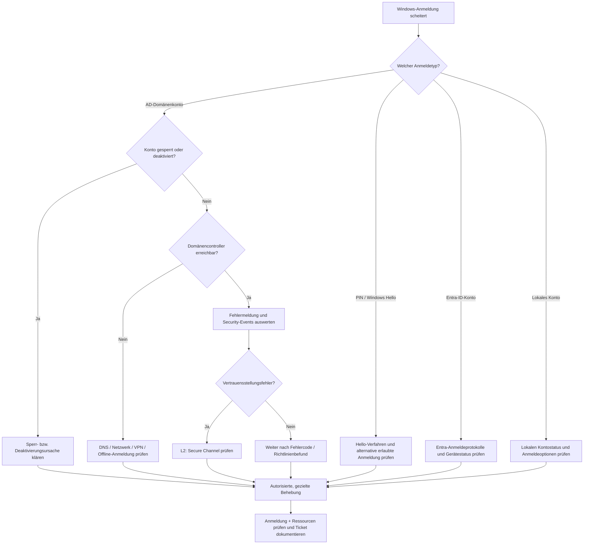

# RB-001 – Windows-Anmeldung fehlgeschlagen

**Projekt:** 50 Tickets · 50 typische Supportfälle · Diagnose · Lösung · Eskalation  
**Kategorie:** Windows 11 / Identitätsmanagement / Netzwerk / Remote-Support  
**Support-Level:** L1 / L2 (abhängig von Berechtigungen und Betriebsmodell)  
**Version:** 1.0 · **Dokumentationsdatum:** 7. November 2026  
**Status:** Fachlich recherchiert; Beispiele konstruiert; **praktische Validierung ausstehend**  
**Beispielumgebung:** Windows 11 Pro, klassische AD-Domäne `firma.example`, Client `PC-023`, Benutzer `m.mustermann`. Namen sind fiktiv.

> **Geltungsbereich:** Der ausführliche Diagnoseweg behandelt primär eine klassische lokale Active-Directory-Domäne. Entra-ID-, Hybrid- und Windows-Hello-Szenarien sind als eigene Abzweigungen dokumentiert. Die Beispielbefehle sind nicht als pauschale Reparaturskripte gedacht.

## 1. Ticket / Ausgangssituation

**INC-001 – Anmeldung am Windows-Arbeitsplatz nicht möglich**

> „Seit heute kann ich mich nicht mehr anmelden. Gestern hat es noch funktioniert. Windows akzeptiert meine Anmeldung nicht.“

**Auswirkung:** Der Mitarbeiter erreicht seinen Arbeitsplatz nicht; geschäftskritische Arbeit kann betroffen sein. Priorität und Dringlichkeit ergeben sich aus tatsächlicher Auswirkung und den betrieblichen Servicevereinbarungen, nicht allein aus dem Stichwort „Login“.

**Diagnoseziel:** Exakte Fehlermeldung, Kontotyp, Reichweite des Problems und erreichbare Verwaltungswege feststellen; danach die technische Ursache eingrenzen, gezielt beheben und den Erfolg prüfen.

## 2. Technische Grundlagen und Begriffserklärungen

| Begriff | Anfängerfreundliche Bedeutung |
|---|---|
| **AD (Active Directory)** | Zentraler Verzeichnisdienst für Benutzer, Gruppen und Computer in Windows-Domänen. |
| **AD DS (Active Directory Domain Services)** | Die klassischen Domänendienste einschließlich der Benutzer- und Computerverwaltung. |
| **DC (Domain Controller)** | Domänencontroller: Server, der unter anderem AD-Daten bereitstellt und Domänenanmeldungen authentifiziert. |
| **Microsoft Entra ID** | Cloudbasierter Identitätsdienst; unter anderem für Microsoft-365-Anmeldungen. Nicht identisch mit AD DS. |
| **Hybrid Join** | Ein Windows-Gerät ist sowohl einer lokalen AD-Domäne als auch Microsoft Entra ID zugeordnet; die klassische Windows-Anmeldung bleibt dabei domänenbasiert. |
| **Kerberos** | Bevorzugtes Authentifizierungsprotokoll einer AD-Domäne. Es arbeitet mit zeitlich begrenzten digitalen Tickets für Dienste. |
| **NTLM (NT LAN Manager)** | Älteres Challenge-Response-Authentifizierungsverfahren; heute vor allem noch aus Kompatibilitätsgründen relevant. |
| **RDP (Remote Desktop Protocol)** | Protokoll für eine eigene grafische Remotedesktop-Sitzung. |
| **WinRM (Windows Remote Management)** | Dienst-/Protokollinfrastruktur für die Windows-Remoteverwaltung, häufig für PowerShell-Remoting. |
| **RSAT (Remote Server Administration Tools)** | Windows-Verwaltungstools, mit denen berechtigte Techniker AD und Server vom Administrations-PC aus verwalten können. |
| **DNS (Domain Name System)** | Wandelt Namen in Netzwerkadressen um und hilft beim Auffinden von Domänendiensten. |
| **VPN (Virtual Private Network)** | Geschützte Verbindung beispielsweise vom Homeoffice in das Firmennetz. |
| **Windows Hello** | Windows-Anmeldung per gerätegebundener PIN, Fingerabdruck oder Gesichtserkennung. **Windows Hello for Business** verwendet in Unternehmenseinsätzen unter anderem kryptografische, gerätegebundene Schlüssel. Eine PIN ist nicht dasselbe wie das Kontokennwort. |

### Visualisierung: Identitätssysteme


**Technischer Hinweis:** Diese Grafiken sind didaktische Vereinfachungen und keine vollständigen Netzwerk- oder Authentifizierungsarchitekturen. Eigene Konzeption, KI-gestützte Visualisierung mit ChatGPT.

**Quellen:** [Microsoft – Entra-Gerätestatus mit dsregcmd](https://learn.microsoft.com/de-de/entra/identity/devices/troubleshoot-device-dsregcmd), [Windows Hello for Business: Funktionsweise](https://learn.microsoft.com/en-us/windows/security/identity-protection/hello-for-business/hello-how-it-works).

## 3. Erste Fehleraufnahme – vor jedem Befehl

**Zunächst den Benutzer befragen:**

1. **Wortlaut:** Welche vollständige Meldung steht am Anmeldebildschirm? Bei Bedarf ein Foto *ohne sichtbare Zugangsdaten* anfordern.
2. **Anmeldetyp:** Kennwort, Windows-Hello-PIN, Biometrie, lokales Konto, AD-Domänenkonto oder Entra-ID-Konto?
3. **Reichweite:** Nur dieser Benutzer, nur dieser Rechner oder mehrere Mitarbeiter? Tritt der Fehler an einem anderen Gerät ebenfalls auf?
4. **Zeitlicher Kontext:** Seit wann? Kennwort geändert? Windows aktualisiert? Gerät getauscht? Im Homeoffice oder Büro?
5. **Netzwerk:** LAN, WLAN, Unternehmens-VPN verfügbar? Kann der Rechner einen Domänencontroller erreichen?
6. **Priorität/Sicherheit:** Ist das Konto absichtlich deaktiviert oder gibt es Anzeichen für verdächtige Anmeldungen?

**Sicherheitsregel:** Niemals das persönliche Kennwort oder die PIN des Benutzers erfragen, im Ticket notieren oder per Fernwartung entgegennehmen. Keine unbegrenzten Anmeldeversuche, die eine Kontosperre auslösen könnten.

### Typische Meldungen / Diagnosezweige

| Meldung (sinngemäß) | Mögliche Erklärung | Primäre Prüfung |
|---|---|---|
| „Benutzername oder Kennwort ist falsch“ | Eingabefehler, falsches Konto, veraltetes Kennwort, Offline-Cache oder andere Authentifizierungsstörung | Benutzerkontext, Zeitpunkt der Kennwortänderung, Kontostatus |
| „Konto ist gesperrt“ | Kontosperrrichtlinie ausgelöst | AD-Kontostatus und Sperrursache |
| „Konto deaktiviert“ | Administrativ gesperrte Benutzeridentität | Freigabe-/Offboardingprozess |
| „Kennwort abgelaufen“ | Kennwortänderung erforderlich | Vorgesehenen Kennwortwechsel prüfen |
| „Domäne nicht verfügbar“ | Domänencontroller nicht erreichbar; keine geeignete Offlineprüfung möglich | Netzwerk, DNS, VPN, Cache-Voraussetzungen |
| „Vertrauensstellung … fehlgeschlagen“ | Gestörter Secure Channel des Computerkontos | L2: Computer-/Domänenbeziehung untersuchen |
| „PIN nicht verfügbar“ | Windows-Hello-/Schlüssel-/Richtlinienproblem | Anmeldeoption und Windows Hello prüfen |

Die Meldungen sind bewusst sinngemäß. Die exakten Texte unterscheiden sich zwischen Windows-Versionen, Spracheinstellungen und Authentifizierungsarten.

## 4. Zugriffsvoraussetzungen – von wo kann ich diagnostizieren?

| Situation | Möglicher Zugriffsweg | Konkrete Diagnose und mögliche Behebung |
|---|---|---|
| Client im Büro, Konto fraglich | **Zentrale AD-Verwaltung** auf autorisiertem Admin-PC | Benutzer über RSAT oder `Get-ADUser` prüfen. Sperre, Deaktivierung und Kennwortstatus untersuchen. Keine Clientanmeldung nötig. |
| Client im Büro erreichbar, tiefere Diagnose nötig | **RDP (Remote Desktop Protocol)** mit eigenem berechtigtem Konto | Clientseitige Logs, DNS und Domänenanbindung überprüfen. Erfordert erlaubten RDP-Zugriff und geeignete Windows-Edition. |
| Client erreichbar, grafische Sitzung nicht erforderlich | **PowerShell-Remoting über WinRM** | Aus der Admin-Sitzung freigegebene Befehle auf `PC-023` ausführen; kein Benutzerdesktop erforderlich. |
| Mitarbeiter bereits angemeldet | **Teams / Schnellhilfe / freigegebene Fernsteuerung** | Bildschirm gemeinsam ansehen, Schritte anleiten oder mit Einwilligung die Steuerung übernehmen; keine automatische Lösung für einen gesperrten Anmeldebildschirm. |
| Homeoffice, kein normales Benutzer-VPN | **Pre-Logon-VPN (VPN vor der Windows-Anmeldung)** oder geeignet verwaltete Fernwartung | Prüfen, ob ein Gerätetunnel oder eine andere Voranmelde-Verbindung konfiguriert ist, damit DC-Konnektivität hergestellt werden kann. |
| Client remote nicht erreichbar | **Serverseitige Prüfung + Vor-Ort-Unterstützung** | Kontostatus zuerst prüfen; vor Ort LAN/WLAN, Anmeldebildschirm, zulässige lokale Administrationszugänge und Systemstatus untersuchen. |
| Viele Benutzer gleichzeitig betroffen | **Infrastrukturdiagnose / Incident-Eskalation** | Gemeinsamen Fehler in DNS, Netzwerk, DC, VPN, Authentifizierungsdiensten oder Richtlinien suchen. |

**Zentrale Verwaltung** bedeutet: Berechtigte Mitarbeiter administrieren Konten oder Geräte über Verwaltungswerkzeuge, ohne auf dem PC des betroffenen Mitarbeiters angemeldet sein zu müssen. Für ein gesperrtes AD-Konto sind typischerweise AD-Benutzerverwaltung oder AD-PowerShell zuständig, nicht die Gruppenrichtlinien-Verwaltung (GPO).

**RDP und Bildschirmfreigabe unterscheiden:** Eine normale RDP-Anmeldung auf einem Windows-11-Pro-/Enterprise-Arbeitsplatz eröffnet keine gemeinsame Präsentation desselben Desktops wie Teams oder Schnellhilfe. Bestehende lokale Sitzungen können gesperrt/getrennt werden; das ist nicht automatisch eine vollständige Benutzerabmeldung. Eingehendes RDP wird von Windows Home nicht als Host unterstützt. Port 3389 nicht direkt im Internet freigeben.

**Quellen:** [RSAT installieren/verwalten](https://learn.microsoft.com/windows-server/remote/remote-server-administration-tools), [Remotedesktop-Voraussetzungen](https://learn.microsoft.com/de-de/windows-server/remote/remote-desktop-services/remotepc/remote-desktop-allow-access), [PowerShell Invoke-Command](https://learn.microsoft.com/en-us/powershell/module/microsoft.powershell.core/invoke-command), [Intune Remote Help](https://learn.microsoft.com/en-us/intune/remote-help/).

## 5. Entscheidungsbaum – welches Problem liegt vor?



**Hinweis zur Website:** Die Mermaid-Grafik ist als technische Quellvorlage gedacht. Bei der Veröffentlichung auf GitHub Pages muss die Unterstützung für Mermaid geprüft oder das Diagramm als eigenes SVG/PNG eingebunden werden.

## 6. Diagnosebefehle – kommentiert, mit Ausführungsort

### 6.1 AD-Konto zentral prüfen (L1/L2 je nach Rechten)

**Wo?** Auf einem autorisierten Administrationsrechner mit dem ActiveDirectory-PowerShell-Modul (RSAT) und Zugriff auf einen Domänencontroller. **Wirkung:** Nur lesen, keine Kontenänderung.

```powershell
# Get-ADUser liest das angegebene Benutzerobjekt aus Active Directory.
# -Identity: Sucht dieses konkrete AD-Konto anhand des Anmeldenamens.
# -Properties: Fordert zusätzliche Kontoeigenschaften an.
$user = Get-ADUser -Identity 'm.mustermann' -Properties Enabled,LockedOut,PasswordExpired,AccountExpirationDate

# Das Pipe-Zeichen | übergibt das Ergebnis an den nächsten Befehl.
# Select-Object beschränkt die Ausgabe auf die ausgewählten Felder.
$user | Select-Object SamAccountName,Enabled,LockedOut,PasswordExpired,AccountExpirationDate
```

**Interpretation:** `LockedOut = True` signalisiert eine Kontosperre; `Enabled = False` ein deaktiviertes Konto; `PasswordExpired = True` ein abgelaufenes Kennwort. Allein daraus geht die Sperrursache nicht hervor. Bei mehreren DCs kann zur Ursachenanalyse die Prüfung des relevanten Controllers nötig sein.

**Quelle:** [Get-ADUser](https://learn.microsoft.com/de-de/powershell/module/activedirectory/get-aduser).

### 6.2 Prüfen, ob RDP überhaupt erreichbar ist (optionaler Diagnoseweg)

**Wo?** Eigener Administrationsrechner. **Wirkung:** Nur TCP-Verbindung prüfen, keine Anmeldung.

```powershell
# Test-NetConnection untersucht die Verbindung zu einem Zielcomputer.
# -ComputerName: Name des entfernten Windows-PCs.
# -Port: TCP-Zielport, hier 3389 für RDP.
Test-NetConnection -ComputerName 'PC-023' -Port 3389
```

**Interpretation:** `TcpTestSucceeded : True` bestätigt die TCP-Erreichbarkeit des Ports, **nicht** die erfolgreiche Benutzeranmeldung. `False` kann etwa durch Firewall, Netzwerk-/Routingfehler, fehlendes VPN oder einen ausgeschalteten RDP-Dienst entstehen.

### 6.3 Grafischen RDP-Client starten (optional)

**Wo?** Eigener Administrationsrechner. **Voraussetzungen:** RDP ist ausdrücklich freigegeben und für den Einsatzzweck geeignet.

```powershell
# mstsc.exe: Startet den normalen Windows-Remotedesktopclient.
# /v:PC-023: Gibt den Zielcomputer an; kein Leerzeichen nach /v:.
# /prompt: Fordert beim Verbinden die Anmeldung an.
# Zwischen Programmname und Parametern steht je ein Leerzeichen.
mstsc.exe /v:PC-023 /prompt
```

**Was geschieht?** Der grafische Remotedesktopclient öffnet eine Verbindung zum Zielgerät. Man verwendet **eigene, erlaubte** administrative Anmeldeinformationen. Der betroffene Benutzer muss nicht zuvor angemeldet sein. Eine normale RDP-Sitzung ist keine gemeinsame Bildschirmfreigabe.

**Quelle:** [mstsc](https://learn.microsoft.com/en-us/windows-server/administration/windows-commands/mstsc).

### 6.4 Netzwerkstatus am Client prüfen

**Wo?** Auf dem betroffenen Client – lokal, per erlaubtem RDP oder über Remoteverwaltung. Ohne entsprechenden Zugang kann dieser Schritt nicht einfach ausgeführt werden.

```powershell
# PowerShell-Cmdlet: Zeigt Adapter-IP-Konfiguration, Gateway und DNS an.
Get-NetIPConfiguration

# Windows-Kommandozeilenprogramm: Zeigt ausführliche Adapterdaten an.
# /all: Gibt auch zusätzliche Konfigurationsdetails aus.
ipconfig /all

# Windows-Kommandozeilenprogramm: Sucht einen Domänencontroller.
# /dsgetdc: nennt die zu untersuchende AD-Domäne.
nltest /dsgetdc:firma.example
```

**Interpretation:** Ist kein DC auffindbar, folgen DNS-, Netzwerk- und VPN-Tests. Auch eine erfolgreiche DC-Suche beweist noch nicht, dass die Benutzeranmeldung erfolgreich sein wird. Bei `ipconfig /all` auf falsche DNS-Server, fehlende Adressen oder fehlerhafte Gateway-Einstellungen achten.

**Quellen:** [DC-Ermittlung mit nltest](https://learn.microsoft.com/de-de/troubleshoot/windows-server/active-directory/domain-join-networking-errors).

### 6.5 Mit PowerShell-Remoting prüfen (alternativer Zugriff)

**Wo?** Eigener Administrationsrechner. **Voraussetzungen:** WinRM-Zugang, Berechtigungen, Remoteauthentifizierung und Firewall sind korrekt konfiguriert.

```powershell
# Invoke-Command führt Code auf einem entfernten Rechner aus.
# -ComputerName bestimmt den Zielcomputer.
# -ScriptBlock enthält die dort ausgeführten Anweisungen.
Invoke-Command -ComputerName 'PC-023' -ScriptBlock {

    # Zeigt die Netzwerkkonfiguration des Zielcomputers an.
    Get-NetIPConfiguration

    # Gibt den Status aller lokalen Netzwerkadapter aus.
    Get-NetAdapter | Select-Object Name,Status,LinkSpeed
}
```

**Interpretation:** Die Ergebnisse kommen von `PC-023`, obwohl der Befehl am Administrations-PC gestartet wurde. Ein Benutzer muss nicht interaktiv am Ziel-PC angemeldet sein. Ein WinRM-Fehler sagt allerdings für sich allein noch nichts über das ursprüngliche Windows-Anmeldeproblem aus.

**Quelle:** [Invoke-Command](https://learn.microsoft.com/en-us/powershell/module/microsoft.powershell.core/invoke-command).

### 6.6 Fehlgeschlagene Windows-Anmeldungen im Security-Log prüfen

**Wo?** Auf dem betroffenen Windows-Rechner beziehungsweise dem System, auf dem die Anmeldung ausgewertet wird. Erforderlich sind ausreichende Log-Leserechte und die passende Überwachungsrichtlinie.

```powershell
# Definiert einen Suchfilter als PowerShell-Hashtable.
$filter = @{
    # Windows-Sicherheitsprotokoll auswählen.
    LogName = 'Security'
    # Ereignis-ID 4625: fehlgeschlagene Anmeldung.
    Id = 4625
    # Ereignisse der letzten zwei Stunden berücksichtigen.
    StartTime = (Get-Date).AddHours(-2)
}

# Liest höchstens zehn passende, jüngste Ereignisse aus.
# Select-Object zeigt Datum, Ereignis-ID und Detailmeldung.
Get-WinEvent -FilterHashtable $filter -MaxEvents 10 |
    Select-Object TimeCreated,Id,Message
```

**Interpretation:** Ein `4625`-Ereignis kann `Status` und `SubStatus` sowie die Authentifizierungsart enthalten. Typische Werte sind `0xC000006A` (ungültiges Kennwort), `0xC0000234` (Konto gesperrt) oder `0xC000005E` (kein Anmeldeserver verfügbar). Nicht jedes Ereignis erscheint zwingend auf demselben Computer. Bei einer Domänenanmeldung können zusätzliche DC-Logs nötig sein.

**Quelle:** [Windows-Ereignis 4625](https://learn.microsoft.com/windows/security/threat-protection/auditing/event-4625), [Get-WinEvent](https://learn.microsoft.com/en-us/powershell/module/microsoft.powershell.diagnostics/get-winevent).

### 6.7 Kontosperren auf dem zuständigen DC untersuchen (L2/autorisiert)

**Wo?** Berechtigter Administrationsrechner. **Voraussetzung:** Remote-Lesezugriff auf das Sicherheitsprotokoll eines relevanten Domänencontrollers; Netzwerkkonnektivität und Ereignisüberwachung müssen dies unterstützen.

```powershell
# Sucht Sperrereignisse der letzten zwei Stunden auf DC01.
# -ComputerName bestimmt den ausgelesenen Domänencontroller.
# -FilterHashtable begrenzt die Ereignisse auf ID 4740.
Get-WinEvent -ComputerName 'DC01.firma.example' -FilterHashtable @{
    LogName   = 'Security'  # Sicherheitsereignisse.
    Id        = 4740        # Konto wurde gesperrt.
    StartTime = (Get-Date).AddHours(-2)  # Zeitfenster.
} -MaxEvents 10 |
    Select-Object TimeCreated,Id,Message
```

**Interpretation:** Ereignis `4740` kann Hinweise auf das Konto und den auslösenden Rechner enthalten. In Umgebungen mit mehreren Domänencontrollern muss gegebenenfalls auf weiteren DCs gesucht werden. Die Recherche von Quellgerät, alten Anmeldeinformationen oder automatisierten Aufgaben erfolgt **vor** einer dauerhaften Behebung.

**Quelle:** [Windows-Ereignis 4740](https://learn.microsoft.com/en-us/windows/security/threat-protection/auditing/event-4740).

### 6.8 Entra-ID-/Hybrid-Gerätestatus prüfen (nur passender Diagnosezweig)

**Wo?** Betroffener Rechner bei verfügbarem berechtigtem Zugriff. Benutzerbezogene Informationen erfordern den korrekten Benutzerkontext.

```powershell
# Windows-Hilfsprogramm zur Diagnose des Gerätebeitrittsstatus.
# /status zeigt unter anderem DomainJoined und AzureAdJoined an.
dsregcmd /status
```

**Interpretation:** `DomainJoined : YES` weist auf eine lokale AD-Domänenmitgliedschaft hin; `AzureAdJoined : YES` auf einen Entra-ID-Beitritt. Sind beide Werte `YES`, liegt in der Regel eine hybride Einbindung vor. Das Ergebnis allein identifiziert nicht den gesamten Anmeldefehler.

**Quelle:** [dsregcmd-Gerätediagnose](https://learn.microsoft.com/de-de/entra/identity/devices/troubleshoot-device-dsregcmd).

### 6.9 Secure Channel prüfen, falls ein Vertrauensstellungsfehler vorliegt (L2)

**Wo?** Betroffener domänengebundener Windows-Client mit geeigneten Rechten. **Wirkung:** Nur Prüfung; hier bewusst **keine Reparatur**.

```powershell
# Testet die sichere Vertrauensbeziehung zur AD-Domäne.
# -Verbose liefert zusätzliche Diagnoseinformationen.
Test-ComputerSecureChannel -Verbose
```

**Interpretation:** Ein negativer Test kann den Verdacht auf eine gestörte Vertrauensbeziehung stützen. Reparaturoperationen und Neuaufnahme in die Domäne erfordern eine separate, dokumentierte L2-Entscheidung; sie sind keine automatische Erstmaßnahme.

**Quelle:** [Microsoft – Broken Trust Relationship](https://learn.microsoft.com/de-de/troubleshoot/windows-server/windows-security/broken-trust-relationship-domain-joined-device-its-domain-secure-channel-issues).

## 7. Lösungswege – abhängig vom Befund

| Befund | Sichere Vorgehensweise | Erfolgskriterium |
|---|---|---|
| Falsches Konto oder Eingabefehler | Benutzer-/Domänenauswahl, Tastaturlayout und Anmeldeoptionen prüfen; keine Kennwortweitergabe verlangen | Vorgesehene Anmeldung funktioniert |
| AD-Konto gesperrt | Ursache (`4740`, `4625`, weitere Authentifizierungsquellen) eingrenzen; alte Anmeldedaten am auslösenden Gerät korrigieren; Konto **nur nach Freigabe** entsperren | Keine wiederkehrende Sperre, Anmeldung erfolgreich |
| Konto deaktiviert | Deaktivierungs-/Sicherheitsgrund und Freigabe klären; nicht eigenmächtig reaktivieren | Freigegebener Kontostatus, erfolgreiche Anmeldung |
| Kennwort abgelaufen | Vorgesehenen Kennwortwechsel oder autorisierte Zurücksetzung durchführen | Neues Kennwort wird akzeptiert |
| DC nicht erreichbar | Netzwerk/DNS/VPN/Routing prüfen; bei Homeoffice gegebenenfalls Voranmelde-VPN verwenden | Online-Authentifizierung und benötigte Ressourcen möglich |
| Offline-Cache veraltet | Prüfen, wo/wann Kennwort geändert wurde; zulässige Offline-Anmeldung und anschließende Online-Authentifizierung untersuchen | Aktuelle Anmeldeinformationen funktionieren nach Online-Verbindung |
| Windows-Hello-PIN gestört | Vorgesehene alternative Anmeldeoption prüfen; PIN-/Schlüsselzurücksetzung nur nach Richtlinie | Hello-Anmeldung funktioniert wieder |
| Vertrauensstellungsfehler | L2 diagnostiziert Secure Channel, Computerkonto und DC-Konnektivität; autorisierte Reparatur | Trust-Test, Domänenanmeldung und Ressourcen erfolgreich |
| Mehrere Geräte/Benutzer betroffen | Größere Störung vermuten, Monitoring und Infrastrukturteam einbeziehen | Ursache zentral behoben, betroffene Nutzer wieder arbeitsfähig |

**Wichtige Nicht-Maßnahmen:** Nicht blind Domänenmitgliedschaft entfernen, Registry ändern, alle Netzwerkadapter zurücksetzen oder Schutzmechanismen deaktivieren. Solche Eingriffe können die Diagnose erschweren oder zusätzliche Schäden verursachen.

## 8. Spezialfall Homeoffice: Das „Henne-Ei-Problem“ bei VPN


Bei einem **benutzerbasierten VPN** wird die Unternehmensverbindung möglicherweise erst nach erfolgreicher Windows-Anmeldung aufgebaut. Die Anmeldung kann aber eine **Online-Verbindung zum Domänencontroller** benötigen – etwa wenn die aktuellen Domänen-Anmeldedaten noch nicht auf dem Laptop zwischengespeichert sind.

**Pre-Logon-VPN** (VPN vor der Anmeldung), etwa ein eingerichteter gerätebasierter Tunnel, kann diese Abhängigkeit auflösen. Solche Funktionen sind jedoch nicht mit jedem VPN-Client oder jeder Firmenkonfiguration verfügbar.

**Beispiel:** Der Mitarbeiter hat das AD-Kennwort auf **einem anderen Gerät** geändert. Auf dem Homeoffice-Laptop kann bei fehlender DC-Verbindung ein zuvor gespeicherter Prüfwert noch zum **alten** Kennwort passen. Der Laptop kann damit offline unter bestimmten Voraussetzungen den Desktop öffnen – dies bedeutet nicht, dass das alte Kennwort noch gültig für Unternehmensdienste ist. Bei einer erfolgreichen Online-Anmeldung mit dem neuen Kennwort können die lokalen Prüfdaten aktualisiert werden.

**Quellen:** [Microsoft – Cached Domain Logon Information](https://learn.microsoft.com/en-us/troubleshoot/windows-server/user-profiles-and-logon/cached-domain-logon-information), [Microsoft – Cached User Logon Troubleshooting](https://learn.microsoft.com/en-us/troubleshoot/windows-client/user-profiles-and-logon/cached-user-logon-fails-lsasrv-event-45058), [Microsoft – Always On VPN-Gerätetunnel](https://learn.microsoft.com/de-de/windows-server/remote/remote-access/vpn/vpn-device-tunnel-config).

*Eigene Konzeption, KI-gestützte Visualisierung mit ChatGPT.*

## 9. Erfolgskontrolle

Das Ticket gilt nur als fachlich gelöst, wenn die für den Fall zutreffenden Prüfungen erfolgreich sind:

- [ ] Anmeldung mit der **vorgesehenen** Methode möglich (Passwort, Hello oder andere freigegebene Methode).
- [ ] Betroffener Rechner und Benutzerkonto sind wieder regulär nutzbar.
- [ ] Erforderliche Unternehmensressourcen funktionieren (z. B. Netzlaufwerk, Teams, Geschäftsanwendung).
- [ ] Bei vorheriger Kontosperre keine erneute Sperre im vereinbarten Beobachtungsfenster.
- [ ] Ursache, durchgeführte Schritte, Änderungen und Prüfergebnisse im Ticket dokumentiert.

## 10. Wann eskalieren?

**Typische L2-Eskalation:** Sicherer Kanal/Computervertrauen beschädigt; DC-/DNS-/Routingfehler; wiederholte Kontosperren ungeklärter Herkunft; Entra-ID-/Hybrid-Join-Fehler; defekte Windows-Hello-Schlüssel/Compliance-Richtlinien; mehrere gleichzeitig betroffene Mitarbeiter; fehlende administrative Freigaben.

**Mitgeben:** Zeit, exakte Meldung, Benutzer-ID (keine Passwörter), Computername, Standort, Netzwerkstatus, betroffener Identitätsdienst, Kontostatus, relevante Event-IDs samt Zeitstempeln und bislang durchgeführte Maßnahmen.

## 11. Muster-Ticketkommentar (fiktiv)

**INC-001 – Windows-Anmeldung nach Kennwortänderung fehlgeschlagen**  
**Fehlerbild:** Domänen-Laptop im Homeoffice akzeptierte das aktuelle Kennwort bei fehlender Verbindung zum Unternehmensnetz nicht.  
**Diagnose:** AD-Konto aktiv und nicht gesperrt. Kennwortänderung erfolgte auf anderem Gerät; Laptop hatte seitdem keine Online-Authentifizierung mit dem neuen Kennwort durchgeführt.  
**Ursache:** Lokaler Cache beruhte noch auf zuvor verwendeten Anmeldeinformationen.  
**Maßnahme:** Nach Prüfung des zulässigen Verfahrens Offline-Anmeldung durchgeführt; anschließend freigegebene Unternehmensverbindung hergestellt und Online-Authentifizierung mit aktuellem Kennwort geprüft.  
**Erfolgskontrolle:** Aktuelle Anmeldung und Zugriff auf erforderliche Unternehmensressourcen erfolgreich.  
**Status:** Gelöst.  

*Das ist ein konstruiertes Lernbeispiel, **kein** tatsächlich bearbeitetes Kundenticket.*

## 12. Lernkontrolle: Drei Kartentypen

**Wissenskarte:** Was zeigt `Get-ADUser -Properties LockedOut` an? → Den AD-Kontostatus bezüglich einer Sperre.  
**Verständniskarte:** Warum kann ein vorheriges Domänenkennwort offline noch funktionieren? → Weil der Laptop gegebenenfalls noch einen lokalen Prüfwert für die frühere erfolgreiche Anmeldung nutzt.  
**Diagnosekarte:** Neues Passwort schlägt nur auf dem Homeoffice-Laptop ohne VPN fehl; Konto ist aktiv. Erste Hypothese? → Veraltete Offline-Anmeldedaten beziehungsweise fehlende Online-Verbindung zur Domäne; zunächst Netzwerk-/Anmeldekontext prüfen.

### Kurze selbstständige Übung

**Fallvariation:** Zwei Benutzer an unterschiedlichen PCs im selben Büro erhalten gleichzeitig eine Meldung, dass keine Domäne verfügbar ist. Beide Konten sind aktiv und nicht gesperrt.

*Aufgabe:* Formuliere zwei plausible gemeinsame Ursachen und nenne für jede einen geeigneten, möglichst wenig eingreifenden Test. Anschließend kurz erklären, wann du den Fall als L1 eskalierst.

## 13. Visualisierungen und Screenshots

- **Grafik A:** Identitätsinfrastruktur – Übersicht (eigene KI-gestützte Illustration).
- **Grafik B:** Identitätsinfrastruktur – Detail mit Kerberos und NTLM (eigene KI-gestützte Illustration).
- **Grafik C:** Henne-Ei-Problem bei Pre-Logon-VPN (eigene KI-gestützte Illustration).
- **Entscheidungsbaum:** Mermaid-Quellgrafik; vor Website-Veröffentlichung technisch darstellen bzw. als SVG exportieren.
- **Terminal-/Event-Log-Screenshots:** Noch nicht vorhanden. Beispielausgaben sind als solche gekennzeichnet; echte Screenshots werden nur aus eigenen Tests hinzugefügt.

## 14. Technische Referenzen und Quellen

1. [Microsoft Learn – Get-ADUser](https://learn.microsoft.com/de-de/powershell/module/activedirectory/get-aduser) – AD-Kontostatus auslesen.
2. [Microsoft Learn – RSAT installieren und verwalten](https://learn.microsoft.com/windows-server/remote/remote-server-administration-tools) – zentrale Verwaltung vom Administrations-PC.
3. [Microsoft Learn – mstsc](https://learn.microsoft.com/en-us/windows-server/administration/windows-commands/mstsc) – Remotedesktop-Syntax und `/prompt`.
4. [Microsoft Learn – Remotedesktop-Voraussetzungen](https://learn.microsoft.com/de-de/windows-server/remote/remote-desktop-services/remotepc/remote-desktop-allow-access) – Editionen, Netzwerk und Berechtigungen.
5. [Microsoft Learn – Invoke-Command](https://learn.microsoft.com/en-us/powershell/module/microsoft.powershell.core/invoke-command) – PowerShell-Remoting.
6. [Microsoft Learn – Get-WinEvent](https://learn.microsoft.com/en-us/powershell/module/microsoft.powershell.diagnostics/get-winevent) – Security-Logs filtern.
7. [Microsoft Learn – Security Event 4625](https://learn.microsoft.com/windows/security/threat-protection/auditing/event-4625) – gescheiterte Anmeldung und Statuscodes.
8. [Microsoft Learn – Security Event 4740](https://learn.microsoft.com/en-us/windows/security/threat-protection/auditing/event-4740) – Kontosperrereignis.
9. [Microsoft Learn – DC-Erreichbarkeit/DNS](https://learn.microsoft.com/de-de/troubleshoot/windows-server/active-directory/domain-join-networking-errors) – Domänencontroller-Ermittlung und DNS.
10. [Microsoft Learn – Cached Domain Logon Information](https://learn.microsoft.com/en-us/troubleshoot/windows-server/user-profiles-and-logon/cached-domain-logon-information) – zwischengespeicherte Domänenanmeldung.
11. [Microsoft Learn – Cached User Logon Troubleshooting](https://learn.microsoft.com/en-us/troubleshoot/windows-client/user-profiles-and-logon/cached-user-logon-fails-lsasrv-event-45058) – Cache-Grenzen und Aktualisierung.
12. [Microsoft Learn – dsregcmd-Diagnose](https://learn.microsoft.com/de-de/entra/identity/devices/troubleshoot-device-dsregcmd) – Entra-ID-/Hybrid-Gerätestatus.
13. [Microsoft Learn – Windows Hello for Business](https://learn.microsoft.com/en-us/windows/security/identity-protection/hello-for-business/hello-how-it-works) – PIN, Biometrie und kryptografische Schlüssel.
14. [Microsoft Learn – Broken Trust Relationship](https://learn.microsoft.com/de-de/troubleshoot/windows-server/windows-security/broken-trust-relationship-domain-joined-device-its-domain-secure-channel-issues) – Secure Channel.
15. [Microsoft Learn – Always On VPN-Gerätetunnel](https://learn.microsoft.com/de-de/windows-server/remote/remote-access/vpn/vpn-device-tunnel-config) – Voranmelde-Verbindung.
16. [Microsoft Learn – Intune Remote Help](https://learn.microsoft.com/en-us/intune/remote-help/) – verwaltete Fernunterstützung.

**Quellenprüfung:** 7. November 2026. Die Quellen dokumentieren Verfahren, aber **nicht**, dass die fiktiven Fälle bereits im eigenen Labor erfolgreich durchgeführt wurden.

## 15. Validierungsstatus und offene Punkte

| Bereich | Status | Was fehlt? |
|---|---|---|
| Recherche / Microsoft-Dokumentation | Erledigt | Spätere Aktualisierungen regelmäßig prüfen |
| Strukturierter Diagnoseablauf | Theoretisch ausgearbeitet | Tests an geeigneten Umgebungen |
| AD-Kontoabfragen | Nicht praktisch getestet | Eigene Testausgaben protokollieren |
| Remotezugriff (RDP/WinRM) | Nicht praktisch getestet | Zugriffsweg mit eigenen Geräten prüfen |
| Security-Event-Analyse | Nicht praktisch getestet | 4625/4740 anhand eigener Logs nachvollziehen |
| Offline-Anmeldung / VPN | Nicht praktisch getestet | Nur in kontrollierter, zulässiger Testumgebung prüfen |
| Screenshots | Offen | Eigene anonymisierte Aufnahmen ergänzen |
| Lernkontrolle | Vorbereitet | Aufgaben ohne Lösungshilfe bearbeiten |

**Grundsatz:** Fachlich recherchierte Verfahren, hypothetische Beispielbefunde und praktisch nachgewiesene Arbeitsschritte bleiben ausdrücklich getrennt.
