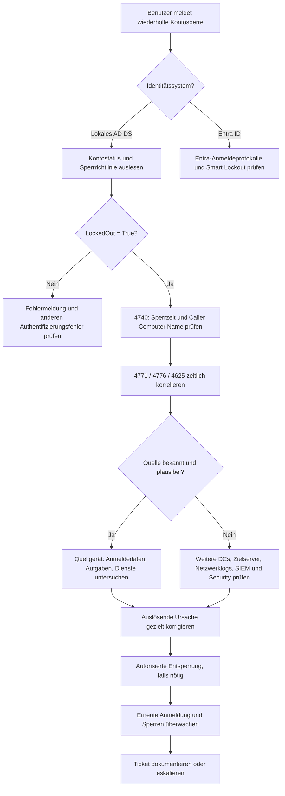

# RB-002 – Benutzerkonto gesperrt: Ursache finden statt nur entsperren

**Projekt:** 50 Tickets · 50 typische Supportfälle · Diagnose · Lösung · Eskalation  
**Kategorie:** Identitätsmanagement / Windows / Active Directory / Security  
**Support-Level:** L1 / L2 (abhängig von Befugnissen und Betriebsmodell)  
**Version:** 1.0 · **Dokumentationsdatum:** 7. November 2026  
**Status:** Fachlich recherchiert · **praktische Validierung ausstehend**  
**Beispielumgebung:** Windows 11 Pro, AD-Domäne `firma.example`, Domänencontroller `DC01.firma.example`, Arbeitsplatz `PC-023`, Benutzer `m.mustermann`. **Sämtliche Personen, Systeme, Ausgaben und Tickets sind fiktiv.**

> **Geltungsbereich:** Das Haupt-Runbook beschreibt die Sperre eines Benutzerkontos in einer **klassischen lokalen Active-Directory-Domäne (AD DS)**. Die cloudbasierte Sperre durch **Microsoft Entra Smart Lockout** ist ein separater Diagnosezweig. Alle gezeigten Abfragen dienen der Demonstration. Änderungen sind nur nach Prüfung der Berechtigungen und Unternehmensvorgaben zulässig.


*Eigene Konzeption, KI-gestützte Visualisierung mit ChatGPT. Didaktische Darstellung, kein Screenshot eines tatsächlich untersuchten Vorfalls.*

---

## 1. Ticket und Ausgangssituation

**INC-002 – Domänenkonto wird wiederholt gesperrt**

> „Mein Benutzerkonto ist seit heute Morgen immer wieder gesperrt. Ein Kollege vom IT-Support hat es schon entsperrt. Eine halbe Stunde später konnte ich mich wieder nicht anmelden.“

**Auswirkung:** Der Mitarbeiter kann nicht zuverlässig auf Windows und Unternehmensressourcen zugreifen. Wiederholte Sperren können auf ein fehlerhaft konfiguriertes Gerät, gespeicherte alte Zugangsdaten oder einen Sicherheitsvorfall hinweisen.

**Diagnoseziel:** Feststellen, **ob** eine Kontosperre vorliegt, **wann** und **von welchem System** die auslösenden Anmeldeversuche kamen, **warum** sie wiederholt auftreten und **wie** sich die Ursache sicher beheben lässt.

**Grundsatz:** Das reine Entsperren stellt häufig nur vorübergehend die Arbeitsfähigkeit her. Ein dauerhaftes Ergebnis erfordert die Untersuchung der auslösenden Anmeldeversuche.

## 2. Technische Grundlagen und Abkürzungen

| Begriff | Einfach erklärt |
|---|---|
| **AD (Active Directory)** | Zentraler Verzeichnisdienst für Benutzer, Computer und Gruppen innerhalb einer klassischen Windows-Unternehmensdomäne. |
| **AD DS (Active Directory Domain Services)** | Microsofts Domänendienste: Verzeichnisdaten, Domänenanmeldung und weitere Infrastrukturaufgaben. |
| **DC (Domain Controller)** | Domänencontroller: Server, der Konten und Anmeldeinformationen für die Domäne bereitstellt bzw. prüft. |
| **PDC-Emulator (Primary Domain Controller Emulator)** | Besondere **FSMO-Rolle** in AD; spielt unter anderem bei Kennwortänderungen und Sperren eine Rolle. Nicht der einzige DC, der relevante Ereignisse haben kann. |
| **FSMO (Flexible Single Master Operations)** | Spezielle AD-Rollen, für die bestimmte Operationen jeweils einem zuständigen Domänencontroller zugewiesen werden. |
| **Kerberos** | Bevorzugtes Authentifizierungsprotokoll in AD-Umgebungen. Es arbeitet mit digitalen Tickets; ein fehlgeschlagener früher Authentifizierungsschritt kann Ereignis 4771 erzeugen. |
| **NTLM (NT LAN Manager)** | Älteres, kennwortbasiertes Challenge-Response-Authentifizierungsverfahren. Seine Prüfungen können im Ereignis 4776 erscheinen. |
| **RSAT (Remote Server Administration Tools)** | Microsoft-Werkzeuge, um beispielsweise AD vom eigenen Administrations-PC aus zu verwalten. |
| **GPO (Group Policy Object)** | Gruppenrichtlinienobjekt; kann unter anderem sicherheitsbezogene Konfigurationen vorgeben. Nicht das Standardwerkzeug zum Entsperren eines Einzelkontos. |
| **PSO (Password Settings Object)** | AD-Objekt für eine *Fine-Grained Password Policy*, also eine fein abgestufte Kennwort- und Sperrrichtlinie für bestimmte Benutzer oder Gruppen. |
| **Security Event** | Eintrag im Windows-Sicherheitsprotokoll, sofern die entsprechende Überwachung aktiviert ist. |
| **Credential Manager** | Windows-Anmeldeinformationsverwaltung; kann für bestimmte Verbindungen hinterlegte Zugangsdaten enthalten. |
| **SIEM (Security Information and Event Management)** | System zur zentralen Sammlung, Auswertung und Korrelation sicherheitsrelevanter Ereignisse. |

### 2.1 Wie kommt es zu einer Kontosperre?

Vereinfacht sieht der Ablauf so aus:

1. Ein Benutzer, eine Anwendung oder ein Dienst versucht, sich bei einer AD-Ressource anzumelden.
2. Die Authentifizierung schlägt beispielsweise wegen eines alten Kennworts fehl.
3. Die zuständigen Domänendienste berücksichtigen den Fehlschlag nach den geltenden Sperrregeln.
4. Wird der Sperrschwellenwert erreicht, wird das Konto vorübergehend gesperrt.
5. Weitere Anmeldeversuche können während der Sperre abgewiesen werden.
6. Nach Ablauf der Richtlinienfrist oder einer **autorisierten** Entsperrung kann eine erfolgreiche Anmeldung wieder möglich sein. Läuft die fehlerhafte Anwendung weiter, droht eine erneute Sperre.

**Die drei wichtigsten Richtlinienwerte:**

| Eigenschaft | Bedeutung |
|---|---|
| `LockoutThreshold` | Anzahl fehlgeschlagener Anmeldeversuche, bei deren Erreichen das Konto gesperrt wird. |
| `LockoutObservationWindow` | Zeitraum für die Rücksetzung des Zählers fehlgeschlagener Versuche. |
| `LockoutDuration` | Zeitdauer einer Sperre; je nach Einstellung ist eine administrative Entsperrung erforderlich. |

**Reines Rechenbeispiel – keine empfohlene Unternehmensrichtlinie:** Eine beispielhaft konfigurierte Richtlinie könnte nach fünf fehlerhaften Versuchen innerhalb eines Beobachtungsfensters von 15 Minuten für 15 Minuten sperren. Die tatsächliche Richtlinie muss stets aus der jeweiligen Domäne ausgelesen werden; für einzelne Benutzer kann zusätzlich eine fein abgestufte PSO-Richtlinie gelten.

**Quelle:** [Microsoft Learn – Get-ADDefaultDomainPasswordPolicy](https://learn.microsoft.com/en-us/powershell/module/activedirectory/get-addefaultdomainpasswordpolicy), [Get-ADUserResultantPasswordPolicy](https://learn.microsoft.com/en-us/powershell/module/activedirectory/get-aduserresultantpasswordpolicy).

### 2.2 Warum kann ein Konto ohne sichtbare Anmeldung gesperrt werden?

Nicht nur das Eingeben eines Kennworts am Windows-Anmeldebildschirm zählt. Auch Prozesse im Hintergrund können mit gespeicherten Zugangsdaten wiederholt eine Netzwerkanmeldung versuchen:

- Ein anderes Notebook oder Smartphone verwendet noch ein altes Kennwort.
- Eine Anwendung versucht, sich mit gespeicherten Zugangsdaten an einem Fileserver anzumelden.
- Ein Windows-Dienst oder eine geplante Aufgabe verwendet ein inzwischen geändertes Kontokennwort.
- Ein VPN-Client (Virtual Private Network) oder eine Remotedesktopverbindung verwendet veraltete Anmeldeinformationen.
- Ein unbefugter Dritter versucht, das Konto durch automatisierte Anmeldeversuche zu verwenden.

**Wichtig:** Ein Benutzerkonto kann deswegen gesperrt werden, obwohl sein Besitzer am aktuellen PC überhaupt kein falsches Kennwort eingegeben hat.

---

## 3. Erste Fehleraufnahme – bevor Befehle ausgeführt werden

| Frage | Diagnosezweck |
|---|---|
| **Was lautet die exakte Fehlermeldung?** | „Konto gesperrt“ von anderen Anmeldestörungen unterscheiden. |
| **Seit wann und wie oft tritt es auf?** | Wiederkehrende Versuche oder eine einmalige Fehleingabe erkennen. |
| **Wurde das Kennwort kürzlich geändert?** | Typischer Hinweis auf veraltete gespeicherte Anmeldeinformationen. |
| **Welche Geräte nutzt der Mitarbeiter?** | Notebook, Zweitrechner, Smartphone, Homeoffice-Client, Terminalserver. |
| **Betrifft es nur ein Konto oder mehrere?** | Einzelproblem von Infrastruktur- oder Sicherheitsereignis abgrenzen. |
| **Gibt es unbekannte Login-Hinweise?** | Möglichen Angriff frühzeitig erkennen und Security-Team einschalten. |

**Sicherheitsregeln:** Nie das persönliche Kennwort oder die PIN erfragen; keine unkontrollierten Testanmeldungen erzeugen; ohne Freigabe keine Sicherheitsrichtlinie lockern und keine Protokolle löschen. Bei verdächtigen Quellen zuerst die betrieblichen Security-/Incident-Prozesse beachten.

## 4. Zugriffswege, Voraussetzungen und konkrete Schritte

| Situation | Zugriff | Konkretes Vorgehen |
|---|---|---|
| Mitarbeiter sitzt im Büro, Windows-Anmeldung scheitert | **Zentrale AD-Verwaltung** via RSAT oder AD-PowerShell | Kontostatus vom eigenen Administrationsrechner prüfen – es ist **keine** Anmeldung auf dem Benutzer-PC erforderlich. |
| Konto wird immer wieder gesperrt | **Domänencontroller-Sicherheitsprotokoll** bzw. SIEM | Ereignis 4740 zur Sperrzeit und zum möglichen Quellrechner suchen; 4771/4776/4625 zur Korrelation prüfen. |
| Verdächtiger Quellrechner ist erreichbar | **Verwaltete Fernwartung, PowerShell-Remoting oder Vor-Ort-Diagnose** | Auf dem Quellgerät relevante Dienste, gespeicherte Verbindungen und geplante Aufgaben untersuchen. |
| Quellrechner im Homeoffice, kein geeigneter Remotezugriff | **Telefonische Anleitung + zentrale Prüfung** | Genutzte Zweitgeräte erfragen; zentrale Protokolle sichern; Freigaben für Vor-Ort- oder andere Diagnosen klären. |
| Mehrere Konten werden gleichzeitig gesperrt | **Security-/Infrastruktur-Eskalation** | Gemeinsamkeiten, betroffene Ziele, Quell-IP-Adressen und mögliche Angriffe untersuchen. |
| Cloud-Konto / Microsoft 365 betroffen | **Microsoft Entra Admin Center** | Entra-Anmeldeprotokolle und Smart-Lockout-Vorgänge untersuchen; nicht mit einer AD-DS-Sperre gleichsetzen. |

**Begriff „zentrale Verwaltung“:** Man prüft ein AD-Benutzerkonto über eine Verwaltungsanwendung oder PowerShell **vom eigenen berechtigten PC aus**, ohne sich als Mitarbeiter an dessen Arbeitsplatz anzumelden. Auf dem Administrationsrechner muss das RSAT-/ActiveDirectory-Modul vorhanden sein; die Sicherheitsrechte müssen ausreichen.

**Zugriff auf Domänencontroller-Protokolle:** Leseberechtigung und erreichbarer Ereignisprotokolldienst sind erforderlich. Eine direkte interaktive Anmeldung auf einem DC ist für die übliche Kontostatusabfrage nicht notwendig.

---

## 5. Diagnose-Entscheidungsbaum



**Hinweis für GitHub Pages:** Mermaid wird nicht durch jedes Website-Theme automatisch gerendert. Falls Mermaid-Unterstützung fehlt, später als SVG/PNG exportieren. Die Textschritte des Runbooks bleiben auch ohne Diagramm nutzbar.

## 6. Diagnose: Kontostatus zentral feststellen

### 6.1 Benutzerkonto abfragen – nur lesend

**Ausführungsort:** Berechtigter Administrationsrechner mit ActiveDirectory-Modul und Netzverbindung zu AD DS.  
**Voraussetzung:** Passende Lese-/Administrationsrechte.  
**Wirkung:** Keine Änderung des Kontos.

```powershell
# Lädt das ActiveDirectory-Modul in die PowerShell-Sitzung.
Import-Module ActiveDirectory

# Get-ADUser sucht den Benutzer im Active Directory.
# -Identity bezeichnet das konkrete Benutzerkonto.
# -Properties liest zusätzliche Statusinformationen aus.
$user = Get-ADUser -Identity 'm.mustermann' -Properties Enabled,LockedOut,LastBadPasswordAttempt,BadPwdCount

# Das Pipe-Zeichen | gibt das Benutzerobjekt an Select-Object weiter.
# Select-Object zeigt nur die diagnostisch benötigten Felder.
$user | Select-Object SamAccountName,Enabled,LockedOut,LastBadPasswordAttempt,BadPwdCount
```

**Wichtige Felder:**

- `LockedOut = True`: Konto ist gesperrt.
- `Enabled = False`: Konto ist deaktiviert – **anderer Befund** als die Kontosperre.
- `LastBadPasswordAttempt`: Zeitbezug zu einem erfassten fehlgeschlagenen Kennwortversuch; Interpretation hängt vom abgefragten DC ab.
- `BadPwdCount`: Zähler fehlgeschlagener Kennwortversuche auf dem abgefragten DC; **nicht** als domänenweit konsistenter Gesamtzähler interpretieren.

**Fiktive Beispielausgabe:**

```text
SamAccountName        : m.mustermann
Enabled               : True
LockedOut             : True
LastBadPasswordAttempt: 07.11.2026 08:31:55
BadPwdCount            : 5
```

**Achtung:** Der Kontostatus bestätigt die Sperre, aber **nicht die verursachende Anwendung**.

**Quelle:** [Microsoft Learn – Get-ADUser](https://learn.microsoft.com/en-us/powershell/module/activedirectory/get-aduser).

### 6.2 Gibt es weitere gesperrte Benutzer?

**Ausführungsort:** Administrationsrechner mit AD-Modul. **Wirkung:** Nur lesend.

```powershell
# Search-ADAccount durchsucht Active Directory nach Konten.
# -LockedOut filtert auf aktuell gesperrte Konten.
# -UsersOnly beschränkt die Suche auf Benutzerkonten.
# Select-Object zeigt Kontoname und Objektklasse an.
Search-ADAccount -LockedOut -UsersOnly |
    Select-Object Name,SamAccountName,ObjectClass
```

**Interpretation:** Mehrere gleichzeitige Sperren können auf ein gemeinsames Infrastrukturproblem oder auf auffällige Anmeldeversuche hindeuten. Die reine Anzahl beweist noch keinen Angriff.

**Quelle:** [Microsoft Learn – Search-ADAccount](https://learn.microsoft.com/en-us/powershell/module/activedirectory/search-adaccount).

### 6.3 Geltende Kontosperrrichtlinie ermitteln

**Ausführungsort:** Administrationsrechner mit AD-Modul. **Wirkung:** Nur lesend.

```powershell
# Liest die Standard-Kennwortrichtlinie der Domäne des angemeldeten Kontos.
# -Current LoggedOnUser wählt dessen Domäne aus.
# Select-Object zeigt ausschließlich die drei Sperrparameter.
Get-ADDefaultDomainPasswordPolicy -Current LoggedOnUser |
    Select-Object LockoutThreshold,LockoutObservationWindow,LockoutDuration

# Prüft, ob für diesen Benutzer eine fein abgestufte Richtlinie (PSO) gilt.
# Gibt es keine solche Richtlinie, kann das Ergebnis leer sein.
Get-ADUserResultantPasswordPolicy -Identity 'm.mustermann' |
    Select-Object Name,LockoutThreshold,LockoutObservationWindow,LockoutDuration
```

**Interpretation:** Ein PSO kann für einen Benutzer andere Werte festlegen als die Standarddomänenrichtlinie. Daher **nicht pauschal von „fünf Fehlversuchen“ ausgehen**.

**Quellen:** [Get-ADDefaultDomainPasswordPolicy](https://learn.microsoft.com/en-us/powershell/module/activedirectory/get-addefaultdomainpasswordpolicy), [Get-ADUserResultantPasswordPolicy](https://learn.microsoft.com/en-us/powershell/module/activedirectory/get-aduserresultantpasswordpolicy).

---

## 7. Diagnose: Ereignis 4740 – Wann wurde das Konto gesperrt?

Die Windows-Ereignis-ID **4740** dokumentiert, dass ein Konto gesperrt wurde. Bei AD-Benutzerkonten untersucht man dafür die Sicherheitsprotokolle der relevanten **Domänencontroller (DCs)**.

Das Feld **Caller Computer Name** kann den auslösenden Rechner nennen. Es ist jedoch nicht garantiert, dass dieses Feld immer ausgefüllt ist oder die tatsächlich verursachende Anwendung erkennen lässt. Ein vermittelnder Server kann ebenfalls als Quelle erscheinen.

### 7.1 Domänencontroller mit PDC-Emulatorrolle ermitteln

```powershell
# Get-ADDomain liest Informationen zur aktuellen AD-Domäne.
# Select-Object wählt die Eigenschaft PDCEmulator aus.
Get-ADDomain | Select-Object DNSRoot,PDCEmulator
```

**Warum?** Der PDC-Emulator ist bei Kennwort- und Kontosperrvorgängen wichtig. **Nicht nur dort suchen:** Je nach Anmeldeweg und DC-Struktur können relevante Ereignisse auf weiteren Domänencontrollern liegen.

### 7.2 Ereignis 4740 remote abfragen

**Ausführungsort:** Berechtigter Administrationsrechner mit Zugriff auf das **Security-Ereignisprotokoll** eines DCs. Die Remote-Ereignisprotokollabfrage benötigt passende Berechtigungen, Firewall- und Dienstkonfigurationen.  
**Wirkung:** Nur lesend.  
**Beispielziel:** `DC01.firma.example`.

```powershell
# Erstellt die Filterbedingungen für die Ereignissuche.
$filter = @{
    # Sucht im Windows-Sicherheitsprotokoll.
    LogName = 'Security'
    # Ereignis-ID 4740 steht für eine Kontosperre.
    Id = 4740
    # Beschränkt die Suche auf die letzten sechs Stunden.
    StartTime = (Get-Date).AddHours(-6)
}

# Liest bis zu 100 passende Ereignisse vom angegebenen DC.
Get-WinEvent -ComputerName 'DC01.firma.example' -FilterHashtable $filter -MaxEvents 100 |
    ForEach-Object {
        # Wandelt jedes Ereignis in XML um, um strukturierte Felder auszulesen.
        $xml = [xml]$_.ToXml()
        # Erstellt eine leere Zuordnung für die Ereignisfelder.
        $felder = @{}
        # Durchläuft jedes Datenfeld des Ereignisses.
        foreach ($feld in $xml.Event.EventData.Data) {
            # Speichert den Inhalt unter dem jeweiligen XML-Feldnamen.
            $felder[$feld.Name] = $feld.'#text'
        }
        # Erstellt einen übersichtlichen Ergebniseintrag.
        [pscustomobject]@{
            Zeitpunkt = $_.TimeCreated
            Konto     = $felder['TargetUserName']
            Quelle    = $felder['CallerComputerName']
            DC        = $_.MachineName
        }
    } |
    # Zeigt nur die Ereignisse für den gesuchten Benutzer.
    Where-Object { $_.Konto -eq 'm.mustermann' }
```

**Fiktive Beispielausgabe:**

```text
Zeitpunkt           Konto          Quelle   DC
---------           -----          ------   --
07.11.2026 08:32:02 m.mustermann   PC-023   DC01.firma.example
```

**Interpretation:** Zum angegebenen Zeitpunkt wurde das Konto gesperrt; `PC-023` ist ein **möglicher Quellrechner**. Nun muss geprüft werden, was auf diesem Gerät zu den Fehlversuchen führte. Die Ausgabe ist kein Beweis, dass beispielsweise Outlook die Sperre ausgelöst hat.

**Wenn keine Ereignisse erscheinen:** Überwachungsrichtlinien, Log-Aufbewahrung, Zeitfenster, Berechtigungen und weitere DCs prüfen. Die Abwesenheit eines Ereignisses im abgefragten Protokoll beweist nicht, dass keine Sperre stattgefunden hat.

**Quelle:** [Microsoft Learn – Ereignis 4740](https://learn.microsoft.com/en-us/previous-versions/windows/it-pro/windows-10/security/threat-protection/auditing/event-4740), [Get-WinEvent](https://learn.microsoft.com/en-us/powershell/module/microsoft.powershell.diagnostics/get-winevent).

---

## 8. Diagnose: Kerberos, NTLM und weitere fehlgeschlagene Anmeldungen

Ereignis **4740** beantwortet in erster Linie **wann das Konto gesperrt wurde**. Für **warum** und **woher** helfen ergänzende Ereignisse.

| ID | Wo typischerweise prüfen? | Bedeutung und wichtige Felder |
|---|---|---|
| **4771** | DC-Security-Log | Kerberos-Vorauthentifizierung fehlgeschlagen; `IpAddress`, `Status`, `TargetUserName`. `0x18` ist ein typischer Hinweis auf ungültige Kennwortinformationen. |
| **4776** | DC-Security-Log für Domänenkonten bei NTLM | NTLM-Anmeldeprüfung; `Workstation`, `Status`, `TargetUserName`. Beispielsweise `0xC000006A` für falsches Kennwort. |
| **4625** | Betroffener Windows-Rechner oder Dienst-/Zielserver (je nach Anmeldeweg) | Fehlgeschlagene Anmeldung; unter anderem Logon Type, Status, Substatus und Quellinformationen. |
| **4767** | Passendes AD-Sicherheitsprotokoll | Konto wurde entsperrt; hilfreich für die Zeitlinie nach einer administrativen Maßnahme. |

**Unbedingt unterscheiden:** `4771` und `4776` erscheinen nicht einfach immer gleichzeitig. Sie dokumentieren unterschiedliche Authentifizierungswege. Sicherheitsprotokolle enthalten nur die Ereignisse, deren Überwachung und Aufbewahrung entsprechend konfiguriert sind.

### 8.1 Kerberos-Ereignisse 4771 für einen Benutzer auslesen

**Ausführungsort:** Administrationsrechner mit lesendem Zugriff auf das Security-Protokoll des angegebenen DCs. **Wirkung:** Nur lesend.

```powershell
# Legt einen Filter für Kerberos-Vorauthentifizierungsfehler an.
$filter = @{
    LogName = 'Security'       # Security-Protokoll
    Id = 4771                  # Kerberos-Fehlerereignis
    StartTime = (Get-Date).AddHours(-6)  # Letzte sechs Stunden
}

# Liest die passenden Ereignisse vom Domänencontroller.
Get-WinEvent -ComputerName 'DC01.firma.example' -FilterHashtable $filter -MaxEvents 200 |
    ForEach-Object {
        # Wandelt jedes Ereignis in eine lesbare XML-Struktur um.
        $xml = [xml]$_.ToXml()
        # Legt eine Zuordnung der benannten Ereignisfelder an.
        $felder = @{}
        foreach ($feld in $xml.Event.EventData.Data) {
            # Ordnet Feldname und Inhalt einander zu.
            $felder[$feld.Name] = $feld.'#text'
        }
        # Formatiert die für den Support wichtigsten Angaben.
        [pscustomobject]@{
            Zeitpunkt = $_.TimeCreated
            Konto     = $felder['TargetUserName']
            QuellIP   = $felder['IpAddress']
            Status    = $felder['Status']
        }
    } |
    # Filtert nach dem betroffenen Benutzer.
    Where-Object { $_.Konto -eq 'm.mustermann' }
```

**Fiktiver Befund:** In zeitlicher Nähe zur Sperre erscheinen mehrfach `4771`-Ereignisse mit `Status = 0x18` und der gleichen Quell-IP-Adresse. Das legt wiederholte ungültige Kerberos-Anmeldedaten nahe – die **exakte Anwendung ist damit noch nicht ermittelt**.

**Quelle:** [Microsoft Learn – Ereignis 4771](https://learn.microsoft.com/en-us/previous-versions/windows/it-pro/windows-10/security/threat-protection/auditing/event-4771).

### 8.2 NTLM-Ereignisse 4776 – Alternative bei NTLM-Anmeldungen

Im Windows-Ereignis **4776** dokumentiert `Workstation` den Quellcomputernamen; `Status` enthält den Ergebniscode. Die Prüfung kann im Ereignisprotokoll oder mit einer vergleichbaren XML-Auswertung wie oben erfolgen (Filter-ID statt `4771` auf `4776` setzen, Felder `TargetUserName`, `Workstation`, `Status` auslesen).

**Wichtige Statuscodes:**

- `0x0`: NTLM-Anmeldeprüfung erfolgreich.
- `0xC000006A`: falsches Kennwort.
- `0xC0000234`: Konto ist gesperrt.

**Quelle:** [Microsoft Learn – Ereignis 4776](https://learn.microsoft.com/en-us/previous-versions/windows/it-pro/windows-10/security/threat-protection/auditing/event-4776).

### 8.3 Was mache ich mit diesen Informationen?

**Beispiel:**

- 08:31:48 – Kerberos-Fehler `4771`, Quell-IP eines Arbeitsplatzrechners.
- 08:31:54 – weiterer Kerberos-Fehler für denselben Benutzer.
- 08:32:02 – Kontosperre `4740`, `Caller Computer Name = PC-023`.

Die Zeitfolge deutet auf wiederholte Anmeldeversuche aus dem Umfeld von `PC-023` hin. **Nächster Schritt:** Das Gerät untersuchen und die verursachende Anwendung oder den Dienst anhand seiner Konfiguration und lokaler Logs identifizieren.

Wird stattdessen ein unbekanntes Gerät oder eine unerwartete Quelladresse sichtbar, kann ein Security-Vorfall vorliegen. Dann nicht unbedacht entsperren oder Spuren entfernen.

---

## 9. Quellgerät untersuchen: Wo stecken veraltete Kennwörter?

**Vorbereitung:** Erst den möglichen Quellcomputer eingrenzen. Dann einen genehmigten Diagnoseweg wählen (Fernwartung, PowerShell-Remoting, Administrator-Sitzung oder vor Ort). Die folgenden Untersuchungen erfolgen nur mit den erforderlichen Rechten und im richtigen Benutzerkontext.

### 9.1 Windows-Anmeldeinformationsverwaltung

Auf dem betroffenen Rechner kann die Windows-Anmeldeinformationsverwaltung (*Credential Manager*) gespeicherte Anmeldeinformationen für bestimmte Verbindungen enthalten.

**Grafischer Weg:** Windows-Suche → „Anmeldeinformationsverwaltung“ → „Windows-Anmeldeinformationen“. Den möglicherweise betroffenen Eintrag identifizieren und nach Rücksprache aktualisieren bzw. gezielt entfernen.

**Wichtig:** Nicht alle Anmeldeinformationen werden hier angezeigt; der Tresor ist benutzerabhängig. Keine pauschale Löschung, keine Offenlegung von Kennwörtern. Bei einem gesperrten Benutzer kann eine Admin-Sitzung einen **anderen** Credential Manager anzeigen als die Benutzersitzung.

### 9.2 Geplante Aufgaben untersuchen

Eine geplante Aufgabe (Task Scheduler) kann im Hintergrund wiederholt mit einem veralteten Benutzerkennwort laufen.

**Ausführungsort:** Verdächtiger Quellcomputer mit geeigneten Rechten. **Wirkung:** Nur lesend.

```powershell
# Liest auf dem aktuellen Computer die geplanten Aufgaben aus.
Get-ScheduledTask |
    # Zeigt Aufgabenname, Pfad, gespeicherten Ausführungsbenutzer und Status.
    Select-Object TaskName,TaskPath,@{
        Name = 'RunAsUser'                # Name der berechneten Ausgabespalte
        Expression = { $_.Principal.UserId } # Benutzer, unter dem die Aufgabe läuft
    },State
```

**Interpretation:** Eine Aufgabe mit dem betroffenen Benutzerkonto ist ein **Prüfkandidat**, aber noch keine bestätigte Ursache. Zeitplan und Aufgabenverlaufsprotokoll mit dem Sperrzeitpunkt abgleichen. Zugangsdaten nur über den vorgesehenen Administrationsprozess korrigieren.

### 9.3 Windows-Dienste und Dienstkonten prüfen

Ein Windows-Dienst kann unter einem eigenen Domänenkonto laufen. Wurde dessen Kennwort geändert, ohne den Dienst anzupassen, können Authentifizierungen scheitern.

**Ausführungsort:** Verdächtiger Quellcomputer mit Berechtigungen für Dienstinformationen. **Wirkung:** Nur lesend.

```powershell
# Get-CimInstance liest Windows-Dienstinformationen per CIM aus.
# Win32_Service enthält unter anderem den Startnamen des Dienstkontos.
Get-CimInstance -ClassName Win32_Service |
    # Wählt Name, Anzeigename, Dienstkonto und aktuellen Status aus.
    Select-Object Name,DisplayName,StartName,State
```

**Interpretation:** Ein Dienst, der unter `FIRMA\m.mustermann` läuft, ist ungewöhnlich für einen normalen persönlichen Benutzer und muss geprüft werden. Dienste sollten nach Möglichkeit geeignete **separate Dienstidentitäten** verwenden, nicht persönliche Mitarbeiterkonten. Das Umstellen von Dienstkonten ist eine kontrollierte Administrationsmaßnahme, kein ungeprüfter L1-Standardfix.

### 9.4 Weitere Kandidaten

- Zusätzliches Notebook oder Desktop mit veralteten Anmeldedaten.
- Netzwerkfreigabe oder wiederhergestellte Verbindung mit alten Credentials.
- VPN-Client, Remote Desktop oder eine Anwendung mit eigenem Login-Cache.
- Hintergrundanwendung, die regelmäßig denselben Netzwerkanmeldeversuch wiederholt.
- Auffällige externe Anmeldeversuche: **Security-Team einschalten**.

**Nicht blind:** Kennwörter global zurücksetzen, alle gespeicherten Anmeldeinformationen löschen oder die Kontosperrrichtlinie heruntersetzen. Diese Maßnahmen können Folgestörungen und Sicherheitsrisiken verursachen.

---

## 10. Fehlerbehebung und kontrollierte Entsperrung

Die Maßnahme richtet sich nach dem **nachvollziehbaren Befund**.

| Nachgewiesener oder plausibler Befund | Maßnahme | Erfolgskontrolle |
|---|---|---|
| Benutzer hat sich mehrfach vertippt | Eingabemethode und Benutzerkonto gemeinsam überprüfen; bei Bedarf den vorgesehenen Kennwortprozess nutzen | Erfolgreiche Anmeldung; keine neuen Sperren |
| Hinterlegte alte Anmeldedaten auf Zweitgerät | Den konkreten Eintrag oder die betroffene Anwendung gezielt korrigieren | Erneuter Verbindungsaufbau ohne fehlerhafte Authentifizierungen |
| Geplante Aufgabe mit altem Kennwort | Zuständigen Administrator informieren; Run-as-Konto über freigegebenes Verfahren aktualisieren | Aufgabenlauf und Security-Protokolle prüfen |
| Dienst verwendet altes Kennwort | Dienstkonfiguration durch zuständigen Administrator korrigieren | Dienst startet und authentifiziert sich erfolgreich |
| Unbekannter Anmeldeursprung, viele betroffene Konten | Security-/Incident-Prozess starten | Auswertung und Freigabe durch verantwortliches Team |
| Keine ausreichenden Daten | Weitere DCs, Zeiträume, Logquellen und Quellgeräte prüfen | Befund dokumentieren, nicht als gelöst ausgeben |

### 10.1 Entsperrung zunächst simulieren (`-WhatIf`)

**Ausführungsort:** Berechtigter AD-Administrationsrechner. **Voraussetzungen:** ActiveDirectory-Modul, Entsperrberechtigung und Freigabe.  
**Sicherheit:** Die erste Variante **ändert nichts**.

```powershell
# Zeigt an, welche Entsperraktion geplant wäre.
# -Identity bezeichnet exakt das betroffene AD-Konto.
# -WhatIf führt die Änderung NICHT durch.
Unlock-ADAccount -Identity 'm.mustermann' -WhatIf
```

### 10.2 Konto tatsächlich entsperren – nur bei Freigabe

```powershell
# Entsperrt das genannte Konto tatsächlich.
# -Confirm fordert vor dem Ausführen eine Bestätigung an.
# Diesen Befehl nur nach Identitätsprüfung und Freigabe verwenden.
Unlock-ADAccount -Identity 'm.mustermann' -Confirm
```

**Wichtig:** Eine Entsperrung allein beseitigt **nicht** das veraltete Kennwort in einer Anwendung. Läuft die fehlerhafte Quelle weiter, kann das Konto bald wieder gesperrt sein. Bei verdächtigen Anmeldeversuchen kann eine Entsperrung ohne Sicherheitsklärung unangemessen sein.

**Quelle:** [Microsoft Learn – Unlock-ADAccount](https://learn.microsoft.com/en-us/powershell/module/activedirectory/unlock-adaccount).

### 10.3 Funktion prüfen

1. `LockedOut` erneut kontrollieren.
2. Den Mitarbeiter über den abgeschlossenen Schritt informieren.
3. Anmeldung mit den **eigenständig eingegebenen** gültigen Zugangsdaten prüfen lassen.
4. Ursprünglich betroffene Ressource öffnen lassen.
5. Über einen vereinbarten Beobachtungszeitraum prüfen, ob weitere fehlgeschlagene Anmeldeversuche oder Sperren auftreten.
6. Den tatsächlichen Beobachtungszeitraum im Ticket dokumentieren – **nicht** „dauerhaft behoben“ behaupten, wenn nur eine Einzelanmeldung geprüft wurde.

---

## 11. Sonderfall: Microsoft Entra Smart Lockout (Cloud)

**Microsoft Entra ID** ist ein cloudbasierter Identitäts- und Zugriffsverwaltungsdienst. Der Mechanismus **Smart Lockout** soll insbesondere automatisierte Kennwortangriffe erschweren. Er verwendet eigene Regeln und ist **nicht identisch** mit der AD-DS-Kontosperre.

**Cloud-Diagnose:** Mit einer berechtigten Rolle im [Microsoft Entra Admin Center](https://entra.microsoft.com/) anmelden → **Entra ID → Monitoring & health → Sign-in logs** → Benutzer, Zeitraum und Status filtern → Fehlerdetails und Anmeldequelle überprüfen. Bei auffälligen Mustern Sicherheitsprozesse anwenden.

Der Cloud-Fehlercode `AADSTS50053` kann auf Smart Lockout beziehungsweise blockierte verdächtige Anmeldeversuche hinweisen. Daraus sollte ohne weitere Prüfung **nicht** auf die Ursache einer lokalen AD-Sperre geschlossen werden.

**Hybrid:** In bestimmten Umgebungen können Cloud- und lokale Kontosperrregeln zusammenspielen. Wenn ein Mitarbeiter in Microsoft 365 nicht anmelden kann, folgt daraus nicht automatisch, dass sein lokales AD-Konto gesperrt ist – und umgekehrt.

**Quellen:** [Microsoft Learn – Smart Lockout](https://learn.microsoft.com/en-us/entra/identity/authentication/howto-password-smart-lockout), [Entra-Anmeldeprotokolle](https://learn.microsoft.com/en-us/entra/identity/monitoring-health/concept-sign-ins), [Fehlgeschlagene Anmeldung untersuchen](https://learn.microsoft.com/en-us/entra/identity/monitoring-health/quickstart-analyze-sign-in).

---

## 12. Abgrenzung 1st und 2nd Level / Eskalation

| 1st-Level – je nach Freigaben | 2nd-Level / Security – je nach Organisation |
|---|---|
| Ticket aufnehmen und Identität prüfen | DC-Protokolle domänenübergreifend korrelieren |
| Kontostatus im vorgesehenen Werkzeug prüfen | Wiederkehrende Sperrquellen auf Clients, Servern und Diensten untersuchen |
| Bekannte, freigegebene Standardmaßnahme ausführen | Problematische Dienstkonten, Tasks und Anmeldeprozesse korrigieren |
| Informationen zur Kennwortänderung/Zweitgeräten erfragen | Richtlinien und komplexe Authentifizierungswege analysieren |
| Befunde und Zeitpunkte dokumentieren | Möglichen Angriff bewerten und Incident Response auslösen |
| Sauber eskalieren | Nachhaltige Prävention, Monitoring und Ursachenbehebung |

**Unverzüglich eskalieren bei:** Sperren privilegierter Konten, auffälligen Quelladressen, vielen Konten mit gleichzeitigen Fehlversuchen, Verdacht auf Kennwortangriff, wiederholter Sperre nach Standardbehebung oder nicht erklärbaren Änderungen an Konten und Systemen.

### Eskalationsinformation – mindestens erforderlich

- Betroffener Benutzer / Konto-ID (keine Kennwörter).
- Genaues Fehlerbild und Beginn, möglichst mit Zeitzone.
- Betroffene Systeme und Anzahl der Benutzer.
- Kontostatus, relevante Richtlinien, Ereignis-IDs und Zeitpunkte.
- Gefundene Quellgeräte bzw. Quell-IP-Adressen, inklusive Unsicherheiten.
- Durchgeführte Maßnahmen und deren Ergebnis.
- Aktueller Stand: gesperrt, entsperrt, Ursache offen oder Security-Vorfall.

---

## 13. Muster-Ticketkommentar

> **Konstruiertes Beispiel – keine real ausgeführte Störungsbearbeitung**

**INC-002 – Wiederkehrende AD-Kontosperre**

**Fehlerbild:** Benutzerkonto `m.mustermann` wird nach Entsperrung wiederholt gesperrt.

**Diagnose:** Kontostatus über AD überprüft; `LockedOut = True`. Ereignis `4740` auf DC01 zum Sperrzeitpunkt ermittelt. `Caller Computer Name = PC-023`. Zeitgleiche fehlgeschlagene Kerberos-Anmeldungen im Ereignis `4771` korreliert. Auf `PC-023` eine geplante Aufgabe festgestellt, die unter dem persönlichen Benutzerkonto mit veralteten Anmeldeinformationen ausgeführt wurde.

**Ursache:** Geplante Aufgabe verwendete nach einer Kennwortänderung weiterhin ungültige Anmeldeinformationen.

**Maßnahme:** Ausführungskonto nach Abstimmung mit dem zuständigen Administrator korrigiert; anschließend Konto gemäß Berechtigung und Freigabe entsperrt.

**Ergebnis:** Aufgabenlauf und reguläre Windows-Anmeldung erfolgreich getestet. Während eines dokumentierten Beobachtungszeitraums keine erneute Sperre festgestellt.

**Status:** Gelöst. **Hinweis:** Das Beispiel ist fiktiv und setzt voraus, dass jeder genannte Prüf- und Lösungsschritt tatsächlich stattgefunden hätte.

---

## 14. Lernkontrolle und spätere Anki-Karten

**Wissenskarten (Begriffe und Befehle):**

- Was bedeutet Ereignis-ID `4740`?
- Welche AD-Eigenschaft zeigt eine aktuelle Kontosperre an?
- Was bewirkt `Unlock-ADAccount -WhatIf`?
- Was unterscheidet Kerberos `4771` von NTLM `4776`?

**Verständniskarten (Ursachen):**

- Warum kann ein Konto ohne manuelle Kennworteingabe gesperrt werden?
- Warum beweist `Caller Computer Name` noch nicht die schuldige Anwendung?
- Warum ist das reine Entsperren keine nachhaltige Reparatur?

**Diagnosekarten (neue Fälle):**

1. Nach einer Kennwortänderung sperrt sich ein Konto alle 15 Minuten. Ereignis `4740` nennt einen selten genutzten Zweitrechner. Welche Hypothesen würdest du zuerst prüfen?
2. Mehrere Konten werden gleichzeitig von unbekannten Quellen gesperrt. Warum ist das kein gewöhnlicher Kennwortreset-Fall?
3. Im Event 4771 steht `0x18` und eine Quell-IP. Welchen nächsten Prüfweg würdest du wählen und welche Schlussfolgerung wäre voreilig?

**Lernprinzip:** Erst selbst Hypothesen bilden, dann anhand der Logdaten prüfen. Praktische Kompetenz wird erst durch selbstständige Bearbeitung oder nachvollziehbare Tests belegt.

---

## 15. Quellen, Geltungsbereich und Validierungsstatus

**Primärquellen – Microsoft Learn:**

1. [Ereignis 4740 – A user account was locked out](https://learn.microsoft.com/en-us/previous-versions/windows/it-pro/windows-10/security/threat-protection/auditing/event-4740) – Sperrereignis und Caller Computer Name.
2. [Ereignis 4771 – Kerberos pre-authentication failed](https://learn.microsoft.com/en-us/previous-versions/windows/it-pro/windows-10/security/threat-protection/auditing/event-4771) – Kerberos, Quell-IP und Statuswerte.
3. [Ereignis 4776 – Credential validation using NTLM](https://learn.microsoft.com/en-us/previous-versions/windows/it-pro/windows-10/security/threat-protection/auditing/event-4776) – NTLM, Workstation und Fehlercodes.
4. [Ereignis 4625 – An account failed to log on](https://learn.microsoft.com/en-us/windows/security/threat-protection/auditing/event-4625) – Fehlgeschlagene Windows-Anmeldungen und Statuscodes.
5. [Get-ADUser](https://learn.microsoft.com/en-us/powershell/module/activedirectory/get-aduser) – AD-Benutzer und Kontoeigenschaften auslesen.
6. [Search-ADAccount](https://learn.microsoft.com/en-us/powershell/module/activedirectory/search-adaccount) – Gesperrte Konten suchen.
7. [Get-ADDefaultDomainPasswordPolicy](https://learn.microsoft.com/en-us/powershell/module/activedirectory/get-addefaultdomainpasswordpolicy) – Standard-Sperr-/Kennwortrichtlinie.
8. [Get-ADUserResultantPasswordPolicy](https://learn.microsoft.com/en-us/powershell/module/activedirectory/get-aduserresultantpasswordpolicy) – Wirksame fein abgestufte Kennwortrichtlinie.
9. [Unlock-ADAccount](https://learn.microsoft.com/en-us/powershell/module/activedirectory/unlock-adaccount) – Autorisiertes Entsperren; `-WhatIf`.
10. [Get-WinEvent](https://learn.microsoft.com/en-us/powershell/module/microsoft.powershell.diagnostics/get-winevent) – Ereignisprotokolle mit PowerShell abfragen.
11. [Account Lockout and Management Tools](https://learn.microsoft.com/en-us/troubleshoot/windows-server/windows-security/account-lockout-and-management-tool) – Ergänzende Microsoft-Diagnosewerkzeuge; Einsatzhinweise beachten.
12. [Microsoft Entra Smart Lockout](https://learn.microsoft.com/en-us/entra/identity/authentication/howto-password-smart-lockout) – Cloud-Kontosperre und Unterschiede zu AD DS.
13. [Microsoft Entra Sign-in Logs](https://learn.microsoft.com/en-us/entra/identity/monitoring-health/concept-sign-ins) – Cloud-Anmeldedaten untersuchen.

**Fiktive Testumgebung:** `firma.example`, `DC01.firma.example`, `PC-023`, `m.mustermann`.  
**Recherche-/Dokumentationsdatum:** 7. November 2026.  
**Validierungsstatus:** Dokumentation anhand Microsoft-Quellen recherchiert; PowerShell-Beispiele sind **nicht** gegen eine eigene aktive AD-Domäne dieses Projekts getestet. Beispielausgaben und Muster-Ticket sind **synthetisch**.

**Vor einer produktiven Ausführung:** Unternehmensrichtlinien, Rechte, Remotezugänge und betriebsspezifische Vorgaben prüfen. Auf echte Benutzerdaten verzichten bzw. vollständig anonymisieren. Keine Entsperrung ohne Freigabe, keine Änderung von Sicherheitsrichtlinien als schnelle Problemlösung.
