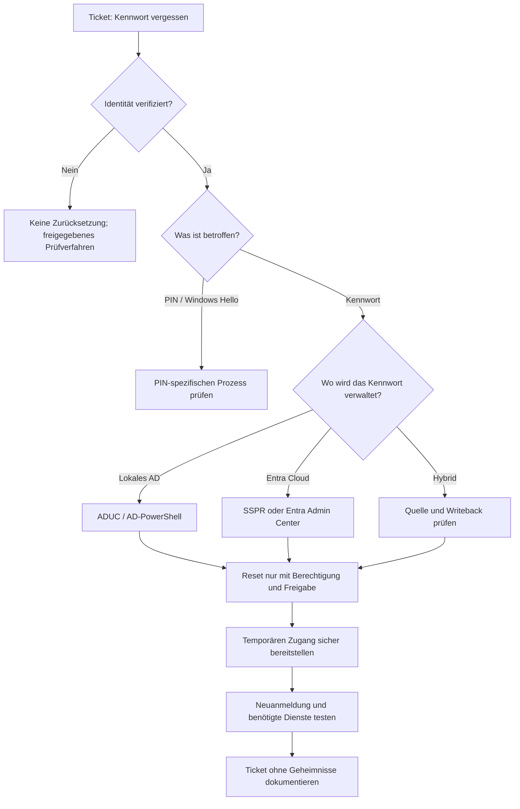

# RB-003 – Passwort vergessen oder zurücksetzen: sicherer Helpdesk-Prozess

**Projekt:** 50 Tickets · 50 typische Supportfälle · Diagnose · Lösung · Eskalation  
**Kategorie:** Identitätsmanagement / Windows / Active Directory / Microsoft Entra ID  
**Support-Level:** L1 / L2 (entsprechend den tatsächlich übertragenen Berechtigungen)  
**Version:** 1.0 · **Dokumentationsdatum:** 7. November 2026  
**Validierungsstand:** Fachlich recherchiert · **praktische Validierung ausstehend**  
**Beispiel:** `firma.example`, Konto `m.mustermann` und Ticket INC-003 sind **fiktiv**.

> **Sicherheitsgrundsatz:** Eine Kennwortrücksetzung ist eine sicherheitsrelevante Kontowiederherstellung. **Zuerst Identität über den freigegebenen Prozess prüfen, dann das richtige Identitätssystem ermitteln, erst danach zurücksetzen.** Niemals das bestehende Kennwort erfragen oder Kennwörter, temporäre Kennwörter oder Wiederherstellungscodes im Ticket dokumentieren.


*Eigene Konzeption, KI-gestützte Visualisierung mit ChatGPT. Didaktische Illustration, keine Abbildung einer realen Supportmaßnahme.*

---

## 1. Ausgangssituation: Ticket INC-003

> „Guten Morgen, ich habe mein Firmenpasswort vergessen. Windows nimmt meine Eingabe nicht an und ich muss gleich an einer Besprechung teilnehmen. Können Sie mir ein neues geben?“

**Auswirkung:** Der Mitarbeiter kann sich nicht wie vorgesehen anmelden.  
**Diagnoseziel:** Feststellen, ob tatsächlich das *Kennwort* vergessen wurde, den Kontoinhaber sicher identifizieren, die zuständige Kontoverwaltung bestimmen und den Zugang kontrolliert wiederherstellen.

**Wichtig:** Es könnte sich auch um eine gesperrte Identität (RB-002), eine nicht erreichbare Domäne (RB-001), eine Windows-Hello-PIN oder eine fehlerhafte Tastaturbelegung handeln. Nicht jedes „Passwort geht nicht“ rechtfertigt eine Kennwortrücksetzung.

## 2. Die entscheidenden Begriffe – anfängerfreundlich

| Begriff | Bedeutung |
|---|---|
| **Kennwort ändern (Change)** | Der Benutzer kennt sein bisheriges Kennwort und ersetzt es selbst, normalerweise nach erfolgreicher Authentifizierung. |
| **Kennwort zurücksetzen (Reset)** | Das alte Kennwort ist nicht verfügbar; ein berechtigter Administrator oder ein geprüfter Selbsthilfeprozess legt ein neues Kennwort fest. |
| **AD / AD DS** | *Active Directory / Active Directory Domain Services:* lokaler Microsoft-Verzeichnisdienst für Benutzer, Gruppen, Computer und Domänenanmeldung. |
| **DC** | *Domain Controller:* Domänencontroller, der unter anderem AD-Benutzerkonten und Authentifizierung verwaltet. |
| **Microsoft Entra ID** | Cloudbasierte Identitäts- und Zugriffsverwaltung, unter anderem für Microsoft 365. |
| **Hybrid** | Lokale AD-Domäne und Entra ID sind verbunden; die Quelle eines Kennworts muss ausdrücklich geklärt werden. |
| **SSPR** | *Self-Service Password Reset:* Selbstständige Kennwortrücksetzung durch den Benutzer nach Prüfung zugelassener Faktoren. |
| **Password Writeback** | *Kennwortrückschreiben:* Bei entsprechend konfigurierten hybriden Umgebungen werden geeignete Entra-Kennwortänderungen in das lokale AD zurückgeschrieben. |
| **RSAT** | *Remote Server Administration Tools:* Administrationswerkzeuge, die z. B. AD-Verwaltung vom Support-PC ermöglichen. |
| **ADUC** | *Active Directory Users and Computers:* Verwaltungsoberfläche „Active Directory-Benutzer und -Computer“, aufrufbar mit `dsa.msc` (wenn installiert). |
| **PowerShell-Cmdlet** | Standardisierter PowerShell-Befehl, z. B. `Get-ADUser`; Parameter wie `-Identity` steuern sein Verhalten. |
| **SecureString** | PowerShell-Datentyp, der zur Übergabe sensibler Zeichenfolgen an dafür vorgesehene Cmdlets dient. Kein Ersatz für vollständige Geheimnisverwaltung. |
| **Windows Hello** | Anmeldung per gerätebezogener PIN, Gesicht oder Fingerabdruck. Die PIN ist nicht dasselbe wie das Domänenkennwort. |
| **MFA** | *Multi-Factor Authentication:* Mehrfaktor-Authentifizierung mit mindestens zwei unterschiedlichen Faktoren. |
| **VPN** | *Virtual Private Network:* geschützte Verbindung zu einem Unternehmensnetz, ggf. schon vor Windows-Anmeldung verfügbar. |
| **RBAC** | *Role-Based Access Control:* Berechtigungen werden anhand zugewiesener Rollen vergeben, z. B. „Kennwortadministrator“ in Entra ID. |

### 2.1 Kennwort vergessen oder PIN vergessen?

Wenn sich der Benutzer per **Windows Hello** mit einer PIN anmeldet, muss die IT zunächst herausfinden, ob der Benutzer wirklich sein Kontokennwort oder nur seine Geräte-PIN vergessen hat. Das sind unterschiedliche Verfahren. Ein Kennwortreset ist nicht automatisch die richtige Lösung für eine vergessene Windows-Hello-PIN.  
**Quelle:** [Microsoft – Windows Hello for Business, FAQ](https://learn.microsoft.com/de-de/windows/security/identity-protection/hello-for-business/faq).

## 3. Wo wird das Kennwort verwaltet?

| Kontotyp / Umgebung | Zuständige Stelle | Typischer Reset-Weg |
|---|---|---|
| **Lokales Windows-Konto** | Einzelner Computer | Freigegebene lokale Kontowiederherstellung; kein AD-Reset |
| **Klassische AD-Domäne** | Active Directory Domain Services (AD DS) | ADUC oder AD-PowerShell durch berechtigten Support |
| **Cloudkonto in Entra ID** | Microsoft Entra ID | SSPR oder Entra Admin Center mit berechtigter Rolle |
| **Hybrid, Benutzer wird aus lokalem AD synchronisiert** | In der Regel lokales AD als Kennwortquelle | Lokal im AD zurücksetzen, oder SSPR/Entra nur bei passend eingerichtetem Writeback und unterstütztem Konto-/Domänenmodell |
| **Externes Gast-/Fremdkonto** | Ursprünglicher Identitätsanbieter bzw. dessen Heimorganisation | An dort zuständige Kontoverwaltung verweisen |

**Besonders wichtig:** „Der Benutzer steht auch im Entra-Portal“ beweist noch nicht, dass der Support ihn dort zurücksetzen darf oder dass die Rücksetzung in die lokale AD-Domäne gelangt. Bei synchronisierten Benutzern sind die **Quelle der Identität**, die Einrichtung von **Password Writeback**, der Domänentyp und die Rollen zu prüfen.  
**Quellen:** [Microsoft – Kennwort eines Benutzers zurücksetzen](https://learn.microsoft.com/de-de/entra/fundamentals/users-reset-password-azure-portal), [Microsoft – Password Writeback](https://learn.microsoft.com/de-de/entra/identity/authentication/tutorial-enable-sspr-writeback).

### Diagnosemodell: zunächst Weg, dann Maßnahme



**Hinweis für GitHub Pages:** Mermaid ist eine Diagrammsprache. Wenn das Website-Theme Mermaid nicht rendert, muss die Grafik später als SVG oder PNG eingebunden werden.

## 4. Erste Ticketaufnahme – vor jedem Reset

| Frage an den Benutzer | Warum? |
|---|---|
| „Wie lautet die exakte Windows-/Microsoft-365-Meldung?“ | Falsches Kennwort, PIN-Problem, Kontosperre oder Offline-Domäne unterscheiden. |
| „Welchen Benutzernamen und welches Gerät verwenden Sie?“ | Das richtige Konto suchen; Vertipper und Namensgleichheit vermeiden. |
| „Sind Sie im Büro, Homeoffice oder unterwegs?“ | Klären, ob der Client einen Domänencontroller bzw. das passende Identitätssystem erreichen kann. |
| „Haben Sie Ihr Kennwort kürzlich woanders geändert?“ | Mögliche Cache- oder Synchronisationsprobleme erkennen. |
| „Haben Sie noch Zugriff auf Ihre registrierten Wiederherstellungsmethoden?“ | Prüfen, ob ein genehmigter SSPR-Weg möglich ist. |
| „Gab es unerwartete Anmeldebenachrichtigungen?“ | Möglichen Sicherheitsvorfall erkennen. |

### 4.1 Identitätsprüfung ist der kritischste Schritt

Der Name im Ticket, die angezeigte Telefonnummer oder die Kenntnis einer E-Mail-Adresse genügen **allein** nicht als Nachweis. Angreifer können sich als Mitarbeiter ausgeben (*Social Engineering*). Ein Kennwortreset für die falsche Person wäre eine Kontoübernahme durch den Supportprozess.

**Mögliche, vom Unternehmen vorab freizugebende Prüfverfahren:** Rückruf über eine **bereits hinterlegte, vertrauenswürdige** Telefonnummer; überprüfte Mitarbeiterausweis-/Vor-Ort-Identifikation; organisationseigene Recovery-/MFA-Verfahren; Freigabe durch einen klar definierten Verantwortlichen kombiniert mit der vorgegebenen Identitätsprüfung. Welche Kombination zulässig ist, hängt vom Risikoprofil und der internen Richtlinie ab. Eine bloße Zustimmung des Vorgesetzten ersetzt nicht automatisch die Identitätsprüfung.

Bei nicht bestandener Prüfung: **kein Reset, sondern Eskalation über den Sicherheits- oder Identitätsprozess**.  
**Orientierung:** [NIST SP 800-63B – Account Recovery](https://pages.nist.gov/800-63-4/sp800-63b/events/).

## 5. Zugriffswege und konkrete Verfahren

| Situation | Zugriff / Werkzeug | Tatsächliche Schritte |
|---|---|---|
| Mitarbeiter im Büro, lokales AD | RSAT/ADUC vom Support-PC | Identität prüfen → Konto in ADUC suchen → „Kennwort zurücksetzen“ → freigegebenen temporären Zugang bereitstellen → Benutzeranmeldung testen |
| Mitarbeiter im Büro, lokales AD; GUI nicht erforderlich | AD-PowerShell auf berechtigtem Admin-PC | Konto mit `Get-ADUser` kontrollieren; Reset nach Autorisierung mit `Set-ADAccountPassword`; ggf. Kennwortwechsel bei nächster Anmeldung verlangen |
| Cloudkonto in Microsoft Entra ID | SSPR im Browser / Entra Admin Center | Nutzer zum registrierten SSPR-Prozess führen oder mit autorisierter Adminrolle zurücksetzen |
| Hybridkonto (AD + Entra) | AD oder Entra mit Writeback | Kontoursprung, erforderliche Rollen und Writeback prüfen; erst dann den passenden Weg wählen |
| Windows-Laptop im Homeoffice | SSPR, Pre-Logon-VPN oder geeigneter Zugang zum Firmennetz | Sicherstellen, dass die Anmeldung nach Reset die Kennwortänderung online übernehmen kann; Offline-Cache beachten |
| Benutzer am Windows-Hello-PIN-Bildschirm | Windows-Hello-Verfahren | PIN-Problem von Kontokennwort unterscheiden, gegebenenfalls separate PIN-Wiederherstellung |
| Verdacht auf Kontokompromittierung | Security-/Identity-Team | Sicherheitsvorfall nach Richtlinie bearbeiten; ein einfacher Reset allein reicht möglicherweise nicht |

> **AD-Reset ist zentrale Kontoverwaltung:** Der Supporttechniker muss dafür *nicht* auf den gesperrten Benutzer-PC per RDP zugreifen. Seine AD-Verwaltungswerkzeuge nutzen die Verbindung zur Domäne. RDP (Remote Desktop Protocol) ist nur bei zusätzlicher Clientdiagnose sinnvoll.

## 6. Lokales AD: Zuerst nur lesend prüfen

**Ausführungsort:** Berechtigter Administrationsrechner (nicht zwingend der Domänencontroller).  
**Voraussetzungen:** RSAT mit `ActiveDirectory`-PowerShell-Modul, Erreichbarkeit der Domänendienste und passende Leserechte.  
**Wirkung:** Keine Änderung.

```powershell
# Lädt die Befehle des ActiveDirectory-Moduls.
Import-Module ActiveDirectory

# Sucht den Beispielbenutzer und fordert zusätzliche Felder an.
# -Identity: Eindeutiger AD-Kontoname.
# -Properties: Zusätzliche Eigenschaften der Benutzeridentität.
$user = Get-ADUser -Identity 'm.mustermann' -Properties Enabled,LockedOut,PasswordExpired,PasswordLastSet

# Leitet das Benutzerobjekt an Select-Object weiter.
# Zeigt nur die für die Prüfung nötigen Eigenschaften.
$user | Select-Object SamAccountName,Enabled,LockedOut,PasswordExpired,PasswordLastSet
```

**Interpretation:**

- `Enabled = False`: Konto deaktiviert; nicht eigenmächtig aktivieren.
- `LockedOut = True`: Kontosperre; zunächst RB-002 berücksichtigen.
- `PasswordExpired = True`: Kennwort abgelaufen; eine reguläre Kennwortänderung kann möglich sein.
- `PasswordLastSet`: Zeitpunkt der zuletzt gespeicherten AD-Kennwortsetzung. Das ist nicht automatisch der Zeitpunkt der letzten *erfolgreichen Benutzeranmeldung*.

### 6.1 Kennwortrichtlinie untersuchen

Für bestimmte Nutzer oder Gruppen können *Fine-Grained Password Policies* gelten – differenzierte Kennwortrichtlinien, die von der Domänen-Standardrichtlinie abweichen.

```powershell
# Zeigt die Standard-Kennwortrichtlinie der AD-Domäne an.
Get-ADDefaultDomainPasswordPolicy

# Zeigt, falls vorhanden, die für den Benutzer wirksame
# differenzierte Kennwortrichtlinie (PSO) an.
Get-ADUserResultantPasswordPolicy -Identity 'm.mustermann'
```

Wenn der zweite Befehl kein Richtlinienobjekt zurückgibt, ist damit **nicht** automatisch die allgemeine Kennwortrichtlinie deaktiviert; häufig gilt dann die Domänenrichtlinie.  
**Quelle:** [Microsoft – Get-ADUserResultantPasswordPolicy](https://learn.microsoft.com/de-de/powershell/module/activedirectory/get-aduserresultantpasswordpolicy).

## 7. Lokales AD: Kennwort in ADUC zurücksetzen (grafisch)

**Ausführungsort:** Eigener, berechtigter Administrationsrechner mit installierten RSAT-Tools.

1. **Identität prüfen und Ticket/Freigabe kontrollieren.** Kein Reset ohne abgeschlossene Prüfung.
2. Mit **Windows-Taste + R** den Ausführen-Dialog öffnen.
3. `dsa.msc` eingeben und bestätigen. Das öffnet **Active Directory-Benutzer und -Computer**, falls ADUC installiert ist.
4. In der richtigen Domäne / Organisationseinheit (OU, *Organizational Unit*) nach dem Benutzer suchen.
5. **Namensgleichheit ausschließen**, etwa durch Kontoname und weitere bekannte Identitätsattribute.
6. Im Kontextmenü des Benutzers **„Kennwort zurücksetzen“** wählen.
7. Neues temporäres Kennwort nach Unternehmensrichtlinie setzen. Die Option zum erforderlichen Kennwortwechsel bei der nächsten Anmeldung nur aktivieren, wenn dieser Weg mit dem Gerät und der Erreichbarkeit der Domäne tatsächlich funktioniert.
8. Kennwort **nur über einen freigegebenen sicheren Kanal** an die verifizierte Person übergeben; keinesfalls ins Ticket oder eine ungeschützte E-Mail schreiben.
9. Anmeldung und anschließend die nötigen Anwendungen prüfen.

**Wichtig:** Bei einem nicht mit der Domäne verbundenen Homeoffice-Laptop kann ein erzwungener Kennwortwechsel bei der nächsten Anmeldung scheitern, wenn kein entsprechender Zugang zum Domänencontroller besteht. Dann den zulässigen Pre-Logon-VPN-, Offline- oder Vor-Ort-Prozess nutzen.  
**Quelle:** [Microsoft – Active-Directory-Benutzer verwalten](https://learn.microsoft.com/en-us/windows-server/identity/ad-ds/manage-user-accounts-in-windows-server).

## 8. Lokales AD: Kennwort mit PowerShell zurücksetzen

### 8.1 Erst die Änderung simulieren – `-WhatIf`

**Achtung: Die folgenden Befehle verändern in der Produktivvariante ein Benutzerkennwort. Nur nach nachweislicher Identitätsprüfung, Autorisierung und in dafür freigegebenen Umgebungen verwenden.**

```powershell
# Lädt das für AD-Befehle benötigte Modul.
Import-Module ActiveDirectory

# Legt den beispielhaften Kontonamen fest.
$identity = 'm.mustermann'

# Fragt das vorgesehene temporäre Kennwort verdeckt ab.
# -AsSecureString: Übergibt es als SecureString-Objekt.
# Es wird NICHT im Quelltext als Klartext hinterlegt.
$newPassword = Read-Host -Prompt 'Temporäres Kennwort eingeben' -AsSecureString

# Simuliert die Kennwortrücksetzung, ohne sie auszuführen.
# -Identity: Welches AD-Konto ist betroffen?
# -Reset: Administratives Zurücksetzen ohne bisheriges Kennwort.
# -NewPassword: Neuer Wert als SecureString.
# -WhatIf: Zeigt eine beabsichtigte Aktion an; KEINE Änderung.
Set-ADAccountPassword -Identity $identity -Reset -NewPassword $newPassword -WhatIf
```

**Was bedeutet `-WhatIf`?** PowerShell meldet die beabsichtigte Änderung, führt diese aber bei diesem Cmdlet **nicht** aus. Es ist eine Sicherheitskontrolle; die korrekte Identität, die Berechtigungen und die fachliche Zulässigkeit müssen trotzdem separat geprüft werden.

### 8.2 Durchführung nach Freigabe – verändert das AD-Konto

Die folgenden Zeilen **nicht** als unkritischen Test auf produktiven Konten ausführen.

```powershell
# ÄNDERT DAS KENNWORT des zuvor geprüften AD-Kontos.
# -Confirm fordert eine zusätzliche Bestätigung an.
Set-ADAccountPassword -Identity $identity -Reset -NewPassword $newPassword -Confirm

# Erzwingt – wenn zum Anmeldeweg passend – die Änderung
# des temporären Kennworts bei der nächsten Anmeldung.
# -ChangePasswordAtLogon $true setzt die AD-Kontoeigenschaft.
# -Confirm fordert eine zusätzliche Bestätigung an.
Set-ADUser -Identity $identity -ChangePasswordAtLogon $true -Confirm

# Entfernt die Variable aus der aktuellen PowerShell-Sitzung.
# Das ersetzt keine Kontrolle von Transkripten oder Geheimnissen.
Remove-Variable -Name newPassword -ErrorAction SilentlyContinue
```

**Wichtige Erläuterungen:**

- `Set-ADAccountPassword` ist ein **verändernder** Befehl. Für die Kennwortrücksetzung sind entsprechende delegierte AD-Rechte nötig. Eine Kennwortrücksetzung ersetzt nicht automatisch die separate Prüfung einer bestehenden Kontosperre (siehe RB-002).
- `-Reset` bedeutet „administrativ neu setzen“, ohne das bisherige Kennwort zu kennen. Anders als beim selbst vorgenommenen Wechsel.
- `Read-Host -AsSecureString` vermeidet ein Klartextkennwort *im Skript*. Das macht nicht automatisch den gesamten Prozess einschließlich Übergabe sicher.
- `-ChangePasswordAtLogon $true` ist **keine** pauschal sinnvolle Option für jedes Konto: bei Services, speziellen Kontotypen, Offlinegeräten oder bestimmten Anmeldeverfahren die Auswirkungen prüfen.
- Die beiden Änderungen sind getrennte Operationen. Falls der zweite Befehl fehlschlägt, ist der Reset möglicherweise bereits erfolgt. Daher Ergebnisse einzeln prüfen und dokumentieren.

**Quelle:** [Microsoft – Set-ADAccountPassword](https://learn.microsoft.com/en-us/powershell/module/activedirectory/set-adaccountpassword), [Microsoft – Set-ADUser](https://learn.microsoft.com/de-de/powershell/module/activedirectory/set-aduser).

### 8.3 Auditnachweis: Sicherheitsereignis 4724

**Ereignis-ID 4724** dokumentiert einen Versuch, das Kennwort eines Kontos zurückzusetzen. Es wird bei entsprechend aktivierter Überwachung auf dem relevanten System protokolliert, für Domänenkonten in der Regel auf einem Domänencontroller.

```powershell
# Liest lokale Security-Ereignisse der letzten zwei Stunden.
# Auf einem berechtigten System ausführen, dessen Protokoll
# die fragliche Kennwortrücksetzung enthalten kann.
Get-WinEvent -FilterHashtable @{
    # Wählt das Windows-Sicherheitsprotokoll.
    LogName   = 'Security'
    # Ereignis 4724: Versuch einer Kennwortrücksetzung.
    Id        = 4724
    # Begrenzung auf den relevanten Zeitraum.
    StartTime = (Get-Date).AddHours(-2)
} | Select-Object -First 10 TimeCreated,Id,Message
```

**Unterscheidung:** 4723 betrifft den Versuch eines **Kennwortwechsels**, 4724 den Versuch eines **administrativen Resets**. Ein Ereignis kann je nach Auditkonfiguration fehlen; ein protokollierter Versuch beweist nicht immer einen erfolgreich abgeschlossenen Gesamtprozess.  
**Quelle:** [Microsoft – AD-Überwachungsrichtlinien](https://learn.microsoft.com/en-us/windows-server/identity/ad-ds/plan/security-best-practices/advanced-audit-policy-configuration).

## 9. Microsoft Entra ID: Kennwort in der Cloud zurücksetzen

### 9.1 Nutzer führt eine Selbsthilfe-Rücksetzung (SSPR) durch

Wenn **SSPR (Self-Service Password Reset)** für diesen Benutzer aktiviert ist und die nötigen Authentifizierungsmethoden eingerichtet sind:

1. Auf einem geeigneten Gerät die offizielle Seite **[https://aka.ms/sspr](https://aka.ms/sspr)** öffnen.
2. Geschäfts-/Schulkonto eingeben und dem Prozess folgen.
3. Die zuvor registrierten Wiederherstellungsmethoden verwenden (z. B. Authenticator), soweit die Unternehmensrichtlinie sie erlaubt.
4. Neues Kennwort setzen und die erfolgreiche Anmeldung überprüfen.

**Nicht jeder Benutzer hat SSPR:** Aktivierung, Registrierung und die zulässigen Authentifizierungsmethoden sind erforderlich. Bei nicht zugelassenem SSPR den offiziellen Helpdesk-Prozess nutzen.  
**Quelle:** [Microsoft – Funktionsweise von SSPR](https://learn.microsoft.com/de-de/entra/identity/authentication/concept-sspr-howitworks).

### 9.2 Support setzt über das Entra Admin Center zurück

**Ausführungsort:** Browser am Administrationsrechner; Zugang zum **Microsoft Entra Admin Center**.  
**Voraussetzungen:** Zuweisung einer Rolle, die den Reset **für das konkrete Zielkonto** erlaubt. Die Rolle **Kennwortadministrator (Password Administrator)** darf grundsätzlich Kennwörter gewöhnlicher Nicht-Administratorkonten und begrenzter weiterer Rollen zurücksetzen – nicht beliebig alle privilegierten Konten.

1. Nach Identitätsprüfung das Entra Admin Center öffnen.
2. Zu **Entra ID → Benutzer** navigieren.
3. Benutzerkonto korrekt auswählen.
4. **Kennwort zurücksetzen** wählen.
5. Das von Entra generierte temporäre Kennwort ausschließlich über einen geeigneten sicheren Kanal der verifizierten Person bereitstellen.
6. Kennwortwechsel bei der folgenden Anmeldung durchführen lassen, falls vom Verfahren gefordert.
7. Anmeldung und benötigte Microsoft-365-Dienste prüfen.

**Wichtig:** Das durch Entra beim Reset generierte temporäre Kennwort ist nicht automatisch ein kurzlebiger Einmalcode. Microsoft dokumentiert ausdrücklich, dass es nicht allein durch Zeitablauf verfällt. Es darf deshalb nicht im Ticket oder in einer ungeschützten Nachricht archiviert werden.  
**Quellen:** [Microsoft – Entra-Kennwortrücksetzung](https://learn.microsoft.com/de-de/entra/fundamentals/users-reset-password-azure-portal), [Microsoft – Rollendefinitionen](https://learn.microsoft.com/de-de/entra/identity/role-based-access-control/permissions-reference).

### 9.3 SSPR direkt am Windows-Anmeldebildschirm

Bei entsprechend verwalteten Windows-11-Geräten kann ein **„Kennwort vergessen“**- bzw. **„Kennwort zurücksetzen“**-Link am Anmeldebildschirm verfügbar sein. Er erscheint **nicht automatisch auf jedem Windows-Rechner**: Die Funktion benötigt unter anderem konfigurierte Entra-SSPR-Einstellungen, Registrierung und erreichbare Dienste.

Microsoft nennt ausdrücklich Einschränkungen für die Kennwortrücksetzung über **Remotedesktop-Sitzungen und Hyper-V-Sitzungen im erweiterten Modus**.  
**Quelle:** [Microsoft – SSPR am Windows-Anmeldebildschirm](https://learn.microsoft.com/de-de/entra/identity/authentication/howto-sspr-windows).

## 10. Hybrid: Warum Password Writeback so wichtig ist

Eine hybride Benutzeridentität kann in **lokalem AD** erstellt und nach **Entra ID** synchronisiert sein. Der Benutzer verwendet unter Umständen dieselbe Identität für Windows und Microsoft 365, aber nicht jeder Resetpfad aktualisiert automatisch beide Umgebungen.

**Password Writeback (Kennwortrückschreiben)** ist eine gesondert einzurichtende Funktion. Bei einer unterstützten und korrekt konfigurierten Konstellation kann sie Kennwortänderungen beziehungsweise SSPR-Resets aus Entra in das lokale AD übertragen.

| Befund | Konsequenz |
|---|---|
| Kennwortquelle liegt im lokalen AD, Writeback nicht freigegeben/eingerichtet | AD-Reset beim zuständigen System durchführen |
| Kennwortquelle AD, Writeback unterstützt und nachweislich eingerichtet | Vorgesehenen Entra-/SSPR-Prozess nutzen; Ergebnis im lokalen AD und bei der Anmeldung prüfen |
| Cloud-only-Konto | Entra-ID-Prozess verwenden |
| Externes oder nicht selbst verwaltetes Konto | Zuständige Heimorganisation / Identitätsverwaltung kontaktieren |

**Nicht verwechseln:** *Password Hash Synchronization* (Kennworthash-Synchronisierung aus AD Richtung Cloud) ist nicht dasselbe wie **Password Writeback** (Rückschreiben von Kennwortänderungen Richtung AD).  
**Quelle:** [Microsoft – Password Writeback konfigurieren](https://learn.microsoft.com/de-de/entra/identity/authentication/tutorial-enable-sspr-writeback).

## 11. Die Homeoffice-Falle: Reset erfolgreich, Windows-Anmeldung weiterhin nicht möglich

**Situation:** Ein Kennwort wird zentral geändert. Der Windows-Domänen-Laptop steht im Homeoffice und hat noch keinen Zugang zum Domänencontroller. Seine lokal zwischengespeicherten Anmeldeinformationen können weiterhin auf dem vorherigen Kennwortstand beruhen.

Daraus kann folgen: **Der Reset war erfolgreich, aber die neue Windows-Anmeldung funktioniert auf genau diesem Laptop offline noch nicht.**

**Prüfschritte:**

1. Ist der Laptop überhaupt online und besteht Zugriff auf das Firmennetz?
2. Ist eine **Pre-Logon-VPN**-Funktion (VPN vor der Windows-Anmeldung) vorhanden?
3. Hat der Laptop seit dem Reset bereits erfolgreich gegen die Domäne authentifiziert?
4. Ist ein Kennwortwechsel bei der nächsten Anmeldung vorgeschrieben, obwohl der DC noch unerreichbar ist?
5. Welcher sichere, dokumentierte Anmelde- und Synchronisierungsweg ist vorgesehen?

**Nicht pauschal sagen:** „Einfach das alte Kennwort verwenden.“ Das kann unter bestimmten Bedingungen offline funktionieren, ist aber weder garantiert noch ein Ersatz für die korrekte Identitäts- und Sicherheitsprüfung.  
**Quelle:** [Microsoft – Cached Domain Logon Information](https://learn.microsoft.com/en-us/troubleshoot/windows-server/user-profiles-and-logon/cached-domain-logon-information).

## 12. Häufige Fehlentscheidungen und Sonderfälle

| Beobachtung | Nicht voreilig tun | Bessere nächste Prüfung |
|---|---|---|
| Windows zeigt „PIN falsch“ | Domain-Kennwort zurücksetzen | Windows Hello / PIN-Wiederherstellung klären |
| Konto ist gesperrt, Kennwort bekannt | Automatisch Kennwort zurücksetzen | Sperrursache mit RB-002 ermitteln |
| Neues Passwort wird am Homeoffice-Laptop abgelehnt | Mehrfach wiederholt versuchen | DC-Erreichbarkeit, lokalen Cache und Pre-Logon-VPN prüfen |
| Reset im Entra-Portal schlägt fehl | Berechtigungen unkontrolliert erhöhen | Kontoursprung, Rolle, Domänentyp, Writeback prüfen |
| SSPR-Option fehlt | Beliebige Registrierungsdaten eintragen | Richtlinie, Registrierung und Verfügbarkeit prüfen |
| Temporäres Passwort wurde per ungeschützter Nachricht versendet | Das als normalen Erfolg betrachten | Sicherheitsvorfall / sichere erneute Bereitstellung entsprechend Prozess prüfen |
| Benutzer meldet unerwartete MFA-Anfragen | Nur Kennwort neu setzen und abschließen | Security-Team einbeziehen; aktive Sitzungen/Tokens, Geräte und Anmeldehistorie beurteilen |

## 13. 1st-/2nd-Level-Abgrenzung

| First Level | Second Level / Identity / Security |
|---|---|
| Ticket und exakte Fehlermeldung aufnehmen | Hybrid-/Writeback-Fehler und Authentifizierungsabhängigkeiten untersuchen |
| Identität nach Unternehmensprozess verifizieren | Komplexe Rollen-/Berechtigungsprobleme lösen |
| Vorhandene SSPR-Verfahren erklären | SSPR-Konfiguration und Richtlinien untersuchen |
| Freigegebenen Standardreset durchführen | DC-, Replikations- und Synchronisationsfehler analysieren |
| Anmeldung und Apps prüfen, Ticket ohne Geheimnisse dokumentieren | Verdacht auf Kontoübernahme oder missbräuchlichen Reset untersuchen |

**Hinweis:** Die Berechtigung zur Kennwortrücksetzung ist nicht automatisch an das organisatorische Support-Level gebunden. Ein L1-Mitarbeiter kann eine gezielt delegierte Reset-Berechtigung besitzen; ein anderer hat sie nicht.

## 14. Muster-Ticketdokumentation – fiktiv

**INC-003 – Mitarbeiter hat das Domänenkennwort vergessen**  
**Fehlerbild:** Windows-Anmeldung mit dem Firmenkonto nicht möglich; Benutzer meldet vergessenes Kennwort.  
**Identitätsprüfung:** Über den freigegebenen internen Prozess erfolgreich abgeschlossen (ohne sensible Prüfdetails im Ticket).  
**Diagnose:** Benutzerkonto in AD geprüft; aktiv, nicht gesperrt. Windows-Hello-PIN-Problem und Domänen-Nichterreichbarkeit durch Rückfrage und Systemkontext ausgeschlossen.  
**Maßnahme:** Kennwort nach Freigabe zentral im AD zurückgesetzt. Temporäres Kennwort über genehmigten sicheren Kanal bereitgestellt; erforderlicher Kennwortwechsel beim nächsten geeigneten Online-Login veranlasst.  
**Erfolgskontrolle:** Anmeldung mit neuem persönlichem Kennwort und Zugriff auf benötigte Unternehmensressourcen bestätigt.  
**Status:** Gelöst.  

*Erfundenes Lernbeispiel; es beschreibt keine durchgeführte produktive Supportmaßnahme. Weder das temporäre noch das neue persönliche Kennwort gehören in das Ticket.*

## 15. Wissenskontrolle, Quellen und Validierung

### Eigene Diagnosefragen

1. Warum ist die Kenntnis des Benutzernamens kein ausreichender Identitätsnachweis?
2. Was ist der Unterschied zwischen einem Kennwortwechsel und einem Kennwortreset?
3. Warum kann ein korrekt durchgeführter AD-Reset am Homeoffice-Laptop zunächst erfolglos wirken?
4. Was genau bewirkt `-WhatIf` bei `Set-ADAccountPassword`?
5. Warum reicht Password Hash Synchronization allein nicht aus, um einen SSPR-Reset ins lokale AD zurückzuschreiben?
6. Warum ist eine Windows-Hello-PIN nicht mit einem Domänenkennwort gleichzusetzen?
7. Was ändert sich bei einer extern verwalteten Identität?
8. Warum darf das temporäre Kennwort nicht im Ticket gespeichert werden?

### Quellen – offizielle Dokumentation

- [Microsoft – Set-ADAccountPassword](https://learn.microsoft.com/en-us/powershell/module/activedirectory/set-adaccountpassword) — Passwortreset per PowerShell, `-Reset`, `-NewPassword`, `-WhatIf` und `-Confirm`.
- [Microsoft – Set-ADUser](https://learn.microsoft.com/de-de/powershell/module/activedirectory/set-aduser) — `-ChangePasswordAtLogon`.
- [Microsoft – Active-Directory-Benutzer verwalten](https://learn.microsoft.com/en-us/windows-server/identity/ad-ds/manage-user-accounts-in-windows-server) — AD-Verwaltung.
- [Microsoft – Get-ADUserResultantPasswordPolicy](https://learn.microsoft.com/de-de/powershell/module/activedirectory/get-aduserresultantpasswordpolicy) — differenzierte AD-Kennwortrichtlinien.
- [Microsoft – Entra-Kennwort zurücksetzen](https://learn.microsoft.com/de-de/entra/fundamentals/users-reset-password-azure-portal) — Adminportal, Rollen, temporäre Kennwörter, Einschränkungen.
- [Microsoft – SSPR: Funktionsweise](https://learn.microsoft.com/de-de/entra/identity/authentication/concept-sspr-howitworks) — Benutzer-Selbsthilfe.
- [Microsoft – SSPR auf Windows-Anmeldebildschirm](https://learn.microsoft.com/de-de/entra/identity/authentication/howto-sspr-windows) — Voraussetzungen und Einschränkungen.
- [Microsoft – Password Writeback](https://learn.microsoft.com/de-de/entra/identity/authentication/tutorial-enable-sspr-writeback) — Hybridintegration.
- [Microsoft – Windows Hello for Business FAQ](https://learn.microsoft.com/de-de/windows/security/identity-protection/hello-for-business/faq) — PIN vs. Kennwort.
- [Microsoft – AD-Überwachungsrichtlinien](https://learn.microsoft.com/en-us/windows-server/identity/ad-ds/plan/security-best-practices/advanced-audit-policy-configuration) — Ereignis 4723/4724.
- [NIST SP 800-63B – Account Recovery](https://pages.nist.gov/800-63-4/sp800-63b/events/) — Sicherheitsprinzipien für Kontowiederherstellung.

**Prüfdatum:** 7. November 2026.  
**Stand:** Quellenrecherche und theoretisches Diagnoseverfahren dokumentiert; keine produktive Durchführung behauptet.  
**Geplante Validierung:** In einer isolierten Testdomäne ein Testkonto anlegen, Identitätsfreigabe simulieren, `-WhatIf`/Reset/Anmeldung prüfen, Ereignis 4724 kontrollieren und anschließend Homeoffice-/Hybrid-Sonderfälle separat testen.
