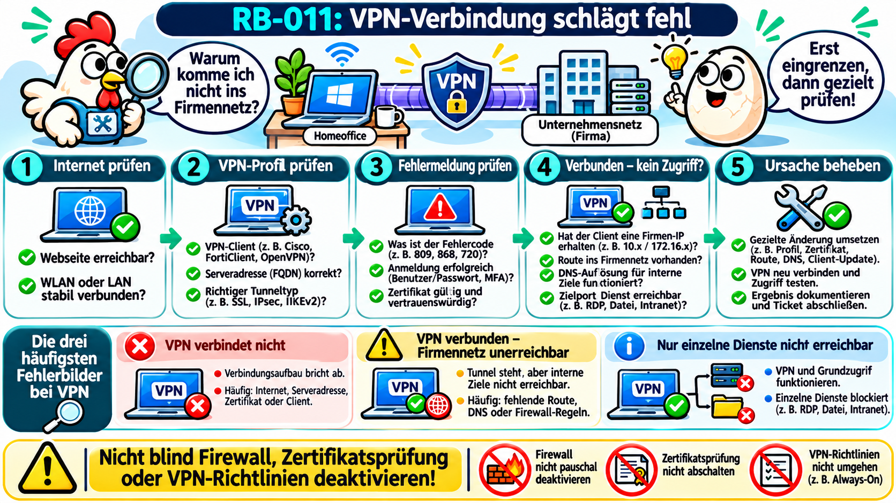
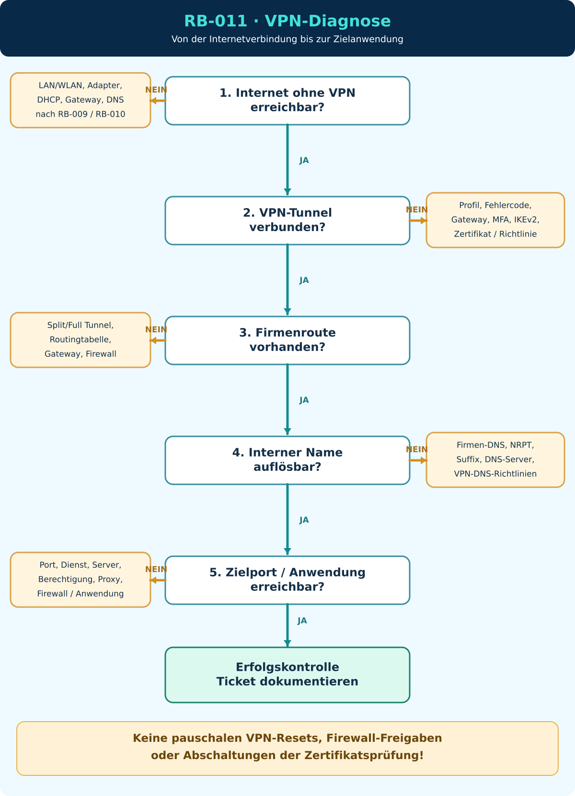

# RB-011 – VPN-Verbindung schlägt fehl

> **50 Tickets – 50 typische Supportfälle**  
> **Ticket:** INC-011 · **Support-Level:** 1st / 2nd Level · **Systeme:** Windows 11, Unternehmens-VPN, DNS, Routing, Firewall, Active Directory / Microsoft Entra ID  
> **Dokumentationsstand:** 08.11.2026 · **Version:** 1.0  
> **Validierungsstatus:** Anhand offizieller Microsoft-Dokumentation recherchiert; **nicht praktisch validiert**. Alle Beispielsysteme, IP-Adressen und Ticketverläufe sind fiktiv.



*Eigene Konzeption, KI-gestützte Visualisierung mit ChatGPT. Didaktisch vereinfachte Darstellung: Die genannten Beispiele und Fehlercodes hängen von der eingesetzten VPN-Technologie ab. Nicht jedes VPN nutzt dieselben Ports, Tunneltypen oder Windows-Befehle.*

## 1. Ausgangssituation und Supportticket

**Fiktives Ticket INC-011**

> „Seit heute Morgen komme ich im Homeoffice nicht mehr ins Firmennetz. Das Internet funktioniert und Teams geht auch, aber sobald ich die VPN-Verbindung starte, kommt eine Fehlermeldung.“

**Beispielumgebung:** Windows 11 Pro, Notebook `NB-023`, integrierter Windows-VPN-Client mit IKEv2, VPN-Gateway `vpn.firma.example`, interne Anwendung `intranet.firma.example`. Die Domäne `firma.example`, Computernamen und IP-Adressen dienen nur als Platzhalter.

**Ziel:** Herausfinden, **in welcher Phase** die Störung auftritt: vor dem Aufbau des Tunnels, bei der Authentifizierung, bei der Tunnelverhandlung oder **erst nach erfolgreichem Aufbau** beim Zugriff auf Unternehmensressourcen.

**Leitsatz:** „VPN geht nicht“ beschreibt noch nicht, **welche** Verbindung oder Funktion ausgefallen ist.

## 2. Technische Grundlagen: Was ist VPN?

**VPN (Virtual Private Network)** ist eine geschützte Verbindung zwischen einem Gerät und einem entfernten Netzwerk über ein anderes Netz, häufig das Internet. Viele VPN-Lösungen verschlüsseln den übertragenen Verkehr zwischen den jeweiligen Tunnelendpunkten. Der VPN-Tunnel ist kein Ersatz für die Berechtigungen auf den Zielsystemen.

```text
Notebook im Homeoffice
   │
   ├── Heimnetz / WLAN / Router
   │
   ▼
Öffentliches Internet
   │
   ▼
VPN-Gateway der Firma  ← überprüft Tunnelaufbau und ggf. Benutzer/Gerät
   │
   ├── internes Routing / Firewall / Sicherheitsrichtlinien
   │
   ▼
Firmennetz (Dateiserver, Intranet, Anwendungen)

DNS-Namensauflösung findet als separate Funktion statt.
Ein VPN-Tunnel garantiert noch nicht, dass jede interne Anwendung erreichbar ist.
```

### Wichtige Begriffe für Anfänger

| Begriff | Einfache Erklärung | Bedeutung im Ticket |
|---|---|---|
| **VPN (Virtual Private Network)** | Geschützter Verbindungspfad in ein entferntes Netz. | Stellt häufig den Zugang zum Firmennetz bereit. |
| **VPN-Client** | Software auf dem Laptop, die den Tunnel aufbaut. | Kann Windows-integriert oder ein gesondertes Programm sein. |
| **VPN-Gateway** | Gegenstelle, die VPN-Verbindungen annimmt. | Kann wegen Erreichbarkeit, Richtlinien oder Authentifizierung blockieren. |
| **Tunnel** | Virtueller Transportpfad für Netzwerkverkehr. | Sein Aufbau ist nur eine Diagnoseebene. |
| **IKEv2 (Internet Key Exchange, Version 2)** | Verfahren zum Aushandeln und Absichern von IPsec-Verbindungen. | Verwendet häufig UDP 500 und 4500. |
| **IPsec (Internet Protocol Security)** | Protokollfamilie zum Schutz von IP-Kommunikation. | Häufige Basis für Unternehmens-VPN. |
| **SSTP (Secure Socket Tunneling Protocol)** | Microsoft-VPN-Verfahren über TLS, gewöhnlich TCP 443. | Andere Port- und Fehlerbilder als IKEv2. |
| **UDP (User Datagram Protocol)** | Verbindungsloses Transportprotokoll. | Ein reiner TCP-Porttest beweist keine UDP-Erreichbarkeit. |
| **TCP (Transmission Control Protocol)** | Verbindungsorientiertes Transportprotokoll. | Für konkrete Diensttests, z. B. HTTPS über TCP 443. |
| **DNS (Domain Name System)** | Übersetzt Namen in IP-Adressen. | Interne Namen benötigen oft firmenspezifische DNS-Regeln. |
| **NRPT (Name Resolution Policy Table)** | Windows-Richtlinien für die Namensauflösung bestimmter Namensräume. | Kann interne DNS-Anfragen gezielt lenken. |
| **Routing / Route** | Legt fest, über welche Netzwerkschnittstelle Daten zum Ziel gelangen. | Eine fehlende Firmenroute kann Zugriffe verhindern. |
| **Split Tunneling** | Nur ausgewählte Ziele laufen durch den VPN-Tunnel. | Andere Daten gehen weiter direkt über das Heimnetz. |
| **Full Tunnel / Force Tunneling** | Nach Konfiguration wird ein größerer bzw. der gesamte relevante Verkehr über VPN geleitet. | Eine falsche Standardroute kann auch Internetzugriffe beeinflussen. |
| **MFA (Multi-Factor Authentication)** | Zusätzliche Bestätigung, etwa über einen zweiten Faktor. | Eine fehlende/abgelehnte Freigabe kann den Aufbau verhindern. |
| **NPS (Network Policy Server)** | Microsoft-RADIUS-Server zur Netzwerkzugriffsprüfung. | Kann Authentifizierung oder Zugriffsrichtlinien beurteilen. |
| **RADIUS (Remote Authentication Dial-In User Service)** | Protokoll zur zentralen Authentifizierung, Autorisierung und Abrechnung. | Wird von vielen VPN-Lösungen verwendet. |
| **RasClient** | Windows-Komponente für Remotezugriffs-Verbindungen. | Schreibt teilweise VPN-Fehler in Ereignisprotokolle. |
| **FQDN (Fully Qualified Domain Name)** | Vollständiger DNS-Name, z. B. `vpn.firma.example`. | VPN-Gateway muss korrekt adressiert sein. |
| **NAT (Network Address Translation)** | Übersetzung von IP-Adressen, häufig am Router. | Kann bei falsch konfigurierten Geräten VPN-Verkehr behindern. |
| **Always On VPN** | Microsoft-Technik für verwaltete automatische VPN-Verbindungen. | Kann Benutzer- und Gerätetunnel unterscheiden. |
| **Device Tunnel / User Tunnel** | Gerätetunnel vor Anmeldung bzw. Benutzertunnel im Benutzerkontext. | Bei Homeoffice-Anmeldeproblemen aus RB-001 relevant. |

**Wichtig:** Ein anderer VPN-Client, etwa ein produktabhängiger SSL-VPN-Client, kann eigene Protokolle, Oberflächen und Logdateien nutzen. Die PowerShell-Funktion `Get-VpnConnection` beschreibt in erster Linie **Windows-integrierte VPN-Profile**, nicht automatisch jedes Fremdprodukt.

**Quellen:** [VPN-Client-Cmdlets](https://learn.microsoft.com/de-de/powershell/module/vpnclient/) · [Microsoft: VPN-Protokolle](https://learn.microsoft.com/de-de/windows-server/remote/remote-access/configure-vpn-protocols) · [Gerätetunnel](https://learn.microsoft.com/de-de/windows-server/remote/remote-access/vpn/vpn-device-tunnel-config)

## 3. Drei Fehlerbilder unterscheiden – bevor wir irgendetwas verändern

| Benutzerbeobachtung | Technischer Zustand | Mögliche Ursachen | Erste Prüfung |
|---|---|---|---|
| **A. VPN verbindet überhaupt nicht** | Tunnel nicht aufgebaut | Internet, Gateway, Clientprofil, Firewall, Zertifikat, MFA, Richtlinie | Fehlercode, Zeitpunkt, Tunneltyp und Internetzugang erfassen |
| **B. VPN meldet „verbunden“, aber Firmennetz geht nicht** | Tunnel steht, Zielnetz unerreichbar | Falsche Route, fehlende DNS-Regel, Firewall, Zugriffsrichtlinie, IPv4/IPv6-Konfiguration | VPN-IP, Routing, interne DNS-Auflösung, konkreten Zielport prüfen |
| **C. Nur eine Firmenanwendung funktioniert nicht** | VPN und mindestens einige Firmenressourcen erreichbar | Zieldienst, Port, lokale/Server-Firewall, Applikationsberechtigung, Proxy | Funktionierende und gestörte Dienste direkt vergleichen |

**Merksatz:** **Tunnel aufgebaut ≠ Firmenressourcen erreichbar.** Eine weitere Authentifizierung an einer Anwendung kann trotz funktionierendem VPN scheitern.

## 4. Zugriffswege: Wie kann ein Supporttechniker den Fehler untersuchen?

| Situation | Möglicher Zugriffsweg | Vorgehen und Einschränkung |
|---|---|---|
| Homeoffice, Internet geht, Firmen-VPN nicht | Telefon/Teams/Schnellhilfe über bestehendes Internet | Fehlermeldung und lesende Clientbefehle gemeinsam prüfen; keine unkontrollierte Änderung am Tunnel. |
| Windows-Client mit lokalem VPN-Profil | Lokale PowerShell am Benutzergerät | `Get-VpnConnection`, IP-/Routen- und Ereignisanzeige prüfen. |
| Firmeneigener VPN-Client eines anderen Herstellers | Herstelleroberfläche und freigegebenes Diagnosepaket | Fehlermeldungen und Logs mit Herstellerdokumentation abgleichen; Windows-Cmdlet zeigt das Produkt ggf. nicht. |
| Kein geeigneter Remotezugriff | Telefonische Anleitung, ggf. Vor-Ort-Support | Benutzer führt nur ungefährliche lesende Tests aus; Geräte- und Profiländerungen nach Freigabe. |
| Viele Benutzer betroffen | VPN-Gateway-, Netzwerk- und IAM-Team | Zentralen Dienstzustand, Lizenz/Kapazität, Zertifikate, Authentifizierung, Firewall und Routing prüfen. |
| VPN steht, aber nur ein interner Server nicht | VPN-/Netzwerkdiagnose und zuständiges Fachteam | Route, DNS und Zielport kontrollieren, danach Zielanwendung untersuchen. |

**Wichtig für Remote-Support:** Falls deine Fernwartung selbst über den problematischen VPN-Tunnel läuft, kann dessen Neustart oder die Änderung einer Route deine eigene Verbindung trennen.

## 5. Diagnose-Entscheidungsbaum



**Textalternative:** (1) Funktioniert das Internet ohne VPN? Nein → lokales Netzwerk prüfen (RB-009/RB-010). Ja → (2) VPN-Profil und exakte Meldung prüfen. (3) Tunnel verbunden? Nein → Server, Transport, Authentifizierung, Zertifikat oder Richtlinie eingrenzen. Ja → (4) interne IP und Route prüfen. (5) interne Namensauflösung und Zielport vergleichen. (6) gezielt korrigieren, erneut testen und dokumentieren. Ein einzelnes erfolgreiches Testergebnis beweist nicht, dass alle übrigen Stufen funktionieren.

## 6. L1-Diagnose: Internet und VPN-Profil kontrollieren

**Ausführungsort:** Betroffener Windows-11-Client, lokale PowerShell. **Alle folgenden Befehle sind lesend.**

### 6.1 Grundverbindung ohne VPN prüfen

```powershell
# Zeigt aktive Netzwerkadapter und ihre Verbindungseigenschaften.
Get-NetAdapter |
    Select-Object Name, Status, LinkSpeed

# Zeigt lokale IP-Adressen, DNS-Server und Standardgateway.
Get-NetIPConfiguration

# Prüft eine konkrete TCP-Verbindung zu einem externen HTTPS-Ziel.
# Achtung: Der Test ersetzt keinen vollständigen Web- oder Browserzugriff.
Test-NetConnection -ComputerName 'www.microsoft.com' -Port 443
```

**Interpretation:** Wenn bereits normales Internet nicht funktioniert, wird zuerst die Basisverbindung nach RB-010 untersucht. Ein erfolgreicher TCP-Test beweist nicht, dass sich die konkrete VPN-Verbindung erfolgreich aufbauen lässt.

### 6.2 Windows-VPN-Profile abfragen

```powershell
# Zeigt VPN-Profile für den aktuell angemeldeten Benutzer.
# Der Befehl gilt für Windows-integrierte VPN-Verbindungen.
Get-VpnConnection |
    Select-Object Name, ServerAddress, TunnelType, ConnectionStatus, SplitTunneling

# Zeigt computerweit angelegte VPN-Profile (falls vorhanden).
# Dafür kann ein berechtigter Administrationskontext sinnvoll sein.
Get-VpnConnection -AllUserConnection |
    Select-Object Name, ServerAddress, TunnelType, ConnectionStatus, SplitTunneling
```

**Parameter und Ausgabe erklärt:**

- `Name`: Anzeigename des VPN-Profils.
- `ServerAddress`: konfigurierte VPN-Gegenstelle. Namen und Adressen niemals unbedacht öffentlich dokumentieren.
- `TunnelType`: Tunneltechnik (z. B. IKEv2 oder SSTP).
- `ConnectionStatus`: Status der Windows-VPN-Verbindung; das bedeutet noch nichts über den Zugriff auf konkrete Unternehmensdienste.
- `SplitTunneling`: Hinweis, ob eine geteilte Tunnelkonfiguration verwendet wird. Die tatsächlich wirksamen Routen sind gesondert zu prüfen.
- `-AllUserConnection`: Abfrage aus der globalen, geräteweiten VPN-Profilablage, **keine Aufforderung, alle Benutzer anzumelden**.

**Quelle:** [Microsoft Learn – Get-VpnConnection](https://learn.microsoft.com/de-de/powershell/module/vpnclient/get-vpnconnection)

### 6.3 VPN-Gateway per DNS auflösen

```powershell
# Übersetzt den Namen der VPN-Gegenstelle in eine IP-Adresse.
# Den Beispielnamen durch die tatsächlich freigegebene Gegenstelle ersetzen.
Resolve-DnsName -Name 'vpn.firma.example'
```

**Interpretation:** Wenn die DNS-Auflösung fehlschlägt, prüfen wir den tatsächlichen Profilnamen, lokale DNS-Konfiguration und Namensauflösung. Erfolgreiche DNS-Auflösung heißt **nicht**, dass der VPN-Server erreichbar ist.

## 7. Fehler beim Aufbau: Fehlercode statt Vermutung

Windows kann bei integrierten VPN-Verbindungen bestimmte Fehlercodes liefern. Die genauen Ursachen hängen vom VPN-Typ und der Serverumgebung ab.

| Beispielcode | Typischer Diagnosehinweis | Was untersuchen? |
|---|---|---|
| **691** | Zugangsdaten nicht akzeptiert oder Authentifizierungsverfahren nicht zugelassen | Benutzerkonto, Richtlinie, gewählte Authentifizierung; nicht blind mehrfach versuchen (Kontosperre möglich) |
| **800** | Tunnel konnte nicht aufgebaut werden | Serveradresse, Netzpfad, Tunneltyp, Aushandlung |
| **809** | Gegenstelle antwortet nicht bzw. Verbindung durch Netzkomponenten behindert | Firewall, NAT, Routing, passende **UDP**-Ports bei IKEv2 |
| **812** | Verbindung durch serverseitige Richtlinien-/Authentifizierungsbedingungen verweigert | NPS-/RAS-Richtlinien, Authentifizierungsmethode |
| **13801** | IKE-Authentifizierungsdaten nicht akzeptabel | Zertifikat, Vertrauenskette und Identitätsprüfung |
| **13806** | Kein geeignetes Computerzertifikat gefunden | Zertifikatsspeicher, Gültigkeit und Verwendungszweck |
| **720** | Mögliches Problem mit Protokoll-/WAN-Miniport-Bindung oder Adresszuteilung | Clientbindung, VPN-Server-IP-Adresspool / DHCP, Ereignisprotokolle |

**Achtung:** Diese Tabelle dient als Orientierung, nicht als automatische Ursache-zu-Code-Zuordnung. Bei einem Drittanbieter-VPN können völlig andere Codes gelten. Microsoft dokumentiert diese Fehler in der [VPN-/AOVPN-Fehlersuche](https://learn.microsoft.com/de-de/troubleshoot/windows-server/networking/troubleshoot-remote-access-vpn-and-aovpn-guidance), [VPN-Fehlercodeliste](https://learn.microsoft.com/de-de/troubleshoot/windows-client/networking/error-codes-for-dial-up-vpn-connection) und beim [Fehler 720](https://learn.microsoft.com/de-de/troubleshoot/windows-server/networking/troubleshoot-error-720-when-establishing-a-vpn-connection).

### 7.1 Häufiger Fehler bei der Portdiagnose

Bei **IKEv2/IPsec** sind **UDP 500 und UDP 4500** typisch. Der folgende Test ist dafür **nicht geeignet**:

```powershell
# Dieser Test prüft TCP 500, NICHT UDP 500!
# Deshalb kann sein Ergebnis IKEv2 nicht zuverlässig beurteilen.
Test-NetConnection -ComputerName 'vpn.firma.example' -Port 500
```

Die Ausgabe `TcpTestSucceeded` bewertet **TCP**. Sie beweist nicht, dass das für IKEv2 benötigte **UDP** durch Netzwerk und Firewall zugelassen ist. Ob UDP-Pakete ankommen, sollte anhand freigegebener Firewall-/Gateway-Logs, Herstellerdiagnose oder geeigneter administrativer Netzwerkmessung untersucht werden. Für SSTP ist dagegen TCP 443 eine typische Transportgrundlage – ein erfolgreicher TCP-443-Test beweist aber auch dort noch keine erfolgreiche VPN-Authentifizierung.

**Quellen:** [Microsoft: Always On VPN – Fehler 809](https://learn.microsoft.com/de-de/troubleshoot/windows-server/networking/troubleshoot-always-on-vpn) · [VPN-Protokolle](https://learn.microsoft.com/de-de/windows-server/remote/remote-access/configure-vpn-protocols)

## 8. Ereignisprotokolle: Wo steht der tatsächliche VPN-Fehler?

**Ausführungsort:** Betroffener Windows-Client; für den Security-/weitergehenden Zugriff gegebenenfalls erhöhte Berechtigungen. Ein integrierter Windows-RAS-VPN-Client kann beispielsweise unter **Windows-Protokolle → Anwendung** einen `RasClient`-Eintrag mit der **Ereignis-ID 20227** hinterlassen.

```powershell
# Definiert ein Filterobjekt für das Windows-Anwendungsprotokoll.
$filter = @{
    # Nur das Protokoll 'Application' auswerten.
    LogName   = 'Application'

    # Beispiel-Ereignis für fehlgeschlagene RAS/VPN-Verbindungen.
    Id        = 20227

    # Betrachtungszeitraum: letzte 24 Stunden.
    StartTime = (Get-Date).AddHours(-24)
}

# Liest die passenden lokalen Ereignisse.
# Falls nichts auftaucht, kann ein anderer Logkanal/Herstellerclient relevant sein.
Get-WinEvent -FilterHashtable $filter -ErrorAction SilentlyContinue |
    Select-Object -First 15 TimeCreated, ProviderName, Id, Message
```

**Interpretation:** Den Fehlercode mit genauer Uhrzeit und dem betreffenden VPN-Profil abgleichen. **Nicht** jedes VPN-Problem erzeugt Ereignis 20227. Bei einem produktabhängigen VPN sind dessen eigene Diagnoseprotokolle maßgeblich. Microsoft nennt `RasClient`/20227 beispielsweise im Zusammenhang mit [Fehler 720](https://learn.microsoft.com/de-de/troubleshoot/windows-server/networking/troubleshoot-error-720-when-establishing-a-vpn-connection).

## 9. Der Tunnel steht – aber das Firmennetz ist unerreichbar

Jetzt wechselt die Diagnose von der **Verbindungsherstellung** zur **Erreichbarkeit interner Ressourcen**.

### 9.1 IP-Konfiguration und VPN-Adapter

```powershell
# Zeigt lokale und virtuelle Netzwerkschnittstellen an.
Get-NetAdapter |
    Select-Object Name, Status, InterfaceDescription

# Zeigt die IP-Konfiguration nach VPN-Aufbau an.
Get-NetIPConfiguration

# Zeigt die vollständige IPv4-/IPv6-Konfiguration.
# ipconfig.exe ist ein Windows-Programm, kein PowerShell-Cmdlet.
ipconfig /all
```

**Interpretation:** Ein VPN-Adapter kann eine virtuelle Schnittstelle oder eine andere vom Hersteller verwaltete Darstellung besitzen. Nicht jedes VPN vergibt eine eigene sichtbar private Adresse; deshalb nur anhand der **Sollkonfiguration** beurteilen.

### 9.2 Routingtabelle prüfen

```powershell
# Zeigt die IPv4-Routen und ihren nächsten Hop (NextHop).
# DestinationPrefix beschreibt das Zielnetz; InterfaceAlias das Interface.
Get-NetRoute -AddressFamily IPv4 |
    Select-Object DestinationPrefix, NextHop, InterfaceAlias, RouteMetric |
    Sort-Object DestinationPrefix

# Zeigt alle Standardrouten (Ziele, für die keine spezifischere Route greift).
Get-NetRoute -AddressFamily IPv4 -DestinationPrefix '0.0.0.0/0' |
    Select-Object DestinationPrefix, NextHop, InterfaceAlias, RouteMetric
```

**Interpretation:** Wenn `10.40.0.0/16` zum Firmennetz gehört, muss ein **geeigneter Weg** zu diesem Netz existieren. Bei Split Tunneling kann das eine spezifische VPN-Route sein, bei Full Tunnel die Standardroute über VPN. Windows berücksichtigt u. a. Präfixlänge und Metriken – **allein eine kleinere Metrik beweist nicht, dass eine weniger spezifische Route gewinnt**. Auch die IPv6-Tabelle kann relevant sein.

**Quelle:** [Microsoft Learn – Get-NetRoute](https://learn.microsoft.com/en-us/powershell/module/nettcpip/get-netroute)

### 9.3 Firmen-DNS und NRPT überprüfen

```powershell
# Löst den internen Anwendungsnamen über die aktuelle Namensauflösung auf.
Resolve-DnsName -Name 'intranet.firma.example'

# Zeigt DNS-Server, geordnet nach Schnittstelle, an.
Get-DnsClientServerAddress |
    Select-Object InterfaceAlias, AddressFamily, ServerAddresses

# Zeigt die effektiven Regeln der Name Resolution Policy Table (NRPT).
# Gibt möglicherweise keine Einträge zurück, wenn keine NRPT konfiguriert ist.
Get-DnsClientNrptPolicy -Effective
```

**Interpretation:** Ein interner Name kann fehlschlagen, obwohl öffentliche Webseiten funktionieren. Ursache kann eine fehlende DNS-Suffix-/NRPT-Regel oder ein nicht erreichbarer Firmen-DNS-Server sein. Die bloße Existenz eines NRPT-Eintrags beweist noch keine erfolgreiche Auflösung. `nslookup` und direkte Serverabfragen können für den Vergleich nützlich sein, bilden aber nicht zwingend alle Windows-Namensauflösungsrichtlinien der Anwendung ab.

**Quelle:** [Microsoft Learn – Get-DnsClientNrptPolicy](https://learn.microsoft.com/de-de/powershell/module/dnsclient/get-dnsclientnrptpolicy?view=windowsserver2025-ps)

### 9.4 Konkreten internen Dienst prüfen

```powershell
# Prüft TCP 443 zu einem freigegebenen internen Webdienst.
# Ein erfolgreicher Porttest beweist keine erfolgreiche Browser-Anmeldung.
Test-NetConnection -ComputerName 'intranet.firma.example' -Port 443
```

**Interpretation:** Wenn der Name aufgelöst wird, aber TCP 443 nicht funktioniert, prüfen wir Route, Firewall, Zielserver, Dienst und gegebenenfalls Proxy. Ein erfolgreicher Porttest heißt lediglich, dass die TCP-Verbindung funktioniert – **nicht**, dass die Webanwendung fachlich nutzbar ist.

## 10. Weitere Fehlerquellen und Fortgeschrittenenwissen

### 10.1 Benutzerkonto, MFA, Zertifikate, NPS

- **Benutzerzugang:** Abgelaufenes oder gesperrtes Konto, veraltete Zugangsdaten oder falsche Authentifizierungsmethode.
- **MFA (Multi-Factor Authentication):** Zusätzliche Freigabe wurde nicht angeboten, abgebrochen oder durch Richtlinie verweigert.
- **Zertifikat:** Nicht vorhanden, abgelaufen, falscher Verwendungszweck, unpassender Name oder fehlerhafte Vertrauenskette.
- **NPS (Network Policy Server):** Zugriffsbedingung, Gruppenrichtlinie oder Authentifizierungsart passt nicht zum Verbindungsversuch.

Bei vielen gleichzeitigen Fehlern und Fehler 812 oder 13801 ist eine **serverseitige** Untersuchung durch das berechtigte VPN-/Identitätsteam häufig sinnvoll. Zertifikatsprüfungen niemals „zur Probe“ abschalten.

### 10.2 Split Tunneling und Full Tunnel

| Variante | Was wird über VPN geleitet? | Typisches Fehlerbild |
|---|---|---|
| **Split Tunneling** | Nur vorgegebene Zielnetze/Namen/Verkehre laut Konfiguration | VPN verbunden, aber Route zu einem internen Subnetz fehlt |
| **Full/Force Tunnel** | Umfangreicher Verkehr oder Standardroute via VPN | Externe Dienste langsam oder unerreichbar, wenn Firmengateway/Proxy/Routing gestört |

**Keine pauschale Änderung der Split-Tunnel-Einstellung!** Das beeinflusst die Unternehmens-Sicherheitsarchitektur und kann Auswirkungen auf Datenverkehr und Datenschutz haben.

### 10.3 Always On VPN: Geräte- und Benutzertunnel

Ein **Device Tunnel** kann bei geeigneter Konfiguration schon **vor der Benutzeranmeldung** bestehen. Ein **User Tunnel** steht im Kontext des angemeldeten Benutzers. Diese Unterscheidung erklärt das bereits in RB-001 behandelte Homeoffice-Anmeldeproblem: Der Benutzer braucht unter Umständen vor dem Windows-Login eine Verbindung zum Domänencontroller.

**Quelle:** [Microsoft Learn – VPN-Gerätetunnel](https://learn.microsoft.com/de-de/windows-server/remote/remote-access/vpn/vpn-device-tunnel-config)

## 11. Fehlerbehebung: Nur mit Befund und Berechtigung

| Nachgewiesener/ausreichend eingegrenzter Befund | Geeignete Maßnahme | Risiko/Freigabe |
|---|---|---|
| Normale Internetverbindung fehlt | Lokale Netzwerkstörung nach RB-009/010 behandeln | Änderung am aktiven Adapter kann Supportverbindung trennen |
| VPN-Profil zeigt falsche Serveradresse | Mit freigegebener Sollkonfiguration abgleichen und autorisiert korrigieren | Keine Serveradressen erraten |
| Benutzerkonto oder MFA blockiert | Kontostatus/Anmeldeprotokolle prüfen und vorgesehenen Identitätsprozess anwenden | Identitätsprüfung und Ticketfreigaben beachten |
| Zertifikat fehlerhaft | Zuständiges Team prüft Zertifikatskette, Gültigkeit, Bereitstellung | Keine Zertifikatsprüfung abschalten |
| Fehler 809 / Tunneltransport blockiert | Firewall-, Routing- und Gateway-Logs durch Netzwerkteam prüfen | Keine pauschalen Firewall-Freigaben |
| Tunnel aktiv, Firmenroute fehlt | Soll-Routen mit tatsächlichen Routen vergleichen, zentral korrigieren | Keine unkontrollierten Split-Tunnel-Änderungen |
| Nur interne Namen scheitern | DNS-/NRPT-Konfiguration und Firmen-DNS prüfen | Keine öffentlichen DNS-Server blind als Ersatz eintragen |
| Nur ein Dienst unzugänglich | Zielport, Dienst, Proxy, Berechtigung und Server-Firewall gezielt prüfen | Kein VPN-Komplettreset erforderlich |

Ein Neuinstallieren des VPN-Clients, Löschen des Profils oder Zurücksetzen des gesamten Netzwerkstacks ist **keine Standard-Erstmaßnahme**. Vor Änderungen müssen relevante Diagnosedaten gesichert und eine Rückfallmöglichkeit vorhanden sein.

## 12. Erfolgskontrolle

- [ ] VPN-Verbindung kann mit vorgesehenem Profil/Verfahren aufgebaut werden.
- [ ] Tunnelzustand und vom Unternehmen vorgesehene Netzwerkkonfiguration stimmen überein.
- [ ] Eine repräsentative interne IP/Route ist erreichbar, sofern dafür ein freigegebener Test vorliegt.
- [ ] Interner Name wird korrekt aufgelöst.
- [ ] Benötigte Anwendung funktioniert tatsächlich für den Benutzer.
- [ ] Gewünschter externer Internetverkehr funktioniert entsprechend Split-/Full-Tunnel-Richtlinie.
- [ ] Fehlerbild, Ursache, Freigabe, Maßnahme und Ergebnisse sind dokumentiert.

## 13. Muster-Ticketkommentar – ausdrücklich fiktiv

**INC-011 – VPN verbindet sich, interne Anwendung nicht erreichbar**

**Fehlerbild:** Mitarbeiter im Homeoffice konnte `intranet.firma.example` nach VPN-Verbindungsaufbau nicht öffnen. Normale Internetdienste funktionierten.

**Diagnose:** VPN-Client meldete „Connected“. DNS-Abfrage der internen Anwendung war erfolgreich; der TCP-Zugriff auf Port 443 scheiterte. Die Routingtabelle zeigte keine freigegebene Route zum betroffenen internen Subnetz. Ein weiterer, korrekt konfigurierter Client konnte die Anwendung erreichen.

**Ursache:** Fehlende Route zum internen Zielnetz im betroffenen VPN-Profil (fiktive Beispielursache).

**Maßnahme:** Die zuständige IT-Stelle stellte das freigegebene Profil mit korrekten Routen bereit. Keine Sicherheitsrichtlinien wurden deaktiviert.

**Ergebnis:** VPN-Verbindung erneut aufgebaut, Route kontrolliert, DNS und HTTPS-Dienst geprüft. Mitarbeiter bestätigte den erfolgreichen Zugriff auf die Anwendung.

**Status:** Gelöst – **nur Muster; keine tatsächlich durchgeführte Supportmaßnahme**.

## 14. Lernkontrolle und Transfertraining

**Wissensfragen**

1. Wofür stehen VPN, IKEv2, NPS und NRPT?
2. Welchen Unterschied gibt es zwischen Split und Full Tunnel?
3. Welche Eigenschaften liefert `Get-VpnConnection` und welche VPN-Clients kann es übersehen?

**Verständnisfragen**

4. Warum beweist ein erfolgreicher VPN-Tunnel keinen Zugriff auf den Dateiserver?
5. Warum lässt sich UDP 4500 nicht zuverlässig mit `Test-NetConnection -Port 4500` prüfen?
6. Warum kann ein öffentlicher DNS-Server die internen Namensprobleme einer AD-Umgebung verschlimmern?

**Diagnosetraining – ohne Lösungsvorgabe**

> Ein Notebook meldet „VPN verbunden“. `intranet.firma.example` löst zu `10.40.5.20` auf. Ein TCP-Test auf Port 443 schlägt fehl. Ein anderes Firmenziel über den Tunnel funktioniert. Welche **drei** konkurrierenden Hypothesen prüfst du zuerst und welche konkreten Tests unterscheiden sie?

**Anki-Kandidaten (Vorbereitung):** `VPN ≠ Zielerreichbarkeit`, `Get-VpnConnection`, `RasClient 20227`, `IKEv2 UDP 500/4500 ≠ TCP`, `NRPT`, `Split Tunneling`, `Fehler 809`, `Device Tunnel`. Karten erst nach Prüfung der fachlichen Formulierungen endgültig in Anki übernehmen.

## 15. Fachliche Quellen und Versionshinweise

1. [Microsoft Learn – Anleitung zur Problembehandlung bei Remotezugriff (VPN/AOVPN)](https://learn.microsoft.com/de-de/troubleshoot/windows-server/networking/troubleshoot-remote-access-vpn-and-aovpn-guidance) – typische Fehlercodes, Transport, Zertifikate und Richtlinien.
2. [Microsoft Learn – Always On VPN: Problembehandlung](https://learn.microsoft.com/de-de/troubleshoot/windows-server/networking/troubleshoot-always-on-vpn) – Client-/Serverdiagnose, 809, 812, 13801, 13806.
3. [Microsoft Learn – Get-VpnConnection](https://learn.microsoft.com/de-de/powershell/module/vpnclient/get-vpnconnection) – Windows-VPN-Profile, `-AllUserConnection`, Status und Tunneltyp.
4. [Microsoft Learn – Get-NetRoute](https://learn.microsoft.com/en-us/powershell/module/nettcpip/get-netroute) – Routingtabelle, Zielpräfixe und Next Hop.
5. [Microsoft Learn – Get-DnsClientNrptPolicy](https://learn.microsoft.com/de-de/powershell/module/dnsclient/get-dnsclientnrptpolicy?view=windowsserver2025-ps) – effektive Namensauflösungsrichtlinien.
6. [Microsoft Learn – Fehlercodes für DFÜ-/VPN-Verbindungen](https://learn.microsoft.com/de-de/troubleshoot/windows-client/networking/error-codes-for-dial-up-vpn-connection) – Hintergrund zu 691, 800 und anderen Codes.
7. [Microsoft Learn – Fehler 720 und RasClient-Ereignis 20227](https://learn.microsoft.com/de-de/troubleshoot/windows-server/networking/troubleshoot-error-720-when-establishing-a-vpn-connection) – Ereignisanalyse und mögliche Adress-/Miniportprobleme.
8. [Microsoft Learn – VPN-Gerätetunnel konfigurieren](https://learn.microsoft.com/de-de/windows-server/remote/remote-access/vpn/vpn-device-tunnel-config) – Device Tunnel und User Tunnel.
9. [Microsoft Learn – VPN-Protokolle konfigurieren](https://learn.microsoft.com/de-de/windows-server/remote/remote-access/configure-vpn-protocols) – IKEv2, SSTP und RRAS.

**Quellenprüfung:** 08.11.2026. Die Anleitung beschreibt einen beispielhaften Windows-/Microsoft-VPN-Kontext. **Herstellerspezifische VPN-Produkte** können andere Diagnosewerkzeuge erfordern. Alle Beispiele sind theoretisch und wurden nicht an einer produktiven Unternehmensumgebung getestet.
