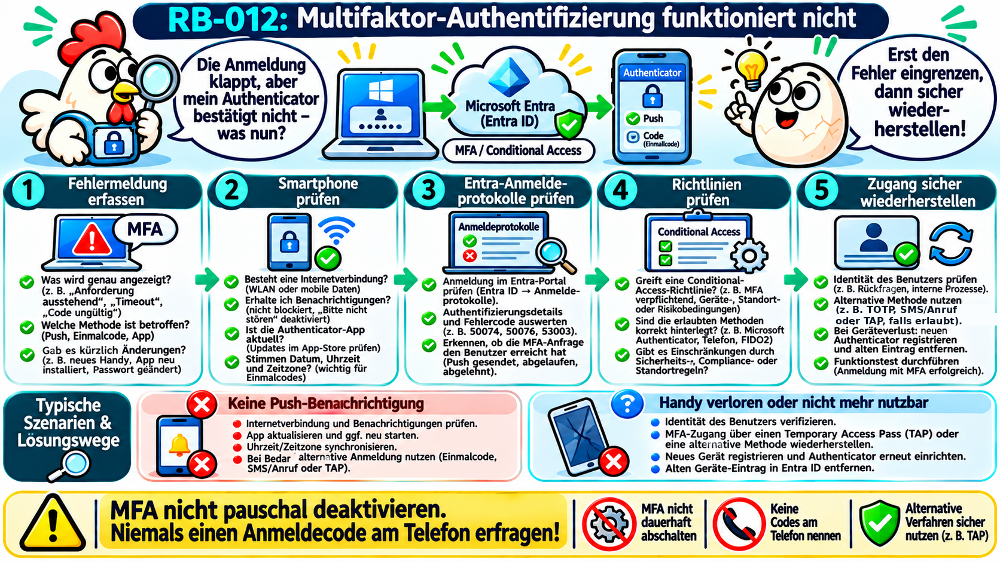
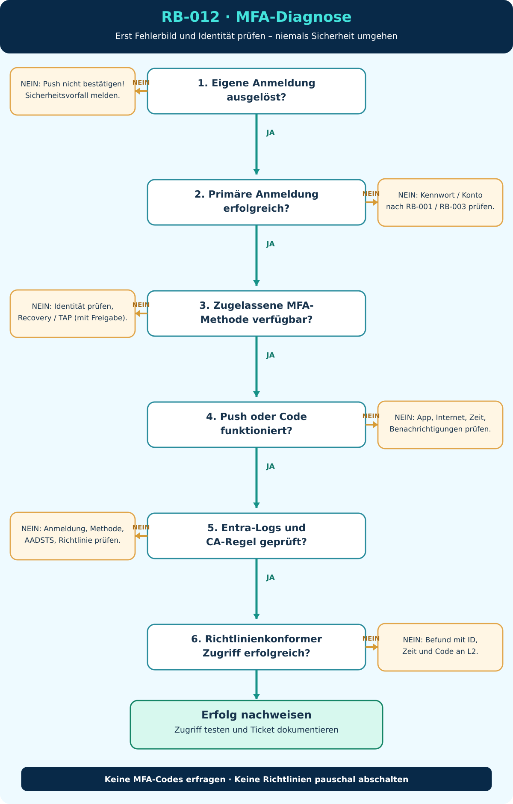

# RB-012 – Multifaktor-Authentifizierung (MFA) funktioniert nicht

> **50 Tickets – 50 typische Supportfälle**  
> **Ticket:** INC-012 · **Support-Level:** 1st / 2nd Level · **Systeme:** Microsoft Entra ID, Microsoft 365, Microsoft Authenticator, Windows 11, iOS/Android  
> **Dokumentationsstand:** 08.11.2026 · **Version:** 1.0  
> **Validierungsstatus:** Anhand offizieller Microsoft-Dokumentation recherchiert; **nicht praktisch validiert**. Sämtliche Personen, Konten und Beispielereignisse sind fiktiv.



*Eigene Konzeption, KI-gestützte Visualisierung mit ChatGPT. Didaktische Darstellung; die tatsächlich erlaubten Anmeldemethoden hängen von den Entra-Richtlinien ab. **Wichtige Präzisierung:** Eine E-Mail-Adresse ist bei gewöhnlichen Microsoft-Entra-Arbeits-/Schulkonten nicht automatisch ein zulässiger zweiter MFA-Faktor; E-Mail kann beispielsweise zur Self-Service-Kennwortrücksetzung eingesetzt werden. Die konkrete Methodenrichtlinie ist maßgeblich.*

## 1. Ausgangssituation: Das Supportticket

**Fiktives Ticket INC-012**

> „Mein Microsoft-365-Kennwort wird akzeptiert, aber auf meinem Smartphone kommt keine Bestätigungsaufforderung mehr. Gestern ging es noch. Ich kann Outlook und Teams deshalb nicht öffnen.“

**Beispielumgebung:** Benutzer `m.mustermann@firma.example`, Microsoft Entra ID als Cloud-Identitätsdienst, Microsoft 365 und Microsoft Authenticator auf einem Android-Smartphone. `firma.example` ist eine reservierte Beispieldomäne; keine echten Zugangsdaten verwenden.

**Ziel:** Herausfinden, ob die Anmeldeanforderung überhaupt bei der richtigen Authentifizierungsmethode ankommt, warum sie nicht erfolgreich abgeschlossen wird und wie der Zugang **ohne Abschalten von MFA** sicher wiederhergestellt werden kann.

**Leitsatz:** „MFA geht nicht“ beschreibt noch nicht den Fehler. Ein Smartphone ohne Benachrichtigung, ein verlorenes Gerät und eine durch Sicherheitsrichtlinien verweigerte Anmeldung benötigen unterschiedliche Lösungen.

## 2. Grundlagen: Was bedeutet MFA und was wird überprüft?

**MFA (Multi-Factor Authentication; Multifaktor-Authentifizierung)** bedeutet, dass eine Anmeldung durch mehr als einen unabhängigen Faktor abgesichert wird. Typische Faktorarten:

| Faktor | Bedeutung | Beispiel |
|---|---|---|
| **Wissen** | Etwas, das der Benutzer weiß | Kennwort oder PIN |
| **Besitz** | Etwas, das der Benutzer besitzt | Registriertes Smartphone, Hardware-Sicherheitsschlüssel |
| **Biometrie** | Ein persönliches körperliches Merkmal | Fingerabdruck oder Gesichtserkennung |

**Wichtig:** Zwei Kennwörter sind nicht automatisch zwei unterschiedliche Faktoren. Eine PIN kann in einem geeigneten gerätegebundenen System einen Schlüssel entsperren; sie ist dann nicht einfach eine zweite frei übertragbare Kennwortabfrage. Für eine konkrete Entra-Anmeldung zählt, welche Methode und welche **Authentifizierungsstärke** die Richtlinie anerkennt.

### Beteiligte Systeme – stark vereinfacht

```text
Windows-PC / Browser / Outlook
         |
         v
Microsoft Entra ID (Cloud-Identitätsdienst)
         |
         +-- Kennwort / primäre Anmeldung oder passwortlose Methode
         |
         +-- MFA-Anforderung / Conditional Access
                    |
                    +--> Microsoft Authenticator (Push oder Code)
                    +--> zugelassene weitere Methode, z. B. FIDO2
                    +--> Wiederherstellung über Temporary Access Pass (falls erlaubt)
         |
         v
Zugriffstoken / Anwendung (z. B. Microsoft 365)
```

Die tatsächliche Reihenfolge hängt vom Anmeldeverfahren ab: *Passwortlose Anmeldung* und ein **Passkey** funktionieren nicht einfach als „Kennwort plus zusätzliche Push-Nachricht“. Die Grafik ist deshalb ein Lernmodell, kein vollständiger Netzwerk-Mitschnitt.

**Microsoft Authenticator:** App für Android und iOS, die Push-Bestätigungen, Einmalcodes und unter bestimmten Voraussetzungen passwortlose Anmeldeverfahren beziehungsweise Passkeys bereitstellt. **Microsoft Entra ID:** Cloud-Dienst, der Benutzeridentitäten und Zugriffsbedingungen verwaltet. **Conditional Access (bedingter Zugriff):** Regeln, die eine Cloud-Anmeldung abhängig von Benutzer, Anwendung, Gerätezustand, Risiko und weiteren Kriterien erlauben, blockieren oder zusätzliche Nachweise verlangen.

Quellen: [Microsoft Authenticator – Grundlagen](https://learn.microsoft.com/de-de/entra/identity/authentication/concept-authentication-authenticator-app) · [Authentifizierungsstärken](https://learn.microsoft.com/de-de/entra/identity/authentication/concept-authentication-strengths)

## 3. Abkürzungen und Begriffe für Anfänger

| Begriff | Erklärung | Warum wichtig? |
|---|---|---|
| **MFA** | Multi-Factor Authentication – Anmeldung über mehrere unabhängige Faktoren | Schützt vor alleiniger Nutzung gestohlener Kennwörter. |
| **Entra ID** | Microsofts cloudbasierter Identitäts- und Zugriffsverwaltungsdienst | Bewertet Cloud-Anmeldungen und verwaltet Authentifizierungsmethoden. |
| **Tenant** | Logisch getrennte Microsoft-Cloud-Organisation („Mandant“) | Benutzer und Richtlinien gehören zu einem bestimmten Unternehmen. |
| **Authenticator** | Microsoft-App zur Bestätigung oder Codeerzeugung | Auf dem Smartphone können mehrere Konten registriert sein. |
| **Push** | Benachrichtigung, die eine Prüfung oder Bestätigung in der App anfordert | Benötigt geeignete App-/Geräte-/Netzwerkvoraussetzungen. |
| **Number Matching** | Nummernabgleich: Die im Anmeldefenster gezeigte Zahl wird in der Authenticator-App eingegeben | Schützt gegen versehentliche Freigaben; eine Aufforderung muss zur eigenen Anmeldung passen. |
| **TOTP** | Time-based One-Time Password – zeitabhängiger Einmalcode | Benötigt korrekte Zeit; typischerweise ohne Push-Nachricht. |
| **OATH** | Initiative/Standards für zeitbasierte oder ereignisbasierte Einmalcodes | Häufig im Zusammenhang mit Authenticator-Codes. |
| **FIDO2 / Passkey** | Kryptografische, geräte- oder schlüsselbasierte Anmeldemethode | Kann phishing-resistente Anmeldung ermöglichen. |
| **Conditional Access** | Richtlinien für bedingten Zugriff auf Cloud-Ressourcen | Kann MFA oder stärkere Methoden verlangen – oder Zugang blockieren. |
| **Authentication Strength** | Authentifizierungsstärke: definierte Mindestkombination von Methoden | Eine vorhandene SMS-Methode kann für eine geforderte phishing-resistente Anmeldung unzureichend sein. |
| **TAP** | Temporary Access Pass – befristeter Zugriffspass | Kontrollierte Konto-Wiederherstellung und Registrierung neuer Methoden. |
| **UPN** | User Principal Name – Anmeldename, oft im E-Mail-Format | Identifiziert den Benutzer in Entra ID. |
| **Microsoft Graph** | Microsoft-Schnittstelle zur Verwaltung und Abfrage von Cloud-Ressourcen | Ermöglicht lesende PowerShell-Analysen mit Rollen/Scopes. |
| **Scope** | Angeforderte API-Berechtigung für die Programmsitzung | Ein Scope allein ersetzt keine passende Administrationsrolle. |
| **SSPR** | Self-Service Password Reset – eigenständige Kennwortzurücksetzung | Nicht gleichbedeutend mit MFA-Wiederherstellung. |
| **AADSTS** | Präfix für viele Microsoft-Entra-Anmeldefehlercodes | Hilfreich für die Zuordnung in den Anmeldeprotokollen. |
| **Sign-in Logs** | Entra-Anmeldeprotokolle | Zeigen Status, Methoden und angewendete Richtlinien. |

## 4. Die vier wichtigsten Fehlerbilder unterscheiden

| Benutzerbeobachtung | Mögliche Ursachen | Nächste sichere Prüfung |
|---|---|---|
| **A. Keine Push-Benachrichtigung** | App-Benachrichtigungen gesperrt, Smartphone offline, Energiesparen, veraltete App, falsche Methode | Benachrichtigungseinstellungen, App, Verbindung und Entra-Anmeldedetails prüfen |
| **B. Code wird abgelehnt/ist abgelaufen** | Falsches Konto, Zeitabweichung, Tippfehler, nicht mehr gültige Registrierung | Konto/Codeart und automatische Gerätezeit prüfen; Fehlercode dokumentieren |
| **C. Neues/defektes/verlorenes Smartphone** | Registrierte Methode auf nicht mehr verfügbarem Gerät | Identität sicher prüfen; zugelassene Ersatzmethode oder TAP verwenden |
| **D. MFA erfüllt, aber Zugriff verweigert** | Conditional-Access-Richtlinie, erforderliche Authentifizierungsstärke, Gerätekonformität oder Risikoprüfung | Entra-Anmeldeprotokoll → Authentifizierungsdetails und Conditional Access |

**Sonderfall:** Benutzer erhält eine Push-Aufforderung, ohne selbst eine Anmeldung gestartet zu haben. **Nicht genehmigen!** Als möglichen Sicherheitsvorfall behandeln und nach Unternehmensverfahren melden – nicht als normales Benachrichtigungsproblem abtun.

## 5. Zugriff und Diagnose: Wo arbeitet der Support?

| Situation | Zugriffsweg | Konkretes Vorgehen / Grenzen |
|---|---|---|
| Benutzer kann am PC arbeiten, aber nicht in Microsoft 365 anmelden | Telefon, Teams über eine noch verfügbare Sitzung, andere freigegebene Fernwartung | Exakte Meldung und Smartphone-Einstellungen gemeinsam prüfen; kein MFA-Code im Gespräch abfragen |
| Benutzer kann seine Sicherheitsinformationen mit einer anderen gültigen Methode öffnen | [mysignins.microsoft.com/security-info](https://mysignins.microsoft.com/security-info) | Benutzer verwaltet nach Richtlinie selbst alternative Methoden |
| Benutzer hat keine nutzbare MFA-Methode mehr | Microsoft Entra Admin Center mit geeignetem Administrationskonto | Identität nach Sicherheitsprozess verifizieren; TAP oder genehmigte Neuregistrierung durchführen |
| Mehrere Mitarbeiter gleichzeitig betroffen | Entra-Dienststatus, Anmeldeprotokolle, zentrale Methoden-/Conditional-Access-Richtlinien | Vor Massenänderungen Auswirkungen und Security-Verantwortliche klären |
| Kein Zugriff auf Admin Center oder fehlende Rechte | Berechtigtes Identitäts-/Security-Team (L2) | Fehlercodes, Zeit, Benutzer-UPN und Korrelations-ID eskalieren, keine Sicherheitsregeln umgehen |

**Begriffe:** *Zentrale Verwaltung* heißt hier: Der Administrator untersucht den Benutzerstatus auf der Unternehmensplattform, **ohne sich auf dem betroffenen Windows-PC anmelden zu müssen**. Das ist keine Bearbeitung einer lokalen Gruppenrichtlinie (GPO). **GPOs** steuern klassische Windows-/Domänenkonfigurationen, während Entra-Authentifizierungsmethoden und Conditional Access in der Cloud verwaltet werden.

## 6. Diagnose-Entscheidungsbaum



**Textalternative:** Benutzer startet Anmeldung? Nein, unbekannte Push-Anfrage → Sicherheitsvorfall. Ja → Passwort/Primäranmeldung erfolgreich? Nein → RB-001/RB-003. Ja → MFA angefordert? Nein → anderes Anmeldeproblem. Ja → ist Gerät/Methode verfügbar? Nein → Identitätsprüfung und Wiederherstellung. Ja → Push/Code lokal prüfen. Danach Entra-Anmeldedetails und Conditional Access prüfen. Nur bestätigte Ursache beheben, Funktionstest, Dokumentation.

## 7. L1: Problemaufnahme und Smartphone prüfen (zunächst ohne Änderungen)

**Fragen:** Welche genaue Fehlermeldung? Seit wann? Nur ein Gerät oder mehrere? Welche Anwendung? App/Push/Einmalcode/Passkey? Smartphone gewechselt? Eigene Anmeldung ausgelöst? Sind weitere Mitarbeiter betroffen?

### 7.1 Sichere Benutzerprüfungen

1. Smartphone besitzt Internetzugang (WLAN oder mobile Daten), Flugmodus aus.
2. Richtige Microsoft-Authenticator-App, richtiges Geschäfts-/Schulkonto ausgewählt.
3. App ist aktuell; Systemuhr und Zeitzone werden automatisch bezogen.
4. App-Benachrichtigungen und Betriebsmodi prüfen (Nicht stören, Batterieoptimierung).
5. Bei Push-Bestätigung die **zur eigenen Anmeldung gehörige Nummer** korrekt vergleichen.
6. Nur falls von der Richtlinie vorgesehen: **Andere Anmeldemethode verwenden** und eine bereits registrierte Alternative auswählen.

**Nicht als Erstmaßnahme:** App-Konto entfernen, App deinstallieren, Smartphone zurücksetzen, MFA generell deaktivieren oder wiederholt unbekannte Push-Anfragen bestätigen. Eine Entfernung der einzigen registrierten Methode kann den Zugang weiter erschweren.

**Wichtig:** Microsoft beschreibt bei Authenticator mögliche Benachrichtigungs-, Verbindungs-, Uhrzeit- und Aktualisierungsprobleme. Diese lokalen Ursachen erklären jedoch nicht jeden serverseitigen Anmeldefehler. [Microsoft Support: Authenticator-Problembehandlung](https://support.microsoft.com/de-de/authenticator/troubleshoot-problems-with-microsoft-authenticator)

### 7.2 Push und Einmalcode nicht verwechseln

- **Push:** Eine bestehende Internetverbindung und der Benachrichtigungskanal des Smartphones spielen mit hinein.
- **Zeitbasierter Einmalcode (TOTP):** Der Code wird durch einen synchronisierten geheimen Schlüssel und die aktuelle Zeit erzeugt; es ist nicht in jedem Fall eine laufende Internetverbindung zum Anzeigen des Codes nötig.
- **Number Matching:** Microsoft fordert beim Push-Verfahren die Übernahme einer angezeigten Nummer in die App. Der Support **erfragt die Nummer oder den Code nicht**, um sich selbst als Benutzer anzumelden.

Quelle: [Microsoft Learn – Nummernabgleich](https://learn.microsoft.com/de-de/entra/identity/authentication/how-to-mfa-number-match)

## 8. Entra-Anmeldeprotokolle: Der zuverlässigere nächste Schritt

**Ausführungsort:** [Microsoft Entra Admin Center](https://entra.microsoft.com/) im Browser des berechtigten Support-/Administrationsrechners. Zum Anzeigen von Anmeldeprotokollen benötigt das Konto eine geeignete Rolle, z. B. **Reports Reader (Berichtsleser)**. Verfügbarkeit von Detaildaten und Aufbewahrungszeit hängen von Lizenzierung und Protokollkonfiguration ab.

**Navigation:** **Entra ID → Überwachung & Integrität → Anmeldeprotokolle** (Oberflächentexte können versions- und sprachabhängig abweichen).

**Vorgehen:** Benutzer-UPN, Zeitfenster und Anwendung filtern → das passende Anmeldeereignis öffnen → Registerkarten **Basic info / Grundlegende Informationen**, **Authentication Details / Authentifizierungsdetails**, **Conditional Access / bedingter Zugriff** prüfen.

| Feld | Interpretation | Hinweis |
|---|---|---|
| Benutzer/UPN | Ist das richtige Konto betroffen? | Gleiche Anzeigenamen können unterschiedliche Konten haben. |
| Status / AADSTS-Code | Warum wurde die Anmeldung abgewiesen oder nicht abgeschlossen? | Code immer mit den Details prüfen. |
| Zeitpunkt / Correlation ID | Zuordnung zu genau diesem Anmeldeversuch | Bei Eskalation hilfreich; Zeitzonen beachten. |
| Authentication Details | Welche Methode wurde versucht, und mit welchem Ergebnis? | Hilft zwischen Push, Code und Richtlinienproblem zu unterscheiden. |
| Conditional Access | Welche Richtlinien wurden ausgewertet bzw. haben blockiert? | Manche Details benötigen zusätzliche Rollen. |
| Geräteinformationen | Verwaltet, konform, Browser/Betriebssystem | Kein Beweis für die physische Position. |

**Typische Fehlercodes (Diagnosehinweise, keine alleinige Ursachenbestätigung):**

| Code | Bedeutung | Geeigneter nächster Schritt |
|---|---|---|
| **AADSTS500121** | MFA-Anforderung nicht abgeschlossen | Was meldet die Authentifizierungsdetailansicht? App, Benutzeraktion, Zeitfenster und Methode vergleichen. |
| **AADSTS53000** | Gerät erfüllt die erforderliche Konformität nicht | Gerätekonformität und zuständige Richtlinie prüfen; Intune-/L2-Team. |
| **AADSTS53003** | Zugriff durch Conditional Access blockiert | Konkrete Richtlinie und deren Bedingungen untersuchen, nicht pauschal MFA deaktivieren. |

**Präzisierung:** Bei einigen Anmeldeabläufen werden mehrere Einträge erzeugt, und ein scheinbar erfolgreicher Schritt heißt nicht, dass die gesamte Anmeldung erfolgreich war. Außerdem schützt Conditional Access **Cloud-Ressourcen**, nicht unmittelbar den lokalen Windows-Anmeldebildschirm.

Quellen: [Entra-Anmeldeprotokolle](https://learn.microsoft.com/en-us/entra/identity/monitoring-health/concept-sign-ins) · [Anmeldedetails interpretieren](https://learn.microsoft.com/de-de/entra/identity/monitoring-health/concept-sign-in-log-activity-details) · [Conditional Access untersuchen](https://learn.microsoft.com/en-us/entra/identity/conditional-access/troubleshoot-conditional-access)

## 9. PowerShell: Lesende Diagnose mit Microsoft Graph

**Achtung:** Für Cloud-Anmeldungen verwendet man nicht `Get-ADUser` oder ein lokales Windows-Ereignis 4625 als primäre Entra-Diagnose. Geeignet sind das **Entra Admin Center** und ggf. **Microsoft Graph PowerShell**. Die Beispiele sind **nur lesend**, setzen eine vom Unternehmen genehmigte Microsoft-Graph-Installation, passende API-Scopes und Entra-Rollen voraus und verwenden fiktive Benutzernamen.

### 9.1 Modul prüfen und eine berechtigte Sitzung aufbauen

**Ausführungsort:** Freigegebener Administrationsrechner mit PowerShell 7 oder unterstützter Windows PowerShell.

```powershell
# Prüft, ob das Graph-Authentifizierungsmodul bereits installiert ist.
# Dieser Befehl verändert das System nicht.
Get-Module -ListAvailable Microsoft.Graph.Authentication

# Prüft, ob das Berichtsmodul für Entra-Anmeldeprotokolle vorhanden ist.
Get-Module -ListAvailable Microsoft.Graph.Reports

# Prüft, ob das Modul für Authentifizierungsmethoden vorhanden ist.
Get-Module -ListAvailable Microsoft.Graph.Identity.SignIns

# Baut eine Graph-Verbindung mit angefragten LESEberechtigungen auf.
# -Scopes legt die beantragten API-Berechtigungen fest.
# Eine Anmeldung und ggf. Administratorzustimmung können erforderlich sein.
Connect-MgGraph -Scopes 'AuditLog.Read.All','UserAuthenticationMethod.Read.All'

# Zeigt, unter welchem Konto und mit welchen Scopes die Sitzung läuft.
Get-MgContext | Select-Object Account, TenantId, Scopes
```

**Interpretation:** Eine erfolgreiche Anmeldung bei Graph bedeutet **nicht**, dass alle Daten gelesen werden dürfen. Zusätzlich können passende Entra-Rollen und Genehmigungen erforderlich sein. Module niemals ohne Freigabe auf Unternehmenssystemen installieren.

### 9.2 Benutzeranmeldungen abfragen

```powershell
# Beispielkonto: nur Platzhalter aus der Dokumentation.
$userUpn = 'm.mustermann@firma.example'

# Erstellt einen OData-Filter für genau dieses Benutzerkonto.
# Nur die Anmeldungen dieses Kontos werden angefordert.
$filter = "userPrincipalName eq '$userUpn'"

# Liest maximal 10 jüngere Ereignisse über Microsoft Graph.
# Dies ist eine reine Leseoperation.
$signIns = Get-MgAuditLogSignIn -Filter $filter -Top 10

# Zeigt Zeitpunkt, Anwendung, Ergebniscode und Korrelations-ID an.
$signIns |
    Sort-Object CreatedDateTime -Descending |
    Select-Object CreatedDateTime, AppDisplayName, CorrelationId,
        @{Name='ErrorCode';Expression={$_.Status.ErrorCode}},
        @{Name='FailureReason';Expression={$_.Status.FailureReason}}
```

**Ergebnis:** Fehlercode und Uhrzeit mit dem vom Benutzer gemeldeten Versuch abgleichen. Der Fehlercode ist ein Ausgangspunkt, nicht die vollständige Ursache. Bei unklaren Authentifizierungsdetails ist die Portalansicht häufig übersichtlicher.

Quelle: [Microsoft Learn – Get-MgAuditLogSignIn](https://learn.microsoft.com/en-us/powershell/module/microsoft.graph.reports/get-mgauditlogsignin)

### 9.3 Registrierte Authenticator-Methoden abfragen

```powershell
# Das zu prüfende Benutzerkonto bestimmen.
$userUpn = 'm.mustermann@firma.example'

# Listet registrierte Microsoft-Authenticator-Methoden des Kontos.
# Dieser Befehl führt KEINE Neuregistrierung und KEINE Löschung aus.
Get-MgUserAuthenticationMicrosoftAuthenticatorMethod -UserId $userUpn |
    Select-Object Id, DisplayName, DeviceTag, PhoneAppVersion
```

**Interpretation:** Eine registrierte Methode beweist nicht, dass das Smartphone aktuell erreichbar oder verwendbar ist. Wenn keine Methode erscheint, trotzdem die Methodenrichtlinie, den Benutzerkontext und die Abfrageberechtigung prüfen. Geräteinformationen und Registrierungen sind Sicherheitsdaten und gehören nicht ungeschützt in öffentliche Dokumentation.

Quelle: [Microsoft Learn – Get-MgUserAuthenticationMicrosoftAuthenticatorMethod](https://learn.microsoft.com/powershell/module/microsoft.graph.identity.signins/get-mguserauthenticationmicrosoftauthenticatormethod)

## 10. Conditional Access und Authentifizierungsstärke – der L2-Zweig

**Fallbeispiel:** Die Mitarbeiterin kann sich zwar mit ihrem Kennwort anmelden und eine SMS empfangen, aber eine bestimmte Anwendung fordert eine *phishing-resistente Authentifizierung*. Eine SMS reicht für diese Richtlinie **nicht** aus.

**Daraus folgt:** Eine vorhandene alternative Methode ist nicht automatisch eine **zulässige** alternative Methode. Es kommt auf die konkrete Kombination der Authentifizierungsstärke an. Nach Microsofts Dokumentation gehören beispielsweise geeignete FIDO2-Passkeys/Sicherheitsschlüssel zu den phishing-resistenten Methoden; eine gewöhnliche SMS-Bestätigung nicht.

Für die Analyse: passende Anmeldung öffnen → Conditional-Access-Tab → betroffene Richtlinie und erforderliche Steuerelemente → zugelassene Methodenrichtlinie → Geräte- und Benutzerbedingungen. Richtlinien nicht global abschalten, um einem Einzelfall kurzfristig Zugriff zu geben.

Quellen: [Authentifizierungsstärken](https://learn.microsoft.com/de-de/entra/identity/authentication/concept-authentication-strengths) · [Richtlinien für Authentifizierungsmethoden](https://learn.microsoft.com/de-de/entra/identity/authentication/concept-authentication-methods-manage) · [Conditional Access – Fehleranalyse](https://learn.microsoft.com/en-us/entra/identity/conditional-access/troubleshoot-conditional-access)

## 11. Gerät verloren oder ersetzt: Sicherer Wiederherstellungsweg

**Voraussetzung für jede administrative Wiederherstellung:** Benutzeridentität nach dem **intern freigegebenen Identitätsprüfungsverfahren** feststellen. Ein behaupteter Name in einem Telefonanruf oder eine E-Mail allein genügt nicht. Verfahren können beispielsweise ein Rückruf über eine bereits bekannte interne Nummer, eine dokumentierte persönliche Identifizierung oder weitere durch die Organisation vorgeschriebene Nachweise sein. **Keine Kennwörter, TANs, Einmalcodes oder Authenticator-Bestätigungen abfragen.**

### 11.1 Wenn eine bereits registrierte Alternative verfügbar ist

Der Benutzer kann, **falls richtlinienkonform**, während der Anmeldung „Andere Methode verwenden“ auswählen und anschließend seine Sicherheitsinformationen unter [mysignins.microsoft.com/security-info](https://mysignins.microsoft.com/security-info) pflegen. Die neue Methode erst erfolgreich testen, bevor die alte, nicht mehr verfügbare Registrierung entfernt wird.

### 11.2 Wenn keine Methode verfügbar ist: Temporary Access Pass (TAP)

Ein **TAP (Temporary Access Pass; befristeter Zugriffspass)** ist ein zeitlich begrenzter Anmeldecode, der einmalig oder mehrfach innerhalb seines Gültigkeitsfensters verwendet werden kann. Er unterstützt insbesondere die **Registrierung neuer sicherer Authentifizierungsmethoden**, wenn die bisherigen verloren gegangen sind.

**Administrativer Ablauf (nur nach Freigabe):**

1. Identität des Mitarbeiters nach Unternehmensvorgabe nachweisbar prüfen; Ticket und Berechtigung erfassen.
2. Prüfen, ob die **TAP-Methode in der Entra-Authentifizierungsmethodenrichtlinie** für diesen Benutzer zugelassen ist.
3. Berechtigter Administrator öffnet **Entra ID → Benutzer → [Benutzer] → Authentifizierungsmethoden → Authentifizierungsmethode hinzufügen → Temporary Access Pass**.
4. Geeignetes, möglichst kurzes Gültigkeitsfenster und gegebenenfalls **Einmalverwendung** entsprechend Unternehmensrichtlinie festlegen.
5. Code auf **freigegebenem, vertraulichem Weg** an den nachweislich identifizierten Benutzer übergeben. **Nie im Ticket, öffentlichen Chat oder unverschlüsselten Wissensartikel speichern.**
6. Benutzer registriert mit dem TAP eine neue zulässige Methode, testet seine Anmeldung und entfernt nach Freigabe alte, nicht mehr nutzbare Registrierungen.
7. Wiederherstellung samt administrativer Aktion und erfolgreicher Kontrolle dokumentieren – ohne Geheimniswerte.

**Berechtigungen:** Zum Anlegen von TAPs für reguläre Benutzer ist typischerweise die Rolle **Authentication Administrator** oder eine passend privilegierte Rolle erforderlich; das Aktivieren der TAP-Richtlinie braucht **Authentication Policy Administrator**. Administratoren können nicht beliebig ihre eigenen Methoden zurücksetzen. Der Gültigkeitsbereich und die erlaubte Nutzung werden durch die Richtlinie eingeschränkt.

**Achtung:** Ein TAP ersetzt nicht allgemein das normale Kennwort. Außerdem bedeutet sein Ablauf nicht zwingend, dass zuvor ausgestellte Sitzungstoken augenblicklich verschwinden.

Quelle: [Microsoft Learn – Temporary Access Pass](https://learn.microsoft.com/de-de/entra/identity/authentication/howto-authentication-temporary-access-pass)

### 11.3 „Require re-register MFA“ nicht als Standardknopf verwenden

Die Entra-Option **„Erneute MFA-Registrierung erforderlich“** kann vorhandene Telefonnummern, Authenticator-Apps und weitere Authentifizierungsmethoden entfernen beziehungsweise zurücksetzen. Das ist eine **verändernde administrative Aktion**, die einen Benutzer ohne Wiederherstellungsweg aussperren kann. Sie ist **kein harmloser Test** und darf nicht ohne Identitätsprüfung, Berechtigung, dokumentierte Freigabe und funktionierenden Wiederherstellungsplan eingesetzt werden.

Auch **Sitzungen widerrufen** ist ein eigener Vorgang und nicht identisch mit dem Austausch einer Authenticator-Registrierung.

Quelle: [Microsoft Learn – Authentifizierungsmethoden verwalten](https://learn.microsoft.com/de-de/entra/identity/authentication/howto-mfa-userdevicesettings)

## 12. Diagnosebeispiele – Hypothese gegen Befund

| Technischer Befund | Plausible Ursache | Gezielte, sichere Maßnahme |
|---|---|---|
| Entra-Anmeldung zeigt MFA-Anfrage, aber keine Push-Meldung am Smartphone | Benachrichtigung oder App/Netzwerkproblem; alternativ falsche registrierte Methode | Lokale Einstellungen und Entra-Registrierung abgleichen, nur freigegebene Korrektur durchführen |
| Zeitbasierter Code wird regelmäßig abgelehnt | Uhrzeitabweichung oder falsches Konto/Registrierung | Automatische Uhrzeit, betroffenen Account und verwendete Methode prüfen |
| Benutzer hat Smartphone verloren; kein Ersatzfaktor | Methode nicht verfügbar | Identitätsprüfung → TAP oder definierter Recovery-Prozess → neue Methode registrieren |
| Fehler **AADSTS53003** mit CA-Details | Conditional-Access-Sperre | Betroffene Regel, Geräte-/Risiko-/Anwendungsbedingungen durch zuständiges Team prüfen |
| SMS funktioniert, aber App verlangt phishing-resistente Authentifizierung | SMS erfüllt geforderte Authentifizierungsstärke nicht | Zugelassene stärkere Methode bereitstellen, keine Richtlinienabsenkung als Schnelllösung |
| Mehrere Benutzer gleichzeitig keine Push-Anforderung | Mögliches zentrales Dienst-/Richtlinienproblem | Dienststatus und zeitgleiche Entra-Ereignisse korrelieren, L2/Identity-Team |
| Unbekannte Push-Anfrage ohne eigene Anmeldung | Möglicher Angriff / unbefugte Anmeldung | Nicht bestätigen, Security-Incident-Prozess auslösen |

## 13. Erfolgskontrolle und Eskalation

**Ein erfolgreicher Login ist der maßgebliche Funktionstest.** Nur ein neuer Eintrag unter „Sicherheitsinformationen“ genügt nicht.

- [ ] Benutzer meldet sich mit der vorgesehenen Methode bei der betroffenen Anwendung an.
- [ ] Die gewählte MFA-Methode funktioniert; bei Number Matching stimmt die Zahl mit dem eigenen Anmeldevorgang überein.
- [ ] Der Zugang entspricht der geltenden Conditional-Access-Richtlinie.
- [ ] Nicht mehr verfügbare Methoden wurden nach Freigabe sicher bereinigt.
- [ ] Keine Geheimniswerte wurden im Ticket gespeichert.

**Eskalation an L2 / Identity / Security bei:** fehlenden administrativen Rechten, unklarer Identitätsprüfung, keiner möglichen Wiederherstellungsmethode, wiederholter Sperre durch Richtlinien, ungewöhnlichen Push-Anfragen, Problemen mehrerer Benutzer, gesperrten Administratoren oder Verdacht auf Kontoübernahme.

**Mitgeben:** Benutzer-UPN, Zeitpunkt inklusive Zeitzone, App, Fehlermeldung/AADSTS-Code, Correlation ID, anonymisierte Befunde, bereits versuchte **nicht-invasiven** Maßnahmen, Status der Identitätsprüfung – keine Kennwörter, QR-Geheimnisse, TAPs oder Einmalcodes.

## 14. Fiktiver Ticketabschluss und Lernkontrolle

### Muster-Ticketkommentar (fiktiver erfolgreicher Vorgang)

**Ticket:** INC-012 – Microsoft-365-Anmeldung scheitert bei MFA  
**Fehlerbild:** Nach Smartphone-Wechsel keine nutzbare Microsoft-Authenticator-Methode mehr verfügbar.  
**Diagnose:** Primäre Anmeldung erfolgreich. Anmeldeprotokolle auf betroffene MFA-Anforderung geprüft. Bisherige registrierte Authenticator-Methode verweist auf das nicht mehr verfügbare Gerät.  
**Sicherheitsprüfung:** Benutzeridentität gemäß dokumentiertem Unternehmensverfahren bestätigt; Maßnahme freigegeben.  
**Maßnahme:** Über genehmigten Temporary-Access-Pass-Prozess neue zulässige Authentifizierungsmethode registriert und alten Geräteeintrag nach Erfolgskontrolle entfernt.  
**Ergebnis:** Erfolgreiche Anmeldung an der betroffenen Anwendung mit der neuen MFA-Methode bestätigt.  
**Status:** Gelöst. Keine Codes/Token im Ticket dokumentiert.

### Anki-/Active-Recall-Lernfragen

**Wissensfragen:**
1. Wofür stehen MFA, TAP, TOTP und UPN?
2. Wo findet ein Administrator die Entra-Anmeldeprotokolle?
3. Was zeigt ein `AADSTS53003` grundsätzlich an?

**Verständnisfragen:**
4. Warum ist eine erfolgreiche Kennwortprüfung kein Beleg für eine abgeschlossene Cloud-Anmeldung?
5. Warum kann eine vorhandene SMS-Methode für eine Anwendung ungeeignet sein?
6. Warum ist „Require re-register MFA“ keine harmlose Diagnosemaßnahme?

**Diagnosefragen:**
7. Der Benutzer erhält keine Push-Benachrichtigung. Was untersuchst du lokal, was serverseitig?
8. Ein Benutzer meldet zehn unerwartete Bestätigungsanfragen. Welches Risiko liegt vor und was unterlässt du?
9. Ein Mitarbeiter hat sein einziges MFA-Gerät verloren. Welche Voraussetzungen gelten für die Wiederherstellung?

**Transferübung ohne vorgegebene Lösung:** Ein Mitarbeiter kann sich über einen FIDO2-Sicherheitsschlüssel bei einer Anwendung anmelden, bei einer zweiten Anwendung aber trotz registrierter Authenticator-Push-Methode nicht. Lege mindestens drei Diagnosehypothesen mit je einem geeigneten Test und einem konkreten erwarteten Befund fest. Formuliere danach eine 3-Satz-Eskalation an das Identity-Team.

## 15. Offizielle Quellen und Validierungsstatus

**Herstellerquellen (geprüft am 08.11.2026):**

1. [Microsoft Support – Authenticator-Probleme beheben](https://support.microsoft.com/de-de/authenticator/troubleshoot-problems-with-microsoft-authenticator) – App, Push, Zeit, Netzwerk und Benachrichtigungen.
2. [Microsoft Learn – Microsoft Authenticator als Authentifizierungsmethode](https://learn.microsoft.com/de-de/entra/identity/authentication/concept-authentication-authenticator-app) – Funktionsarten und Registrierung.
3. [Microsoft Learn – Nummernabgleich](https://learn.microsoft.com/de-de/entra/identity/authentication/how-to-mfa-number-match) – Nummernbestätigung bei Push-Anmeldungen.
4. [Microsoft Learn – Microsoft Entra-Anmeldeprotokolle](https://learn.microsoft.com/en-us/entra/identity/monitoring-health/concept-sign-ins) – Anmeldung, Fehlerfelder und Suchfilter.
5. [Microsoft Learn – Anmeldeprotokoll-Details](https://learn.microsoft.com/de-de/entra/identity/monitoring-health/concept-sign-in-log-activity-details) – Authentifizierungsdetails und Richtlinienauswertung.
6. [Microsoft Learn – Conditional-Access-Anmeldefehler](https://learn.microsoft.com/en-us/entra/identity/conditional-access/troubleshoot-conditional-access) – CA-Ursachen, AADSTS-Fehler und Richtlinienanalyse.
7. [Microsoft Learn – Authentifizierungsstärken](https://learn.microsoft.com/de-de/entra/identity/authentication/concept-authentication-strengths) – Welche Methoden die jeweilige Sicherheitsanforderung erfüllen.
8. [Microsoft Learn – Authentifizierungsmethoden verwalten](https://learn.microsoft.com/de-de/entra/identity/authentication/howto-mfa-userdevicesettings) – Registrierungs-Reset, administrative Rollen und Sitzungen.
9. [Microsoft Learn – Temporary Access Pass](https://learn.microsoft.com/de-de/entra/identity/authentication/howto-authentication-temporary-access-pass) – Ablauf und Wiederherstellung.
10. [Microsoft Learn – Get-MgAuditLogSignIn](https://learn.microsoft.com/en-us/powershell/module/microsoft.graph.reports/get-mgauditlogsignin) – Lesender Graph-Befehl.
11. [Microsoft Learn – Get-MgUserAuthenticationMicrosoftAuthenticatorMethod](https://learn.microsoft.com/powershell/module/microsoft.graph.identity.signins/get-mguserauthenticationmicrosoftauthenticatormethod) – Lesende Authenticator-Abfrage.
12. [Microsoft Learn – Richtlinien für Authentifizierungsmethoden](https://learn.microsoft.com/de-de/entra/identity/authentication/concept-authentication-methods-manage) – zulässige Verfahren und Richtlinienverwaltung.

**Was belegt ist:** Die grundsätzlichen Diagnose- und Wiederherstellungsverfahren sind anhand der verlinkten Herstellerdokumentation ausgearbeitet.  
**Was nicht belegt ist:** Es wurde kein realer Entra-Tenant oder echtes betriebsinternes Benutzerkonto untersucht. Es gibt keinen produktiven Nachweis für einen der Beispiel-Fehler.  
**Nächste praktische Validierung:** Nur mit ausdrücklicher Berechtigung in einem freigegebenen Testtenant, ohne reale Mitarbeiterkonten und ohne Absenkung der MFA-Sicherheit.
