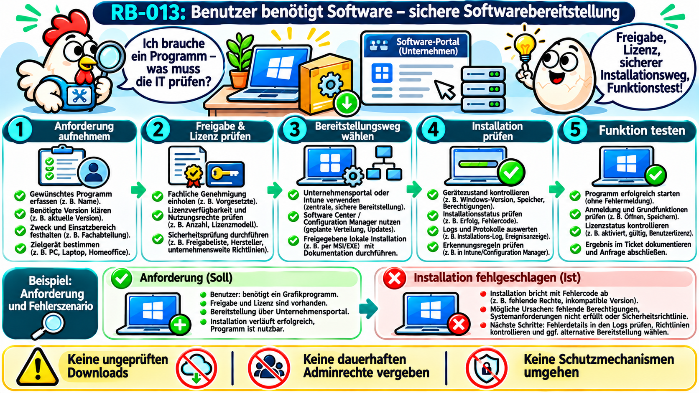
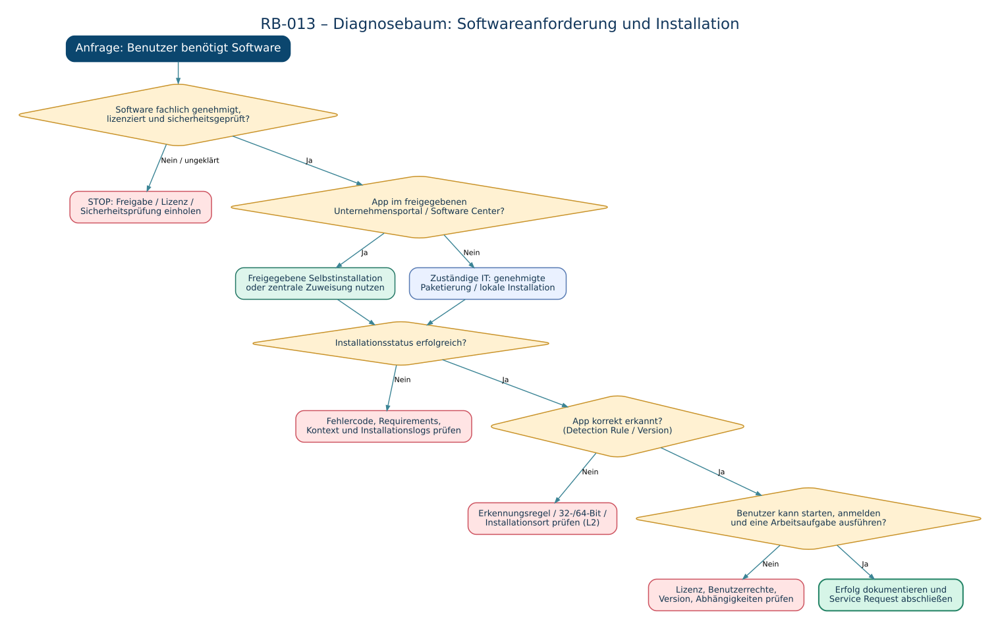

# RB-013 – Benutzer benötigt Software / Softwareinstallation

**Projekt:** 50 Tickets – 50 typische Supportfälle  
**Kategorie:** Service Request / Softwarebereitstellung / Windows-Client  
**Support-Level:** 1st / 2nd Level (betriebsabhängig)  
**Systeme:** Windows 11, Microsoft Intune, Microsoft Configuration Manager, Windows Installer, PowerShell  
**Version:** 1.0 · **Recherchedatum:** 08.11.2026  
**Status:** Technisch recherchiertes Fallbeispiel; **noch nicht praktisch validiert**.



> **Leitgedanke:** Eine installierte Anwendung ist noch nicht automatisch eine **genehmigte**, **korrekt lizenzierte**, **sicher bereitgestellte** und **funktionsfähige** Anwendung.

---

## 1. Ausgangssituation: Das Supportticket

**Fiktives Ticket SR-013:**

> „Ich benötige für meine Projektarbeit ein Programm zum Bearbeiten von PDF-Dateien. Auf meinem Laptop finde ich es nicht. Könnten Sie das bitte installieren? Ich habe morgen einen wichtigen Abgabetermin.“

**Auswirkung:** Ein benötigter Arbeitsablauf ist eingeschränkt. Es liegt nicht zwingend eine technische Störung vor.

**Ziel:** Die fachlich freigegebene und lizenzrechtlich zulässige Software in der passenden Version sicher bereitstellen, installieren und mit dem Benutzer testen.

**Warum Service Request?** Ein *Service Request* (Serviceanfrage) ist eine geplante Anforderung wie eine Softwarebereitstellung. Ein *Incident* (Störung) liegt dagegen beispielsweise vor, wenn eine bereits bereitgestellte Anwendung plötzlich nicht mehr funktioniert. Ein fehlschlagender Software-Rollout kann zusätzlich einen Incident oder ein Unterticket auslösen.

**Erste Rückfragen:** Welche Software wird benötigt? Wofür? Welche Version und Zusatzmodule? Bis wann? Auf welchem Gerät? Ist bereits eine Lizenz vorhanden? Ist die Software in der Unternehmensliste freigegeben? Ist die Anwendung möglicherweise schon installiert, aber nicht auffindbar?

## 2. Technische Grundlagen – Was ist „Software bereitstellen“?

Eine Softwarebereitstellung umfasst mehr als einen Installationsdialog. Sie besteht aus der **Anforderung, Berechtigungs- und Lizenzprüfung, Auswahl einer vertrauenswürdigen Quelle, Installation, Installationsnachweis, Funktionsprüfung und Dokumentation**.

### Begriffe und Abkürzungen

| Begriff | Einsteigererklärung |
|---|---|
| **Deployment** | Verteilung beziehungsweise Bereitstellung von Software auf einem oder vielen Geräten. |
| **Endpoint** | Verwaltetes Endgerät, zum Beispiel ein Windows-Laptop. |
| **Microsoft Intune** | Cloudbasierte Plattform zur Geräte- und Anwendungsverwaltung. |
| **Company Portal (Unternehmensportal)** | Von der IT bereitgestellter App-Katalog, aus dem Nutzer erlaubte Programme installieren können. |
| **Microsoft Configuration Manager** | Verwaltungsplattform für Geräte, Software und Betriebssysteme, oft mit lokalen Unternehmensinfrastrukturen. |
| **Software Center** | Benutzeroberfläche für durch Configuration Manager bereitgestellte Software. Nicht dasselbe wie das Intune-Unternehmensportal. |
| **MSI (Microsoft Installer-Paket)** | Installationspaket, das von **Windows Installer** beziehungsweise `msiexec.exe` verarbeitet wird. |
| **EXE (Executable)** | Ausführbare Programmdatei; Installationsparameter unterscheiden sich je nach Hersteller und Installer. |
| **Win32-App** | In Intune verwaltete klassische Windows-Desktopanwendung, häufig als `.intunewin` verpackt. |
| **IME (Intune Management Extension)** | Verwaltungsagent auf Windows-Geräten, der unter anderem Intune-Win32-App-Aktionen verarbeitet. |
| **Assignment (Zuweisung)** | Festlegung, für welche Benutzer oder Geräte die App bereitsteht beziehungsweise automatisch installiert werden soll. |
| **Detection Rule (Erkennungsregel)** | Regel, die kontrolliert, ob eine App als installiert erkannt wird, etwa anhand von Datei, Registry oder MSI-Produktcode. |
| **Installationskontext** | Konto, unter dem das Setup ausgeführt wird: etwa aktueller Benutzer oder `SYSTEM` (lokales Windows-Systemkonto). |
| **UAC (User Account Control)** | Windows-Benutzerkontensteuerung, die administrative Änderungen absichert. |
| **Hashwert / SHA-256** | Prüfsumme eines Dateiinhalts; mit einem **vertrauenswürdig vom Hersteller gelieferten Vergleichswert** lassen sich Veränderungen feststellen. |
| **Digital signiert** | Eine Datei kann eine überprüfbare Herausgebersignatur enthalten; das ersetzt keine Unternehmensfreigabe. |

### Der Ablauf in vier Systemebenen

```text
Mitarbeiter / Service-Desk-Ticket
       |
       v
Freigabe + Lizenz + Sicherheitsrichtlinie
       |
       v
IT-App-Katalog / Intune / Configuration Manager / genehmigtes MSI-Setup
       |
       v
Verwalteter Windows-Client --> Installation --> Erkennung --> Funktionstest
```

Ein Installationspaket ist dabei nicht automatisch eine Benutzerlizenz. Je nach Lizenzmodell kann zusätzlich eine Aktivierung, die Anmeldung mit einem Firmenkonto oder eine Lizenzzuweisung erforderlich sein.

**Quelle:** Microsoft Learn – [Intune Win32-App-Verwaltung](https://learn.microsoft.com/de-de/intune/app-management/deployment/win32).

## 3. Die häufigsten Varianten der Anfrage

| Meldung des Benutzers | Worum handelt es sich? | Erste Prüfung |
|---|---|---|
| „Ich brauche Programm X.“ | Neue Softwareanforderung | Geschäftsbedarf, Genehmigung, Lizenz, freigegebener Katalog |
| „Das Programm ist im Portal nicht sichtbar.“ | Zuweisungs-/Katalogproblem | Benutzer/Gruppe, Gerät, App-Zuweisung und Portalstatus |
| „Installieren schlägt fehl.“ | Deployment-/Installationsstörung | Fehlermeldung, Installationstyp, Log, Status und Rückgabecode |
| „Es steht ‚installiert‘, aber ich finde es nicht.“ | Erkennungs-, Installations- oder Verknüpfungsproblem | Installationsort, App-Inventar, Erkennungsregel, Benutzerkontext |
| „Das Programm startet, aber meldet keine Lizenz.“ | Aktivierungs-/Zugriffsproblem | Lizenzzuweisung, Anmeldestatus, Abonnement, Netzabhängigkeiten |
| „Das Programm startet, aber eine Funktion fehlt.“ | Funktions-/Versionsproblem | Edition, Plugins, Lizenzumfang, Berechtigungen und benötigte Komponenten |

**Merksatz:** „Installation erfolgreich“ ≠ „App korrekt erkannt“ ≠ „Benutzer kann produktiv damit arbeiten“.

## 4. Sicherheit, Lizenzen und Freigaben – der erste Prüfpunkt

Bevor Software verteilt wird, werden insbesondere fünf Fragen geklärt:

1. **Fachliche Freigabe:** Wird die Software für die Tätigkeit benötigt? Ist sie im Standardkatalog enthalten oder muss die Fachabteilung zustimmen?
2. **Lizenz:** Sind ausreichende Nutzungsrechte vorhanden? Gilt die Lizenz pro Benutzer, pro Gerät, nach Funktionen oder über einen Firmenvertrag?
3. **Hersteller/Bezugsquelle:** Stammt das Paket aus dem genehmigten Repository oder von einer verifizierten offiziellen Herstellerquelle?
4. **IT-Sicherheit:** Ist die Version freigegeben? Gibt es Sicherheits-, Datenschutz-, Kompatibilitäts- oder Supportvorgaben?
5. **Installation:** Darf der Service Desk das Paket selbst bereitstellen, oder ist dies Aufgabe der Softwareverwaltung beziehungsweise der Paketierung?

**Nicht tun:** Unkontrolliert von Downloadportalen installieren, Sicherheitsmeldungen umgehen, dauerhaft lokale Administratorrechte vergeben oder fremde Lizenzschlüssel verwenden. Ein dringender Geschäftstermin hebt Genehmigungs- und Sicherheitsvorgaben nicht auf.

Eine digitale Signatur ist ein Prüfhinweis. Eine gültige Signatur allein beweist nicht, dass das Programm fachlich erwünscht oder frei von Sicherheitsrisiken ist. Auch ein Hashwert ist nur als Integritätsnachweis aussagekräftig, wenn ein **vertrauenswürdiger Referenzhash** vorliegt.

## 5. Zugriffswege: Wo erledigt der Support die Arbeit?

| Situation | Zugriffsweg | Konkretes Vorgehen |
|---|---|---|
| Software ist im **Intune-Unternehmensportal** verfügbar | Auf dem Benutzergerät, oft begleitet per Telefon/Teams | Benutzer wählt die freigegebene App im Portal und startet die Installation; Support prüft das Ergebnis. |
| Software ist über **Configuration Manager** verfügbar | Software Center auf dem Gerät | Benutzer oder Support startet die bereitgestellte Installation; Status und gegebenenfalls Genehmigungsanforderung prüfen. |
| App soll für mehrere Geräte automatisch verteilt werden | Intune-/Configuration-Manager-Adminoberfläche | Berechtigte Administration prüft Paket, Gruppe, Zuweisung, Anforderungen, Erkennungsregeln und Rollout. |
| Ein freigegebenes Einzelpaket darf lokal installiert werden | Berechtigtes Administrationskonto bzw. freigegebener Installationsworkflow | Paketversion und Signatur prüfen, Installation dokumentiert ausführen und testen. |
| Gerät nicht erreichbar oder ausgeschaltet | Ticketsystem und zentrale Verwaltungsinformationen | Genehmigung/Lizenz vorbereiten, Gerätestatus prüfen, Termin für Bereitstellung planen. |
| Installer scheitert | Clientlogs und Management-Konsole | Rückgabecode, Installationskontext, Anforderungen, Abhängigkeiten und Logs auswerten; bei Bedarf an L2 eskalieren. |

**Vorsicht bei Fernsupport:** Eine Teams-Bildschirmfreigabe reicht aus, wenn der Benutzer erlaubte Schritte selbst durchführen kann. RDP (Remote Desktop Protocol) oder PowerShell-Remoting sind nicht zwingend erforderlich. Auf verwalteten Firmenrechnern gelten immer die internen Fernwartungs- und Berechtigungsregeln.

**Quellen:** [Intune-Unternehmensportal für Windows](https://learn.microsoft.com/de-de/intune/user-help/apps/install-apps-windows), [Configuration Manager Software Center](https://learn.microsoft.com/en-us/mem/configmgr/core/understand/software-center).

## 6. Diagnose-Entscheidungsbaum



Der Baum trennt **normale Serviceanforderungen** von **Installationsfehlern**. Erst wenn die Genehmigung und Lizenz geklärt sind, wird ein Installationsweg ausgewählt. Treten Fehler auf, wird nicht sofort ein anderer Installer gestartet, sondern der vorhandene Vorgang analysiert.

## 7. Standardprozess im First-Level-Support

**Schritt 1 – Ticket vollständig aufnehmen.** Softwarebezeichnung, Version, Arbeitszweck, Gerät, Benutzer, Frist, bestehende Installation und Fehlertext dokumentieren.

**Schritt 2 – Katalog- und Freigabestatus prüfen.** Ist die App bereits im Unternehmensportal oder Software Center erhältlich? Welche Freigaben erfordert das Unternehmen?

**Schritt 3 – Lizenz klären.** Eine installierte App ist nicht automatisch lizenziert. Lizenzerfordernis und Zuweisung anhand der zuständigen Quelle prüfen.

**Schritt 4 – Zielgerät kontrollieren.** Windows-Version, 64-/ARM64-Architektur, freier Speicher, Netzwerk und eventuelle Neustartanforderung ermitteln.

**Schritt 5 – Genehmigten Bereitstellungsweg nutzen.** Wenn die App im Portal zur Selbstinstallation verfügbar ist, Benutzer anleiten; andernfalls zuständige IT-Administratoren einbinden.

**Schritt 6 – Installationsstatus UND Anwendung testen.** App starten, erforderliche Anmeldung/Lizenz und mindestens einen echten Arbeitsablauf prüfen.

**Schritt 7 – Ticket dokumentieren.** Installierte Version, Weg, Zuweisung, Testergebnis und offene Punkte festhalten.

## 8. Intune: App-Zuweisung und Erkennungsregeln verstehen

Die **Intune Management Extension (IME)** verarbeitet auf geeigneten Windows-Geräten unter anderem Win32-App-Bereitstellungen. Der Administrator kann eine Anwendung als **Available (verfügbar)** anbieten oder als **Required (erforderlich)** zuweisen. Verfügbare Apps können Benutzer über das Unternehmensportal installieren; erforderliche Apps werden gemäß Zuweisung automatisch bereitgestellt.

### Was wird auf Client und Serverseite geprüft?

| Prüfung | Ausführungsort | Bedeutung |
|---|---|---|
| App im Unternehmensportal sichtbar? | Benutzergerät / Company Portal | Ist eine passende App für diesen Benutzer/dieses Gerät verfügbar? |
| Gerät in Intune vorhanden und verwaltet? | Intune Admin Center | Kann das Zielgerät eine Zuweisung erhalten? |
| Zugewiesene Gruppe und Filter passend? | Intune Admin Center | Ist die App für diesen Benutzer/dieses Gerät vorgesehen? |
| Anforderungen erfüllt? | Intune Admin Center + Gerät | Unterstütztes OS, Architektur, Speicher und weitere Vorgaben? |
| Installation ausgeführt? | Intune-Appstatus + IME-Logs | Wurde der Installer gestartet, und welchen Rückgabecode lieferte er? |
| App erkannt? | Intune-Erkennungsregel | Findet Intune die erwartete Datei, Registry-Information oder MSI-Produktkennung? |
| Anwendung verwendbar? | Benutzergerät | Startet die Software und funktioniert die benötigte Aufgabe? |

### Detection Rule – ein Beispiel

Angenommen, ein MSI-Setup liefert Rückgabecode `0`. Die Intune-Erkennungsregel sucht aber eine andere Produktkennung als die installierte Version. Dann kann die Managementplattform den Bereitstellungsvorgang weiterhin als fehlgeschlagen oder nicht erkannt melden, **obwohl Dateien installiert wurden**. Vor einem erneuten Rollout muss daher die Erkennungslogik geprüft werden.

**Wichtig:** Eine Erkennungsregel prüft nur die dafür konfigurierten Merkmale. Sie ist kein vollständiger Funktionstest der Anwendung.

**Quelle:** [Microsoft Learn – Win32-Apps hinzufügen und zuweisen](https://learn.microsoft.com/en-us/mem/intune-service/apps/apps-win32-add).

## 9. PowerShell: Lesende Vorprüfung auf dem Windows-Client

Alle folgenden Befehle sind **lesend**, soweit nicht anders gekennzeichnet. Sie können lokal auf dem betreffenden Gerät oder in einem **explizit genehmigten** Remoteverwaltungsverfahren ausgeführt werden. Abhängig von der Abfrage sind entsprechende Leseberechtigungen nötig.

### A. Windows-Version und Architektur abfragen

**Zweck:** Ermitteln, ob das Gerät zu den Systemanforderungen passt.

```powershell
# Ruft Informationen zum Betriebssystem über CIM ab.
$os = Get-CimInstance -ClassName Win32_OperatingSystem

# Zeigt Name, Version und Architektur als übersichtliche Spalten.
$os | Select-Object Caption, Version, OSArchitecture
```

**Interpretation:** Ein 64-Bit-Windows bedeutet nicht automatisch, dass jede x64-Anwendung kompatibel ist. Zusätzlich zählen beispielsweise OS-Version, benötigte Abhängigkeiten und Herstellerfreigaben.

### B. Verfügbaren Speicherplatz abfragen

```powershell
# Liest Informationen zum logischen Laufwerk C: aus.
$drive = Get-CimInstance -ClassName Win32_LogicalDisk -Filter "DeviceID='C:'"

# Rechnet freien Speicher und Gesamtkapazität in GiB um.
$freeGiB  = [math]::Round($drive.FreeSpace / 1GB, 2)
$totalGiB = [math]::Round($drive.Size / 1GB, 2)

# Zeigt die lesbaren Werte an, ohne etwas zu löschen.
[pscustomobject]@{ Laufwerk = 'C:'; FreiGiB = $freeGiB; GesamtGiB = $totalGiB }
```

**Interpretation:** Die Anforderungen des konkreten Pakets sind maßgeblich. Ein beliebiger pauschaler Wert für freien Speicher ist keine sichere Installationsfreigabe.

### C. Installierte Desktopsoftware über Registry-Uninstall-Einträge untersuchen

**Warum nicht `Win32_Product`?** Eine Abfrage dieser WMI-Klasse kann MSI-Konsistenzprüfungen/Rekonfigurationen auslösen und ist für einen schnellen passiven Inventarcheck ungeeignet. Stattdessen lesen wir die bekannten Uninstall-Registry-Schlüssel.

```powershell
# Legt die bekannten Uninstall-Pfade für 64-Bit- und 32-Bit-Programme fest.
$paths = @(
    'HKLM:\SOFTWARE\Microsoft\Windows\CurrentVersion\Uninstall\*',
    'HKLM:\SOFTWARE\WOW6432Node\Microsoft\Windows\CurrentVersion\Uninstall\*',
    'HKCU:\SOFTWARE\Microsoft\Windows\CurrentVersion\Uninstall\*'
)

# Liest vorhandene Einträge aus; ungültige Pfade werden still übersprungen.
$apps = Get-ItemProperty -Path $paths -ErrorAction SilentlyContinue

# Filtert auf Einträge mit Anzeigenamen und sortiert alphabetisch.
$apps |
    Where-Object { $_.DisplayName } |
    Select-Object DisplayName, DisplayVersion, Publisher, InstallDate |
    Sort-Object DisplayName
```

**Grenzen:** Nicht jede portable App oder jeder per Benutzer installierte Store-/MSIX-Eintrag erscheint hier. `HKCU` zeigt nur den aktuellen Benutzerkontext; für andere Benutzer sind andere Benutzerprofile relevant. Fehlende Einträge beweisen nicht sicher, dass Software nicht vorhanden ist. `InstallDate` kann fehlen oder veraltet sein.

### D. Signatur eines **bereits freigegebenen** Installationspakets prüfen

```powershell
# Beispielpfad: eine bereits durch die IT bereitgestellte Datei.
$file = 'C:\IT-Pakete\Freigabe\Anwendung.msi'

# Prüft, ob die Datei vorhanden ist.
Test-Path -LiteralPath $file

# Zeigt den Authenticode-Signaturstatus (falls eine Signatur existiert).
Get-AuthenticodeSignature -LiteralPath $file |
    Select-Object Status, StatusMessage, SignerCertificate

# Berechnet die SHA-256-Prüfsumme des Pakets.
Get-FileHash -LiteralPath $file -Algorithm SHA256 |
    Select-Object Path, Algorithm, Hash
```

**Interpretation:** `Test-Path = True` belegt nur, dass die Datei existiert. Eine gültige Signatur und ein Hash-Vergleich mit einem **getrennt und vertrauenswürdig beschafften Referenzwert** erhöhen die Sicherheit, sind aber keine automatische Freigabe. Eine fehlende Signatur erfordert eine Bewertung nach Hersteller- und Unternehmensvorgaben; nicht einfach Sicherheitsprüfungen abschalten.

**Quelle:** [Get-FileHash – Microsoft Learn](https://learn.microsoft.com/de-de/powershell/module/microsoft.powershell.utility/get-filehash).

## 10. Installation durchführen – GUI, WinGet und MSI sauber unterscheiden

Dieser Abschnitt erläutert die Verfahren. **Auf Unternehmensgeräten keine Installation ohne Freigabe ausführen.**

### Weg A: Unternehmensportal oder Software Center – bevorzugt

Ist die App offiziell verfügbar, bietet der freigegebene Self-Service-Katalog meist den einfachsten Weg. Hier können die notwendigen Pakete, Berechtigungen und Installationsoptionen zentral hinterlegt werden. Der Benutzer muss dafür oft **keine dauerhaften Administratorrechte** erhalten.

### Weg B: WinGet – Windows Package Manager

**WinGet** ist ein Paketmanager, der nach Anwendungen suchen, Paketinformationen anzeigen und sie – bei Freigabe – installieren kann. Ob WinGet in Unternehmensumgebungen verwendet werden darf, hängt von Richtlinien und Bezugsquellen ab.

**Nur lesende Beispieldiagnose:**

```powershell
# Prüft, ob der WinGet-Befehl auf diesem Gerät verfügbar ist.
Get-Command winget -ErrorAction SilentlyContinue

# Sucht nach einem Paket im konfigurierten Paketkatalog.
winget search --name 'PowerToys'

# Zeigt Paketinformationen für eine eindeutige Paket-ID an.
winget show --id Microsoft.PowerToys --exact --source winget
```

**Nur als Syntaxbeispiel für eine bereits genehmigte Installation – VERÄNDERT das Gerät:**

```powershell
# Installiert das exakt benannte Paket aus der angegebenen Quelle.
# Erst nach Unternehmensfreigabe; Quelle, Version und Lizenz prüfen!
winget install --id Microsoft.PowerToys --exact --source winget
```

**Parameter:** `install` startet die Installation, `--id` wählt die Paketkennung, `--exact` erzwingt einen genauen Treffer und `--source` legt die Paketquelle fest. WinGet ersetzt weder Lizenzkontrolle noch Change-/Freigabeprozess.

**Quelle:** [WinGet install – Microsoft Learn](https://learn.microsoft.com/en-us/windows/package-manager/winget/install).

### Weg C: MSI – Microsoft Windows Installer

**Nur als Syntaxbeispiel für eine genehmigte, getestete Unternehmensinstallation – VERÄNDERT das Gerät:**

```powershell
# Legt den Pfad zu einem offiziell freigegebenen MSI-Paket fest.
$msi = 'C:\IT-Pakete\Freigabe\Anwendung.msi'

# Legt den Logpfad fest; der Ordner C:\IT-Logs muss existieren.
$log = 'C:\IT-Logs\Anwendung-install.log'

# Startet Windows Installer mit definierten Parametern.
# /i installiert das Paket; /qn blendet die Benutzeroberfläche aus.
# /norestart verhindert einen automatischen Neustart.
# /L*v erzeugt ein ausführliches Installationsprotokoll.
# ACHTUNG: Dieser Befehl installiert Software und benötigt Freigabe.
$process = Start-Process -FilePath 'msiexec.exe' -Wait -PassThru -ArgumentList @(
    '/i', "`"$msi`"", '/qn', '/norestart', '/L*v', "`"$log`""
)

# Zeigt den Rückgabecode des Installers nach Prozessende an.
$process.ExitCode
```

**Warum `-Wait` und `-PassThru`?** `-Wait` wartet auf die Beendigung des gestarteten Prozesses. `-PassThru` gibt ein Prozessobjekt zurück, dessen `ExitCode` den Rückgabecode liefert. Der Code muss entsprechend dem Installer und der Deploymentplattform bewertet werden. Eine Installation im SYSTEM-Kontext kann sich anders verhalten als im Benutzerkontext. Für EXE-Pakete dürfen die MSI-Schalter **nicht pauschal** übernommen werden; dort gilt die jeweilige Herstellerdokumentation.

**Wichtig:** Der Befehl ist ein erklärendes Beispiel, kein für unbekannte Pakete freigegebenes Produktionsskript. Logdateien können persönliche oder sensible Daten enthalten.

**Quelle:** [Windows Installer – Standard-Befehlszeilenoptionen](https://learn.microsoft.com/de-de/windows/win32/msi/standard-installer-command-line-options).

## 11. Fehlercodes und Installationslogs auswerten

### Häufige Windows-Installer-Rückgabecodes

| Code | Typische Bedeutung | Richtige Reaktion |
|---|---|---|
| **0** | Installation laut Installer erfolgreich | Danach Erkennung und Funktion prüfen |
| **1602** | Benutzer hat den Vorgang abgebrochen | Nutzerhandlung und Prozess prüfen |
| **1603** | Schwerwiegender Installationsfehler, **kein eindeutiger Ursachenbeweis** | Verbose MSI-Log auswerten; vorherige Schritte und `Return value 3` im Kontext prüfen |
| **1618** | Andere MSI-Installation läuft bereits | Laufende Installation identifizieren, abwarten; keinen Installerprozess blind beenden |
| **1619** | MSI-Paket nicht geöffnet | Pfad, Berechtigung, Integrität, Netzquelle prüfen |
| **1638** | Andere Produktversion bereits installiert | Upgrade-/Versionspfad prüfen |
| **3010** | Installation erfolgreich; Neustart zum Abschluss erforderlich | Neustart koordiniert planen, nicht automatisch als Fehler behandeln |

**Hinweis:** Diese Bedeutungen gelten für **Windows Installer**. Bei anderen Installern und Intune-Paketen können benutzerdefinierte Return-Code-Zuordnungen gelten.

**Quelle:** [Windows Installer – Error Codes](https://learn.microsoft.com/de-de/windows/win32/msi/error-codes).

### Wo sind die Logs bei Intune?

Bei Win32-App-Deployments findet man sie normalerweise unter:

`C:\ProgramData\Microsoft\IntuneManagementExtension\Logs`

| Logdatei | Schwerpunkt |
|---|---|
| `IntuneManagementExtension.log` | IME-Check-in, Richtlinienabruf und -verarbeitung |
| `AppWorkload.log` | App-Bereitstellung und Installations-/Erkennungsabläufe |
| `AppActionProcessor.log` | App-Aktionen, Anwendbarkeit und Erkennungsprüfungen |
| `AgentExecutor.log` | Intune-basierte PowerShell-Skriptausführungen |

**Lesender PowerShell-Test auf einem Intune-verwalteten Gerät:**

```powershell
# Prüft den Standardordner für IME-Protokolle.
$logFolder = 'C:\ProgramData\Microsoft\IntuneManagementExtension\Logs'
Test-Path -LiteralPath $logFolder

# Zeigt die verfügbaren Protokolldateien mit Änderungsdatum an.
Get-ChildItem -LiteralPath $logFolder -Filter '*.log' -ErrorAction SilentlyContinue |
    Select-Object Name, Length, LastWriteTime |
    Sort-Object LastWriteTime -Descending

# Liest die letzten 40 Zeilen des App-Logs, sofern vorhanden.
# Berechtigungen und Datenschutz beachten.
$appLog = Join-Path $logFolder 'AppWorkload.log'
if (Test-Path -LiteralPath $appLog) {
    Get-Content -LiteralPath $appLog -Tail 40
}
```

**Interpretation:** Wenn das Verzeichnis fehlt, ist nicht automatisch Intune kaputt: Das Gerät verwendet möglicherweise keine IME, das Feature ist nicht eingerichtet oder die Installation des Agenten fehlt. Den Verwaltungskontext klären.

**Quelle:** [Intune Management Extension – Microsoft Learn](https://learn.microsoft.com/de-de/intune/device-management/tools/management-extension-windows).

### Logs bei Configuration Manager

Bei Configuration Manager stehen unter anderem Anwendungsdeployment- und Clientlogs zur Verfügung, beispielsweise `AppEnforce.log` für die Ausführung von Anwendungsinstallationen und `AppDiscovery.log` für die Erkennung. Welche Logs auf dem Client vorhanden sind, hängt von der verwendeten Konfiguration ab. Das Software Center zeigt außerdem Installations- und Fehlerstatus.

**Quelle:** [Software Center – Microsoft Learn](https://learn.microsoft.com/en-us/mem/configmgr/core/understand/software-center).

## 12. Vier Diagnosebeispiele: Hypothese oder nachgewiesene Ursache?

### Fall A – App im Unternehmensportal nicht vorhanden

**Hypothesen:** Keine Zuweisung, falsche Gruppe, falsches Gerät, nicht erfüllte Anforderungen, verzögerte Richtlinienverarbeitung. **Nicht** sofort Installer herunterladen. **Nächster Test:** Benutzer-/Gerätezielgruppe, Zuweisungsart, Filtersystem, App- und Gerätestatus in Intune prüfen.

### Fall B – MSI liefert `1603`

**Hypothesen:** Unterschiedliche Ursachen sind möglich, beispielsweise fehlende Voraussetzungen oder eine problematische Custom Action. **Nächster Test:** Vollständiges MSI-Log mit Zeitstempel analysieren; `1603` allein beweist keine defekte Datei oder fehlende Adminrechte.

### Fall C – Installer liefert `0`, Intune meldet „Nicht installiert“

**Hypothesen:** Fehlerhafte Erkennungsregel, falsche 32-/64-Bit-Registry-Prüfung, andere Paketversion, Installation im Benutzerkontext statt Systemkontext. **Nächster Test:** Detection Rule und `AppWorkload.log` abgleichen und auf dem Zielgerät die tatsächlich installierte Version prüfen.

### Fall D – Installation erfolgreich, Benutzer kann die App nicht verwenden

**Hypothesen:** Fehlende Lizenz, nicht erlaubte Anmeldung, inkompatible Version, Benutzerprofil, Netzabhängigkeit. **Nächster Test:** Mit dem echten Benutzerkonto eine typische Funktion ausführen; erforderliche Lizenz und Berechtigung prüfen. Erst dann Ticket schließen.

## 13. Lösungsmaßnahmen, Erfolgskontrolle und Eskalation

### Sichere Maßnahmen

- Fehlende fachliche Genehmigung oder Lizenz durch die zuständige Stelle klären.
- Falsche Zuweisung im Verwaltungssystem **nach Freigabe** korrigieren.
- Korrekte Paketversion, Architektur, Abhängigkeiten und Erkennungsregel überprüfen.
- Bei `1618` die laufende Installation feststellen und ihren regulären Abschluss abwarten.
- Bei `3010` einen nötigen Neustart mit dem Benutzer und dem Betriebsfenster abstimmen.
- Bei beschädigtem Paket ausschließlich die freigegebene Version erneut aus einer vertrauenswürdigen Quelle bereitstellen.
- Nach erfolgreichem Setup Anwendung mit vorgesehenem Konto tatsächlich starten und testen.

### Erfolgskontrolle

Eine Softwareanfrage ist erst erfüllt, wenn Freigabe und Lizenz geklärt sind, die vorgesehene Version auf dem richtigen Gerät bereitsteht, erforderliche Aktivierung/Anmeldung funktioniert und der Benutzer eine für seine Arbeit relevante Funktion erfolgreich getestet hat.

### Wann an L2 / Softwarepaketierung eskalieren?

- Paket fehlt im freigegebenen Katalog oder Sicherheitsfreigabe muss geprüft werden.
- Intune-Zuweisung, Detection Rules oder Requirements sind fehlerhaft.
- Wiederholter `1603` oder andere nicht geklärte Installationsfehler.
- Mehrere Geräte betroffen; möglicher Fehler am zentralen Deployment.
- Neue Paketierung, Abhängigkeit, Versionsmigration oder genehmigter Rollback erforderlich.
- Lizenz-/Datenschutz-/Sicherheitsentscheidung außerhalb der L1-Befugnisse.

**Eskalationsdaten:** Ticketnummer, Benutzer/Gerät, Produkt/Version, Genehmigungsstatus, gewählter Bereitstellungsweg, Zeitpunkt, Rückgabecode, relevante **bereinigte** Logauszüge, bereits getestete Maßnahmen und aktueller Funktionsstatus.

## 14. Fiktiver Ticketabschluss und Lernkontrolle

### Fiktiver Ticketkommentar – SR-013

> **Anfrage:** Fachabteilung benötigt freigegebenen PDF-Editor auf Windows-11-Laptop.  
> **Prüfung:** Genehmigung und verfügbare Lizenz bestätigt; Gerätezuweisung und Windows-Kompatibilität geprüft.  
> **Maßnahme:** Anwendung über das freigegebene Unternehmensportal bereitgestellt; Installationsstatus überwacht.  
> **Erfolgskontrolle:** Programm gestartet, Firmenlizenz erkannt; Benutzer konnte eine Testdatei öffnen, bearbeiten und speichern.  
> **Status:** Erledigt.  
> **Hinweis:** Ausschließlich fiktives Demonstrationsticket – keine real durchgeführte Maßnahme.

### Lernkarten – Vorschläge für Anki

**Wissen:** Was ist eine Intune-Erkennungsregel? – Eine Prüfung, ob eine App anhand definierter Merkmale als installiert erkannt wird.

**Wissen:** Was bedeutet Windows-Installer-Code `3010`? – Installation erfolgreich, Neustart zum Abschluss nötig.

**Verständnis:** Warum reicht der Rückgabecode `0` nicht für einen Ticketabschluss? – Er beweist keine Lizenzierung und keinen erfolgreichen Anwender-Funktionstest.

**Verständnis:** Was unterscheidet „Available“ von „Required“ in Intune? – Optional zur Installation angeboten vs. verpflichtend zugewiesen.

**Diagnose:** MSI-Code `1618`, Installation scheitert. Erste Hypothese? – Eine andere MSI-Installation läuft; die Ursache prüfen und deren Abschluss abwarten.

**Diagnose:** Intune meldet „nicht installiert“, aber die EXE startet. Was prüfen? – Detection Rules, Installationskontext, Paketversion und Logs.

### Praxisübung ohne zusätzliche virtuelle Maschine

Auf deinem privaten Windows-11-Gerät kannst du **lesend** prüfen: OS-Version mit `Get-CimInstance`, freien Speicher, installierte Programme über Registry und Paketinfos via `winget show`. **Keine Testinstallation nötig.** Erst den Befund dokumentieren, anschließend in eigenen Worten erklären, welche Befehle eine Änderung bewirken würden und welche nicht.

### Diagnosetest zum Wissenstransfer

Ein Mitarbeiter benötigt ein genehmigtes Tool. Im Company Portal wird „Installation erfolgreich“ angezeigt, aber die App startet unter seinem Benutzerkonto mit „Lizenz fehlt“. Beschreibe die zwei nächsten Prüfungen und erkläre, warum eine erneute Installation nicht automatisch der beste nächste Schritt ist.

## 15. Offizielle Quellen und Validierungsstatus

Die folgenden Microsoft-Quellen sind **technische Referenzen**, keine nachträglich behaupteten eigenen Praxistests. Bei sich ändernden Cloudoberflächen sind aktuelle Produktdokumentation und betriebliche Richtlinien maßgeblich.

1. [Microsoft Learn – Win32-App-Verwaltung in Intune](https://learn.microsoft.com/de-de/intune/app-management/deployment/win32) – Funktionsumfang und Verwaltung.
2. [Microsoft Learn – Win32-Apps hinzufügen und zuweisen](https://learn.microsoft.com/en-us/mem/intune-service/apps/apps-win32-add) – Zuweisungen, Anforderungen, Erkennungsregeln, Rückgabecodes.
3. [Microsoft Learn – Apps aus dem Intune-Unternehmensportal installieren](https://learn.microsoft.com/de-de/intune/user-help/apps/install-apps-windows) – Nutzerseitige Bereitstellung.
4. [Microsoft Learn – Configuration Manager Software Center](https://learn.microsoft.com/en-us/mem/configmgr/core/understand/software-center) – Softwarekatalog und Installationsstatus.
5. [Microsoft Learn – Intune Management Extension](https://learn.microsoft.com/de-de/intune/device-management/tools/management-extension-windows) – Agent, Funktionsweise und Logpfade.
6. [Microsoft Learn – Intune-Win32-Apps behandeln](https://learn.microsoft.com/en-us/mem/intune/apps/apps-win32-troubleshoot) – Logauswertung und Fehleranalyse.
7. [Microsoft Learn – Windows Installer-Befehlszeilenoptionen](https://learn.microsoft.com/de-de/windows/win32/msi/standard-installer-command-line-options) – `msiexec` und Logging.
8. [Microsoft Learn – Windows Installer-Rückgabecodes](https://learn.microsoft.com/de-de/windows/win32/msi/error-codes) – Codes 0/1603/1618/3010.
9. [Microsoft Learn – WinGet Install](https://learn.microsoft.com/en-us/windows/package-manager/winget/install) – Parameter und Paketquellen.
10. [Microsoft Learn – Get-FileHash](https://learn.microsoft.com/de-de/powershell/module/microsoft.powershell.utility/get-filehash) – Hashwertberechnung.

**Bearbeitungsstand 08.11.2026:** Herstellerquellen recherchiert, fiktive Supportfälle ausgearbeitet, Befehle zur Erläuterung dokumentiert. **Keine praktische Installation, keine Unternehmenslizenzprüfung und kein echter Deployment-Test durchgeführt.**

*Eigene Konzeption, KI-gestützte Visualisierung mit ChatGPT. Die Grafiken sind didaktische Illustrationen, keine Screenshots einer produktiven Umgebung.*
