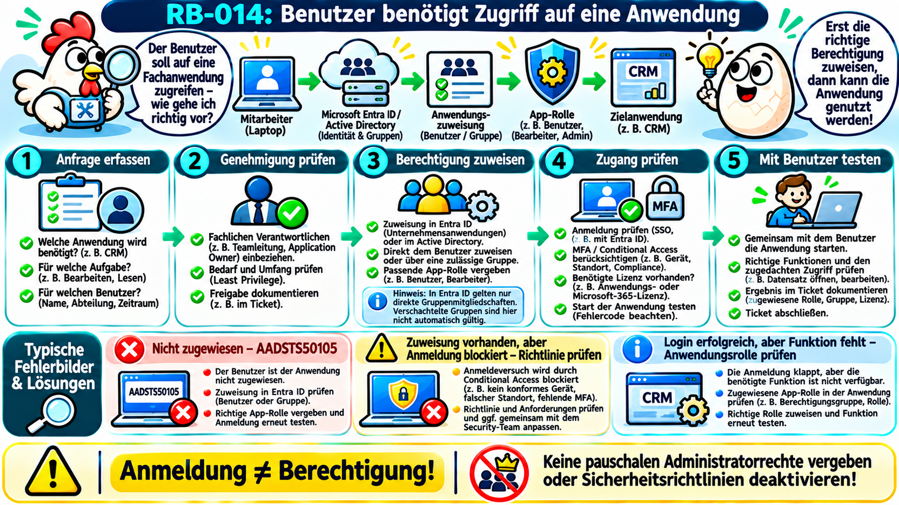
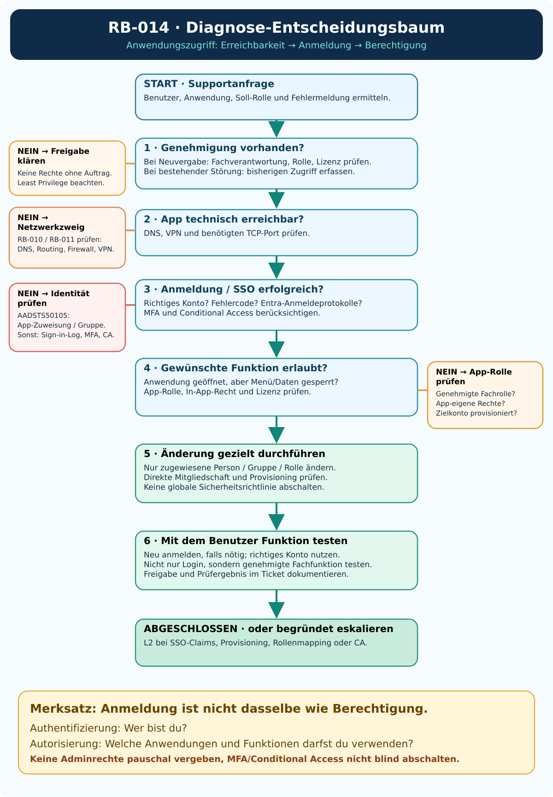

# RB-014 – Benutzer benötigt Zugriff auf eine Anwendung

**Projekt:** 50 Tickets – 50 typische Supportfälle  
**Kategorie:** Service Request / Identity & Access Management / Anwendungsberechtigung  
**Support-Level:** 1st / 2nd Level, abhängig von internen Zuständigkeiten  
**Systeme:** Active Directory (AD), Microsoft Entra ID, Unternehmensanwendungen, Windows 11  
**Version:** 1.0 · **Recherche:** 08.11.2026  
**Status:** Dokumentierter und anhand von Herstellerquellen recherchierter Übungsfall; **noch nicht praktisch validiert**.



> **Leitgedanke:** **Anmeldung ≠ Berechtigung.** Eine Person kann sich erfolgreich ausweisen und trotzdem keine Berechtigung besitzen, eine Anwendung oder eine bestimmte Funktion darin zu verwenden.

---

## 1. Ausgangssituation: Das Supportticket

**Fiktives Ticket SR-014:**

> „Ich arbeite seit heute im Vertrieb und benötige Zugriff auf unser CRM. Mit meinem Firmenkonto kann ich mich zwar anmelden, aber die Anwendung lässt mich nicht hinein. Mein Kollege kann dort Kunden bearbeiten.“

**CRM (Customer Relationship Management)** bezeichnet eine Anwendung zur Verwaltung von Kundenkontakten und Vertriebsprozessen. Die Beispielanwendung nennen wir **Fabrikam CRM**; sie ist keine tatsächlich untersuchte Unternehmensinstallation.

**Ziel:** Nach einer gültigen fachlichen Freigabe erhält der Mitarbeiter die **passende** Anwendungsberechtigung – nicht unnötig hohe Rechte. Anschließend prüft der Support mit dem betroffenen Benutzer die Anmeldung und eine für seine Tätigkeit erforderliche Funktion.

**Warum Service Request?** Eine neue, genehmigungspflichtige Berechtigung ist zunächst eine *Serviceanfrage*. Wenn ein bisher vorhandener Zugriff plötzlich ausfällt, ist dies dagegen typischerweise ein *Incident* (Störung). Die technische Diagnose kann sich überschneiden.

**Erste Rückfragen:** Welche Anwendung und welche URL? Welche Aufgabe (nur lesen oder bearbeiten)? Welche Benutzerkennung? Gibt es eine konkrete Fehlermeldung oder Fehlernummer? Hat der Zugriff schon einmal funktioniert? Wer genehmigt die Rechte? Sind andere Mitarbeiter betroffen?

## 2. Technische Grundlagen und ausgeschriebene Abkürzungen

| Begriff | Anfängerfreundliche Erklärung |
|---|---|
| **AD (Active Directory)** | Klassischer Microsoft-Verzeichnisdienst im Unternehmen. Benutzer, Computer und Gruppen werden zentral verwaltet. |
| **Microsoft Entra ID** | Cloudbasierter Identitäts- und Zugriffsverwaltungsdienst von Microsoft; früher Azure Active Directory genannt. |
| **IAM (Identity and Access Management)** | Verwaltung digitaler Identitäten und ihrer Zugriffsrechte. |
| **SSO (Single Sign-On)** | Einmaliges Anmelden: Eine Unternehmensidentität kann für verschiedene Anwendungen verwendet werden. |
| **Authentifizierung** | Prüfung: „Wer bist du?“ Beispielsweise anhand des Firmenkontos und eines zweiten Faktors. |
| **Autorisierung** | Prüfung: „Was darfst du?“ Beispielsweise Kunden lesen, bearbeiten oder Benutzer verwalten. |
| **RBAC (Role-Based Access Control)** | Rollenbasierte Zugriffskontrolle. Eine Rolle fasst Berechtigungen für eine Tätigkeit zusammen. |
| **App-Rolle** | Von einer Anwendung bereitgestellte Rolle, beispielsweise „Leser“ oder „Bearbeiter“. Nicht mit einer globalen Administratorrolle verwechseln. |
| **Gruppenzuweisung** | Eine AD-/Entra-Sicherheitsgruppe erhält Zugriff; ihre dafür berücksichtigten Mitglieder profitieren von der Zuweisung. |
| **Enterprise Application (Unternehmensanwendung)** | Repräsentation einer eingebundenen Anwendung in einem Entra-Mandanten, einschließlich Zuweisungen und Anmeldeeinstellungen. |
| **Service Principal (Dienstprinzipal)** | Das technische Entra-Objekt, über das eine konkrete Anwendung im Mandanten repräsentiert und verwaltet wird. |
| **SAML (Security Assertion Markup Language)** | Standard für die Übermittlung von Anmeldeinformationen zwischen Identitätsanbieter und Anwendung. |
| **OIDC (OpenID Connect)** | Modernes Protokoll zur Anmeldung über einen Identitätsanbieter, basierend auf OAuth 2.0. |
| **MFA (Multi-Factor Authentication)** | Mehrfaktor-Authentifizierung, beispielsweise Kennwort plus Authenticator-Bestätigung. |
| **Conditional Access (bedingter Zugriff)** | Entra-Richtlinien, die abhängig von Bedingungen wie Gerät, Risiko oder Standort den Zugang gestatten oder blockieren. |
| **Token / Claim** | Ein *Token* ist eine vom Identitätssystem ausgestellte digitale Aussage; *Claims* sind darin enthaltene Informationen, zum Beispiel die Identität oder eine App-Rolle. |
| **SCIM (System for Cross-domain Identity Management)** | Standard zur automatischen Erstellung, Änderung und Deaktivierung von Konten in Zielanwendungen. |
| **Provisioning (Bereitstellung)** | Ein Benutzerkonto wird bei Bedarf in einer Zielanwendung angelegt bzw. aktualisiert. Das ist nicht dasselbe wie eine erfolgreiche Anmeldung. |
| **Least Privilege (geringste erforderliche Rechte)** | Jede Person erhält nur diejenigen Berechtigungen, die sie für ihre Aufgabe benötigt. |
| **UPN (User Principal Name)** | Anmeldename, oft in der Form `benutzer@firma.example`. |

**Merksatz:** **„Ein Benutzerkonto existiert“ ≠ „Anwendung zugewiesen“ ≠ „Anmeldung erfolgreich“ ≠ „Darf Datensätze bearbeiten“.** Das sind unterschiedliche Prüfpunkte.

**Quellen:** [Microsoft: SSO erklärt](https://learn.microsoft.com/de-de/entra/identity/enterprise-apps/what-is-single-sign-on), [Microsoft: automatische Bereitstellung](https://learn.microsoft.com/en-us/entra/identity/app-provisioning/how-provisioning-works).

## 3. Welche technischen Wege führen überhaupt zur Anwendung?

```text
Mitarbeiter auf seinem Windows-PC
            |
            +------ Lokale Unternehmensanwendung ------+
            |                                          |
            |                         AD-Konto / AD-Gruppe / eigene App-Rollen
            |
            +------ Cloud- oder Webanwendung ----------+
                                                       |
                                             Microsoft Entra ID (SSO)
                                                       |
                                      Benutzer- oder Gruppenzuweisung
                                                       |
                                         ggf. App-Rolle / Richtlinien
                                                       |
                                  ggf. Provisioning in die Zielanwendung
                                                       |
                                            Anwendung prüft Rechte
```

**Wichtig:** Das Diagramm zeigt **mögliche** Wege, keinen zwingenden Standard. Eine Anwendung kann eigene Benutzer und Rollen verwalten, AD-Gruppen direkt lesen, über Entra SSO verwenden oder mehrere Varianten kombinieren.

**Beispiel:** Du kannst dich erfolgreich bei Microsoft Entra ID authentifizieren. Trotzdem kann die CRM-Anwendung den Zugriff verweigern, weil (a) keine erforderliche App-Zuweisung vorhanden ist, (b) eine Bedingter-Zugriff-Richtlinie blockiert oder (c) in der CRM-Anwendung die Rolle „Vertriebsmitarbeiter“ fehlt. Diese Befunde müssen getrennt geprüft werden.

### SSO ist keine automatische Rechtevergabe

Bei **SSO (Single Sign-On)** nutzt die Anwendung eine bereits verifizierte Unternehmensidentität. Daraus folgt **nicht**, dass jede Person automatisch alle Anwendungen oder Funktionen verwenden darf. Die Autorisierung erfolgt zusätzlich über Zuweisungen, App-Rollen und gegebenenfalls anwendungsinterne Rechte.

### Warum kann ein Benutzer in Entra zugewiesen sein, aber trotzdem im CRM fehlen?

Einige Anwendungen benötigen ein **eigenes Benutzerobjekt**. Wenn automatisches *Provisioning* konfiguriert ist, kann Entra das Konto über **SCIM** erzeugen und ändern. Diese Synchronisation erfolgt nicht notwendigerweise sofort. Bei fehlgeschlagener Provisionierung muss man **Provisioning-Logs** prüfen; eine korrekte Zuweisung allein genügt nicht. [Microsoft: Provisioning-Ablauf](https://learn.microsoft.com/en-us/entra/identity/app-provisioning/how-provisioning-works).

## 4. Drei typische Fehlerbilder sauber unterscheiden

| Meldung / Beobachtung | Möglicher Fehlerbereich | Erster gezielter Test |
|---|---|---|
| **„Sie sind dieser Anwendung nicht zugewiesen“ / AADSTS50105** | Fehlende direkte Benutzer- oder gültige Gruppenzuweisung bei „Zuweisung erforderlich“ | Unternehmenseintrag in Entra → Benutzer und Gruppen / Eigenschaften prüfen |
| **Anmeldung wird abgewiesen, obwohl Zuweisung vorhanden ist** | MFA, Conditional Access, Gerätecompliance, falsche Identität oder SSO-Konfiguration | Entra-Anmeldeprotokolle, Fehlercode, Korrelations-ID, betroffene Richtlinien prüfen |
| **Anmeldung erfolgreich, aber „Keine Berechtigung“ in einer Funktion** | App-Rolle, anwendungsinterne Berechtigung, Lizenz oder Provisioning | In-App-Rolle, Lizenz und Kontostatus in der Zielanwendung prüfen |
| **Anwendung erscheint nicht im My-Apps-Portal** | Sichtbarkeit, Zuweisung oder Portal-Konfiguration | App-Zuweisung und „Für Benutzer sichtbar“ prüfen; fehlendes Symbol ist kein vollständiger Zugangstest |
| **Nur von bestimmtem Standort/Gerät gesperrt** | Conditional Access oder Netzwerkanforderung | Richtlinienauswertung und Gerätezustand überprüfen |
| **Zugriff nach Gruppenänderung unverändert** | Neues Token, alte Sitzung, AD-Logontoken, Provisioning-Verzögerung oder ungültige Gruppenstruktur | Gezielte Neuanmeldung und tatsächliche Gruppenzuweisung / Provisioning-Logs prüfen |

### Konkreter Microsoft-Fehler: AADSTS50105

Microsoft dokumentiert **AADSTS50105** für den Fall, dass die Enterprise Application eine Zuweisung verlangt, aber keine dafür gültige App-Rollenzuweisung für den Benutzer vorhanden ist. Eine **direkte Mitgliedschaft** in einer der Anwendung zugewiesenen Gruppe kann den Zugriff ermöglichen; **verschachtelte Gruppen** gelten bei dieser App-Zuweisung nicht automatisch. Außerdem wird die Zuweisungspflicht für **globale Administratoren** nicht in derselben Weise durchgesetzt. Mit dem eigentlichen Benutzer testen, nicht nur mit einem Admin. [Microsoft Learn: AADSTS50105](https://learn.microsoft.com/de-de/troubleshoot/entra/entra-id/app-integration/error-code-AADSTS50105-user-not-assigned-role).

## 5. Zugriffswege – wo arbeitet der Supporttechniker?

| Situation | Zugriff | Konkretes Vorgehen |
|---|---|---|
| Benutzer meldet fehlenden Zugriff auf eine **Entra-Unternehmensanwendung** | Entra Admin Center, eigenes berechtigtes Supportkonto | Ticketfreigabe und Zuweisung kontrollieren; ggf. vorgesehene Benutzer-/Gruppenzuweisung durch berechtigte Rolle durchführen |
| Benutzer benötigt Zugriff auf **interne Windows-Anwendung** | AD-Verwaltung über RSAT oder zuständiges Anwendungsportal | AD-Gruppe und anwendungsspezifische Rechte gemäß Freigabe prüfen; Änderungen dokumentieren |
| Benutzer ist angemeldet, aber die Funktion bleibt gesperrt | Bildschirmfreigabe (Teams/Schnellhilfe) + Adminportal | Benutzer zeigt Fehler; Support vergleicht vorhandene App-Rolle mit genehmigter Aufgabe |
| Anwendung ist über Firmen-VPN erreichbar, aber Startseite lädt nicht | Clientdiagnose, DNS- und Portprüfung | Erst Erreichbarkeit, VPN, Namen und Dienststatus prüfen; kein Berechtigungsfehler unterstellen |
| Gruppe wurde vor Kurzem geändert | AD/Entra + Benutzer-Sitzung | Gruppenmitgliedschaft prüfen; sofern sinnvoll kontrollierte neue Anmeldung bzw. aktualisiertes Token abwarten |
| Provisioning in der Zielanwendung scheitert | Entra-Provisioning-Logs / App-Adminportal | Synchronisation, Attributzuordnung und Zielkonto prüfen; an L2/App-Verantwortliche eskalieren |

**„Zentral verwalten“ bedeutet:** Der Support verwaltet das Benutzerkonto und die Anwendungszuweisung vom eigenen berechtigten Verwaltungsrechner oder Cloudportal aus. Er muss dazu **nicht** per Remotedesktop (RDP, Remote Desktop Protocol) auf dem Benutzer-PC angemeldet sein.

**Voraussetzungen:** Passende Rolle, Mandantenzugriff, dienstbezogene Lizenzierung, Freigabe der Anwendungseigentümer und dokumentierter Änderungsprozess. Ein Screenshot des Benutzers ersetzt niemals eine Zugriffsfreigabe.

## 6. Vor der Berechtigung: Genehmigung und Sicherheitsprüfung

**Eine Zugriffsanfrage darf nicht automatisch genehmigt werden.** Vor jeder Rechtevergabe klären:

1. **Wer** soll Zugriff bekommen? Identität, UPN und gegebenenfalls Personal-/Ticketreferenz.
2. **Worauf** genau? Richtige Anwendung und Mandant/Umgebung (Produktion oder Test).
3. **Wozu**? Fachliche Aufgabe, z. B. Datensätze lesen oder bearbeiten.
4. **Wer genehmigt?** Vorgesetzter oder Application Owner (fachlich zuständige Person).
5. **Wie lange?** Dauerhaft, befristet, projektbezogen; Wiedervorlage möglich.
6. **Welche Rolle?** Nur minimal notwendige Rechte, keine Adminrolle „damit es funktioniert“.
7. **Welche Lizenz / Compliance?** Benötigte Nutzungsrechte sowie externe oder sensible Daten berücksichtigen.

**Nie pauschal:** „Assignment required = No“, „MFA aus“, „Conditional Access aus“ oder „Global Administrator“ vergeben, nur um eine Fehlermeldung zu beseitigen. Das würde die Zugangskontrolle möglicherweise über die eigentliche Anfrage hinaus aufweichen.

## 7. App-Zuweisung, Gruppen und Rollen verstehen

Nehmen wir die fiktive Anwendung **Fabrikam CRM**.

| Ebene | Beispiel | Wirkung |
|---|---|---|
| Entra-/AD-Identität | `l.meyer@firma.example` | Der Benutzer existiert und kann authentifiziert werden. |
| Zuweisungsgruppe | `SG_CRM_Vertrieb` | Eine direkt berechtigte Gruppe erhält die App-Zuweisung. |
| Entra-App-Zuweisung | `SG_CRM_Vertrieb` → Fabrikam CRM | Erfüllt ggf. die Zugangsbedingung „Zuweisung erforderlich“. |
| App-Rolle | `SalesEditor` | Die CRM-Anwendung kann anhand der Rolle Bearbeitung erlauben. |
| App-eigene Rechte | „Kunden in Region Nord bearbeiten“ | Kann unabhängig von der Entra-Rolle in der Zielanwendung gepflegt werden. |
| Lizenz | CRM-Benutzerlizenz | Kann erforderlich sein, damit die App produktiv verwendet werden darf. |

**Wichtig:** „Standardzugriff“ in Entra kann die Zuweisungspflicht erfüllen, sendet aber nach Microsoft-Dokumentation nicht automatisch einen `roles`-Claim mit einer benannten App-Rolle. Die Anwendung kann folglich weiterhin eigene Rollen verlangen. [Microsoft: AADSTS50105](https://learn.microsoft.com/de-de/troubleshoot/entra/entra-id/app-integration/error-code-AADSTS50105-user-not-assigned-role).

**Gruppen sind nicht immer identisch wirksam:** Klassische AD-Gruppen können verschachtelt sein. Für **Entra-Enterprise-App-Gruppenzuweisungen** wird eine verschachtelte Mitgliedschaft aber nicht wie eine direkte Gruppenmitgliedschaft behandelt. Das muss in der Diagnose ausdrücklich geprüft werden.

## 8. Diagnose-Entscheidungsbaum



Der Baum startet mit **genehmigter Anfrage oder bestehender Störung**, verzweigt danach nach **Netzwerkerreichbarkeit, Authentifizierung und Autorisierung** und führt erst dann zu geeigneten Änderungen.

## 9. Strukturierter L1-Ablauf

**Schritt 1 – Ticket präzisieren.** Benutzer, App, Umgebung, gewünschte Aufgabe, genaue Fehlermeldung und Zeitraum erfassen; klären, ob Neuvergabe oder Ausfall.

**Schritt 2 – Umfang feststellen.** Nur der Benutzer oder mehrere? Andere Anwendungen erreichbar? Gerät und Netzverbindung grundsätzlich funktionsfähig?

**Schritt 3 – Freigabe prüfen.** Bei neuer Berechtigung: fachliche Genehmigung, passende Rolle, Lizenz und Dauer dokumentieren.

**Schritt 4 – Zugriffsweg bestimmen.** AD-Gruppenverwaltung, Entra-Unternehmensanwendung, anwendungseigenes Portal oder Provisioning.

**Schritt 5 – Bestehende Rechte untersuchen.** Stimmt der angemeldete Benutzer? Direkte Gruppenzuweisung? App-Rolle? Geräte-/MFA-Richtlinie? Zielkonto vorhanden?

**Schritt 6 – Nur genehmigte Änderung.** Zugehörige App-Gruppe bzw. App-Rolle im vorgesehenen System durch berechtigte Person zuweisen; Änderung dokumentieren.

**Schritt 7 – Funktion prüfen.** Benutzer meldet sich gegebenenfalls neu an und führt eine echte, erlaubte Aufgabe durch. Nicht nur ein grünes Login-Symbol kontrollieren.

**Schritt 8 – Ticket abschließen oder eskalieren.** Konkrete Prüfergebnisse, Änderung und funktionalen Test festhalten.

## 10. Lesende Diagnose: Netzwerk und lokales Active Directory

Alle nachfolgenden Beispiele verwenden **fiktive Systeme und Konten**. Die Befehle greifen nur dann auf eine echte Umgebung zu, wenn du sie dort selbst mit den entsprechenden Rechten ausführst. Ausführung ausschließlich auf berechtigten Administrationssystemen.

### A. Ist die Anwendung technisch erreichbar?

**Ausführungsort:** Windows-Client oder genehmigter Supportrechner. **Zweck:** DNS-/TCP-Erreichbarkeit von einem Berechtigungsproblem unterscheiden.

```powershell
# Prüft, ob der Name der Beispielanwendung über DNS aufgelöst wird.
Resolve-DnsName -Name 'crm.firma.example'

# Prüft, ob der HTTPS-Zielport der Anwendung über TCP erreichbar ist.
# -ComputerName benennt den Zielserver.
# -Port 443 prüft den üblichen HTTPS-Port (TCP).
Test-NetConnection -ComputerName 'crm.firma.example' -Port 443
```

**Interpretation:** `TcpTestSucceeded: True` bedeutet nur, dass der **TCP-Port** erreichbar ist. Es beweist weder eine erfolgreiche Anmeldung noch passende Rollen. Ein negativer Wert kann durch Firewall, Routing, Proxy, VPN oder den Zielserver bedingt sein; er beweist keinen Berechtigungsfehler.

### B. Welche AD-Gruppen hat der Benutzer laut Verzeichnis?

**Ausführungsort:** Berechtigter Rechner mit **RSAT (Remote Server Administration Tools)** und ActiveDirectory-Modul. **Voraussetzung:** Verzeichnisleserechte und erreichbarer Domänencontroller.

```powershell
# Sucht das AD-Benutzerobjekt anhand des fiktiven Anmeldenamens.
$user = Get-ADUser -Identity 'l.meyer'

# Fragt Gruppenmitgliedschaften des ermittelten Benutzerobjekts ab.
# Get-ADPrincipalGroupMembership benötigt einen erreichbaren globalen Katalog.
$gruppen = Get-ADPrincipalGroupMembership -Identity $user

# Zeigt die gefundenen Gruppen übersichtlich nach Namen sortiert.
$gruppen | Select-Object Name, SamAccountName | Sort-Object Name
```

**Interpretation:** Prüfen, ob die für die Anwendung vorgesehene Gruppe vorhanden ist. Der Befehl beweist **noch nicht**, dass die Zielanwendung die Mitgliedschaft richtig auswertet oder der Benutzer mit einem aktualisierten Anmeldetoken arbeitet.

**Quelle:** [Microsoft Learn – Get-ADPrincipalGroupMembership](https://learn.microsoft.com/en-us/powershell/module/activedirectory/get-adprincipalgroupmembership).

### C. Mit welchen Gruppen wurde die aktuelle Windows-Sitzung gestartet?

**Ausführungsort:** Betroffener Windows-PC, **im Kontext des betroffenen Benutzers** (nicht mit dem Support-Administratorkonto).

```powershell
# Zeigt die Gruppen und Sicherheitskennungen (SIDs),
# die im Zugriffstoken der aktuellen Windows-Sitzung enthalten sind.
whoami /groups
```

**Interpretation:** Wenn die Gruppe in AD inzwischen vorhanden ist, in der bereits laufenden Sitzung aber fehlt, kann eine neue Anmeldung nötig sein. `whoami` unter einem Support-Administratorkonto zeigt **dessen** Gruppen, nicht die des betroffenen Benutzers. Vor Abmeldung ungespeicherte Arbeit sichern.

## 11. Lesende Diagnose: Microsoft Entra ID und Microsoft Graph

**Ausführungsort:** Berechtigter Administrationsrechner mit Microsoft-Graph-PowerShell-Modulen. **Vorbedingungen:** Zugang zum richtigen Entra-Mandanten, passende Administrationsrolle und genehmigte Graph-Berechtigungen. **Nicht** mit privaten Testkonten und echten Benutzerinformationen auf einer öffentlichen Website arbeiten.

### A. Benutzerinformationen über Microsoft Graph abfragen

```powershell
# Stellt eine interaktive Verbindung zu Microsoft Graph her.
# Directory.Read.All ist eine weitreichende LESENDE Verzeichnisberechtigung
# und muss nach Organisationsrichtlinie freigegeben sein.
Connect-MgGraph -Scopes 'Directory.Read.All'

# Fragt das fiktive Benutzerkonto ab und speichert das Ergebnis.
$user = Get-MgUser -UserId 'l.meyer@firma.example'

# Zeigt nur ausgewählte Eigenschaften des Benutzerobjekts an.
$user | Select-Object Id, DisplayName, UserPrincipalName
```

**Interpretation:** Damit ist nur die Existenz/Identität im Entra-Verzeichnis geprüft. Eine gültige App-Zuweisung ist noch nicht nachgewiesen.

### B. Welche Enterprise-App-Rollen sind dem Benutzer zugewiesen?

```powershell
# Liest App-Rollenzuweisungen des ausgewählten Benutzers.
# Der Graph-Endpunkt kann auch Zuweisungen über DIREKTE Gruppenmitgliedschaft liefern.
# Die passenden Graph-Berechtigungen und Entra-Rollen sind erforderlich.
$zuweisungen = Get-MgUserAppRoleAssignment -UserId $user.Id -All

# Zeigt die betroffene Anwendung und die technische App-Rollen-ID.
$zuweisungen | Select-Object ResourceDisplayName, AppRoleId, PrincipalDisplayName
```

**Interpretation:** Eine Zeile für die Zielanwendung kann auf eine Zuweisung hindeuten. Die `AppRoleId` muss **gegen die Rollendefinition der konkreten Anwendung** geprüft werden. Die Null-GUID `00000000-0000-0000-0000-000000000000` kann für „Standardzugriff“ stehen und ist keine benannte Fachrolle. Fehlende Zeilen müssen unter Berücksichtigung von Gruppenzuweisungen, Berechtigungen der Abfrage und Aktualisierungsverzögerungen untersucht werden.

**Wichtiger Berechtigungshinweis:** Microsoft nennt für die Graph-API `GET /users/{id}/appRoleAssignments` unter anderem `Directory.Read.All` als Delegated-Alternative und passende Entra-Rollen. Eine erfolgreiche Anmeldung bei Graph allein reicht nicht immer aus. Die Abfrage kann direkte Gruppenzuweisungen mit einschließen; **verschachtelte Gruppen** sind für die Enterprise-App-Zuweisung nicht automatisch gültig.

**Quellen:** [Microsoft Graph – appRoleAssignments](https://learn.microsoft.com/en-us/graph/api/user-list-approleassignments?view=graph-rest-1.0), [Get-MgUserAppRoleAssignment](https://learn.microsoft.com/de-de/powershell/module/microsoft.graph.applications/get-mguserapproleassignment).

### C. Fehlerhafte Entra-Anmeldung ohne PowerShell untersuchen

**Ausführungsort:** **Microsoft Entra Admin Center**, entsprechend berechtigte Rolle.

1. **Entra ID → Überwachung und Integrität → Anmeldeprotokolle** öffnen.
2. Nach **Benutzer**, **Anwendung**, **Zeitpunkt** und **Fehlschlag** filtern.
3. **Fehlercode**, **Fehlergrund**, **Korrelations-ID** und die betroffenen Richtlinien erfassen.
4. Im Reiter **Conditional Access (bedingter Zugriff)** prüfen, ob eine Richtlinie die Anmeldung blockiert hat.
5. Keine Richtlinie zum Zweck eines schnellen Tests global deaktivieren.

**Quellen:** [Microsoft: Anmeldefehler untersuchen](https://learn.microsoft.com/entra/identity/monitoring-health/howto-troubleshoot-sign-in-errors), [Microsoft: Conditional Access untersuchen](https://learn.microsoft.com/en-us/entra/identity/conditional-access/troubleshoot-conditional-access).

## 12. Diagnoseergebnisse interpretieren – was folgt daraus?

| Befund | Technische Schlussfolgerung | Gezielter nächster Schritt |
|---|---|---|
| DNS-Auflösung oder TCP 443 schlägt fehl | Netzwerkproblem möglich, keine belastbare Aussage zu App-Rollen | RB-010 / RB-011: DNS, VPN, Routing, Firewall prüfen |
| AADSTS50105 | Gültige Enterprise-App-Zuweisung fehlt möglicherweise | App-Eigenschaft „Zuweisung erforderlich“, direkte Zuweisung und Gruppe prüfen |
| Anmeldung scheitert unter Conditional Access | Richtlinie / Geräteanforderung kann blockieren | Sign-in-Log und Richtlinienbedingungen mit Security/Entra-Team prüfen |
| SSO erfolgreich, aber Funktionsmenü fehlt | App-Rolle oder anwendungsinterne Rechte fehlen möglich | Fachlich genehmigte In-App-Rolle und Lizenz prüfen |
| Entra-Zuweisung vorhanden, Zielkonto fehlt | Provisioning oder manuelle Kontoerstellung noch nicht erfolgt | Provisioning-Logs und Zielanwendung untersuchen |
| Benutzer direkt in Entra-Zuweisungsgruppe, aber App scheitert | Zuweisung ist nur eine Ebene | Authentifizierung, Token, Provisioning, App-Rolle und Richtlinien prüfen |
| Benutzer nur Mitglied einer Untergruppe | Verschachtelte Entra-Gruppen können App-Zuweisung nicht erfüllen | Direkte Gruppenmitgliedschaft oder zulässige direkte App-Zuweisung klären |
| Neue Berechtigung, aber alte Sitzung offen | Token/Sitzung kann alte Angaben enthalten | Neue Authentifizierung kontrolliert testen; Sicherheitsrichtlinien beachten |

**Keine automatische Rechteeskalation:** Ein fehlender Menüpunkt rechtfertigt nicht die Zuweisung einer Administratorrolle. Zuerst muss geklärt werden, ob die Funktion überhaupt für die Tätigkeit genehmigt ist.

## 13. Fehlerbehebung und Erfolgskontrolle

### Fall A: Neue Zugriffsanforderung wurde genehmigt

1. Fachliche Freigabe, Anwendung und minimal nötige Rolle aus dem Ticket übernehmen.
2. Zuständige Verwaltungsquelle ermitteln (AD-Gruppe, Entra-Unternehmensanwendung, In-App-Verwaltung).
3. Mit geeigneter berechtigter Rolle die **konkret genehmigte Zuweisung** durchführen; niemals pauschale Administratorrechte vergeben.
4. Wenn erforderlich: Provisioning-/Synchronisationsstatus kontrollieren.
5. Benutzer lässt sich mit dem **richtigen Firmenkonto** neu an der Anwendung anmelden.
6. Gemeinsam eine **erlaubte Fachfunktion** testen, zum Beispiel einen Testdatensatz öffnen – nicht versehentlich echte Kundendaten verändern.
7. Zuweisung, Genehmiger, Zeitpunkt, Rolle und Test im Ticket dokumentieren.

### Fall B: Fehler AADSTS50105

1. Identität und App aus Anmeldeprotokoll/Fehlerseite sichern.
2. **Enterprise Applications → betroffene App → Eigenschaften:** „Zuweisung erforderlich?“ prüfen.
3. **Benutzer und Gruppen:** direkte Benutzerzuweisung oder gültige direkte Mitgliedschaft in zugewiesener Gruppe kontrollieren.
4. Falls die Freigabe vorliegt: passende Zuweisung bzw. Rolle autorisiert ergänzen.
5. **Nicht** „Zuweisung erforderlich“ auf „Nein“ setzen, nur weil dieser Benutzer nicht zugewiesen ist.
6. Mit dem betroffenen Benutzer erneut testen.

### Fall C: Benutzer kann sich anmelden, aber nur lesen

1. Fachlich genehmigte Soll-Rechte („Lesen“ oder „Ändern“) dokumentieren.
2. App-Rollenzuweisung und anwendungsinterne Rollen prüfen; bei Bedarf Lizenzstatus und Provisioning berücksichtigen.
3. Gezielte Rollenänderung durch das zuständige App-Team veranlassen.
4. Anschließend genau die gewünschte Funktion **ohne unnötige Datenänderungen** testen.

### Warum funktioniert eine neue Gruppenzuweisung manchmal erst später?

Bei einer klassischen Windows-AD-Sitzung entsteht ein Zugriffstoken beim Anmelden. Neue Gruppenmitgliedschaften sind nicht immer sofort in der bereits bestehenden Sitzung enthalten. Bei Cloudanwendungen können bereits ausgestellte Token/Sitzungen alte Rolleninformationen enthalten; bei automatischem Provisioning kommen Synchronisationszyklen hinzu. Deshalb **nicht blind immer wieder Rechte zuweisen**. Stattdessen die jeweilige Ebene prüfen und bei sicherem Zustand eine frische Anmeldung ausprobieren. [Microsoft: Token-Lebensdauer](https://learn.microsoft.com/de-de/entra/identity-platform/access-tokens).

### Erfolg nachweisen

Eine Anfrage ist erst dann fachlich abgeschlossen, wenn der betroffene Benutzer (a) die Anwendung öffnen, (b) sich mit dem vorgesehenen Konto authentifizieren und (c) die ausdrücklich genehmigte Funktion ausführen kann. Ein bloßer Portalstatus „Assigned“ genügt nicht.

## 14. L1-/L2-Eskalation, Muster-Ticket und Lernkontrolle

### Wann eskalieren?

**L1:** Antragsdaten und Freigabe prüfen, Benutzer/App eindeutig identifizieren, Standardzuweisung nach Berechtigung durchführen, bekannte Fehlermeldungen untersuchen und mit dem Benutzer testen.

**L2 / Application Owner / IAM-Team:** SSO-Konfiguration, SAML/OIDC-Claims, App-Rollenmapping, Provisioning-/SCIM-Fehler, tenantweite Conditional-Access-Probleme, Änderungen an Gruppenstruktur oder Anwendungsrollen, ungeklärte Lizenz-/Compliancefragen.

### Musterticket (fiktiv)

**Ticket:** SR-014  
**Meldung:** Neuer Vertriebsmitarbeiter kann Fabrikam CRM nicht öffnen, Fehler AADSTS50105.  
**Freigabe:** Fachverantwortliche genehmigt Rolle „SalesReader“ für Projektlaufzeit.  
**Diagnose:** Identität und App geprüft; Anmeldeprotokoll zeigt AADSTS50105. Unternehmenseintrag verlangt Zuweisung. Nutzer war nicht direkt zugewiesen und kein direktes Mitglied der zugelassenen App-Gruppe.  
**Maßnahme:** Berechtigte Administration ordnet den Benutzer nach Freigabe der vorgesehenen App-Gruppe zu; erforderliche App-Rolle geprüft.  
**Ergebnis:** Neue Anmeldung mit betroffener Benutzeridentität erfolgreich; genehmigte Lesefunktion getestet.  
**Status:** Gelöst (fiktives Beispiel, **nicht praktisch durchgeführt**).

### Anki-Karten – Beispiele

| Kartentyp | Vorderseite | Rückseite |
|---|---|---|
| Wissen | Wofür steht SSO? | Single Sign-On; einmalige Anmeldung für mehrere Anwendungen. |
| Wissen | Was bedeutet AADSTS50105? | Für eine zuweisungspflichtige Anwendung fehlt eine gültige App-Zuweisung. |
| Verständnis | Warum reicht eine erfolgreiche Anmeldung nicht zum Bearbeiten von Kundendaten? | Authentifizierung bestätigt die Identität; Autorisierung bestimmt Funktionen/Rechte. |
| Verständnis | Warum ist „Standardzugriff“ nicht automatisch „SalesEditor“? | Standardzugriff erfüllt ggf. die Zuweisungspflicht, liefert aber keine benannte App-Rolle. |
| Diagnose | CRM-Login funktioniert, „Kunden bearbeiten“ fehlt. Was prüfst du zuerst? | Soll-Rolle/Freigabe, tatsächliche App-Rolle, anwendungsinterne Berechtigungen, Lizenz. |
| Diagnose | Benutzer ist nur über verschachtelte Gruppe in App-Zuweisungsgruppe. Was ist verdächtig? | Entra-Enterprise-App-Gruppenzuweisung berücksichtigt hier keine verschachtelten Mitgliedschaften. |

**Diagnoseübung ohne Lösungsvorgabe:** Ein Benutzer hat laut AD-Gruppe Zugriff auf das CRM. Das CRM zeigt jedoch „Nicht berechtigt“. Sein Kollege mit derselben Stelle kann es verwenden. Was wären deine **drei ersten Prüfungen**, und mit welchem Ergebnis würdest du welche Hypothese ausschließen? Versuche die Reihenfolge **ohne** direkt auf eine neue Gruppenzuweisung zu springen.

## 15. Quellen, Bearbeitungs- und Validierungsstatus

**Technische Herstellerdokumentation (Stand der Recherche: 08.11.2026):**

1. [Microsoft Learn – SSO in Entra ID](https://learn.microsoft.com/de-de/entra/identity/enterprise-apps/what-is-single-sign-on) – Anmeldung und Identitätsanbieter.
2. [Microsoft Learn – Benutzer und Gruppen einer Unternehmensanwendung zuweisen](https://learn.microsoft.com/de-de/entra/identity/enterprise-apps/assign-user-or-group-access-portal) – Zuweisung und App-Rollen.
3. [Microsoft Learn – Fehler AADSTS50105](https://learn.microsoft.com/de-de/troubleshoot/entra/entra-id/app-integration/error-code-AADSTS50105-user-not-assigned-role) – fehlende Zuweisung und Gruppenverschachtelung.
4. [Microsoft Learn – Anmeldefehler in Entra untersuchen](https://learn.microsoft.com/entra/identity/monitoring-health/howto-troubleshoot-sign-in-errors) – Fehlercode, Korrelation und Protokolle.
5. [Microsoft Learn – Conditional Access Troubleshooting](https://learn.microsoft.com/en-us/entra/identity/conditional-access/troubleshoot-conditional-access) – Richtlinienauswertung.
6. [Microsoft Learn – Wie Application Provisioning funktioniert](https://learn.microsoft.com/en-us/entra/identity/app-provisioning/how-provisioning-works) – SCIM, Synchronisierung und Protokolle.
7. [Microsoft Learn – Get-ADPrincipalGroupMembership](https://learn.microsoft.com/en-us/powershell/module/activedirectory/get-adprincipalgroupmembership) – Gruppenabfrage.
8. [Microsoft Graph – App-Rollenzuweisungen für Benutzer](https://learn.microsoft.com/en-us/graph/api/user-list-approleassignments?view=graph-rest-1.0) – Graph-Abfrage, Berechtigungen und direkte Gruppenmitgliedschaft.
9. [Microsoft Learn – Get-MgUserAppRoleAssignment](https://learn.microsoft.com/de-de/powershell/module/microsoft.graph.applications/get-mguserapproleassignment) – PowerShell-Cmdlet.
10. [Microsoft Learn – Access Tokens](https://learn.microsoft.com/de-de/entra/identity-platform/access-tokens) – Token und Gültigkeitsdauer.

**Status: Recherchiert.** Das Szenario, die Konten und die Ticketlösung sind konstruiert. Kein produktiver Benutzerzugriff wurde verändert oder getestet. Eine spätere Praxisvalidierung sollte dokumentieren: konkrete Testumgebung, Genehmigung, Testergebnisse, Screenshots ohne vertrauliche Daten und gegebenenfalls Korrekturen des Runbooks.

**Grafiknachweis:** Eigene Konzeption, KI-gestützte Visualisierung mit ChatGPT. Die Bilder sind technische Illustrationen, keine Screenshots einer produktiven Umgebung.
