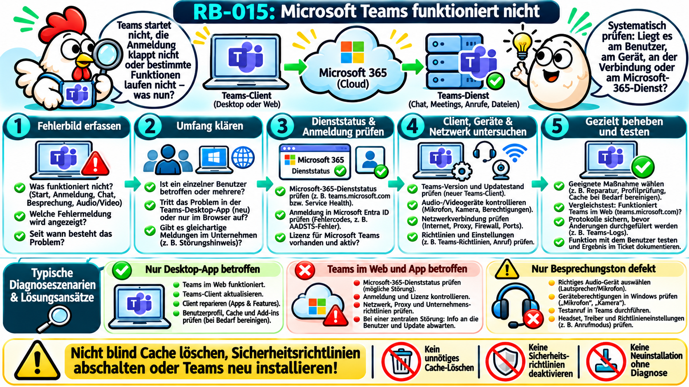
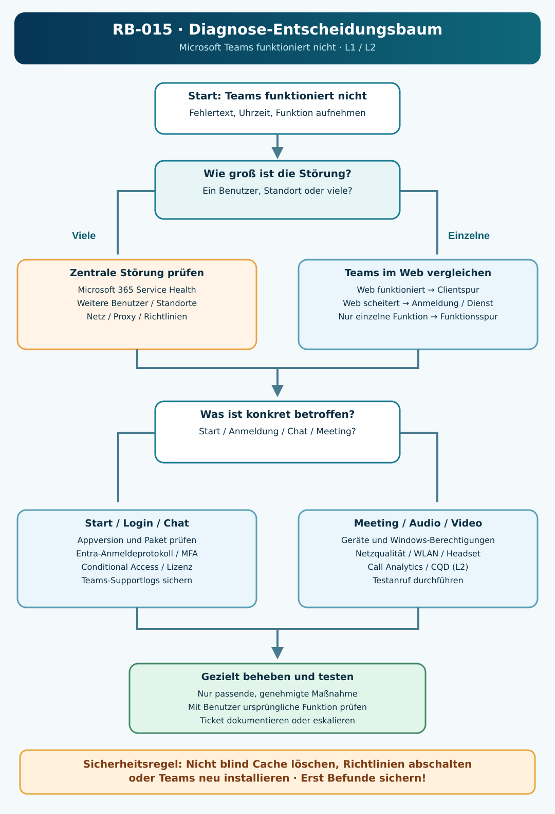

# RB-015 – Microsoft Teams funktioniert nicht

**Themenbereich:** Microsoft 365 / Collaboration / Client- und Dienstdiagnose  
**Support-Level:** L1/L2  
**Umgebung:** Neues Microsoft Teams für Windows 11, Teams im Web, Microsoft Entra ID, Microsoft 365  
**Version:** 1.0 · 08.11.2026  
**Status:** Anhand von Microsoft Learn recherchiert; praktische Validierung ausstehend. Alle Beispielmeldungen, Namen und Tickets sind fiktiv.



> **Leitgedanke:** Nicht jedes Teams-Problem ist ein Teams-Clientproblem. Anmeldung, Cloud-Dienst, Netzwerk, lokale App, Endgeräte und Richtlinien müssen voneinander unterschieden werden.

## 1. Supportticket und Ausgangssituation

**INC-015 (fiktiv):** „Seit heute früh startet Teams zwar, aber ich kann mich nicht anmelden. Bei zwei Kollegen funktioniert es. Im Browser kann ich Teams teilweise öffnen, aber auf meinem Laptop nicht.“

**Ziel:** Das Fehlerbild einordnen, den tatsächlich betroffenen Bestandteil bestimmen, risikoarme Tests durchführen, die Ursache gezielt beheben und die Funktion gemeinsam mit dem Benutzer überprüfen.

**Erste Rückfragen:** Seit wann tritt der Fehler auf? Welche Meldung inklusive Fehlercode wird angezeigt? Betrifft es nur einen Benutzer oder mehrere? Funktioniert Teams im Browser? Funktionieren Outlook und andere Microsoft-365-Dienste? Ist nur Chat oder speziell Meeting/Audio/Video betroffen?

## 2. Technische Grundlagen und Abkürzungen

| Begriff | Einsteigererklärung |
|---|---|
| **Teams-Client** | Teams-Programm auf dem PC; das neue Teams verwendet unter Windows eine andere App-Technologie als das frühere klassische Teams. |
| **Teams im Web** | Teams im unterstützten Browser; sinnvoll als Vergleichstest, aber nicht identisch mit einer vollständigen Diagnosesicherung. |
| **Microsoft 365** | Cloudplattform, zu deren Diensten Teams und weitere Geschäftsanwendungen gehören. |
| **Microsoft Entra ID** | Cloudbasierter Dienst, der die Benutzeridentität und den Zugang zu Diensten verwaltet. |
| **SSO (Single Sign-On)** | Einmalige Anmeldung, die den Zugriff auf mehrere Dienste erleichtern kann. |
| **MFA (Multi-Factor Authentication)** | Zusätzliche Prüfung eines zweiten Faktors neben einem Passwort. |
| **Conditional Access** | Entra-Richtlinien, die festlegen, unter welchen Bedingungen eine Anmeldung zulässig ist. |
| **Cache (Zwischenspeicher)** | Lokal gespeicherte Daten, die den Ablauf beschleunigen. Löschen ist keine universelle Lösung. |
| **WebView2** | Microsoft-Edge-basierte Komponente, die moderne Windows-Anwendungen für Weboberflächen einsetzen können. |
| **Proxy** | Zwischenstation für Netzwerkzugriffe; kann Unternehmensregeln durchsetzen. |
| **DNS (Domain Name System)** | Übersetzt Namen in Netzwerkadressen. |
| **TLS (Transport Layer Security)** | Verschlüsseltes Transportprotokoll, meist für HTTPS-Verbindungen. |
| **CQD (Call Quality Dashboard)** | Teams-Werkzeug zur Analyse organisationsweiter Audio-/Videoqualität. |
| **QoS (Quality of Service)** | Priorisierung bestimmter Netzwerkdaten zur Verbesserung zeitkritischer Verbindungen. |

### Vereinfachte Infrastruktur

```text
Windows-Client (neues Teams)       Browser (Teams im Web)
            \                           /
             \       Internet /        /
              ---- Unternehmensnetz ---
                         |
               Microsoft 365 / Teams
                         |
               Microsoft Entra ID
              (Anmeldung / Richtlinien)
                         |
            Chat / Besprechung / Dateien
```

Die tatsächliche Infrastruktur umfasst mehrere Microsoft-Dienste und Endpunkte. Teams kann deshalb teilweise funktionieren, obwohl etwa die Anmeldung, bestimmte Inhalte oder die Medienübertragung beeinträchtigt sind. **Eine erfolgreiche Anmeldung beweist nicht, dass die Besprechungsqualität gut ist.**

## 3. Fehlerbilder einordnen

| Symptom | Denkbare Ursachen | Erster Vergleichstest |
|---|---|---|
| Teams startet nicht oder beendet sich | Clientpaket, WebView2, Berechtigungen, lokale App-Umgebung | Funktioniert Teams im Web? |
| Anmeldefehler oder Endlosschleife | Konto, Entra ID, MFA, Conditional Access, Netzwerk/Proxy | Exakten Fehlercode und Entra-Anmeldeprotokoll prüfen |
| Chat/Kanal zeigt Inhalte nicht | Dienstzustand, Richtlinien, Anzeige-/Synchronisationsfehler | Andere Benutzer und Webansicht vergleichen; Logs vor Cache-Löschen sichern |
| Kamera oder Mikrofon fehlt | Geräteauswahl, Windows-Gerätezugriff, Treiber, Hardware | Testanruf, Windows-Geräteprüfung |
| Schlechte Sprache oder Videoaussetzer | Netzqualität, Paketverlust, WLAN, Geräte, Medienpfad | Teams-Meeting-Diagnose/Call Analytics, andere Verbindung testen |
| Teams nur bei vielen Benutzern gestört | Microsoft-365-Störung oder zentrale Netz-/Richtlinienänderung | Service Health und organisationsweiten Umfang prüfen |

**Wichtig:** „Teams funktioniert nicht“ ist noch keine Diagnose. Wir grenzen zuerst den betroffenen Funktionsbereich ein.

## 4. Zugriffsvoraussetzungen und Diagnosewege

| Situation | Zugriff | Konkreter Ablauf |
|---|---|---|
| Benutzer ist in Windows angemeldet | Teams-Bildschirmfreigabe, Schnellhilfe oder Vor-Ort-Support | Symptom gemeinsam nachvollziehen, Fehlertext aufnehmen, Client/Web vergleichen |
| Teams selbst ist ausgefallen | Telefon, Windows-Schnellhilfe oder zugelassene Fernwartung | Unabhängigen Supportkanal verwenden; nicht auf eine kaputte Teams-Sitzung verlassen |
| Verdacht auf Anmelde-/Richtlinienproblem | Entra Admin Center mit Leseberechtigung | Fehlgeschlagene Anmeldung anhand Uhrzeit, Benutzer, Korrelations-ID prüfen |
| Mehrere Benutzer betroffen | Microsoft 365 Admin Center und Teams Admin Center | Dienststatus und organisatorische Auswirkungen untersuchen |
| Nur Meeting-Audio schlecht | Teams Admin Center / Call Analytics, CQD je nach Rolle | Medienqualität, Gerät und Netzbedingungen bewerten |

**Datenschutz:** Supportprotokolle können Kontoinformationen, Geräte- und Sitzungsdetails enthalten. Nur über freigegebene Wege sammeln und weitergeben.

## 5. Ursachen und Prüfpriorität

1. **Einzelner Benutzer/Client:** lokales Teams-Profil, App-Update, Geräteprobleme, Anmeldung.
2. **Mehrere Benutzer an einem Standort:** Proxy, Firewall, DNS, Routing, WLAN, Standortnetz.
3. **Mehrere Standorte:** zentrale Richtlinie, Identitätsdienst oder Cloud-Störung.
4. **Nur einzelne Funktion:** Teams-Richtlinie, Teams/SharePoint/Exchange-Abhängigkeit, Anwendungszugriff, Audio/Video.

Die Reihenfolge wird an Befunde angepasst. Ein Dienststatus „gesund“ schließt nicht jede regionale oder benutzerspezifische Störung aus.

## 6. Diagnose-Entscheidungsbaum



**Merksatz:** Erst Umfang → dann betroffene Ebene → dann konkrete Maßnahme.

## 7. Praktische Diagnose: Lesende Befehle mit Zeilenkommentaren

### 7.1 Teams-Prozess auf dem Client prüfen

**Ausführungsort:** Lokaler Windows-11-Client oder zulässig verwaltete Remotesitzung. **Rechte:** Normalerweise Benutzerkontext ausreichend. **Wirkung:** Lesend.

```powershell
# Liest Prozesse, deren Namen auf Teams hinweisen.
# -ErrorAction SilentlyContinue unterdrückt nur die Meldung, wenn nichts gefunden wird.
Get-Process -Name 'ms-teams','msteams' -ErrorAction SilentlyContinue |
    # Zeigt Namen, Prozesskennung (Id), Startzeit und Arbeitsspeicherbelegung.
    Select-Object ProcessName, Id, StartTime, WorkingSet64
```

**Interpretation:** Kein Treffer kann auf einen nicht gestarteten Client hinweisen, beweist aber weder einen Installationsfehler noch einen fehlerhaften Cloud-Dienst. Ein vorhandener Prozess beweist keine erfolgreiche Anmeldung.

### 7.2 Prüfen, ob das neue Teams als App installiert ist

```powershell
# Fragt Teams-Pakete des aktuell angemeldeten Windows-Benutzers ab.
# Get-AppxPackage ist eine lesende Abfrage, keine Neuinstallation.
Get-AppxPackage -Name 'MSTeams' |
    # Zeigt den Paketnamen, die Version und den Installationsort.
    Select-Object Name, Version, InstallLocation
```

**Interpretation:** Kein Ergebnis in diesem Benutzerkontext ist ein Hinweis auf eine fehlende Registrierung, aber kein Nachweis, dass Teams systemweit nicht vorhanden ist. Bei verwalteten Geräten weitere Bereitstellungsdaten prüfen.

### 7.3 Grundlegende Verbindung prüfen

```powershell
# Löst den Teams-Webnamen per DNS auf.
Resolve-DnsName -Name 'teams.microsoft.com'

# Testet eine TCP-Verbindung auf HTTPS-Port 443.
# Ein positiver Wert beweist nur den TCP-Aufbau, nicht die Funktion von Teams.
Test-NetConnection -ComputerName 'teams.microsoft.com' -Port 443
```

**Interpretation:** Fehlgeschlagene Namensauflösung spricht für eine DNS-/Netzwerkprüfung. `TcpTestSucceeded : True` ist *kein* vollständiger Teams-Gesundheitstest. Unternehmens-Proxys oder Sicherheitssoftware können den tatsächlichen Datenfluss zusätzlich beeinflussen.

### 7.4 Systemzeit und lokale Windows-Ereignisse kontrollieren

```powershell
# Zeigt die lokale Uhrzeit mit Zeitzonenoffset an.
Get-Date -Format 'yyyy-MM-dd HH:mm:ss zzz'

# Liest nur die letzten Windows-Anwendungsereignisse ab Ereignis-ID 1000.
# Ereignis 1000 kann auf einen Prozessabsturz hinweisen, muss aber Teams zugeordnet werden.
Get-WinEvent -FilterHashtable @{
    # Protokoll der Anwendungen.
    LogName = 'Application'
    # Möglicher Anwendungsfehler (nicht exklusiv Teams).
    Id = 1000
    # Nur Ereignisse der letzten zwei Stunden.
    StartTime = (Get-Date).AddHours(-2)
} -ErrorAction SilentlyContinue |
    # Begrenzte Ausgabe für die erste Sichtung.
    Select-Object -First 10 TimeCreated, ProviderName, Message
```

**Interpretation:** Nur Einträge auswerten, die zeitlich und anhand des Anwendungsnamens tatsächlich zum gemeldeten Fehler passen. Die Ereignis-ID allein beweist keine Teams-Ursache.

### 7.5 Supportdateien für Teams sichern

In Teams unter Windows lassen sich Diagnoseprotokolle über **Strg + Alt + Umschalt + 1** beziehungsweise den dafür vorgesehenen Menüpunkt erfassen. Die Protokolle werden standardmäßig im Download-Ordner bereitgestellt. Vor der Weitergabe prüfen, welche Konten darin dokumentiert sein könnten und ob ein genehmigter Supportweg vorliegt. Zeiten können in UTC aufgezeichnet sein.

Quelle: [Microsoft Learn – Teams-Protokolldateien](https://learn.microsoft.com/de-de/microsoftteams/log-files).

## 8. Desktop gegen Web vergleichen

**Test A:** Auf demselben Arbeitsplatz Teams im unterstützten Browser öffnen (`https://teams.microsoft.com/`).  
**Test B:** Mit demselben Benutzer und im Rahmen der Sicherheitsrichtlinien vergleichen: Anmeldung? Chat? Besprechung?  
**Test C:** Ggf. bei einem zweiten berechtigten Benutzer prüfen, ob dieselbe Störung besteht.

| Ergebnis | Wahrscheinliche Prüfspur |
|---|---|
| Web funktioniert, Desktop nicht | Clientpaket, lokale App-Daten, Profil, WebView2, Desktop-Richtlinien |
| Web und Desktop scheitern | Identitäts-/Lizenzproblem, Tenant-Richtlinie, Dienststatus oder Netzwerk |
| Nur eine Funktion scheitert | Berechtigung, Teams-Richtlinie, dienstspezifische Abhängigkeit |
| Browser geht im Firmennetz, nicht im Homeoffice | VPN-/Proxy-/DNS-/Zugriffsbedingungen getrennt prüfen |

Das ist eine **Eingrenzung**, kein automatischer Ursachenbeweis.

## 9. Anmeldung, MFA und Conditional Access

**Microsoft Entra ID** ist die Cloud-Identitätsverwaltung. Bei fehlerhaften Teams-Anmeldungen unter anderem prüfen:

- Exakte Fehlermeldung und Fehlercode (z. B. `0xCAA20004` als möglicher Hinweis auf Conditional Access).
- Ob das richtige Arbeits- oder Schulkonto verwendet wird.
- Ob die benötigte Lizenz und die vorgesehenen Nutzungsrechte vorhanden sind.
- Ob eine MFA-Anforderung vorliegt und erfolgreich abgeschlossen wurde.
- Im **Entra Admin Center → Entra ID → Monitoring & health → Sign-in logs**: Zeit, Status, betroffene Ressource, Korrelations-ID und Conditional-Access-Ergebnis.

**Nicht** das Kennwort telefonisch erfragen; Conditional Access oder MFA nicht pauschal deaktivieren. Zugriffsprobleme können zudem durch Teams-Abhängigkeiten wie SharePoint oder Exchange verursacht werden.

Quelle: [Microsoft Learn – Conditional Access bei Anmeldeproblemen](https://learn.microsoft.com/en-us/entra/identity/conditional-access/troubleshoot-conditional-access).

## 10. Dienste und Tenant prüfen

Bei mehreren betroffenen Benutzern prüft ein entsprechend berechtigter Administrator im **Microsoft 365 Admin Center** den Bereich **Service health** auf bekannte Incidents/Advisories. Zusätzlich kann im **Teams Admin Center** eine funktionsspezifische Analyse erfolgen.

Ein globaler Dienstvorfall wird nicht durch Neuinstallation eines lokalen Teams-Clients behoben. In diesem Fall: Auswirkungen dokumentieren, Benutzer informieren, Microsoft-Status verfolgen und notwendige organisatorische Eskalation durchführen.

## 11. Audio, Kamera und Besprechungsqualität

Wenn Chat funktioniert, aber Meetings fehlerhaft sind, sind die diagnostischen Schwerpunkte anders:

- In Teams **Einstellungen → Geräte**: korrektes Mikrofon, Lautsprecher und Kamera auswählen; Testanruf soweit verfügbar.
- Windows **Einstellungen → Datenschutz und Sicherheit**: Kamera- und Mikrofonzugriff kontrollieren.
- Headset, USB-Verbindung, Bluetooth-Verbindung und Treiber prüfen.
- Eine Testbesprechung mit bewusst ausgewähltem Gerät durchführen.
- Bei Qualitätsproblemen: Latenz, Paketverlust, WLAN-Qualität und ggf. VPN-Routing/Proxy untersuchen.
- Als L2, sofern berechtigt: Teams Admin Center **Call Analytics** für einzelne Anrufe und **CQD (Call Quality Dashboard)** für Muster im Unternehmen heranziehen.

**Wichtig:** `ping` oder ein TCP-Test auf 443 allein reichen nicht aus, um Echtzeit-Audioqualität nachzuweisen.

Quelle: [Microsoft Learn – Teams-Anrufqualität](https://learn.microsoft.com/de-de/microsoftteams/monitor-call-quality-qos).

## 12. Gezielte Fehlerbehebung und Risiken

| Nachgewiesener/ausreichend eingegrenzter Befund | Geeigneter nächster Schritt |
|---|---|
| Nur der Desktop-Client ist betroffen; Web funktioniert | Teams vollständig beenden und neu starten, Versionsstand prüfen, bei Bedarf appseitige Reparatur |
| Lokales neues Teams zeigt weiterhin Fehler | Nach Sicherung benötigter Protokolle gezieltes Zurücksetzen über Windows-App-Einstellungen erwägen |
| Anmeldung wird durch Richtlinie blockiert | Berechtigte Admins prüfen anwendbare Conditional-Access-/Geräterichtlinien; Freigabeprozess einhalten |
| Dienstvorfall im Microsoft-365-Status sichtbar | Incident dokumentieren und kommunizieren, nicht lokal „herumreparieren“ |
| Mikrofon/Kamera ist falsches Gerät | Geräteauswahl und Windows-Berechtigungen richtig einstellen |
| Netzqualität schlecht | Lokalen Funk-/Kabelweg, Paketverluste und Teams-Call-Daten untersuchen |

### Besonders wichtig: Teams-Cache nicht blind löschen

Microsoft weist in der aktuellen Dokumentation ausdrücklich darauf hin, dass das Löschen des Teams-Caches **kein allgemeiner erster Schritt** ist. Bei fehlendem Chatverlauf, nicht angezeigten Kanälen oder Benachrichtigungsproblemen kann dieser Eingriff wertvolle Diagnoseprotokolle entfernen, ohne die Ursache zu beheben.

Für das **neue Teams** beschreibt Microsoft gegebenenfalls das Zurücksetzen unter **Windows → Einstellungen → Apps → Installierte Apps → Microsoft Teams → Erweiterte Optionen → Zurücksetzen**. Dabei werden lokale App-Daten und Personalisierungen entfernt. Vorher Fehlerbild, relevante Protokolle und mögliche Auswirkungen berücksichtigen.

**Nicht verwechseln:** Das alte klassische Teams hat andere Cachepfade als das neue Teams. Alte Internetanleitungen können daher unpassend sein.

Quelle: [Microsoft Learn – Teams-Clientcache löschen](https://learn.microsoft.com/de-de/troubleshoot/microsoftteams/teams-administration/clear-teams-cache).

## 13. Erfolgskontrolle und L1/L2-Abgrenzung

**Erfolgskontrolle:** Der betroffene Nutzer meldet sich mit dem vorgesehenen Arbeitskonto an, kann Chat und die ursprünglich fehlerhafte Funktion ausführen und bestätigt die Behebung. Ein reiner Start der Teams-App reicht nicht.

| First Level (L1) | Second Level (L2) |
|---|---|
| Fehleraufnahme, Umfang, Versions- und Webvergleich | Tenant, Entra, Conditional Access, Teams-Richtlinien |
| Geräteauswahl, lokale Verbindung und App-Neustart | Organisationsweite Netzwerk-/Proxy-/Medienanalyse |
| Genehmigte Standardmaßnahmen | Logkorrelation, Call Analytics, CQD, Bereitstellung |
| Dokumentation und saubere Eskalation | Nachhaltige Lösung, Change-/Incident-Management |

## 14. Muster-Ticket und Lernkontrolle

**Fiktives Ticket INC-015:**  
**Fehlerbild:** Teams-Desktop-App meldet Anmeldung nicht möglich; Teams im Web funktioniert.  
**Diagnose:** Benutzerkonto, Dienststatus und Vergleich im Web geprüft. Neuer Teams-Client startet, verliert aber die lokale Anmeldung. Fehlerdetails und Teams-Supportdateien aufgenommen.  
**Maßnahme:** Nach Dokumentation und Freigabe lokale App-Reparatur vorgenommen; kein Reset von Richtlinien oder Sicherheitsmechanismen.  
**Ergebnis:** Desktop-Anmeldung und Test-Chat erfolgreich.  
**Status:** Gelöst – **fiktives Lernbeispiel**, nicht praktisch im Rahmen dieses Projekts getestet.

**Active-Recall-Fragen:**

1. Warum ist der Web-/Desktop-Vergleich so hilfreich?
2. Warum darf „Teams-Prozess läuft“ nicht mit „Teams funktioniert“ gleichgesetzt werden?
3. Welche Probleme lassen sich nicht durch Cache-Löschen beheben?
4. Was unterscheidet Clientproblem, Entra-Anmeldeproblem und Teams-Dienstvorfall?
5. Warum reicht `Test-NetConnection -Port 443` nicht aus, um Anrufqualität zu bestätigen?

**Anki-Karten (Beispiele):**

| Kategorie | Vorderseite | Rückseite |
|---|---|---|
| Wissen | Was bedeutet SSO? | Single Sign-On: Anmeldung, die Zugriff auf mehrere Dienste erleichtern kann. |
| Verständnis | Warum zuerst Teams im Web testen? | Trennt Client-spezifische Fehler von dienst- oder kontoweiten Problemen. |
| Diagnose | Desktop kaputt, Web geht. Was zuerst? | Lokale Teams-Version, Profil und Client-Logs prüfen. |

## 15. Quellen, Methodik und Validierungsstatus

Die hier beschriebenen Verfahren wurden anhand der folgenden offiziellen Herstellerdokumentation recherchiert. Sie ersetzen keine mandantenspezifischen IT-Freigaben oder Hersteller-Supportfälle.

1. [Teams-Clientcache löschen – Microsoft Learn](https://learn.microsoft.com/de-de/troubleshoot/microsoftteams/teams-administration/clear-teams-cache) – Unterschiede zwischen klassischem und neuem Teams; Warnungen vor vorschnellem Cache-Löschen.
2. [Teams-Protokolldateien sammeln – Microsoft Learn](https://learn.microsoft.com/de-de/microsoftteams/log-files) – Supportdateien und Tastenkombination.
3. [Teams-Anmeldefehler beheben – Microsoft Learn](https://learn.microsoft.com/en-us/troubleshoot/microsoftteams/teams-sign-in/resolve-sign-in-errors) – Fehlercodes und Anmeldefehler.
4. [Conditional Access untersuchen – Microsoft Learn](https://learn.microsoft.com/en-us/entra/identity/conditional-access/troubleshoot-conditional-access) – Richtlinien und Anmeldeprotokolle.
5. [Teams-Anrufqualität – Microsoft Learn](https://learn.microsoft.com/de-de/microsoftteams/monitor-call-quality-qos) – CQD und Call Analytics.
6. [Neuen Teams-Client starten – Microsoft Learn](https://learn.microsoft.com/de-de/troubleshoot/microsoftteams/teams-administration/resolve-new-teams-launch-issues) – spezifische Startfehler und Ursachen.
7. [Teams-Clientabstürze – Microsoft Learn](https://learn.microsoft.com/de-de/troubleshoot/microsoftteams/teams-administration/resolve-teams-client-crash-issues) – WebView2 und Medienstack.

**Stand der Recherche:** 08.11.2026. **Praktische Validierung:** ausstehend. Befehle und Diagnoseausgaben sind als lehrreiche Beispiele beschrieben und wurden nicht als tatsächlich ausgeführte Tests dokumentiert.
