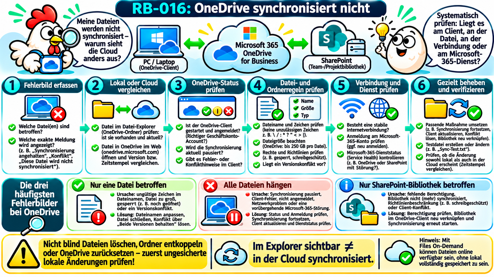
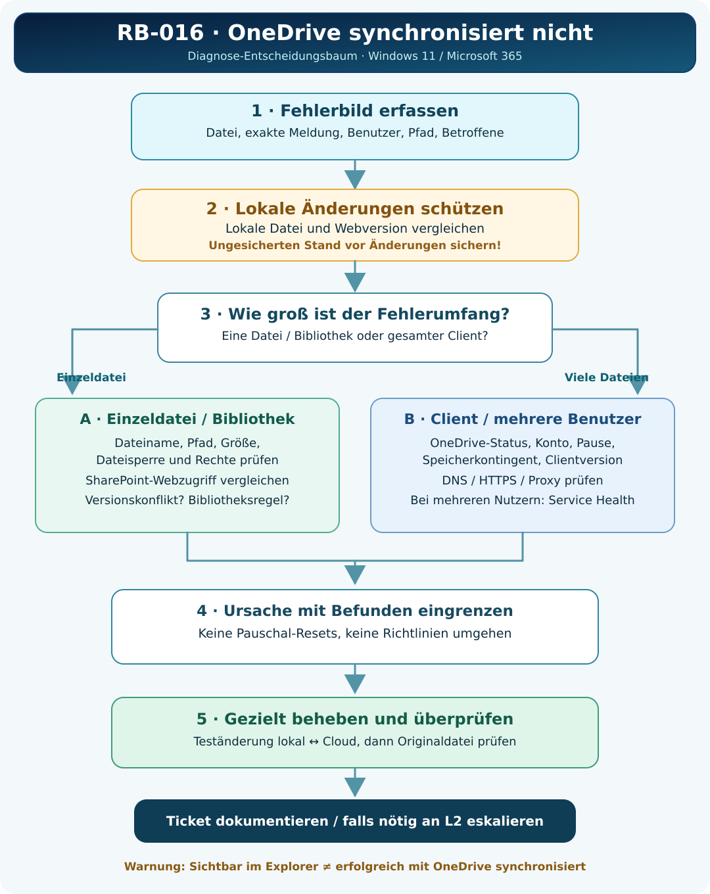

# RB-016 – OneDrive synchronisiert nicht

**Projekt:** 50 Tickets – 50 typische Supportfälle  
**Kategorie:** Microsoft 365 · OneDrive · SharePoint · Cloud-Synchronisierung  
**Support-Level:** L1/L2 (abhängig von Berechtigungen und Zuständigkeiten)  
**Plattform:** Windows 11, OneDrive-Synchronisierungsclient, Microsoft 365  
**Version / Recherchestand:** 1.0 · 08.11.2026  
**Validierung:** Technisch recherchiertes, fiktives Übungsbeispiel. Kein produktiver Praxistest durchgeführt.



**Merksatz:** *Eine Datei im Datei-Explorer zu sehen, ist kein Beweis dafür, dass ihre letzte Änderung bereits in der Cloud angekommen ist.*

---

## 1. Supportticket und Ausgangssituation

> **INC-016 – Fiktive Benutzeranfrage:** „Gestern habe ich unsere Kalkulation auf meinem Laptop geändert. Heute sieht mein Kollege in SharePoint noch den alten Stand. Im Explorer ist meine neue Datei aber vorhanden.“

**Auswirkung:** Kollegen arbeiten möglicherweise mit unterschiedlichen Dateiversionen. Je nach Dokument können Informationsverlust und falsche Entscheidungen drohen.  
**Ziel:** Den tatsächlichen Speicherort und Synchronisierungsstand feststellen, lokale Änderungen sichern, die Fehlerursache beseitigen und die Übereinstimmung beider Dateiversionen nachweisen.

**L1-Erstfragen:**

1. Wie heißt die betroffene Datei und **wo** wird sie geöffnet (vollständiger Pfad beziehungsweise SharePoint-Bibliothek)?
2. Nur eine Datei, eine Bibliothek, ein Benutzer oder mehrere Geräte betroffen?
3. Was steht beim OneDrive-Cloudsymbol in der Windows-Taskleiste: „Aktuell“, „Angehalten“, „Anmeldung erforderlich“, „Fehler“ oder „Änderungen werden verarbeitet“?
4. Wurde die Datei kürzlich umbenannt, verschoben, offline bearbeitet oder gleichzeitig auf mehreren Geräten bearbeitet?
5. Wann wurde die Datei zuletzt lokal gespeichert und wann erscheint die letzte Version in **OneDrive im Web** beziehungsweise SharePoint?
6. Gibt es bereits eine Fehlermeldung? Exakten Wortlaut und Zeitstempel dokumentieren.

**Datenschutz:** Keine Benutzerkennwörter, MFA-Codes oder vertraulichen Dokumentinhalte anfordern. Falls Screenshots benötigt werden, Namen und personenbezogene Daten nach Unternehmensvorgaben schwärzen.

---

## 2. Technische Grundlagen: Wie funktioniert die Synchronisierung?

**OneDrive** ist ein Cloudspeicher- und Dateidienst von Microsoft. Der **OneDrive-Synchronisierungsclient** (`OneDrive.exe`) verbindet ausgewählte Cloudinhalte mit dem lokalen Windows-Dateisystem. Er erkennt Änderungen und überträgt sie – abhängig von Netzwerk, Anmeldung, Berechtigungen und Regeln – zwischen Client und Cloud.

**SharePoint Online** stellt unter anderem gemeinsame **Dokumentbibliotheken** für Teams, Abteilungen und Projekte bereit. Dateien aus Microsoft Teams-Kanälen liegen häufig in solchen SharePoint-Bibliotheken. Der OneDrive-Synchronisierungsclient kann auch diese Inhalte verfügbar machen.

```text
Lokales Windows-Gerät                 Microsoft-365-Cloud
┌──────────────────────┐               ┌──────────────────────────┐
│ Windows-Datei-Explorer│               │ OneDrive (persönliche     │
│  OneDrive-Ordner      │◄── OneDrive ─►│ Arbeitsdateien)          │
│  SharePoint-Ordner    │   Sync-Client │ SharePoint (Teamdateien) │
└──────────────────────┘               └──────────────────────────┘
       │                                             │
  Office-Programme                         Browser / Kollegengeräte
```

Eine **erfolgreiche Anmeldung** ist noch kein Nachweis einer erfolgreichen Synchronisierung. Der Client muss die lokale Änderung erkennen, übertragen und die Cloud muss sie akzeptieren. Auch ein anderer Benutzer muss auf dieselbe Datei beziehungsweise dieselbe Bibliothek zugreifen.

### Begriffe und Abkürzungen

| Begriff | Für Einsteiger erklärt |
|---|---|
| **Sync** | Kurzform für Synchronisierung: Änderungen zwischen Speicherorten abgleichen. |
| **Sync-Client** | Lokales Programm, das OneDrive- und SharePoint-Dateien mit dem PC verbindet. |
| **Cloud** | Bereitgestellte Online-Dienste und Speicher auf entfernten Servern. |
| **SharePoint-Bibliothek** | Gemeinsame Dokumentablage, zum Beispiel für eine Abteilung. |
| **Tenant / Mandant** | Abgegrenzte Microsoft-365-Unternehmensumgebung. |
| **Files On-Demand** | Dateien sind im Explorer sichtbar, obwohl die eigentlichen Inhalte eventuell noch nicht heruntergeladen wurden. |
| **KFM (Known Folder Move)** | OneDrive-Funktion, die bekannte Windows-Ordner wie „Desktop“, „Dokumente“ und „Bilder“ in die OneDrive-Synchronisierung einbindet. |
| **Quota** | Zugewiesenes Speicherplatzkontingent. |
| **HTTPS** | Geschützte Webverbindung, meist über TCP-Port 443. |
| **DNS (Domain Name System)** | Übersetzt Servernamen in IP-Adressen. |
| **GPO (Group Policy Object)** | Gruppenrichtlinie zur zentralen Windows-Konfiguration. |
| **Intune** | Cloudplattform zur zentralen Verwaltung von Geräten und Richtlinien. |

**Ein wichtiger Unterschied:** „Mit OneDrive verknüpfen“ und „Synchronisieren“ sind zwei Wege, um SharePoint-Inhalte im Explorer sichtbar zu machen. Microsoft empfiehlt, wenn geeignet, die OneDrive-Verknüpfung. Vor Änderungen an vorhandenen Verbindungen muss die konkrete Einrichtung geprüft werden. [Microsoft Support: SharePoint- und Teams-Dateien synchronisieren](https://support.microsoft.com/de-de/sharepoint/sync/sync-sharepoint-and-teams-files-with-your-computer).

---

## 3. Fehlerbilder richtig unterscheiden

| Meldung / Beobachtung | Mögliche Erklärung | Gezielte erste Prüfung |
|---|---|---|
| **Rotes X** auf Datei oder Cloudsymbol | Eine oder mehrere Dateien können nicht synchronisiert werden | Cloudsymbol öffnen, konkreten Dateifehler lesen |
| **Pausensymbol** | Synchronisierung wurde angehalten oder automatisch pausiert | Pausengrund und Einstellung prüfen |
| **Graues Symbol / Anmeldung erforderlich** | OneDrive nicht angemeldet oder Einrichtung unvollständig | Richtiges Geschäfts- oder Privatkonto prüfen |
| **„Änderungen werden verarbeitet“** | Offene/große Dateien, viele Änderungen oder verzögerte Verarbeitung | Laufende Dateien, Datenmenge und Zeitverlauf prüfen |
| **Datei lokal neu, im Web alt** | Upload unvollständig, falscher Pfad oder Konflikt | Lokale/Cloud-Datei und Versionen vergleichen |
| **Nur SharePoint-Bibliothek betroffen** | Bibliotheksrechte, Richtlinie, Verknüpfung oder Sync-Konfiguration | Zugriff im Browser und Bibliothekseinstellungen prüfen |
| **Datei im Explorer sichtbar, offline nicht öffnbar** | Files On-Demand: nur online gespeicherte Platzhalterdatei | Statussymbol und Onlineverfügbarkeit prüfen |
| **Viele Mitarbeiter betroffen** | Mögliche Microsoft-365-Störung oder Unternehmensnetzwerkproblem | Service Health, Netzwerk und gemeinsame Richtlinien |

OneDrive-Symbole werden von Microsoft einzeln erklärt: [Microsoft Support – Bedeutung der Symbole](https://support.microsoft.com/de-de/onedrive/what-do-the-onedrive-icons-mean).

### Files On-Demand genauer erklärt

- **Wolke:** Datei ist nur online verfügbar. Ein Eintrag im Explorer ist vorhanden, der eigentliche Dateiinhalt muss aber erst bei Bedarf heruntergeladen werden.
- **Grünes Häkchen:** Datei ist lokal verfügbar und kann grundsätzlich auch offline geöffnet werden.
- **Ausgefüllter grüner Kreis mit weißem Häkchen:** Die Datei ist für „Immer auf diesem Gerät speichern“ vorgemerkt.
- **Kreisende Pfeile:** Eine Synchronisierungsaktivität findet statt oder steht an. Sie sind kein Erfolgsnachweis.

**Nicht verwechseln:** Offlineverfügbarkeit ist eine Eigenschaft der lokalen Kopie. Synchronisierungserfolg betrifft den Abgleich mit der Cloud. [Microsoft Support – Files On-Demand](https://support.microsoft.com/de-de/sharepoint/sync/work-with-synced-files-in-file-explorer).

---

## 4. Zugriffsvoraussetzungen und Diagnoseorte

| Situation | Wo prüft der Support? | Typische L1-/L2-Maßnahme |
|---|---|---|
| Benutzer angemeldet, nur eine Datei betroffen | OneDrive-Taskleistensymbol, Explorer, Browser | Dateifehler und Dateiversionen vergleichen; lokale Änderungen schützen |
| Alle Dateien eines Benutzers betroffen | Client, Kontostatus und Microsoft-365-Webportal | Kontoanmeldung, Pausenstatus, Speicher und Synchronisierungsclient kontrollieren |
| Nur eine SharePoint-Bibliothek betroffen | Client und SharePoint-Browser; bei Bedarf SharePoint-Administration | Berechtigungen, Offlineverfügbarkeit, Verknüpfungs-/Synchronisierungsstatus prüfen |
| Viele Geräte / Benutzer betroffen | Microsoft 365 Admin Center, Microsoft 365 Apps Admin Center | Service Health, gemeinsame Richtlinien und Sync Health untersuchen |
| Client nicht remote erreichbar | Telefonisch / freigegebene Fernwartung / vor Ort | Exakte Meldung erfragen, Browserzugriff prüfen und je nach Umgebung Diagnosezugang herstellen |

**Zugriffsarten:** Bei bestehender Windows-Sitzung eignet sich eine freigegebene Teams- oder Schnellhilfe-Sitzung häufig besser als eine eigene RDP-Sitzung (Remote Desktop Protocol). Für administrative Prüfungen können freigegebene Verwaltungsoberflächen und PowerShell verwendet werden. Rechte und Unternehmensrichtlinien bleiben maßgeblich.

---

## 5. Sicherheit vor der Fehlerbehebung: Welche Dateiversion ist noch nicht gesichert?

**Dies ist der wichtigste Schutzschritt bei RB-016.** Wenn eine lokale Änderung noch nicht synchronisiert wurde, kann eine vorschnelle Neuverknüpfung, ein Umzug des Ordners oder das Überschreiben der Datei den Überblick über die aktuelle Fassung zerstören.

1. Lokale Datei im Explorer identifizieren: **vollständigen Pfad, Größe, Änderungsdatum** dokumentieren.
2. Die entsprechende Datei in OneDrive oder SharePoint **im Browser** suchen und Änderungsdatum, Speicherort und gegebenenfalls Versionsverlauf vergleichen.
3. Ist die lokale Fassung aktueller oder unklar, erst eine **freigegebene, geschützte Sicherungskopie außerhalb des betroffenen synchronisierten Pfads** erstellen – nur an einem nach Unternehmensrichtlinie zugelassenen Ort.
4. Prüfen, ob Dokumente parallel auf anderen Geräten bearbeitet wurden. Den Versionsverlauf nur zur **Untersuchung**, nicht sofort zur Wiederherstellung verwenden.
5. Erst danach verändernde Maßnahmen anstoßen.

**Nicht automatisch tun:** OneDrive-Ordner löschen, synchronisierte Bibliotheken entkoppeln, Client neu installieren oder Cloudversion überschreiben. Bei sensiblen Dokumenten Eigentümer und IT-Zuständigkeit einbeziehen.

Microsoft dokumentiert den Versionsverlauf, einschließlich der Möglichkeit, frühere Versionen anzusehen und mit bewusster Entscheidung wiederherzustellen: [Versionsverlauf](https://support.microsoft.com/de-de/onedrive/restore-a-previous-version-of-a-file-stored-in-onedrive).

---

## 6. Diagnose-Entscheidungsbaum



**Grundgedanke:** Zuerst Umfang und betroffene Version ermitteln. Danach entweder den Pfad „einzelne Datei / Bibliothek“ oder „gesamter Client / Dienst“ wählen. Die Wiederherstellung erfolgt erst nach Sicherung ungesynchronisierter Änderungen.

---

## 7. Diagnosewerkzeuge und kommentierte PowerShell-Befehle

### 7.1 Prüfen, ob der OneDrive-Client läuft

**Ausführungsort:** Windows-Client des betroffenen Benutzers, in dessen Sitzung; in der Regel keine Administratorrechte nötig.  
**Ziel:** Prüfen, ob `OneDrive.exe` ausgeführt wird.

```powershell
# Sucht nach dem aktuell laufenden OneDrive-Prozess.
# -Name legt den Prozessnamen ohne .exe fest.
# -ErrorAction SilentlyContinue verhindert eine Fehlermeldung,
# wenn kein entsprechender Prozess gefunden wird.
Get-Process -Name 'OneDrive' -ErrorAction SilentlyContinue |
    # Gibt Prozess-ID und Startzeit zurück.
    Select-Object Id, ProcessName, StartTime
```

**Interpretation:** Eine Ausgabe bestätigt, dass ein Prozess existiert, **nicht**, dass Dateien erfolgreich synchronisiert werden. Keine Ausgabe kann bedeuten, dass OneDrive nicht läuft oder nicht im aktuellen Kontext sichtbar ist. Prüfen, ob OneDrive installiert ist und in der richtigen Benutzersitzung gestartet wurde.

### 7.2 Tatsächliche OneDrive-Programmversion abfragen

**Ausführungsort:** Betroffener Windows-Client. **Reine Leseabfrage.**

```powershell
# Wählt den ersten gefundenen OneDrive-Prozess aus.
$client = Get-Process -Name 'OneDrive' -ErrorAction SilentlyContinue |
    Select-Object -First 1

# Prüft, ob der Prozess gefunden wurde und ein Programmpfad verfügbar ist.
if ($null -ne $client -and $client.Path) {
    # Liest die Dateiversionsinformation der ausführbaren Datei.
    (Get-Item -LiteralPath $client.Path).VersionInfo.FileVersion
} else {
    # Ausgabe, falls der Prozess nicht gefunden wurde.
    'OneDrive-Prozess oder Programmpfad nicht verfügbar.'
}
```

**Interpretation:** Die Versionsnummer hilft beim Vergleich mit freigegebenen Unternehmensversionen; sie erklärt den Fehler für sich allein noch nicht.

### 7.3 OneDrive-Ordnerpfade im Benutzerkontext ermitteln

```powershell
# Zeigt vorhandene OneDrive-Umgebungsvariablen für diesen Benutzer.
# Diese Pfade sind Hinweise auf lokale Sync-Verzeichnisse.
# Nicht jeder Kontotyp setzt jede Variable.
[PSCustomObject]@{
    OneDrivePrivat   = $env:OneDrive
    OneDriveGeschaeft = $env:OneDriveCommercial
}
```

**Interpretation:** Diese Werte beschreiben lokale Pfade, nicht den Cloud-Synchronisierungszustand. Ein fehlender Wert beweist keinen generellen OneDrive-Ausfall. Die genaue Datei muss über Explorer und Browser abgeglichen werden.

### 7.4 Dateimetadaten sicher prüfen

**Ausführungsort:** Client. Den Beispielpfad vorher durch die **tatsächlich betroffene lokale Datei** ersetzen. Der Befehl verändert die Datei nicht.

```powershell
# Beispielpfad durch den echten lokalen Speicherort ersetzen.
$datei = 'C:\Users\Max\OneDrive - Beispiel GmbH\Projekt\Planung.xlsx'

# Prüft, ob die Datei unter diesem Pfad vorhanden ist.
if (Test-Path -LiteralPath $datei -PathType Leaf) {
    # Liest Dateigröße und letztes Änderungsdatum aus.
    Get-Item -LiteralPath $datei |
        Select-Object FullName, Length, LastWriteTime
} else {
    'Die Datei wurde an diesem lokalen Pfad nicht gefunden.'
}
```

**Wichtig:** `LastWriteTime` ist nur ein lokaler Dateisystemzeitstempel und beweist keine erfolgreiche Cloudübertragung. Auch gleich große Dateien können inhaltlich abweichen. Der Vergleich mit Versionsstand im Web ist erforderlich.

### 7.5 Namensauflösung des Cloudziels prüfen

**Ausführungsort:** Client. Beispielhost `beispiel-my.sharepoint.com` durch den tatsächlich vom Unternehmen verwendeten OneDrive-/SharePoint-Host ersetzen.

```powershell
# Fragt DNS nach der Auflösung des OneDrive-Unternehmenshosts.
# -Name gibt den konkreten Hostnamen an.
Resolve-DnsName -Name 'beispiel-my.sharepoint.com'
```

**Interpretation:** Erfolgreiche DNS-Auflösung bedeutet nur, dass die Namensauflösung funktioniert. Weder Anmeldung noch OneDrive-Synchronisierung sind dadurch bewiesen. Bei Firmen-Proxys oder speziellen DNS-Umgebungen kann die Interpretation abweichen.

### 7.6 HTTPS-Erreichbarkeit für den Cloudhost prüfen

```powershell
# Prüft den Aufbau einer TCP-Verbindung auf Port 443 (HTTPS).
# Der Hostname ist ein Beispiel und muss zum Mandanten passen.
Test-NetConnection -ComputerName 'beispiel-my.sharepoint.com' -Port 443
```

**Interpretation:** `TcpTestSucceeded : True` bestätigt eine TCP-Verbindung zum Host auf Port 443. Es bestätigt **nicht** erfolgreiche Authentifizierung, TLS-Prüfung, Proxykompatibilität oder Dateiübertragung. `False` ist ein Hinweis auf ein Verbindungsproblem, nicht automatisch auf eine lokale Firewall als Ursache.

### 7.7 Optional: Richtlinie für OneDrive-Synchronisierungsberichte auslesen

**Ausführungsort:** Windows-Client in Unternehmensumgebung. Die Abfrage liest lediglich eine vorhandene Richtlinieneinstellung und setzt sie nicht.

```powershell
# Fragt den aktuellen Richtlinienwert für OneDrive Sync Health ab.
# reg.exe query verändert keinen Registrierungseintrag.
reg.exe query 'HKLM\SOFTWARE\Policies\Microsoft\OneDrive' /v EnableSyncAdminReports
```

**Interpretation:** Bei gesetztem, korrekt konfiguriertem Wert kann die Übertragung von Sync-Health-Daten vorgesehen sein. Fehlt der Wert, ist die Funktion möglicherweise nicht eingerichtet. Weitere Voraussetzungen und Verzögerungen beschreibt Microsoft; aus dieser Einzelabfrage folgt nicht, ob ein Gerät bereits im Dashboard erscheint. [Microsoft Learn – Sync Health](https://learn.microsoft.com/de-de/sharepoint/sync-health).

---

## 8. Dateispezifische Ursachen: Namen, Größe, Pfade und Zugriffsrechte

Wenn **nur einzelne Dateien** nicht synchronisiert werden, zuerst die konkreten Dateifehler prüfen.

| Befund | Erklärung | Geeigneter nächster Schritt |
|---|---|---|
| Ungültige Zeichen / reservierter Dateiname | OneDrive/SharePoint und Windows unterstützen bestimmte Namen nicht | Dateiname gezielt gemäß Regel ändern, Auswirkungen auf Links prüfen |
| Zu langer Dateipfad | Cloud und lokale Programme besitzen Längenbeschränkungen | Pfad verkürzen, nicht ganze Bibliothek pauschal verschieben |
| Sehr große Datei | Upload kann Zeit benötigen; Größenlimit beachten | Dateigröße und Dokumentation prüfen; ausreichend Übertragungszeit |
| Datei durch Anwendung gesperrt | Geöffnete oder laufend geschriebene Datei kann Upload blockieren | Speichern und Anwendung kontrolliert schließen |
| Fehlende Schreibberechtigung | Datei/SharePoint-Bibliothek lässt Änderung nicht zu | Rechte und zuständige Gruppe prüfen; keine pauschale Vollzugriffsfreigabe |
| Versionskonflikt | Zwei Geräte haben unterschiedliche Änderungen erzeugt | Versionen bewusst vergleichen und zusammenführen |
| Speicherplatzkontingent erreicht | Cloud nimmt keine weiteren Änderungen auf | Kontingent und Bereinigung/Freigabe nach Genehmigung klären |

**Stand der Quellenrecherche:** Microsoft nennt für einzelne Dateien ein Maximum von 250 GB; für Cloud-Dateipfade gelten eigene Grenzwerte. Für die Gesamtzahl synchronisierter Elemente existieren Empfehlungen und teils Vorschaufunktionen – **keine pauschale feste Grenze ohne Prüfung des aktuellen Rollouts behaupten**. [Microsoft Support – Einschränkungen und Grenzwerte](https://support.microsoft.com/de-de/onedrive/restrictions-and-limitations-in-onedrive-and-sharepoint) und [Pfadlängen](https://support.microsoft.com/en-us/onedrive/what-are-file-path-length-limits).

---

## 9. Wenn „Änderungen werden verarbeitet“ nicht endet

Der Hinweis kann nach dem Import vieler Dateien oder nach einem Systemupdate normal sein. Mögliche Hindernisse sind unter anderem große Datenmengen, geöffnete Dateien, blockierte Dateitypen, fehlende Anmeldung oder ein Netzwerkengpass.

**Vorgehen:**

1. Aktivitätsfenster öffnen und betroffene Dateien ermitteln.
2. Laufende Übertragungen und Datenmengen beurteilen, nicht nach wenigen Sekunden von „hängt“ ausgehen.
3. Prüfen, ob Datei noch in Word, Excel, einer anderen App oder einem Hintergrundprozess geöffnet ist.
4. Status des OneDrive-Kontos, Speicher und Internetverbindung prüfen.
5. Bei einem einzelnen Problemobjekt **nur dieses** isoliert untersuchen. Keine pauschalen Löschaktionen.

Offizielle Referenz: [Microsoft – OneDrive bleibt bei „Änderungen werden verarbeitet“ hängen](https://support.microsoft.com/de-de/onedrive/troubleshoot-onedrive-sync-issues-stuck-on-processing-changes).

---

## 10. Wenn nur eine SharePoint- oder Teams-Bibliothek betroffen ist

Eine Dokumentbibliothek kann im Browser funktionieren, während die lokale Synchronisierung verhindert oder fehlerhaft konfiguriert ist. Außerdem können unterschiedliche Konten, defekte Verknüpfungen, fehlende Berechtigungen und Bibliotheksrichtlinien eine Rolle spielen.

**Sinnvolle Reihenfolge:**

1. Browserzugriff auf die **genau gleiche Bibliothek** mit dem betroffenen Konto prüfen.
2. Vergleich mit einem zweiten Benutzer nur mit legitimem Zugriff und ohne Weitergabe von Kontodaten.
3. Prüfen, ob die Bibliothek bewusst nur online bereitgestellt werden darf. Fehlt die Option „Synchronisieren“, ist das nicht zwingend ein Defekt.
4. Feststellen, ob die Bibliothek per **„Verknüpfung zu OneDrive hinzufügen“** oder per **„Synchronisieren“** eingebunden wurde; beide Verfahren nicht blind parallel für denselben Inhalt einrichten.
5. Bibliotheksrechte und Richtlinien nur mit den zuständigen Berechtigungen untersuchen. **Keinen Sicherheitsmechanismus zum Testen abschalten.**

Referenzen: [Microsoft Learn – Synchronisierungsprobleme](https://learn.microsoft.com/de-de/troubleshoot/sharepoint/sync/troubleshoot-sync-issues), [Microsoft Support – SharePoint und Teams synchronisieren](https://support.microsoft.com/de-de/sharepoint/sync/sync-sharepoint-and-teams-files-with-your-computer).

---

## 11. Cloud- und Infrastrukturdiagnose durch L2

Wenn mehrere Benutzer oder Geräte betroffen sind, prüft der Second Level zunächst mögliche gemeinsame Fehlerquellen:

- **Microsoft 365 Service Health:** Dienstmeldungen zu OneDrive/SharePoint prüfen (erfordert geeignete Adminrolle).
- **OneDrive Sync Health im Microsoft 365 Apps Admin Center:** Sofern durch die Organisation eingerichtet, Geräteversion, letzte Meldung, Synchronisierungszustand und bekannte Fehler prüfen.
- **Anmeldung und Richtlinien:** Geschäfts-/Schulkonto, Gerätezustand, Zugriffsrichtlinien und SharePoint-Berechtigungen abgleichen.
- **Netzwerk:** DNS, Internetweg, Unternehmensproxy, Firewall, TLS-Verbindungsaufbau und Zugriffsregeln prüfen.
- **Richtlinienverteilung:** Via Intune oder GPO vorgegebene OneDrive-Konfigurationen berücksichtigen.

**Vorsicht beim Sync-Health-Dashboard:** Die Telemetrie ist nur bei vorhandenen Voraussetzungen und aktivierter Konfiguration aussagekräftig. Die Anzeige kann zeitverzögert sein; eine fehlende Meldung bedeutet nicht automatisch, dass das Gerät ausgeschaltet oder der Client defekt ist. [Microsoft Learn – OneDrive Sync Health](https://learn.microsoft.com/de-de/sharepoint/sync-health).

---

## 12. Fehlerbehebung: Von risikoarm zu eingreifend

### Stufe A – Diagnose und einfache Korrektur (typisch L1)

- Richtige Identität und richtigen Speicherort bestätigen.
- Pausierte Synchronisierung nach Klärung des Grunds **fortsetzen**.
- Fehlende Anmeldung nach regulärem Unternehmensverfahren erneuern.
- Datei speichern und gegebenenfalls die blockierende Anwendung schließen.
- Einzelnen Dateinamen, Dateipfad, Dateigröße oder konkrete Berechtigung untersuchen.
- OneDrive-Version und Clientstatus erfassen; bei Bedarf reguläres, freigegebenes Update.
- Nach dokumentierter Korrektur den betroffenen Dateivorgang testen.

### Stufe B – Reparatur des OneDrive-Clients (nur gezielt und freigegeben)

Ein Microsoft-dokumentierter `OneDrive.exe /reset` kann Sync-Probleme beheben. Der Reset setzt OneDrive-Einstellungen zurück und baut Synchronisierungsverbindungen neu auf. Microsoft erläutert ausdrücklich, dass der Reset keine Dateien absichtlich löscht; **bei einem ungeklärten Synchronisierungsstand müssen lokale Änderungen dennoch zuvor gesichert und die Konfiguration dokumentiert werden**. Nach dem Reset kann eine vollständige Synchronisierung erfolgen und es können Ordnerauswahlen neu erforderlich sein. [Microsoft Support – OneDrive zurücksetzen](https://support.microsoft.com/de-de/onedrive/reset-onedrive).

**Nicht als Standard-Erstmaßnahme ausführen.** Vorher prüfen: Sind alle lokalen Änderungen geschützt? Welche Konten und Bibliotheken sind verbunden? Liegt eine Berechtigung für diesen Eingriff vor?

**Vollständiger Befehl für Windows „Ausführen“ (`Win` + `R`):**

```text
%localappdata%\Microsoft\OneDrive\OneDrive.exe /reset
```

Die Leerzeichen-Schreibweise ist relevant: **Nach `OneDrive.exe` folgt ein Leerzeichen und dann `/reset`.** Falls Windows die ausführbare Datei dort nicht findet, nennt Microsoft auch Installationspfade unter `C:\Program Files\Microsoft OneDrive\OneDrive.exe` beziehungsweise `C:\Program Files (x86)\Microsoft OneDrive\OneDrive.exe`.

**Entsprechendes PowerShell-Beispiel – verändernder Befehl, nur nach Freigabe:**

```powershell
# Setzt den vollständigen Pfad zur üblichen OneDrive-Installation zusammen.
$oneDriveExe = Join-Path $env:LOCALAPPDATA 'Microsoft\OneDrive\OneDrive.exe'

# Prüft, ob die ausführbare Datei an diesem Ort existiert.
if (Test-Path -LiteralPath $oneDriveExe -PathType Leaf) {
    # Startet den von Microsoft dokumentierten OneDrive-Reset.
    # ACHTUNG: Setzt Einstellungen zurück und baut Sync-Verbindungen neu auf.
    & $oneDriveExe /reset
} else {
    # Fordert die Prüfung eines alternativen Installationspfads an.
    'OneDrive.exe nicht unter LOCALAPPDATA gefunden. Installationspfad prüfen.'
}
```

**Danach:** OneDrive bei Bedarf über Start öffnen, Konto-/Bibliotheksverbindungen prüfen, ggf. erneut einrichten und Synchronisierungsergebnis validieren.

### Stufe C – Eingriffe mit höherer Tragweite (L2 / Change-Freigabe)

Neu verknüpfen, Bibliothekssynchronisierung entfernen und wieder einrichten, SharePoint-Richtlinien verändern oder OneDrive neu installieren. Hier sind Freigabe, Bestandsaufnahme und Rückfallplan notwendig. Lokale ungesicherte Daten dürfen niemals unbemerkt entfernt oder überschrieben werden.

---

## 13. Erfolgskontrolle und dokumentierter Funktionsnachweis

Bei der originalen betroffenen Datei nicht nur auf das grüne Symbol vertrauen:

1. **Lokale und Cloud-Version:** Gleiches Dokument und gleiche Bibliothek eindeutig bestimmen.
2. **Unkritische Testdatei** verwenden, die dafür freigegeben ist, z. B. `RB016-Sync-Test.txt` in einem genehmigten Testordner.
3. Lokal eine Änderung speichern und warten, bis der Client „Aktuell“ oder die entsprechende abgeschlossene Synchronisierung zeigt.
4. Datei im **Web** öffnen und Inhalt beziehungsweise Änderungsstand kontrollieren.
5. Falls zugelassen: Cloudseitig eine weitere Änderung durchführen und den Rückweg am Client prüfen.
6. Ursprüngliche Datei erneut mit dem berechtigten Benutzer kontrollieren; bei Konflikten erst nach Vergleich eine Variante freigeben.
7. Testergebnis, Zeitstempel, Diagnosen und offene Punkte im Ticket festhalten.

**Nicht erforderlich:** Echte Unternehmensdaten für Testzwecke auf private Clouds oder unsichere Speichermedien kopieren.

---

## 14. Eskalation und Muster-Ticketkommentar

### L1 an L2 eskalieren, wenn ...

- mehrere Benutzer / Geräte oder ganze Standorte betroffen sind,
- SharePoint-/OneDrive-Bibliotheksrechte oder organisatorische Richtlinien unklar sind,
- Versionenkonflikte mit geschäftskritischen Änderungen drohen,
- lokale Änderungen vor einer Reparatur nicht sicher identifiziert werden können,
- Cloud-Speicher-, Dienst- oder Identitätskonfiguration zu prüfen ist,
- für eine Korrektur zusätzliche Rechte oder Freigaben notwendig sind.

### Ticketkommentar – fiktives Beispiel

**INC-016 – Änderungen an Projektdokument werden nicht übertragen**  
**Fehlerbild:** Mitarbeiter meldet, dass lokal gespeicherte Excel-Änderungen im SharePoint-Webzugriff nicht sichtbar sind.  
**Erstdiagnose:** Lokalen Dateipfad und zugehörige SharePoint-Bibliothek abgeglichen. OneDrive-Client zeigte Synchronisierungsfehler für eine einzelne Datei. Cloud-Datei hatte einen älteren Änderungsstand.  
**Datensicherung:** Die aktuellere lokale Fassung wurde gemäß Unternehmensrichtlinie vor weiteren Schritten separat geschützt.  
**Ursache:** Datei war bei der Synchronisierung durch eine laufende Anwendung blockiert.  
**Maßnahme:** Datei regulär gespeichert und die blockierende Anwendung kontrolliert geschlossen. OneDrive-Synchronisierungsstatus überwacht.  
**Erfolgskontrolle:** Die aktuelle Fassung war anschließend im SharePoint-Webzugriff verfügbar; geänderten Inhalt gemeinsam mit dem Benutzer kontrolliert.  
**Status:** Gelöst.  

*Dieses Beispiel ist konstruiert. Es dokumentiert keine tatsächlich durchgeführte Supportmaßnahme.*

---

## 15. Lernkontrolle, Transfer und Quellen

### Wissensfragen

1. Was bedeutet ein blaues Wolkensymbol im Windows-Explorer?
2. Welche Informationen liefert `Get-Process -Name OneDrive` – und was kann es nicht beweisen?
3. Wozu dient die OneDrive-Synchronisierungs-App beim Zugriff auf SharePoint-Dateien?

### Verständnisfragen

1. Warum kann eine Datei lokal gespeichert und trotzdem in SharePoint veraltet sein?
2. Warum ist eine funktionierende HTTPS-Verbindung noch kein Nachweis der OneDrive-Funktion?
3. Weshalb dürfen `OneDrive.exe /reset` und die Neuverknüpfung nicht ohne Bestandsaufnahme erfolgen?

### Diagnoseaufgabe (ohne vorweggenommene Lösung)

Ein Kollege meldet, dass `Angebot.xlsx` auf zwei Notebooks unterschiedliche Inhalte zeigt. Beide OneDrive-Clients sind angemeldet. Einer meldet „Aktuell“, der andere zeigt bei der Datei ein rotes X. Es gibt drei verschiedene Änderungszeitstempel in lokalen Dateiansichten und im SharePoint-Webzugriff. **Wie würdest du die korrekte Datenversion schützen und anschließend die Störung eingrenzen?**

### Anki-Kartenideen

- **Wissenskarte:** Was signalisiert die OneDrive-Wolke neben einer Datei? → Nur online verfügbar; Dateiinhalt ist nicht zwingend lokal gespeichert.
- **Verständniskarte:** Warum beweist eine lokale Datei keinen Cloud-Upload? → Der Sync-Client muss die Änderung erfolgreich übertragen und der Cloud-Dienst muss sie annehmen.
- **Diagnosekarte:** Nur eine Datei hat ein rotes X, alle anderen synchronisieren. Was zuerst? → Konkreten Dateifehler, Dateinamen, Dateisperre, Rechte und Konflikt prüfen.

### Technische Herstellerquellen (geprüft am 08.11.2026)

1. [Microsoft Support – OneDrive-Synchronisierungsprobleme beheben](https://support.microsoft.com/de-de/onedrive/fix-onedrive-sync-problems) – erster Diagnosezugang und Statussymbole.
2. [Microsoft Support – Bedeutung der OneDrive-Symbole](https://support.microsoft.com/de-de/onedrive/what-do-the-onedrive-icons-mean) – Explorer-, Cloud- und Fehleranzeigen.
3. [Microsoft Support – Mit synchronisierten Dateien im Explorer arbeiten](https://support.microsoft.com/de-de/sharepoint/sync/work-with-synced-files-in-file-explorer) – Files On-Demand.
4. [Microsoft Support – „Änderungen werden verarbeitet“](https://support.microsoft.com/de-de/onedrive/troubleshoot-onedrive-sync-issues-stuck-on-processing-changes) – blockierte Dateien und lange Synchronisierung.
5. [Microsoft Support – Einschränkungen und Grenzwerte](https://support.microsoft.com/de-de/onedrive/restrictions-and-limitations-in-onedrive-and-sharepoint) – Namen, Pfade, Größen und Anzahl der Dateien.
6. [Microsoft Support – OneDrive zurücksetzen](https://support.microsoft.com/de-de/onedrive/reset-onedrive) – Voraussetzungen und dokumentierte Reset-Schritte.
7. [Microsoft Learn – OneDrive Sync Health](https://learn.microsoft.com/de-de/sharepoint/sync-health) – Dashboard für Administratoren.
8. [Microsoft Learn – OneDrive/SharePoint-Synchronisierungsprobleme](https://learn.microsoft.com/de-de/troubleshoot/sharepoint/sync/troubleshoot-sync-issues) – Bibliotheksregeln und Grenzen.
9. [Microsoft Support – SharePoint-/Teams-Dateien synchronisieren](https://support.microsoft.com/de-de/sharepoint/sync/sync-sharepoint-and-teams-files-with-your-computer) – Verknüpfung versus Synchronisierung.
10. [Microsoft Support – Versionsverlauf in OneDrive](https://support.microsoft.com/de-de/onedrive/restore-a-previous-version-of-a-file-stored-in-onedrive) – Sicherung und Wiederherstellung verschiedener Versionen.
11. [Microsoft Learn – Known Folder Move](https://learn.microsoft.com/de-de/sharepoint/redirect-known-folders) – Umleitung bekannter Windows-Ordner.
12. [Microsoft Support – OneDrive-Fehlercodes](https://support.microsoft.com/de-de/onedrive/what-do-the-onedrive-error-codes-mean) – Fehlermeldungen und Auslegung.

**Projektstatus:** Recherchiert und dokumentiert. Fiktive Beispiele. Praktische Tests und Screenshots aus einer echten Windows-/Microsoft-365-Umgebung stehen aus.
