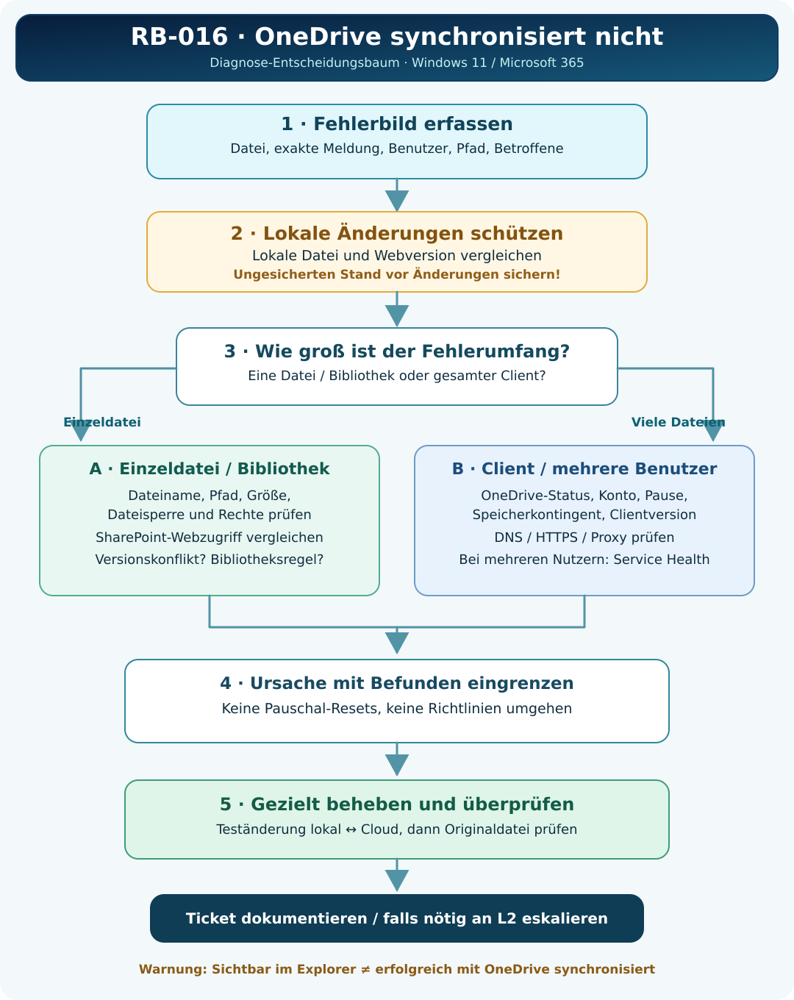

# RB-016 – Praxis-Runbook: OneDrive synchronisiert nicht

**Kategorie:** Microsoft 365 / OneDrive / SharePoint  
**Support-Level:** L1/L2  
**Version:** 1.0 · 08.11.2026  
**Status:** Recherchiert – praktische Validierung ausstehend  
**Ziel:** Ursache eingrenzen, lokale Änderungen schützen und eine kontrollierte Synchronisierung nachweisen.



## 1. Ticket aufnehmen (L1)

- Exakte Meldung, Zeitpunkt, Benutzerkonto und betroffenen Rechner erfassen.
- **Eine Datei, eine Bibliothek, alle Dateien oder mehrere Benutzer?**
- Vollständigen lokalen Dateipfad **und** zugehörigen Webspeicherort dokumentieren.
- OneDrive-Cloudsymbol öffnen: pausiert, Fehler, nicht angemeldet, „Änderungen werden verarbeitet“?
- Wurde parallel auf anderen Rechnern oder offline gearbeitet?

## 2. Sicherheits-Check vor jeder Änderung

**STOPP, wenn lokale oder Cloudversionen voneinander abweichen.** Zuerst ermitteln, wo der aktuelle Datenstand liegt. Ungesicherte lokale Änderungen an einem freigegebenen, geschützten Speicherort aufbewahren und keine Konfliktversion überschreiben. Datenschutz und Unternehmensrichtlinien beachten.

## 3. Zugriff und Synchronisierung kontrollieren (L1)

| Prüffrage | Vorgehen | Interpretation |
|---|---|---|
| Richtiger Speicherort? | Explorer-Pfad mit OneDrive-/SharePoint-Webpfad abgleichen | Unterschiedliche Ordner sind kein Sync-Fehler |
| Client gestartet? | OneDrive-Symbol in Taskleiste; optional PowerShell | Laufender Prozess beweist keinen Sync-Erfolg |
| Pausiert oder nicht angemeldet? | Aktivitätscenter öffnen | Ursache prüfen; regulär fortsetzen/anmelden |
| Nur eine Datei betroffen? | Konkrete Fehlermeldung ansehen | Name, Dateisperre, Größe, Berechtigung, Konflikt |
| Ganze Bibliothek betroffen? | Im SharePoint-Webzugriff testen | Rechte, Bibliotheksrichtlinie, Verbindung prüfen |
| Mehrere Benutzer betroffen? | Gemeinsamkeiten und Dienststatus prüfen | L2 / Service Health / Sync Health |

## 4. Lesende Diagnosebefehle (L1)

**Ausführungsort:** Betroffener Windows-Client in der Sitzung des Benutzers.

```powershell
# Prüft, ob der OneDrive-Prozess läuft.
Get-Process -Name 'OneDrive' -ErrorAction SilentlyContinue |
    Select-Object Id, ProcessName, StartTime

# Zeigt bekannte lokale OneDrive-Verzeichnisse des Benutzers.
# Werte können je nach Kontokonfiguration fehlen.
[PSCustomObject]@{
    Privat = $env:OneDrive
    Geschaeft = $env:OneDriveCommercial
}

# Prüft die DNS-Auflösung eines Firmen-OneDrive-Hosts.
# Beispielhost durch die tatsächlich verwendete Domäne ersetzen.
Resolve-DnsName -Name 'beispiel-my.sharepoint.com'

# Prüft einen TCP-Verbindungsaufbau zum HTTPS-Port.
# Ein positives Ergebnis beweist keine erfolgreiche Synchronisierung.
Test-NetConnection -ComputerName 'beispiel-my.sharepoint.com' -Port 443
```

**Befunde interpretieren:** Prozess vorhanden ≠ Datei übertragen. DNS erfolgreich ≠ Anmeldung erfolgreich. TCP 443 offen ≠ SharePoint-Berechtigung vorhanden.

## 5. Konkrete Fehlerzweige

**A. Nur eine Datei:** Aktuelle lokale Version schützen. Fehlermeldung untersuchen: ungültige Zeichen/Pfad, offene Datei, Kontingent, Dateigröße, Rechte, Konflikt. Nur die nachgewiesene Ursache korrigieren.

**B. Gesamter Client:** Richtiges Konto, Pausierung, Speicherplatz, Clientversion, Netzverbindung und Dienststatus prüfen. Bei „Änderungen werden verarbeitet“ Datenmenge und Zeit berücksichtigen.

**C. Nur SharePoint-Bibliothek:** Identische Bibliothek im Browser kontrollieren; Berechtigung, Offlinefähigkeit und Verknüpfungs-/Sync-Methode prüfen. Änderungen an zentralen Richtlinien durch L2.

**D. Mehrere Benutzer:** Microsoft 365 Service Health und eingerichtetes OneDrive Sync Health Dashboard kontrollieren; gemeinsame Proxy-, Netzwerk- oder Richtlinienänderungen untersuchen.

## 6. Fehlerbehebung (nach Diagnose)

1. Unproblematische Korrektur wählen: Synchronisierung fortsetzen, gültige Anmeldung, Datei schließen, fehlerhaften Namen/Dateipfad gezielt berichtigen, freigegebene Client-Aktualisierung.
2. Veränderte Dateiversion erneut **im Web** verifizieren.
3. **Reset/Neuverknüpfung nicht als Erstmaßnahme** einsetzen. Vorher lokale Änderungen sichern, verbundene Konten/Bibliotheken dokumentieren und erforderliche Freigabe einholen.
4. Falls wirklich freigegeben, Windows **Ausführen** (`Win`+`R`), vollständiger Microsoft-Befehl:

```text
%localappdata%\Microsoft\OneDrive\OneDrive.exe /reset
```

**Achtung:** Zwischen `OneDrive.exe` und `/reset` steht ein Leerzeichen. Der Reset baut Synchronisierungsverbindungen neu auf und kann neue Ordnerauswahlen nötig machen. Wenn OneDrive an diesem Pfad nicht installiert ist, den korrekten Installationspfad prüfen. Quelle: [Microsoft – OneDrive zurücksetzen](https://support.microsoft.com/de-de/onedrive/reset-onedrive).

## 7. Funktionsprüfung

- Eine zulässige Testdatei im freigegebenen Sync-Ordner erstellen oder ändern.
- Synchronisierung bis zu einem abgeschlossenen Zustand verfolgen.
- Datei im OneDrive-/SharePoint-Webzugriff überprüfen.
- Wenn vorgesehen, eine Cloud-Änderung durchführen und Rücksynchronisierung testen.
- **Ursprüngliche betroffene Datei** und Benutzerworkflow erneut kontrollieren.

## 8. Eskalationspaket (L2)

Exakter Dateipfad und Webort, Zeitstempel, betroffene Benutzer/Geräte, Fehlertext, Cloud-/Lokalversionsstand, Clientversion, Kontozustand, durchgeführte Diagnosen, bereits erfolgte Änderungen und Ergebnis. Keine vertraulichen Dateiinhalte oder Zugangsdaten ohne Freigabe weitergeben.

## 9. Ticketabschluss – Muster (fiktiv)

**Fehlerbild:** Datei lokal aktuell, SharePoint-Webversion veraltet.  
**Diagnose:** Rotes X auf einer Datei; übrige Dateien synchronisieren. Aktueller lokaler Datenstand geschützt.  
**Ursache:** Datei während der Übertragung durch eine Anwendung gesperrt.  
**Maßnahme:** Anwendung nach Speichern regulär geschlossen; Synchronisierung wieder aufgenommen.  
**Erfolg:** Aktueller Dateistand im Web sichtbar; mit Benutzer geprüft.  
**Status:** Gelöst.

## 10. Herstellerquellen

- [Microsoft – OneDrive-Sync-Probleme beheben](https://support.microsoft.com/de-de/onedrive/fix-onedrive-sync-problems)
- [Microsoft – OneDrive-Symbole](https://support.microsoft.com/de-de/onedrive/what-do-the-onedrive-icons-mean)
- [Microsoft – OneDrive zurücksetzen](https://support.microsoft.com/de-de/onedrive/reset-onedrive)
- [Microsoft – Einschränkungen und Grenzwerte](https://support.microsoft.com/de-de/onedrive/restrictions-and-limitations-in-onedrive-and-sharepoint)
- [Microsoft Learn – Sync Health Dashboard](https://learn.microsoft.com/de-de/sharepoint/sync-health)
- [Microsoft Learn – SharePoint-Sync-Fehler](https://learn.microsoft.com/de-de/troubleshoot/sharepoint/sync/troubleshoot-sync-issues)

**Ausführliche Grundlagen, kommentierte Beispiele und Lernkontrollen:** [RB-016-Lernartikel](RB-016_Lernartikel.md).  
**Praktische Validierung:** Ausstehend.
