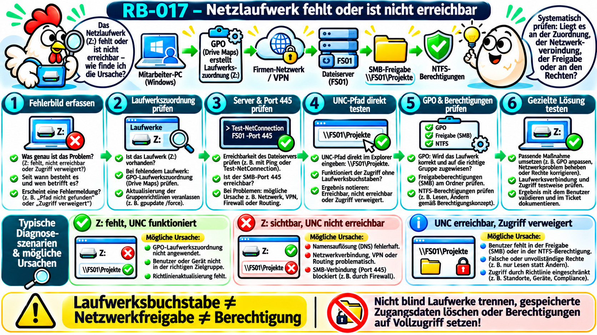
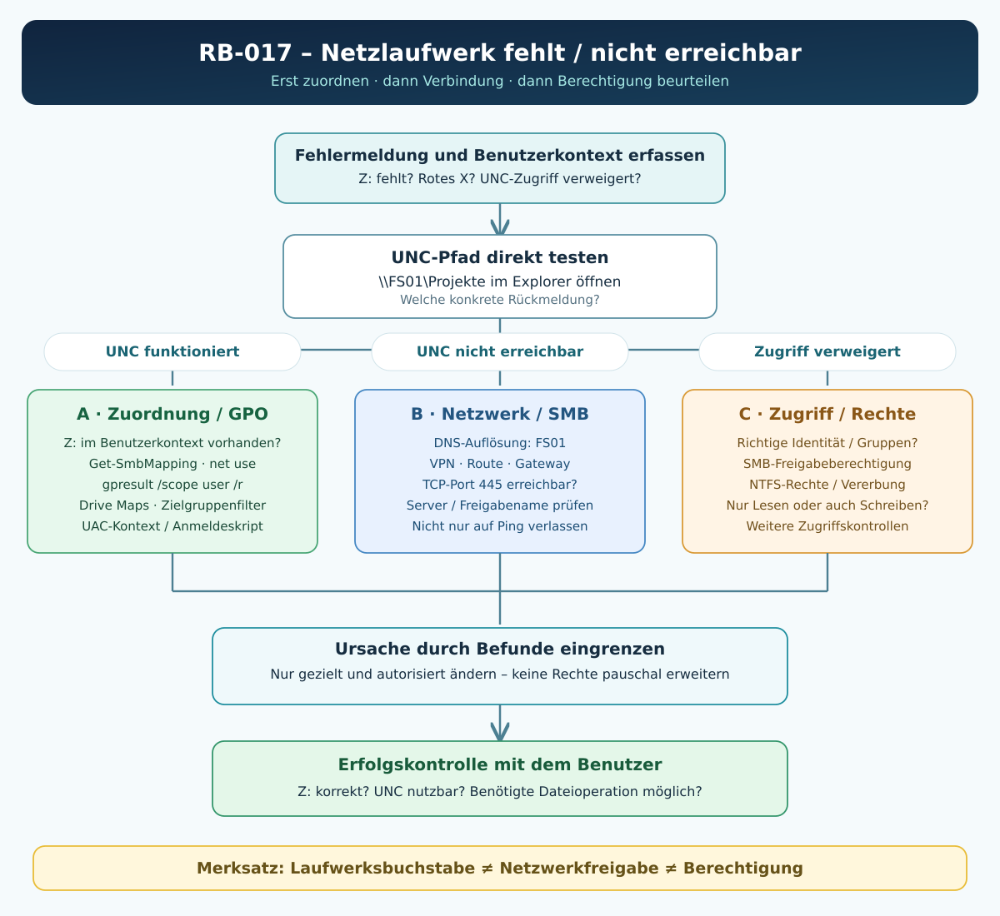

# RB-017 – Netzlaufwerk fehlt oder ist nicht erreichbar

**Projekt:** 50 Tickets – 50 typische Supportfälle  
**Themengebiet:** Windows-Client, Active Directory, Gruppenrichtlinien, SMB, Datei- und Freigabeberechtigungen  
**Support-Level:** L1 / L2 – abhängig von Berechtigungen und Unternehmensprozess  
**Version:** 1.0 · **Recherche:** 08.11.2026  
**Validierung:** Technisch recherchiertes Lernbeispiel; **nicht praktisch im Unternehmensnetz getestet**.  
**Beispielumgebung:** Windows 11 Pro, AD-Domäne `firma.example`, Dateiserver `FS01`, Freigabe `\\FS01\Projekte`, Netzlaufwerk `Z:` (alle Namen erfunden).



## 1. Das Supportticket

> **INC-017 (fiktiv):** „Seit heute ist mein Laufwerk Z: verschwunden. Gestern konnte ich noch auf die Projektunterlagen zugreifen. Bei einem Kollegen funktioniert es weiterhin.“

**Ziel:** Herausfinden, ob nur der **Laufwerksbuchstabe** fehlt, die **Serverfreigabe** nicht erreichbar ist oder die **Berechtigung** den Zugriff verhindert. Die Ursache gezielt beheben und den Zugriff mit dem Benutzer überprüfen.

**Erste Rückfragen:** Seit wann? Welches Gerät, Standort und Konto? LAN, WLAN oder Homeoffice/VPN? Exakte Fehlermeldung? Nur `Z:` oder auch direkter Zugriff auf `\\FS01\Projekte` betroffen? Ein Benutzer oder die ganze Abteilung? Welche Dateien/Aktionen genau (Auflisten, Lesen, Speichern)? Wurde kürzlich eine Gruppe, GPO, Anmeldeskript oder Freigabe geändert?

## 2. Grundlagen: Netzlaufwerk, Netzwerkfreigabe und Rechte – drei verschiedene Dinge

- Eine **Netzwerkfreigabe** ist ein auf einem Server über das Netzwerk bereitgestellter Ordner, z. B. `\\FS01\Projekte`. Der Netzwerkpfad im Format `\\Server\Freigabe` heißt **UNC-Pfad** (*Universal Naming Convention*).
- Ein **Netzlaufwerk** ist ein **Laufwerksbuchstabe als Verknüpfung** auf diesen Pfad, z. B. `Z:` → `\\FS01\Projekte`. Der Buchstabe ist eine Komfortfunktion – nicht die Freigabe selbst.
- **SMB (Server Message Block)** ist das Datei-/Freigabeprotokoll; Windows nutzt für übliches SMB über TCP standardmäßig **Port 445**.
- **Freigabeberechtigungen** beschränken den Zugriff über die SMB-Freigabe. **NTFS (New Technology File System)** schützt Dateien und Ordner auf dem Dateisystem. Beide Ebenen sind für den Netzwerkzugriff maßgeblich; zusätzlich können andere Regeln eingreifen.
- **GPO (Group Policy Object, Gruppenrichtlinienobjekt)** kann über **Group Policy Preferences / Drive Maps** die Laufwerkszuordnung automatisch für Benutzer herstellen. Eine GPO-Zuordnung verleiht **nicht automatisch Datei- oder Ordnerberechtigungen**.

**Merksatz:** **Laufwerksbuchstabe ≠ erreichbare Freigabe ≠ erlaubter Zugriff.** Es sind drei eigene Diagnosefragen.

**Vereinfachter Ablauf:** `Windows-Benutzer → Z:-Zuordnung (z. B. GPO) → DNS/Netzwerk/VPN → SMB/FS01 (TCP 445) → Freigaberecht → NTFS-Recht → Datei`.

## 3. Häufige Fehlerbilder und ihre Bedeutung

| Fehlerbild | Bedeutung / denkbare Ursachen | Geeigneter erster Test |
|---|---|---|
| `Z:` fehlt im Explorer | GPO-Laufwerkszuordnung, Benutzerkontext, Zielgruppenfilter oder Anmeldeskript | UNC-Pfad `\\FS01\Projekte` direkt öffnen |
| `Z:` sichtbar, rotes X / „Netzwerkpfad wurde nicht gefunden“ | Gespeicherte Zuordnung; Servername, DNS, VPN, Routing, SMB-Verbindung oder Freigabename problematisch | `Get-SmbMapping`, `Resolve-DnsName`, TCP 445 prüfen |
| UNC-Pfad erreichbar, aber „Zugriff verweigert“ | Authentifizierung, Freigabe-/NTFS-Regeln oder Sicherheitsrichtlinie | Benutzeridentität, Freigabe- und NTFS-Rechte prüfen |
| Ordner öffnet, Speichern geht nicht | Schreiben/Ändern fehlt, Sperre, Speicherkapazität, Schutzfunktion | Tatsächliche Operation und Fehlermeldung testen |
| `Z:` nur in Admin-PowerShell nicht sichtbar | Unterschiedliche Windows-Anmeldesitzungen/UAC-Kontext | In normaler Benutzer-Sitzung und Admin-Sitzung vergleichen |
| Alle Benutzer betroffen | Gemeinsam genutzter Server, DNS, Netzwerk, GPO oder Dienst | Wirkungskreis und zentralen Serverstatus klären |

**Nicht verwechseln:** Ein nicht zugeordnetes Laufwerk ist noch kein Beweis, dass die Freigabe offline oder das Benutzerkonto falsch berechtigt ist.

## 4. Zugriffsmöglichkeiten des Supporttechnikers

| Situation | Zugriff / Ausführungsort | Konkreter Weg |
|---|---|---|
| Benutzer angemeldet, `Z:` fehlt | Benutzersitzung am PC; Teams/Schnellhilfe bei zulässiger Fernunterstützung | UNC-Pfad im Explorer testen, Benutzerkontext und Mapping prüfen |
| Client im Firmennetz, Remoting erlaubt | IT-Administrationsgerät → WinRM/RDP, **mit berechtigtem Konto** | Netzwerkkonnektivität prüfen; beachten: Remote-/Admin-Kontext zeigt nicht zwingend die Laufwerke des betroffenen Benutzers |
| Homeoffice | Benutzer-PC mit Unternehmens-VPN | VPN aufbauen/Status prüfen, internen DNS und SMB-Zugriff testen |
| Dateiserver- oder Berechtigungsprüfung nötig | FS01 / zugelassenes Managementsystem | Freigabe und NTFS-ACL unter autorisiertem Konto prüfen |
| Viele Benutzer betroffen | L2: Dateiserver, GPO, DNS, VPN, Netzwerkbetrieb | Gemeinsamen Fehler eingrenzen und koordinieren |

**Sicherheit:** Kein Benutzerpasswort erfragen. Keine dauerhaften Administratorrechte vergeben. Share- oder NTFS-Rechte nur nach Genehmigung und geringstmöglichem Zugriff ändern.

## 5. Diagnose-Entscheidungsbaum



1. **Ist `Z:` überhaupt sichtbar?** Wenn nein: UNC-Pfad direkt testen, danach Zuordnung/GPO untersuchen.
2. **Ist `\\FS01\Projekte` direkt erreichbar?** Wenn nein: DNS, Route/VPN, TCP 445 und Freigabename prüfen.
3. **Kommt „Zugriff verweigert“?** Wenn ja: Identität, Freigaberecht, NTFS-Recht und andere Zugriffskontrollen untersuchen.
4. **Lässt sich die benötigte Operation ausführen?** Wenn nur Lesen funktioniert: Schreibrechte / Datei- oder Dienstsperren untersuchen.
5. **Nach Behebung:** In der richtigen Benutzersitzung sowohl `Z:` als auch UNC-Zugriff und die konkrete Tätigkeit prüfen.

## 6. Diagnose A – Netzlaufwerkszuordnung auf dem Client prüfen

**Ziel:** Feststellen, ob der Laufwerksbuchstabe einer SMB-Freigabe zugeordnet ist.  
**Ausführungsort:** PowerShell im **Kontext des betroffenen angemeldeten Benutzers**, vorzugsweise nicht erhöht.  
**Voraussetzung:** Der Client ist ansprechbar; die Abfrage verändert nichts.

```powershell
# Zeigt die SMB-Zuordnungen dieser Windows-Sitzung an.
Get-SmbMapping |
    # Wählt die für die Fehlersuche relevanten Eigenschaften aus.
    Select-Object LocalPath, RemotePath, Status

# Fragt gezielt die Zuordnung von Z: ab.
Get-SmbMapping -LocalPath 'Z:'

# Zeigt die Netzwerkverbindungen der aktuellen Benutzersitzung.
# net.exe ist ein Windows-Kommandozeilenprogramm, kein PowerShell-Cmdlet.
net use
```

**Beispielbefund (fiktiv):** Keine Ausgabe für `Z:` – hier fehlt die Zuordnung. Das bedeutet **nicht**, dass `\\FS01\Projekte` unerreichbar ist.  
**Grenze:** Erhöhte PowerShell, RDP, WinRM oder ein anderer Benutzer können einen **anderen Sitzungskontext** abfragen. Microsoft dokumentiert insbesondere Unterschiede bei über UAC verknüpften Sitzungen.

## 7. Diagnose B – Den UNC-Pfad direkt prüfen

**Ziel:** GPO-/Laufwerksbuchstabenfehler von einem echten Freigabeproblem trennen.  
**Ausführungsort:** Betroffener Windows-Client in der Benutzersitzung.

**Schritt im Explorer:** `Win + E` → Adressleiste → `\\FS01\Projekte` → Eingabetaste. Der Pfad funktioniert auch ohne `Z:`-Zuordnung, sofern Netzwerk und Berechtigungen passen.

```powershell
# Prüft den Zugriff auf den angegebenen UNC-Pfad im aktuellen Kontext.
# True: Der Pfad ist in diesem Kontext nutzbar.
# False: Mehrere Ursachen möglich, unter anderem Nichterreichbarkeit
# oder fehlende Berechtigung; Ergebnis alleine ist nicht eindeutig.
Test-Path -LiteralPath '\\FS01\Projekte'

# Listet Ordnerinhalte – nur wenn Leserechte vorhanden sind.
# Keine Schreib- oder Löschoperation.
Get-ChildItem -LiteralPath '\\FS01\Projekte' -ErrorAction Stop |
    Select-Object -First 10 Name, Mode
```

**Befundinterpretation:** UNC funktioniert, `Z:` fehlt → zuerst Zuordnung/GPO. UNC mit „Pfad nicht gefunden“ → Netzwerk/DNS/SMB/Freigabe. UNC mit „Zugriff verweigert“ → Authentifizierung/Berechtigung. Der Unterschied der genauen Fehlermeldung ist wichtig.

## 8. Diagnose C – DNS, Netzwerk, VPN und SMB-Port

**Ausführungsort:** Betroffener Client beziehungsweise ein anderer Client im selben relevanten Netzwerksegment.  
**Voraussetzung:** Der Servername `FS01` ist hier beispielhaft; im Unternehmen den realen Hostnamen einsetzen.

```powershell
# Prüft, ob der Dateiservername zu einer IP-Adresse aufgelöst wird.
Resolve-DnsName -Name 'FS01'

# Zeigt IP-Adresse, Standardgateway und DNS-Server am Client.
Get-NetIPConfiguration

# Testet die TCP-Erreichbarkeit des SMB-Dienstes auf Port 445.
# Ein erfolgreiches Ergebnis beweist NICHT die Benutzerberechtigung
# oder einen funktionierenden Zugriff auf die Freigabe.
Test-NetConnection -ComputerName 'FS01' -Port 445

# Zeigt bestehende SMB-Sitzungen und das verwendete SMB-Dialekt an.
# Gibt es noch keine aktive SMB-Verbindung, kann die Ausgabe leer sein.
Get-SmbConnection |
    Select-Object ServerName, ShareName, UserName, Dialect
```

**Interpretation:**

- `Resolve-DnsName` fehlgeschlagen → Namensauflösung und Domänen-DNS prüfen.
- `TcpTestSucceeded : False` → Netzwerk/VPN, Routing, Firewall oder SMB-Dienst prüfen. Nur der TCP-Test reicht nicht für eine eindeutige Ursachenfeststellung.
- `TcpTestSucceeded : True`, aber UNC nicht nutzbar → Freigabename, Authentifizierung, SMB-Protokollzustand und Rechte weiter untersuchen.
- `ping` ist ergänzend möglich, aber ICMP kann gesperrt sein. Ein fehlgeschlagener Ping ist kein sicherer Nachweis, dass der SMB-Dienst nicht erreichbar ist.

**Vorsicht:** SMB-Port 445 nicht ungeschützt über das öffentliche Internet öffnen. Für Homeofficezugriffe vorgesehene VPN- oder andere abgesicherte Zugriffswege benutzen.

## 9. Diagnose D – GPO und automatische Laufwerkszuordnung

**Begriffe:** **GPP (Group Policy Preferences)** sind Gruppenrichtlinieneinstellungen, die unter anderem Laufwerke zuordnen. **OU (Organizational Unit)** ist eine Organisationseinheit im AD, mit der sich Benutzer und Computer gliedern lassen. **Item-Level Targeting** bezeichnet zusätzliche Zielgruppenbedingungen für ein einzelnes Richtlinienelement.

**Typischer Verwaltungsweg:** Gruppenrichtlinienverwaltung → betroffene Benutzer-GPO → `Benutzerkonfiguration → Einstellungen → Windows-Einstellungen → Laufwerkszuordnungen` (engl. *User Configuration → Preferences → Windows Settings → Drive Maps*). Dort sind **Aktion** (Create/Update/Replace/Delete), **Zielpfad**, **Buchstabe**, **Sicherheitsfilterung** und mögliche **Zielgruppenbedingungen** zu prüfen.

**Ausführungsort:** Betroffener Benutzer-PC, normale oder entsprechend berechtigte Sitzung.

```powershell
# Zeigt den Ergebnissatz der Gruppenrichtlinien für den Benutzer.
# gpresult.exe ist ein Windows-Programm.
gpresult /scope user /r

# Exportiert den Benutzer-Richtlinienbericht als HTML-Datei.
# Der Operator $env:TEMP liest den temporären Ordner des Kontos.
# /h schreibt den Report als Datei, keine GPO wird geändert.
gpresult /scope user /h "$env:TEMP\RB017-GPResult.html"

# Öffnet den gespeicherten Bericht mit dem Standardbrowser.
Start-Process "$env:TEMP\RB017-GPResult.html"
```

**Einordnung:** Steht das erwartete GPO nicht im Bericht, prüfe OU-Verknüpfung, Benutzer, Gruppen-/Sicherheitsfilter, WMI-Filter, Vererbung, Richtlinienverarbeitung und Netzwerkanbindung. Ist die GPO vorhanden, aber `Z:` fehlt, prüfe das konkrete **Drive-Maps-Einstellungselement** einschließlich Targeting und Ereignisprotokollen; eine vorhandene GPO beweist noch keine erfolgreiche Laufwerkszuordnung.

### GPP-Fehler im Ereignisprotokoll

```powershell
# Liest die letzten passenden GPP-Ereignisse aus dem Anwendungslog.
# 4098: Ein Preference-Element ließ sich nicht anwenden.
# 4096: Ein Preference-Element wurde erfolgreich angewendet.
# Der Ereignistext muss auf "Drive Maps" beziehungsweise
# die betroffene Zuordnung geprüft werden – nicht jedes Ereignis
# betrifft das Netzlaufwerk.
Get-WinEvent -FilterHashtable @{
    LogName = 'Application'
    Id = 4096,4098
    StartTime = (Get-Date).AddDays(-2)
} -ErrorAction SilentlyContinue |
    Select-Object -First 25 TimeCreated, Id, ProviderName, Message
```

**Hinweis:** Abhängig von Windows-Konfiguration und Protokollierung können Ereignisse fehlen. Ergänzend: Ereignisanzeige → `Anwendungs- und Dienstprotokolle → Microsoft → Windows → GroupPolicy → Operational`. Microsoft beschreibt dort unter anderem die Verarbeitung der Drive-Maps-Erweiterung; ein **erfolgreich angewendetes** Laufwerk kann nachträglich durch ein anderes Anmeldeskript wieder entfernt werden.

**Verändernde Maßnahmen nur gezielt:** `gpupdate /target:user /force` erzwingt eine Richtlinienaktualisierung und kann weitere Einstellungen verändern; daher erst nach Diagnose, im richtigen Kontext und nach Freigabe. „Replace“ kann Zuordnungen neu erstellen; in produktiven GPOs nicht experimentell umstellen.

## 10. Diagnose E – Freigabe- und NTFS-Berechtigungen

**Ausführungsort:** Dateiserver `FS01` selbst oder eine berechtigte Verwaltungsverbindung zu diesem Server. Die tatsächliche lokale Serverpfadangabe muss bekannt sein.

```powershell
# Zeigt die Berechtigungen auf der SMB-Freigabe 'Projekte'.
# Dieser Aufruf ist auf dem DATEISERVER auszuführen.
Get-SmbShareAccess -Name 'Projekte' |
    Select-Object AccountName, AccessControlType, AccessRight

# Liest die NTFS-Zugriffsregeln des echten lokalen Ordnerpfads aus.
# Beispiel: Der Pfad muss der tatsächlichen Freigabe entsprechen.
Get-Acl -LiteralPath 'D:\Freigaben\Projekte' |
    Select-Object -ExpandProperty Access |
    Select-Object IdentityReference, FileSystemRights, AccessControlType, IsInherited
```

**Auf dem betroffenen Client:**

```powershell
# Zeigt die Benutzeridentität dieser Sitzung an.
whoami

# Zeigt die in dieser aktuellen Sitzung vorhandenen Gruppen an.
# Gruppenänderungen in Active Directory erscheinen unter Umständen
# erst nach einer neuen geeigneten Anmeldung im Zugriffstoken.
whoami /groups
```

**Grenzen:** Eine einzelne `Get-Acl`-Zeile beweist nicht die effektiven Rechte. Erlaubende/verweigernde Regeln, Gruppen, Vererbung und gegebenenfalls weitergehende Zugriffskontrollen können zusammenwirken. Prüfe zudem den gewünschten Vorgang: **Auflisten ≠ Lesen ≠ Schreiben ≠ Löschen**. Mehr dazu im Grundlagenkapitel von RB-005.

## 11. Sonderfall: Z: in normalem Explorer sichtbar, aber nicht im Admin-Fenster

Bei aktivierter **UAC (User Account Control / Benutzerkontensteuerung)** können eine normale Benutzersitzung und eine erhöhte Administratorsitzung unterschiedliche Zuordnungen sehen. Der Support darf daraus nicht vorschnell schließen, die Zuordnung sei gelöscht oder die GPO defekt.

**Vorgehen:** Zuerst `Get-SmbMapping` oder `net use` **nicht erhöht** beim betroffenen Benutzer ausführen. Danach die erhöhten Kontexte bei Bedarf vergleichen. Für bestimmte Aufgaben den UNC-Pfad statt eines Benutzer-Laufwerksbuchstabens verwenden. Windows-Registrierungsänderungen wie `EnableLinkedConnections` oder das Deaktivieren von UAC sind **keine allgemeine Standardlösung**; Microsoft dokumentiert Grenzen und Sicherheitsaspekte.

## 12. Gezielte Fehlerbehebung und Nebenwirkungen

| Nachgewiesener Befund | Geeignete Maßnahme | Vorher beachten |
|---|---|---|
| UNC funktioniert, `Z:` fehlt und Zuordnung ist nicht gesetzt | GPO-Targeting/Zuordnung im zuständigen Verfahren korrigieren oder nach Freigabe Mapping erneuern | Kein globaler GPO-Eingriff ohne Freigabe; Laufwerksbuchstabenkonflikte beachten |
| Kein interner Serverzugriff im Homeoffice | Firmen-VPN und Netzroute/DNS nach vorgegebenem Verfahren herstellen | Nicht SMB/445 ins Internet freigeben |
| SMB TCP 445 nicht erreichbar | Firewall/Route/Serverdienst durch zuständiges Team prüfen | Keine pauschale Firewallabschaltung |
| UNC erreicht, aber Benutzer erhält „Zugriff verweigert“ | Zugewiesene AD-Gruppe, Share- und NTFS-Rechte gezielt korrigieren | Least Privilege: keine pauschalen Vollzugriffsrechte |
| Abteilung betroffen / Laufwerk verschwindet nach Login | GPO, Anmeldeskripte und Laufwerkszuordnungen zentral korrelieren | Änderungen wirken gegebenenfalls auf viele Benutzer |
| Andere Sitzung zeigt andere Zuordnung | Benutzerkontext korrigieren; gezielt UNC nutzen | UAC nicht abschalten |

### Beispiel: Nur nach Freigabe eine Laufwerkszuordnung herstellen

**Voraussetzung:** Richtiger freigegebener UNC-Pfad, Buchstabe frei, Benutzer berechtigt; keine widersprechende zentrale Richtlinie. **Verändernder Befehl**, nicht als erster Diagnoseschritt verwenden.

```powershell
# Zeigt die vorhandenen Zuordnungen, bevor eine Änderung erfolgt.
Get-SmbMapping | Select-Object LocalPath, RemotePath, Status

# Ordnet im aktuellen Benutzerkontext die Freigabe dem Laufwerk Z: zu.
# Dieser Schritt VERÄNDERT die Zuordnung auf dem Client.
# Nur mit Freigabe / dokumentierter Standardmaßnahme ausführen.
net use Z: \\FS01\Projekte /persistent:yes

# Prüft anschließend, ob die Zuordnung vorhanden ist.
Get-SmbMapping -LocalPath 'Z:'
```

**Parameter:** `/persistent:yes` merkt sich die Zuordnung für spätere Anmeldungen im aktuellen Kontext. In GPO-verwalteten Umgebungen kann die GPO eine solche manuelle Zuordnung später ändern/ersetzen/entfernen. Deshalb nicht blind als „Dauerlösung“ verwenden. **Nicht** pauschal `net use * /delete`, gespeicherte Zugangsdaten löschen oder GPO-„Replace“ anpassen.

## 13. Erfolgskontrolle

1. Der richtige Benutzer sieht `Z:` im Explorer (falls erwartet).
2. `Z:` verweist auf den korrekten UNC-Pfad – nicht auf irgendeine andere Freigabe.
3. Der direkte UNC-Pfad funktioniert.
4. Die **benötigte** Operation wird mit dem Benutzer getestet (z. B. berechtigte Testdatei öffnen und nach Freigabe im vorgesehenen Testordner speichern).
5. Bei GPO-Fehlern werden Richtlinienzustand und Ereignisse kontrolliert; bei Wiederholungsfehlern ggf. erneute Benutzeranmeldung testen.
6. Fehlerursache, Tests, betroffene Benutzer, Änderungen und Ergebnis dokumentieren.

## 14. Eskalation, Musterticket und Lernkontrolle

### L1 → L2 eskalieren, wenn ...

- mehrere Benutzer/Standorte betroffen sind;
- GPO-Verknüpfungen, Zielgruppenfilter, Anmeldeskripte oder Dateiserver-Konfiguration geändert werden müssten;
- SMB-Netzwerkpfad, DFS-Namespace, DNS, VPN oder zentrale Sicherheitsregeln untersucht werden müssen;
- Share-/NTFS-Rechte nach Genehmigung geändert werden müssen, aber L1 keine entsprechenden Rechte hat;
- sicherheitsrelevante Auffälligkeiten oder wiederkehrende Probleme vorliegen.

### Muster-Ticketkommentar – fiktiv

**INC-017 – Netzlaufwerk Z: fehlt nach Benutzeranmeldung**  
**Symptom:** Nur ein Benutzer sieht `Z:` nicht; direkte Eingabe von `\\FS01\Projekte` ist erfolgreich.  
**Diagnose:** SMB/FS01 und Berechtigung funktionieren. Auf dem Client fehlt die `Z:`-Zuordnung. Benutzerbezogenen GPO-Bericht und Drive-Maps-Ereignisse untersucht; die Zuordnung wurde wegen einer fehlerhaften Zielgruppenbedingung nicht angewendet.  
**Ursache:** Fehlerhafte GPP-Targeting-Konfiguration für die betroffene Benutzergruppe.  
**Maßnahme:** Zielgruppenbedingung nach Freigabe durch die zuständige Administration korrigiert; Benutzer-Richtlinien erneut verarbeitet und die Zuordnung geprüft.  
**Ergebnis:** `Z:` zeigt auf `\\FS01\Projekte`; berechtigte Projektdatei geöffnet; Fehler nicht mehr reproduzierbar.  
**Status:** Gelöst. **Hinweis:** Dieses Ticket beschreibt **kein tatsächlich ausgeführtes Ereignis**.

### Lernkontrolle – Active Recall

**Wissenskarte:** Was ist ein UNC-Pfad? – Ein Netzwerkpfad im Format `\\Server\Freigabe`.  
**Verständniskarte:** Warum kann `Z:` fehlen, obwohl die Freigabe funktioniert? – Weil die Laufwerkszuordnung unabhängig von der Freigabe existiert.  
**Diagnosekarte:** `Z:` fehlt, UNC funktioniert; welche zwei Prüfungen folgen? – Mapping im Benutzerkontext und GPO/Drive Maps.  
**Transferkarte:** UNC erreichbar, aber „Zugriff verweigert“; welchen Abschnitt aus RB-005 brauchst du? – Zusammenspiel von SMB-Freigabe- und NTFS-Rechten.

**Übung ohne Musterlösung:** Drei Mitarbeiter derselben Abteilung melden ein fehlendes Laufwerk, eine vierte Person nicht. Der UNC-Pfad ist erreichbar, `Get-SmbMapping` zeigt bei den drei Mitarbeitern kein `Z:`. Welche drei Diagnosehypothesen prüfst du in welcher Reihenfolge und welche Ergebnisse würden sie widerlegen?

## 15. Quellen und Prüfstatus

Die Quellen stützen die beschriebenen **Verfahren**, nicht ein tatsächlich durchgeführtes Testprotokoll. Herstellerseiten können sich ändern.

1. **Microsoft Learn – Group Policy Preferences:** https://learn.microsoft.com/en-us/windows-server/identity/ad-ds/manage/group-policy/group-policy-preferences  
   *Verwendet für Drive Maps, GPP-Verarbeitung und Item-Level Targeting.*
2. **Microsoft Learn – Szenario: GPO mapped drive doesn't apply:** https://learn.microsoft.com/en-us/troubleshoot/windows-client/group-policy/scenario-guide-gpo-to-map-network-drive-doesn-t-apply-as-expected  
   *Verwendet für GPO-/Event-/Anmeldeskript-Diagnose.*
3. **Microsoft Learn – gpresult:** https://learn.microsoft.com/de-de/windows-server/administration/windows-commands/gpresult  
   *Verwendet für Berichtserstellung und Parameter.*
4. **Microsoft Learn – Group Policy Preferences events:** https://learn.microsoft.com/en-us/troubleshoot/windows-server/group-policy/information-group-policy-preferences-events  
   *Verwendet für Ereignis-IDs 4096 und 4098.*
5. **Microsoft Learn – Get-SmbMapping:** https://learn.microsoft.com/en-us/powershell/module/smbshare/get-smbmapping  
   *Verwendet für Zuordnungsdiagnose.*
6. **Microsoft Learn – Get-SmbConnection:** https://learn.microsoft.com/en-us/powershell/module/smbshare/get-smbconnection  
   *Verwendet für aktive SMB-Sitzungen.*
7. **Microsoft Learn – Get-SmbShareAccess:** https://learn.microsoft.com/en-us/powershell/module/smbshare/get-smbshareaccess  
   *Verwendet für Freigabeberechtigungen.*
8. **Microsoft Learn – Mapped drives not available in elevated command prompt:** https://learn.microsoft.com/en-us/troubleshoot/windows-client/networking/mapped-drives-not-available-from-elevated-command  
   *Verwendet für UAC-/Sitzungskontext-Sonderfall.*
9. **Microsoft Learn – Applying Group Policy troubleshooting:** https://learn.microsoft.com/en-us/troubleshoot/windows-server/group-policy/applying-group-policy-troubleshooting-guidance  
   *Verwendet für Ereignisanzeige und Richtlinienanalyse.*

**Status:** Recherchiert und für Lernzwecke aufbereitet; Screenshots/Befehlausgaben sind beispielhaft. Keine produktive oder virtuelle Testumgebung wurde für dieses Dokument eingerichtet. **Praxisvalidierung:** offen.
