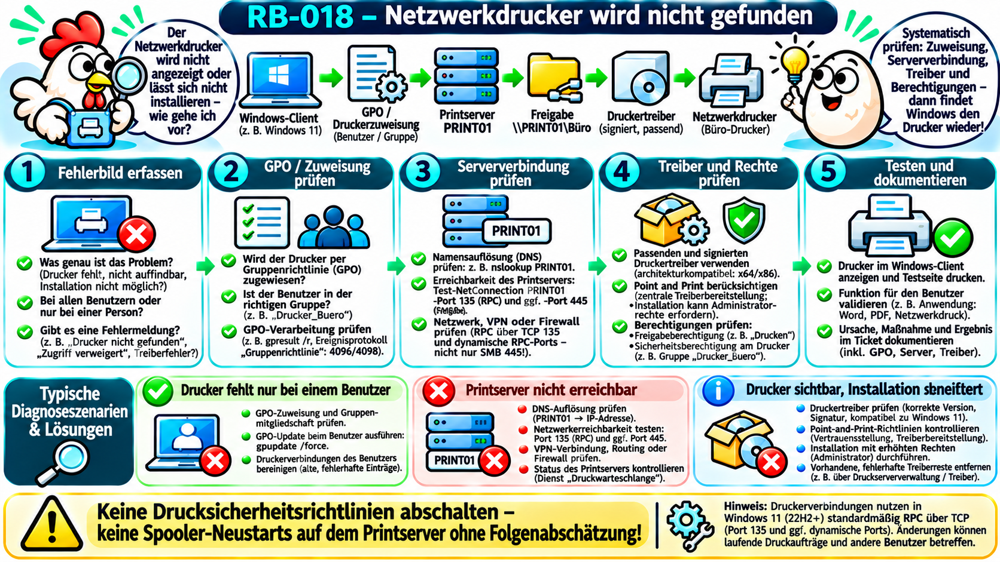
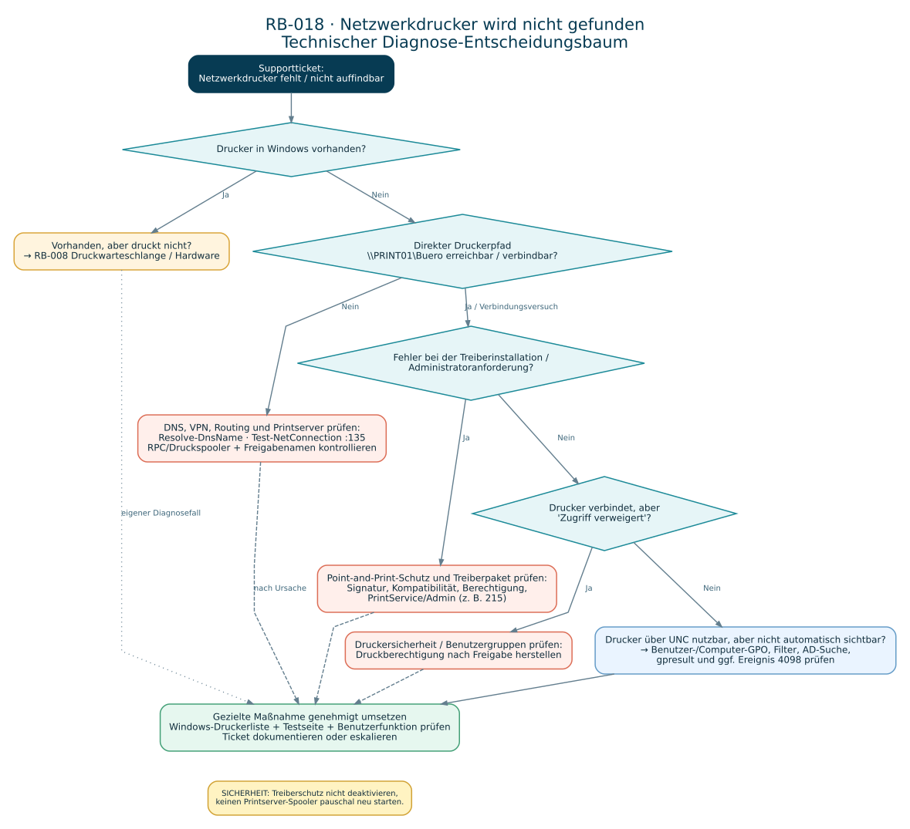

# RB-018 – Netzwerkdrucker wird nicht gefunden

**Projekt:** 50 Tickets – 50 typische Supportfälle  
**Kategorie:** Windows-Client, Netzwerkdrucker, Printserver, Gruppenrichtlinien  
**Support-Level:** L1/L2 gemäß Rollen, Freigaben und Betriebsmodell  
**Version:** 1.0 · **Recherche:** 08.11.2026  
**Validierungsstatus:** Anhand offizieller Microsoft-Dokumentation erarbeitet. **Noch kein praktischer Test im Unternehmensnetz durchgeführt.**  
**Beispielumgebung:** Windows 11 Pro, Active-Directory-Domäne `firma.example`, Windows-Printserver `PRINT01`, Druckerfreigabe `\\PRINT01\Buero`. Alle Bezeichnungen sind fiktiv.



## 1. Das Supportticket: Der Drucker fehlt

> **INC-018 – fiktives Ticket:** „Ich bin seit heute im Büro und finde den Abteilungsdrucker nicht mehr. Bei den Kollegen steht er unter Drucker & Scanner. Wenn ich ihn hinzufügen möchte, erscheint er nicht in der Liste.“

**Aufgabe:** Herausfinden, ob der Drucker lediglich nicht **automatisch zugewiesen** wurde, ob die **Verbindung zum Printserver** gestört ist oder ob **Treiber beziehungsweise Berechtigungen** die Installation verhindern. Abschließend prüft der Benutzer einen erfolgreichen Testdruck.

**Erste Fragen:** Ist der Drucker nur bei diesem Benutzer oder bei mehreren Mitarbeitern verschwunden? Ist er unter „Einstellungen → Bluetooth & Geräte → Drucker & Scanner“ überhaupt eingetragen? Was passiert bei einer direkten Verbindung mit `\\PRINT01\Buero`? Seit wann tritt das Problem auf? Gibt es eine genaue Fehlernummer, einen Treiberdialog oder eine Administratorabfrage? Funktionieren andere Drucker? Wurde das Gerät, der Standort, die Gruppenmitgliedschaft oder der Printserver geändert?

**Abgrenzung zu RB-008:** RB-008 behandelt den **vorhandenen Drucker, der nicht druckt** (Spooler, Aufträge, Hardware). RB-018 behandelt primär einen **fehlenden, nicht auffindbaren oder nicht installierbaren Netzwerkdrucker**.

## 2. Grundlagen und Abkürzungen – was gehört zur Druckerkette?

| Begriff | Anfängerfreundliche Bedeutung |
|---|---|
| **Printserver (Druckserver)** | Computer/Server, der Druckerfreigaben und meist Druckwarteschlangen zentral anbietet. Im Beispiel heißt er `PRINT01`. |
| **Druckerfreigabe** | Freigegebene Druckwarteschlange mit Netzwerkpfad, z. B. `\\PRINT01\Buero`. Nicht mit einem Dateiordner verwechseln. |
| **UNC (Universal Naming Convention)** | Schreibweise `\\Server\Freigabename` für eine Netzwerkressource. |
| **GPO (Group Policy Object)** | Gruppenrichtlinienobjekt; kann Druckerverbindungen automatisch einem Benutzer oder Gerät zuweisen. |
| **AD (Active Directory)** | Verzeichnisdienst für Benutzer, Computer und Gruppen; kann auch veröffentlichte Drucker auffindbar machen. |
| **DNS (Domain Name System)** | Löst Namen wie `PRINT01` in IP-Adressen auf. |
| **RPC (Remote Procedure Call)** | Technik, mit der Programme über das Netzwerk Funktionen eines anderen Rechners aufrufen; wichtig für Windows-Druckserverkommunikation. |
| **TCP (Transmission Control Protocol)** | Netzwerk-Transportprotokoll für zuverlässige, verbindungsorientierte Kommunikation. |
| **SMB (Server Message Block)** | Windows-Protokoll für Datei- und bestimmte Freigabezugriffe. TCP 445 kann bei speziellen Druckkonfigurationen relevant sein, ist aber **kein universeller Test aller Windows-Druckverbindungen**. |
| **Point and Print** | Verfahren, bei dem Windows eine Verbindung zu einem freigegebenen Drucker herstellt und dabei gegebenenfalls Druckertreiber vom Server bezieht. |
| **Spooler (Druckwarteschlangendienst)** | Windows-Dienst, der Drucker und Druckaufträge verwaltet; Dienstname `Spooler`. |
| **RSoP (Resultant Set of Policy)** | Tatsächlich angewendete Gruppenrichtlinien für einen Benutzer oder Computer. |
| **Treiber** | Software, über die Windows mit einer bestimmten Druckerfamilie kommuniziert. Architektur, Modell und Sicherheitseinstellungen müssen passen. |

### Die Infrastruktur – welche Komponente macht was?

`Benutzer/Windows-PC → automatische GPO-Zuweisung oder manuelle Druckersuche → DNS und Netzwerk → Printserver PRINT01 → Druckerfreigabe Buero → geeigneter Treiber → physischer Drucker`

Eine **Gruppenrichtlinie** sorgt unter Umständen dafür, dass der Drucker automatisch in Windows erscheint. Sie beweist noch **keine** erfolgreiche Erreichbarkeit, installiert nicht unter allen Bedingungen einen benötigten Treiber und setzt keine Berechtigungsprüfung außer Kraft.

Ein Drucker kann **nicht in der Suchliste auftauchen**, obwohl seine Freigabe über den direkten UNC-Pfad erreichbar ist. Die automatische Druckersuche, eine AD-Veröffentlichung und die eigentliche Druckerverbindung sind unterschiedliche Funktionen. [Microsoft: GPOs zur Druckersteuerung](https://learn.microsoft.com/de-de/troubleshoot/windows-server/printing/use-group-policy-to-control-ad-printer).

## 3. Häufige Fehlerbilder: Was bedeutet die Meldung?

| Symptom | Mögliche Ursache | Erster sinnvoller Test |
|---|---|---|
| Drucker fehlt bei **einem** Benutzer | Fehlende oder nicht angewendete GPO; falsche Gruppe; benutzerspezifische Zuordnung | `gpresult /scope user /r`, direkt `\\PRINT01\Buero` testen |
| Drucker fehlt bei **allen** | Printserver-/Netzwerkstörung, geänderte Freigabe oder fehlerhafte GPO | Printserverstatus, Name und zentrale Konfiguration untersuchen |
| Drucker nicht in **Suchliste**, direkte Freigabe funktioniert | Such-/Veröffentlichungsproblem | Direkten UNC-Zugriff mit korrekt benannter Freigabe verwenden |
| `PRINT01` wird nicht aufgelöst | DNS-Problem, falscher Name, kein Unternehmensnetz/VPN | `Resolve-DnsName PRINT01` |
| Drucker-Verbindung meldet **RPC-Server nicht verfügbar** | Firewall, RPC-/Spooler-Dienst, Server oder Routing | TCP 135, Printserver-Status und RPC-Konfiguration prüfen |
| Verbindung beginnt, scheitert bei **Treiberinstallation** | Point-and-Print-Schutz, fehlende Adminrechte, falscher oder nicht signierter Treiber | Exakte Fehlermeldung, Treibername, PrintService-Protokoll |
| Drucker sichtbar, aber **Zugriff verweigert** | Druckerberechtigung, Benutzeridentität oder Richtlinie | Drucker-Sicherheit auf Server und Benutzer/Gruppen untersuchen |
| Drucker vorhanden, Testseite wird nicht gedruckt | Queue-/Spooler-/Hardwareproblem | Mit RB-008 fortfahren |

**Achtung:** Diese Symptome liefern **Hypothesen**, keine endgültige Diagnose.

## 4. Von welchem Rechner aus arbeitet der Support?

| Situation | Ausführungsort und Werkzeug | Konkretes Vorgehen |
|---|---|---|
| Benutzer angemeldet | Windows-Client, Bildschirmfreigabe/Teams/Schnellhilfe (wenn genehmigt) | Druckerliste, Meldung, UNC-Pfad, `Get-Printer` und `gpresult` im richtigen Benutzerkontext prüfen |
| Client im Firmennetz, Remoteverwaltung freigegeben | Administrationsrechner → RDP oder WinRM zum Client | Diagnose mit eigenem berechtigtem Konto; beachten, dass die Drucker des Supportkontos nicht identisch mit den benutzergebundenen Druckerzuordnungen sein müssen |
| Druckerfreigabe oder Treiber prüfen | Printserver oder freigegebene Druckerverwaltung | Druckername, Freigabe, Port, Treiber, Spoolerstatus und Druckersicherheit auslesen |
| Benutzer im Homeoffice | Client + genehmigte VPN-Verbindung | Interne Namensauflösung, VPN-/Route und RPC-/Druckserverzugriff prüfen |
| Mehrere Abteilungen betroffen | L2/Printserver-/Netzwerk-Team | Gemeinsame GPO, RPC, Printserver, Updates und Infrastruktur koordiniert untersuchen |

**Sicherheit:** Keine Passwörter des Benutzers erfragen. Berechtigungen nur nach Freigabe ändern. Keine globale GPO oder Druckerserver-Firewallregel auf Verdacht lockern.

## 5. Diagnose-Entscheidungsbaum



**Diagnosereihenfolge:**

1. Drucker fehlt **oder** ist vorhanden, aber nicht funktionsfähig? Bei vorhandenem Drucker mit Druckproblemen zu **RB-008** wechseln.
2. Der Drucker fehlt: Ist die direkte Freigabe `\\PRINT01\Buero` erreichbar beziehungsweise verbindbar?
3. **Ja:** GPO-/Benutzerzuordnung, AD-Veröffentlichung und automatische Suche prüfen.
4. **Nein:** DNS, Firmen-VPN, Netzwerkweg, RPC und Printserverdienste eingrenzen.
5. **Druckerverbindung startet, Treiberinstallation schlägt fehl:** Point-and-Print-Schutz und Treiber prüfen.
6. **Verbindung erfolgreich, Zugriff verweigert:** Berechtigung in der Druckerfreigabe prüfen.
7. Nach gezielter Änderung: Benutzer sieht Drucker, kann Anwendungstest und Testdruck durchführen.

## 6. Diagnose A – Lokale Druckerliste prüfen

**Ausführungsort:** Windows PowerShell auf dem betroffenen Client, möglichst in der normalen Benutzersitzung. **Typ:** Lesend.

```powershell
# Liest die lokal bekannten Drucker und Druckerverbindungen aus.
Get-Printer |
    # Zeigt Name, Treiber und zugehörigen Port übersichtlich an.
    Select-Object Name, DriverName, PortName, Type

# Kontrolliert den Zustand des lokalen Windows-Druckwarteschlangendiensts.
# 'Spooler' ist der technische Dienstname.
Get-Service -Name Spooler
```

**Interpretation:** Fehlt `\\PRINT01\Buero` in der Ausgabe, ist der Drucker in diesem Client-/Sitzungskontext nicht als Verbindung erkennbar. Das beweist nicht, dass der Drucker am Printserver fehlt. Bei `Spooler = Stopped` untersuchen, warum der Dienst nicht läuft, statt ihn blind neu zu starten. In einem anderen Benutzerkontext können andere Drucker erscheinen.

**Microsoft-Referenz:** [Get-Printer (PrintManagement)](https://learn.microsoft.com/de-de/powershell/module/printmanagement/get-printer).

## 7. Diagnose B – Printserver und Namensauflösung prüfen

**Ausführungsort:** Betroffener Client oder gleichwertiger Testcomputer im selben Netzsegment. **Typ:** Lesend.

```powershell
# Löst den Printservernamen über DNS auf.
# Ein Erfolg liefert die zugehörige IP-Adresse, beweist aber noch keine RPC-Verbindung.
Resolve-DnsName -Name 'PRINT01'

# Testet TCP-Port 135 des Printservers (RPC Endpoint Mapper).
# Bei Windows 11 22H2+ nutzt Druckkommunikation standardmäßig RPC über TCP.
Test-NetConnection -ComputerName 'PRINT01' -Port 135

# Testet SMB über TCP 445 nur als zusätzliche Information.
# Ein erfolgreiches Ergebnis auf 445 allein beweist NICHT,
# dass die Printserver-RPC-Verbindung funktioniert.
Test-NetConnection -ComputerName 'PRINT01' -Port 445
```

**Interpretation:**

- **DNS-Auflösung scheitert:** DNS-Server, Name und Firmennetz/VPN prüfen.
- **TCP 135 scheitert:** RPC-Endpunkt nicht erreichbar oder durch Netzwerk/Firewall blockiert; zunächst Umfang und Routing ermitteln.
- **TCP 135 erfolgreich:** RPC-Druckkommunikation **noch nicht** nachgewiesen, denn dynamische RPC-Ports und der Spooler können weiterhin scheitern.
- **TCP 445 erfolgreich/fehlgeschlagen:** Beweist beziehungsweise widerlegt nur den getesteten SMB-Port, nicht pauschal die Windows-Druckserverfunktion.

**Technischer Hintergrund:** Seit Windows 11 Version 22H2 setzt Windows für Druckserverkommunikation standardmäßig **RPC über TCP** ein. Für den RPC-Endpunktzuordnungsdienst wird üblicherweise TCP 135 benötigt, außerdem können dynamische TCP-Ports (häufig 49152–65535) oder ein konfigurierter fester RPC-Port relevant sein. Diese Firewallkonfiguration ist **L2-/Infrastrukturthema**, keine pauschale L1-Portfreigabe. [Microsoft: Windows-11-RPC-Verbindungsupdates zum Drucken](https://learn.microsoft.com/de-de/troubleshoot/windows-client/printing/windows-11-rpc-connection-updates-for-print).

## 8. Diagnose C – Existiert die Freigabe auf dem Printserver?

**Ausführungsort:** Berechtigtes Administrationssystem, das Printserver-Abfragen durchführen darf, oder direkt der Printserver. **Typ:** Lesend.

```powershell
# Fragt die Druckerwarteschlangen am entfernten Printserver PRINT01 ab.
# -ComputerName ist hier ein Parameter des PrintManagement-Cmdlets.
# Er verwendet nicht automatisch eine RDP-Desktopverbindung.
Get-Printer -ComputerName 'PRINT01' |
    # Filtert die für den Support relevanten Felder.
    Select-Object Name, ShareName, Shared, DriverName, PortName

# Zeigt den Dienstzustand auf dem Server.
# Diesen Befehl AUF PRINT01 ausführen oder dort autorisiert remote ausführen.
Get-Service -Name Spooler

# Fragt die auf dem Printserver installierten Treiber ab.
Get-PrinterDriver -ComputerName 'PRINT01' |
    Select-Object Name, Manufacturer, PrinterEnvironment
```

**Interpretation:**

- Druckername/`ShareName` **abweichend**: Der bisherige UNC-Pfad wurde möglicherweise geändert.
- `Shared = False`: Warteschlange ist derzeit nicht als Netzwerkdrucker freigegeben.
- RPC-Abfrage selbst **scheitert**: Das ist noch **kein Nachweis**, dass am Server keine Warteschlange existiert; die Remoteabfrage benötigt Rechte und eine funktionierende Serverkommunikation.
- Treiber nicht vorhanden oder ungeeignet: Über freigegebene, unterstützte Treiberpakete und Printserverpflege lösen.

**Microsoft:** [Get-Printer](https://learn.microsoft.com/en-us/powershell/module/printmanagement/get-printer), [Get-PrinterDriver](https://learn.microsoft.com/en-us/powershell/module/printmanagement/get-printerdriver).

## 9. Diagnose D – Automatische Bereitstellung per GPO

**GPO** bedeutet *Group Policy Object* (Gruppenrichtlinienobjekt). Eine Druckerzuweisung kann beispielsweise für bestimmte Benutzergruppen oder Computer vorgesehen sein. Nur weil die Freigabe funktioniert, heißt das nicht, dass sie automatisch in der Windows-Druckerliste erscheint.

**Ausführungsort:** Betroffener Client im **Benutzerkontext**, dessen Drucker fehlt; für computerbezogene Gruppenrichtlinien zusätzlich Computerbericht. **Typ:** Lesend.

```powershell
# Zeigt eine Zusammenfassung angewendeter Benutzer-Gruppenrichtlinien.
# gpresult.exe ist ein Windows-Kommandozeilenprogramm.
gpresult /scope user /r

# Erstellt für den aktuellen Benutzer eine ausführliche HTML-Auswertung.
# Der Bericht enthält ggf. interne Gruppen-/Domäneninformationen:
# nicht ungeprüft öffentlich teilen.
gpresult /scope user /h "$env:TEMP\RB018-GPResult.html" /f

# Öffnet den generierten Bericht mit der zugehörigen Standardanwendung.
Start-Process "$env:TEMP\RB018-GPResult.html"
```

**Was ist zu prüfen?** Existiert das erwartete GPO? Wird es auf den Benutzer/Computer angewendet? Wurde die Druckerzuweisung durch Zielgruppenfilter oder Sicherheitsfilter ausgeschlossen? Gibt es einen falschen Pfad, eine nicht vorhandene Freigabe, mehrere widersprechende GPOs oder eine zu frühe Verarbeitung ohne Netzwerkzugang?

**Ereignishinweis:** Fehlerhafte Gruppenrichtlinien-Druckerzuweisungen können als **Ereignis 4098** im Anwendungsprotokoll erscheinen. Die Ereignis-ID ist ein Hinweis auf einen Fehlschlag der Gruppenrichtlinieneinstellung; den konkreten Fehlercode im Ereignis auswerten. [Microsoft: Ereignis-IDs und Point-and-Print-Einschränkungen](https://learn.microsoft.com/de-de/troubleshoot/windows-server/printing/event-ids-associated-point-print-restrictions).

**Hinweis zu Veränderungen:** `gpupdate /force` wendet Richtlinien erneut an und kann auch weitere Änderungen für Benutzer/Computer auslösen. Nur mit Freigabe, Kenntnis der Auswirkungen und idealerweise außerhalb kritischer Arbeitsvorgänge verwenden.

**Microsoft:** [gpresult](https://learn.microsoft.com/de-de/windows-server/administration/windows-commands/gpresult).

## 10. Diagnose E – Treiberinstallation und Point and Print

**Point and Print** verbindet einen Client mit einer freigegebenen Warteschlange und kann dabei erforderliche Druckertreiber vom Printserver installieren. Genau dieses automatische Beziehen von Treibern ist ein Sicherheitsrisiko, weshalb Windows hierfür Schutzregeln vorsieht.

**Standardeinstellung:** Seit Microsofts Sicherheitsänderungen ab August 2021 erfordert die Installation oder Aktualisierung eines vom Printserver bezogenen Druckertreibers standardmäßig **Administratorrechte**. Das ist kein ungewöhnlicher Defekt, sondern häufig vorgesehenes Verhalten. [Microsoft KB5005652](https://support.microsoft.com/de-de/servicing/os/windows/2021/08/kb5005652-manage-new-point-and-print-default-driver-installation-behavior-cve-2021-34481).

**Zu untersuchen:**

1. Erscheint eine Administrator- oder Vertrauensaufforderung? **Nicht** blind abweisen oder die Richtlinie dauerhaft ausschalten.
2. Gibt es eine **signierte**, zur Windows-Edition und Architektur passende, durch die IT freigegebene Treiberversion?
3. Haben Administratoren den Treiber bereits über das freigegebene Softwarebereitstellungsverfahren zur Verfügung gestellt?
4. Passt die Treiberversion auf Client und Server? Gibt es einen Treiberfehlercode?
5. Gibt es Einträge in `Microsoft-Windows-PrintService/Admin` – beispielsweise **Ereignis 215** bei Treiberinstallationsproblemen? Der Fehlercode ist entscheidend.

**Sicherer Lösungsweg:** Unterstützten Treiber prüfen, gegebenenfalls mit administrativen Berechtigungen über ein genehmigtes Verfahren installieren oder bereitstellen. **Nicht** `RestrictDriverInstallationToAdministrators` auf `0` ändern, um die Sicherheitsvorgaben zu umgehen.

## 11. Ereignisprotokolle gezielt lesen

**Ausführungsort:** Windows-Client mit ausreichenden Berechtigungen. **Typ:** Lesend.

```powershell
# Liest Ereignisse der administrativen PrintService-Fehlerprotokollierung
# aus dem angegebenen Zeitfenster (hier: die letzten vier Stunden).
$druckFilter = @{
    # Windows-Protokoll für Druckverwaltungsprobleme.
    LogName = 'Microsoft-Windows-PrintService/Admin'
    # Zeitliche Eingrenzung erleichtert die Korrelation mit dem Ticket.
    StartTime = (Get-Date).AddHours(-4)
}

# Gibt höchstens 20 Ereignisse mit Zeitpunkt, ID und Kurzmeldung zurück.
Get-WinEvent -FilterHashtable $druckFilter -ErrorAction SilentlyContinue |
    Select-Object -First 20 TimeCreated, Id, ProviderName, Message

# Durchsucht das Windows-Anwendungsprotokoll nach GPO-Ereignis 4098.
# Ein 4098-Ereignis muss anhand Quelle und Meldung einem Drucker zugeordnet werden.
Get-WinEvent -FilterHashtable @{
    LogName = 'Application'
    Id = 4098
    StartTime = (Get-Date).AddHours(-4)
} -ErrorAction SilentlyContinue |
    Select-Object -First 20 TimeCreated, ProviderName, Message
```

**Grenzen:** Protokolle können auf einem betroffenen System fehlen oder leer sein, wenn keine passenden Ereignisse auftraten oder Überwachung nicht aktiv ist. Ein Ereignis 4098 kann auch von **anderen** Gruppenrichtlinieneinstellungen stammen; auf Quelle und Kontext achten. Treiberdaten/Hostnamen in Logs können intern sein – für öffentliche Beispiele anonymisieren.

## 12. Fehler beheben – aber nur passend zum Befund

| Nachgewiesener Befund | Fachgerechte Maßnahme | Prüfkriterium |
|---|---|---|
| Direkte Freigabe funktioniert, GPO nicht angewendet | GPO-Link, Filter, Benutzer-/Computerkontext und Druckerpfad prüfen; zuständige IT korrigiert die Zuweisung | Drucker wird für vorgesehenen Benutzer automatisch sichtbar |
| Drucker nicht in der Suche, UNC funktioniert | Freigabe direkt über UNC bereitstellen (nach Freigabe); AD-Veröffentlichung/Suchdienst separat prüfen | Drucker ist als Verbindung verfügbar |
| Name `PRINT01` falsch/nicht auflösbar | Korrekte Serveradresse und interne DNS-/VPN-Verbindung herstellen | Namensauflösung und Remoteverbindung funktionieren |
| RPC-Druckverbindung scheitert | Firewall/RPC-Konfiguration und Spoolerstatus durch Printserver-/Netzwerkadministration prüfen | Druckerverbindung lässt sich herstellen |
| Treiber-Installation an Administratorrechten blockiert | Freigegebenen Treiber sicher durch berechtigten Administrator/Deployment bereitstellen | Verbindung ohne Schutzabschaltung möglich |
| Druckerfreigaberecht fehlt | Berechtigungsantrag genehmigen lassen, Gruppen-/Sicherheitsberechtigung gezielt anpassen | Zugriff und Testdruck mit Zielkonto funktionieren |
| Drucker installiert, aber Auftrag hängt | An **RB-008** übergeben | Warteschlange und Druckgerät gesondert diagnostiziert |

### Verändernder Beispielbefehl (nur nach Freigabe!)

**Ausführungsort:** Betroffener Windows-Client mit erforderlichen Rechten, tatsächlicher Freigabename bekannt. **Wirkung:** Legt eine Verbindung zum angegebenen Netzwerkdrucker an.

```powershell
# VERÄNDERNDER BEFEHL – nur durchführen, wenn der Drucker genehmigt
# und die korrekte Freigabe am Printserver verifiziert ist.
# -ConnectionName erwartet den vollständigen UNC-Druckerpfad.
# Eventuell wird eine administrative Treiberinstallation nötig.
Add-Printer -ConnectionName '\\PRINT01\Buero'

# Nach erfolgreicher Installation prüfen, ob Windows die Verbindung kennt.
Get-Printer | Select-Object Name, DriverName, PortName
```

**Keine automatische Empfehlung:** Fehlgeschlagene Verbindungen nicht massenhaft löschen; Druckertreiber nicht unkontrolliert entfernen und den **Spooler auf dem Printserver nicht vorsorglich neu starten**, weil dadurch Druckaufträge vieler Benutzer beeinträchtigt werden können.

**Microsoft:** [Add-Printer](https://learn.microsoft.com/en-us/powershell/module/printmanagement/add-printer).

## 13. L1-/L2-Abgrenzung und Eskalation

| L1: häufig möglich | L2: typischerweise erforderlich |
|---|---|
| Fehlermeldung, Benutzer-/Gerätebezug, Umfang erfassen | Printserverfreigabe, RPC-Firewall und Serverrichtlinien untersuchen |
| `Get-Printer`, `Resolve-DnsName`, `Test-NetConnection` lesen | Druckertreiber bereitstellen/aktualisieren und Signatur-/Kompatibilitätsprobleme bearbeiten |
| UNC-Zugriff und Benutzer-GPO-Bericht prüfen | Zentrale GPO-Zuweisungen und Zielgruppenfilter korrigieren |
| Genehmigte Benutzerhilfe und Testdruck | Berechtigungen für Drucker administrieren, größere Störungen koordinieren |

**Eskalation mitgeben:** Benutzer, Gerät, Standort, Zeitpunkt, Printserver/Freigabe, Umfang, Fehlercode, `gpresult`-Befund, DNS-/RPC-Testergebnis, PrintService-Ereignisse, Treiberversion, bisherige Änderungen und Auswirkung. Keine Zugangsdaten und keine unnötigen personenbezogenen Logdetails übermitteln.

## 14. Muster-Ticket und Lerntests

**INC-018 – fiktiver Abschluss, nicht real durchgeführt**

- **Störung:** Netzwerkdrucker „Buero“ wird bei einer Mitarbeiterin nicht angezeigt.
- **Diagnose:** Direkte Druckerverbindung zu `\\PRINT01\Buero` war nach Prüfung zulässig und erfolgreich. Der Server und die Freigabe waren erreichbar. `gpresult` zeigte, dass die vorgesehene benutzerbezogene GPO nicht angewendet wurde; eine fehlerhafte Zielgruppenfilterung wurde mit der zuständigen Administration identifiziert.
- **Ursache:** Druckerzuweisung griff nicht auf die vorgesehene Benutzergruppe.
- **Maßnahme:** Freigegebene Zielgruppenzuordnung in der GPO durch berechtigte Administration korrigiert, Richtlinien im vorgesehenen Verfahren aktualisiert.
- **Erfolgskontrolle:** Drucker erscheint für die Mitarbeiterin; Windows-Testseite und Dokumentdruck erfolgreich.
- **Status:** Gelöst (fiktives Übungsbeispiel).

### Active Recall und Anki – drei Kartenarten

| Kartentyp | Frage | Kurze Antwort |
|---|---|---|
| Wissen | Wofür steht UNC? | Universal Naming Convention – z. B. `\\PRINT01\Buero`. |
| Wissen | Wofür steht RPC? | Remote Procedure Call – entfernte Funktionsaufrufe. |
| Verständnis | Wieso erscheint ein Netzwerkdrucker möglicherweise nicht, obwohl seine Freigabe erreichbar ist? | Druckersuche und automatische GPO-Zuweisung sind getrennte Funktionen. |
| Verständnis | Warum reicht TCP 445 als Druckserver-Test nicht? | Windows 11 verwendet standardmäßig RPC über TCP; Port 135 und weitere Ports können nötig sein. |
| Diagnose | Drucker fehlt nur bei einem Benutzer; UNC funktioniert. Erste Hypothese? | Benutzerbezogene GPO, Filter oder Zuordnung fehlt. |
| Diagnose | Druckerverbindung fordert Adminrechte beim Treiberbezug. Ist das zwingend ein Fehler? | Nein – Point-and-Print-Sicherheitsvorgabe kann das verlangen. |

**Transferübung:** Drucker `\\PRINT01\Buero` ist auf PC-A sichtbar, bei Benutzer B nicht. `Resolve-DnsName` gelingt und Port 135 ist erreichbar, aber das Hinzufügen scheitert mit einer Treiber-Aufforderung. Erkläre, warum die bisherigen Tests **weder** die Treiberfreigabe noch die RPC-Druckkommunikation vollständig belegen. Leite den nächsten sicheren Prüfschritt ab.

## 15. Quellen, Transparenz und Validierung

**Microsoft-Dokumentation (Abruf/Recherche: 08.11.2026):**

1. [Get-Printer – PrintManagement](https://learn.microsoft.com/en-us/powershell/module/printmanagement/get-printer) – lokale und entfernte Druckerabfragen.
2. [Get-PrinterDriver – PrintManagement](https://learn.microsoft.com/en-us/powershell/module/printmanagement/get-printerdriver) – Druckertreiber diagnostizieren.
3. [Add-Printer – PrintManagement](https://learn.microsoft.com/en-us/powershell/module/printmanagement/add-printer) – genehmigte Verbindung zur freigegebenen Warteschlange.
4. [gpresult – Microsoft Learn](https://learn.microsoft.com/de-de/windows-server/administration/windows-commands/gpresult) – angewendete Gruppenrichtlinien untersuchen.
5. [Drucker über Gruppenrichtlinien steuern](https://learn.microsoft.com/de-de/troubleshoot/windows-server/printing/use-group-policy-to-control-ad-printer) – Drucker-GPOs, AD-Veröffentlichung und Suche.
6. [Drucker-RPC unter Windows 11](https://learn.microsoft.com/de-de/troubleshoot/windows-client/printing/windows-11-rpc-connection-updates-for-print) – RPC über TCP, Ports und Kommunikationsänderungen.
7. [KB5005652: Point-and-Print-Sicherheit](https://support.microsoft.com/de-de/servicing/os/windows/2021/08/kb5005652-manage-new-point-and-print-default-driver-installation-behavior-cve-2021-34481) – Schutz bei Treiberinstallationen.
8. [Ereignisse zu Point-and-Print-Einschränkungen](https://learn.microsoft.com/de-de/troubleshoot/windows-server/printing/event-ids-associated-point-print-restrictions) – Ereignis 4098 und Treiberfehler.

**Status:** Technik anhand offizieller Herstellerquellen recherchiert; alle Beispiele, Servernamen und Befunde sind fiktiv. Die tatsächlich durchgeführten Tests, genaue Windows-Builds, eingesetzte Treiber und messbare Ergebnisse sind **noch zu ergänzen**. Kein Nachweis einer bereits behobenen realen Unternehmensstörung.

**Verwandte Fälle:** RB-008 – Drucker druckt nicht · RB-010 – Keine Netzwerkverbindung · RB-017 – Netzlaufwerk fehlt. Bei der Website-Integration werden daraus anklickbare Querverweise.
