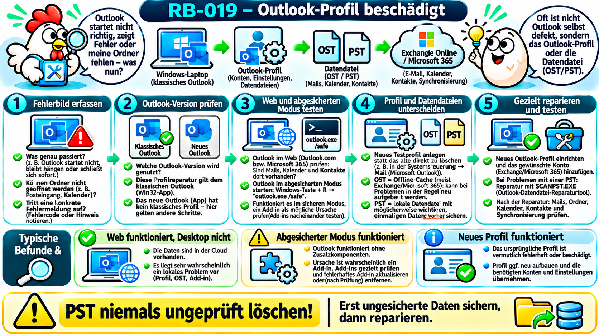
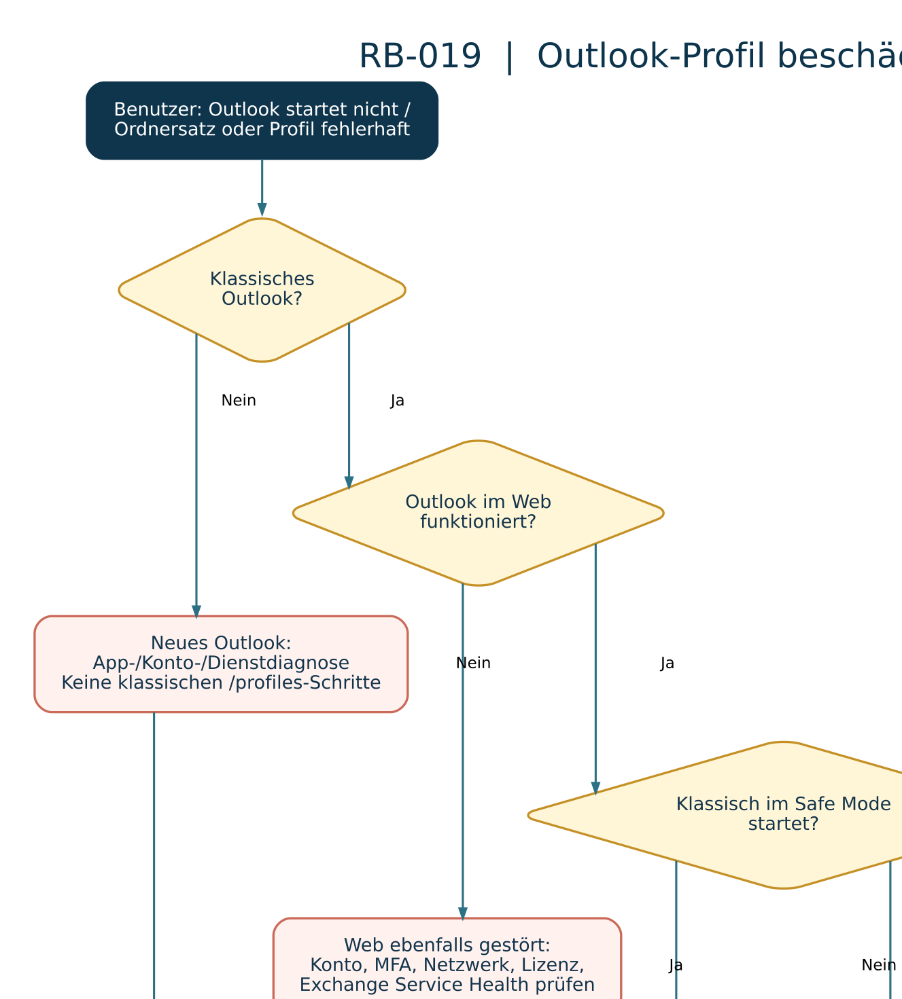

# RB-019 – Outlook-Profil beschädigt

**Projekt:** 50 Tickets – 50 typische Supportfälle  
**Kategorie:** Microsoft 365, Outlook, Windows-Client, Exchange Online  
**Support-Level:** L1/L2 gemäß Berechtigungskonzept  
**Version / Recherche:** 1.0 · 08.11.2026  
**Validierungsstatus:** Anhand offizieller Microsoft-Dokumentation recherchiert; **keine praktische Validierung in einer produktiven Umgebung**.  
**Beispielumgebung:** Windows 11, klassisches Outlook für Microsoft 365, Exchange-Online-Postfach, Benutzer `m.mustermann@firma.example`. Alle Namen und Tickets sind **fiktiv**.



## 1. Supportticket und Zielsetzung

> **INC-019 – fiktive Meldung:** „Outlook öffnet sich seit heute nicht mehr. Es kommt die Meldung, dass das Outlook-Fenster oder der Ordnersatz nicht geöffnet werden kann. Im Browser kann ich meine E-Mails aber sehen.“

**Ziel:** Die lokale Fehlerursache eingrenzen, dabei ungesicherte Daten schützen, Outlook wieder funktionsfähig machen und die Wiederherstellung gemeinsam mit dem Benutzer überprüfen.

**Erste Fragen:** Seit wann tritt die Störung auf? Welche **exakte** Meldung erscheint? Betrifft es nur Outlook auf einem PC? Funktioniert dasselbe Postfach in Outlook im Web? Tritt der Fehler nach einem Update, einem neuen Add-in, einer Passwortänderung oder einer Migration auf? Sind lokale Archive oder ungesendete Nachrichten vorhanden?

**Abgrenzung:** RB-006 untersucht allgemein Sende-/Empfangsstörungen; RB-019 behandelt speziell Konfiguration und lokale Datendateien **des klassischen Outlook-Profils**. Nicht jedes Outlook-Problem ist ein Profilfehler.

## 2. Grundlagen und Abkürzungen

| Begriff | Anfängerfreundliche Erklärung |
|---|---|
| **Outlook-Profil** | Satz von Einstellungen, E-Mail-Konten und Datendateiverweisen, die klassisches Outlook beim Start verwendet. Ein Profil ist **nicht** identisch mit dem Windows-Benutzerprofil. |
| **Klassisches Outlook** | Win32-Desktopprogramm aus Microsoft 365 Apps/Office, traditionell mit lokaler Profilverwaltung und PST/OST-Datendateien. |
| **Neues Outlook für Windows** | Andere Outlook-Anwendung mit abweichender Konfiguration. Die klassische Profilauswahl und viele `outlook.exe`-Schalter gelten hierfür **nicht**. |
| **OWA / Outlook im Web** | Zugriff auf das Exchange-/Microsoft-365-Postfach über den Browser; nützlich als Gegenprobe. |
| **Exchange Online** | Cloudbasierter Microsoft-E-Mail- und Kalenderdienst, auf dem das Unternehmenspostfach liegen kann. |
| **OST (Offline Storage Table)** | Lokale Offlinekopie eines serverbasierten Postfachs, insbesondere im Exchange-Cache-Modus. Nach Prüfung meist neu aufbaubar; unübertragene Änderungen können dennoch wichtig sein. |
| **PST (Personal Storage Table)** | Lokale Outlook-Datendatei, z. B. für Archive oder bestimmte Kontotypen. Kann **einzige Kopie** wichtiger Mails sein und muss geschützt werden. |
| **Cachemodus** | Outlook hält eine lokale Kopie von Postfachdaten, um auch bei Verzögerungen/offline arbeiten zu können. |
| **Add-in** | Erweiterung von Outlook; ein fehlerhaftes Add-in kann den Start oder die Bedienung stören. |
| **COM (Component Object Model)** | Microsoft-Komponententechnik; klassische Outlook-Add-ins können COM-basierte Erweiterungen sein. |
| **Autodiscover (AutoErmittlung)** | Dienst/Mechanismus zum automatischen Auffinden der korrekten Kontoeinstellungen für Outlook. |
| **SCANPST.EXE** | Microsoft-Tool „Posteingangsreparatur“, das Fehler in lokalen Outlook-Datendateien untersucht und gegebenenfalls repariert. |
| **L1/L2** | First-/Second-Level-Support: Standarddiagnosen bzw. komplexere Analysen je nach Unternehmenszuständigkeit. |

**Ein Bild im Kopf:** `Windows-PC → klassisches Outlook → Profil (Konto, Einstellungen, Datendateiverweise) → OST-Cache / PST-Archive → Exchange-Online-Postfach`. Ein beschädigtes Profil, eine beschädigte OST und eine Exchange-Dienststörung liegen **an unterschiedlichen Stellen**.

**Microsoft-Quelle:** [Übersicht über E-Mail-Profile im klassischen Outlook](https://support.microsoft.com/de-de/outlook/overview-of-outlook-email-profiles).

## 3. Klassisches Outlook oder neues Outlook? Zuerst die Version bestimmen

**Das ist der wichtigste erste Prüfpunkt.** Das neue Outlook besitzt nicht dasselbe klassische MAPI-Profilmodell (MAPI = Messaging Application Programming Interface, Microsoft-Schnittstellen für E-Mail-Programme), wie es in den klassischen Profilassistenten dokumentiert ist.

| Merkmal | Klassisches Outlook | Neues Outlook |
|---|---|---|
| Typischer Desktopzugang | Office-/Microsoft-365-Desktopanwendung | Moderne Windows-Outlook-App |
| Profilauswahl mit `outlook.exe /profiles` | Vorgesehen | Nicht der passende Diagnoseweg |
| `outlook.exe /safe` (klassische Add-ins) | Vorgesehen | Nicht derselbe abgesicherte Modus |
| OST/PST im klassischen Sinne | Relevanter Prüfbereich | Klassisches OST-Profilverfahren nicht unmittelbar übertragbar |
| Typische Reparatur | Add-ins, Konto/Profil, Daten, Office-Reparatur | App-/Kontoprobleme und gegebenenfalls Windows-App-Reparatur nach Richtlinie |

**Praxis:** Programmbezeichnung und verwendete Anwendung mit dem Mitarbeiter bestätigen; keine klassische Profilanleitung blind auf das neue Outlook anwenden.

**Quelle:** [Microsoft: Neues Profil im klassischen Outlook erstellen](https://support.microsoft.com/de-de/outlook/create-an-outlook-profile), [Microsoft: Apps und Programme in Windows reparieren](https://support.microsoft.com/de-de/windows/apps/repair-apps-and-programs-in-windows).

## 4. Fehlermeldungen und plausible Ursachen

| Fehlerbild | Mögliche Ursache | Erste Prüfung |
|---|---|---|
| „Outlook-Fenster kann nicht geöffnet werden“ / „Ordnersatz kann nicht geöffnet werden“ | Profil, Datendatei, Navigationsbereich oder Add-in | Outlook im Web, Safe Mode, konkreter Fehlertext |
| Outlook startet und schließt sofort | Add-in, defekte Programmkomponente oder lokaler Profilfehler | `outlook.exe /safe`, Zuverlässigkeitsverlauf, Ereignis 1000 |
| Outlook fordert immer wieder Anmeldung | Token-/Anmeldeproblem, Konto- oder Netzwerkkonfiguration | Anmeldung im Browser, Entra-Anmeldeprotokolle (L2) |
| Ordner fehlen nur im Desktopclient | Synchronisierung, Cache, Ansicht/Profil | Webansicht mit Desktop vergleichen |
| Fehlermeldung nennt ausdrücklich `.ost` | Beschädigter Offlinecache möglich | Speicherort und Serverkopie prüfen, erst dann Neuaufbau planen |
| Fehlermeldung nennt `.pst` | Beschädigte lokale Datendatei möglich | Datendatei zuerst sichern, dann SCANPST erwägen |
| Mehrere Benutzer betroffen | Dienst- oder Netzwerkinfrastruktur statt Einzelprofil | Microsoft-365-Dienststatus und Vergleichsbenutzer |

**Diagnoseregel:** Ein Symptom ist ein Hinweis, **kein Beweis** für eine Beschädigung.

## 5. Wo arbeitet der Supporttechniker?

| Situation | Diagnosezugriff | Konkrete Handlung |
|---|---|---|
| Benutzer kann Windows normal verwenden | Gemeinsame Bildschirmfreigabe oder genehmigte Fernwartung | Outlook-Version, Fehlermeldung und Vergleichstest gemeinsam erfassen |
| Outlook startet nicht, Windows läuft | Windows-Anmeldung am betroffenen Client oder autorisierte Remoteverwaltung | Lesende Prozess-/Log-Abfragen; klassische Profilauswahl testen |
| Zugriff auf Microsoft 365 erforderlich | Berechtigtes Adminportal / Microsoft 365 Service Health | Bei mehreren Betroffenen zentrale Störungen prüfen |
| Benutzer besitzt lokale PST-Archive | Client und genehmigter Datensicherungsweg | Dateipfade und Datensicherung mit Benutzer abstimmen |
| Kein Clientzugriff | Telefonische Fehleraufnahme; ggf. Vor-Ort-Termin | Nicht ohne Prüfung Daten- oder Profiländerungen anweisen |

**Berechtigungen:** Für grundlegende Outlook-Profileinstellungen benötigt man nicht automatisch Domänenadministratorrechte. Die jeweils vorgesehenen Unternehmensrichtlinien sind maßgeblich.

## 6. Diagnose-Entscheidungsbaum



**Lesereihenfolge:** (1) Version bestimmen → (2) Web-/Dienstvergleich → (3) abgesicherter Start → (4) neues Testprofil → (5) PST/OST unterscheiden → (6) nur die nachgewiesene Ursache beheben und prüfen.

## 7. Diagnose A – Outlook im Web und Dienststatus vergleichen

**Ausführungsort:** Browser auf dem betroffenen Arbeitsplatz, optional Administrationsportal. **Typ:** Lesend / Beobachtung.

1. Benutzer meldet sich über den vom Unternehmen freigegebenen Webzugang an, z. B. `https://outlook.office.com/` für Exchange Online.
2. Test: Sind Posteingang, Kalender und aktuelle Nachrichten dort sichtbar?
3. **Web funktioniert, Desktop nicht:** lokale Outlook-Konfiguration wahrscheinlicher; aber noch kein Beweis für ein defektes Profil.
4. **Web und Desktop funktionieren nicht:** Konto, Authentifizierung, Lizenz, Netzwerk oder Exchange-Dienst ebenfalls untersuchen.
5. Bei mehreren betroffenen Personen: Microsoft-365-**Service Health** im berechtigten Administrationsportal prüfen.

**Quelle:** [Microsoft: Outlook-Verbindungsprobleme in Microsoft 365](https://learn.microsoft.com/de-de/troubleshoot/exchange/outlook-issues/outlook-connection-issues).

## 8. Diagnose B – Abgesicherter Start und Add-ins

Der **abgesicherte Outlook-Modus** startet klassisches Outlook mit reduzierten Erweiterungsfunktionen; er ist **nicht** der abgesicherte Modus von Windows.

**Ausführungsort:** Betroffener Windows-Client. **Typ:** Diagnostischer Programmstart.

```text
Windows-Taste + R
outlook.exe /safe
```

**Syntax:** Nach `outlook.exe` steht **ein Leerzeichen**, danach `/safe` mit Schrägstrich. Der Dialog „Ausführen“ startet das Programm. Wenn `outlook.exe` nicht gefunden wird, muss der tatsächliche Programmpfad der klassischen Office-Installation geprüft werden.

**Interpretation:** Startet Outlook jetzt normal, ist ein Add-in **verdächtig**. Im klassischen Outlook: `Datei → Optionen → Add-Ins → COM-Add-Ins → Gehe zu`. Add-ins zunächst dokumentieren und kontrolliert deaktivieren, danach einzeln testen. Es ist nicht erforderlich, sie pauschal zu deinstallieren.

**Wenn Safe Mode ebenfalls fehlschlägt:** Profil, Datendatei, Installation und Authentifizierung weiter untersuchen.

**Quelle:** [Microsoft: Outlook im abgesicherten Modus](https://support.microsoft.com/de-de/office/öffnen-von-outlook-im-abgesicherten-modus-f394c2ee-b2af-e97a-64ee-35cd24414811).

## 9. Diagnose C – Ein neues Outlook-Testprofil erstellen

Ein **neues Profil** ist ein besonders aussagekräftiger Test, weil die ursprünglichen Profilinformationen erhalten bleiben können.

**Vorbedingungen:** Klassisches Outlook bestätigt; Konto- und Lizenzstatus bekannt; PST-Dateien, lokale Archive und ungesendete/offline Änderungen dokumentiert; erforderliche Freigabe vorhanden.

**Ausführungsort:** Betroffener Windows-Client. **Typ:** **Verändernd** (neues lokales Profil), aber zunächst **kein Löschen** des alten Profils.

```text
Windows-Taste + R
outlook.exe /profiles
```

**Schreibweise:** Ein Leerzeichen zwischen `outlook.exe` und `/profiles`, **kein** Leerzeichen innerhalb des Schalters.

**Alternative:** Beim Start des klassischen Outlook die **Umschalttaste** gedrückt halten, um die Profilauswahl zu öffnen; je nach Version über `Datei → Kontoeinstellungen → Profil ändern`.

1. In der Profilauswahl `Optionen` und `Neu` auswählen.
2. Eindeutigen Testnamen wie `Outlook-Test-RB019` vergeben.
3. Geschäftskonto entsprechend Unternehmensvorgabe hinzufügen.
4. Testprofil verwenden, ohne das alte Profil zu entfernen.
5. Posteingang, Kalender und Senden/Empfangen nach vollständiger Einrichtung testen.
6. **Neues Profil funktioniert, altes nicht:** deutliches Indiz für einen Fehler in alten Profilinformationen. Fehlt auch im neuen Profil die Funktion, sind Konto, Netzwerk, Add-ins oder Dienst weiter zu prüfen.

**Nicht voreilig löschen:** Ein altes Profil kann relevante lokale Einstellungen und Datendateiverweise enthalten. Erst Datenbestand und Erfolg prüfen, dann gegebenenfalls über eine spätere Bereinigung entscheiden.

**Quelle:** [Microsoft: Outlook-Profil erstellen](https://support.microsoft.com/de-de/outlook/create-an-outlook-profile).

## 10. Diagnose D – OST und PST unterscheiden, bevor Dateien angefasst werden

| Eigenschaft | OST | PST |
|---|---|---|
| Hauptzweck | Zwischengespeicherte Offlinekopie von Exchange-Postfachdaten | Lokaler Datenspeicher oder Archiv |
| Serverkopie | Bei korrekt synchronisiertem Exchange-Postfach typischerweise vorhanden | **Möglicherweise keine** Serverkopie vorhanden |
| Standardmaßnahme | Bei tatsächlich nachgewiesenem Cacheproblem nach Prüfung neu aufbauen | **Zuerst sichern**, danach ggf. gezielt mit SCANPST reparieren |
| Hauptrisiko | Noch nicht synchronisierte Änderungen, lokale Offlineelemente, Bandbreite/Neusynchronisation | Verlust der möglicherweise einzigen Kopie von Mails/Archivdaten |

**So findet man Dateipfade im klassischen Outlook:** `Datei → Kontoeinstellungen → Kontoeinstellungen → Datendateien`. Angezeigte Datendatei und Konto zuordnen; nicht allein anhand einer Endung auf deren Bedeutung schließen.

**Beispielorte:** `%LOCALAPPDATA%\Microsoft\Outlook` (häufig OST), `%USERPROFILE%\Documents\Outlook-Dateien` (häufig PST). **Das sind typische, keine garantierten Speicherorte.**

**Besonders wichtig:** Eine OST darf nicht sofort gelöscht werden, nur weil im Web eine Postfachkopie vorhanden ist. Vorher prüfen, ob es unsynchronisierte Elemente oder andere einzigartige lokale Daten gibt; Unternehmensvorgaben und eine mögliche Sicherung beachten.

**Quelle:** [Microsoft: Outlook-Datendateien (PST und OST) reparieren](https://support.microsoft.com/de-de/outlook/repair-outlook-data-files-pst-and-ost), [Microsoft: Fehler in OST](https://learn.microsoft.com/de-de/troubleshoot/outlook/data-files/errors-have-been-detected-in-.ost-file).

## 11. Diagnose E – Lesende PowerShell-Abfragen (mit Kommentaren)

### 11.1 Läuft klassisches Outlook überhaupt?

**Ausführungsort:** PowerShell auf dem betroffenen Windows-PC. **Typ:** Lesend.

```powershell
# Sucht nach einem laufenden Outlook-Prozess.
# -ErrorAction SilentlyContinue unterdrückt die Meldung,
# falls der Prozess derzeit nicht existiert.
Get-Process -Name OUTLOOK -ErrorAction SilentlyContinue |
    # Zeigt die für die Diagnose relevanten Eigenschaften.
    Select-Object ProcessName, Id, StartTime, Responding
```

**Auswertung:** Keine Ausgabe → kein klassischer Prozess mit diesem Namen gefunden; das beweist keinen Profildefekt. `Responding = False` ist ein Indiz für eine aktuell nicht reagierende grafische Anwendung, aber keine abschließende Ursachenanalyse.

### 11.2 Outlook-Datendateien im Standardcacheordner auflisten

**Ausführungsort:** Benutzerkontext des betroffenen Clients. **Typ:** Lesend, **keine Dateien verändern**.

```powershell
# Bildet den häufigen Speicherort lokaler Outlook-Datendateien.
$ordner = Join-Path -Path $env:LOCALAPPDATA -ChildPath 'Microsoft\Outlook'

# Prüft nur, ob dieser Ordner vorhanden ist.
Test-Path -Path $ordner

# Zeigt vorhandene OST-Dateien einschließlich Dateigröße an.
# Die Größe ist in Bytes; sie beweist keine Beschädigung.
Get-ChildItem -Path $ordner -Filter '*.ost' -File -ErrorAction SilentlyContinue |
    Select-Object Name, Length, LastWriteTime, FullName
```

**Auswertung:** Eine OST-Datei im Ordner belegt nicht, dass genau diese zum betroffenen Outlook-Profil gehört. Für eine verbindliche Zuordnung den Dialog **Datendateien** verwenden.

### 11.3 Windows-Absturzereignisse korrelieren

**Ausführungsort:** PowerShell auf dem betroffenen Client. **Typ:** Lesend; Berechtigung zur Ereignisprotokollabfrage erforderlich.

```powershell
# Erstellt einen Filter für Absturzereignisse der letzten 48 Stunden.
$filter = @{
    # Windows-Anwendungsprotokoll auswählen.
    LogName = 'Application'
    # 1000: Application Error; 1001: häufig Windows Error Reporting.
    Id = 1000, 1001
    # Zeitpunkt der Störung eingrenzen.
    StartTime = (Get-Date).AddHours(-48)
}

# Liest nur die passenden Ereignisse aus.
Get-WinEvent -FilterHashtable $filter -ErrorAction SilentlyContinue |
    # Sucht innerhalb der Meldung nach Outlook-Prozessnennung.
    Where-Object { $_.Message -match 'OUTLOOK\.EXE' } |
    # Zeigt höchstens die zehn jüngsten Treffer an.
    Select-Object -First 10 TimeCreated, Id, ProviderName, Message
```

**Auswertung:** Ein `Application Error` mit Modulname oder Ausnahme hilft bei der Eingrenzung, beweist aber noch nicht, dass das Profil beschädigt ist. Zeitstempel mit der Benutzermeldung abgleichen. Bei Nichtabsturzfehlern können diese Ereignisse fehlen.

**Microsoft-Quelle:** [Outlook-Abstürze mit Event ID 1000](https://learn.microsoft.com/de-de/troubleshoot/outlook/performance/outlook-crashes-and-returns-event-id-1000-crash-signatures).

## 12. Diagnose F – Reparaturmethoden und ihre Auswirkungen

### A. Klassisches Profil über die Anwendung reparieren

`Datei → Kontoeinstellungen → Kontoeinstellungen → E-Mail → Konto wählen → Reparieren` – **nur wenn die Schaltfläche für diese Version und diesen Kontotyp tatsächlich angeboten wird**. Microsoft weist ausdrücklich auf Einschränkungen hin, etwa bei Outlook 2016 mit Exchange.

**Quelle:** [Microsoft: Outlook-Profil reparieren](https://support.microsoft.com/de-de/outlook/fix-your-outlook-email-connection-by-repairing-your-profile).

### B. Neues Testprofil als bevorzugter Vergleich

Neue Profilauswahl wie in Abschnitt 9. Erst bei nachgewiesenem Erfolg und nach Prüfung wichtiger Datendateien das neue Profil gegebenenfalls zum Standard machen. Ein altes Profil nicht automatisch entfernen.

### C. Bei PST-Fehlern: SCANPST.EXE

1. Outlook schließen und die betroffene `.pst`-Datei eindeutig zuordnen.
2. **Vor dem Eingriff eine eigenständige Sicherung** der Datei an einem freigegebenen Speicherort anlegen.
3. `SCANPST.EXE` über den installierten Office-Programmordner öffnen (Installationspfade variieren).
4. Datei auswählen, zunächst prüfen, dann gegebenenfalls Reparatur mit kontrollierter Sicherung durchführen.
5. Ergebnis, wiederhergestellte Ordner und fehlende Elemente überprüfen.

Microsoft dokumentiert, dass die Reparatur nicht alle Inhalte wiederherstellen kann und beispielsweise „Lost and Found“-/„Verloren und gefunden“-Ordner entstehen können. Deshalb die Originaldatei nicht überschreiben, bevor eine Sicherung existiert.

**Quelle:** [Microsoft: Reparieren von PST/OST-Datendateien](https://support.microsoft.com/de-de/outlook/repair-outlook-data-files-pst-and-ost).

### D. OST bei nachgewiesener Beschädigung neu aufbauen (L2 bzw. freigegebener Prozess)

Nur nach Sicherung/Prüfung nicht synchronisierter Inhalte und positiver serverseitiger Bestandserfassung. Microsoft beschreibt das Neuerstellen der OST für bestimmte Exchange-Caches. **Keine allgemeine L1-Standardmaßnahme.** Große Postfächer können viel Zeit und Netzwerktraffic zur Neusynchronisierung benötigen.

### E. Beschädigte Office-Installation reparieren

Wenn Profil-, Daten- und Add-in-Diagnosen nicht passen: Microsoft-365-/Office-Update prüfen, gegebenenfalls freigegebene **Schnellreparatur** und bei Bedarf weitergehende **Onlinereparatur** durchführen. Änderungen und Auswirkungen koordinieren.

### F. Neues Outlook

Für das **neue Outlook** nicht mit klassischem Profil-/OST-Verfahren arbeiten: Unter Windows **Einstellungen → Apps → Installierte Apps → Outlook (new) → Erweiterte Optionen** (falls verfügbar) zunächst **Reparieren**, erst nach Prüfung eventuell **Zurücksetzen**. Die Verfügbarkeit hängt von App-Typ/Version ab. App-Daten und Anmeldung können betroffen sein.

**Quelle:** [Microsoft: Apps in Windows reparieren](https://support.microsoft.com/de-de/windows/apps/repair-apps-and-programs-in-windows).

## 13. Erfolgskontrolle und Eskalation

**Mit dem Benutzer prüfen:** Outlook startet normal, richtiges Konto und richtige Ordner sichtbar, neue Nachricht senden und empfangen (an autorisierte Testadresse), Kalender und Kontakte, vorhandene PST-Archive bei Bedarf, richtige Postfach-/Ordneranzeige, keine unmittelbaren Fehler nach Neustart. Bei fehlenden Elementen Vergleich mit Outlook im Web durchführen.

**L1 → L2, wenn:** Datendatei nur lokal und ggf. beschädigt; PST-/Offline-Datenverlust droht; neues Profil scheitert; Autodiscover-/Exchange-/Authentifizierungsfehler; mehrere Benutzer oder zentrale Richtlinien betroffen; Logs auf Add-in- oder Profilursache nicht eindeutig; sensible Wiederherstellungsmaßnahmen nötig.

**Übergabe:** genaue Meldung und Zeitpunkt, Outlook-Version, Kontoart, Webvergleich, Add-in-/Safe-Mode-Test, Testprofilbefund, OST-/PST-Bestand und Sicherungsstatus, Ereignisse, Änderungsmaßnahmen, aktuelle Auswirkungen. Keine Passwörter oder unnötigen Mailinhalte dokumentieren.

## 14. Musterticket und Lernkontrolle

**INC-019 – fiktives Ticketbeispiel, nicht real durchgeführt**

- **Fehlerbild:** Klassisches Outlook startet mit „Ordnersatz kann nicht geöffnet werden“ nicht.
- **Umfang:** Ein Windows-11-Client eines Benutzers, Postfach in Outlook im Web erreichbar.
- **Diagnose:** Outlook-Version bestätigt, `outlook.exe /safe` ohne Erfolg; vorhandene lokale PST-Datendatei identifiziert und gesichert; mit `outlook.exe /profiles` neues Testprofil angelegt.
- **Befund:** Testprofil startet und synchronisiert Postfach; altes Profil zeigt weiterhin den Fehler.
- **Ursache:** Lokaler Profilfehler ist durch den Vergleich plausibel bestätigt; konkreter beschädigter Einstellungseintrag nicht bestimmt.
- **Maßnahme:** Neues Profil nach Freigabe verwendet; erforderliche alte Einstellungen kontrolliert übernommen; alter Profilbestand zunächst aufbewahrt.
- **Erfolg:** Sende-/Empfangstest und Kalenderzugriff erfolgreich; PST-Archiv geprüft.
- **Status:** Gelöst (fiktives Schulungsbeispiel).

### Active Recall – ohne nachzulesen beantworten

1. Was speichert ein Outlook-Profil, und was speichert es **nicht zwingend**?
2. Warum beweist ein funktionierendes Outlook im Web keinen Profildefekt?
3. Welcher vollständige Startbefehl deaktiviert im klassischen Outlook testweise Add-ins?
4. Worin unterscheiden sich OST und PST hinsichtlich des Datenverlust-Risikos?
5. Welcher Vergleichstest kann einen lokalen Profilfehler erhärten?
6. Warum darfst du eine vermeintlich beschädigte PST nicht sofort löschen?
7. Wann ist eine L2-Eskalation erforderlich?

### Vorschläge für Anki-Karten

| Kartentyp | Vorderseite | Rückseite (kurz) |
|---|---|---|
| Wissen | Was ist ein klassisches Outlook-Profil? | Konten, Einstellungen und Datendateiverweise. |
| Wissen | Welcher Befehl startet klassisches Outlook ohne Add-ins? | `outlook.exe /safe` |
| Verständnis | Weshalb sind PST und OST nicht gleich sicher neu aufbaubar? | OST meist Servercache, PST kann einzige Datenkopie sein. |
| Diagnose | Webmail funktioniert, Outlook im Safe Mode auch – nächster Verdacht? | Ein störendes Add-in prüfen. |
| Diagnose | Neues Profil funktioniert; altes nicht. Was folgt? | Fehler in alter Profilkonfiguration wahrscheinlich. |
| Diagnose | Outlook meldet PST-Schaden. Was **vor** SCANPST? | Datei sichern, Zustand und Speicherort verifizieren. |

**Transferübung:** Ein Kollege kann Outlook nur nach einem PC-Neustart kurz benutzen. Outlook im Web funktioniert, ein neues Profil behebt die Abstürze aber **nicht**. Formuliere zwei alternative Hypothesen und für jede einen risikoarmen Prüfschritt. **Nicht** reflexhaft eine neue PST erstellen.

## 15. Quellen, Validierungsstatus und Dokumentationshinweise

| Technische Aussage / Verfahren | Offizielle Microsoft-Quelle |
|---|---|
| Aufbau und Verwaltung klassischer Outlook-Profile | [Profilübersicht](https://support.microsoft.com/de-de/outlook/overview-of-outlook-email-profiles) |
| Neues Outlook-Testprofil / Profilauswahl | [Profil erstellen](https://support.microsoft.com/de-de/outlook/create-an-outlook-profile) |
| Outlook im abgesicherten Modus / Add-ins | [Abgesicherter Outlook-Modus](https://support.microsoft.com/de-de/office/öffnen-von-outlook-im-abgesicherten-modus-f394c2ee-b2af-e97a-64ee-35cd24414811) |
| Profilreparatur und Einschränkungen | [Profil reparieren](https://support.microsoft.com/de-de/outlook/fix-your-outlook-email-connection-by-repairing-your-profile) |
| PST-/OST-Datendateien und SCANPST | [Datendateien reparieren](https://support.microsoft.com/de-de/outlook/repair-outlook-data-files-pst-and-ost) |
| OST-Beschädigung und Neuaufbau | [OST-Fehler](https://learn.microsoft.com/de-de/troubleshoot/outlook/data-files/errors-have-been-detected-in-.ost-file) |
| Outlook-Startprobleme und Profiltest | [Outlook kann nicht gestartet werden](https://support.microsoft.com/de-de/outlook/i-can-t-start-microsoft-outlook-or-receive-the-error-cannot-start-microsoft-outlook-cannot-open-the) |
| Autodiscover und klassische Outlook-Profile | [Autodiscover-Fehlerdiagnose](https://learn.microsoft.com/de-de/troubleshoot/exchange/outlook-issues/cannot-set-up-profile-autodiscover) |
| Exchange Online / Dienststatus | [Outlook-Verbindungsprobleme](https://learn.microsoft.com/de-de/troubleshoot/exchange/outlook-issues/outlook-connection-issues) |
| Apps unter Windows reparieren | [Windows-App-Reparatur](https://support.microsoft.com/de-de/windows/apps/repair-apps-and-programs-in-windows) |
| Outlook-Absturzereignis 1000 | [Outlook-Ereignisse](https://learn.microsoft.com/de-de/troubleshoot/outlook/performance/outlook-crashes-and-returns-event-id-1000-crash-signatures) |

**Kennzeichnung:** Herstellerdokumentation recherchiert und anhand fiktiver Fälle strukturiert. Befehle, Dialogabläufe und Reparaturschritte wurden **nicht** in einer produktiven Unternehmensumgebung praktisch getestet. **Betriebssystem-/Produktversionen und Funktionsverfügbarkeit können sich ändern.**

**Transparenz zu den Bildern:** Eigene Konzeption, KI-gestützte Visualisierung mit ChatGPT. Die Comic-Infografik ist eine didaktische Illustration und kein Screenshot einer tatsächlichen Umgebung. Der SVG-Diagnosebaum ist ein konzeptionelles Schema.
