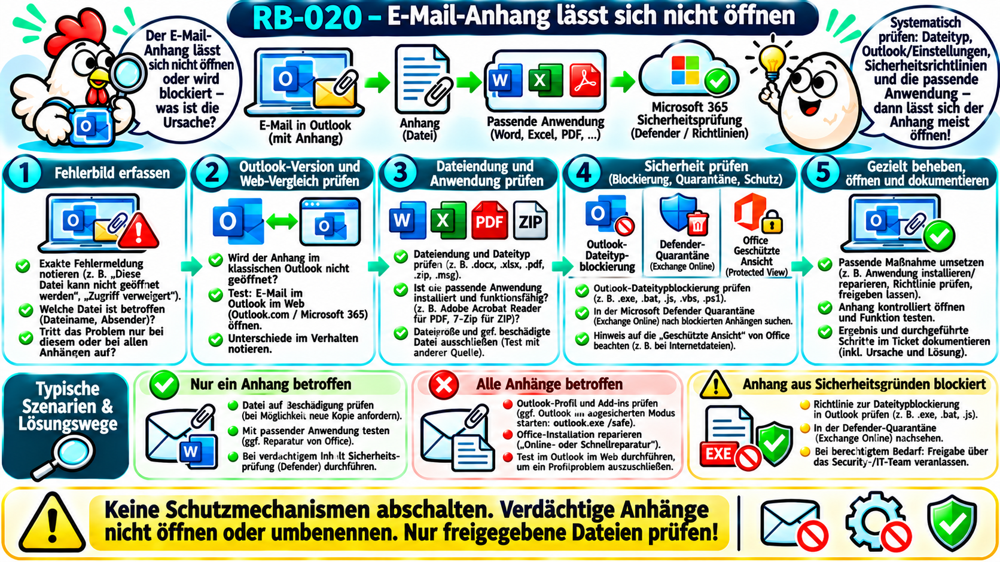
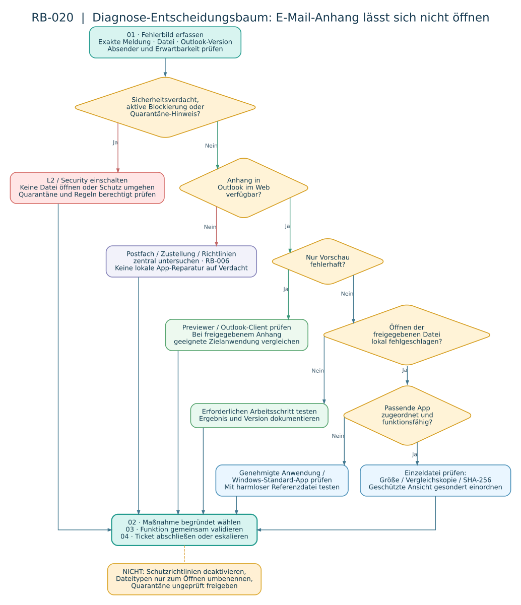

# RB-020 – E-Mail-Anhang lässt sich nicht öffnen

**Projekt:** 50 Tickets – 50 typische Supportfälle  
**Kategorie:** Microsoft 365, Outlook, Dateiformate, Windows-Sicherheit  
**Support-Level:** L1; L2 bei Microsoft-365-Sicherheitsrichtlinien, Quarantäne und wiederkehrenden zentralen Fehlern  
**Version / Recherche:** 1.0 · 08.11.2026  
**Validierungsstatus:** Herstellerdokumentation recherchiert; die Fallbeispiele wurden **nicht praktisch in einer Unternehmensumgebung validiert**.  
**Beispielumgebung:** Windows 11, klassisches oder neues Outlook für Windows, Exchange Online, Microsoft Defender für Office 365. Beispielkonten, Dateinamen und Tickets sind fiktiv.



## 1. Supportticket, Ausgangssituation und Ziel

> **Fiktives Ticket INC-020:** „Ich habe vom Kollegen eine E-Mail mit einer Excel-Datei bekommen. Wenn ich den Anhang anklicke, erscheint eine Fehlermeldung. Ich muss die Tabelle heute bearbeiten.“

**Ziel:** Die konkrete Ursache feststellen und den freigegebenen Anhang nutzbar machen, ohne Sicherheitskontrollen zu umgehen oder verdächtige Daten zu öffnen.

**Erste Fragen:** Welche exakte Fehlermeldung erscheint? Betrifft das Problem **nur einen Anhang oder alle Anhänge**? Welcher Dateityp und welche Dateigröße sind betroffen? Wird die Datei im Outlook-Desktopclient, im neuen Outlook oder in Outlook im Web geöffnet? Kann ein anderer berechtigter Mitarbeiter dieselbe Datei öffnen? Handelt es sich um eine vertrauenswürdige, erwartete Nachricht? Hat die Sicherheitssoftware etwas blockiert?

**Abgrenzung:** RB-006 behandelt allgemeinen Mailversand und -empfang; RB-019 behandelt das klassische Outlook-Profil. RB-020 konzentriert sich auf **Anhangvorschau, Dateizugriff, Anwendungszuordnung und Sicherheitsprüfung**.

## 2. Anfängergrundlagen: Von der E-Mail zum geöffneten Anhang

| Begriff | Einfach erklärt |
|---|---|
| **Anhang / Attachment** | Datei, die einer E-Mail beigefügt ist, etwa `Bericht.xlsx`. |
| **Dateiendung / Erweiterung** | Die Buchstaben nach dem letzten Punkt, z. B. `.xlsx`; sie helfen Windows bei der Zuordnung einer Anwendung. Sie beweisen nicht den tatsächlichen oder sicheren Dateiinhalt. |
| **MIME (Multipurpose Internet Mail Extensions)** | Standard, um u. a. Dateianhänge und ihre Typen in E-Mails zu übertragen. |
| **Client** | Anwendung auf dem PC, z. B. klassisches oder neues Outlook. |
| **Outlook im Web (OWA)** | Browserzugriff auf das Postfach, z. B. über `https://outlook.office.com/` bei entsprechendem Unternehmenskonto. |
| **Dateizuordnung** | Windows-Regel, welches Programm eine `.pdf`-, `.docx`- oder `.xlsx`-Datei öffnet. |
| **Geschützte Ansicht / Protected View** | Sicherheitsmodus von Office, in dem Dokumente aus potenziell unsicheren Quellen eingeschränkt geöffnet werden. *Nicht* gleichbedeutend mit defekter Datei. |
| **Mark of the Web (MotW)** | Herkunftsmarkierung in Windows, die bei einigen heruntergeladenen Dateien erkennen lässt, dass sie aus einer Internetzone stammen. |
| **Defender for Office 365** | Cloudbasierte Schutzfunktionen für E-Mails und Zusammenarbeit; *Safe Attachments* untersucht Anhänge auf Schadsoftware. |
| **Quarantäne** | Isolierter Bereich für verdächtige oder durch Sicherheitsregeln zurückgehaltene Nachrichten/Dateien. |
| **Hash / SHA-256** | Aus Dateiinhalten berechneter Prüfwert. Gleiche Hashwerte sprechen mit sehr hoher Sicherheit für identische Inhalte; ein Hash beweist **nicht**, dass die Datei ungefährlich ist. |
| **L1/L2** | First/Second Level: Standarddiagnose bzw. weiterführende Administration gemäß Unternehmensberechtigungen. |

**Vereinfachte Verarbeitungskette:** `Absender → Mailtransport/Schutz → Postfach → Outlook (Vorschau oder Download) → Windows-Dateizuordnung → Anwendung → Dateiinhalt`. Störungen an diesen Stationen sind **verschiedene** Fehler und dürfen nicht verwechselt werden.

**Quelle:** [Microsoft Support: Anlagen in Outlook öffnen, speichern und bearbeiten](https://support.microsoft.com/de-de/outlook/mail/open-save-and-edit-attachments-received-in-outlook).

## 3. Unterschied zwischen klassischem Outlook, neuem Outlook und Web

| Situation | Was kann geprüft werden? | Einschränkung |
|---|---|---|
| **Klassisches Outlook** | Anhangvorschau, Speichern unter, Öffnen in Zielanwendung, gegebenenfalls Add-ins und Profil | Manche klassischen Reparaturmethoden gelten nicht für neues Outlook. |
| **Neues Outlook für Windows** | Anhangvorschau, Download, Öffnen über Standardanwendung, Vergleich mit Outlook im Web | Andere App-Architektur und Einstellungen als beim klassischen Outlook. |
| **Outlook im Web** | Prüfen, ob dieselbe Nachricht und der Anhang angezeigt, als Vorschau dargestellt oder heruntergeladen werden können | Web-Vorschau und Desktopprogramm sind nicht identisch; Browserfehler bleiben möglich. |

**Schlüsseltest:** Funktioniert **derselbe** erwartete, freigegebene Anhang in Outlook im Web, aber nicht im Desktopclient, ist eine **lokale** Ursache plausibler. Das beweist jedoch nicht automatisch, dass Outlook selbst beschädigt ist: Auch Dateizuordnung, Office-App, Browserdownload-Regeln oder lokale Sicherheitssoftware kommen infrage.

**Quellen:** [Microsoft Support: Häufige Outlook-Anlagenprobleme](https://support.microsoft.com/de-de/outlook/troubleshoot-attachment-problems-in-outlook-for-windows), [Microsoft Support: Anlagen öffnen und speichern](https://support.microsoft.com/de-de/outlook/mail/open-save-and-edit-attachments-received-in-outlook).

## 4. Fehlermeldungen und mögliche Ursachen

| Beobachtung / sinngemäße Meldung | Mögliche Ursache | Erste gezielte Prüfung |
|---|---|---|
| „Mit welcher App möchten Sie diese Datei öffnen?“ | Keine geeignete Standard-App zugeordnet | Dateiendung, installierte Anwendung und Windows-Standard-Apps prüfen |
| Vorschau funktioniert nicht, Download funktioniert | Vorschau/Previewer oder unterstütztes Format | Datei **nur bei unbedenklicher Herkunft** mit freigegebener App testen |
| Datei lässt sich nach Download nicht öffnen | Inkompatibles Format, beschädigte Datei, fehlende App, lokale Richtlinie | Erweiterung, Größe, App, Referenzdatei vergleichen |
| „Outlook hat den Zugriff auf unsichere Anlagen blockiert“ | Outlook-Anlagenfilter blockiert Dateityp | Blockierte Erweiterung prüfen, keine Umgehung vornehmen |
| Office öffnet in „Geschützter Ansicht“ | Herkunftsmarkierung / Sicherheitszone | Vertrauenswürdigkeit und Herkunft prüfen; nicht pauschal deaktivieren |
| „Datei beschädigt“ / „Format oder Dateiendung ungültig“ | Unvollständige Datei, Format stimmt nicht, Anwendung kann Inhalt nicht lesen | Dateigröße, Vergleich mit Quelle, falls autorisiert SHA-256 prüfen |
| „Anhang wird überprüft“ / Platzhalter | Safe Attachments / dynamische Zustellung | Prüfung und Sicherheitsstatus abwarten; Admin bei ungewöhnlicher Dauer einschalten |
| Nachricht oder Anhang fehlt vollständig | Filter, Quarantäne, Zustellung oder Transportregel | Nachricht und Sicherheitsportal serverseitig prüfen, nicht Client reparieren |
| Alle Anhänge in einer Outlook-Installation schlagen fehl | Outlook-/Office-/Browser-/Sicherheitskonfiguration | Webvergleich, lokale Anwendungsfunktion, gegebenenfalls L2-Protokolle |

**Wichtig:** Die tatsächlichen Fehlermeldungen können je nach Office-Version, Konto und Richtlinie anders lauten.

## 5. Zugriffsweg: Wo arbeitet der Support?

| Ort / Werkzeug | Wofür? | Voraussetzung |
|---|---|---|
| Benutzerrechner – Explorer / Standard-Apps | Dateityp und passende Anwendung prüfen | Berechtigter lokaler Zugriff, klare Zustimmung |
| Outlook Desktop / Web | Gleiche Nachricht vergleichen, zulässige Vorschau testen | Benutzer angemeldet, legitimer Zugriff |
| PowerShell auf Benutzerrechner | Dateimetadaten, Hash und gegebenenfalls Herkunftshinweis **lesend** prüfen | Eine **freigegebene lokale Testdatei**, keine unbekannte ausführbare Datei |
| Microsoft Defender Portal | Sicherheitsquarantäne / Safe-Attachments-Befunde prüfen | Zugewiesene Sicherheitsrolle und Genehmigung; i. d. R. L2/Security |
| Exchange Admin Center / Exchange Online PowerShell | Zustellungsweg untersuchen, wenn Nachricht fehlt | Exchange-Berechtigungen; Message Trace ist **kein Dateireparaturwerkzeug** |

Die Datei muss vor jeder lokalen Prüfung **als legitim und nach Unternehmensrichtlinie prüfbar** eingeordnet werden. Verdächtige Anhänge nicht eigenmächtig öffnen, ausführen, freigeben oder an externe Scandienste hochladen.

## 6. Diagnose-Entscheidungsbaum



**Prüffolge:**

1. Datei und Fehlermeldung genau erfassen; Sicherheitsverdacht einschätzen.
2. Fehlt die Nachricht oder blockiert ein System aktiv? → Zustellungs-/Sicherheitsdiagnose, nicht lokales Reparieren.
3. Dieselbe Datei im Web anzeigen/herunterladen? → Unterschied zwischen Cloud und Client dokumentieren.
4. Dateityp und freigegebene Zielanwendung prüfen.
5. Schutzwarnung vorhanden? → gesonderten Security-Weg benutzen.
6. Bei freigegebener, unbedenklicher Datei Dateiintegrität und Programmfunktion untersuchen.
7. Nur nach begründetem Befund gezielt reparieren, Erfolg testen oder eskalieren.

## 7. Diagnose A – Dateiendung und Anwendung prüfen

**Ausführungsort:** Windows-11-Benutzerrechner, für eine vom Unternehmen genehmigte, harmlose Testdatei.

**Grafisch:** `Einstellungen → Apps → Standard-Apps → Dateiendung eingeben`, beispielsweise `.pdf` oder `.xlsx`. Dort nachsehen, welches Programm als Standard gesetzt ist.

```powershell
# Pfad zur FREIGEGEBENEN lokalen Testdatei festlegen.
# Ein nicht vorhandener Beispielpfad wird vor der Verwendung angepasst.
$pfad = 'C:\Support-Test\Beispiel.xlsx'

# Prüfen, ob die Datei am angegebenen Ort vorhanden ist.
Test-Path -LiteralPath $pfad

# Eigenschaften des Dateisystems anzeigen.
# Extension = Dateiendung; Length = Größe in Bytes.
Get-Item -LiteralPath $pfad |
    Select-Object Name, Extension, Length, LastWriteTime, FullName
```

**Interpretation:** `Test-Path = False` heißt lediglich, dass die Datei **unter diesem Pfad** nicht gefunden wurde. Eine Endung `.xlsx` beweist nicht, dass der Inhalt wirklich eine gültige Excel-Arbeitsmappe ist. Eine Dateigröße von 0 Bytes ist ein deutlicher Hinweis auf eine leere Datei, jedoch kein allgemeiner Nachweis einer bestimmten Fehlerursache.

**Quelle:** [Microsoft Support: Standard-Apps unter Windows ändern](https://support.microsoft.com/de-de/windows/apps/change-default-apps-in-windows).

## 8. Diagnose B – Datei-Integrität mit SHA-256 prüfen

**Zweck:** Ein und dieselbe genehmigte Datei mit einer bekannten Referenzkopie vergleichen. **Nicht** zur Freigabe gefährlicher Anhänge verwenden.

```powershell
# Pfad zu einer ungefährlichen, autorisierten Testdatei.
$pfad = 'C:\Support-Test\Beispiel.xlsx'

# SHA-256-Hash des lokalen Inhalts berechnen.
# -LiteralPath interpretiert den Pfad ohne Platzhalterzeichen.
# -Algorithm SHA256 wählt einen modernen Hashalgorithmus.
Get-FileHash -LiteralPath $pfad -Algorithm SHA256 |
    Select-Object Path, Algorithm, Hash
```

**Interpretation:** Gleiche Hashwerte zwischen einer **vertrauenswürdigen Referenzkopie** und der untersuchten Datei sprechen sehr stark für identischen Inhalt. Unterschiedliche Hashwerte zeigen unterschiedliche Inhalte; daraus folgt **noch nicht**, warum sie sich unterscheiden. Die Dateiquelle und die Berechtigung zur Hashprüfung müssen geklärt sein.

**Quelle:** [Microsoft Learn: Get-FileHash](https://learn.microsoft.com/de-de/powershell/module/microsoft.powershell.utility/get-filehash).

## 9. Diagnose C – Herkunftskennzeichnung: Mark of the Web

Windows kann heruntergeladene Dateien mit einem alternativen Datenstrom `Zone.Identifier` markieren. Office und andere Anwendungen berücksichtigen solche Kennzeichen bei Sicherheitsentscheidungen.

```powershell
# NUR auf einer eigens erstellten, ungefährlichen Testdatei verwenden.
$pfad = 'C:\Support-Test\Beispiel.xlsx'

# Prüfen, ob alternative NTFS-Datenströme vorhanden sind.
# Für diese Abfrage wird nichts an der Datei verändert.
Get-Item -LiteralPath $pfad -Stream * |
    Select-Object FileName, Stream, Length

# Falls vorhanden: Den Inhalt des Zone.Identifier-Datenstroms LESEN.
# Wenn kein Datenstrom existiert, kann eine Fehlermeldung erscheinen.
Get-Content -LiteralPath $pfad -Stream 'Zone.Identifier' -ErrorAction SilentlyContinue
```

**Hinweis:** `-Stream` setzt eine PowerShell-/Windows-Dateisystemumgebung voraus, die alternative NTFS-Datenströme unterstützt. Das Fehlen des Datenstroms beweist **keine** allgemeine Ungefährlichkeit.

**Sicherheitsregel:** `Unblock-File` oder das Entfernen des Herkunftshinweises ist **keine Diagnose-Standardmaßnahme**. Niemals ohne Sicherheitsprüfung und Freigabe anwenden. Die geschützte Office-Ansicht oder organisationsweite Makroblockierungen nicht pauschal deaktivieren.

**Quellen:** [Microsoft Learn: Makros und Mark of the Web](https://learn.microsoft.com/de-de/microsoft-365-apps/security/internet-macros-blocked), [Microsoft Learn: Attachment Manager-Richtlinien](https://learn.microsoft.com/en-us/windows/client-management/mdm/policy-csp-attachmentmanager).

## 10. Sicherheitsprüfungen – Drei verschiedene Schutzmechanismen

### A. Outlook-Dateitypblockierung

Outlook blockiert bestimmte riskante Dateitypen, beispielsweise ausführbare oder Skriptdateien. Der Hinweis bedeutet: **Eine Schutzregel greift**; es muss nicht automatisch ein Programmfehler vorliegen. Einen solchen Anhang nicht durch Umbenennen oder durch Registry-Änderungen auf dem Benutzerrechner „freischalten“.

**Quelle:** [Microsoft Support: Blockierte Anlagen in Outlook](https://support.microsoft.com/de-de/outlook/blocked-attachments-in-outlook).

### B. Microsoft Defender für Office 365 – Safe Attachments

Safe Attachments kann Anhänge vor Freigabe überprüfen und bei bestimmten Richtlinien zunächst einen Platzhalter anzeigen (*Dynamic Delivery* = dynamische Zustellung). Erkennt das System eine Bedrohung, kann die Nachricht in Quarantäne landen. Das ist ein **serverseitiger Sicherheitsbefund**, keine Aussage über eine fehlende lokale PDF-App.

**Quellen:** [Microsoft Learn: Sichere Anlagen](https://learn.microsoft.com/de-de/defender-office-365/safe-attachments-about?view=o365-worldwide), [Microsoft Learn: Quarantäne verwalten](https://learn.microsoft.com/de-de/defender-office-365/quarantine-admin-manage-messages-files).

### C. Office – Geschützte Ansicht

Die geschützte Ansicht ist ein eingeschränkter Modus für Dokumente aus potenziell unsicheren Quellen. Das Dokument kann möglicherweise angezeigt werden, auch wenn Bearbeitung eingeschränkt ist. **„Öffnen in geschützter Ansicht“ ist nicht dasselbe wie „Datei kann nicht geöffnet werden“.** Eine Warnung wird nicht allein deshalb ignoriert, weil der Absender bekannt erscheint.

**Quelle:** [Microsoft Support: Was ist die geschützte Ansicht?](https://support.microsoft.com/de-de/office/collab-files/what-is-protected-view).

## 11. Lösungswege abhängig vom Befund

| Nachgewiesener / ausreichend eingegrenzter Befund | Angemessene Maßnahme | Kontrolle |
|---|---|---|
| Standard-App fehlt oder falsch | Freigegebene passende App installieren/zuordnen | Harmlose Testdatei desselben Typs öffnen |
| Nur Outlook-Vorschau scheitert | Vorschau-/Clientfunktion untersuchen, erlaubten alternativen Öffnungsweg testen | Gleiche freigegebene Datei in Web/Client prüfen |
| Eine Datei ist tatsächlich beschädigt | Unveränderte Referenzkopie oder erneute Übermittlung über freigegebenen Weg anfordern | Datei öffnet sich und Inhalt ist vollständig |
| Office-Anwendung kann auch harmlose lokale Testdateien nicht öffnen | App reparieren, bei Bedarf L2 einschalten | Testdatei und betroffenen Anhang prüfen |
| Outlook blockiert Dateityp | Sicherheitsentscheidung akzeptieren; zulässigen alternativen Austauschweg mit Security abstimmen | Bereitgestellte, freigegebene Datei verwendbar |
| Safe Attachments / Quarantäne | L2/Security prüft Befund und Richtlinien; **nicht automatisch freigeben** | Sicherheitsfreigabe und Zugriff dokumentiert |
| Geschützte Ansicht | Schutzmodus korrekt interpretieren, Vertrauensprüfung durchführen, vorgesehene Freigabeprozesse nutzen | Zulässige Tätigkeit ohne Schutzumgehung möglich |
| Alle Benutzer / alle Anhänge betroffen | Microsoft-365-Dienststatus, Richtlinien und zentrale Fehlerlage prüfen | Vergleichstests an mehreren zulässigen Konten |

**Office-Reparatur:** Windows → Einstellungen → Apps → Installierte Apps → Microsoft 365/Office → Ändern → gegebenenfalls Schnellreparatur, danach nach Bedarf Onlinereparatur. Änderungen nur bei passendem Fehlerbild und gemäß Wartungs-/Freigabeprozess. Quelle: [Microsoft Support: Office reparieren](https://support.microsoft.com/de-de/office/lifecycle/repair-an-office-application?ad=de&rs=de-de&ui=de-de).

**Warum keine pauschale Lösung?** Eine defekte Standard-App lässt sich nicht durch das Freigeben einer Quarantäne-Mail beheben. Eine durch Sicherheitsregeln blockierte `.exe` darf nicht dadurch „repariert“ werden, dass Windows-Schutzregeln abgeschaltet werden.

## 12. 1st-Level-/2nd-Level-Eskalation

| L1 – nach vorhandenen Rechten | L2 / Security / Messaging |
|---|---|
| Exakte Meldung aufnehmen, Sicherheitsverdacht weiterleiten | Defender-/Quarantäne-Befunde und Richtlinien administrativ prüfen |
| Outlook-Version und Webvergleich | Mehrbenutzer-/Exchange-/Defender-Störungen korrelieren |
| Dateityp, Standard-App und harmlose Testdateien prüfen | Unternehmensrichtlinien und zentrale Sicherheitsprotokolle auswerten |
| Genehmigte App-Reparatur nach Standardprozess | Wiederkehrende Fehler, Dateifilter, Integrations-/Clientkonflikte analysieren |
| Ergebnis dokumentieren und Benutzer informieren | Freigabeentscheidungen und betroffene Benutzergruppen koordinieren |

**Mindestinformationen für die Eskalation:** Ticket-ID, Benutzer (intern), Absender/Zeitpunkt, exakte Fehlermeldung, Dateityp/-größe, Outlook-Version, Ergebnis Webvergleich, Zeitpunkt von Sicherheitswarnungen, bereits durchgeführte **nicht verändernde** Tests. Keine sensiblen Originalanhänge leichtfertig als Ticketbeilage versenden.

## 13. Fiktives Musterticket / Ticketkommentar

**INC-020 – Excel-Anhang lässt sich nicht öffnen (fiktiv)**  
**Fehlerbild:** Nutzer meldet, dass sich `Projektstatus.xlsx` aus einer erwarteten internen E-Mail im klassischen Outlook nicht öffnen lässt.  
**Diagnose:** Datei wurde von der internen Ansprechperson als erwartet bestätigt. Dieselbe Nachricht/Datei war in Outlook im Web erreichbar. Die Datei ließ sich lokal nicht über Doppelklick öffnen; andere freigegebene XLSX-Testdateien waren ebenfalls ohne zugeordnetes Programm. Windows zeigte keine passende Standard-App.  
**Ursache:** Fehlende beziehungsweise fehlerhafte Zuordnung zur genehmigten Tabellenanwendung.  
**Maßnahme:** Freigegebene Tabellenanwendung im Unternehmensportal bereitgestellt und `.xlsx` der vorgesehenen App zugeordnet.  
**Ergebnis:** Testdatei und betroffener Anhang erfolgreich geöffnet; Tabelleninhalt gemeinsam mit dem Benutzer geprüft.  
**Status:** Gelöst.  
**Transparenz:** Konstruierter Fall; **nicht** tatsächlich durchgeführt.

## 14. Lernkontrolle, Praxisübungen und Anki-Karten

### Übung ohne Microsoft-365-Unternehmensabo

1. Eigene harmlose `.txt`-Datei auf deinem Windows-11-Laptop erstellen und unter einem eindeutigen Pfad speichern.
2. Mit `Get-Item` Endung, Größe und Zeitstempel ermitteln; mit `Get-FileHash` einen SHA-256-Wert berechnen.
3. Eine Kopie erstellen; **nur die Kopie** um ein Zeichen verändern; beide SHA-256-Werte vergleichen.
4. Unter **Einstellungen → Apps → Standard-Apps** nachsehen, mit welcher Anwendung `.txt` geöffnet wird. Keine Vorgaben des eigenen Rechners ändern, wenn du es nicht möchtest.
5. Für Office-/PDF-Tests nur selbst erstellte, bekannte Dateien verwenden. Keine fremden angeblichen „Muster-Schadprogramme“ herunterladen.

**Cloud-Abgrenzung:** Für Exchange-Nachrichtenverfolgung, Defender-Quarantäne oder Richtlinienverwaltung benötigst du einen entsprechend lizenzierten Testmandanten, entsprechende Rollen und gegebenenfalls einen freigegebenen Unternehmens-Testfall. Ein normales privates Microsoft-365-Abo ist dafür nicht zwingend ausreichend.

### Active Recall (erst ohne nachzusehen beantworten)

1. Was ist der Unterschied zwischen *Vorschau* und *Öffnen in einer Anwendung*?
2. Welchen Zusatznutzen hat ein Vergleich zwischen Outlook im Web und Desktop-Outlook?
3. Was zeigt ein SHA-256-Vergleich – und was **nicht**?
4. Warum ist eine blockierte `.exe` kein gewöhnlicher „fehlender Dateizuordnungsfehler“?
5. Weshalb darf man die geschützte Ansicht nicht einfach deaktivieren?
6. Wann wäre eine L2-/Security-Eskalation erforderlich?

### Anki-Kartenentwürfe (Wissen / Verständnis / Diagnose)

| Typ | Vorderseite | Kurze Antwort |
|---|---|---|
| Wissen | Was ist eine Dateizuordnung? | Zuordnung einer Dateiendung zu einer Anwendung. |
| Wissen | Was macht `Get-FileHash`? | Berechnet einen Hashwert aus dem Dateiinhalten. |
| Verständnis | Warum kann die Vorschau fehlschlagen, obwohl die Datei intakt ist? | Vorschau und eigentliche Anwendung nutzen unterschiedliche Komponenten. |
| Verständnis | Worin unterscheiden sich Outlook-Dateitypblockierung und geschützte Office-Ansicht? | Outlook blockiert den Zugriff auf bestimmte Anhangtypen; Office öffnet Dokumente eingeschränkt. |
| Diagnose | Web öffnet XLSX, Desktop fragt nach Anwendung: Was zuerst prüfen? | Dateizuordnung und installierte genehmigte Tabellenanwendung. |
| Diagnose | Anhang fehlt mit Defender-Quarantäne-Hinweis: Was nicht tun? | Schutz umgehen oder Anhang ungeprüft freigeben. |

**Zeitversetzte Lernkontrolle:** Die Diagnosefragen nach ungefähr 7 und 21 Tagen erneut ohne Hilfestellung bearbeiten; den Transfer mit einem neuen Fehlerbild prüfen.

## 15. Quellen, Einschränkungen und Bearbeitungsstatus

**Offizielle Quellen, geprüft am 08.11.2026:**

1. [Microsoft Support – Anlagen in Outlook öffnen und speichern](https://support.microsoft.com/de-de/outlook/mail/open-save-and-edit-attachments-received-in-outlook) – Unterschiede zwischen Outlook-Versionen und Vorschau/Download.
2. [Microsoft Support – Anlagenprobleme in Outlook](https://support.microsoft.com/de-de/outlook/troubleshoot-attachment-problems-in-outlook-for-windows) – Outlook-spezifische Fehler.
3. [Microsoft Support – Blockierte Outlook-Anlagen](https://support.microsoft.com/de-de/outlook/blocked-attachments-in-outlook) – riskante Dateitypen.
4. [Microsoft Support – Geschützte Ansicht](https://support.microsoft.com/de-de/office/collab-files/what-is-protected-view) – Schutzmodus von Office.
5. [Microsoft Learn – Safe Attachments](https://learn.microsoft.com/de-de/defender-office-365/safe-attachments-about?view=o365-worldwide) – Cloudüberprüfung, Quarantäne und dynamische Zustellung.
6. [Microsoft Learn – Quarantäne administrieren](https://learn.microsoft.com/de-de/defender-office-365/quarantine-admin-manage-messages-files) – Security-Prüfpfad.
7. [Microsoft Support – Standard-Apps](https://support.microsoft.com/de-de/windows/apps/change-default-apps-in-windows) – Dateizuordnungen in Windows 11.
8. [Microsoft Learn – Get-FileHash](https://learn.microsoft.com/de-de/powershell/module/microsoft.powershell.utility/get-filehash) – Hashberechnung.
9. [Microsoft Learn – Mark of the Web](https://learn.microsoft.com/de-de/microsoft-365-apps/security/internet-macros-blocked) – Herkunftsmarkierung / Makroschutz.
10. [Microsoft Support – Office reparieren](https://support.microsoft.com/de-de/office/lifecycle/repair-an-office-application?ad=de&rs=de-de&ui=de-de) – anwendungsbezogene Reparatur.
11. [Microsoft Learn – Nachrichtenablaufverfolgung](https://learn.microsoft.com/de-de/exchange/monitoring/trace-an-email-message/message-trace-faq) – Zustellungsdiagnose, nicht Dateireparatur.
12. [Microsoft Learn – Microsoft 365 Developer Program](https://learn.microsoft.com/de-de/office/developer-program/microsoft-365-developer-program) – Sandbox nur bei Erfüllung der Teilnahmebedingungen.

**Status:** Recherchierter Lernartikel mit kommentierten Beispielbefehlen, Entscheidungsbaum und fiktivem Ticket. **Praktische Umsetzung in Microsoft 365/Defender nicht durchgeführt**. Keine Aussage, dass reale Kundendaten getestet wurden. 

**Querverweise:** RB-006 (Outlook sendet/empfängt nicht), RB-019 (Outlook-Profil), RB-014 (Anwendungsberechtigungen), RB-013 (Softwarebereitstellung).
