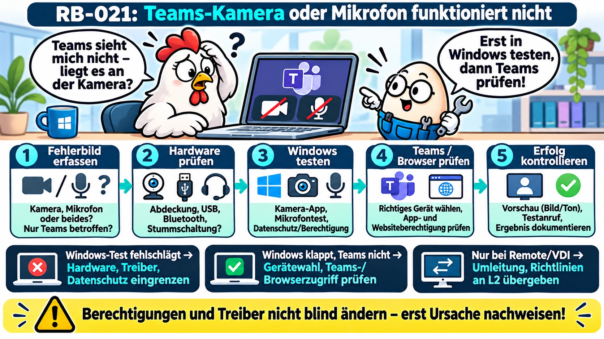

# RB-021 – Teams-Kamera oder Mikrofon funktioniert nicht

**Projekt:** 50 Tickets – 50 typische Supportfälle  
**Kategorie:** Microsoft Teams / Windows 11 / Peripherie / Berechtigungen  
**Support-Level:** L1 (Erstdiagnose, Geräteeinstellungen, Vergleichstests) und L2 (Treiber, verwaltete Richtlinien, VDI, Serienfehler)  
**Version:** 1.0 · **Stand:** 22.11.2026  
**Status:** Technisch auf Grundlage offizieller Microsoft-Quellen recherchiert; **nicht in einer realen Umgebung praktisch validiert**. Fiktives Schulungsbeispiel.



> **Leitgedanke:** Eine in Windows erkannte Kamera beziehungsweise ein Mikrofon funktioniert nicht automatisch in Teams. Hardware, Geräteinitialisierung, Datenschutzfreigabe, Anwendungsauswahl und Besprechungsstatus sind **getrennt zu prüfen**. Der Befund entscheidet über den nächsten Schritt – nicht eine pauschale Reparaturliste.

## 1. Das Supportticket und die Zielsetzung

**Musterfall INC-021 (fiktiv):** Eine Mitarbeiterin meldet: „Seit heute sehen mich die anderen in Teams nicht. Manchmal wird auch das Mikrofon nicht gefunden. Ich habe gleich eine Besprechung.“ Die Firma verwendet Windows 11 und Microsoft Teams für Arbeit oder Schule. Ein Headset und eine integrierte Notebookkamera sind vorhanden.

**Ziel:** Die betroffene Komponente sicher identifizieren, funktionierende und ausgefallene Ebenen voneinander abgrenzen, möglichst **reversible** Korrekturen vornehmen und mit der Mitarbeiterin die tatsächliche Funktion belegen. Wenn keine L1-Lösung möglich ist, eine aussagekräftige L2-Eskalation vorbereiten.

**Nicht automatisch Teil des Tickets:** Generelle Teams-Anmeldung, Cloud-Dienstausfall oder Chat-Nachrichten – siehe [RB-015 – Microsoft Teams funktioniert nicht](https://marcf46.github.io/it-support/rb-015/) im Projekt. Der vorliegende Fall konzentriert sich auf **Audio-/Videogeräte**.

### Was zuerst gefragt werden muss

- Kamera, Mikrofon oder beide betroffen? Sieht die Person sich selbst in der Vorschau? Sehen andere zwar das Bild, hören aber keinen Ton?
- Teams als **Desktop-App**, **im Browser** oder in einer **virtuellen Desktopumgebung (VDI/RDP)**?
- Seit wann? Vorher funktionsfähig? Wechsel zu neuem Headset, Dock, USB-Port, Browser, Windows- oder Teams-Update?
- Nur dieses Gerät, nur dieser Benutzer, nur eine Besprechung oder mehrere Arbeitsplätze?
- Fehlertext? Gerät fehlt in der Auswahlliste, ist ausgegraut, liefert ein schwarzes Bild oder zeigt Pegel ohne hörbaren Ton?
- Bereits laufende andere Konferenzsoftware? Abdeckung der Webcam, Hardware-Mute-Taste, Bluetooth-Verbindung?

**Priorität:** Zeitkritische Besprechung beachten, ohne die Fehleranalyse durch unkontrollierte Änderungen zu ersetzen. Ggf. vorübergehend ein freigegebenes Ersatz-Headset, Telefon-Audio oder einen anderen verwalteten Arbeitsplatz einsetzen.

## 2. Grundlagen – die Medienkette verstehen

Die Funktion hängt von mehreren Schichten ab:

1. **Physische Ebene:** Kamera, Mikrofon, Kabel, USB-Port, Dock, Bluetooth, Notebook-Schalter, Abdeckung, Stromversorgung.
2. **Windows-Geräteebene:** Das Gerät wird erkannt, der Treiber initialisiert es und stellt seine Funktion bereit; im Geräte-Manager beziehungsweise den Audio-/Kameraeinstellungen kann es sichtbar sein.
3. **Berechtigungsebene:** Windows erlaubt den Kamera-/Mikrofonzugriff für die benötigte App-Kategorie. Bei Teams im Browser muss zusätzlich **die konkrete Website** im Browser freigegeben sein.
4. **Anwendungsebene:** Teams wählt das passende Eingabegerät aus; es kann von der Windows-Standardauswahl abweichen. Die Person kann im Meeting zusätzlich stummgeschaltet sein oder Video deaktiviert haben.
5. **Sonderumgebungen:** Bei Remote Desktop / VDI muss das lokale Gerät eventuell in die entfernte Sitzung **umgeleitet** werden. Die Teams-Medienoptimierung ist eine zusätzliche Ebene.

**Merksatz:** „Gerät erkannt“ ≠ „Gerät nimmt auf“ ≠ „Zugriff erlaubt“ ≠ „in Teams ausgewählt“ ≠ „im Anruf übertragen“.

### Abkürzungen

| Begriff | Bedeutung | Relevanz |
|---|---|---|
| USB | Universal Serial Bus | Kabel, Port, Hub oder Dock als mögliche Fehlerstelle |
| Bluetooth | Funkverbindung für Peripherie | Kopplung und Profil/aktive Verbindung prüfen |
| PnP | Plug and Play | Windows-Geräteerkennung, Status und Treiberzuordnung |
| VDI | Virtual Desktop Infrastructure | Kamera-/Mikrofonumleitung und Optimierung können fehlen |
| RDP | Remote Desktop Protocol | Lokale Ressourcen müssen je nach Szenario übertragen werden |
| L1 / L2 | First-/Second-Level-Support | Unterschiedliche Zuständigkeiten und Änderungsbefugnisse |

## 3. Fehlerbilder und plausible Ursachen

| Symptom | Denkbare Ursachen | Entscheidender Gegenbeweis / Test |
|---|---|---|
| Kamera in Teams-Liste nicht vorhanden | Hardware/USB, Treiber, Windows- oder VDI-Erkennung | Kamera-App und Geräte-Manager prüfen; lokaler gegen virtuellen Desktop |
| Kamera in Teams auswählbar, aber schwarzes Bild | Verschluss, fremde Anwendung, Berechtigung, Treiber, Teams-Auswahl | Kamera-App und Teams-Vorschau getrennt testen |
| Mikrofon aufnehmbar, andere hören nichts | Stummschaltung, falsches Mikrofon, zu geringer Pegel, Meeting-Einstellung | Windows-Aufnahmeprobe und Teams-Testanruf |
| Mikrofon fehlt auch in Windows | Bluetooth/USB/Audio-Treiber oder Hardware | Andere Buchse, alternatives Headset, PnP-Status |
| Windows-Test funktioniert, nur Teams Desktop versagt | Falsches Gerät, App-/Berechtigungsproblem, Teams-Client | Gerät in Teams wählen; Teams Web als **kontrollierte Gegenprobe** |
| Teams Web scheitert, Desktop funktioniert | Websiteberechtigung, Browser-Geräteauswahl oder Richtlinie | Browser-Siteberechtigung für tatsächliche Teams-URL prüfen |
| Nur in RDP/VDI fehlerhaft | Fehlende Umleitung/Medienoptimierung, Clientrichtlinie | Lokalen Test mit dem entfernten Test vergleichen |
| Mehrere Benutzer/Standorte gleichzeitig betroffen | Gemeinsam eingesetzte App-Version, Gerätemodell, Richtlinie oder Dienst | Umfang und Zeitpunkt vergleichen; IT-Administration hinzuziehen |

**Wichtig:** Solche Symptome machen eine Ursache *plausibel*, nicht bewiesen. Eine Kamera im Geräte-Manager mit Status „OK“ ist beispielsweise noch kein Nachweis für ein korrektes Livebild.

## 4. Wo arbeitet der Supporttechniker?

**Am Benutzer-PC (L1):** Einwilligung zur Fernhilfe und zum Test einholen; Teams-Geräteeinstellungen, Windows-Kamera-App, Windows-Audio-Eingabetest, Gerätemanager und Datenschutzeinstellungen untersuchen. Bei Bild-/Tonprobe nur notwendige Testdaten verwenden und **keine privaten Aufnahmen speichern**.

**Am verwalteten Client / Adminarbeitsplatz (L2):** Softwareverteilung, USB-/Gerätebeschränkungen, Gerätemanagement, Treiberversionen, Browser-Policies oder VDI-Konfiguration prüfen – ausschließlich mit passenden Rechten und Freigaben.

**Nicht erforderlich:** Gleich zu Beginn das gesamte Teams-Profil oder den Cache löschen, Audio-/Kameratreiber deinstallieren, Sicherheitsrichtlinien deaktivieren oder Teams neu installieren. Solche Maßnahmen überspringen die Diagnose und erzeugen möglicherweise zusätzliche Probleme.

## 5. Diagnose-Entscheidungsbaum


**Lesereihenfolge:**

1. **Fehlertyp und Einsatzumgebung** feststellen; Hardware-Mute, Abdeckung, USB und Bluetooth prüfen.
2. **Außerhalb von Teams** testen: Kamera-App für das Bild; unter Windows **Einstellungen → System → Sound → Eingabe → Test starten** für das Mikrofon.
3. **Windows-Test fehlgeschlagen:** Geräteinitialisierung, Treiber, Berechtigungen oder Hardware untersuchen; erst danach Teams erneut prüfen.
4. **Windows-Test erfolgreich:** Teams-Geräteauswahl, eigene Stummschaltung, Video-Vorschau und App-Berechtigungen prüfen.
5. **Desktop gegen Web** gezielt vergleichen – im Web zusätzlich Websiteberechtigung und Browser-Auswahl prüfen; Testanruf steht laut Microsoft **nicht in Teams Web** zur Verfügung.
6. **Nur in VDI/RDP:** lokale gegen entfernte Funktion und die Umleitung prüfen, dann die zuständige Administration einbinden.
7. **Wiederholungstest und Ticketbefund**; bei weiterem Fehler mit reproduzierbaren Daten eskalieren.

## 6. Diagnose A – Hardware, Stummschaltung und Verbindungsweg (L1)

**Prüfschritte:**

1. Kameraabdeckung physisch öffnen; gegebenenfalls Kameraschalter, Fn-Taste oder herstellerspezifischen Privacy-Modus kontrollieren.
2. Mikrofon-Mute am Headset, am Notebook und in der Teams-Besprechung unterscheiden. Ein Hardware-Mute kann trotz sichtbarem Windows-Gerät aktiv sein.
3. Externe Geräte abziehen und **nach Absprache** an einem direkten USB-Port anschließen; zunächst möglichst ohne Dock/Hub testen.
4. Bluetooth-Gerät: Akkustand, Paarung und tatsächlich verbundene Audiofunktion prüfen; mögliches Umschalten zwischen Telefon und Notebook beachten.
5. Andere Konferenzsoftware schließen, die das Gerät möglicherweise nutzt. Gespeicherte Arbeit zuvor sichern.
6. Wenn möglich, eine **kontrollierte A/B-Gegenprobe**: anderes bekannt funktionierendes Headset am gleichen PC beziehungsweise dasselbe Headset an einem zweiten freigegebenen PC.

**Interpretation:** Tritt der Fehler nur am Dock auf, ist ein Dock-/USB-Zweig wahrscheinlich; versagt dasselbe Headset an zwei Rechnern, steigt der Hardwareverdacht. Diese Vergleiche beweisen allein aber noch keine spezifische Treiberursache.

## 7. Diagnose B – Windows unabhängig von Teams prüfen (L1)

### 7.1 Kamera-App als Trennversuch

1. In Windows 11 die **Kamera-App** öffnen.
2. Prüfen, ob die gewünschte Kamera ausgewählt ist, die Abdeckung offen ist und ein bewegtes Bild erscheint.
3. Nur wenn erforderlich, eine zweite Kamera zum Vergleich auswählen. **Keine unnötigen Fotos oder Videos aufnehmen.**

**Ergebnis A: kein Bild auch in Windows.** Fokus auf Hardware, Treiber, Datenschutzzugriff, Erkennung und konkurrierende Software – nicht zuerst Teams neu installieren.

**Ergebnis B: Livebild funktioniert.** Kamera und grundlegender lokaler Zugriff funktionieren in diesem Test. Danach Teams-Auswahl und Teams-/Browser-Berechtigungen untersuchen. Eine erfolgreiche Kamera-App beweist nicht, dass Teams Zugriff hat.

### 7.2 Mikrofon unabhängig testen

1. **Einstellungen → System → Sound → Eingabe** öffnen.
2. Gewünschtes Mikrofon auswählen. Prüfen, ob es aktiviert und nicht stummgeschaltet ist; Eingabelautstärke kontrollieren.
3. Windows-Funktion **Test starten** verwenden, einen neutralen Testsatz sprechen und anschließend beenden bzw. Probe abspielen, wenn angeboten.
4. Eingabepegel und Aufnahmeprobe zusammen bewerten. Der sichtbare Pegel allein beweist noch nicht die erwartete Sprachqualität.

**Ergebnis A:** Kein Ausschlag / keine Aufnahme → zuerst Windows-/Gerätezweig.  
**Ergebnis B:** Aufnahme gelingt → Teams-Geräteauswahl und Meetingstatus prüfen.

## 8. Diagnose C – Windows-Berechtigungen korrekt verstehen (L1 / administriert)

Unter **Einstellungen → Datenschutz & Sicherheit → Kamera** beziehungsweise **Mikrofon** liegen mehrere Schalter: Gerätezugriff, Zugriff durch Apps und Zugriff durch **Desktop-Apps**. Microsoft weist ausdrücklich darauf hin, dass klassische Desktop-Apps **nicht unbedingt einzeln in der App-Liste erscheinen** und sich deren Kamerazugriff nicht immer pro Desktop-App einstellen lässt. Die genaue Anzeige hängt von App-Typ und Windows-Version ab.

**Prüfen statt ungefragt aktivieren:** Ist der Zugriff gewollt und nach Unternehmensrichtlinie erlaubt? Sind Schalter gesperrt oder ausgegraut? Dann **keine GPO-/Intune-Umgehung**, sondern L2-Weitergabe.

- Kamera: Kamera-Zugriff sowie relevante Desktop-App-Berechtigung kontrollieren.
- Mikrofon: Mikrofon-Zugriff sowie relevante Desktop-App-Berechtigung kontrollieren.
- Teams im **Browser** benötigt zusätzlich die Freigabe der tatsächlich aufgerufenen Teams-Seite im Browser; allgemeine Browserfreigabe allein reicht nicht zwingend.
- Ein „Aus“ kann eine bewusste organisatorische Datenschutzentscheidung sein – nicht automatisch ein Fehler, den L1 übersteuern darf.

## 9. Diagnose D – Teams-Desktop gezielt prüfen (L1)

1. Teams öffnen und unter **Einstellungen und mehr → Einstellungen → Geräte** nachsehen.
2. Bei **Mikrofon** und **Kamera** explizit das erwartete Gerät auswählen. Der Eintrag „Standard“ kann nach Dock-/Headsetwechsel auf ein unerwartetes Gerät zeigen.
3. Kamera-Vorschau beobachten; gegebenenfalls anderes Kameragerät vergleichen.
4. Für Mikrofon/Lautsprecher den **Testanruf** nach verfügbarer App-Funktion verwenden. Microsoft beschreibt diesen Test in der Desktop-App; er ist aktuell **nicht in Teams Web** verfügbar. Das Testergebnis ist **kein Nachweis**, dass eine externe Meetingverbindung unter allen Netzwerkbedingungen funktionieren muss.
5. In der tatsächlichen Besprechung prüfen, ob **Mikrofon** bzw. **Kamera** durch die Person ausgeschaltet ist. Ein korrekt erfasstes Windows-Mikrofonsignal nutzt nichts, wenn Teams stummgeschaltet ist.
6. Nach einer einzelnen gezielten Änderung den gleichen Test wiederholen und das Ergebnis festhalten.

**Faustregel:** Nur Teams Desktop fehlerhaft, Windows und Teams Web erfolgreich → Teams-Client, dessen Geräteauswahl oder lokale Clientumgebung stärker verdächtig. Nicht sofort alle Clientdaten löschen.

## 10. Diagnose E – Teams im Browser als Vergleich (L1)

**Vergleichsmethode:** Browser Teams mit dem **gleichen Konto, gleichen Gerät und nach Möglichkeit unter vergleichbaren Bedingungen** öffnen. Browser-Zugriff nur nach Unternehmensfreigabe und wenn diese Nutzungsform unterstützt wird.

- Im Browser prüfen, ob die **tatsächliche Teams-Website** Kamera-/Mikrofonberechtigung besitzt und nicht auf „Blockieren“ steht.
- Im Browser selbst das korrekte Kameragerät bzw. Mikrofon auswählen.
- Wenn Windows und Teams Desktop funktionieren, aber Teams Web nicht: Site-Berechtigung und Browser-/Policy-Zweig bevorzugen.
- Wenn Browser und Desktop beide fehlschlagen, beweist das **keine** Cloud-Störung; gemeinsam genutzte Windows-Einstellungen, Hardware, Richtlinien und Nutzungsbedingungen sind ebenfalls möglich.
- Nicht die in **Teams eingebetteten Drittanbieter-Apps** mit dem normalen Teams-Besprechungsgerät verwechseln; sie können nochmals eigene Berechtigungen besitzen.

**Risiko der Fehlinterpretation:** Ein fehlender „Testanruf“-Knopf in Teams Web ist laut Microsoft eine Funktionseinschränkung und keine diagnostische Fehlermeldung.

## 11. Diagnose F – Lesende Windows-PowerShell-Abfragen (L1/L2)

Die folgenden Befehle ändern keine Windows-Konfiguration. Sie sind **ergänzende Indizien**, nicht Ersatz für eine Bild-/Tonprobe. In einer **autorisierten** Windows-PowerShell-Sitzung ausführen; lokale Richtlinien beachten. Für Bildschirm-/Log-Ausgaben personenbezogene Gerätenamen gegebenenfalls anonymisieren.

### 11.1 Erkannte Audio- und Kamerageräte anzeigen

```powershell
# Fragt ausschließlich aktuell vorhandene Plug-and-Play-Geräte ab.
# Kamera- und Audiogeräte können je nach Hersteller/Klassifizierung
# unter Camera, Image, AudioEndpoint oder MEDIA auftauchen.
Get-PnpDevice -PresentOnly |
    Where-Object { $_.Class -in @('Camera', 'Image', 'AudioEndpoint', 'MEDIA') } |
    Select-Object Class, FriendlyName, Status, InstanceId |
    Sort-Object Class, FriendlyName
```

**Interpretation:** `Status = OK` zeigt eine erfolgreiche PnP-Initialisierung an, **nicht**, dass Teams das richtige Gerät gewählt hat oder eine verwendbare Aufnahme liefert. Fehlt ein erwartetes Gerät, Verbindung, Erkennung und Herstellerkonfiguration prüfen. Die Liste kann interne und virtuelle Audiogeräte enthalten.

### 11.2 Windows-Audiodienste ohne Eingriff lesen

```powershell
# Fragt die Zustände der Windows-Audiodienste ab.
# Der Befehl startet oder stoppt keine Dienste.
Get-Service -Name 'Audiosrv', 'AudioEndpointBuilder' |
    Select-Object Name, DisplayName, Status, StartType
```

**Interpretation:** Abweichende Dienstzustände dokumentieren, aber nicht allein daraus „Dienstneustart erforderlich“ ableiten. Systemweite Neustarts können andere Anwendungen beeinträchtigen.

### 11.3 Konkretes Gerät im Geräte-Manager zuordnen

```powershell
# Liefert lediglich Geräte mit nicht erfolgreichem PnP-Status.
# Fehlende Treffer bedeuten nicht, dass alle Medienpfade funktionieren.
Get-PnpDevice -PresentOnly |
    Where-Object {
        $_.Status -ne 'OK' -and
        $_.Class -in @('Camera', 'Image', 'AudioEndpoint', 'MEDIA')
    } |
    Select-Object Class, FriendlyName, Status, Problem, InstanceId
```

**Hinweis:** `Get-PnpDevice` ist unter unterstützten Windows-Systemen im PnPDevice-Modul verfügbar. Die genaue Ausgabe und vorhandene Klassen sind geräteabhängig. Kommandos auf einem entfernten Rechner zeigen nur dann dessen Zustände, wenn sie **dort** im passenden Kontext laufen.

## 12. Befundabhängige Behebung – von reversibel zu invasiv

| Nachgewiesener Befund | Geeigneter nächster Schritt | Zuständigkeit / Vorsicht |
|---|---|---|
| Hardware-Mute bzw. Kameraverschluss aktiv | Mute lösen, Abdeckung öffnen | L1, mit betroffener Person abstimmen |
| Falsches USB-/Bluetooth-Gerät verbunden | Verbindung/Kopplung korrigieren, Dock umgehen, Gerät neu auswählen | L1; andere aktive Sitzungen beachten |
| Windows-Berechtigung fehlt, Freigabe ist zulässig | Betroffenen Schalter **nach Richtlinie** korrigieren | L1 oder Admin, keine Richtlinien umgehen |
| Windows-Test funktioniert, falsches Gerät in Teams | Kamera/Mikrofon in Teams gezielt auswählen | L1; Vorschau und Testanruf wiederholen |
| Nur Browser schlägt fehl | Websiteberechtigung und Browser-Geräteauswahl korrigieren | L1, sofern Policy es erlaubt |
| Gerät wird von Windows nicht erkannt, auch A/B-Test negativ | Hardware-/USB-Fehler lokalisieren, Hersteller-Treiberstand prüfen | L1 Eingrenzung, L2 Treiberänderung |
| Nur in VDI/RDP oder mehrere Benutzer betroffen | Client-/Serverumleitung, Optimierung und Richtlinien untersuchen | L2 / VDI-Administration |
| Nur eine Teams-Appversion/Installation betroffen | Versions-/Anwendungsdiagnose, ggf. abgestimmte Reparatur | L2; **kein blindes Cache-Löschen** |

**Nicht pauschal machen:** Datenschutzschalter global aufdrehen, Registry/GPO ändern, Treiber löschen, Teams-Cache leeren, Teams deinstallieren oder den PC im laufenden Meeting ungefragt neu starten. Vor verändernden Eingriffen Datensicherung, Auswirkungen, Rollenzuständigkeit und Freigabe prüfen.

## 13. Erfolgskontrolle, L1/L2-Eskalation und Dokumentation

### Erfolgskriterien – tatsächlich vorgeführt

- Kamera: Benutzerin bestätigt in der Teams-Vorschau ein korrektes, aktuelles Bild; gegebenenfalls in einer **freigegebenen Testbesprechung** die Übertragung prüfen.
- Mikrofon: Aufnahme in Windows und im Teams-Desktop-Testanruf beziehungsweise in einer autorisierten Testbesprechung verständlich. Meeting-Mute und Geräteeinstellung passen.
- Geprüft nach der letzten Änderung; bei Bluetooth/Dock möglichst auch nach Wechsel/Neuverbindung erneut prüfen.
- Benutzerin kann das gewünschte Gerät künftig selbst identifizieren; Ticket hält Ursache, Maßnahme und Prüfergebnis fest.

### L2-Eskalation, wenn

- Gerät auch außerhalb von Teams nicht funktioniert und A/B-/Treiberbefunde auf eine Clientstörung hinweisen;
- Unternehmensrichtlinien, UAC, Intune-/GPO-Sperren oder Browser-Policies die Berechtigung festlegen;
- Probleme nur in VDI/RDP oder nach gemeinsamem Update auftreten;
- Fehler nach kontrollierter Teams-/Windows-Gegenprobe reproduzierbar bleibt;
- mehrere Beschäftigte gleichzeitig betroffen sind oder Sicherheitsbedenken bestehen.

**Mitgeben:** betroffene Windows-/Teams-Version (soweit bekannt), Gerätebezeichnung und Anschlussart, Zeitpunkt, konkrete Fehlermeldung, Desktop/Web/VDI, Windows-Kamera-/Mikrofontest, Berechtigungsstatus, Teams-Auswahl, A/B-Vergleich, durchgeführte Maßnahmen und Ergebnis. Keine vertraulichen Audio-/Videodateien ohne eindeutige Freigabe anhängen.

## 14. Musterticket, Diagnoseübung, Active Recall und Anki

### 14.1 Muster-Ticket INC-021-A – Mikrofon (fiktiv)

**Meldung:** „Im Teams-Meeting hört mich niemand; das Headset ist verbunden.“  
**Eingrenzung:** Windows 11, Teams Desktop, nur eine Mitarbeiterin. Windows-Mikrofontest mit USB-Headset liefert verständliche Aufnahme. In Teams ist jedoch das integrierte Notebook-Mikrofon gewählt.  
**Ursache:** Falsche **Teams-Eingabegeräteauswahl**.  
**Maßnahme:** USB-Headset in Teams → Einstellungen → Geräte als Mikrofon gewählt.  
**Erfolg:** Teams-Testanruf mit verständlicher Wiedergabe; bei der Mitarbeiterin bestätigt.  
**Ticketstatus:** Gelöst – **ausschließlich fiktives Schulungsbeispiel, kein durchgeführter Test**.

### 14.2 Muster-Ticket INC-021-B – Kamera (fiktiv)

**Meldung:** „Kamera bleibt in Teams schwarz.“  
**Eingrenzung:** Teams Desktop und Kamera-App liefern schwarz; im Geräte-Manager erscheint die Kamera. Sichtprüfung ergibt geschlossenen mechanischen Kameraverschluss.  
**Ursache:** Kameraverschluss geschlossen; **PnP-Erkennung war trotzdem möglich**.  
**Maßnahme:** Verschluss mit Einverständnis geöffnet.  
**Erfolg:** Kamera-App und Teams-Vorschau zeigen aktuelles Bild.  
**Ticketstatus:** Gelöst – **fiktiv**.

### 14.3 Transferaufgabe ohne Lösungsvorgabe

Ein Notebook wird morgens über ein Dock betrieben. Der Windows-Mikrofontest mit dem integrierten Mikrofon funktioniert. Teams Desktop zeigt **kein** funktionierendes Signal, Teams Web im selben Windows-Profil funktioniert jedoch mit dem USB-Headset. Nach einer Bildschirmfreigabe stört sich die Person an einer zusätzlichen Stummschaltung. **Formuliere drei konkurrierende Hypothesen, ordne zwei differenzierende Tests an und erkläre, welche Beobachtung jede Hypothese entkräftet.**

### 14.4 Active Recall – ohne Unterlagen

1. Warum beweist `Get-PnpDevice: OK` keine funktionierende Teams-Kamera?
2. Wie unterscheidest du ein Mikrofonproblem von einem Lautsprecherproblem?
3. Welcher Vergleich trennt einen Windows-Gerätefehler von einem reinen Teams-Fehler?
4. Welche zusätzliche Berechtigungsebene kommt bei Teams im Browser hinzu?
5. Was bedeutet es, wenn die Windows-Kamera-App funktioniert, Teams aber ein schwarzes Bild zeigt?
6. Weshalb ist die Testanruf-Funktion in Teams Web kein geeigneter Prüfschritt?
7. Wann ist der Fall an die VDI-/Endpoint-Administration zu übergeben?
8. Welche vier Befunde gehören zwingend in einen hochwertigen Ticketabschluss?

### 14.5 Anki-Kandidaten (noch nicht als Importdatei ausgegeben)

| Kategorie | Vorderseite | Rückseite |
|---|---|---|
| Wissen | Windows-Pfad für Mikrofontest? | Einstellungen → System → Sound → Eingabe → Test starten |
| Wissen | Wo wird das Mikrofon in Teams gewählt? | Einstellungen → Geräte → Mikrofon |
| Verständnis | Windows erkennt die Kamera. Warum kann Teams trotzdem scheitern? | Erkennung ≠ Zugriff ≠ Auswahl ≠ Medienübertragung |
| Verständnis | Warum Desktop/Web vergleichen? | Clientfehler von Browser-/Berechtigungsfehler abgrenzen |
| Diagnose | Windows-Aufnahme OK, Teams stumm. Erste Prüfung? | Teams-Geräteauswahl und Meeting-Mute |
| Diagnose | Kamera-App und Teams beide schwarz. Erste Spuren? | Verschluss, Hardware, Berechtigungen, Treiber |
| Diagnose | Nur VDI-Sitzung ohne Ton. Zuständiger Zweig? | Mikrofonumleitung/VDI-Optimierung, L2 |

## 15. Quellen, Methodik und Transparenz

**Methodik:** Offizielle Microsoft-Dokumentation zum Stand der Recherche am 22.11.2026 geprüft. Die genannten Diagnosezweige und die Priorisierung sind eine **didaktische Ableitung**; sie sind nicht Microsofts universelles Schritt-für-Schritt-Skript für jede Unternehmensumgebung. Es wurden **keine Live-Systeme getestet**, keine Benutzerkonten verändert und keine Geräte neu konfiguriert.

**Offizielle Quellen:**

1. Microsoft Support – [Meine Kamera funktioniert nicht in Microsoft Teams](https://support.microsoft.com/de-de/teams/meetings/my-camera-isn-t-working-in-microsoft-teams) – andere Kamera-Apps, Testanruf, Windows-/Browser-Berechtigungen.
2. Microsoft Support – [Mein Mikrofon funktioniert nicht in Microsoft Teams](https://support.microsoft.com/de-de/teams/meetings/my-microphone-isn-t-working-in-microsoft-teams) – Geräteauswahl, Soundtest, Stummschaltung, Windows- und Browserrechte.
3. Microsoft Support – [Verwalten von App-Berechtigungen für eine Kamera in Windows](https://support.microsoft.com/de-de/windows/privacy/manage-app-permissions-for-a-camera-in-windows) – Unterschied Store-/Desktop-Apps und Zugriffskontrollen.
4. Microsoft Support – [Beheben von Mikrofonproblemen](https://support.microsoft.com/de-de/windows/hardware/drivers/fix-microphone-problems) – Aufnahmeprobe, Headset, Treiber und Geräteverbindung.
5. Microsoft Support – [Manage your device settings in Microsoft Teams](https://support.microsoft.com/en-us/teams/notifications-settings/manage-your-device-settings-in-microsoft-teams) – Geräteauswahl und Testanruf.
6. Microsoft Support – [Troubleshoot device features in Microsoft Teams on the web](https://support.microsoft.com/en-us/teams/troubleshooting/troubleshoot-device-features-in-microsoft-teams-on-the-web) – Browserfreigabe und zusätzliche App-Rechte.
7. Microsoft Learn – [New VDI solution for Teams](https://learn.microsoft.com/en-us/microsoftteams/vdi-2) – Besonderheiten von virtualisierten Teams-Umgebungen (L2-Sonderfall).

**Quellenhinweis:** Microsoft kann Menübezeichnungen und Seiteninhalte aktualisieren. Vor Umsetzung im Betrieb ist der tatsächliche Clientstand maßgeblich. Die Illustrationen sind **eigene Konzeption, KI-gestützte Visualisierung mit ChatGPT**; kein Screenshot und keine echte Supportaufzeichnung. Beispielidentitäten und Tickets sind erfunden.

**Weiterführend im Projekt:** [RB-015 – Microsoft Teams funktioniert nicht](https://marcf46.github.io/it-support/rb-015/) für Login/Client/Dienstprobleme. Beim Import auf die Website die verlinkte Zielseite bei Bedarf anhand der dortigen Verzeichnisstruktur anpassen.
