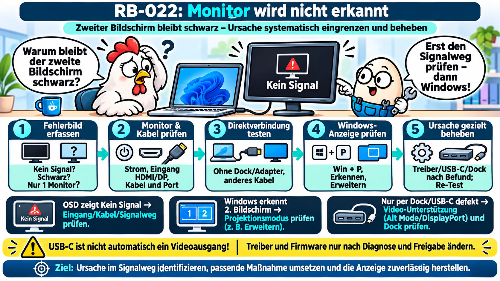

# RB-022 – Monitor wird nicht erkannt

**Projekt:** 50 Tickets – 50 typische Supportfälle  
**Kategorie:** Hardware / Windows 11 / Monitor und Signalweg  
**Support-Level:** L1 – mit klarer L2-Eskalationsgrenze bei Treibern, Firmware, BIOS/UEFI, zentral verwalteten Geräten und Hardwaredefekten  
**Version:** 1.0 · **Recherche:** 22.11.2026  
**Status:** Anhand von Microsoft- und Dell-Herstellerquellen recherchiert; **noch nicht praktisch validiert**. Alle Musterfälle sind fiktiv.



> **Leitgedanke:** Ein schwarzer Monitor, die Meldung „Kein Signal“ und ein von Windows nicht erkannter Monitor sind **unterschiedliche Befunde**. Erst unterscheiden, **wo** die Signalkette unterbrochen ist; dann genau dort prüfen. Ein Austausch von Kabeln, die Änderung des Projektionsmodus oder eine Treiberaktualisierung ohne Befund ist keine systematische Diagnose.

## 1. Das Supportticket und die Zielsetzung

**INC-022 – fiktive Meldung:** „Seit heute Morgen bleibt mein zweiter Bildschirm schwarz. Gestern hat er am Notebook noch funktioniert. Auf dem Monitor steht ‚Kein Signal‘. Ich arbeite mit Windows 11 und gelegentlich an einer Dockingstation.“

**Auftrag:** Einen zweiten Bildschirm am vorhandenen Arbeitsgerät wieder betriebsbereit machen, ohne unnötige Eingriffe in Treiber, Firmware oder Geräteverwaltung. Die **tatsächlich nachgewiesene Ursache** und den **erfolgreichen End-to-End-Test** dokumentieren.

### Unmittelbare Fragen beim Erstkontakt

- Ist der betroffene Monitor **ausgeschaltet**, zeigt er sein **Bildschirmmenü (OSD)** oder meldet er **„Kein Signal“**? Ist die Bildschirmbeleuchtung an?
- Zeigt Windows unter **Einstellungen → System → Anzeige** ein Rechteck für den zweiten Bildschirm? Mit welcher Nummer? Oder taucht er dort überhaupt nicht auf?
- Gibt es **kein Bild**, ein **flackerndes Bild**, eine „Out of range“-Meldung oder nur einen nicht erweiterten Desktop?
- Gerätetyp: Notebook/PC, Windows-Version, Monitormodell, genutzter **HDMI-/DisplayPort-/USB-C-/Thunderbolt**-Weg, Adapter, Dock oder Monitor-Daisy-Chain?
- Betrifft es **nur einen Monitor**, beide externen Monitore oder auch das integrierte Notebookdisplay? Seit wann? Nach Umstecken, Update, Sleep/Wakeup, Schreibtischwechsel?
- Ist ein Ersatzkabel, anderer freigegebener Anschluss oder bekanntermaßen funktionierender Monitor zur **kontrollierten Gegenprobe** verfügbar?
- Ist eine kurzfristige Ausweichlösung für einen zeitkritischen Termin nötig? Änderungen und Testunterbrechungen abstimmen.

**Abgrenzung:** RB-022 behandelt den Monitor und den Videopfad als Supportfall. Wenn zusätzlich USB, Netzwerk und Stromversorgung **über die Dockingstation** ausfallen, auf **RB-023 – Dockingstation funktioniert nicht** erweitern. Ein völlig nicht startender PC gehört eher zu RB-025/026.

## 2. Grundlagen: Vom Grafikchip zum sichtbaren Bild

Die Anzeige ist eine **Abhängigkeitskette**:

1. **Grafikausgabe des PCs:** Grafikadapter, Treiber, aktiver Videoausgang und unterstützte Anzeigeanzahl.
2. **Signalweg:** HDMI, DisplayPort, USB-C mit Video-Unterstützung, Adapter, ggf. Dock oder MST-Verkettung; Kabel und Stecker müssen elektrisch und logisch funktionieren.
3. **Monitor:** Stromversorgung, aktiver Eingang und Gerätestatus. Das interne Monitor-Menü kann noch funktionieren, obwohl kein PC-Signal anliegt.
4. **Aushandlung/Erkennung:** Monitor und Rechner tauschen Anzeigeninformationen und Verbindungssignale aus (vereinfacht: EDID/Hot-Plug-Detection). Ein gestörter Handshake kann die Erkennung verhindern.
5. **Windows-Anzeigeverwaltung:** Erkennung, Anzeigeaktivierung, Projektionsmodus und bei sichtbarem Gerät passende Auflösung und Aktualisierungsrate.

**Wichtig:** „Monitor ist im Geräte-Manager vorhanden“ ist noch kein Beweis für ein sichtbares Bild. Umgekehrt kann „Kein Signal“ nur den **aktuell gewählten Monitoreingang** beschreiben und nicht zwingend einen Windows-Treiberdefekt.

### Begriffe auf einen Blick

| Begriff | Bedeutung | Typischer Diagnosebezug |
|---|---|---|
| OSD | On-Screen-Display, Monitormenü | Belegt Bedienbarkeit des Monitors, nicht funktionierendes PC-Videosignal |
| HDMI / DP | Digitaler Videoanschluss / DisplayPort | Richtiger Port, korrekte Signalquelle, Kabeltest |
| USB-C | Steckerform und Schnittstellenfamilie | **USB-C allein garantiert keinen Videoausgang** |
| DP Alt Mode | DisplayPort-Signal über USB-C | Muss vom betreffenden PC-Port und Zubehör unterstützt werden |
| Thunderbolt | Multifunktionsschnittstelle (modellabhängig) | Unterstützte Anzeigewege/Kabel/Modi laut Gerätespezifikation prüfen |
| DisplayLink | USB-basierte Grafiklösung mit Softwaretreiber | Bei bestimmten Universal-Docks relevant, nicht mit DP Alt Mode verwechseln |
| MST | Multi-Stream Transport | Mehrere getrennte Videostreams über geeigneten DP-Pfad |
| EDID | Extended Display Identification Data | Der Monitor teilt unterstützte Anzeigemodi mit; Fehler sind nicht allein daraus beweisbar |
| PnP | Plug and Play | Windows-Gerätestatus als **Indiz**, nicht als vollständiger Videotest |
| GPU | Graphics Processing Unit | Grafikadapter/Grafiktreiber |
| L1 / L2 | First-/Second-Level-Support | L1: Sichtprüfung und reversible Tests; L2: tiefe Eingriffe nach Freigabe |

**Henne-Ei-Merksatz:** Bevor Windows ein Bild auf dem zweiten Monitor anzeigen kann, muss überhaupt ein **kompatibler, durchgängiger Videopfad** vorhanden sein. Eine Windows-Einstellung repariert kein ungeeignetes USB-C-Portprofil oder defektes Kabel.

## 3. Fehlerbilder statt vorschneller Ursachenfestlegung

| Beobachtetes Symptom | Plausible Hypothesen | Aussagekräftige Gegenprobe |
|---|---|---|
| Monitor völlig aus, kein OSD | Stromversorgung, Netzteil, Steckdose, Gerätefehler | Strom, LED und OSD unabhängig vom PC prüfen |
| OSD funktioniert, „Kein Signal“ | Falscher Eingang, Kabel/Port, PC-Ausgabe, Adapter/Dock | Eingang kontrollieren; direkter Anschluss mit geeignetem Kabel |
| Windows zeigt **nur Monitor 1**, Monitor 2 fehlt | Erkennung/Signalweg, Dock/USB-C, GPU/Treiber | Direktanschluss und **Erkennen** in Anzeigeeinstellungen |
| Windows zeigt **1 und 2**, zweiter bleibt schwarz | Projektionsmodus, deaktivierte Anzeige, Signalübertragung, inkompatibler Modus | `Win + P` und für Monitor 2 Anzeigeeinstellungen prüfen |
| Nur **Duplizieren**, kein unabhängiger Desktop | Windows-Modus oder Hardware-Splitter, der nur dupliziert | `Erweitern` wählen; tatsächlichen Verbindungsaufbau prüfen |
| Bildschirm nur **über Dock** ohne Bild | Dock-Typ, Portfähigkeit, Kabel, Grafikbandbreite, Docktreiber/Firmware | Derselbe Monitor am PC **direkt** mit geeigneter Schnittstelle testen |
| Nur der **dritte Monitor** fehlt | GPU-/Dock-/Bandbreiten- oder MST-Grenze | Ein externer Monitor, dann zwei, dann drei; Spezifikationen vergleichen |
| Funktion nach Update/Standby gestört | Anzeigeinitialisierung, Treiberversion, Dock/Monitor-Handshake | Zeitpunkt dokumentieren; reversible Reinitialisierung, anschließend freigegebene Treiberdiagnose |
| Bild erscheint, flackert oder zeigt „Out of range“ | Auflösung/Bildwiederholrate, Signalqualität, Bandbreite | Empfohlene Auflösung/unterstützte Frequenz testen (bei erkannter Anzeige) |

**Diagnostische Vorsicht:** Die Tabelle enthält **Hypothesen, keine Beweise**. „Seit dem Update“ ist eine zeitliche Korrelation, noch keine bestätigte Kausalität.

## 4. Wo wird geprüft – und mit welchen Rechten?

**Am Arbeitsplatz des Benutzers (L1):** Monitor-LED/OSD, Stromversorgung, Input-Taste, Kabel/Steckverbindungen, nur freigegebene andere Ports/Kabel und gegebenenfalls Direktanschluss. Nach Freigabe des Benutzers Windows-Anzeigeeinstellungen prüfen. Nicht ungefragt den Arbeitsplatz abstecken oder einen laufenden Bildschirminhalt unterbrechen.

**Am Windows-Client (L1):** `Win + P`, `Einstellungen → System → Anzeige`, „Mehrere Bildschirme → Erkennen“, Geräte-Manager und **lesende** PowerShell-Befehle. Sichtprüfung nach dem Test mit dem Anwender. Ein gezielter Neustart nur nach Einverständnis und Sicherung offener Arbeit.

**Bei L2 oder Client-/Endpoint-Team:** GPU-/Docktreiber zurücksetzen/aktualisieren, Gerätemanagement-/Sicherheitsrichtlinien untersuchen, Firmware oder BIOS/UEFI ändern und Hardware austauschen. Solche Schritte können administrative Rechte, Downtime und genehmigte Prozesse erfordern.

**Nicht Teil einer sicheren Erstdiagnose:** Registry-/EDID-Manipulation, pauschale Treiberdeinstallation, Firmware-Flash, unkontrolliertes Entfernen „versteckter“ Monitore oder Sicherheits-/MDM-Richtlinien deaktivieren.

## 5. Diagnose-Entscheidungsbaum – Überblick


**Leseregel:** Eine Entscheidung wird mit einem beobachtbaren Test beantwortet. Danach nur dem entsprechenden Pfad folgen.

1. **Monitor mit eigenem OSD erreichbar?** Nein: zunächst Strom/Monitor-Hardware. Ja: Signalquelle und Videopfad untersuchen.
2. **Bekanntermaßen geeignete Direktverbindung liefert ein Bild?** Ja: Zwischenkomponenten (Dock/Adapter/Port/Kabel) eingrenzen. Nein: Windows/GPU/Monitor mit Gegengerät weiter differenzieren.
3. **Windows erkennt eine zweite Anzeige?** Ja: `Win + P` und Aktivierung prüfen. Nein: `Erkennen`, Kabel/Port und lesende PnP-Diagnose; ggf. L2.
4. **Funktioniert der betroffene Monitor an einem anderen freigegebenen Gerät bzw. anderes Display am PC?** A/B-Test begrenzt Monitordefekt gegen PC-Ausgang; keine Einzelbeobachtung ist allein immer eindeutig.
5. **Nach gezielter Korrektur:** Erkennung, sichtbares Bild, Erweiterung, Auflösung und Stabilität mit dem Benutzer prüfen.

## 6. Diagnose A – Strom, OSD, Eingang, Kabel und Port (L1)

**Vor Änderung:** Foto/Beschreibung des bestehenden Anschlusswegs und des Fehlers erfassen, damit später der gleiche Sollzustand wiederhergestellt werden kann.

1. Monitor-Led, Stromversorgung und wenn möglich **Monitormenü über dessen eigene Taste** prüfen. Reagiert das OSD? Wenn nicht: Netzanschluss und Hardware nach Arbeitssicherheits- und Betriebsregeln prüfen; keine Netzteilöffnung.
2. Am Monitor den **tatsächlich angeschlossenen Eingang** auswählen: etwa `HDMI 1`, `HDMI 2`, `DisplayPort` oder `USB-C`. Auto-Select ist nicht immer zuverlässig.
3. Kabel an **beiden Enden** auf festen Sitz und sichtbare Schäden kontrollieren. Beschädigte Kabel nicht weiter betreiben.
4. Falls vorhanden: **ein** bekannt funktionsfähiges, technisch geeignetes Kabel testen. Bei DisplayPort Verriegelung vor dem Abziehen lösen; Stecker nicht mit Gewalt einstecken.
5. Einen anderen kompatiblen Videoausgang oder Eingang als **kontrollierten** Vergleich nutzen; am Desktop-PC darauf achten, ob der Anschluss an der dedizierten GPU oder am Mainboard liegt. Ein Mainboard-Ausgang kann modell- bzw. konfigurationsbedingt deaktiviert sein.
6. Befunde notieren: Monitor-OSD ja/nein, gewählter Eingang, Kabel/Port alt/neu, Anzeigeverhalten nach **jedem** Test.

**Interpretation:** Ein leuchtender Monitor mit OSD und „Kein Signal“ beweist nur, dass kein **nutzbares Signal an diesem gewählten Eingang angezeigt wird**. Es beweist weder einen kaputten Monitor noch einen kaputten Grafiktreiber.

## 7. Diagnose B – A/B-Test: Direktverbindung statt Fehlerkette (L1)

Bei Dock, KVM, USB-C-Adapter oder HDMI-Umsetzer gibt es mehrere Glieder. **Isoliere sie.**

- Test 1: **Monitor A – Kabel A – PC-Port A** (bisheriger Aufbau): Fehler reproduzieren.
- Test 2: **Monitor A – geeignetes Kabel B – gleicher PC-Port A**: Ändert sich das Verhalten? → Kabel als Variable.
- Test 3: **Monitor A – passender PC-Port B** oder **Monitor B – Kabel A – Port A**: Nur wenn die Alternativen elektrisch/technisch kompatibel sind; sonst ist der Vergleich wertlos.
- Test 4: Bei Dockfehler: **Monitor A direkt am kompatiblen PC-Videoausgang** (ohne Dock/Adapter), möglichst mit derselben Auflösung und Anzeigeart.

| Befund | Aussage | Nicht vorschnell schließen |
|---|---|---|
| Mit Ersatzkabel funktioniert es | Ursprüngliches Kabel oder dessen Kontaktweg verdächtig | Nicht jeder Monitorfehler ist damit erklärt |
| Direkt funktioniert, über Dock nicht | Dock-/Adapter-/Hostport-Zweig ist verdächtig | Dock ist nicht zwingend kaputt; kann inkompatibel konfiguriert sein |
| Monitor A an zweitem PC ebenfalls ohne Bild, Monitor B am ersten PC ok | Monitor A oder seine Eingangs-/Kabelkombination verdächtig | Unterschiedliche Auflösungs-/Portfähigkeiten mitdenken |
| Monitor B ebenfalls am PC ohne Signal | PC-Ausgang, Modus oder gemeinsame Verbindung verdächtig | Noch kein eindeutiger GPU-Defekt |

**Ein-Test-eine-Variable-Prinzip:** Wenn gleichzeitig Kabel, Dock, Eingang und Treiber geändert werden, verliert das Ergebnis seinen diagnostischen Wert.

## 8. Diagnose C – Windows 11: erkannt, aktiviert oder tatsächlich nicht gefunden? (L1)

### 8.1 Projektionsmodus kontrollieren

1. Auf dem funktionsfähigen Display **`Windows + P`** drücken.
2. Die gewünschte Betriebsart wählen: **Duplizieren** (gleiches Bild) oder **Erweitern** (getrennte Desktopfläche). „Nur PC-Bildschirm“ deaktiviert die externe Darstellung und kann einen vermeintlichen Defekt vortäuschen.
3. Wenn sichtbar: Anzeige wirklich erweitern; Fenster/Maus über Bildschirmgrenze bewegen. Dass Windows nur einen Desktop auf beiden Anzeigen zeigt, kann ein **gewolltes Duplizieren** sein.

### 8.2 Anzeige in Windows erkennen

1. **Einstellungen → System → Anzeige** öffnen (alternativ Desktop-Rechtsklick → Anzeigeeinstellungen).
2. Wenn zwei Monitorrechtecke sichtbar: **Identifizieren**, die Zuordnung und den aktuellen Projektionsmodus kontrollieren. Falls nötig die zweite Anzeige wieder aktivieren.
3. Wenn die externe Anzeige **nicht** aufgeführt ist: unter **Mehrere Bildschirme → Erkennen** suchen lassen.
4. Dokumentieren: Gibt es ein zweites Rechteck? Ein OSD-Bild? Wurde durch `Erkennen` etwas neu hinzugefügt? Das sind unterschiedliche Beobachtungen.

**Grenze:** „Erkennen“ repariert keine unterbrochene Hardwareverbindung. Wenn Windows keinen zweiten Bildschirm findet, geht die Diagnose **zurück zum Signalweg** und gegebenenfalls zu PnP/Treiber, nicht direkt zu einer Treiberdeinstallation.

### 8.3 Wenn der Monitor sichtbar, aber das Bild unbrauchbar ist

Bei erkanntem Gerät, „Out of range“, Flackern oder unbrauchbarer Darstellung nach Hardware-/Herstellerprüfung **unterstützte** Auflösung und Frequenz testen: **Einstellungen → System → Anzeige → [Monitor] → Erweiterte Anzeige**. Vor Änderungen den Ausgangswert dokumentieren; kein blindes Übertakten von Frequenzen.

### 8.4 Reinitialisierung bei plötzlich ausgefallenem bestehenden Setup

Microsoft nennt **`Windows + Strg + Umschalt + B`** zur Reinitialisierung des Grafiktreibers in bestimmten Fällen. Möglich sind ein kurzes Flackern oder ein Signalton. Das ist **kein Beweis** für eine Treiberursache. Erst nach Rücksprache einsetzen und den Erfolg mit derselben Verbindung kontrollieren. Ein geplanter Neustart kann ebenfalls helfen; offene Arbeit vorher sichern.

## 9. Diagnose D – Lesende PowerShell- und Geräte-Manager-Prüfung (L1/L2)

**Ausführungsort:** Windows 11, Windows PowerShell auf dem betroffenen PC. Die folgenden Kommandos **lesen nur**; sie ändern keine Treiber- oder Monitoreinstellungen.

### 9.1 Aktuell vorhandene Monitor-Geräteklassen

```powershell
# Listet momentan als vorhanden gemeldete PnP-Monitore.
# Der Status ist ein Indiz, KEIN Beweis für ein sichtbares Bild.
Get-PnpDevice -Class Monitor -PresentOnly |
    Select-Object Status, Class, FriendlyName, InstanceId |
    Format-Table -AutoSize
```

**Interpretation:** Ein Gerät mit `Status = OK` muss nicht das gerade erwartete Display sein; die Anzeige kann trotzdem ausgeschaltet oder über den falschen Eingang verbunden sein. Die Ausgabe eignet sich zum **Vergleich vor/nach einem physikalischen Test**.

### 9.2 Grafikadapterstatus anzeigen

```powershell
# Windows-PnP-Grafikadapter als derzeit vorhandene Geräte lesen.
# Auf manchen Systemen gibt es integrierte und dedizierte Adapter.
Get-PnpDevice -Class Display -PresentOnly |
    Select-Object Status, FriendlyName, InstanceId |
    Format-Table -AutoSize

# Bei Bedarf geräteübergreifend nach der Klasse filtern:
Get-PnpDevice -PresentOnly |
    Where-Object { $_.Class -in @('Monitor', 'Display') } |
    Select-Object Class, Status, FriendlyName |
    Sort-Object Class, FriendlyName
```

**Interpretation:** Der GPU-Gerätestatus grenzt Treiber-/Initialisierungsprobleme ein, beweist aber weder Portfunktion noch eine funktionierende HDMI-/DisplayPort-Leitung.

### 9.3 Grafikkartendetails lesend ermitteln

```powershell
# Liest vom System gemeldete Grafikadapterinformationen über CIM/WMI.
# Vorher/Nachher auf demselben Gerät vergleichen.
Get-CimInstance -ClassName Win32_VideoController |
    Select-Object Name, DriverVersion, VideoModeDescription
```

**Interpretation:** Fehlende oder unplausible Werte sind kein alleiniger Ausfallbeweis; Werte können je nach Treibermodell/Adaptertyp variieren. Den **Treiberstand** stets mit Herstellerangaben und dem verwalteten Softwarestandard abgleichen.

### 9.4 Geräte-Manager als Ergänzung

- **Geräte-Manager → Monitore** sowie **Grafikkarten** öffnen.
- Fehlersymbole, Fehlercodes, installierte Grafikadapter und ggf. Eigenschaften → Treiber notieren.
- Bei nicht angeschlossenen Monitoren können gespeicherte Geräteeinträge vorhanden sein. **Nicht ohne Anlass „ausgeblendete Geräte“ löschen**.

**Datenschutz:** Seriennummern/`InstanceId`, Rechnernamen und Screenshots nur in zulässigem Umfang ins Ticketsystem übernehmen, nicht in öffentlich zugängliche Lernbeispiele.

## 10. Diagnose E – Treiber, Windows-Update und plötzliche Änderungen (L1 → L2)

Wenn Verbindung, Eingang und Anzeigeeinstellungen plausibel sind, kann der Grafiktreiber-/Initialisierungszweig relevant werden.

1. Prüfen, **ob der Fehler zeitlich nach einem konkreten Windows-, GPU- oder Dock-Update** entstand. Kein „Update war gestern, also ist es schuld“-Fehlschluss.
2. Einmalige Reinitialisierung mit **`Windows + Strg + Umschalt + B`** oder geplanter Neustart als reversibler Test nach Absprache.
3. **Geräte-Manager → Grafikkarten → Eigenschaften → Treiber**: Modell, Version, Datum, Fehlercode dokumentieren.
4. Erst bei geeignetem Befund: **Treiber-Rollback, freigegebene Herstelleraktualisierung oder Neuinstallation** durch L2/Endpoint-Team nach Unternehmensprozess. Microsoft dokumentiert diese Wege, aber sie sind **keine automatischen L1-Sofortmaßnahmen**.
5. Nach jedem Eingriff ursprünglichen Bildaufbau reproduzieren und mehrere Anzeigewechsel testen.

**Warnung:** Ein Treiberwechsel kann lokal oder remote die Anzeige temporär unterbrechen; bei nur einem funktionierenden Display oder Fernwartung besonders vorsichtig sein. Keine beliebigen „Driver Updater“ aus dem Internet installieren.

## 11. Diagnose F – USB-C, Dock, DisplayLink, MST und dritte Monitore (L1 → L2)

Diese Fälle verdienen einen eigenen Entscheidungszweig, weil **passende Stecker noch keine passenden Protokolle garantieren**.

### USB-C: Daten, Strom und Video sind verschiedene Eigenschaften

Ein USB-C-Port kann beispielsweise Daten und Ladeleistung bereitstellen, ohne **DisplayPort Alt Mode** oder den benötigten Videoausgang zu unterstützen. Dell nennt solche Fehlkonfigurationen ausdrücklich. Ebenso muss das **Kabel/der Adapter** für den jeweiligen Videopfad geeignet sein.

**Prüfung:** Exakte Hersteller-/Modellangaben von Notebook, Hostport, Kabel und Monitor nachlesen. Nicht von der Steckerform auf die Fähigkeit schließen. Ein bereits funktionierender USB-Stick am Port ist **kein Videofunktionstest**.

### Dockingstation: Typ klären

- **Native DP-/Thunderbolt-Docks:** Anforderungen an Hostport, Protokoll, Dock und Bandbreite unterscheiden sich je nach Modell.
- **Universal-Docks mit DisplayLink:** Bildausgabe kann einen **spezifischen DisplayLink-Treiber** benötigen. Dell nennt die Modelle D6000/D6000S/UD22 als Beispiele; diese Aussage ist **nicht auf alle Docks übertragbar**.
- **Firmware/BIOS/Treiber:** Nur nach Herstellerleitfaden und Freigabe; zunächst die direkte PC-Verbindung testen. Ein Dock kann ohne Defekt inkompatibel oder falsch initialisiert sein.

### Mehrere Displays, MST und Splitter

- **DP-MST/Daisy-Chain** funktioniert nur mit unterstützten DP-/USB-C-/Thunderbolt-Konstellationen und konfigurierten Monitoren; bei mehreren Geräten die dokumentierte unterstützte Kombination prüfen.
- Ein einfacher **HDMI-Splitter** zeigt typischerweise dasselbe Signal auf mehreren Displays und stellt **keine unabhängige Windows-Erweiterung** bereit.
- Die Anzahl gleichzeitig nutzbarer Bildschirme hängt unter anderem von **GPU, Dock, Portbandbreite, Auflösung und Bildrate** ab. Dass ein einzelner Monitor funktioniert, beweist nicht, dass drei hochauflösende Displays unterstützt sind.

**Hinweis auf das Folgeticket:** Wenn Tastatur, Netzwerk und Monitor **gemeinsam** über dieselbe Dockingstation ausfallen, ist RB-023 das passendere Hauptproblem.

## 12. Von der Diagnose zur gezielten Behebung

| Nachgewiesener oder gut isolierter Befund | Zulässige, zielgerichtete Maßnahme | Kontrolle |
|---|---|---|
| Monitor ohne Strom/OSD | Stromanschluss bzw. freigegebenes Ersatzgerät prüfen | OSD und Bild nach Verbindung |
| Falscher aktiver Eingang | Korrekten OSD-Eingang auswählen | PC-Bild sichtbar, Windows erkennt Display |
| Kabel als Ursache durch A/B-Test isoliert | Kabel durch geeignetes freigegebenes ersetzen | Kalt-/Warmstart bzw. Reconnect prüfen |
| Windows zeigt 2 Monitore, externer ist deaktiviert | `Win + P` → **Erweitern** oder gewünschte Betriebsart | Fenster zwischen den Monitoren verschieben |
| Gerät nach Direktanschluss erkannt, über Dock nicht | Dock-/Adapter-/Hostport-Zweig untersuchen; ggf. RB-023 | Beide Wege protokollieren, keine vorschnelle Dock-Defektdiagnose |
| USB-C-Port ohne Videounterstützung | Unterstützten Videoausgang und passendes Kabel/Adapter verwenden | Gleiches Display über geeigneten Weg testen |
| Auflösung/Frequenz nicht unterstützt | Nur dokumentierte unterstützte Werte verwenden | Stabiles Bild und gewünschte Auflösung |
| Konkretes GPU-/Docktreiberproblem | L2: genehmigter Rollback oder Hersteller-/Endpoint-Update | Nach Reboot/Dockwechsel erneut prüfen |
| Verdacht auf defekten Videoport/Monitor | Gezielter Ersatz-/Kreuztausch, dann Hardwareeskalation | Gegenprobe an kompatiblen Geräten |

**Nicht tun:** Wild Treiber löschen, EDID-Dateien überschreiben, Registry-Patches aus Foren übernehmen, Herstellerfirmware ohne Freigabe flashen, den Nutzer pauschal auf einen Monitor festlegen.

## 13. Funktionsprüfung, Ticketabschluss und L2-Übergabe

### Abnahmekriterien – gemeinsam mit der betroffenen Person

- [ ] Das **gewünschte** externe Display zeigt Bild am vorgesehenen Eingang; kein „Kein Signal“.
- [ ] Windows erkennt die vorgesehenen Anzeigen; **Identifizieren** ordnet die Geräte korrekt zu.
- [ ] Der vereinbarte Modus funktioniert: **Erweitern** oder ausdrücklich gewünschtes Duplizieren.
- [ ] Anwendungen können zwischen Anzeigen verschoben werden; Auflösung und Frequenz liegen im unterstützten Bereich.
- [ ] Nach einer erneuten Verbindung (bei Dock/Hotplug) funktioniert die Ausgabe weiterhin; bei Bedarf Sleep/Wakeup nur nach Abstimmung testen.
- [ ] Ursache und veränderte Komponente **konkret** dokumentiert, plus Restunsicherheit und Nutzerbestätigung.

### Eskalationsgrenzen

L2/Endpoint/Hardware-Support einbinden, wenn ein **reproduzierbares Problem** trotz geeigneter Kabel-/Port-/Monitor-Gegenprobe besteht, USB-C-/MST-Kompatibilität unklar ist, mehrere Arbeitsplätze gleichzeitig ausfallen, ein Treiber-/Firmware-/BIOS-Eingriff nötig scheint oder die gemeinsame Dockfunktion gestört ist.

**Minimaler L2-Datensatz:** Windows-Build; Gerätetyp, GPU und ggf. Dockmodell; Monitor- und Portmodell; Anschlusskette; OSD-Text; `Win + P`-Modus; Anzahl Windows-Anzeigen; ursprünglicher vs. geänderter Kabel-/Portweg; Ergebnisse der A/B-Tests; Treiberstand; seit wann; freigegebene Maßnahmen samt Wirkung; Priorität und Nutzererreichbarkeit.

### Ticketabschluss – fiktive Formulierung

> **INC-022 (Schulungsbeispiel):** Notebookdisplay funktionsfähig, externer Monitor meldete „Kein Signal“. Windows zeigte nur eine Anzeige. Am Monitor war HDMI 2 gewählt, das Kabel steckte an HDMI 1. Nach Auswahl von HDMI 1 zeigte der Monitor Bild; Windows erkannte das Gerät. Mit `Win + P → Erweitern` die gewünschte Desktop-Erweiterung eingestellt und mit dem Benutzer geprüft. Ursache: falscher Monitoreingang. Keine Treiber-/Firmwareänderung. **Fiktiv, nicht praktisch durchgeführt.**

## 14. Zwei Musterfälle und Lernkontrolle

### 14.1 Fall A – „Monitor defekt?“ (fiktiv, mit Auflösung)

**Meldung:** Zweiter Bildschirm meldet „No Signal“, OSD reagiert; Notebookdisplay funktioniert. Windows zeigt eine Anzeige. Der Mitarbeiter hat den Arbeitsplatz am Morgen umgebaut.

**Hypothesen:** Eingang falsch, Stecker lose, Kabel inkompatibel oder defekt, Port nicht aktiv, GPU-/Windows-Problem.

**Kontrollierter Test:** Aktiven Monitoreingang mit tatsächlich verwendeter Buchse abgleichen. Bei Abweichung **nur** den Eingang korrigieren und Windows erneut prüfen.

**Fiktiver Befund:** HDMI 2 eingestellt, Kabel an HDMI 1. Nach OSD-Änderung Bild vorhanden und Anzeige erkannt. **Abschlussgrund:** Falsche Signalquelle, keine pauschale Treiberursache.

### 14.2 Fall B – „USB-C passt doch!“ (fiktiv, mit Auflösung)

**Meldung:** Neuer externer USB-C-Monitor erhält Strom; Bild bleibt schwarz. Notebook-Port nimmt USB-C-Sticks problemlos an. Windows findet keine zweite Anzeige.

**Hypothesen:** Hostport ohne Video, ungeeignetes Kabel, falscher Monitoreingang, nicht kompatibler Monitor, Defekt.

**Kontrollierter Test:** Die **konkrete Notebook-Port-Spezifikation** und Monitor-Dokumentation vergleichen; zugelassenen HDMI-/DP-Alternativpfad mit einem geeigneten Kabel nutzen.

**Fiktiver Befund:** Der benutzte USB-C-Port bietet nur Daten, nicht die erforderliche DisplayPort-Alt-Mode-Funktion. Über den geeigneten Videoausgang Bild vorhanden. **Abschlussgrund:** Schnittstellenfähigkeit fehlte. Eine Treiberneuinstallation wäre hier keine Lösung.

### 14.3 Transferaufgabe – erst selbst eine Diagnosehypothese bilden

**Neuer Fall ohne vorweggenommene Lösung:** Ein Notebook erkennt den zweiten Monitor **direkt per HDMI**, aber über eine USB-C-Dockingstation bleibt er schwarz. Die angeschlossene Maus an derselben Dock funktioniert. Bei zwei externen Monitoren bleibt zudem manchmal nur einer aktiv. Seit einem Umbau des Arbeitsplatzes ist die Störung reproduzierbar.

**Deine Aufgabe (ohne Hilfestellung):** Formuliere **drei** voneinander unabhängige Hypothesen. Nenne für jede **einen Test, der sie widerlegen kann**, und priorisiere die Tests nach Risiko und Informationsgewinn. Erkläre anschließend in einer professionellen **Drei-Satz-Ticketnotiz**, was schon bewiesen ist, was offen bleibt und was als Nächstes geprüft wird.

### 14.4 Active Recall – ohne den Artikel nachzulesen

1. Was beweist ein funktionierendes Monitormenü trotz „Kein Signal“ – und was **nicht**?
2. Worin unterscheiden sich Windows **Identifizieren** und **Erkennen**?
3. Warum kann ein Gerät per USB-C **laden**, aber kein Bild liefern?
4. Welchen Nachweis liefert ein Direktanschluss mit Bild, wenn die Dock-Verbindung fehlschlägt?
5. Warum ist ein `Get-PnpDevice`-Status `OK` kein End-to-End-Nachweis?
6. In welchem Fall ist `Win + P` zielführender als ein Grafiktreiber-Rollback?
7. Warum lösen einfache HDMI-Splitter kein echtes Dual-Monitor-Erweitern?
8. Welche Beobachtungen müssen vor einer L2-Übergabe zwingend dokumentiert werden?

**Lernprinzip:** Die Lösung nicht nur lesen, sondern den **nächsten Test aus dem aktuellen Befund** ableiten. Nach ungefähr 7 und 21 Tagen dieselben Diagnoseregeln an veränderten Szenarien abrufen.

### 14.5 Optionale Anki-Kandidaten – noch **keine** Importdatei

| Kartentyp | Vorderseite | Knappe Rückseite |
|---|---|---|
| Wissen | Wofür steht OSD? | Monitoreigenes Bildschirmmenü. |
| Wissen | Was bedeutet DP Alt Mode? | DisplayPort-Videosignal über geeignete USB-C-Verbindung. |
| Verständnis | Warum beweist „USB-C lädt“ keinen Videoausgang? | Laden/Daten und Video sind getrennte Anschlussfähigkeiten. |
| Verständnis | Warum erst einen Monitor direkt testen? | Dock/Adapter als Fehlerkomponente isolieren. |
| Diagnose | OSD „Kein Signal“, Windows 1 Anzeige: erster lokaler Prüfschritt? | Eingang und physische Signalkette prüfen. |
| Diagnose | Windows zeigt zwei Anzeigen, zweite schwarz: welche Erstprüfung? | Projektionsmodus/Aktivierung mit `Win + P`. |
| Diagnose | Direkt HDMI ok, Dock USB-C ohne Bild: nächste Hypothesen? | Portfähigkeit, Docktyp/Adapter, Bandbreite, Treiber. |

## 15. Herstellerquellen, Methodik und Transparenz

**Offizielle Dokumentation (abgerufen/recherchiert am 22.11.2026):**

1. [Microsoft Support – Problembehandlung bei Verbindungen von externen Monitoren in Windows](https://support.microsoft.com/de-de/windows/hardware/display-graphics/troubleshoot-external-monitor-connections-in-windows) – Kabel, Ausgänge, Grafiktreiber, `Win + Strg + Umschalt + B`, mehrere Monitore.
2. [Microsoft Support – So verwenden Sie mehrere Monitore in Windows](https://support.microsoft.com/de-de/windows/hardware/display-graphics/how-to-use-multiple-monitors-in-windows) – **Erkennen/Identifizieren**, `Win + P`, Erweitern/Duplizieren.
3. [Microsoft Support – Beheben von USB-C-Problemen in Windows](https://support.microsoft.com/de-de/windows/hardware/usb/fix-usb-c-problems-in-windows) – Video über DisplayPort-Alt-Mode und unterstützte Geräte/Kabel.
4. [Microsoft Learn – Get-PnpDevice](https://learn.microsoft.com/en-us/powershell/module/pnpdevice/get-pnpdevice?view=windowsserver2025-ps) – Lesende Abfrage von PnP-Geräten.
5. [Microsoft Learn – Win32_DesktopMonitor](https://learn.microsoft.com/en-us/windows/win32/cimwin32prov/win32-desktopmonitor) – Grenzen bestimmter WMI-Anzeigeninformationen.
6. [Dell – HDMI Ports: Complete Guide](https://www.dell.com/support/kbdoc/de-de/000139468/hdmi-anschl%C3%BCsse-an-dell-ger%C3%A4ten-vollst%C3%A4ndiger-leitfaden) – praktische Anschluss-, Kabel- und Monitortests (herstellerspezifisch).
7. [Dell – USB-C monitor displays no video](https://www.dell.com/support/kbdoc/en-us/000326500/dell-monitor-usb-c-port-displays-no-video) – DP Alt Mode/Thunderbolt als Voraussetzung bestimmter USB-C-Monitore; **modellgebundene Aussage**.
8. [Dell – Guide to Dell Docking Stations](https://www.dell.com/support/kbdoc/en-us/000124295/guide-to-dell-docking-stations) – Dock-Erkennung, Eingangsquelle, DisplayLink bei ausgewählten Geräten und Firmware-/Treiberpfad.
9. [Dell – How to Daisy Chain Monitors](https://www.dell.com/support/contents/en-us/article/product-support/self-support-knowledgebase/monitor-screen-video/guide-daisy-chain-monitors) – MST-/DP-/USB-C-Grenzen und fehlende HDMI-Daisy-Chain-Funktion.
10. [Microsoft Support – Auflösung und Layout ändern](https://support.microsoft.com/de-de/windows/hardware/display-graphics/change-your-screen-resolution-and-layout-in-windows) – Bildschirmauflösung bei erkanntem Display.

### Methodik und Grenzen

- **Herstellerfakten** wurden aus Microsoft- und Dell-Supportdokumentation entnommen. Die Reihenfolge der L1-Diagnose, die A/B-Test-Tabelle und die Mustertickets sind **eigene didaktische Ableitungen**, keine wörtlichen Hersteller-Runbooks.
- **Keine praktische Validierung:** Kommandos sind auf dokumentierte Syntax und lesenden Charakter überprüft, **nicht** an einem realen betroffenen Windows-11-Arbeitsplatz in diesem Fall ausgeführt worden.
- Herstelleroberflächen, Gerätedetails und Richtlinien können abweichen. Vor produktiver Durchführung aktuelle interne Standards und Gerätespezifikationen heranziehen.
- **Bildkennzeichnung:** Eigene Konzeption, KI-gestützte Visualisierung mit ChatGPT. Die Grafik ist kein Produktscreenshot.
- **Nicht automatisiert veröffentlicht:** Dieses Paket ist zur späteren Prüfung, Laborvalidierung und manuellen Website-Einbindung vorbereitet.
