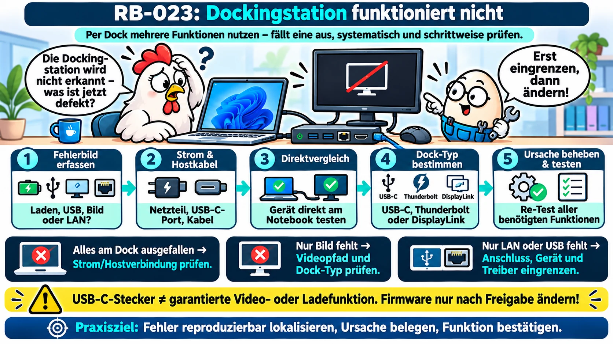

# RB-023 – Dockingstation funktioniert nicht

**Projekt:** 50 Tickets – 50 typische Supportfälle  
**Kategorie:** Hardware / Windows 11 / USB-C, Thunderbolt, USB4 und Dockingstationen  
**Support-Level:** L1/L2; L1 für symptomorientierte Eingrenzung und reversible Tests, L2 für Treiber-, Firmware-, Richtlinien- und Hardwareentscheidungen  
**Version:** 1.0 · **Recherche:** 22.11.2026  
**Status:** Mit offiziellen Quellen von Microsoft, Dell, Lenovo und DisplayLink recherchiert. **Keine praktische Validierung durchgeführt.** Fallbeispiele sind fiktiv.



> **Leitgedanke:** Eine Dockingstation ist keine einzelne Funktion, sondern ein Knotenpunkt für **Stromversorgung, USB-Daten, Video und gegebenenfalls Ethernet/Audio**. Funktioniert das Laden, beweist das **nicht**, dass die USB- oder Videoverbindung funktioniert. Umgekehrt kann eine nicht geladene Batterie mit funktionierenden USB-Geräten ein **separates Power-Delivery-Problem** bedeuten. Zuerst das Fehlerbild zerlegen – danach kontrolliert vergleichen.

## 1. Das Supportticket und das Ziel

**INC-023 – fiktive Meldung:** „Ich komme morgens ins Büro, verbinde mein Windows-11-Notebook wie immer per USB-C mit der Dockingstation. Der zweite Bildschirm bleibt aus, die Maus funktioniert nicht und über LAN komme ich auch nicht ins Netz. Das Notebook scheint aber noch zu laden.“

**Auftrag:** Die ausgefallenen Funktionen ohne Datenverlust und ohne unkontrollierte Treiber- oder Firmwareeingriffe wiederherstellen. Die betroffene Fehlerdomäne durch reproduzierbare Tests bestimmen und die Ursache sowie das Ergebnis benutzerbestätigt dokumentieren.

### Fragen beim Erstkontakt

1. **Was genau fällt aus?** Laden, USB-Maus/Tastatur, externe Anzeige(n), Ethernet, Headset oder alles gleichzeitig?
2. **Was funktioniert noch?** Die Ladestatus-Anzeige, die Dock-LED, eine USB-Maus, ein Monitor oder ein Netzwerkadapter?
3. **Seit wann?** Nach Gerätewechsel, Umstecken, Windows-Update, Standby, Docktausch oder Wechsel des Arbeitsplatzes?
4. **Welche Kombination?** Notebook- und Dockmodell, Netzteil, Hostkabel, Anschluss am Notebook, Bildschirmzahl, USB-Geräte, verwendete Netzwerkdose?
5. **Reproduzierbarkeit?** Immer oder sporadisch, bei Bewegung am Kabel, nach Standby oder erst unter mehreren angeschlossenen Monitoren?
6. **Betrieblicher Kontext?** Laufende Dateiübertragungen, verschlüsselte Datenträger, virtuelle Desktops, Meetings, eingeschränkte Ausfallzeit?

**Abgrenzung:** Bei isoliertem Videoausfall auf das Monitor-Runbook **RB-022** verweisen, bei isolierten Eingabegeräten auf **RB-024**. Bei Netzwerkproblemen trotz korrekt arbeitender Dock-Hardware in die Netzwerkdiagnose (z. B. RB-010) wechseln.

## 2. Grundlagen: Warum ein einzelner Stecker vier Probleme verbergen kann

Eine typische Dock-Verbindung enthält mehrere, technisch teilweise unabhängige Pfade:

| Pfad | Aufgabe | Typisches Symptom bei Störung |
|---|---|---|
| **Versorgung / USB Power Delivery (PD)** | Dock mit Netzteil versorgen und ggf. Notebook laden | Dock ohne LED oder Notebook lädt nicht / langsam |
| **USB-Daten / Hub** | USB-Geräte, Audio, manchmal Netzwerk intern anbinden | Maus, Tastatur, USB-Speicher oder Dock-LAN fehlen |
| **Video** | GPU-DisplayPort über geeigneten USB-C-/Thunderbolt-/USB4-Pfad oder USB-Grafik via DisplayLink | Externe Monitore ohne Bild bzw. nicht erkannt |
| **Ethernet** | Netzwerkcontroller im Dock mit RJ45-Anschluss | Ethernetadapter fehlt, Link ist down oder IP-Kommunikation gestört |

Vereinfacht: **Notebook ↔ Hostport/Kabel ↔ Dock ↔ jeweilige Funktion**. Die Dock-Funktion bestimmt, **welcher Teil** der Kette verwendet wird. Ein leuchtendes LED-Signal beweist nur den jeweils **modellabhängig** beschriebenen Status, nicht sämtliche Pfade. Eine USB-C-Buchse ist eine Steckerform; sie garantiert **weder eine bestimmte Videoauflösung noch Laden noch Thunderbolt-Kompatibilität**.

### Drei technologisch unterschiedliche Dock-Arten

**A. Klassische USB-C-Docks mit DisplayPort Alternate Mode (DP Alt Mode):** Video wird über einen vom Host unterstützten DisplayPort-Pfad übertragen. USB-Daten laufen daneben über USB. Voraussetzung sind passende Hostport-, Kabel- und Dock-Funktionen; maximale Zahl/Auflösung von Monitoren ist modell- und hostabhängig.

**B. Thunderbolt-/USB4-Docks:** Sie verwenden die vom jeweiligen Host und Zubehör unterstützten Protokolle und Tunnel. Ein äußerlich identischer USB-C-Stecker bedeutet nicht, dass ein beliebiger USB-C-Anschluss die erforderliche Hostfunktion bietet. USB4-Geräte und Funktionen können auf kompatiblen Windows-11-Systemen in den USB4-Einstellungen sichtbar sein; die Seite ist nicht auf jedem Gerät vorhanden.

**C. DisplayLink-basierte Universal-Docks:** Ein integrierter USB-Grafikchip stellt Bildausgänge über USB-Daten bereit; kompatible DisplayLink-Software kann nötig sein. Das ist **nicht** identisch mit einer direkten DisplayPort-Alt-Mode-Verbindung. Außerdem laufen nicht automatisch alle USB-Anschlüsse des Docks über den DisplayLink-Chip – die Dock-USB-Hub-Funktion ist getrennt zu diagnostizieren.

Quellen zur Einordnung: Microsoft „USB-C-Probleme“, „USB4-Einstellungen“; Dell „Guide to Dell Docking Stations“; DisplayLink „First Step Troubleshooting“ (Links in Kapitel 15).

## 3. Henne-und-Ei-Prinzip: Die Abhängigkeiten verstehen

Die typische Fehlannahme lautet: **„Das Notebook lädt – also kann die Dockingstation nicht defekt sein.“** Eine weitere: **„Windows erkennt keinen zweiten Bildschirm – also ist Windows defekt.“** Beide Schlussfolgerungen sind logisch unzulässig.

Ein Bild setzt beispielsweise voraus, dass (a) der konkrete Host-Ausgang und der Dock-Typ eine passende Grafikübertragung unterstützen, (b) die Verbindung und Aushandlung funktionieren, (c) der Monitor mit Strom, Kabel und Eingang arbeitet und (d) Windows einen passenden Anzeigemodus nutzt. Die USB-Maus braucht teilweise **andere** Voraussetzungen als der Videoausgang; die Notebook-Ladung wieder andere.

**Merksatz:** *Eine funktionierende Teilfunktion bestätigt keine andere Teilfunktion.* Statt der unspezifischen Aussage „Dock geht nicht“ wird aus jedem Symptom eine eigene Prüffrage. Die Kombination der Befunde reduziert die Zahl plausibler Ursachen.

## 4. Fehlerbild-Matrix und Hypothesen

| Beobachtung | Erste plausible Ursachen | Aussagekräftiger Test |
|---|---|---|
| **Alle Dockfunktionen fehlen**, Dock-LED aus | Netzteil, Steckdose, Dock-Elektronik; LED-Modellverhalten beachten | Originalnetzteil und Dockanzeige nach Handbuch, kontrollierte Neuverbindung |
| **Laden funktioniert, USB/Video/LAN fehlen** | Datenpfad Hostkabel/-port, Hub/Controller, Dockinitialisierung | USB-Gerät direkt am Notebook, Hostkabel/Port und Dockgegenprobe |
| **USB und LAN funktionieren, Monitore nicht** | Host-/Dock-Video-Protokoll, DisplayLink-Software, Monitoreingang, Bandbreite | Monitor direkt, Dock-Typ und unterstützte Displaywege überprüfen |
| **Bild funktioniert, USB fehlt** | Dock-USB-Hub/USB-Port, Gerät, Host-USB-Pfad | Dasselbe USB-Gerät direkt und an anderem Dockport testen |
| **Nur Ethernet fehlt** | Kabel, RJ45-Port, Dock-NIC, Switchport, IP/DHCP/DNS, Richtlinie | Dock-Adapter sichtbar? Link up? Kabel/Gegenport/IP prüfen |
| **Nur Notebook lädt nicht** | PD-Kompatibilität, Docknetzteil, Leistungsbedarf, Host-Port, Kabel | Ladeanzeige / Netzteil- und Leistungsdaten gegen Handbuch |
| **Dock nach Sleep/Resume unzuverlässig** | Neu-Aushandlung oder Energieverwaltung; Zusammenhang erst testen | Verhalten vor/nach Standby und kontrollierter Neuverbindung dokumentieren |
| **Nur der zweite/dritte externe Monitor fehlt** | Host-/Dock-Grafikgrenzen, Auflösung/Frequenz, MST/DisplayLink-Typ | Mit einem Monitor beginnen, Anzahl und Modus stufenweise erhöhen |
| **An anderem Notebook funktioniert alles** | Ursprünglicher Hostport, Treiber, Richtlinie, Kompatibilität | Testaufbau gleich halten; Geräte-/Versionsdaten vergleichen |
| **An zwei kompatiblen Notebooks reproduzierbar defekt** | Dock, Netzteil oder Kabel wahrscheinlicher | Bekannt funktionierendes, **kompatibles** Vergleichsdock/Kabel verwenden |

Die Hypothesen sind **keine Ursachenfeststellung**. Es gibt kein pauschales „Dock-Reset behebt alles“ und keinen universellen Firmwarefix.

## 5. Die zentrale Diagnosemethode: Kontrollierter A/B-Vergleich

**A/B-Test:** Man verändert **nur eine Komponente oder eine relevante Bedingung** und beobachtet den Effekt. Erst dadurch gewinnt der Test diagnostischen Wert.

1. **Ausgangsaufbau notieren:** Notebookmodell, Dockmodell, Originalnetzteil, Hostport und Hostkabel, externe Geräte, Fehlerstatus.
2. **Ein konkretes Funktionsmerkmal auswählen:** beispielsweise USB-Maus reagiert nicht; die Maus selbst darf nicht bereits unzuverlässig sein.
3. **Direkt am Notebook prüfen:** Maus (sofern geeigneter Port/Adapter vorhanden) oder Monitor an einem bekannten unterstützten Videoausgang anschließen; keine exotische Kette aus neuen Adaptern aufbauen.
4. **Wieder über die Dockingstation prüfen:** dasselbe Gerät und möglichst dasselbe Zubehör, mit kontrollierter Änderung des Signalwegs.
5. **Nur einen Faktor austauschen:** z. B. ein **für das Dock zertifiziertes** Hostkabel, einen freigegebenen alternativen Hostport oder eine kompatible Vergleichsdock.
6. **Befund protokollieren:** Direkt funktioniert / Dock funktioniert nicht / anderes Hostkabel funktioniert – das ist stärker als „Treiber vielleicht kaputt“.

**Vorsicht beim Direktvergleich:** Ein DisplayPort-Monitor lässt sich nicht allein durch beliebiges USB-C-Kabel direkt testen. Ein Desktop-PC oder Notebook-Port muss die erforderliche Video-Funktion unterstützen. Sonst wäre ein fehlgeschlagener Test nicht aussagekräftig.

### Vier kurze Testbeispiele

- **USB-Maus direkt funktioniert, über zwei Dock-USB-Ports nicht:** USB-Hub-/Hostpfad am Dock wahrscheinlicher; kein Beweis für Dock-Hardwaredefekt.
- **Monitor direkt funktioniert, USB und LAN am Dock funktionieren, nur Dock-Monitor nicht:** Video-Dockpfad/Protokoll/Software gezielt prüfen; nicht zuerst globale Windows-Netzwerkprobleme untersuchen.
- **LAN-Adapter im Windows-Gerätemanager sichtbar, Link „Disconnected“:** zuerst Kabel, RJ45 und Gegenport/Link prüfen; nicht direkt DNS ändern.
- **Notebook lädt nicht, Dock-USB-Geräte funktionieren:** PD, Adapter-Leistung, Kompatibilität und Ladezustand getrennt prüfen.

## 6. Praxisdiagnose – Schritt 1: Annahme und sichere Ausgangsaufnahme

**L1 am Arbeitsplatz**, abgestimmt mit dem Anwender:

- Sind die betroffenen Geräte geschäftskritisch? Ein geplantes Abstecken kann externen Bildschirm, Netzwerk, Audio, laufende Dateiübertragung und Meetings unterbrechen. Erst Einverständnis und sicheren Zeitpunkt klären.
- **Kabelkette skizzieren:** Steckdose → Docknetzteil → Dock → Hostkabel → Notebook; Abgänge zu Monitor(en), USB und LAN.
- **Beschädigungen** an Port, Stecker, Netzteil und Kabel? Bei Hitze, Brandgeruch, Funken, beschädigter Isolierung oder Flüssigkeit **nicht weiter testen**; stromlos sichern und Hardware-/Sicherheitsprozess auslösen.
- Dock-LED/Leistungsanzeige gemäß **Modellhandbuch** interpretieren, nicht allgemeingültig.
- Bei kabelgebundenen Monitoren die Videoeingänge, bei LAN den Linkzustand und bei USB einen einfachen bekannten Testgegenstand prüfen.
- **Kompatibilität** konkret nach Hersteller und Modell feststellen: PC-Host-Port mit Video/PD/Thunderbolt/USB4? Dock-Anforderung und Zubehör?

## 7. Praxisdiagnose – Schritt 2: Versorgung, Hostkabel, Reset

**Reihenfolge nach geringer Eingriffstiefe:**

1. Ist das **richtige Original-/freigegebene Netzteil** mit spezifizierter Leistung am Dock angeschlossen? Steckdosenleiste und Anschluss prüfen; Netzteile nicht aufgrund passender Stecker eigenmächtig vertauschen.
2. Sitzt das **Hostkabel** ordnungsgemäß? Keine Kraftanwendung an beschädigten Buchsen. Wenn abnehmbar: unterstützt das Kabel die benötigten **Daten-, Video- und PD-Funktionen**?
3. Beim Modell mit mehreren USB-C-Buchsen: Ist das Kabel im **richtigen Host-Port** des Docks und im **geeigneten Host-Port** des Notebooks?
4. Wenn der Fehler fortbesteht: geplanter **Power-Cycle** nach Anwenderfreigabe und **genau dem Herstellerverfahren** für das Dock. Beispielsweise beschreibt Dell für bestimmte Modelle: Hostverbindung und Dock-Netzteil lösen, Peripherie abziehen, Dock-Powerbutton eine modellabhängig beschriebene Zeit halten, dann Netzteil und Host wieder anschließen. **Die Dell-Tasten-/LED-Sequenz darf nicht als universelle Prozedur auf jedes Dock übertragen werden.**
5. Erfolg **vorher/nachher** testen. War die Reinitialisierung erfolgreich, den genauen Befund vermerken; ohne weitergehende Evidenz keine definitive Aussage „Ursache war Firmware“ ableiten.

**Nicht machen:** Produktivnetzwerk ungefragt unterbrechen; nicht im laufenden Dock-Firmwareupdate abziehen; unbekannte Netzteile oder beschädigte Kabel ausprobieren.

## 8. Praxisdiagnose – Schritt 3: Windows 11 untersuchen (lesend)

Windows kann **Teilgeräte** einer Dockingstation einzeln auflisten – etwa USB-Hub, Ethernetadapter, Audio-/Grafikeinheit. Die Dockingstation muss dabei **nicht** als einziges Gerät mit dem Namen „Dock“ sichtbar sein. Aus der Existenz eines Geräteeintrags folgt noch **keine** funktionierende Endanwendung.

### 8.1 Geräte-Manager

- **USB-Controller / USB-Hubs:** relevante Einträge und Fehlercode/Warnsymbol notieren.
- **Netzwerkadapter:** taucht das Dock-Ethernetinterface auf? Welche Verbindungsanzeige?
- **Grafikkarten / Monitore:** direkte Grafik- und gegebenenfalls DisplayLink-Komponenten unterscheiden.
- **USB4-/Thunderbolt-Geräte:** nur bei entsprechend unterstützten Plattformen sichtbar; Herstellerdokumentation und ggf. unter Windows 11 die vorhandene **USB4-Einstellungsseite** nutzen.
- **Unbekannte Geräte:** Hardware-IDs/Status als Hinweis dokumentieren, nichts ungezielt deaktivieren oder deinstallieren.

### 8.2 Lesende PowerShell-Befehle

Die folgenden Befehle lesen Zustände aus; sie **ändern keine** Geräte, Treiber, Netzwerkkonfigurationen oder Firmware:

```powershell
# Aktuell angeschlossene USB-PnP-Geräte und deren Status.
Get-PnpDevice -Class USB -PresentOnly |
    Select-Object Status, FriendlyName, InstanceId

# Vorhandene Monitorinstanzen; ein PnP-Eintrag beweist kein sichtbares Bild.
Get-PnpDevice -Class Monitor -PresentOnly |
    Select-Object Status, FriendlyName, InstanceId

# Sichtbare physische bzw. virtuelle Netzadapter mit Linkstatus.
Get-NetAdapter |
    Select-Object Name, InterfaceDescription, Status, LinkSpeed, MacAddress

# IP-Konfiguration (IP, Gateway, DNS) ohne Änderungen.
Get-NetIPConfiguration |
    Select-Object InterfaceAlias, InterfaceDescription, IPv4Address, IPv4DefaultGateway, DNSServer

# Fehlerhafte/unklare PnP-Geräte zum gezielten Nachsehen.
Get-PnpDevice -PresentOnly -Status ERROR,DEGRADED,UNKNOWN |
    Select-Object Class, Status, FriendlyName, InstanceId
```

**Interpretation:** `Status = Up` beim Ethernetadapter bedeutet primär, dass ein Link gemeldet wird; **nicht**, dass DNS, DHCP, Routing, Internet oder eine interne Anwendung funktionieren. `Get-PnpDevice -PresentOnly` zeigt aktuell präsente Geräte – nicht automatisch den Zustand aller internen Dock-Funktionen. `MacAddress`/`InstanceId` sind Gerätekennungen: vor externer Weitergabe nach Unternehmensvorgaben reduzieren.

**Option für einen spezifisch ausgewählten LAN-Port:**

```powershell
# Beispiel: InterfaceAlias muss aus Get-NetAdapter übernommen werden.
# Eine reine Anzeige, keine Neukonfiguration.
Get-NetIPConfiguration -InterfaceAlias 'Ethernet 2'
```

Der Alias `Ethernet 2` ist nur ein **Beispiel**. Nur mit tatsächlich ermitteltem Alias ausführen. Vor und nach einem kontrollierten Dock-Anschluss kann ein Unterschied in der Netzadapterliste hilfreich sein; keine einheitliche Namenskonvention voraussetzen.

## 9. Teilfunktion A: Externe Monitore ausgefallen

**Muster:** USB-Maus und Dock-LAN arbeiten, aber externe Monitore bleiben schwarz.

1. Monitorversorgung und Monitoreingang prüfen; zeigt das OSD „Kein Signal“?
2. Windows: **Einstellungen → System → Anzeige**, `Windows + P` und erkannte Anzeige(n) kontrollieren.
3. Monitor **direkt** an einen *geeigneten* Notebookvideoausgang anschließen: funktioniert er dort?
4. Dock-Typ bestimmen: **DP Alt Mode**, **Thunderbolt/USB4** oder **DisplayLink**. Nur letzterer Typ benötigt typischerweise entsprechende DisplayLink-Grafiksoftware für seine USB-Grafikpfade.
5. Unterstützt die konkrete Host/Dock-Kombination die **Anzahl, Auflösung und Bildwiederholrate** der Monitore? Ein Monitor als Basistest, danach stufenweise erweitern.
6. Falls nur der Dockvideopfad ausfällt: Treiber-/Firmwarestand, DisplayLink-Status bzw. Hostfreigabe durch **L2** nach betrieblichem Verfahren prüfen.

**Konsequenz:** Ein nur am Dock ausfallender Monitor gehört zwar als Teilfunktion zum Dockticket, der tiefe Monitor- und GPU-Diagnosepfad steht in **RB-022**. Nicht „Windows neu installieren“ und nicht pauschal alle Monitore/Adapter aus dem Geräte-Manager entfernen.

## 10. Teilfunktion B: USB-Eingabegeräte oder Speicher fehlen

**Muster:** Die Dock-Monitore funktionieren, die USB-Maus aber nicht.

- Dasselbe Gerät **direkt am Notebook** testen (ggf. mit freigegebenem Adapter). Funktioniert es auch direkt nicht, ist das Dock nicht als einzige Hypothese plausibel.
- Anderen passenden **USB-Port am Dock** testen, ohne die übrige Konfiguration unnötig zu ändern.
- Für kabellose Eingabegeräte prüfen, ob ihr **USB-Funkempfänger** am Dock hängt. Ein Bluetooth-Headset nutzt dagegen keine automatische „Dock-Bluetooth-Funktion“.
- Andere USB-Geräte vorübergehend **nach Rücksprache** entfernen, wenn Strom-/Hubbelastung plausibel ist.
- Gerätetyp und Fehlercode im Geräte-Manager lesen, nicht ohne Befund Controller/Treiber deaktivieren.
- Bei eingeschränkten USB- oder Datenträgerrichtlinien wird **nichts umgangen**; bei Unternehmensgeräten an Endpoint-/Security-Team eskalieren.

## 11. Teilfunktion C: Ethernet über Dock ausgefallen

**Muster:** USB und Video arbeiten, aber LAN am Dock nicht.

**Ebene 1 – physisch / Gerät:** Ethernetkabel korrekt im RJ45-Port? Link-LED (falls vorhanden) / Switchport? Dock-USB-LAN-Adapter im Geräte-Manager und `Get-NetAdapter` sichtbar? Meldung `Disconnected` vs. `Up`?

**Ebene 2 – IP-Konfiguration:** Für den tatsächlichen Dock-Adapter IP-Adresse, Gateway, DNS ermitteln. Keine Beispiel-IP als Sollwert behaupten; mit Unternehmens-Netzkonzept und Vergleichsgerät abgleichen. DHCP-/Adress- oder VLAN-/Portauthentifizierungsprobleme an Netzwerkteam geben.

**Ebene 3 – Dienst:** Wenn Link und IP stimmen, getrennt DNS-Auflösung, Zielerreichbarkeit und Anwendung gemäß Netz-Runbook diagnostizieren. **„Ethernet steckt im Dock“ ≠ „Internet muss gehen“**.

**Wichtig:** Wenn nur Dock-LAN fehlschlägt, kann der Fehler am Netzwerk-Switchport, Kabel, Dock-NIC, Treiber, Netzwerkzugang (z. B. 802.1X) oder an IP/DNS liegen. Niemals Sicherheitsmechanismen oder Unternehmensrichtlinien als „Test“ abschalten.

## 12. Teilfunktion D: Notebook lädt nicht / Leistungswarnung

**Muster:** USB und Bild über Dock arbeiten, Notebook meldet aber „Langsames Ladegerät“ oder lädt nicht.

- Dock und Notebook unterstützen **Power Delivery** in der benötigten Richtung und Höhe? Nicht jedes Notebook kann über jeden USB-C-Port geladen werden.
- Docknetzteil, Dockmodell und Notebook-Leistungsbedarf anhand offizieller Spezifikationen vergleichen; das Netzteil muss auch Dock und Peripherie versorgen.
- Der Hostkabeltyp kann die zulässige Leistung begrenzen; keine Vermutung allein aus Steckeroptik.
- Netzteil/Stecker auf sicheren Zustand prüfen; nur **kompatible und freigegebene** Vergleichskomponenten verwenden.
- Laden am eigenen Hersteller-Netzteil direkt funktioniert, am Dock nicht: engerer PD-/Dockpfad, aber noch kein zweifelsfreier Hardwaredefekt.
- Bei Überhitzung oder wiederholten Schutzabschaltungen **nicht experimentieren**; Gerät zur Hardwareprüfung aussondern.

**Keine einfache Gleichsetzung:** „Dock lädt nicht“ ist nicht zwingend „Dock meldet sich nicht am USB-Bus“ – Strom- und Datenverbindungen werden getrennt ausgehandelt.

## 13. Priorisierung, Freigaben und L2-Eskalation

**L1 – üblicher, risikoarmer Rahmen:** Sichtprüfung, Herstellerkompatibilität nachlesen, Symptommatrix, kontrolliertes Wiedereinstecken, zulässiges Kabel-/Port-A/B-Testing, Windows-Anzeige, Geräte-Manager, lesende PowerShell, dokumentierte Abschlussprüfung. Power-Cycle nur nach Anwenderzustimmung und Herstellerhandbuch.

**L2 / Client Management / Hardware:** Dock-/Thunderbolt-/USB4-/DisplayLink-Treiber, BIOS-/UEFI-Einstellungen, Firmwareupdate, kontrollierter Treiber-Rollback, zentrale Gerätesperren, kompatible Ersatzgeräte, Hardwaregarantie. Maßnahmen nur mit Change-/Freigaberegel, bekanntem Modell und kompatiblem Paket. **Keine Firmwareaktualisierung während instabiler Stromversorgung.**

### Übergabepaket an L2 (Mindestdaten)

| Feld | Beispielinhalt |
|---|---|
| Betroffenheit | Dock USB + Monitor + LAN; Notebook lädt weiterhin |
| Hardware | Notebook-/Dockmodell, Netzteil-Leistung und Hostkabeltyp laut Hersteller |
| Versionen / Änderungen | OS-Build, Treiber-/Dockversion (falls verfügbar), Zeitpunkt / kürzliches Update |
| Signalpfade | Hostport → Dock → betroffene Anschlüsse; Direkt-/Gegenproben |
| Windowsbefund | USB-PnP, Netzwerkadapterstatus, Monitoranzeige; relevante Codes |
| Reproduktion | Nach neuem Anstecken erneut? anderes freigegebenes Kabel/Notebook? |
| Durchgeführte Maßnahmen | Nur tatsächlich ausgeführte Schritte samt Ergebnis |
| Offen / Risiko | Welche Hypothesen bleiben, welche Freigabe wird benötigt? |

## 14. Zwei fiktive Diagnosefälle und Active Recall

### Fall A – Dock lädt, aber keine USB-Geräte

**Meldung:** Dock liefert nach Anzeige des Notebook-Akkus Strom; USB-Maus am Dock funktioniert nicht, ebenso die Dock-Ethernetbuchse. Externer Monitor wird nicht erkannt. Die Maus funktioniert direkt am Notebook. Ein freigegebenes, nach Dock-Spezifikation geeignetes Hostkabel aus einem funktionierenden Arbeitsplatz sorgt nach Austausch für funktionierende USB-, LAN- und Videoverbindungen.

**Interpretation:** Der Vergleich spricht **stark** für das ursprüngliche Hostkabel bzw. dessen Daten-/Videofunktion; die verfügbare Evidenz legt keine Windows-Neuinstallation nahe. Erst mit reproduzierbarer Wiederholung und Kontrolle der Kabel-/Portbelegung lässt sich die Ursache belastbar festhalten. **Fiktiver Schulungsfall, nicht real durchgeführt.**

### Fall B – Dock-Maus und LAN funktionieren, Bild bleibt schwarz

**Meldung:** Windows-11-Notebook, universelles DisplayLink-Dock. USB-Maus und LAN gehen, der Monitor funktioniert direkt am Notebook. In der dokumentierten Modellanleitung ist für die Dock-Videoausgänge DisplayLink-Software vorgesehen. Auf dem verwalteten Client ist die nötige Software nicht vorhanden. Nach genehmigter Bereitstellung über das Endpoint-Team funktioniert der Monitor am Dock.

**Interpretation:** Kein Anlass, einen USB-C-Hostport allein aufgrund fehlenden Bildes als defekt zu klassifizieren. Die abweichende **Videotechnologie** ist die zielführende Hypothese. **Fiktiver Schulungsfall, nicht real durchgeführt.**

### Selbsttest – erst beantworten, dann nachlesen

1. **Wissen:** Nenne die vier getrennten Dock-Funktionspfade.
2. **Verständnis:** Warum beweist „Notebook lädt am Dock“ kein funktionierendes Videosignal?
3. **Diagnose:** USB-Maus geht direkt am Notebook, nicht über zwei Dockports – welche *zwei* Komponenten testest du als Nächstes und warum?
4. **Diagnose:** Ethernetadapter ist `Up`, Benutzer erreicht aber keine interne Anwendung. Welche Ebene prüfst du als Nächstes?
5. **Transfer:** Worin unterscheiden sich DisplayLink und DisplayPort Alt Mode bei der Fehleranalyse?
6. **Risikobewertung:** Wann darf ein Dock-Power-Cycle nicht ohne Rücksprache erfolgen?
7. **Self-Explanation:** Erkläre einem Anwender in drei Sätzen, warum du zuerst die Geräte direkt anschließt und erst später Treiber ansiehst.

<details>
<summary>Kontrollantworten (erst nach eigener Bearbeitung öffnen)</summary>

1. Versorgung/PD, USB-Daten, Video, Ethernet (Audio ist ein weiterer möglicher Pfad).
2. Aushandlung und Hardwarevoraussetzungen sind teilweise unabhängig.
3. Hostkabel/Hostport und Dock-USB-Hub/Port; jeweils nur eine Komponente variieren.
4. IP-/DNS-/Routing- und anschließend Anwendungs-/Richtlinienebene; Link „Up“ genügt nicht.
5. DisplayLink verwendet USB-Grafik mit zugehöriger Software; DP Alt Mode nutzt einen Host-Grafikpfad. Der genaue Dock-Typ entscheidet.
6. Bei laufender Arbeit, Dateiübertragungen, aktiven Meetings, unklarer Hardware- oder Firmwarelage; erst Arbeit sichern und Freigabe einholen.
7. Ein sauberer Direktvergleich trennt Peripherieprobleme vom Dockpfad und vermeidet unnötige Änderungen.
</details>

### Wiederholung mit FSRS/Anki (Vorschlag, keine automatischen Karten)

- **Wissenskarte:** „Welche vier Hauptpfade hat eine Dockingstation?“ → „Strom/PD, USB-Daten, Video, LAN.“
- **Verständniskarte:** „Warum kein Video trotz Laden?“ → „PD und Video sind getrennte Funktionen mit eigenen Voraussetzungen.“
- **Diagnosekarte:** „USB direkt ok, über Dock nicht: nächster Test?“ → „Hostkabel/Port und Dock-USB-Pfad isolieren.“
- **Diagnosekarte:** „Link Up, aber kein Zugriff?“ → „IP, Gateway, DNS, Routing, Richtlinie und Ziel testen.“

## 15. Technischer Diagnosebaum, Quellen und Validierungsplan


### Offizielle Quellen (Abruf und Abgleich: 22.11.2026)

1. **Microsoft Support – USB-C-Probleme in Windows beheben:** https://support.microsoft.com/de-de/windows/hardware/usb/fix-usb-c-problems-in-windows  
   *Unterstützte Alternativmodi, Kabel/Portfunktionen, eingeschränkte Lademöglichkeiten und Fehlermeldungen.*
2. **Microsoft Support – Probleme mit externen Monitorverbindungen:** https://support.microsoft.com/de-de/windows/hardware/display-graphics/troubleshoot-external-monitor-connections-in-windows  
   *Projektionsmodus und externe Anzeigeprobleme.*
3. **Microsoft Learn – USB4-Einstellungsseite in Windows 11:** https://learn.microsoft.com/de-de/windows-hardware/design/component-guidelines/usb4-settings-enablement  
   *Wann USB4-Einstellungen und Gerätefähigkeiten sichtbar sein können.*
4. **Dell – Guide to Dell Docking Stations:** https://www.dell.com/support/kbdoc/en-us/000124295/guide-to-dell-docking-stations  
   *Dock-Typen, Power-Cycle, häufige Symptomgruppen, Modell- und Treiberbezug.*
5. **Dell – WD19 Benutzerhandbuch (Deutsch):** https://dl.dell.com/topicspdf/dell-wd19-130w-dock_users-guide_de.pdf  
   *Modellbezogene Strom- und USB-C-Verbindung, Fehlersuche.*
6. **Lenovo Support – Dock Guidelines and Troubleshooting:** https://support.lenovo.com/uu/en/solutions/ht510459-dock-guidelines-and-troubleshooting  
   *Kompatibilität, unterstützte Video-Konfiguration und Herstellerfirmware.*
7. **DisplayLink Support – First Step Troubleshooting:** https://support.displaylink.com/knowledgebase/articles/1179748-first-step-troubleshooting-for-devices-powered-by  
   *Trennung zwischen USB-Hub, Dock-Video, Ethernet und Audio.*
8. **DisplayLink Support – My DisplayLink device does not work at all:** https://support.displaylink.com/knowledgebase/articles/544834-how-to-install-displaylink-software-on-windows  
   *USB-Erkennung und Unterscheidung von Hardware-/Treiberproblemen bei DisplayLink-Docks.*
9. **Microsoft Learn – Get-PnpDevice:** https://learn.microsoft.com/en-us/powershell/module/pnpdevice/get-pnpdevice?view=windowsserver2025-ps
10. **Microsoft Learn – Get-NetAdapter:** https://learn.microsoft.com/en-us/powershell/module/netadapter/get-netadapter?view=windowsserver2025-ps
11. **Microsoft Learn – Get-NetIPConfiguration:** https://learn.microsoft.com/en-us/powershell/module/nettcpip/get-netipconfiguration?view=windowsserver2025-ps

### Geplante Laborvalidierung (noch offen)

| Labortest | Kontrolliertes Setup | Erwarteter Lernnachweis |
|---|---|---|
| T1 | Funktionierendes, kompatibles Dock mit USB-Maus, Monitor, Ethernet | Baseline pro Teilfunktion dokumentiert |
| T2 | USB-Maus direkt vs. über Dock anstecken | Fehlerort USB-Gerät vs. Dock-Pfad unterscheidbar |
| T3 | HDMI-/DP-Monitor direkt vs. über Dock | Video-Pfad von Windows-Projektionsmodus differenziert |
| T4 | Dock-LAN mit/ohne Netzwerkverbindung | `Get-NetAdapter` und IP-/Linkdiagnose korrekt eingeordnet |
| T5 | **Nur freigegebener** Dock-Power-Cycle laut Handbuch | Vorher/Nachher-Befunde reproduzierbar |
| T6 | Zwei **freigegebene, kompatible** Hostkabel nacheinander | Aussagekräftiger A/B-Test ohne Protokollvermischung |

**Erfolgskriterium:** Nicht „alle Knöpfe ausprobiert“, sondern dokumentiert, *welcher* Einzeltest welche Hypothese stützt oder widerlegt. Eine Maßnahme gilt erst nach **erneutem Test sämtlicher benötigter Dockfunktionen** als erfolgreich.

**Transparenz:** Dies ist eine recherchierte Fallanalyse zur Vorbereitung eigenständiger Diagnose. Es wurden **keine realen Dockingstationen geprüft, keine Befehle an einem Client ausgeführt und keine produktiven Systeme verändert**. Oberflächen, Treiberpakete und Herstellerverfahren sind modellabhängig. Auf einer Website bitte den Status **„recherchiert – Praxisvalidierung ausstehend“** beibehalten.

**Grafiknachweis:** Eigene Konzeption, KI-gestützte Visualisierung mit ChatGPT.
