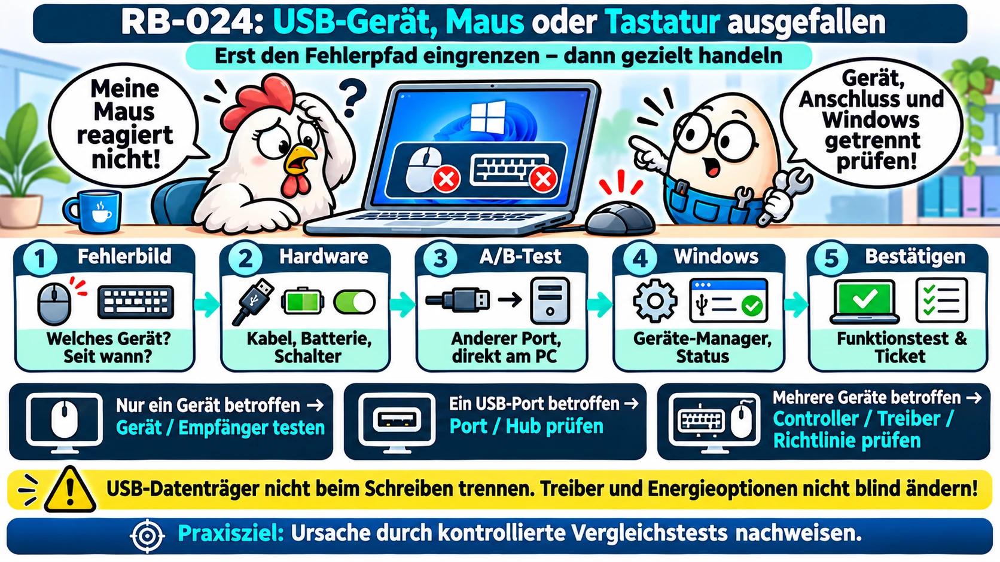

# RB-024 – USB-Gerät, Maus oder Tastatur ausgefallen

**Projekt:** 50 Tickets – 50 typische Supportfälle  
**Kategorie:** Hardware, Windows 11, USB und Eingabegeräte  
**Support-Level:** L1; L2 bei System-/Controller-/Treiberproblemen, Unternehmensrichtlinien, erhöhtem Risiko oder nicht aufklärbaren Hardwarefehlern  
**Version:** 1.0 · **Recherche:** 22.11.2026  
**Status:** Anhand offizieller Microsoft-, Dell- und Logitech-Quellen recherchiert. **Keine praktische Validierung durchgeführt.** Alle Musterfälle sind fiktiv.



> **Leitgedanke:** „USB-Gerät funktioniert nicht“ ist ein Symptom, keine Diagnose. Hardware, Anschluss, Energieversorgung, USB-Erkennung, Funkverbindung und Anwendung sind verschiedene Fehlerdomänen. Erst das betroffene Glied **beweisen**, dann zielgerichtet handeln. Ein leuchtendes Gerät beweist nur einen Teil seiner Funktion; ein Eintrag im Geräte-Manager noch keine korrekte Bedienbarkeit.

## 1. Das Supportticket und das Ziel

**INC-024 – fiktive Meldung:** „Meine USB-Maus reagiert nicht mehr. Auch die Tastatur an der Dockingstation fällt manchmal aus. Gestern war noch alles in Ordnung.“

**Ziel:** Den betroffenen Fehlerpfad reproduzierbar eingrenzen, die benötigte Eingabe- beziehungsweise USB-Funktion mit dem geringsten vertretbaren Eingriff wiederherstellen und den Benutzer den Erfolg bestätigen lassen. Dabei Datenverlust, unnötige Ausfallzeiten und Richtlinienverletzungen verhindern.

**Erstkontakt – sechs Fragen:**

1. **Was genau?** Maus, Tastatur, USB-Stick, Headset, Kartenleser oder mehrere Geräte? Keine Reaktion, Unterbrechungen, falsche Eingabe, Fehlermeldung oder Gerät gar nicht sichtbar?
2. **Wie angeschlossen?** Direkt per USB-Kabel, 2,4-GHz-USB-Empfänger, Bluetooth oder über Hub/Dockingstation/KVM? Ein *USB-Funkempfänger* bedeutet **nicht** automatisch Bluetooth.
3. **Seit wann?** Nach Umstecken, Rechnerwechsel, Standby, Update, Arbeitsplatzwechsel oder ohne bekannte Änderung?
4. **Wie weit reicht der Fehler?** Nur eine App? Auf Anmeldebildschirm? Nur ein USB-Port? Alle USB-Ports? Nur nach Energiesparmodus?
5. **Arbeitsfähigkeit?** Sind Maus **und** Tastatur ausgefallen? Gibt es eine bekannte funktionierende Ersatzmaus/-tastatur oder eine autorisierte andere Eingabemöglichkeit?
6. **Risiken?** Sind USB-Datenträger mit laufendem Kopier-/Schreibvorgang, sensible Geräte, Produktionssysteme oder andere aktive Peripherie betroffen?

**Abgrenzung:** Fällt eine USB-Maus ausschließlich über eine Dockingstation aus, siehe auch **RB-023**. Ein Computer, der überhaupt nicht startet, gehört nicht in dieses Runbook (siehe **RB-025**). Ein Datenträger mit vermutetem Datenverlust erfordert einen gesonderten Datensicherungs-/Datenträgerprozess und darf nicht wie eine unkritische Maus behandelt werden.

## 2. Technik verstehen: Was muss funktionieren?

### Kabelgebundenes USB-Gerät

Vereinfachte Kette: **Stromversorgung → mechanische Verbindung → USB-Hostcontroller/Hub → USB-Enumeration → Treiber/Geräteklasse → nutzbare Funktion**. „Enumeration“ ist das Erkennen und Identifizieren eines Geräts durch den Host: Es wird adressiert, beschreibt seine Eigenschaften und bekommt passende Softwareunterstützung. Für einfache USB-Mäuse und -Tastaturen sind häufig Standardtreiber der **Human Interface Device (HID)**-Klasse zuständig.

- **Strom ≠ Daten:** Eine Maus-LED kann leuchten, obwohl Kontakte, Datenpfad, Controller, Treiber oder eine Anwendung nicht funktionieren.
- **Gerät erkannt ≠ Eingabe erfolgreich:** Ein PnP-Eintrag belegt nicht, dass Zeigerbewegung oder Tastatureingabe an der gewünschten Oberfläche funktioniert.
- **Ein Port ≠ alle Ports:** Ports können an unterschiedlichen internen Hubs/Controllern hängen. Ein Portfehler kann lokal bleiben.
- **Hub/Dock ≠ Direktverbindung:** Hub-Stromversorgung, Hostkabel und Dock-Controller sind zusätzliche Fehlerstellen.

### Funkgerät mit USB-Empfänger (typisch 2,4 GHz)

Die Kette lautet: **Batterie/Schalter → Funkstrecke → passender, ggf. gekoppelter USB-Empfänger → USB-Port/Hub → Windows/HID → Eingabe**. Anders als bei einer nativen Bluetooth-Maus erscheint die Verbindung häufig nicht als gekoppelte Bluetooth-Maus in den Windows-Bluetooth-Einstellungen. Logitech weist unter anderem auf schwache Batterien, ungünstige Empfängerposition und Funkstörungen hin [Q4, Q5].

### Bluetooth-Maus/-Tastatur

Die Kette lautet: **Batterie/Schalter → Bluetooth-Funkmodul → Bluetooth aktiviert und Pairing gültig → Windows-Bluetooth-Stack → Eingabe**. Eine Bluetooth-Störung ist nicht allein durch Umstecken eines USB-Ports zu beheben, *außer* die Funkfunktion wird über einen USB-Bluetooth-Adapter bereitgestellt [Q3].

## 3. Das Henne-und-Ei-Prinzip: Ursache und Folge auseinanderhalten

**Henne:** „Windows hat meine Tastatur nicht erkannt.“  
**Ei:** „Die Tastatur braucht doch nur Strom – die LED leuchtet!“

Beide Aussagen können gleichzeitig plausibel erscheinen und dennoch am eigentlichen Fehler vorbeigehen. Es gibt mehrere **notwendige, aber nicht hinreichende** Voraussetzungen:

1. Das Gerät ist sicher versorgt und physisch verbunden.
2. Der Übertragungsweg ist funktionstüchtig (USB-Daten bzw. Funk).
3. Windows erkennt Gerät und erforderliche Schnittstelle ohne relevanten Fehler.
4. Das gewünschte Eingabeereignis erreicht die Zieloberfläche.

**Gegenprobe:** Der beste nächste Test ist nicht „Treiber neu installieren“, sondern ein Vergleich, der zwischen zwei Hypothesen unterscheidet: dieselbe Maus an einem **anderen direkten Port**; eine **bekannt funktionierende Vergleichsmaus** am ursprünglichen Port; nach Möglichkeit dasselbe Gerät an einem anderen freigegebenen PC.

**Merksatz:** *Erkannt, versorgt und wirklich benutzbar sind drei unterschiedliche Aussagen.*

## 4. Symptom-Ursachen-Matrix – Hypothesen statt Schnellurteile

| Beobachtung | Erste plausible Hypothesen | Trennender Test |
|---|---|---|
| **Nur eine Maus/Tastatur ausgefallen** | Gerät, Kabel, Akku, Schalter, Empfänger, Port | Vergleichsgerät an demselben Port; betroffenes Gerät an anderem Port/PC |
| **Nur ein bestimmter Port betroffen** | Portverschleiß, mechanischer Schaden, lokaler Hubpfad | dasselbe Gerät an geeignetem anderen direkten Port |
| **Über Dock/Hub fehlerhaft, direkt am PC gut** | Hub-/Dock-Port, Strombudget, Hostkabel, Dockelektronik | direkte und indirekte Verbindung mit identischem Gerät vergleichen |
| **Viele USB-Geräte zeitgleich ausgefallen** | Controller, Hub, Treiber, Energieversorgung, Richtlinie | unterschiedliche direkte Ports, Windows-Gerätestatus, L2-Eskalation |
| **Maus bewegt sich sporadisch, Funkempfänger** | Batterie, Abstand, RF-Störung, Empfängerposition | Batterie/Position einzeln ändern und Stabilität prüfen |
| **Bluetooth-Gerät fehlt** | Bluetooth deaktiviert, Pairing, Reichweite, Treiber, Funkmodul | Windows-Bluetooth-Status, Pairing und anderes BT-Gerät vergleichen |
| **Nur nach Standby/Aufwachen** | Energiestatus/Initialisierung, USB-Suspend, Treiber | Zeitpunkt dokumentieren, Verhalten nach kontrolliertem Neuverbinden vergleichen |
| **Windows zeigt Code 10 / 43** | Treiber oder Gerät meldet Start-/Funktionsproblem; nicht automatisch physischer Defekt | vollständigen Fehlertext, Hardware-ID, A/B-Tests und Änderungshistorie erfassen |
| **Maus funktioniert, aber nur eine App reagiert nicht** | Anwendung, Fokus, Remote-Desktop-Sitzung, Eingabespezialfall | außerhalb der App und in anderem Fenster testen |
| **USB-Speicher wird nicht angezeigt** | Kabel, Datenleitung, Gerät, Erkennung, Berechtigung, Laufwerkszuordnung | PnP/Geräte-Manager **lesend** prüfen; keinesfalls vorschnell initialisieren/formatieren |

**Fallstrick:** „Tastatur schreibt falsche Zeichen“ ist nicht unbedingt Hardwareausfall – Tastaturlayout, NumLock, Fn-Modus oder eine Anwendung können die sichtbaren Zeichen verändern.

## 5. Sicherheit und Betriebskontext vor jedem Test

- **Beschädigung, Funken, Rauch, Brandgeruch, übermäßige Wärme oder Überstromwarnung?** Betroffenen Anschluss **nicht weiter belasten**. Nur gefahrlos und nach lokalen Vorgaben trennen; Hardware-/Sicherheitsprozess auslösen.
- **USB-Speicher, externe SSD, Kartenleser:** Vor dem Abziehen Schreib-/Kopiervorgänge stoppen und ein Laufwerk, soweit vom System angeboten, **sicher entfernen**. Bei nicht lesbarem Laufwerk **nicht formatieren, initialisieren oder „reparieren“**, bevor Datensicherung und Freigabe geklärt sind.
- **Beide Eingabegeräte weg:** Eine **bekannt funktionierende Ersatz-Eingabe** oder autorisierte Fernunterstützung organisieren. Keine Controller-Treiberdeinstallation, die den letzten Eingabeweg beseitigen könnte. Bildschirmtastatur nur verwenden, wenn noch eine sichere Eingabemöglichkeit besteht.
- **Unternehmensgerät:** USB-Device-Control, Endpoint-Management, DLP, Treiberbereitstellung und Sicherheitsvorgaben können absichtlich Anschlüsse/Geräte einschränken. Niemals Schutzfunktionen umgehen oder fremde, nicht freigegebene Datenträger als „Testgerät“ anstecken.
- **Vor jeder Unterbrechung:** Nutzer informieren, laufende Arbeit sichern, Arbeitsplatz-/Produktionsimpact beachten.

## 6. Der A/B-Test: Die Ursache beweisbar eingrenzen

**Ein A/B-Test verändert genau einen relevanten Faktor.** Geeignete Vergleichskomponenten müssen nach Möglichkeit identisch oder nachweislich kompatibel und durch den Betrieb freigegeben sein.

| Test | A – Ausgangszustand | B – eine Änderung | Befund / Interpretation |
|---|---|---|---|
| 1 – Port | Betroffene USB-Maus an Port 1 ohne Funktion | Dieselbe Maus an direktem Port 2 | Funktion an Port 2: Pfad Port 1/Hub wahrscheinlicher, noch kein sicherer Defektnachweis |
| 2 – Gerät | Maus A an Port 1 ohne Funktion | Bekannte funktionierende Maus B an **demselben** Port 1 | Maus B funktioniert: Maus A, deren Kabel/Empfänger wahrscheinlicher |
| 3 – Host | Maus A an PC 1 ohne Funktion | Maus A an freigegebenem PC 2 | PC 2 funktioniert: ursprünglicher Host/Port/OS/Richtlinie prüfen |
| 4 – Dock | Maus A am Dock ohne Funktion | Maus A direkt am geeigneten Notebookport | Direkt funktioniert: Dock-/Hostpfad eingrenzen, RB-023 |
| 5 – Funk | Empfänger nah an störender USB-3.x-Peripherie | Empfänger mit geeignetem Verlängerungskabel in Abstand | Stabilität verbessert: Interferenz als Hypothese gestützt, reproduzieren |

**Kontrolle:** Welche Variable wurde geändert? Welche Beobachtung hat sich verändert? Wiederholt sich das Ergebnis bei Rückwechsel? Ein Einzelversuch ohne stabile Reproduzierbarkeit ist **kein** eindeutiger Ursachenbeweis.

## 7. Diagnoseschritt A – USB-Kabelgerät und USB-Hub (L1)

1. **Sichtprüfung:** Originalkabel, Stecker und Buchse auf Schäden/lockeren Sitz prüfen. Keine Metallgegenstände in Buchsen einführen; bei Schäden nicht weiterprobieren.
2. **Ab-/Anstecken:** Bei unkritischem Eingabegerät nach Nutzerfreigabe trennen, kurz warten und erneut anschließen. Das kann den Erkennungsvorgang erneut auslösen [Q1]. **Gilt nicht pauschal für Datenträger.**
3. **Geeigneter direkter Port:** Zwischenstecker/KVM/Hub/Dock vorübergehend umgehen. Microsoft empfiehlt dies ausdrücklich [Q1].
4. **Gegenprobe:** Bekannt funktionierendes Vergleichsgerät direkt am ursprünglichen Port verwenden. Bei wiederholtem Ausfall Portzustand und Modell notieren.
5. **Strombudget:** Bei stromhungrigen USB-Geräten beachten, dass passive Hubs begrenzte Leistung bereitstellen. Ein Gerät mit separatem Netzteil nach Herstelleranleitung prüfen – niemals improvisiert versorgen.
6. **Verhalten:** Eingabe an einer geeigneten lokalen Windows-Oberfläche testen; Funk, Remote-Desktop, eine eingefrorene Anwendung oder ein gesperrter Eingabefokus können sonst Fehldiagnosen erzeugen.

**Wenn direkt am PC gut, nur über Dock schlecht:** Den einzelnen Port und Hubpfad dokumentieren und nach RB-023 fortsetzen, statt sofort das Eingabegerät auszutauschen.

## 8. Diagnoseschritt B – Funkmaus/-tastatur mit USB-Empfänger (L1)

1. Modell und Verbindungstyp identifizieren: USB-Empfänger vs. integriertes Bluetooth. Ggf. Herstellerkennzeichnung des Empfängers notieren.
2. Batterie/Akku, Ein-/Ausschalter und ggf. Gerätemodusschalter kontrollieren.
3. USB-Empfänger direkt an einen geeigneten Host-Port statt an Dock/KVM/Hub stecken (nach Freigabe) und Reichweite reduzieren.
4. Funkstörungen prüfen: USB-3.x-Geräte, Metallflächen, WLAN-/Funkgeräte oder große Distanz können stören; Empfängerposition einzeln verändern [Q4, Q5].
5. Empfänger und Maus/Tastatur als **Paar** betrachten. Nicht jeder Empfänger ist universell. **Nicht** wahllos koppeln oder ein Firmengerät mit einem fremden Receiver verbinden.
6. Wenn Hersteller eine Paarungssoftware vorsieht: nur freigegebene Anwendung und herstellerspezifischen Prozess verwenden. Bei weiterhin instabiler Verbindung A/B mit bekannt intakter Kombination und an L2/Hardware eskalieren.

**Wichtig:** Ein erkanntes USB-Empfängergerät belegt nicht automatisch eine funktionierende Funkverbindung zur Maus oder Tastatur.

## 9. Diagnoseschritt C – Bluetooth-Eingabegerät (L1)

1. Kontrollieren, ob das Gerät Bluetooth statt USB-Dongle verwendet; Akku, Schalter, Reichweite und Gerätemodus prüfen.
2. **Windows 11 → Einstellungen → Bluetooth & Geräte:** Bluetooth eingeschaltet? Gerät als verbunden oder gekoppelt angezeigt? [Q3]
3. Ist Bluetooth **allgemein verschwunden** oder nur dieses eine Gerät ausgefallen? Ein anderes zugelassenes Bluetooth-Gerät kann den Fehler eingrenzen.
4. Gerät aus-/einschalten und Windows-Bluetooth-Problembehandlung über **Hilfe abrufen** prüfen. Je nach Windows-Stand kann die Einstellungsnavigation variieren [Q3].
5. Bei plausibel fehlerhafter Kopplung **nach Freigabe** Gerät entfernen und gezielt neu koppeln – nur wenn passende Ersatz-Eingabe/Pairing-Möglichkeit besteht.
6. Interferenz mit nahe stehenden nicht ausreichend abgeschirmten USB-3.0-Geräten in Betracht ziehen; Microsoft nennt dies ausdrücklich [Q3].
7. Falls Bluetooth-Adapter oder Treiber betroffen sind: Problemstatus dokumentieren und an Endpoint/L2 übergeben.

**Abgrenzung:** Die Windows-Anzeige „gekoppelt“ ist **nicht** derselbe Status wie „verbunden und Eingabe funktioniert“.

## 10. Diagnoseschritt D – Windows-Gerätestatus und Fehlercodes

**Geräte-Manager:** `Win + X` → **Geräte-Manager** (alternativ `devmgmt.msc`, wenn Eingabe möglich).

Relevante Gruppen abhängig von Gerät und Treiber: **Mäuse und andere Zeigegeräte**, **Tastaturen**, **Eingabegeräte (Human Interface Devices)**, **USB-Controller**, **Bluetooth** sowie **Andere Geräte**. Beachten: zusammengesetzte Geräte können mehrere Instanzen haben; nicht jedes Gerät erscheint nur unter einer einzigen Rubrik.

**Zu erheben:** Gerätestatus, Warnsymbol, konkreter Fehlercode, Zeitpunkt, Hersteller-/Gerätemodell, Anschlussart, ggf. Hardware-ID und Zusammenhang mit USB-Ab-/Anstecken.

- **Code 10:** Gerät kann nicht gestartet werden; mehrere Ursachen möglich.
- **Code 22:** Gerät ist deaktiviert; **vor einer Aktivierung Unternehmensrichtlinie/Grund prüfen**.
- **Code 43:** Windows hat das Gerät wegen eines vom Gerät oder Treiber gemeldeten Problems angehalten. **Kein alleiniger Beweis** für einen physischen Defekt.

Microsoft dokumentiert die Fehlercodes und gerätespezifischen Maßnahmen [Q6]. Das Ereignis „Gerät nicht erkannt“ muss **nicht** mit der Ursache gleichgesetzt werden: Eine Descriptor-Anforderung kann beispielsweise an Gerät, Kabel, Port oder Hostpfad scheitern.

**Windows vs. Anwendung:** Funktionieren Maus/Tastatur in anderen lokalen Anwendungen, aber nicht in einer bestimmten App? Dann den Anwendungs-/Sitzungskontext eingrenzen. Funktionieren sie bereits vor Windows nicht, *kann* Hardware/Firmware infrage kommen; die Aussagekraft eines Pre-Boot-Tests ist geräte- und Firmwareabhängig.

## 11. Lesende Windows-/PowerShell-Prüfungen

Alle folgenden Befehle sind **lesend**; sie deaktivieren und entfernen keine Geräte und installieren nichts. PowerShell kann nur genutzt werden, wenn ein sicherer Eingabeweg vorhanden ist.

```powershell
# A. Aktuell präsente USB-/HID-/Eingabegeräte einordnen.
# Nicht jedes Bluetooth-Gerät erscheint als USB-Gerät.
Get-PnpDevice -PresentOnly |
  Where-Object { $_.Class -in @('USB','HIDClass','Keyboard','Mouse','Bluetooth') } |
  Select-Object Class, Status, FriendlyName, InstanceId |
  Sort-Object Class, FriendlyName

# B. Präsente PnP-Geräte mit gemeldetem Problemstatus.
Get-PnpDevice -PresentOnly |
  Where-Object { $_.Status -ne 'OK' } |
  Select-Object Class, Status, FriendlyName, InstanceId

# C. Beispiel: Details eines konkret zuvor identifizierten Geräts.
# <INSTANCE-ID> ist ein Platzhalter, kein echter Gerätebezeichner.
Get-PnpDevice -InstanceId '<INSTANCE-ID>' |
  Format-List *

# D. Windows-Hardwareinventar: nur lesend, kann viele Einträge liefern.
Get-CimInstance Win32_PnPEntity |
  Where-Object { $_.PNPClass -in @('USB','HIDClass','Keyboard','Mouse') } |
  Select-Object Name, PNPClass, Status, ConfigManagerErrorCode
```

**Auswertung:**

- **Kein Eintrag** ist kein sicherer Beweis für defekte Hardware: Die Art der USB-Enumeration, Präsent-/Nichtpräsent-Filter und Treiberklassifizierung beeinflussen die Sichtbarkeit.
- **`Status: OK`** beweist keine erfolgreiche Tasten- oder Zeigereingabe und keinen störungsfreien Funkpfad.
- **`ConfigManagerErrorCode`** ist ein Windows-Konfigurationsfehlercode; nicht mit einem beliebigen Ereignisprotokollcode verwechseln.
- **`InstanceId`** kann gerätespezifische Kennungen enthalten. Für Tickets nur erforderliche, datenschutzkonforme Ausschnitte übernehmen. Zur Weitergabe an Hersteller nur nach Freigabe.
- Falls das Cmdlet `Get-PnpDevice` in einer Umgebung nicht verfügbar ist, die Prüfung über den Geräte-Manager statt mit ungeprüften Internet-Skripten durchführen.

## 12. Gezielte Maßnahmen, Energieverwaltung und Eskalation

| Nachgewiesener Befund | Geeignete Maßnahme | Kontrolle / Zuständigkeit |
|---|---|---|
| Defektes oder unterbrochenes Eingabekabel; Vergleich bestätigt | Freigegebenes Ersatzgerät bzw. Kabel | Eingabe stabil, L1/Hardware |
| Problem nur an einem Anschluss / über Hub | Intakten Port nutzen, Kabel/Hub nach Vorgabe ersetzen | Direkte und indirekte A/B-Werte, L1/L2 |
| Batterie leer, Gerät aus, Funkstrecke gestört | Batterie wechseln, Schalter/RF-Position korrigieren | Wiederholter Funktionstest, L1 |
| Bluetooth aus oder Gerät nicht verbunden | Nach Freigabe Bluetooth aktivieren bzw. koppeln | Verbunden **und** nutzbare Eingabe, L1 |
| Gerät laut Geräte-Manager deaktiviert | Deaktivierungsursache/Richtlinie klären; nur nach Freigabe aktivieren | Geräte- und Eingabetest, Endpoint/L2 |
| Fehler nach Standby / Energiesparzustand | Zuerst Status-/Zeitkorrelation beweisen, ggf. gezielter OEM-/Endpoint-Prozess | Re-Test nach Standby, L2 |
| Treiber-/Controllerfehlermeldung plausibel | Herstellertreiber oder Treiberreparatur nach Change/Freigabe, Rollback planen | Geräte- und Nutzbarkeitstest, L2 |
| Sicherheitsrichtlinie sperrt Gerät | Richtlinie dokumentieren, berechtigte Stelle konsultieren | **Keine Umgehung**, Security/Endpoint |
| Strom-/Überstromwarnung, thermischer Schaden | Nicht weiter testen, sichere Isolation und Hardwareprozess | Keine L1-Reparatur |
| Datenträger nicht lesbar / möglicher Datenverlust | Nichts formatieren/initialisieren; Datenträger-/Backup-/Recoveryprozess | Datensicherheit priorisieren |

### Selektives USB-Anhalten (Selective Suspend)

Windows kann inaktive USB-Ports oder Geräte zur Energieeinsparung gezielt in einen Ruhemodus versetzen. Ein Fehler, der **nach Standby/Aufwachen** auftritt, kann eine Energieverwaltungsursache nahelegen, beweist sie aber nicht. Microsoft beschreibt Selective Suspend als regulären Mechanismus und **empfiehlt ausdrücklich, ihn nicht pauschal zu deaktivieren** [Q7].

Daher im L1-Standardpfad **keine** globalen Energieoptionen abschalten, USB-Controller serienweise deinstallieren, Registry-„Fixes“ ausführen oder ungeprüfte Treiberpakete installieren. Ein genehmigter, gezielter Test durch L2 kann gegebenenfalls mit Vorher/Nachher-Erfassung und Rückbauplan erfolgen.

### Wann an L2/Endpoint/Hardware eskalieren?

- Mehrere direkte USB-Ports und mehrere bekannt funktionierende Geräte sind gleichzeitig betroffen.
- Wiederholte Fehlercodes, USB-Controllerfehler, Treiber-/Firmwareabhängigkeit oder reproduzierbarer Resume-Fehler.
- Unternehmensrichtlinie, Security-, BIOS-/UEFI- oder Endpoint-Management-Thema.
- Kein sicherer Eingabeweg, kritische Geräte, Gefahr, Datenträger-/Datenverlustproblem.
- Physischer Schaden, reproduzierbarer Portausfall oder Garantie-/Ersatzteilentscheidung.

**Ticketübergabe:** Gerät, Hostmodell, Port/Dock/Kabel, Verbindungstyp, Startzeit, Fehlertext, A/B-Tabelle, PnP-Daten, letzte Änderung, bereits ausgeführte Maßnahmen und Rollback-/Auswirkungsbedarf.

### Abschlussprüfung und Ticketkommentar

Nur „im Geräte-Manager sichtbar“ reicht nicht. Nach erfolgreicher Maßnahme **mit dem Benutzer** testen:

- Maus: Bewegung, Klick, ggf. Scrollen an der relevanten lokalen Anwendung.
- Tastatur: Tastenanschläge, Sondertasten/Layout (falls gemeldet), erneute Funktion nach Sperren/Entsperren entsprechend Unternehmensvorgabe.
- Funk: stabile Eingabe über angemessene Dauer, ggf. nach mehreren Reconnects und nach Standby (wenn das ursprüngliche Symptom dies betrifft).
- USB-Gerät: **tatsächliche Zielaufgabe** testen (z. B. Headset-Audio, legitimer Zugriff auf einen genehmigten Datenträger) und nicht nur Anschluss-LED.
- Ticket dokumentiert: **Symptom → Hypothesen → A/B-Tests → belegte Ursache → Maßnahme → Re-Test → Nutzerbestätigung**.

**Beispiel eines fiktiven Ticketkommentars:**

> USB-Funkmaus seit heute mit sporadischen Aussetzern. Batterie geprüft, Gerät an direktem Hostport getestet; am bisherigen Dockport reproduzierbare Störung. A/B-Test: Empfänger über zugelassene USB-Verlängerung vom störenden USB-3.x-Gerät entfernt; Eingabe blieb im Vergleichstest stabil. Keine Treiber-/Energiesparänderung. Funktion gemeinsam mit Anwender geprüft; Ursache „Funkinterferenz wahrscheinlich“, nicht als endgültig bewiesen deklariert.

## 13. Zwei fiktive Praxisfälle für Diagnose und Transfer

### Fall A – USB-Maus funktioniert nur an Port 2

**Meldung:** Kabelgebundene Maus A funktioniert an Port 1 nicht, ihre LED leuchtet. An Port 2 funktioniert sie zuverlässig. Eine bekannte intakte Maus B funktioniert an Port 1 ebenfalls nicht; an Port 2 ja.

**Interpretation:** Das Muster spricht deutlich für einen Fehler im Pfad von **Port 1** (Buchse, interner Hub/Controller, Freigabe), **nicht** für Maus A. Ohne Geräte-Manager-/Sichtprüfung lässt sich noch nicht zwischen Portschaden, deaktiviertem Port und Richtlinie entscheiden.

**L1-Vorgehen:** Port 1 dokumentieren und bei sichtbarem Schaden nicht weiterverwenden; Port 2 gemäß Betriebsvorgabe als Übergang nutzen, Re-Test durchführen, bei reproduzierbarem Portproblem Hardware-/L2-Ticket eröffnen.

### Fall B – Funkmaus stoppt sporadisch nach Arbeitsplatzwechsel

**Meldung:** Maus über USB-Empfänger ist seit dem Umzug an einen anderen Schreibtisch unzuverlässig. Kabelmaus am PC funktioniert. Funkmaus reagiert besser, wenn ihr Empfänger direkt und mit etwas Abstand zu einer USB-3.x-SSD platziert wird.

**Interpretation:** Die USB-Host-/Eingabefunktion scheint grundsätzlich betriebsfähig; die **Funkstrecke** oder Empfängerposition ist wahrscheinlicher. Ein einmaliger erfolgreicher Test beweist jedoch nicht sicher RF-Interferenz: Batterie, Kopplung und Wiederholbarkeit separat prüfen.

**L1-Vorgehen:** Batterie und Receiver prüfen, Empfängerposition kontrolliert ändern, Fehlerhäufigkeit erneut testen, dokumentieren; bei weiterem Ausfall mit freigegebener Vergleichskombination testen.

## 14. Aktives Abrufen und Selbstkontrolle

Ohne Nachschlagen beantworten; anschließend mit dem Lernartikel abgleichen:

**Wissensfragen**
1. Was unterscheidet **USB-Gerät erkannt** von **HID-Eingabe funktioniert**?
2. Was bedeutet *USB-Enumeration*?
3. Ist ein USB-Empfänger immer Bluetooth? Begründe kurz.
4. Was bedeuten die Geräte-Manager-Codes 22 und 43 – und was beweisen sie **nicht**?

**Verständnisfragen**
5. Warum beweist eine leuchtende Maus-LED keine funktionierende USB-Verbindung?
6. Weshalb sind `Status: OK` und eine funktionierende Bildschirmtastatur kein Beweis für intakte physische Tastatur-Hardware?
7. Warum ist das pauschale Deaktivieren von USB Selective Suspend keine gute Erstmaßnahme?

**Diagnosefragen**
8. Maus A an Port 1 ohne Funktion; Maus B funktioniert dort, Maus A funktioniert an Port 2 ebenfalls nicht. Welche Hypothese wird wahrscheinlicher – und welcher weitere Test wäre sinnvoll?
9. Nach Standby fallen Tastatur und USB-Headset gleichzeitig aus. Formuliere **zwei konkurrierende Hypothesen** und einen Test, der sie unterscheidet.
10. Ein USB-Stick ist im Geräte-Manager sichtbar, erscheint aber nicht im Explorer. Welche Handlungen sind **vor** jeder Datenträgeränderung zu unterlassen?
11. Eine Funkmaus hängt, die USB-Tastatur funktioniert. Welche drei **nicht-desktruktiven** Prüfungen sind zuerst sinnvoll?
12. Übe eine 30-Sekunden-Übergabe an L2: Symptom, Gegenproben, Befunde, Risiko und nächste offene Hypothese.

**Lerntransfer:** Nach etwa 7 und 21 Tagen einen neuen, nur teilweise beschriebenen USB-Fall ohne Runbook diagnostizieren. Die Trennschärfe des ersten A/B-Tests sowie den dokumentierten Nachweis bewerten. Keine Behauptung aufstellen, das Runbook sei bereits praktisch validiert.

## 15. Quellen und Transparenz

Die folgenden Originalquellen wurden am **22.11.2026** für die Recherche gesichtet. Sie begründen die Prüfrichtungen, nicht die konkrete Ursache eines fiktiven Musterfalls. Abschnittsreihenfolge und A/B-Methodik sind eine **didaktisch abgeleitete Supportstrategie**, keine als Ganzes wörtlich übernommene Herstellervorschrift.

- **[Q1] Microsoft Support:** „Probleme mit Maus und Tastatur unter Windows“ – Hardware-, Port-, Hub-, Kabel- und Batterieprüfung.  
  https://support.microsoft.com/de-de/windows/hardware/input-devices/mouse-and-keyboard-problems-in-windows
- **[Q2] Dell Support:** „How to Fix USB Port Issues on Your Dell Computer“ – typische USB-Fehler, physische Prüfung, USB-Diagnose, sichere Entfernung von Speichermedien.  
  https://www.dell.com/support/kbdoc/en-us/000132048/how-to-troubleshoot-usb-issues
- **[Q3] Microsoft Support:** „Bluetooth-Probleme in Windows beheben“ – Bluetooth-Zustand, Kopplung, Interferenz, Problembehandlung.  
  https://support.microsoft.com/de-de/windows/hardware/bluetooth/fix-bluetooth-problems-in-windows
- **[Q4] Logitech Support:** „Wireless device does not work or is not recognized“ – Empfänger, Batterie, RF-Störung, Verbindung.  
  https://support.logi.com/hc/en-150/articles/360023204454-Wireless-device-does-not-work-or-is-not-recognized
- **[Q5] Logitech Support:** „Wireless product not working properly when also using a USB 3.0 device“ – mögliche 2,4-GHz-Interferenz.  
  https://support.logi.com/hc/en-in/articles/360023414273-Wireless-product-not-working-properly-when-also-using-a-USB-3-0-device
- **[Q6] Microsoft Support:** „Fehlercodes im Geräte-Manager in Windows“ – Bedeutung u. a. der Codes 10, 22 und 43.  
  https://support.microsoft.com/de-de/windows/hardware/drivers/error-codes-in-device-manager-in-windows
- **[Q7] Microsoft Learn:** „Selektives Anhalten per USB“ – Energieverwaltung und Empfehlung, den Mechanismus nicht pauschal zu deaktivieren.  
  https://learn.microsoft.com/de-de/windows-hardware/drivers/usbcon/usb-selective-suspend

**Bildnachweis:** Eigene Konzeption, KI-gestützte Visualisierung mit ChatGPT. Die Comic-Abbildung ist eine didaktische Illustration, kein Screenshot eines realen Kundenfalls.  
**Validierungsstatus:** Quellenrecherche und inhaltliche Plausibilisierung durchgeführt; **keine Hardwaretests im Labor, keine echten Tickets und keine Produktivänderungen**. Fehlerursachen aus den Musterfällen bleiben Hypothesen bis zum reproduzierbaren Nachweis.
