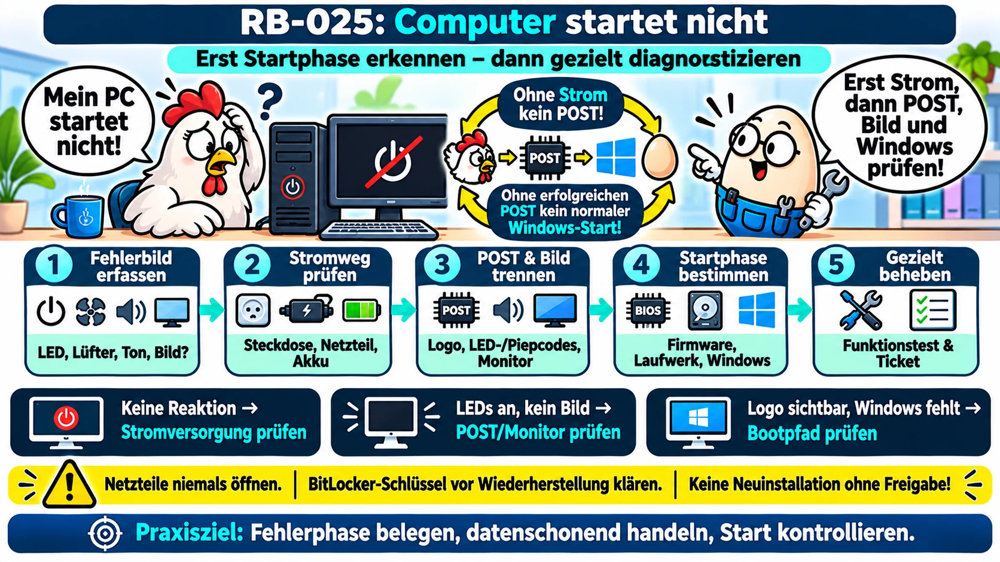

# RB-025 – Computer startet nicht

**Projekt:** 50 Tickets – 50 typische Supportfälle  
**Kategorie:** Hardware, Windows 11, Arbeitsplatz und Startdiagnose  
**Support-Level:** L1/L2 (L1: Fehlerklasse, äußerer Stromweg und sichere Gegenproben; L2/Hardware: POST-/Firmware-/Speicher-/Systemdiagnose)  
**Version:** 1.0 · **Recherche:** 22.11.2026  
**Status:** Anhand offizieller Herstellerquellen recherchiert, theoretisch dokumentiert; **noch nicht an einem realen Störungsgerät praktisch validiert**. Alle Übungsfälle sind fiktiv.



> **Leitgedanke:** „Computer startet nicht“ ist ein **Symptom**, noch keine Ursache. **No Power → No POST → No Video → No Boot** sind unterscheidbare Fehlerbilder, keine vier gleichbedeutenden Namen. Erst erkennen, welche Phase betroffen ist, dann möglichst datenschonend eingrenzen und beheben.

## 1. Das Supportticket und das Ziel

**INC-025 (fiktive Meldung):** „Mein Rechner startet seit heute Morgen nicht. Der Bildschirm bleibt schwarz. Ich brauche die Dokumente für einen Kundentermin.“

**Arbeitsziel:** Die betroffene Startphase **beobachtbar und reproduzierbar eingrenzen**; einen sicheren, möglichst minimalinvasiven Lösungsweg wählen; Daten und Betriebsvorgaben schützen; Startfähigkeit und Nutzerzugang prüfen. **Ein schwarzer Bildschirm allein beweist nicht, dass Windows defekt ist.**

**Erstkontakt – sechs Leitfragen:**

1. Was genau passiert nach dem Einschalten: **gar nichts**, LEDs/Lüfter/Pieptöne, Herstellerlogo, Windows-Logo, Fehlermeldung, BitLocker-Abfrage, Neustartschleife?
2. Desktop, Notebook oder All-in-One? **Hersteller, Modell, Inventarnummer**, Netzteil/Dock und Anzahl angeschlossener Monitore?
3. Seit wann? Letzter erfolgreicher Start? Vorher **Stromausfall, Umzug, Akkuleerstand, Update, Flüssigkeit, Sturz, Hardwarewechsel**?
4. Gibt es **Wärme, Geruch, ungewöhnliche Geräusche, sichtbare Beschädigung oder aufgeblähten Akku**? Dann **nicht weiter testen**.
5. Was ist geschäftskritisch: Frist, Anzahl Betroffener, lokale noch nicht gesicherte Daten, Zugang zu Ersatzarbeitsplatz?
6. Lässt sich die Störung mit genau **einem kontrollierten Startversuch** reproduzieren, ohne einen laufenden Update-/Reparaturprozess zu unterbrechen?

**L1-Grenze:** Steckdose, Netzteiltyp, Anschlüsse, LED- und Monitorstatus, externe Peripherie und vereinbarte Gegenproben. **L2/Hardware:** modellabhängige Diagnoseprogramme, Hardwaretausch, interne Komponenten, Firmware und verschlüsselter Wiederherstellungszugriff.

## 2. Technik verstehen: Was geschieht beim Einschalten?

Ein typischer Windows-Arbeitsplatz durchläuft logisch mehrere Voraussetzungen:

| Phase | Vereinfachte Funktion | Beobachtbare Indizien | Was die Beobachtung **nicht** beweist |
|---|---|---|---|
| **Stromversorgung** | Steckdose/Netzteil/Akku/Board stellen nutzbare Energie bereit. | Power-LED, Ladestatus, Lüfter, Verhalten der Einschalttaste. | Eine leuchtende Lade-LED beweist **keinen** erfolgreichen Systemstart. |
| **Firmware / POST** | UEFI/BIOS initialisiert zentrale Hardware und führt Selbsttests aus. | Herstellerlogo, LEDs, modellabhängige Pieptöne, Diagnosemeldungen. | Ein Logo belegt **nicht zwingend**, dass POST vollständig abgeschlossen wurde. |
| **Videoausgabe** | Grafikpfad, Kabel, Monitor und Eingang stellen ein Bild dar. | Monitor-OSD, „Kein Signal“, Bild auf alternativem Bildschirm. | Keine Bildausgabe ist **nicht automatisch** No Power oder No POST. |
| **Boot-Pfad** | UEFI/Bootmanager findet das Startmedium und lädt Windows-Komponenten. | „No bootable device“, Windows-Logo, Laderad, Wiederherstellungsansicht. | Das Anzeigen des Herstellerlogos beweist **noch keinen** Windows-Start. |
| **Windows / Anmeldung** | Kernel, Dienste, Anmeldung und Benutzerumgebung starten. | Anmeldebildschirm, Desktop, Netzwerkzugriff. | Ein sichtbarer Desktop bestätigt nicht alle Geschäftsanwendungen. |

Die Dell-Klassifikation trennt **No Power**, **No POST**, **No Boot** und **No Video**. Die Microsoft-Dokumentation trennt zusätzlich Windows-Startphasen. Quellen: [Dell – Klassifikation](https://www.dell.com/support/kbdoc/en-us/000125609/resolve-no-power-no-post-no-boot-or-no-video-issues-with-your-dell-computer), [Microsoft Learn – Windows-Startprobleme](https://learn.microsoft.com/en-us/troubleshoot/windows-client/performance/windows-boot-issues-troubleshooting).

**Begriffe präzise:**

- **No Power:** Keine oder unzureichende Anzeichen eines Einschaltens; primär Stromweg/Hardware prüfen. Manche Defekte wirken ähnlich und brauchen Herstellerdiagnose.
- **No POST:** Rechner bekommt offenbar Strom, erreicht aber keinen nachweisbar abgeschlossenen Selbsttest. Diagnose-LEDs, Pieptöne oder Hängenbleiben im Logo sind Hinweise, keine universellen Codes.
- **No Video:** Rechner könnte laufen, aber Anzeigeweg ist unterbrochen. Von No POST ohne weitere Indizien nicht immer eindeutig abzugrenzen.
- **No Boot:** Hardwareinitialisierung ist weit genug, aber ein startfähiges Betriebssystem wird nicht erfolgreich geladen. Fehler kann Firmware-Bootkonfiguration, SSD oder Windows betreffen.

## 3. Das Henne-und-Ei-Prinzip – Ursache und Folge nicht verwechseln

**Die Henne fragt:** „Soll ich Windows reparieren, obwohl der PC überhaupt nicht reagiert?“  
**Das Ei erklärt:** „Bevor Windows startet, müssen Stromversorgung, grundlegende Hardwareinitialisierung und ein Bootpfad funktionieren.“

**Abhängigkeitskette:**

```text
Betriebsbereite Stromversorgung
          ↓
Firmware initialisiert Hardware / POST
          ↓
Firmware findet gültigen Startpfad
          ↓
Windows-Bootmanager / Windows-Ladevorgang
          ↓
Windows-Anmeldung und Arbeitsplatz
```

**Parallelspur: Bildschirm:** Ein Rechner kann alle genannten Schritte durchlaufen, obwohl aufgrund eines Defekts im Monitor-/Grafikpfad **kein sichtbares Bild** erscheint. Deshalb steht „No Video“ nicht einfach als festes serielles Glied der Startkette. Der Bildschirm muss separat geprüft werden.

**Fachlicher Merksatz:** *Keine Windows-Reparatur, bevor belegt ist, dass der Fehler überhaupt in der Windows-Startphase liegt.*

## 4. Vier Fehlerklassen und ihre typischen Hypothesen

| Ausgangsbeobachtung | Arbeitshypothese | Erste geeignete Gegenprobe | Eskalationssignal |
|---|---|---|---|
| Keine LED, keine Reaktion | Steckdose, Netzleiste, Adapter, Akku, Stromversorgung | Bekannte funktionierende Steckdose/zulässiger Adapter | Überhitzung, Geruch, Schaden oder weiterhin keinerlei Reaktion |
| Power-LED / Lüfter, kein Logo; Piepcodes | POST-/Board-/RAM-/Firmwareproblem möglich | Blinkmuster dokumentieren; OEM-Handbuch/Diagnose | Diagnosecode, ausbleibender POST trotz sicherer Gegenprobe |
| Power-LED, kein Bild, Monitor meldet „Kein Signal“ | Falsche Quelle, Kabel, Monitor, Grafikpfad; POST offen | OSD, Eingang, Direktanschluss/zweiter Bildschirm | Vergleichsmonitor bleibt schwarz; Diagnosecode |
| Herstellerlogo bleibt stehen | POST hängt oder Boot-Übergabe scheitert | Verlauf/Fehlermeldung dokumentieren; OEM-Diagnose | Wiederholt gleiche Stelle, Hardwarefehler |
| „No bootable device“ | SSD nicht erreichbar, Bootreihenfolge/UEFI-Konfiguration, Dateisystem-/Bootfehler | SSD-Erkennung in **lesender** UEFI-Ansicht, OEM-Test | SSD fehlt/Hardwaretest fehlerhaft; BitLocker-Kontext |
| Windows-Laderad, automatische Reparatur, Neustartschleife | OS-/Treiber-/Update-/Storagefehler möglich | Exakte Meldung, WinRE-Optionen, Ereignisverlauf nach Wiederanlauf | Wiederholte Reparaturfehlschläge, ungesicherte Daten |
| BitLocker-Wiederherstellungsbildschirm | Verschlüsselungs-/TPM-/Bootzustandsänderung oder Recovery-Bedingung | Schlüssel-ID prüfen; autorisierten Key-Prozess starten | Key nicht vorhanden; kein Recht zur Entsperrung |

**Achtung:** Ein einzelner Blinkcode ist **nicht herstellerübergreifend** definiert. Anzahl, Farbe und Rhythmus immer exakt mit dem konkreten Modellhandbuch abgleichen. [HP-Startdiagnose](https://support.hp.com/ch-de/document/ish_4120821-4027713-16).

## 5. Sicherheits- und Datenvorprüfung

**Nicht fortsetzen** bei Brandgeruch, Rauch, heißem Gehäuse, ausgelaufenem/aufgeblähtem Akku, Flüssigkeitsschaden oder knisterndem Netzteil. Gerät nach betrieblicher Sicherheitsanweisung stromlos machen, sofern gefahrlos möglich; verantwortliche Stelle informieren. Bei Flüssigkeit nicht wiederholt einschalten.

**Nie als L1-Standardmaßnahme:**

- PC-**Netzteilgehäuse** öffnen, Kondensatoren berühren, defekte Leitungen provisorisch reparieren oder Netzteile unterschiedlicher Spezifikation improvisiert anschließen.
- BIOS/UEFI aktualisieren, Secure Boot / TPM deaktivieren, Bootmodus ändern, CMOS zurücksetzen oder interne Laufwerke/RAM ohne technische Freigabe ausbauen.
- Partitionen löschen, SSD initialisieren, Windows neu installieren, „Diesen PC zurücksetzen“ oder Daten durch Wiederherstellungsversuche gefährden.
- BitLocker-Schlüssel in das Ticket schreiben oder außerhalb des vorgesehenen **autorisierten** Schlüsselprozesses versenden.
- Einen laufenden BIOS-Update-, Firmware-, Verschlüsselungs-, Datenträger- oder Windows-Reparaturprozess wegen eines langen schwarzen Bildschirms vorschnell mit Gewalt abbrechen.

**Vor Reparatur klären:** Letzte Datensicherung, nur lokal gespeicherte Geschäftsdaten, Verschlüsselungsstatus, Schlüsselzugang und Wiederherstellungsrechte. **Wenn dies ungeklärt ist, L2 einbeziehen und zunächst Beweissicherung/Diagnose statt Änderung.**

## 6. L1-Start: Beobachten, dokumentieren, gezielt eingrenzen

1. **Sichtprüfung und Gefahrenausschluss:** beschädigte Leitungen, ungewöhnliche Wärme/Gerüche, Flüssigkeit, aufgeblähten Akku beachten.
2. **Nur einen Startversuch beobachten:** Uhrzeit, Geräusche, LEDs, Hersteller-/Windows-Logo, genaue Fehlermeldung und zeitliche Reihenfolge notieren.
3. **Bekannt funktionierenden Stromweg** kontrollieren: Steckdose direkt, Netzleiste/Schalter, Steckverbindungen, Modell-/Leistungsdaten des freigegebenen Netzteils. Bei Notebook Lade-LED und Akkuanzeige einordnen; nur Hersteller-konforme Vergleichsadapter verwenden.
4. **Monitor separat prüfen:** Menü/OSD erreichbar? Richtiger Eingang? Signalweg direkt testen, ohne Dock/KVM/Adapter, wenn betrieblich möglich. Laptop: internen Bildschirm berücksichtigen.
5. **Peripherie nach Freigabe minimieren:** Nicht benötigte USB-Geräte, externe Datenträger, Dock, KVM und Zusatzmonitore abkoppeln, dabei geöffnete Anwendungen und Datenträger-Schreibvorgänge berücksichtigen. Alle Veränderungen protokollieren.
6. **Fehlerklasse wählen:** No Power / Verdacht No POST / No Video / No Boot. Bei Mehrdeutigkeit ausdrücklich „nicht trennscharf“ dokumentieren und weitere Gegenprobe planen.

**Zu einem Power-Reset / Entladen:** Manche Hersteller empfehlen bei bestimmten Modellen nach Trennung der Versorgung eine definierte Tastenhaltezeit. Das ist **kein universeller Reset**; nur auf Grundlage der jeweiligen OEM-Anleitung und Betriebsfreigabe, keinesfalls während eines laufenden Updates. Dell beschreibt modellabhängige Verfahren unter [No Power](https://www.dell.com/support/contents/en-ed/article/product-support/self-support-knowledgebase/fix-common-issues/no-power).

## 7. Diagnosezweig A – No Power (L1, bei Bedarf L2)

**Symptom:** Power-Taste ohne erkennbare Wirkung; keine üblichen Betriebsindikatoren. Eine externe Lade-LED allein schließt No Power nicht aus.

**Reihenfolge:**

- **A1:** Steckdose durch ein anderes geeignetes Gerät bzw. nach örtlichen Regeln prüfen; schaltbare Steckdosenleiste und Netzschalter kontrollieren. Keine elektrischen Messungen ohne Qualifikation.
- **A2:** Externes Originalnetzteil, Kabel und Stecker auf sichtbare Schäden prüfen; korrekt einsetzen. Bei USB-C-Laden nur technisch freigegebenen Adapter mit ausreichender Leistung und für das konkrete Gerät unterstütztem Ladeport verwenden.
- **A3:** Notebook: Akku-/Netzteilanzeige und Startverhalten unter Netzversorgung beobachten; bei tiefentladenem Akku Herstellerladehinweise befolgen. Ohne vom Hersteller als entnehmbar vorgesehenen Akku keine Öffnung.
- **A4:** **Eine Variable pro Versuch**: anderes freigegebenes Netzteil / Steckdose / Anschluss. Ergebnis und verwendete Spezifikation notieren.
- **A5:** Bleibt das Gerät reaktionslos oder gibt es Auffälligkeiten → L2/Hardware, Gewährleistung/Service. Kein Netzteil öffnen.

**Interpretation:** Start nur mit Vergleichsnetzteil ist ein Hinweis auf den bisherigen Strompfad, aber kein automatischer Beweis, dass ausschließlich das Netzteil defekt ist. Prüfen, ob der Fehler unter der normalen Konfiguration dauerhaft behoben ist.

## 8. Diagnosezweig B – No POST / Firmware- oder Hardwareproblem

**Symptom:** Lüfter/LEDs aktiv; piept, blinkt oder bleibt vor nachweisbarem Boot stehen. Ein fehlendes Bild kann auch nur ein Video-Fehler sein; die Zuordnung braucht Indizien.

1. **LED-/Piep-Sequenz** exakt erfassen: Farben, Anzahl, Pausen, Wiederholung und Modell/BIOS-Version falls bereits bekannt. Keine generische Zahlentabelle anlegen.
2. **Herstellerhandbuch** zur konkreten Seriennummer oder Modellkennung aufrufen; Ursachen werden modellabhängig codiert. HP nennt z. B. Caps-Lock-/Num-Lock-Blinkmuster, Dell verschiedene LEDs/Pieptöne. Herstellerquellen: [Dell](https://www.dell.com/support/kbdoc/en-us/000125609/resolve-no-power-no-post-no-boot-or-no-video-issues-with-your-dell-computer), [HP](https://support.hp.com/ch-de/document/ish_4120821-4027713-16).
3. **Externe Peripherie** mit kontrollierter Gegenprobe ausschließen, soweit sicher und freigegeben.
4. Wenn ein OEM-Diagnosemenü erreichbar ist, **nur passende freigegebene Tests** durchführen und Kennungen/Fehlercodes sichern. Bootmenü-Tasten variieren je Hersteller, Generation und Firmware.
5. Bei persistierendem Fehler: **L2/Hardwaretausch/Herstellerservice**. RAM-Tausch, Gehäuseöffnung, BIOS-Wiederherstellung und CMOS-Reset erst nach Servicevorgabe.

**Hinweis:** „Herstellerlogo sichtbar“ ist ein Übergangssignal, kein absoluter Beweis eines vollständigen POST. Bei Freeze am Logo kommen Firmware-/Hardwareinitialisierung und Boot-Übergang infrage.

## 9. Diagnosezweig C – No Video (parallel zur Startkette)

**Symptom:** Power-Indikatoren vorhanden, aber Monitor schwarz. Ob POST und Windows erfolgreich laufen, ist zunächst offen.

**Sichere Prüfungen:**

- Monitorstrom, OSD-Menü und Eingang (HDMI/DP/USB-C) kontrollieren; wenn OSD nicht erscheint: Monitor-/Stromweg prüfen.
- Verbindung und direktes, bekannt funktionsfähiges Kabel testen; Dock/KVM/Adapter als eigene Fehlerquelle isolieren. Keine heißen/angeschmorten Anschlüsse anfassen.
- Bei Notebook internes Panel gegen externes vergleichen, bei Desktop unterschiedliche Monitor-/Kabelkombinationen im Rahmen zulässiger Anschlüsse prüfen.
- Ein wahrnehmbarer Windows-Anmeldeton oder eindeutige Netzwerk-/Remote-Erreichbarkeit **kann** helfen, laufendes System trotz fehlender Anzeige zu vermuten, beweist aber die exakte Ursache nicht. Remote-Tests nur mit zulässiger Berechtigung.
- Gelingt ein Bild auf alternativem Monitor, einen **Monitor-/Signalwegfehler** priorisieren. Bei komplett fehlendem Bild und Hersteller-Hardwarecodes **L2**.

**Abgrenzung:** RB-022 behandelt den externen Monitor vertieft. RB-025 benutzt diese Gegenprobe lediglich, um einen vermeintlichen Computer-Startfehler sauber abzugrenzen.

## 10. Diagnosezweig D – No Boot (L2; Übergang zu RB-026)

**Voraussetzung:** Es gibt belastbare Hinweise auf abgeschlossene oder ausreichend weit fortgeschrittene Hardwareinitialisierung und auf eine Störung beim Erreichen des Betriebssystems.

- **D1: Exakte Meldung:** „No bootable device“, „Operating System not found“, Bootmanager-/BCD-Fehler, BitLocker-Recovery, Bluescreen oder automatische Reparatur – jeweils fotografieren und im Ticket vermerken, falls datenschutzkonform.
- **D2: Bootmedium/SSD:** In UEFI nur **lesend** prüfen, ob ein Datenträger/Boot-Eintrag vorhanden ist. **Nicht** auf Verdacht SATA-Modus, Secure Boot, TPM, Partitionierung oder Bootreihenfolge ändern. SSD nicht sichtbar oder OEM-Test fehlerhaft → Hardware/Data-Recovery-Pfad.
- **D3: WinRE (Windows-Wiederherstellungsumgebung):** Wenn verfügbar und freigegeben, „Problembehandlung → Erweiterte Optionen → Starthilfe“ als herstellerunterstütztes Verfahren erwägen. **Die Starthilfe nimmt Änderungen vor**; deshalb erst Daten-/BitLocker-/Freigabestatus klären.
- **D4: Vor jedem tieferen Reparaturversuch:** Autorisierte BitLocker-Wiederherstellung prüfen; Schlüssel nicht ungeschützt erfassen. Ohne Zugriff oder bei geschäftskritischen ungesicherten Daten an L2/Backup/Endpoint übergeben.
- **D5: Ergebnis:** Startet Windows, Anmeldung und erforderliche Anwendungen testen; startet es nicht, Fehlerausgabe sichern und an L2 übergeben. **Keine Blindserie** aus `bootrec`, `bcdedit`, `diskpart`, `chkdsk /f` oder Neuinstallation.

Microsoft beschreibt WinRE und Starthilfe offiziell: [Windows RE](https://support.microsoft.com/de-de/windows/experience/backup-recovery/windows-recovery-environment), [Starthilfe](https://support.microsoft.com/de-de/windows/experience/startup-boot/startup-repair). Eine detaillierte Windows-Bootreparatur gehört zum nachfolgenden **RB-026 „Windows startet nicht korrekt“**.

## 11. Sichere technische Prüfungen und ihre Grenzen

**Grundregel:** Auf einem tatsächlich nicht startenden PC kann man **keine normalen Windows-PowerShell-Befehle ausführen**. Die folgenden **lesenden** Beispiele sind nur sinnvoll, wenn Windows wieder startet, ein autorisierter Remote-Zugang besteht oder Daten auf einem Vergleichsgerät betrachtet werden. Sie ersetzen keinen POST-Test.

### A. Systemmodell nach erfolgreichem Start

```powershell
Get-CimInstance -ClassName Win32_ComputerSystem |
    Select-Object Manufacturer, Model, Name
```

**Nutzen:** Modell für Handbuch, Treiber-/Serviceportal und Dokumentation bestimmen. **Grenze:** Ausgabe nur aus laufendem Windows; kein Beweis für den Zustand beim ursprünglichen Fehler.

### B. Firmware-Version erfassen

```powershell
Get-CimInstance -ClassName Win32_BIOS |
    Select-Object Manufacturer, SMBIOSBIOSVersion, ReleaseDate
```

**Nutzen:** Abgleich mit OEM-Diagnosehinweisen. **Keine** Update-Anweisung und keine Reparatur. Das Vorhandensein einer BIOS-Version beweist nicht, dass das Gerät aktuell fehlerfrei startet.

### C. Vorhandene Datenträger – nur Inventar

```powershell
Get-Disk |
    Select-Object Number, FriendlyName, SerialNumber, BusType,
                  OperationalStatus, HealthStatus, Size
```

**Grenze:** `HealthStatus = Healthy` ist **keine** vollständige Datenträger- oder Datenintegritätsgarantie; manche Treiber melden nur eingeschränkte Informationen. Keine `Initialize-Disk`-/`Clear-Disk`-/`Set-Disk`-Folgebefehle ableiten.

### D. Boot-/Power-Ereignisse nach erfolgreichem Windows-Start

```powershell
Get-WinEvent -FilterHashtable @{
    LogName='System'
    Id=41,6008
    StartTime=(Get-Date).AddDays(-7)
} -ErrorAction SilentlyContinue |
    Select-Object -First 15 TimeCreated, Id, ProviderName, Message
```

**Interpretation:** Ereignis 41 (Kernel-Power) und 6008 (unerwartetes Herunterfahren) können den **ungeplanten Shutdown** dokumentieren, belegen aber für sich **nicht** die Ursache, z. B. kein sicherer Beweis für einen Netzteildefekt. Ereignisse fehlen möglicherweise bei vollkommenem Startausfall oder Log-Lücken.

### E. Optionaler WinRE-Status auf funktionierendem Windows

```powershell
reagentc /info
```

**Grenze:** Zeigt die Konfiguration der Wiederherstellungsumgebung auf einem laufenden System. Dieser Befehl **startet keine** Reparatur und hilft beim vollständig stromlosen Gerät nicht. Keine Änderungen am WinRE-Status ohne Freigabe.

### F. Ohne lauffähiges Windows: Was bleibt belegbar?

- Hersteller-/Gerätemodell, Power-LEDs, Beep-Codes, UEFI-Diagnoseergebnis;
- OSD-/Monitorstatus, bekannte funktionierende Versorgung und Kabel;
- Anwenderangaben zum letzten erfolgreichen Start, letzte Änderungen;
- Vorliegende verwaltete Geräteinformationen (Inventarsystem) ausdrücklich **als historische Quelle** kennzeichnen, nicht als aktuelle Live-Messung.

## 12. Maßnahmen nach Befund, Rückfallstrategie und Eskalation

| Belegter Befund | Angemessene Maßnahme | Kontrolle/Rückfall | Zuständigkeit |
|---|---|---|---|
| Netzleiste ausgeschaltet / Netzstecker lose | Korrekt anschließen | Kontrollierter Kaltstart und angemessene Beobachtung | L1 |
| Freigegebener Vergleichsadapter funktioniert, bisheriger nicht | Adapter spezifikationsgleich austauschen | Mehrfachstart, Laden und Arbeitsplatz testen; Altteil kennzeichnen | L1 nach Prozess / Hardware |
| Start nur ohne externes Gerät/Dock möglich | Schuldigen Anschluss/Peripherie systematisch einzeln bestimmen | Ursprüngliche Konfiguration schrittweise wiederherstellen | L1/L2 |
| Externer Monitor defekt oder falscher Eingang | Anzeige-/Kabelpfad berichtigen | Bild bereits im Firmware-/Startbildschirm und Windows | L1 |
| Eindeutiger OEM-POST-Fehlercode | Gerät, Modell, Code, Rhythmus dokumentieren | Keine invasive Selbstreparatur; Servicefall | L2/Hersteller |
| SSD nicht erkennbar / Diagnose meldet Fehler | Datensicherung/Recovery-Priorität klären | Nicht initialisieren; abgestimmter Austausch | L2/Storage |
| Windows-Bootproblem, Datensicherung/BitLocker geklärt | Starthilfe **nur nach Freigabe** oder definiertes Recovery-Runbook | Erfolgreicher Boot und Benutzerabnahme | L2 |
| Unklare Datenlage / BitLocker-Key nicht verfügbar | Keine schreibenden Reparaturen | An Endpoint/Security/Backup eskalieren | L2/Security |

**Eskalationsdaten mindestens:** Ticketzeitpunkt; Hersteller/Modell/Inventarnummer; Beschreibung des letzten funktionierenden Zustands; Fehlerklasse plus Unsicherheit; LED-/Piepmuster; Bild-/Fehlermeldung; Versorgungs-/Kabel-/Monitor-/Peripherie-Gegenproben; OEM-Diagnosecode; Verschlüsselungs- und Sicherungsstatus **ohne Schlüsselmaterial**; bereits ausgeführte Veränderungen; betriebliche Auswirkung.

**Rückfallstrategie:** Ausgangskonfiguration notieren und nach jeder harmlosen Gegenprobe wiederherstellen. Bei freigegebenen Änderungen zuvor festhalten, wer sie zurücknehmen kann. Firmware-/TPM-/Bootkonfigurationsänderungen können BitLocker-Recovery auslösen und gehören nicht zu improvisierten L1-Maßnahmen.

## 13. Zwei fiktive Praxisfälle – Diagnose und Transfer

### Fall A – „Toter PC“ trotz funktionierendem Arbeitsplatzmonitor

**Ausgangslage:** Nach Arbeitsplatzwechsel reagiert ein Notebook beim Druck auf die Power-Taste nicht; der Nutzer vermutet defektes Windows. Die Steckdosenleiste leuchtet. Ein Dock ist angeschlossen, aber die Lade-LED des Notebooks ist aus.

**Eigenständige Hypothesenbildung:** Ist die Leiste wirklich auf dieser Buchse unter Spannung? Liefert das Dock genügend/überhaupt Strom? Ist das Notebook über den richtigen Ladeanschluss verbunden? Ist der Akku tiefentladen?

**Kontrollierte Probe (fiktiv):** Freigegebenes Original-Netzteil direkt am Notebook → Lade-LED erscheint, nach Ladezeit Start möglich. Der Vergleich ist ein Hinweis auf den Dock-/Strompfad. Anschließend dockseitige Verkabelung, Netzteilmodell und Leistungsanforderung abgleichen. **Nicht automatisch** Dock oder Akku als defekt deklarieren.

**Ticketkommentar (Beispiel):** „Notebook reagierte an Dock nicht auf Einschaltversuch; Ladeanzeige aus. Nach Anschluss des freigegebenen Original-Netzteils Ladeanzeige vorhanden, Start erfolgreich. Ursache auf Dock-Strompfad eingegrenzt; Dock-Netzteil/Verkabelung an zuständiges Team übergeben. Nutzerzugang am Original-Netzteil geprüft.“

### Fall B – Notebook läuft, aber es bleibt bei schwarzem Bild

**Ausgangslage:** Notebook-Lüfter und Power-LED laufen, der externe Monitor zeigt „Kein Signal“. Nutzer meldet „Computer startet nicht“. Bei direkter Prüfung zeigt das interne Panel den Windows-Anmeldebildschirm.

**Diagnose:** Der Rechner startet nachweislich bis zur Anmeldung; dies ist ein **Video-/Dock-/Signalproblem**, kein nachgewiesener No-Boot-Fall. Direktes HDMI-Signal mit freigegebenem Kabel funktioniert, nur das Dock liefert kein externes Bild. Übergabe an Dock-/Videopfad (RB-022/RB-023).

**Transferfrage:** Welche Beobachtung hätte dir vor der Gegenprobe als **vermeintlich** starker Hinweis auf einen Rechnerdefekt erscheinen können, obwohl sie diesen nicht belegt?

## 14. Active Recall, Self-Explanation und spätere Validierung

**Ohne auf den Text zu schauen beantworten:**

1. Worin unterscheiden sich No Power, No POST, No Video und No Boot? Nenne für jede Klasse einen beobachtbaren Hinweis.
2. Weshalb ist „LED leuchtet“ kein Beleg für einen erfolgreich ausgeführten POST?
3. Wie würdest du feststellen, ob ein schwarzer Bildschirm auf Monitor/Kabel oder auf dem Rechner beruht, ohne Windows zu verändern?
4. Warum darf ein Hersteller-Blinkcode nicht mit irgendeiner allgemeinen Blinkcode-Tabelle interpretiert werden?
5. Welche **drei Freigaben/Voraussetzungen** brauchst du vor tieferen Windows-Recovery-Maßnahmen?
6. Ein Anwender meldet „No bootable device“: Welche zwei **lesenden** Informationen willst du zuerst sichern?
7. Warum beweist `Kernel-Power 41` für sich keinen Netzteilschaden?
8. Welche Information muss im L2-Ticket stehen, damit der nächste Bearbeiter die Fehlersuche ohne Wiederholung fortsetzen kann?

**Anki-Kandidaten (noch nicht als Karten exportiert):**

| Typ | Frage | Kurze Antwort |
|---|---|---|
| Wissen | Was bedeutet POST? | Power-On Self-Test: Firmware prüft/initialisiert zentrale Hardware. |
| Wissen | Was heißt No Boot? | Hardwarestart weit genug, Betriebssystem wird nicht erfolgreich geladen. |
| Verständnis | Warum nicht sofort Windows reparieren? | Der Fehler kann im Strom-, POST- oder Videopfad liegen. |
| Diagnose | LEDs aktiv, externer Monitor schwarz – erste Unterscheidung? | Video-/Signalweg gegen POST-/Hardwarefehler abgrenzen. |
| Diagnose | BitLocker-Wiederherstellung vor Repair – nächster Schritt? | Autorisierte Schlüsselbeschaffung, Freigabe und Datensicherung klären. |

**Praktische Validierung (später):** Auf freigegebener Lab-Hardware gefahrlose, reversible Simulationen durchführen: Netzleiste aus / Netzteil getrennt, falscher Monitoreingang, externen Monitor abgekoppelt, bootfähiges Medium **nicht** manipulieren. Gemessen werden Diagnoseklasse, Dauer, Ergebnis der Gegenprobe, korrekte Eskalation und saubere Ticketdokumentation. **Keine absichtlich beschädigten Bootdaten, kein Stromabzug während Updates, keine mutwillige Verschlüsselungs-/TPM-Störung.**

**Spaced Repetition:** Dieselbe vierteilige Klassifikation nach etwa **7 und 21 Tagen** ohne Vorlage erneut anhand eines anderen Fehlerbilds erklären. Erfolg = selbstständige Zuordnung und Begründung, nicht bloß Wiedererkennen von Schlagwörtern.

## 15. Offizielle Quellen und Transparenz

Abruf und inhaltliche Recherche: **22.11.2026**. Die Quellen stützen allgemeine Diagnosekonzepte; konkrete Prüfsequenzen für einen echten Firmenrechner sind stets mit **Modellhandbuch, Unternehmensrichtlinie, Backup-/BitLocker-Prozess und Supportberechtigung** abzugleichen.

1. **Dell:** „Resolve No Power, No POST, No Boot or No Video Issues“ – Klassifikation und OEM-Diagnose. https://www.dell.com/support/kbdoc/en-us/000125609/resolve-no-power-no-post-no-boot-or-no-video-issues-with-your-dell-computer
2. **Dell:** „Computer Won't Turn On: Troubleshoot Power Issues“ – Stromversorgungs- und Startfehler. https://www.dell.com/support/contents/en-ed/article/product-support/self-support-knowledgebase/fix-common-issues/no-power
3. **HP:** „Computer lässt sich nicht einschalten, startet nicht oder das System wird nicht gestartet“ – Startfehler und modellbezogene Diagnose. https://support.hp.com/ch-de/document/ish_4120821-4027713-16
4. **Microsoft Support:** „Windows-Wiederherstellungsumgebung“. https://support.microsoft.com/de-de/windows/experience/backup-recovery/windows-recovery-environment
5. **Microsoft Support:** „Starthilfe“. https://support.microsoft.com/de-de/windows/experience/startup-boot/startup-repair
6. **Microsoft Learn:** „Windows startup issues troubleshooting“ – Phasendiagnose. https://learn.microsoft.com/en-us/troubleshoot/windows-client/performance/windows-boot-issues-troubleshooting
7. **Microsoft Learn:** „BitLocker recovery overview“ – geschützter Wiederherstellungszugriff. https://learn.microsoft.com/en-us/windows/security/operating-system-security/data-protection/bitlocker/recovery-overview
8. **Microsoft Support:** „Wiederherstellungsoptionen unter Windows“ – Bewertung von Recovery-Wegen. https://support.microsoft.com/de-de/windows/experience/backup-recovery/recovery-options-in-windows

**Quellenabgrenzung:** Die Ablaufmatrix, A/B-Test-Priorisierung, Musterfälle, Formulierungen und Lernfragen sind eine **eigene didaktische Synthese** aus Herstellerangaben und bewährtem Diagnoseprinzip; sie sind nicht als wörtliche Herstellervorgaben zu verstehen. Ein konkreter Hardwaredefekt wurde **nicht** festgestellt. Keine Lösung wurde im Labor getestet.

**Grafikhinweis:** Eigene Konzeption, KI-gestützte Visualisierung mit ChatGPT. Die Infografik ist ein Lernanker und kein Ersatz für den technischen Entscheidungsbaum und die Modell-Dokumentation.
