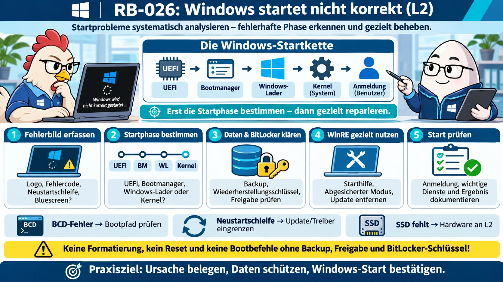

# RB-026 – Windows startet nicht korrekt

**Projekt:** 50 Tickets – 50 typische Supportfälle  
**Kategorie:** Windows 11 · Systemstart · Wiederherstellung · Störungsanalyse  
**Support-Level:** L2 (L1: Aufnahme und gesicherte Erstbefunde; L2: WinRE, Start-/Systemdiagnose und autorisierte Wiederherstellung)  
**Version:** 1.0 · **Recherche:** 22.11.2026  
**Status:** Anhand offizieller Microsoft-Dokumentation recherchiert und didaktisch aufbereitet. **Keine praktische Validierung auf einem betroffenen Gerät erfolgt.** Alle Fallbeispiele und Ergebnisse sind fiktiv.



> **Leitgedanke:** Die Meldung „Windows startet nicht“ ist keine Diagnose. **Zuerst klären, wo der Start abbricht; dann die Daten und den BitLocker-Zugriff absichern; erst anschließend die passende Wiederherstellungsmaßnahme auswählen.**

## 1. Das Ticket: Symptom, Auftrag und Abgrenzung

**INC-026 (fiktiver Übungsfall):** „Nach einem Update kommt nur noch das Windows-Logo. Danach startet der Rechner neu und zeigt die automatische Reparatur. Gestern lief noch alles.“

**Bearbeitungsziel:** Den betroffenen Teil der Windows-Startkette mit nachvollziehbaren Indizien ermitteln, die wahrscheinlichste Fehlerursache eingrenzen, eine **autorisierte und möglichst datenschonende** Maßnahme auswählen und den erfolgreichen Normalstart anschließend beweisen.

**Abgrenzung zu RB-025:** Bei RB-025 war noch offen, ob überhaupt Strom, POST oder Bildausgabe funktionieren. **RB-026 setzt voraus, dass sich der Fehler zumindest plausibel im Windows-Startpfad zeigt.** „No bootable device“, fehlendes Laufwerk oder POST-Diagnosecodes können weiterhin Hardware-/Storagefälle sein. Sie werden nicht blind als Softwarefehler behandelt.

**Sechs Fragen an die meldende Person:**

1. Welches **konkrete Bild** erscheint: Firmware-Logo, drehende Punkte, Bluescreen, BitLocker-Abfrage, Reparaturmenü oder schwarzer Bildschirm?
2. **Wann** genau und wie oft wird neu gestartet? Bleibt der Vorgang dauerhaft an derselben Stelle? Exakten Stopcode / Fehlercode fotografieren oder abschreiben.
3. Letzter erfolgreicher Start; was geschah vorher (Update, neuer Treiber, Sicherheitssoftware, Stromausfall, Dock, BIOS-Änderung)?
4. Ist die Festplatte/SSD im **UEFI beziehungsweise Herstellerdiagnosetool** sichtbar, oder meldet das Gerät fehlende Hardware?
5. Gibt es lokale, **noch nicht gesicherte Daten**, verwaltete Unternehmensrichtlinien oder eine Wiederherstellungssperre?
6. Ist **BitLocker/Device Encryption** aktiv, und ist der Wiederherstellungsschlüssel über den **autorisierten** Prozess zugänglich (nicht im Ticket hinterlegen)?

**L1:** Symptom aufnehmen, sichere Beobachtung, Gerätedaten, Zeitpunkt, Änderungsverlauf, Backup-/Schlüsselstatus zur richtigen Stelle melden. **L2:** WinRE-Auswertung, Recovery-Auswahl, Treiber-/Update-Rollback und Bootkonfiguration **nur nach Berechtigung**.

## 2. Das Windows-Henne-und-Ei-Prinzip

Windows kann den Desktop nur anzeigen, wenn vorgelagerte Komponenten ausreichend funktionieren. Vereinfacht:

```text
UEFI-Firmware / POST (vor Windows)
             ↓
Windows Boot Manager (z. B. bootmgfw.efi bei UEFI)
             ↓
Windows OS Loader (winload.efi bei UEFI)
             ↓
Windows-Kernel, Boot-Start-Treiber und Systemstruktur
             ↓
Sitzungsaufbau, Dienste, Anmeldung, Desktop
```

**Henne:** „Der Windows-Desktop erscheint nicht – ist der Desktop kaputt?“  
**Ei:** „Vielleicht. Zuerst brauchen Bootmanager, Ladeprogramm und Kernel ihren jeweiligen funktionierenden Vorgänger. Ein Fehler an einer früheren Stelle verhindert spätere Bildschirme.“

**Wichtige Ausnahme:** Die **Bildausgabe ist ein separater Beobachtungspfad**. Ein schwarzer Monitor beweist nicht, dass Windows nicht gebootet hat (siehe RB-022/RB-025). Ein Stopcode zeigt dagegen, dass Windows bereits in eine weiter fortgeschrittene Startphase gekommen ist.

**Merksatz:** *Erst den ausgefallenen Schritt der Abhängigkeitskette identifizieren, dann die richtige Ebene reparieren.*

**Quelle:** [Microsoft Learn – Windows-Startphasen](https://learn.microsoft.com/de-de/troubleshoot/windows-client/performance/windows-boot-issues-troubleshooting).

## 3. Vier Windows-Startphasen präzise unterscheiden

| Phase | Wofür verantwortlich? | Typische Hinweise | Typische Diagnosefrage |
|---|---|---|---|
| **PreBoot / Firmware** | Hardware initialisieren, Bootmedium und Startpfad finden | Logo, UEFI-Meldung, „No bootable device“ | Wird der Systemdatenträger erkannt? War POST erfolgreich? |
| **Windows Boot Manager** | Boot-Konfiguration (BCD) nutzen und Windows-Lader wählen | BCD-Fehler, `0xc000000f` als mögliches Beispiel | Ist ein gültiger Boot-Eintrag vorhanden? |
| **Windows OS Loader** | Kernel und bootkritische Komponenten laden | Loader-/Dateifehler, verschiedene Recovery-Fehlercodes | Lassen sich notwendige Dateien und Treiber laden? |
| **Kernel / spätere Initialisierung** | Treiber, Registry-Hives, Systemdienste, Sitzungen starten | Stopcode/BSOD, Neustartschleife, lange Hänger | Welcher Treiber, Dienst oder welche Systemkomponente stoppt? |

Die Zuordnung ist **eine Hypothese anhand der Beobachtung**, keine unumstößliche Diagnose: Ein und derselbe Fehlercode kann mehrere Auslöser haben. Auch kaputter Massenspeicher kann wie ein Bootkonfigurationsfehler aussehen.

**UEFI / GPT ist bei Windows 11 der Normalfall.** Pauschale Internetanleitungen für Legacy-BIOS/MBR (zum Beispiel beliebige `bootrec /fixmbr`-Serien) sind deshalb **keine universelle Standardlösung**.

## 4. Symptome in technisch prüfbare Hypothesen übersetzen

| Fehlersymptom | Mögliche Ursachen (nicht abschließend) | Sinnvolle erste Prüfung | Typischer nächster Schritt |
|---|---|---|---|
| Bootmanager-/BCD-Meldung | Boot-Konfiguration, fehlende Startdatei, Laufwerk/EFI-Partition nicht erreichbar | Vollständigen Code, UEFI-SSD-Erkennung und Bootpfad dokumentieren | WinRE-Starthilfe nach Freigabe; L2-Bootanalyse wenn erfolglos |
| Windows-Logo mit Endlosschleife | Update, bootkritischer Treiber, Systemdateien, Storage | Letzte Änderung, Stopcode, WinRE-Verfügbarkeit, Safe Mode | Ursache anhand der Tests weiter eingrenzen |
| Bluescreen beim Start | Treiber-/Kernelproblem, Storage, beschädigte Komponenten | Stopcode und Parameter, Zeitpunkt, vorangegangene Änderung | Stopcode-spezifische Microsoft-Dokumentation; ggf. L2/Endpoint |
| Automatische Reparatur ohne Erfolg | Starthilfe hat Problem erkannt, aber nicht behoben | Reparaturbericht/`SrtTrail.txt` nach identifiziertem Windows-Laufwerk | Geeignete andere WinRE-Option oder weiterführende Analyse |
| Abgesicherter Modus funktioniert | Fehler ggf. an optionalen Treibern, Diensten oder Software | Normalstart vs. Safe Mode, Ereignisprotokolle, Änderungsverlauf | Problematische Änderung gezielt zurücknehmen |
| WinRE startet nicht | WinRE/Bootpfad beschädigt, Recovery-Partition oder Hardwareproblem | Bootmedium/Storage/USB-Recoveryweg nach Unternehmensvorgabe | Autorisierte Wiederherstellungsmedien/Endpoint-Team |
| BitLocker-Recovery-Screen | Schutzauslösung, geänderter Boot-/TPM-Kontext, legitimer Recoveryfall | Schlüssel-ID und Ursache über zuständige Stelle prüfen | Autorisierten Wiederherstellungsprozess nutzen |

**Keine voreilige Kausalbehauptung:** „Nach dem Update“ beschreibt **zeitliche Nähe**, nicht zwingend die Ursache.

## 5. Vor jedem schreibenden Eingriff: Sicherheits- und Daten-Gate

**STOP-Bedingungen:** auffällige SSD-Geräusche/Hardwaretests, Laufwerk nicht erkannt, ungeklärte Backups, kritische lokale Daten, BitLocker-Schlüssel nicht verfügbar, Gerät unter Security-/Forensik-Vorbehalt, fehlende Freigabe, laufendes Firmware-Update oder unklarer Verschlüsselungsstatus.

**Daten-Check:**

- [ ] Sind lokale Dateien oder noch nicht synchronisierte Inhalte vorhanden? **Cloud-Synchronisierung ersetzt kein verifiziertes Backup.**
- [ ] Gibt es ein **getestetes**, zeitlich passendes Backup oder eine freigegebene Sicherungs-/Imagingstrategie?
- [ ] Verschlüsselung und **autorisierter** BitLocker-Wiederherstellungsschlüsselzugang geklärt? **Keinen Schlüssel** in E-Mail/Ticket/Chat speichern.
- [ ] Verantwortliche Person, notwendiges Wartungsfenster, System-/Arbeitsplatzkritikalität dokumentiert?
- [ ] Was ist **Rollback** oder Eskalationsweg, wenn die Maßnahme scheitert?

**Nicht als Standardprobe:** `format`, `diskpart clean`, `chkdsk /f` oder `/r`, Bootpartitionen ändern, `bcdboot` oder `bootrec` blind ausführen, BCD-Recovery deaktivieren, Secure Boot/TPM umstellen, Windows zurücksetzen oder neu installieren. All das kann Daten oder Systemstart beeinflussen und muss zu einem konkreten Befund und einem freigegebenen Recoveryverfahren passen.

**Microsoft weist darauf hin**, dass für bestimmte WinRE-Optionen ein BitLocker-Wiederherstellungsschlüssel nötig ist. Unterschiedliche WinRE-Startwege können unterschiedliches Entsperrverhalten auslösen. [BitLocker-Wiederherstellung](https://learn.microsoft.com/de-de/windows/security/operating-system-security/data-protection/bitlocker/recovery-overview).

## 6. WinRE sicher erreichen und richtig einordnen

**Windows Recovery Environment (WinRE)** ist die Wiederherstellungsumgebung mit unter anderem **Starthilfe, Starteinstellungen, Updates deinstallieren, Systemwiederherstellung, Eingabeaufforderung** und je nach Version/Verwaltung weiteren Optionen.

**Zugriffswege (je nach Ausgangszustand):**

1. **Windows ist noch erreichbar:** `Einstellungen → System → Wiederherstellung → Erweiterter Start → Jetzt neu starten`.
2. **Anmeldebildschirm erreichbar:** `Umschalt` gedrückt halten, über Ein/Aus **Neu starten** wählen.
3. **Wiederholte fehlgeschlagene Startversuche:** WinRE kann **automatisch** erscheinen. Nicht routinemäßig den Strom während laufender Update- oder Recovery-Vorgänge unterbrechen.
4. **WinRE lokal nicht verfügbar:** freigegebenes Windows-/OEM-Wiederherstellungsmedium; im Setup den **Reparaturweg** wählen, nicht versehentlich installieren.

Microsoft dokumentiert auch einen Zugang durch kontrollierte Startunterbrechungen. **Dies ist keine harmlose Universalroutine:** Vor allem bei möglichen Schreibvorgängen, Laufwerksfehlern oder geschäftskritischen Daten wird sie nicht als erster Schritt verwendet; nur nach Risikoprüfung und Freigabe.

**Wichtig:** Nicht jede Option ist auf jedem Windows-11-Build und in jeder Unternehmensumgebung sichtbar oder erlaubt. Manche aktuellen Windows-11-Versionen bieten zusätzliche Wiederherstellungsfunktionen (z. B. Quick Machine Recovery oder Point-in-Time Restore); deren Verfügbarkeit hängt u. a. von Version und Verwaltung ab.

**Quellen:** [WinRE](https://support.microsoft.com/de-de/windows/experience/backup-recovery/windows-recovery-environment), [Wiederherstellungsoptionen](https://support.microsoft.com/de-de/windows/experience/backup-recovery/recovery-options-in-windows).

## 7. WinRE-Starthilfe: erste geeignete Reparaturoption bei Bootproblemen

**Wann?** Bootmanager-/Startdateiprobleme oder andere klassische Startstörungen, **nachdem** die Hardware-/Datenprüfung erfolgte und der Eingriff freigegeben ist.

**Menüweg (Anzeigen können abweichen):** `WinRE → Problembehandlung → Erweiterte Optionen → Starthilfe` (bzw. „Startreparatur“). Falls verlangt, Konto und Wiederherstellungsschlüssel autorisiert bereitstellen.

**Was sie tut:** Sie **diagnostiziert und verändert gegebenenfalls** Startkomponenten automatisch. Die Starthilfe ist **kein rein lesender Test** und keine Garantie auf vollständige Reparatur. Nach Abschluss immer einen kontrollierten Neustart und einen vollständigen Funktionstest durchführen.

**Bei Fehlschlag:** Nicht immer wieder blind denselben Durchlauf starten. Ergebnis, genaue Meldung, Hardwarestatus und etwaige Protokolldaten aufnehmen. Microsoft beschreibt ein Diagnoseprotokoll unter `%windir%\System32\LogFiles\Srt\SrtTrail.txt`. **WinRE-Laufwerksbuchstaben können von Windows abweichen**; den Pfad nicht pauschal als `C:` voraussetzen. Ein Verweis auf `SrtTrail.txt` ist **kein Beleg**, dass die Datei selbst die Ursache ist.

**Quelle:** [Microsoft Support – Starthilfe](https://support.microsoft.com/de-de/windows/experience/startup-boot/startup-repair), [Microsoft Learn – Startup Repair und Protokoll](https://learn.microsoft.com/de-de/troubleshoot/windows-client/performance/windows-boot-issues-troubleshooting).

## 8. Abgesicherter Modus: Diagnose, nicht Beweis einer Lösung

**Voraussetzung:** Windows kann mit reduzierten Treibern und Diensten zumindest teilweise starten, BitLocker-Zugang und Berechtigung sind geklärt.

**Menüweg:** `WinRE → Problembehandlung → Erweiterte Optionen → Starteinstellungen → Neu starten`, danach in der Liste **Abgesicherter Modus** oder **mit Netzwerk** auswählen. Nicht von einer universell funktionierenden F8-Taste ausgehen.

**Aussagewert:** Startet Windows im abgesicherten Modus, jedoch nicht normal, **spricht das** für eine Störung durch zusätzliche Treiber, Dienste, Autostart-/Softwarekomponenten oder Konfiguration. Ein gelungener Safe-Mode-Start **identifiziert die konkrete Ursache noch nicht**.

**Kontrollierte Schritte:** genaue letzte Änderung eingrenzen, passende Protokolle prüfen, nach Freigabe zuletzt hinzugekommene problematische Software/Treiber rückgängig machen, danach **normal neu starten** und das ursprüngliche Symptom erneut testen. Ein dauerhaft erzwungener Safe-Mode-Start ist kein erfolgreicher Ticketabschluss.

**Quelle:** [Microsoft Support – Windows-Starteinstellungen](https://support.microsoft.com/de-de/windows/experience/startup-boot/windows-startup-settings).

## 9. Nach Updates oder Treibern: Wiederherstellung mit minimalem Eingriff

**Update nachweislich zeitnah?** In WinRE kann `Problembehandlung → Erweiterte Optionen → Updates deinstallieren` eine passende Option sein. Welche Kategorien deinstallierbar sind, hängt von Build/Update/Umgebung ab. Nicht jede Aktualisierung lässt sich entfernen.

**Wiederherstellungspunkt vorhanden?** Die **Systemwiederherstellung** setzt Systemdateien, installierte Programme und Einstellungen auf den Zustand des Wiederherstellungspunktes zurück. **Persönliche Dateien werden dabei normalerweise nicht zurückgesetzt**, neue Anwendungen/Treiber/Updates können aber betroffen sein. Vor Bestätigung die betroffenen Programme prüfen und die Unternehmensvorgaben beachten.

**Neue, versionsabhängige Optionen:** Point-in-Time-Wiederherstellung stellt einen **breiteren PC-Snapshot** wieder her und kann auch persönliche Dateien betreffen; daher nicht mit der klassischen Systemwiederherstellung gleichsetzen. Quick Machine Recovery (sofern verfügbar/aktiviert) adressiert bekannte, weit verbreitete Startprobleme und ist kein Ersatz für lokale Storage-Diagnose.

**Nicht vermischen:** Eine **In-Place-Reparatur** der laufenden Windows-Installation erfordert einen entsprechenden startfähigen Windows-Kontext; eine **saubere Neuinstallation** ist eine andere, deutlich invasivere Maßnahme. „Eigene Dateien beibehalten“ im Reset bedeutet nicht, dass Programme, Konfigurationen oder alle Daten unverändert bleiben.

**Quellen:** [Updates deinstallieren](https://support.microsoft.com/de-de/windows/deployment/updates-lifecycle/how-to-uninstall-a-windows-update), [Systemwiederherstellung](https://support.microsoft.com/de-de/windows/experience/backup-recovery/system-restore), [Windows-Recoveryoptionen](https://support.microsoft.com/de-de/windows/experience/backup-recovery/recovery-options-in-windows).

## 10. Nur lesende technische Prüfungen – Arbeitsumgebung beachten

**A. Auf normal oder im abgesicherten Modus gestarteten, autorisierten Windows-Geräten:**

```powershell
# Wiederherstellungsumgebung und Status – nur auslesen
reagentc /info

# Zuletzt aufgetretene Stop-/Shutdown-/Bugcheck-Indizien (keine Diagnose allein)
Get-WinEvent -FilterHashtable @{
    LogName='System'; Id=41,6008,1001; StartTime=(Get-Date).AddDays(-14)
} -ErrorAction SilentlyContinue |
    Select-Object -First 20 TimeCreated, Id, ProviderName, Message

# Gerät, Windows-Build, Datenträgerinventar
Get-CimInstance Win32_OperatingSystem |
    Select-Object Caption, Version, BuildNumber, LastBootUpTime
Get-Disk | Select-Object Number, FriendlyName, HealthStatus, OperationalStatus

# BitLocker-STATUS auslesen – KEINE Wiederherstellungsschlüssel veröffentlichen
Get-BitLockerVolume | Select-Object MountPoint, VolumeStatus, ProtectionStatus
```

**B. In WinRE / einer autorisierten Windows-PE-Konsole – lesende Orientierung, keine Partitionsänderung:**

```bat
:: BCD-Konfiguration anzeigen; aktueller Systemkontext beachten
bcdedit /enum all

:: Vorhandene Laufwerksbuchstaben und Volumes anzeigen
:: diskpart ist hier nur mit 'list volume' im lesenden Modus vorgesehen
diskpart
list volume
exit

:: Verschlüsselungsstatus nur auslesen; gibt keine Schlüssel preis
manage-bde -status
```

**Interpretationsgrenzen:** `Get-WinEvent` funktioniert nicht in einer normalen, unveränderten WinRE-Shell. Ein Laufwerksbuchstabe in WinRE muss nicht dem produktiven `C:` entsprechen. `HealthStatus = Healthy` ist kein Nachweis, dass eine SSD fehlerfrei ist. `bcdedit /enum all` zeigt einen Konfigurationsstand, aber nicht automatisch, *warum* ein Bootvorgang scheitert. Nie aus diesen Ausgaben allein eine schreibende Reparatur ableiten.

## 11. Fortgeschrittene Reparatur: weshalb pauschale Befehlslisten gefährlich sind

**Häufige Internetbefehle und ihre Grenzen:**

| Befehl / Maßnahme | Einordnung | Warum nicht blind ausführen? |
|---|---|---|
| `sfc /scannow` | Reparatur geschützter Windows-Dateien **im laufenden Zielsystem** | In WinRE ist der Zielkontext **nicht** automatisch die offline installierte Windows-Instanz. Offline-Optionen erfordern korrekt ermittelte Pfade. |
| `DISM /Online /Cleanup-Image /RestoreHealth` | Reparatur des **aktuell laufenden** Windows-Images | `/Online` aus WinRE würde die dort laufende Umgebung adressieren, **nicht automatisch** die offline Installation. |
| `chkdsk /f` oder `/r` | Kann Dateisystem reparieren und Schreibvorgänge auslösen | Bei defekter SSD oder ungesicherten Daten können Reparaturversuche ein Datenrettungsszenario verschlechtern. |
| `bootrec /fixmbr`, `/fixboot`, `/rebuildbcd` | Reparatur-/Bootwerkzeuge für **konkrete** Startkonfigurationen | BIOS/MBR und UEFI/GPT unterscheiden sich; veränderte Bootdateien/-einträge können Start und Verschlüsselung beeinflussen. |
| `bcdboot` | Kann Bootdateien und Startkonfiguration erstellen | Benötigt zweifelsfrei identifizierte Windows- und EFI-/Systempartition sowie ein geprüftes L2-Verfahren. |
| `bcdedit /set ...` | Ändert BCD und Start-/Recoveryverhalten | Änderungen können Recovery-Schleifen verdecken oder Sicherheitsmechanismen beeinflussen. |
| Reset / Neuinstallation | Letztes Recovery- bzw. Bereitstellungsverfahren | Anwendungen, Einstellungen und ggf. Datenverlust; Unternehmensbereitstellung und Backup erforderlich. |

**Beispiel eines Verfahrensfehlers:** Die Reparaturkonsole zeigt eine Windows-Installation auf `D:`, ein Internet-Tutorial verwendet ungeprüft `C:\Windows`. Das kann eine falsche Partition oder ein falsches Image betreffen. Deshalb **erst Zuordnung, Daten-/BitLocker-Gate, Freigabe und dokumentierte Zielpfade**, dann gegebenenfalls passende L2-Kommandos aus der für das Gerät geltenden Hersteller- oder Microsoft-Prozedur.

## 12. Diagnose nach Befund: Entscheidungsmatrix

| Nachweis / Arbeitshypothese | Gute nächste Entscheidung | Re-Test / Rückfall |
|---|---|---|
| Startdateien/BCD auffällig, SSD erkannt | Freigegebene WinRE-Starthilfe; wenn gescheitert L2-Bootanalyse | Bootmanager-Fehler verschwindet; vollständiger Windows-Start |
| Nur Normalstart scheitert, Safe Mode funktioniert | Änderungsverlauf/Treiber-/Softwarekorrelation untersuchen | Nach isoliertem Rollback Normalstart und Fachanwendung testen |
| Fehler nach Update, passende Update-Deinstallation verfügbar | Änderung nach Freigabe über WinRE rückgängig machen | Normalstart, Updatezustand und Richtlinienkonformität prüfen |
| Restore-Point passend und Backup/BitLocker geklärt | Systemwiederherstellung nach Auswirkungen prüfen | Anmelde-/Anwendungs-/Datenfunktion und Änderung dokumentieren |
| SSD fehlt im UEFI oder OEM-Test fehlerhaft | **Keine Windows-Reparatur**, Storage-/Hardwareteam | Hardwareprüfung und Daten-/Recoveryplan |
| BitLocker-Recovery ohne Schlüsselzugang | **STOP**, autorisierte Key-Stelle einbinden | Keine unautorisierte Entsperrung/Bootänderung |
| Wiederherstellungsoptionen erfolglos | Beweissicherung, Backup-/Imagingstatus, L2/L3-Entscheidung | Nur freigegebenes Rebuild/Neuinstallation, danach kompletter Re-Test |

**Grundregel:** Eine Fehlermeldung darf auch **mehrere Ursachen gleichzeitig** haben. Beispielsweise kann ein Speicherfehler Windows-Dateien beschädigen; eine einmalige Dateireparatur beseitigt dann nicht unbedingt die Hardwareursache.

## 13. Fiktiver Übungsfall A: Update, Neustartschleife, Safe Mode

**Ausgangslage:** Windows-11-Notebook startet nach einem geplanten Update nur bis zur Neustartschleife. Firmware erkennt die SSD, keine Hardware-Fehlercodes. WinRE ist verfügbar; Backupstatus und BitLocker-Keyzugriff werden von der zuständigen Stelle bestätigt.

**Hypothese 1:** Das Update oder eine damit ausgelöste Treiberänderung korreliert mit dem Fehler. **Noch kein Beweis**, dass das Update selbst defekt ist.

**Test:** Ein autorisierter Safe-Mode-Start gelingt. Im Ereignisverlauf zeigen sich Hinweise auf einen kürzlich aktualisierten Drittanbietertreiber. Der Befund spricht **für** eine Treiber-/Softwarekomponente, nicht für einen gesicherten Hardwaredefekt.

**Maßnahme (fiktiv):** Nach Freigabe wird **genau der betroffene Treiber** auf die freigegebene vorherige Version zurückgesetzt; übrige Updates bleiben unangetastet.

**Validierung (fiktiv):** Zwei normale Starts, Windows-Anmeldung, VPN/Netzwerk und betroffene Fachanwendung funktionieren. Das Ticket enthält Treiberversionen, Tests und die Freigabe.

**Transferfrage:** Warum wäre das pauschale Entfernen sämtlicher Updates in diesem Fall eine schlechter begründete Maßnahme?

## 14. Fiktiver Übungsfall B: BCD-Meldung, aber SSD-Problem

**Ausgangslage:** Rechner meldet sinngemäß eine beschädigte Startkonfiguration. Ein zuvor geplanter Neustart war abrupt. Im UEFI wird die SSD zeitweise **nicht** erkannt; OEM-Diagnose meldet einen Laufwerksfehler.

**Hypothese:** Der Bootfehler könnte **Folge** einer instabilen SSD sein – nicht primär ein isolierter BCD-Defekt.

**Test:** OEM-Befund und Sichtbarkeit des Laufwerks werden dokumentiert, ohne schreibenden Dateisystemtest. Das Team prüft Backup, lokale Daten und den autorisierten Verschlüsselungszugang.

**Entscheidung:** **Keine** `bootrec`-/`bcdboot`-/`chkdsk /f`-Experimente. Übergabe an Storage/Endpoint/L2 mit Datenrettungspriorität.

**Lehrpunkt:** Selbst eine „reparaturbedürftig“ aussehende Startdatei darf nicht automatisch repariert werden, wenn die zugrunde liegende Speicherebene instabil ist.

## 15. Diagnosekompetenz, Selbsttest und Quellen

### Active Recall – ohne Unterlagen beantworten

1. Wie unterscheiden sich UEFI, Bootmanager, Windows-Lader und Kernel in der Startkette?
2. Warum kann eine beschädigte SSD wie ein BCD-Fehler aussehen?
3. Weshalb ist `sfc /scannow` in einer WinRE-Shell nicht einfach der gleiche Test wie im laufenden Windows?
4. Was beweist ein erfolgreicher Start im abgesicherten Modus – und was **nicht**?
5. Wann ist „Updates deinstallieren“ geeignet, wann eher die Starthilfe?
6. Welche drei Punkte müssen vor einer Systemwiederherstellung verbindlich geklärt sein?
7. Warum bedeutet „Dateien beibehalten“ beim Reset nicht „keine Auswirkungen“?
8. Wie lautet ein professioneller Übergabekommentar mit **Befund → Test → Ergebnis → nächstem Schritt**?

### Verständnis- und Diagnosefragen

- **D1:** Bluescreen direkt nach dem Windows-Logo, SSD ist vorhanden, Safe Mode funktioniert. Welchen Test würdest du als Nächstes wählen – und warum?
- **D2:** WinRE zeigt eine Windows-Installation auf `D:`; ein Tutorial empfiehlt `C:`. Was tust du **zuerst**?
- **D3:** Starthilfe meldet Erfolg, Windows startet einmal, fällt beim zweiten Start erneut aus. Ist das Ticket erledigt? Begründe.
- **D4:** BitLocker-Abfrage und keine Information zum Key. Was ist deine Grenze und wer muss übernehmen?

**Spaced Repetition:** Nach ca. **7 und 21 Tagen** erneut zwei Diagnosefälle lösen, ohne Diagramm oder Runbook. Ziel ist **selbstständige Fehlereingrenzung**, nicht bloß das Erinnern an Klickfolgen.

### Offizielle Quellen, Recherche 22.11.2026

1. Microsoft Learn, *Erweiterte Problembehandlung für Windows-Startprobleme*: https://learn.microsoft.com/de-de/troubleshoot/windows-client/performance/windows-boot-issues-troubleshooting
2. Microsoft Support, *Windows-Wiederherstellungsumgebung*: https://support.microsoft.com/de-de/windows/experience/backup-recovery/windows-recovery-environment
3. Microsoft Support, *Starthilfe*: https://support.microsoft.com/de-de/windows/experience/startup-boot/startup-repair
4. Microsoft Support, *Windows-Starteinstellungen*: https://support.microsoft.com/de-de/windows/experience/startup-boot/windows-startup-settings
5. Microsoft Support, *Wiederherstellungsoptionen*: https://support.microsoft.com/de-de/windows/experience/backup-recovery/recovery-options-in-windows
6. Microsoft Support, *Update deinstallieren*: https://support.microsoft.com/de-de/windows/deployment/updates-lifecycle/how-to-uninstall-a-windows-update
7. Microsoft Support, *Systemwiederherstellung*: https://support.microsoft.com/de-de/windows/experience/backup-recovery/system-restore
8. Microsoft Learn, *BitLocker-Wiederherstellung*: https://learn.microsoft.com/de-de/windows/security/operating-system-security/data-protection/bitlocker/recovery-overview

**Transparenz:** Alle Tabellen, Teststrategien, Formulierungen und Musterfälle sind eine eigene didaktische Zusammenstellung der oben genannten Herstellerquellen. Einzelne diagnostische Hypothesen sind als Hypothesen gekennzeichnet. Die Maßnahmen wurden **nicht** in einer Labor- oder Produktionsumgebung ausgeführt und ihr Erfolg **nicht** praktisch bestätigt. Die Infografik ist eine KI-gestützte Illustration und ersetzt kein technisches Prüfergebnis.
