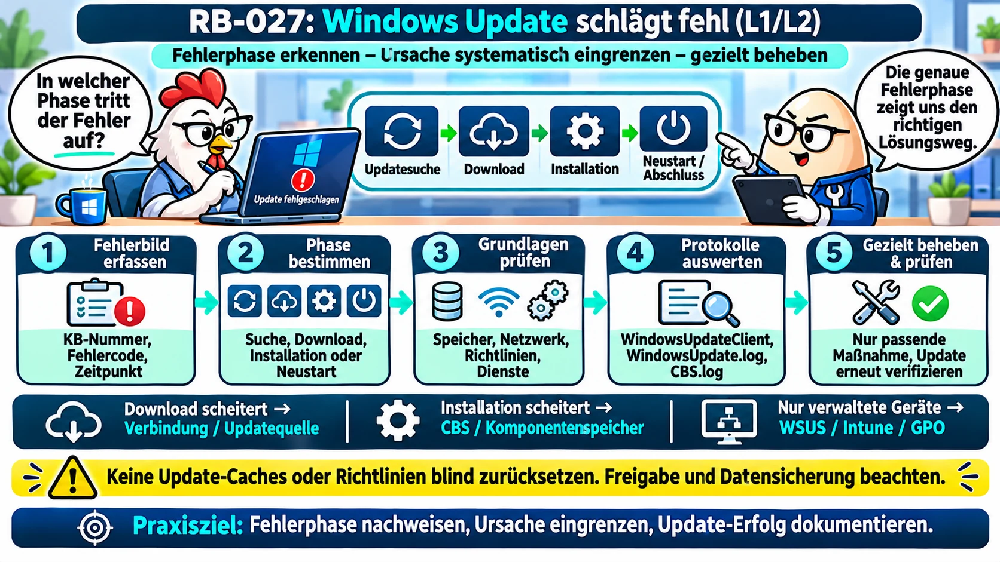

# RB-027 – Windows Update schlägt fehl

**Projekt:** 50 Tickets – 50 typische Supportfälle  
**Kategorie:** Windows 11 · Updateverwaltung · Fehlerdiagnose · Enterprise-Betrieb  
**Support-Level:** L1/L2 (L1: Aufnahme, sichere Prüfungen, dokumentierte Standardmaßnahmen; L2: Protokollanalyse, Komponentenspeicher, Updatequellen und genehmigte Reparatur)  
**Version:** 1.0 · **Recherche:** 22.11.2026  
**Status:** Offizielle Microsoft-Quellen recherchiert und didaktisch aufbereitet. **Keine praktische Validierung an einem gestörten System.** Musterfälle, Ticketdaten und Testergebnisse sind fiktiv.



> **Leitidee:** „Windows Update fehlgeschlagen“ ist eine Symptombeschreibung, keine Ursache. **Zuerst den genauen Aktualisierungstyp, die Fehlerphase und den Code erfassen; dann passende Abhängigkeiten und Protokolle prüfen; erst anschließend gezielt eingreifen.**

## 1. Supportfall, Ziel und Abgrenzung

**INC-027 (fiktiv):** „Das Windows-11-Sicherheitsupdate wird heruntergeladen, bricht aber bei der Installation ab. Nach einem Neustart steht wieder derselbe Fehler im Updateverlauf.“

**Auftrag:** Einen fehlgeschlagenen Windows-Update-Vorgang reproduzierbar eingrenzen, eine technisch begründete, autorisierte Maßnahme auswählen, den Installationsstatus nachvollziehbar prüfen und die Bearbeitung dokumentieren.

**Unterscheidung von RB-026:** Hier startet Windows noch und lässt die Diagnose im laufenden System zu. Führt ein Update zum fehlenden Systemstart, zu BitLocker-Recovery oder einer Startschleife, gilt das Sicherheits-/Wiederherstellungsverfahren aus **RB-026**, bevor weitere Updateversuche stattfinden.

**Service-Desk-Sicht:** Ein Einzelplatzfehler und eine flächendeckende Störung nach einer zentralen Update-Richtlinienänderung sind unterschiedliche Incidents. Priorität, Kommunikation und Eskalation richten sich nach der Auswirkung.

## 2. Die Update-Abhängigkeitskette verstehen

Vereinfacht läuft Windows Update über diese Schritte:

```text
Updatequelle / Freigabe / Richtlinie
                ↓
Suche und Anwendbarkeitsprüfung
                ↓
Download / Inhaltsübermittlung
                ↓
Paketverarbeitung und Installation (z. B. CBS)
                ↓
Neustart, Abschluss und Erfolgsmeldung
```

**Die Henne fragt:** „Es steht ›Fehler bei Windows Update‹ – muss der Updatedienst kaputt sein?“  
**Das Ei antwortet:** „Nicht unbedingt. Bereits die Quelle, die Netzwerkverbindung, die Anwendbarkeit, der Download, der Komponentenspeicher oder der Neustart können scheitern. Bestimme den fehlerhaften Schritt.“

| Phase | Typische Frage | Hilfreiche Belege |
|---|---|---|
| **Suche / Scan** | Sieht der Client das Update und die zuständige Quelle? | Updateverlauf, WindowsUpdateClient-Ereignisse, Richtlinien und WindowsUpdate.log |
| **Download** | Kann der Client erforderliche Inhalte aus der vorgesehenen Quelle abrufen? | Netzwerk-/Proxybefund, BITS/Delivery Optimization, WindowsUpdate.log |
| **Installation** | Kann das heruntergeladene Paket angewendet werden? | Exakter Fehlercode, `CBS.log`, Komponentenstatus |
| **Neustart / Abschluss** | Ist die Installation noch ausstehend oder wird sie zurückgerollt? | Wiederanmeldung, Updateverlauf, Ereignisprotokolle; bei Featureupgrade Setup-Logs |

*Ein Prozentwert wie „100 %“ belegt weder die abgeschlossene Installation noch die Ursache eines Stillstands.*

**Microsoft-Grundlage:** [Funktionsweise von Windows Update](https://learn.microsoft.com/de-de/windows/deployment/update/how-windows-update-works).

## 3. Welcher Update-Typ ist betroffen?

| Update-Typ | Beispiel | Besonderheit |
|---|---|---|
| **Qualitäts-/Sicherheitsupdate** | Kumulatives Update (KB) | Häufig CBS-/Servicing-Diagnose; ggf. Neustart erforderlich |
| **Funktionsupdate** | Upgrade auf eine andere Windows-11-Version | Kompatibilitäts- und Setup-Phasen; ggf. Rollback, `setupact.log`, `SetupDiag` |
| **Treiberupdate** | Grafik-/Netzwerk-/Gerätetreiber | Gerät, Herstellerfreigabe, Richtlinie und Treiberkompatibilität prüfen |
| **Definitionen / weitere Microsoft-Produkte** | Sicherheitsdefinitionen, zusätzliche Produkte | Eigene Updatequelle und besondere Zuständigkeit möglich |

**Nicht verwechseln:** Ein Patch mit KB-Nummer und ein Featureupgrade haben nicht dieselben Diagnosepfade. Vor jeder Reparatur muss feststehen, **welches Update**, **welche Windows-Version** und **welcher genaue Fehlercode** betroffen sind.

## 4. Die sieben wichtigsten Fragen bei der Erstaufnahme

1. **Welche KB-Nummer bzw. welcher Update-Name?** Qualitäts-, Treiber- oder Funktionsupdate?
2. **Exakter Fehlercode** (`0x...`), Meldung, Zeitpunkt und Screenshot aus `Einstellungen → Windows Update → Updateverlauf`?
3. **In welcher Phase** tritt das Problem auf: Suche, Download, Installation, Neustart oder Rollback?
4. **Seit wann?** Welche Änderungen gab es vorher: VPN/Proxy, Speichermangel, neue Securitysoftware, Update-Ring, Gruppenrichtlinie?
5. **Wie viele Geräte betroffen?** Nur dieser PC, mehrere Geräte einer OU/Intune-Gruppe, alle am Standort?
6. **Wie wird das Gerät verwaltet?** Privat/Standalone oder Unternehmensgerät mit WSUS, Intune, Configuration Manager, Autopatch oder anderen Regeln?
7. **Besteht bereits ein Sicherheits- oder Betriebsrisiko?** Wiederholt gescheiterte Sicherheitsupdates, aktive Softwareverteilung, mangelnde Backups, Arbeiten mit sensiblen Daten?

**Ticket-Mindestbefund:** Gerätekennung, Build, KB, Code, Phase, Zeit, Verteilungskanal, Umfang, bereits versuchte Maßnahmen.

## 5. Schutzmaßnahmen vor Änderungen

Vor jedem Eingriff mit Änderungen:

- **Freigabe/Zuständigkeit klären:** Im Unternehmensbetrieb Updatequellen, GPO/MDM, Endpoint-Schutz und Wartungsfenster nicht eigenmächtig ändern.
- **Daten/Recovery klären:** Aktuelles Backup, Wiederherstellbarkeit, bei Recovery-Risiken BitLocker-Schlüsselzugriff über autorisierte Stelle; Schlüssel nie im Ticket speichern.
- **Updateprozess nicht blind unterbrechen:** Keine erzwungenen Neustarts während laufender Paketinstallation, kein Herunterfahren auf Verdacht und keine „Reset-Skripte“ ohne Befund.
- **Änderungen begrenzen:** Eine Maßnahme nach dokumentiertem Beleg, danach Statusprüfung. Nicht mehrere Reparaturen gleichzeitig ausführen.
- **Logdaten schützen:** Protokolle können Identifikatoren, Pfade, Servernamen und Infrastrukturhinweise enthalten. Nur autorisiert ablegen und teilen.

**Besonderer Hinweis:** `SoftwareDistribution` oder `catroot2` pauschal zu löschen/umzubenennen kann Diagnosedaten und Aktualisierungszustände beeinflussen. Das ist **kein L1-Standardschritt**, selbst wenn allgemeine Internet-Tipps es empfehlen.

## 6. Sichere L1-Basisdiagnose – ohne Reparatur

**A. Status und Verlauf**

- `Einstellungen → Windows Update`: Fehlertext, ausstehender Neustart, Installationsfortschritt, ggf. Updates pausiert.
- `Windows Update → Updateverlauf`: KB, fehlerhafte Installation, genauer Code; ggf. `winver` für Version/Build.
- Stimmt die **Datum-/Zeiteinstellung**, besteht eine **stabile Verbindung**, ist das Gerät an Strom angeschlossen?
- **Speicherplatz** des Systemlaufwerks kontrollieren und mit den Updateanforderungen abgleichen. Keine pauschale Mindest-GB-Zahl ohne Versions-/Updatebezug.
- Bei nicht verwalteten Windows-11-Geräten kann die integrierte **Windows Update-Problembehandlung über „Hilfe anfordern“** ein geeigneter erster geführter Schritt sein; sie kann Einstellungen ändern. Deshalb im Betrieb nur freigegeben nutzen und Ergebnis dokumentieren.

**B. Vergleichstest**

- Ist **nur ein PC** betroffen, obwohl dieselbe KB in der gleichen Gerätegruppe erfolgreich installiert wurde?
- Gibt es eine **vergleichbare Maschine** mit derselben Build-/Gerätekonfiguration und Updatequelle?
- Haben mehrere betroffene Geräte **denselben Fehlercode und Zeitpunkt**, kann eine zentrale Ursache vorliegen. Eine Gleichzeitigkeit ist aber noch kein Beweis.

**C. Nicht voreilig:** Fehler beim Herunterladen nicht mit `sfc /scannow` „behandeln“, solange Netzwerk-/Updatequelle noch nicht geprüft wurden.

Quellen: [Windows Update-Problembehandlung](https://support.microsoft.com/de-de/windows/experience/windows-update-troubleshooter), [Speicherplatz für Updates](https://support.microsoft.com/de-de/windows/deployment/updates-lifecycle/free-up-space-for-windows-updates).

## 7. WindowsUpdateClient-Ereignisse, Update-Log und CBS verstehen

| Informationsquelle | Was sie zeigt | Typischer Nutzen |
|---|---|---|
| **Updateverlauf** | Installationsstatus und oft KB/Fehlercode | Erster Anker für Zeitpunkt und betroffenen Patch |
| **Ereignisanzeige** `Microsoft → Windows → WindowsUpdateClient → Operational` | Ereignisse des Windows-Update-Clients | Zeitfenster der Suche/Installation und Fehlertext |
| **`Get-WindowsUpdateLog`** | Übersetzt ETW-/ETL-Traces in eine lesbare Datei | Suche, Kommunikation, Download, Clientablauf analysieren |
| **`%windir%\Logs\CBS\CBS.log`** | Servicing-/Komponenteninstallation | Bei Installationsfehlern/Komponentenspeicherproblemen |
| **`%windir%\Logs\DISM\dism.log`** | DISM-Diagnose-/Reparaturlauf | Bei untersuchten DISM-Aktionen |
| **Featureupdate: Panther/SetupDiag** | Setup-Phasen, Treiberblocker, Rollbackregeln | Nur für Windows-Version-Upgrades relevant |

**Wichtig:** `Get-WindowsUpdateLog` erzeugt eine **statische** neue Textdatei. Wenn danach weitere Versuche gemacht werden, muss das Cmdlet erneut ausgeführt werden. Der Ursprung sind ETL-Traces, nicht eine automatisch live fortgeschriebene Textdatei.

Offizielle Quellen: [Windows-Update-Protokolle](https://learn.microsoft.com/de-de/windows/deployment/update/windows-update-logs), [Get-WindowsUpdateLog](https://learn.microsoft.com/de-de/powershell/module/windowsupdate/get-windowsupdatelog), [SetupDiag](https://learn.microsoft.com/de-de/windows/deployment/upgrade/setupdiag).

## 8. Lesende PowerShell-Prüfungen, kommentiert

**Arbeitsumgebung:** Diese Befehle sind für **laufendes Windows 11 / Windows PowerShell** vorgesehen, nicht für WinRE. Berechtigungen können im Unternehmen eingeschränkt sein. Für manche Systemlogs sind erhöhte Rechte erforderlich. Die Abfragen verändern keine Update-Richtlinien.

```powershell
# Windows-Version, Build und letzter Systemstart – nur Informationen
Get-CimInstance Win32_OperatingSystem |
    Select-Object Caption, Version, BuildNumber, LastBootUpTime

# Platz auf dem Systemlaufwerk in GiB (Anzeige, keine Bereinigung)
Get-CimInstance Win32_LogicalDisk -Filter "DeviceID='C:'" |
    Select-Object DeviceID, @{Name='FreeGiB';Expression={[math]::Round($_.FreeSpace / 1GB, 1)}},
                           @{Name='SizeGiB';Expression={[math]::Round($_.Size / 1GB, 1)}}

# Updatebezogene Dienste ansehen; 'Stopped' allein ist nicht der Fehlerbeweis:
# Triggerstart und bedarfsgesteuerter Betrieb sind möglich.
Get-Service wuauserv, bits, cryptsvc, usosvc -ErrorAction SilentlyContinue |
    Select-Object Name, Status, StartType

# Prüfen, ob dieses Ereignisprotokoll vorhanden / zugänglich ist
Get-WinEvent -ListLog 'Microsoft-Windows-WindowsUpdateClient/Operational'

# Letzte Ereignisse, keine Filterung auf vermeintlich eindeutige Ereignis-ID
Get-WinEvent -FilterHashtable @{
    LogName='Microsoft-Windows-WindowsUpdateClient/Operational'
    StartTime=(Get-Date).AddDays(-14)
} -MaxEvents 80 -ErrorAction SilentlyContinue |
    Select-Object TimeCreated, Id, LevelDisplayName, Message
```

**Lesende Enterprise-/Netzwerkprüfungen:**

```powershell
# Nur lesen: wirksame Windows-Update-Richtlinien können aus GPO/MDM stammen
Get-ItemProperty 'HKLM:\SOFTWARE\Policies\Microsoft\Windows\WindowsUpdate' `
    -ErrorAction SilentlyContinue
Get-ItemProperty 'HKLM:\SOFTWARE\Policies\Microsoft\Windows\WindowsUpdate\AU' `
    -ErrorAction SilentlyContinue
Get-ItemProperty 'HKLM:\SOFTWARE\Microsoft\PolicyManager\current\device\Update' `
    -ErrorAction SilentlyContinue

# WinHTTP-Proxy nur ansehen. Browserzugriff beweist nicht automatisch
# die Erreichbarkeit des Updateendpunkts aus dem Systemkontext.
netsh winhttp show proxy
```

**Neue Protokolldatei erzeugen – dokumentierter Diagnoseexport, nicht strikt lesend auf Dateisystemebene:**

```powershell
# Erzeugt eine neue Datei; vorhandene Zieldatei nicht überschreiben!
# Nur auf freigegebenem Speicherort und ohne -ForceFlush ausführen.
Get-WindowsUpdateLog -LogPath "$env:USERPROFILE\Desktop\RB027-WindowsUpdate.log"
```

`-ForceFlush` bewusst **nicht** verwenden: Laut Microsoft kann es Update-Orchestrator- und Windows-Update-Dienste anhalten. Logexport und Ereignisabfrage belegen die Ursache nicht automatisch; Ergebnisse müssen zeitlich mit dem konkreten Fehler zusammengeführt werden.

## 9. Fehlercodes interpretieren – keine Ein-Code-eine-Lösung-Regel

| Beispielcode | Dokumentierte Bedeutung / Hinweis | Nächste gezielte Prüfung |
|---|---|---|
| `0x80070002` | Eine erforderliche Datei wurde nicht gefunden; Windows-Update-Kontext beachten | Zeitpunkt/Phase, Client- und CBS-Logs |
| `0x80070005` | Zugriff verweigert / Berechtigung | Autorisierung, Richtlinien, Security-Konflikt nachweisen |
| `0x8007000D` | Ungültige Daten bzw. beschädigte Updatedaten | Paket/Cache-/Servicing-Ereignisse eingrenzen |
| `0x80073712` | Beschädigter Komponentenspeicher | CBS, genehmigte DISM-Analyse |
| `0x800F081F` | Erforderliche Reparatur-/Paketquelle fehlt | CBS/DISM und passende Reparaturquelle analysieren |
| `0x8024002E` | Windows Update-Client laut Code deaktiviert | Richtlinie, Dienstkonfiguration, Unternehmensvorgabe |
| `0x80248014` | Hinweis auf Updatedatenbank oder Updatedienst | Ereignisprotokolle und Dienst-/Datenbankstatus |
| `0xC1900101` | Bei Funktionsupdates häufig treiberbezogener Rollback | Panther/SetupDiag, Treiber-/Kompatibilitätsbefund |
| `0x80070070` (bei Upgrades) | Häufig nicht ausreichend Speicherplatz | Freier Speicher und Updateanforderungen |

**Interpretationsregel:** Ein Code ist eine **Hypothese**, keine eindeutige Wurzelursache. Wichtig sind **der komplette Code einschließlich Zusatzcode**, betroffene KB, Aktualisierungsphase, Build und der dazugehörige Logeintrag. `0x800F081F` kann z. B. auf fehlende Reparaturquellen verweisen, nicht pauschal auf einen „defekten Windows Update-Dienst“.

Quellen: [Microsoft – Updatefehler](https://support.microsoft.com/de-de/windows/deployment/updates-lifecycle/troubleshoot-problems-updating-windows), [Komponentenfehler](https://learn.microsoft.com/de-de/troubleshoot/windows-server/installing-updates-features-roles/fix-windows-update-errors), [Windows-Upgrade-Fehler](https://support.microsoft.com/de-de/windows/deployment/install-upgrade/get-help-with-windows-upgrade-and-installation-errors).

## 10. Diagnosepfad A: Suche oder Download scheitert

**Mögliche Bereiche:** Updatequelle/Policy, Internet/VPN, Proxy/TLS/DNS, Firewall-Endpunkte, verfügbare Downloads, BITS/Delivery Optimization oder verfügbare Kapazität.

**Vorgehen:**

1. Wird das Update überhaupt **angeboten**? Passt das Gerät zur freigegebenen Zielgruppe und zur Updatequelle?
2. **Einzelgerät oder viele?** Beim Masseneffekt zuerst WSUS/Intune/Configuration Manager und Verbindungsstrecke prüfen lassen.
3. Update- und Network-Logs zeitlich korrelieren. **Nicht** anhand eines erfolgreichen Browseraufrufs folgern, dass der Update-Client seine Ziele erreichen kann.
4. Dienststatus erfassen; `Stopped` bei einem bedarfsgesteuert gestarteten Dienst ist **für sich genommen kein Defekt**.
5. Erst nach belegter Ursache: DNS-/Proxy-/WSUS-Korrektur durch zuständiges Team, freigegebene Netzwerkfreischaltung oder geeignete Standard-Problembehandlung. **Keine eigenmächtige Änderung der Updatequelle.**

**Wichtig für Unternehmen:** Ein Gerät kann bei WSUS nach Updates suchen und dennoch nichts installieren, wenn keine Updates genehmigt bzw. passend zugewiesen sind. Der Scan ist nicht dasselbe wie eine Installationsanweisung.

Quellen: [Windows Update im Betrieb](https://learn.microsoft.com/de-de/windows/deployment/update/how-windows-update-works), [Windows Update Client Troubleshooting](https://learn.microsoft.com/en-us/troubleshoot/windows-client/installing-updates-features-roles/windows-update-issues-troubleshooting).

## 11. Diagnosepfad B: Installation / Komponentenstatus scheitert

**Mögliche Bereiche:** Komponentenstore (`WinSxS`/CBS), beschädigtes Paket, unzureichende Berechtigungen, Speicherplatz, Konflikte mit Sicherheitssoftware, Richtlinien, Wartungsstapel, inkompatible Drittanbieterkomponenten.

1. Fehlercode aus Updateverlauf mit **`CBS.log`** und WindowsUpdateClient-Zeitfenster korrelieren.
2. Speicherplatz und mögliche ausstehende Neustarts prüfen. Ein geplanter **normaler** Neustart ist nur nach Freigabe und wenn keine laufende Installation unterbrochen wird vertretbar.
3. **Falls CBS-Beschädigung als Hypothese gestützt ist:** L2 darf mit geeigneter Berechtigung zunächst `DISM /Online /Cleanup-Image /CheckHealth` oder `/ScanHealth` untersuchen. Die Befehle dienen der Zustandsdiagnose; `/ScanHealth` kann länger laufen.
4. Eine schreibende Reparatur mit `DISM /Online /Cleanup-Image /RestoreHealth` und anschließend ggf. `sfc /scannow` ist **kein automatischer L1-Standard**: Genehmigung, Backup, Reparaturquelle und Abbruchkriterien vorher klären.
5. `0x800F081F` bei `RestoreHealth` bedeutet häufig: Die nötige Quelle ist nicht verfügbar. Dann muss die **kompatible Reparaturquelle passend zum Betriebssystem** bestimmt werden. Keinen beliebigen `/Source`-Pfad verwenden.
6. Nach genau einer begründeten Maßnahme: KB erneut in der **vorgesehenen Updatequelle** prüfen, Ergebnis dokumentieren.

Offizielle Anleitungen: [Beheben von Windows-Update-Beschädigungen](https://learn.microsoft.com/de-de/troubleshoot/windows-server/installing-updates-features-roles/fix-windows-update-errors), [Windows-Image reparieren](https://learn.microsoft.com/de-de/windows-hardware/manufacture/desktop/repair-a-windows-image?view=windows-11).

## 12. Diagnosepfad C: Neustart, Rollback oder Funktionsupdate scheitert

- **Neustart erforderlich?** Status und geplantes Wartungsfenster beachten; ein erneuter Scan allein schließt die Installation nicht ab.
- **Abschluss mit Rücknahme/Rollback?** Zeitpunkt, Screenshots und Codes sichern; **bei einem Funktionsupdate** `SetupDiag`, `setupact.log`/`setuperr.log` sowie Panther-/Rollback-Pfade auswerten.
- **Treiberhinweis / `0xC1900101`?** Geräte- und Treiberversion plus Hersteller-Kompatibilität gegen SetupDiag-/Setup-Logs abgleichen.
- **Windows startet nicht mehr?** Sofort auf RB-026-/Recovery-Vorgehen wechseln. Keine improvisierte Neuinstallation.
- **Updatequalität/Servicingproblem auf vielen PCs?** Deployment-Team und Security einschalten; ggf. aktuelles Hersteller-Known-Issues-Dokument prüfen. Nicht selbst flächendeckend deinstallieren.

Quellen: [SetupDiag](https://learn.microsoft.com/de-de/windows/deployment/upgrade/setupdiag), [Upgrade-Protokollpfade](https://learn.microsoft.com/de-de/windows/deployment/upgrade/log-files).

## 13. Verwaltete Geräte: GPO, WSUS, Intune, Configuration Manager

Bei verwalteten Geräten kann der „Updates suchen“-Knopf durchaus funktionieren, obwohl eine Richtlinie die Quelle oder Zielversion festlegt.

**Prüfpfad (nur lesen):**

- Ist die **Updatequelle** WSUS, Windows Update oder nach Updateklasse getrennt? Quelle im Client bzw. in zugewiesenen Policies und Logs prüfen.
- Sind Updates von der zuständigen Stelle genehmigt und für das Gerät freigegeben (WSUS/Zuweisungen/Ringe)?
- Liegt ein **GPO-/MDM-Konflikt** vor? Die Registry-Pfade in Abschnitt 8 sind Indizien, aber keine vollständige Richtlinienauswertung.
- Besteht ein bekanntes **Netzwerk-/Proxyproblem** in der konkreten Updatekommunikation?
- Stimmt die Gerätegruppenzuordnung mit dem beabsichtigten Ausrollring überein?

**Nicht tun:** WSUS-Schlüssel löschen, GPO-Einstellungen umgehen, Intune-Ringe verändern, Firewallregeln deaktivieren oder direkt Microsoft-Updates installieren, obwohl ein Unternehmen die Freigabe zentral steuert.

**Eskalationsweg:** L1 → Client-/Endpoint-Admin → bei Quelle/Zuweisung: zuständiges WSUS-/Intune-/Configuration-Management-Team.

Quellen: [WSUS und Windows Update Clientrichtlinien](https://learn.microsoft.com/de-de/windows/deployment/update/wufb-wsus), [Update-Ringe in Intune](https://learn.microsoft.com/en-us/troubleshoot/mem/intune/device-protection/troubleshoot-update-rings).

## 14. Zwei fiktive Diagnosefälle: Lösung belegen statt raten

### Fall A – Qualitätsupdate mit `0x80073712`

**Meldung:** „KB-Update lädt, Installation scheitert.“

- **Hypothese 1:** Netzwerkproblem beim Download. **Gegenindiz:** Download als abgeschlossen dokumentiert; Scheitern erst beim Installationsversuch.
- **Hypothese 2:** Servicing-/Komponentenspeicherproblem. **Dafür spricht:** `CBS.log` enthält passende Zeitstempel und Komponentenfehler; ggf. DISM-Status signalisiert Beschädigung.
- **L2-Maßnahme (nur nach Backup/Freigabe):** Ggf. DISM-Reparatur mit geeigneter Quelle, danach Ergebnis und Fehlerfreiheit prüfen.
- **Erfolg:** KB ist tatsächlich installiert, kein gleichartiger Fehler im Verlauf, Neustart abgeschlossen und ein erneuter Updatecheck liefert keinen identischen Fehlschlag.

**Lerneffekt:** Das fehlerhafte Glied lag in der **Installation**, nicht im Netzwerk.

### Fall B – 17 verwaltete Notebooks finden keine Qualitätsupdates

**Meldung:** „Im Büro aktualisieren etliche Notebooks nicht, Zuhause meldet die Update-App ›auf neuestem Stand‹.“

- **Hypothese 1:** Geräte ohne Internet. **Gegenindiz:** Andere betriebliche Webdienste funktionieren; kein Beweis für Updatequellenzugang.
- **Hypothese 2:** Zentrale Updatequelle/Zuweisung fehlerhaft. **Dafür spricht:** Betroffene Geräte in derselben Richtlinien-/WSUS-Gruppe; Updateclient scannt denselben konfigurierten Endpoint; Freigabe/Zuweisung für konkrete KB fehlt (fiktiver bestätigter Administrationsbefund).
- **Maßnahme:** Nur das zuständige Update-Team korrigiert die KB-Freigabe/Zuweisung. L1/L2 ändert **keine** Clientschlüssel.
- **Erfolg:** Betroffene Referenzgeräte finden und installieren die genehmigte KB; zentraler Status wird nach der üblichen Meldelatenz überprüft.

**Lerneffekt:** „Keine Updates verfügbar“ bedeutet nicht automatisch „Computer ist aktuell“; eine Verwaltungsrichtlinie kann das Ergebnis begrenzen.

*Alle Personen, Fehler, Log- und Testergebnisse in diesen Fällen sind erfunden. Keine praktische Durchführung wird behauptet.*

## 15. Diagnosekompetenz, Active Recall, Transfer und Quellen

### Wissensabruf ohne Unterlagen

1. Nenne die vier Updatephasen und ordne jeder ein Diagnoseartefakt zu.
2. Worin unterscheiden sich `WindowsUpdate.log` und `CBS.log`?
3. Warum beweist `Stopped` bei `wuauserv` nicht sofort einen Dienstfehler?
4. Was ändert sich fachlich, wenn ein PC durch **WSUS/Intune** verwaltet wird?
5. Welche Bedeutung hat eine statische mit `Get-WindowsUpdateLog` erstellte Datei?

### Verständnisfragen

6. Ein Download ist abgeschlossen, `CBS.log` zeigt einen Fehler. Welche Hypothese wird dadurch schwächer und welche stärker?
7. Warum ist ein pauschales Löschen von `SoftwareDistribution` vor der Logauswertung problematisch?
8. Weshalb muss nach erfolgreicher Reparatur die **exakte KB**, nicht nur „Windows Update zeigt keinen Fehler“, kontrolliert werden?

### Diagnose- und Transferfälle

9. Ein Featureupgrade rollt mit `0xC1900101` zurück. Welche speziellen Quellen ziehst du zusätzlich heran?
10. Ein Einzelplatz scheitert beim Download, 40 identische Geräte sind erfolgreich. Wie gestaltest du deinen A/B-Test?
11. Nach einem Betriebssystemupdate startet Windows gar nicht. Wo verläuft die Grenze zwischen RB-027 und RB-026?
12. Du darfst wegen fehlender Freigabe keine Richtlinie ändern. Formuliere einen **technisch präzisen L2-Eskalationskommentar** mit den gesicherten Befunden.

**Lernziel:** Nicht Reparaturbefehle auswendig anklicken, sondern den **richtigen Fehlerpfad** erkennen und Befunde verständlich kommunizieren. Wiederholung nach ca. 7 und 21 Tagen anhand eines neuen Falls.

### Offizielle Recherchequellen (22.11.2026)

- Microsoft Support – Behandeln von Problemen beim Aktualisieren von Windows: https://support.microsoft.com/de-de/windows/deployment/updates-lifecycle/troubleshoot-problems-updating-windows
- Microsoft Support – Windows Update-Problembehandlung: https://support.microsoft.com/de-de/windows/experience/windows-update-troubleshooter
- Microsoft Learn – Funktionsweise von Windows Update: https://learn.microsoft.com/de-de/windows/deployment/update/how-windows-update-works
- Microsoft Learn – Windows Update-Protokolldateien: https://learn.microsoft.com/de-de/windows/deployment/update/windows-update-logs
- Microsoft Learn – Get-WindowsUpdateLog: https://learn.microsoft.com/de-de/powershell/module/windowsupdate/get-windowsupdatelog
- Microsoft Learn – Windows Update issues troubleshooting: https://learn.microsoft.com/en-us/troubleshoot/windows-client/installing-updates-features-roles/windows-update-issues-troubleshooting
- Microsoft Learn – Beheben von Windows-Update-Beschädigungen: https://learn.microsoft.com/de-de/troubleshoot/windows-server/installing-updates-features-roles/fix-windows-update-errors
- Microsoft Learn – Reparieren eines Windows-Images: https://learn.microsoft.com/de-de/windows-hardware/manufacture/desktop/repair-a-windows-image?view=windows-11
- Microsoft Learn – WSUS und Windows Update Clientrichtlinien: https://learn.microsoft.com/de-de/windows/deployment/update/wufb-wsus
- Microsoft Learn – Intune Update-Ring Troubleshooting: https://learn.microsoft.com/en-us/troubleshoot/mem/intune/device-protection/troubleshoot-update-rings
- Microsoft Learn – SetupDiag: https://learn.microsoft.com/de-de/windows/deployment/upgrade/setupdiag
- Microsoft Learn – Upgrade-Protokolle: https://learn.microsoft.com/de-de/windows/deployment/upgrade/log-files
- Microsoft Support – Reparatur durch erneute Installation derselben Windows-Version: https://support.microsoft.com/en-gb/windows/deployment/install-upgrade/fix-issues-by-reinstalling-the-current-version-of-windows

> **Hinweis zu Recovery-Reparaturen:** Die Windows-11-Funktion „Probleme mithilfe von Windows Update beheben“ installiert die aktuelle Version erneut und erhält nach Microsoft-Angaben Apps, Einstellungen und Dateien. Sie ist **keine erste Diagnosemaßnahme**, erfordert geeignete Voraussetzungen und ist auf verwalteten Unternehmensgeräten unter Umständen nicht verfügbar. Ein separater Änderungs-/Backupprozess bleibt erforderlich.

**Transparenz:** Dieser Artikel ist ein sorgfältig strukturierter **recherchierter Lernfall**. Weder die Kommandos noch die Reparaturen oder Muster-Ergebnisse wurden im Rahmen dieses Tickets auf einer gestörten Windows-11-Maschine praktisch getestet. Die Grafik wurde KI-gestützt erstellt; technische Prüfbehauptungen stammen aus den verlinkten Herstellerquellen und sind bei der späteren Laborvalidierung zu prüfen.
