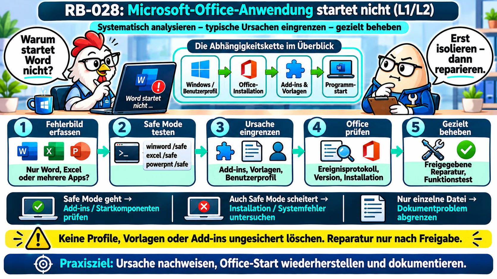

# RB-028 – Microsoft-Office-Anwendung startet nicht

**Projekt:** 50 Tickets – 50 typische Supportfälle  
**Kategorie:** Anwendungs- und Arbeitsplatzsupport · Microsoft 365 Apps / Office unter Windows 11  
**Support-Level:** L1/L2 (L1: Aufnahme, sichere Vergleiche und genehmigte Standardmaßnahmen; L2: Ereignis-/Profilanalyse, verwaltete Add-ins, Installationsreparatur)  
**Version:** 1.0 · **Recherche:** 22.11.2026  
**Status:** Offizielle Microsoft-Quellen recherchiert und didaktisch aufgearbeitet. **Keine praktische Validierung an einem fehlerhaften Arbeitsplatz.** Alle Musterfälle, Tickets und Testausgaben sind fiktiv.



> **Leitidee:** Eine nicht startende Office-App ist ein Symptom. Ein **Normalstart-/Safe-Mode-Vergleich** grenzt Startkomponenten ein; er **beweist allein noch keine bestimmte Ursache**. Nur mit belegter Fehlerhypothese und Freigabe reparieren.

## 1. Supportfall, Ziel und Abgrenzung

**INC-028 (fiktiv):** „Word öffnet sich kurz, danach verschwindet das Fenster. Excel funktioniert auf demselben Windows-11-PC.“

**Auftrag:** Auswirkung und Fehlerbild erfassen, Anwendungs- und Startpfad eingrenzen, dokumentierte Diagnose durchführen, gegebenenfalls eine autorisierte Korrektur umsetzen und den Erfolg über einen normalen Programmstart mit Testdokument nachweisen.

**Abgrenzungen:**

- **RB-004 – Anwendung startet nicht:** allgemeine Windows-Anwendungsdiagnose; hier Microsoft-Office-spezifische Startmechanismen.
- **RB-019 – Outlook-Profil beschädigt:** Outlook-spezifische Profil- und Datendateidiagnose; bei Outlook in dieses Runbook verzweigen.
- **RB-029 – Microsoft-365-Lizenz fehlt:** Aktivierungs- und Berechtigungsfall; ein Lizenzfehler ist nicht automatisch ein Prozessabsturz.
- **Dokumentproblem:** Startet Word/Excel normal, aber nur **eine bestimmte Datei** nicht, ist vorrangig die Datei, der Speicherort, das Format oder die Dokumenterweiterung betroffen – nicht zwangsläufig die Installation.

**Umfang:** Vor allem die klassischen Windows-Desktopanwendungen Word, Excel und PowerPoint (Microsoft 365 Apps bzw. unterstützte Office-Versionen). Office im Browser, Mac, mobile Apps und das neue Outlook haben teils andere Diagnosewege.

## 2. Technische Abhängigkeitskette: Warum kann Office schon beim Start scheitern?

Vereinfacht wirken beim Start mehrere Komponenten zusammen:

```text
Windows-Sitzung und Benutzerkontext
          ↓
Installierte Office-App + Programmdateien
          ↓
Benutzereinstellungen, Vorlagen, Startdateien
          ↓
Geladene Erweiterungen / COM-Add-ins
          ↓
Programmoberfläche, Konto-/Dienste-Funktionen
```

Diese Darstellung ist **ein vereinfachtes Denkmodell, keine strikte tatsächliche Startreihenfolge**. Komponenten können parallel oder abhängig vom konkreten Startpfad geladen werden. Lizenzierung, Netzwerk, Cloud-Dateien und geschützte Unternehmensrichtlinien spielen je nach Fehlerbild unterschiedliche Rollen.

**Die Henne fragt:** „Word startet nicht – ist Office kaputt?“  
**Das Ei antwortet:** „Das ist noch offen. Läuft Excel? Startet Word mit `winword /safe`? Passiert es bei jeder Datei? Erst diese Unterschiede zeigen uns, *wo* wir suchen sollten.“

### Warum der Vergleich wichtig ist

| Beobachtung | Erste Arbeitsannahme | Was noch nicht bewiesen ist |
|---|---|---|
| Nur Word betroffen, Excel und PowerPoint starten | Word-spezifische Startkomponente | Dass die gesamte Office-Installation fehlerfrei ist |
| Alle Office-Apps stürzen ab | Gemeinsame Komponente, Installation, Update oder Windows-Kontext | Dass eine Onlinereparatur zwingend hilft |
| Word startet mit `/safe`, normal aber nicht | Im Safe Mode deaktivierte oder anders geladene Komponente | Dass zwingend ein COM-Add-in schuld ist |
| Word startet auch mit `/safe` nicht | Fehler außerhalb des durch Safe Mode umgangenen Pfads möglich | Dass Profile/Erweiterungen vollständig ausgeschlossen sind |
| Nur eine Datei führt zum Absturz | Datei-/Vorlagen-/Speicherortproblem | Dass die App selbst defekt ist |
| App startet, meldet „Nicht lizenziertes Produkt“ | Aktivierungs-/Lizenzpfad | Dass das Programm nicht starten kann |

**Herstellerbezug:** Microsoft beschreibt Office Safe Mode ausdrücklich als Hilfsmittel, um Probleme durch Add-ins, Erweiterungen oder bestimmte Startressourcen einzugrenzen.  
Quelle: https://support.microsoft.com/de-de/office/lifecycle/open-office-apps-in-safe-mode-on-a-windows-pc

## 3. Fehlersymptome präzise unterscheiden

- **Kein sichtbares Fenster:** Klick wirkt folgenlos; eventuell bereits ein Prozess vorhanden. Prozesszustand erst prüfen, nicht sofort beenden.
- **Splashscreen, dann Absturz:** Word-/Excel-Logo erscheint und verschwindet; Zeitpunkt, Fehlermodul und Windows-Ereignis ermitteln.
- **„Funktioniert nicht mehr“ / Fehlermeldung:** Exakten Wortlaut, Code, Modul und Zeitstempel sichern.
- **Anwendung hängt:** Fenster sichtbar, aber keine Reaktion; nicht mit einem Crash verwechseln.
- **Nur beim Doppelklick auf Dokument:** Leere Anwendung getrennt starten; Dateiassoziation, Vorlage, Dateiinhalte und Speicherort isolieren.
- **„Nicht lizenziertes Produkt“ / Anmeldung verlangt:** App startet – Aktivierung und Konto gehören zunächst in einen eigenen Pfad.
- **„Office ist ausgelastet“ / Click-to-Run-Vorgang:** Prüfen, ob Bereitstellung, Update oder Reparatur läuft; Vorgang nicht unkontrolliert abbrechen.

**Merksatz:** „Startet nicht“ ist erst eine brauchbare Ticketbeschreibung, wenn mindestens **App + Fehlerphase + Fehlermeldung + Umfang + Vergleichsergebnis** vorliegen.

## 4. Die acht wichtigsten Fragen der Erstaufnahme

1. **Welche App und Variante?** Word, Excel, PowerPoint; Microsoft 365 Apps, Office LTSC, Office 2021/2024? Desktop oder Web?
2. **Was genau passiert?** Keine Reaktion, Splashscreen, Absturz, Hänger, Aktivierungsmeldung, nur Dokumentstart?
3. **Seit wann und nach welcher Änderung?** Office-/Windows-Update, Add-in-Update, Profilmigration, neues Makro-/DMS-/PDF-Add-in?
4. **Eine App oder mehrere?** Word vs. Excel vs. PowerPoint auf demselben Gerät prüfen.
5. **Ein Benutzer oder mehrere?** Nur dieser Benutzer auf einem Gerät? Andere Geräte betroffen? Vergleich ausschließlich autorisiert.
6. **Jede Datei oder nur eine?** Start ohne Dokument und mit leerem Testdokument getrennt testen.
7. **Was ist geschäftskritisch?** Zeitdruck, Dokumente mit sensiblen Daten, Arbeitsunterbrechung, SLA?
8. **Welche Berechtigungen/Richtlinien?** Verwaltete Office-Installation, zentral zugewiesene Add-ins, Updatekanal, freigegebene Änderungen?

**Ticket-Mindestdaten:** Gerät, Benutzer/Abteilung nach Berechtigung, App/Build, Zeitpunkt, Symptom, normale Startmethode, Safe-Mode-Ergebnis, mögliche Änderung und bisherige Tests.

## 5. Sicherheits- und Änderungs-Gate

Vor Maßnahmen mit Änderungen:

- Genehmigung, Support-Level, Hersteller-/Unternehmensrichtlinien und Wartungsfenster prüfen.
- **Dokumente sichern:** Ungespeicherte Änderungen, AutoWiederherstellen, lokale Vorlagen, Makros und Add-in-Konfiguration berücksichtigen.
- **Keine Profile, Vorlagen, Registry-Schlüssel oder Add-ins ungesichert löschen.** Bei Bedarf erst sichern und reversibel umbenennen; L2/Freigabe.
- **Keine Office- oder Windows-Sicherheitsfunktionen abschalten**, um einen Start zu erzwingen.
- **Keine unkontrollierten Testanmeldungen mit fremden Konten** und keine sensiblen Beispieldokumente in fremde Cloudbereiche kopieren.
- **Onlinereparatur** kann erneute Anmeldung, Download/Bandbreite und Änderung der Installation mit sich bringen. Vorher Produkt, Freigabe und Bereitstellungsweg klären.
- Bei mehreren betroffenen PCs: Change-/Incident-Verfahren nutzen, bevor ein Einzelplatz-Workaround auf alle Systeme ausgerollt wird.

**L1:** Erfassen, vergleichen, Safe Mode testen, genehmigte Standardmaßnahmen. **L2:** profil-/registrierungsnahe Maßnahmen, Add-in-Deployment, Office-Reparatur, WER-/Crash-Auswertung und zentral verwaltete Installationen.

## 6. L1-Grunddiagnose ohne Systemänderung

### 6.1 Startpfade trennen

1. Windows-Startmenü: Office-App **ohne Datei** starten.
2. Mit neuem, unkritischem Testdokument vergleichen. Bei bereits vorhandenen Dateien zunächst nur freigegebene Testdateien nutzen.
3. Dasselbe Office-Programm über die bekannte Verknüpfung und über Windows-Startmenü vergleichen.
4. Andere Office-Apps auf demselben Gerät prüfen.
5. Bei normalem Appstart, aber Dateifehler: Dateiformat, Ablageort, Dateizugriff und geschützte Ansicht getrennt behandeln. Schutzfunktionen nicht blind deaktivieren.

### 6.2 Sichtbare Windows-Zustände

- Task-Manager: Ist `WINWORD.EXE`, `EXCEL.EXE` oder `POWERPNT.EXE` bereits aktiv? CPU-/Speichernutzung? Nicht ohne Rücksprache beenden (ungespeicherte Arbeit).
- Windows-Updateverlauf und gegebenenfalls Office-Updatekanal/Bereitstellung dokumentieren; Updates nur genehmigt starten.
- **Installierte Apps:** Erscheint die gesamte Office-Suite? Gibt es mehrere Installationsvarianten? Nicht pauschal deinstallieren.
- Freier Datenträgerspeicher, Neustartbedarf, Sicherheitssoftware- und Verwaltungsstatus **beobachten**, aber nicht aus einer einzelnen Auffälligkeit auf die Ursache schließen.

## 7. Office Safe Mode als zentrale Diagnose

**Achtung:** Der **abgesicherte Modus von Office** ist **nicht** der abgesicherte Modus von Windows.

Mit `Windows + R` und anschließend einem Befehl starten:

```text
winword /safe
excel /safe
powerpnt /safe
```

Zwischen Programmname und `/safe` steht ein Leerzeichen. Nur **eine App pro Test** starten. Die Titelleiste zeigt im Erfolgsfall typischerweise „Abgesicherter Modus“; Funktion und sichtbare Anzeige dokumentieren.

| Ergebnis | Plausible Schlussfolgerung | Nächster Test |
|---|---|---|
| **Safe Mode startet, Normalmodus nicht** | Startabhängige Add-ins, Vorlagen, Ressourcen oder Benutzereinstellungen als Kandidaten | COM-/Office-Add-ins und Startdateien isolieren, Standardstart nach jeder Änderung prüfen |
| **Safe Mode und Normalmodus scheitern** | Fehler liegt auch auf dem reduzierten Startpfad | Fehlermeldung/Eventlog, Installation und Systemkontext untersuchen |
| **Safe Mode und Normalmodus starten, bestimmte Datei nicht** | Dokument-/Speicherortproblem wahrscheinlich | Leeres Dokument vs. problematische Datei vergleichen |
| **Safe Mode startet, bestimmte Funktionen fehlen** | Erwartbar: Safe Mode deaktiviert Startkomponenten | Nicht als vollständigen Funktionstest werten |

**Wichtig:** Eine App, die unter `/safe` läuft, zeigt einen nützlichen Unterschied, aber **keinen kausalen Beweis** für ein spezielles Add-in. Auch mehrere andere Startressourcen werden anders behandelt.

Herstellerquelle: https://support.microsoft.com/de-de/office/lifecycle/open-office-apps-in-safe-mode-on-a-windows-pc

## 8. Add-ins reproduzierbar isolieren

Nach erfolgreichem Safe-Mode-Start und erforderlicher Freigabe:

1. Liste vorhandener **COM-Add-ins, Office-/Anwendungs-Add-ins und „Deaktivierte Elemente“** dokumentieren.
2. Über `Datei → Optionen → Add-Ins` den passenden Typ unter **Verwalten** auswählen und mit **Los...** öffnen (abhängig von App/Version).
3. **Aktivierungszustand vor Änderung sichern.** Nur freigegebene Add-ins vorübergehend deaktivieren; zentral verwaltete Add-ins nicht ohne Zuständigkeit ändern.
4. Office-App vollständig beenden und **normal** neu starten.
5. Wenn der Start dann klappt, Add-ins **nacheinander** wieder aktivieren und jeweils den Normalstart testen.
6. Wenn ein einzelnes Add-in den Fehler reproduzierbar zurückbringt: Version/Hersteller/Deployment dokumentieren, gezielten Update-/Reparaturpfad mit L2/Hersteller abstimmen.
7. Ist kein Add-in eindeutig verantwortlich: Änderung zurücknehmen und andere Startkomponenten prüfen.

**Warum einzeln?** Nur so entsteht ein belastbarer Zusammenhang: `Add-in X aktiv → Fehler; X deaktiviert → kein Fehler; X erneut aktiv → Fehler` (sofern sichere Reproduktion möglich).

**Nicht verwechseln:** Office-Web-Add-ins, COM-Add-ins und Excel-Add-ins sind technisch unterschiedlich. Ein COM-Add-in-Test deckt nicht automatisch jede andere Erweiterung ab.

Hersteller: https://support.microsoft.com/de-de/office/lifecycle/i-get-a-stopped-working-error-when-i-start-office-applications-on-my-pc

## 9. Word, Excel und PowerPoint: anwendungsspezifische Pfade

### 9.1 Word

- **`winword /a`** ist ein zusätzlicher Word-spezifischer Diagnoseschalter; Microsoft dokumentiert ihn für Startprobleme und das Umgehen bestimmter Add-ins und Vorlagen. Nicht als Reparaturbefehl missverstehen.
- **`Normal.dotm`** kann benutzerspezifische Einstellungen/Makros enthalten. Bei begründetem Verdacht und Freigabe **vorher sichern**, dann als reversiblen A/B-Test umbenennen, nicht löschen. Eine neu erzeugte Vorlage kann persönliche Anpassungen fehlen lassen.
- Word-Startordner und globale Vorlagen können das Startverhalten beeinflussen. Keine unbekannten Makros aktivieren und keine Unternehmensvorlagen entfernen, ohne deren Rolle zu kennen.

Hersteller: https://support.microsoft.com/de-de/word/how-to-troubleshoot-problems-that-occur-when-you-start-or-use-word  
Hersteller: https://support.microsoft.com/de-de/word/change-the-normal-template-normal-dotm

### 9.2 Excel

- Excel besitzt **COM-Add-ins**, **Excel-Add-ins** und **XLSTART-/Startordner**. Microsoft nennt alle ausdrücklich als mögliche Einflussgrößen.
- Eine Arbeitsmappe aus **XLSTART** wird beim Start automatisch geöffnet. Ein fehlerhaftes oder nicht zugängliches Startdokument kann wie ein Appstart-Fehler wirken.
- Auch hier: Startordnerinhalte bei Freigabe **sichern und einzeln** aus dem Startpfad herausnehmen; nach jeder Veränderung Normalstart prüfen.

Hersteller: https://support.microsoft.com/de-de/excel/excel-not-responding-hangs-freezes-or-stops-working

### 9.3 PowerPoint

- Zunächst `powerpnt /safe` mit Normalstart vergleichen.
- Add-ins, Startressourcen und problematische Präsentationsdateien anhand desselben Grundschemas prüfen.
- Eventlogs und Office-Reparatur nur nach Befund, statt pauschal Einstellungen aus Word oder Excel auf PowerPoint zu übertragen.

### 9.4 Outlook – bewusste Übergabe

Outlook verwendet zusätzliche Komponenten (Profile, Datendateien, Exchange-/MAPI-Add-ins). Bei Outlook-spezifischer Störung auf **RB-019** beziehungsweise das passende Outlook-Runbook verzweigen; `outlook /safe` kann dort ein Eingangstest sein. Das **neue Outlook** ist kein identischer Diagnosefall.

## 10. L2: Windows-Ereignisprotokoll und reproduzierbare Belege

### 10.1 Ereignisanzeige / Zuverlässigkeitsverlauf

- `eventvwr.msc` → **Windows-Protokolle → Anwendung**; nach Uhrzeit/Programm filtern.
- Bei echten Abstürzen können **Application Error (oft Ereignis-ID 1000)** und **Windows Error Reporting (häufig 1001)** Hinweise geben.
- Ein genanntes Fehlermodul wie `KERNELBASE.dll` ist **nicht zwangsläufig die eigentliche Ursache**. Weitere Belege erforderlich.
- `perfmon /rel` öffnet – soweit verfügbar – den **Zuverlässigkeitsverlauf**; als ergänzende zeitliche Übersicht, nicht als alleiniger Fehlerbeweis.

Microsoft Learn: https://learn.microsoft.com/en-us/troubleshoot/windows-server/performance/troubleshoot-application-service-crashing-behavior

### 10.2 Nur lesende PowerShell-Abfragen

```powershell
# OS und letzte Startzeit: gelesen, nicht verändert
Get-CimInstance Win32_OperatingSystem |
  Select-Object Caption,Version,BuildNumber,LastBootUpTime

# Laufende Office-Prozesse, wenn vorhanden; nur Anzeige
Get-Process WINWORD,EXCEL,POWERPNT -ErrorAction SilentlyContinue |
  Select-Object ProcessName,Id,StartTime,Responding

# Installierte Software über Uninstall-Registry: NUR LESEN
$paths = @(
 'HKLM:\SOFTWARE\Microsoft\Windows\CurrentVersion\Uninstall\*',
 'HKLM:\SOFTWARE\WOW6432Node\Microsoft\Windows\CurrentVersion\Uninstall\*'
)
Get-ItemProperty $paths -ErrorAction SilentlyContinue |
  Where-Object DisplayName -Match 'Microsoft 365|Microsoft Office|Office LTSC' |
  Select-Object DisplayName,DisplayVersion,Publisher,InstallDate

# Abstürze der letzten 7 Tage, nach Anwendung eingrenzen; nur Lesen
Get-WinEvent -FilterHashtable @{
  LogName='Application'; StartTime=(Get-Date).AddDays(-7)
  Id=1000,1001
} -MaxEvents 200 -ErrorAction SilentlyContinue |
  Where-Object { $_.Message -match 'WINWORD\.EXE|EXCEL\.EXE|POWERPNT\.EXE' } |
  Select-Object TimeCreated,Id,ProviderName,Message
```

**Einschränkungen:** Nicht jede Installation erscheint in diesen Uninstall-Schlüsseln. Leere Ergebnisse sind kein Beweis, dass Office fehlt. Eventlog-Meldungen können Namen/Pfade/Daten enthalten: nur berechtigt lesen und geschützt dokumentieren. `Get-Process` liefert einen Momentanstatus und beweist nicht, dass eine App korrekt funktioniert.

### 10.3 Konten-/Profilvergleich

Nur nach Freigabe mit einem **zulässigen Testprofil** oder Referenzgerät vergleichen. Keine produktiven Benutzerprofile löschen und keine fremden Zugangsdaten verwenden. `Betroffener Benutzer auf anderem Gerät` vs. `anderer genehmigter Testbenutzer auf betroffenem Gerät` kann den möglichen Fehlerbereich eingrenzen; Vergleichsbetrieb muss datenschutzkonform sein.

## 11. Office-Installation prüfen und gezielt reparieren

**Nicht direkt mit einer Komplett-Neuinstallation beginnen.** Erst dokumentieren, welche App/Version betroffen ist, ob Safe Mode hilft, ob weitere Office-Apps funktionieren und welche Ereignisse aufgezeichnet wurden.

**Microsofts Standardweg unter Windows 11:** `Einstellungen → Apps → Installierte Apps → Microsoft 365/Office → … → Ändern` (Bezeichnungen je Installation abweichend).

| Installationstyp | Reparaturoption | Eingriff |
|---|---|---|
| **Click-to-Run** | **Schnellreparatur** | Überprüft/ersetzt beschädigte Dateien, typischerweise kürzer; zuerst erwägen, wenn passend |
| **Click-to-Run** | **Onlinereparatur** | Umfassender, benötigt in der Regel Netz/Bereitstellungsfähigkeit; ggf. erneute Anmeldung/Änderungen |
| **MSI-basiert** | **Reparieren** | Abweichender Dialog und Verfahren |

**Wichtig:** Auch wenn nur Word betroffen ist, repariert die Office-Oberfläche häufig **die gesamte Suite**, nicht nur Word. Immer alle Office-Anwendungen schließen, betroffene Arbeitsabläufe berücksichtigen, Autorisierung prüfen und nachher vollständigen Funktionstest durchführen. Microsoft empfiehlt je nach Fehler auch die Onlinereparatur; die Reihenfolge muss zu Fehlerbild und Betriebsrichtlinie passen.

Offizielle Anleitung: https://support.microsoft.com/de-de/office/lifecycle/repair-an-office-application

**Weitere Eingriffe:** Neuinstallation/Deinstallation, Office-Deployment-Tool, Updatekanalwechsel, Rückrollen eines Builds, Registry-Änderungen oder Neuaufbau des Benutzerprofils sind **L2/Endpoint-/Change-Maßnahmen**. Nicht als allgemeiner Standardbefehl ausführen.

## 12. Lizenz, Update, Dateifehler und Unternehmenskontext abgrenzen

### Aktivierung und Lizenz

Eine App kann starten und dennoch eingeschränkte Funktionen wegen einer fehlenden Lizenz anzeigen. Dann gelten Konto-, Abonnement- und Lizenzzuweisungsprüfungen – **nicht pauschal eine Crash-Reparatur**. Wurde Lizenzierung als eigentlicher Fehler identifiziert, Übergabe an **RB-029**. Keine Lizenzdaten/Token in Tickets kopieren.

Quelle: https://support.microsoft.com/de-de/microsoft-365-activation-licensing/office-install/unlicensed-product-and-activation-errors-in-office

### Update / bekannte Fehler

Wenn der Startfehler **zeitgleich mit einem bestimmten Office-Build** auf mehreren Geräten auftritt, Version/Build, Updatekanal, Zeitpunkt, identische Add-ins und den offiziellen Known-Issues-Status vergleichen. Einzelne Microsoft-Updates können konkrete Startprobleme verursachen; eine automatische „Rollback“-Empfehlung ohne Herstellerhinweis wäre unbegründet.

Quellen: https://support.microsoft.com/de-de/support/known-issues/fixes-or-workarounds-for-recent-office-issues und https://support.microsoft.com/de-de/support/known-issues/fixes-or-workarounds-for-recent-issues-in-word-for-windows

### Dokument vs. Anwendung

Ein Fehler nur bei einem bestimmten Word-Dokument oder einer Excel-Arbeitsmappe verlangt zunächst Test mit **neuer leerer Datei**, Prüfung des Speicherorts und der zugehörigen Erweiterungen. Office-„Geschützte Ansicht“, Makros und Endpoint-Schutz sind Sicherheitsgrenzen; niemals ohne genehmigte Risikoabwägung deaktivieren.

### Verwaltete Umgebung

Firmen können Add-ins per Richtlinie zentral verteilen, Office-Updates über festgelegte Kanäle steuern und Anmeldungen über Microsoft Entra ID verwalten. L1 sollte Zuweisung und Umfang klären, bevor ein lokaler Fix versucht wird. Nur autorisierte Administratoren ändern zentrales Deployment, Richtlinien oder Schutzkonfigurationen.

## 13. Systematische Entscheidungsmatrix

| Befund | Reproduzierbare Gegenprobe | Arbeitshypothese | Zulässiger nächster Schritt |
|---|---|---|---|
| Word startet nicht; Excel startet | `winword /safe` | Word-spezifischer Startpfad | Add-ins/Vorlage/Benutzerkontext differenzieren |
| Excel startet nur in `/safe` | COM-Add-ins (mit Freigabe) einzeln prüfen | Excel-Erweiterung | Problematisches Add-in nachweisen und mit Hersteller abstimmen |
| Word startet mit `/safe`, aber nicht normal; Add-ins ausgeschlossen | `winword /a` + Word-Vorlagen (L2) | Word-Startressource | Reversibler, gesicherter Vorlagentest |
| Mehrere Office-Apps stürzen ab | gleicher Build/anderer Benutzer/anderes Gerät | Gemeinsame Installation/Profil/Update | Eventlog korrelieren, Endpoint/L2, ggf. genehmigte Reparatur |
| Nur Doppelklick auf `.docx` scheitert | Word leer starten; unkritische zweite Datei | Datei/Zuordnung/Speicherort | Dateifehlerpfad statt pauschaler Office-Reparatur |
| App öffnet, Bearbeiten gesperrt | genaue Lizenzmeldung und Kontoanzeige | Aktivierung/Lizenz | RB-029 und Lizenzverwaltung |
| Office zeigt „wird aktualisiert“ | Office-/Deploymentstatus, Zeitstempel | Laufender Prozess | Status abklären, nicht blind beenden |

**Diagnose ist ein Vergleichsverfahren:** Jede Zeile ist eine Hypothese – erst der passende Test und sein Resultat können sie bestätigen oder verwerfen.

## 14. Zwei fiktive Praxisfälle (keine Laborergebnisse)

### Musterfall A – Word startet nur im Office Safe Mode

**Ticket INC-028-A (fiktiv):** In einer Buchhaltungsabteilung verschwindet Word direkt nach dem Splashscreen. Excel und PowerPoint öffnen sich. `winword /safe` funktioniert.

**Hypothesen:** COM-Add-in für DMS, globale Word-Vorlage, benutzerspezifische Startkomponente.

**Geplanter Ablauf:**

1. Zeitpunkt, Word-Version, genaues Symptom und Änderungsverlauf aufnehmen.
2. Normales Word-Starten und `winword /safe` an gleicher Sitzung vergleichen.
3. Liste der installierten, aktiven und verwalteten Add-ins dokumentieren.
4. Nach Freigabe: nicht zentral verwaltete Add-ins einzeln testweise deaktivieren, normal starten, bei Erfolg nacheinander reaktivieren.
5. Bei eindeutigem Befund Hersteller/Deployment für problematisches Add-in prüfen; abgestimmtes Update ausrollen.
6. Normalstart und ein freigegebenes Musterdokument wiederholt testen; Ticket schließen nach Bestätigung.

**Möglicher, rein hypothetischer Befund:** Ein DMS-COM-Add-in in alter Version verursacht den Fehler. **Dieser Befund wurde nicht real gemessen.**

**Selbsterklärung:** Weshalb wäre ein sofortiger Office-Reinstall in diesem Fall diagnostisch schwächer als ein kontrollierter Add-in-Vergleich?

### Musterfall B – Alle Office-Apps stürzen nach einer Änderung ab

**Ticket INC-028-B (fiktiv):** Word, Excel und PowerPoint starten weder normal noch mit `/safe`. Die Störung begann nach einem Software-Rollout; auf einem Vergleichsgerät mit gleichem Office-Kanal tritt sie nicht auf.

**Hypothesen:** beschädigte Click-to-Run-Installation, inkompatible neue Systemkomponente, Rechte-/Profilproblem, bekanntes Problem eines Updates.

**Geplanter Ablauf:**

1. Fehlermeldungen und Ereigniszeiten aus Windows-Anwendungsprotokoll sichern.
2. Office-Build und Rollout-Änderungen mit genehmigtem Referenzgerät vergleichen.
3. Benutzerkontext nur mit freigegebenem Testprofil eingrenzen.
4. Bei Hersteller-/Endpointfreigabe geeignete Office-Reparatur wählen (zuerst Eingriffsumfang bewerten).
5. Wenn Reparatur nicht hilft, Problem mit Logs und Reproduktionsdaten an L2/Endpoint/Hersteller eskalieren.
6. Alle betroffenen Apps und relevante Unternehmens-Add-ins erneut testen.

**Möglicher, rein hypothetischer Befund:** Office-Dateien oder ein gemeinsam geladenes Modul sind beschädigt. **Keine reale Validierung.**

**Selbsterklärung:** Warum ist „Safe Mode geht auch nicht“ allein noch kein Beweis für eine beschädigte Office-Installation?

## 15. Active Recall, Transfer und praktische Validierung

### Wissen ohne Hilfsmittel abrufen

1. Welche drei Startbefehle verwenden Word, Excel und PowerPoint im Office Safe Mode?
2. Worin unterscheidet sich Office Safe Mode vom Windows-Safe-Mode?
3. Welche fünf Daten gehören mindestens in die Erstaufnahme eines Office-Startproblems?
4. Welche zwei grundlegend verschiedenen Diagnosewege folgen auf „Safe Mode klappt“ vs. „Safe Mode klappt nicht“?
5. Wozu dienen die Windows-Events 1000/1001, und was beweisen sie **nicht**?

### Verständnis und Transfer

6. Warum bedeutet „Word öffnet sich im Safe Mode“ nicht automatisch „COM-Add-in defekt“?
7. Warum darf eine Word-Vorlage nicht ungesichert gelöscht werden?
8. Ein Benutzer kann Word öffnen, aber nicht bearbeiten: Welche Kategorie ist zuerst zu prüfen?
9. Warum liefert der Vergleich „nur eine Office-App betroffen“ einen anderen Diagnoseweg als „alle Apps betroffen“?
10. Warum muss nach einem erfolgreichen Normalstart auch ein **Dokument- und Funktionsprüfung** erfolgen?

### Drei Diagnosekarten (Vorschlag für spätere Anki-Erstellung)

| Kartentyp | Vorderseite | Kurze Rückseite |
|---|---|---|
| Wissen | Word im Office Safe Mode starten? | `winword /safe` |
| Verständnis | Safe Mode startet – was weißt du sicher? | Der reduzierte Startpfad unterscheidet sich; Ursache noch offen. |
| Diagnose | Excel startet nur normal nicht, im Safe Mode schon. Erster Nachweis? | Add-ins/Startdateien einzeln isolieren; Normalstart jeweils prüfen. |

### Reale Lab-Validierung: später, freiwillig und risikoarm

- Auf einer freigegebenen Testinstallation die drei `/safe`-Startbefehle prüfen, ohne produktive Daten zu verwenden.
- Lesende Prozess- und Ereignisabfragen anwenden und Beobachtungen protokollieren.
- Nur wenn eine **genehmigte Testumgebung** vorliegt: ein unkritisches Add-in kontrolliert aktivieren/deaktivieren; Zusammenhang testen.
- Erfolgskriterien: normaler Start, neue Testdatei erstellen/öffnen/speichern/schließen, erneuter Start, keine reproduzierbare Fehlermeldung.
- Keine künstlich erzeugten Defekte an einem produktiven System. **Bis zur tatsächlichen Prüfung den Status „recherchiert, nicht validiert“ beibehalten.**

**Zeitversetzter Check:** Nach ungefähr 7 und 21 Tagen aus dem Gedächtnis die Diagnosematrix anwenden; Transferfall ohne vorgegebene Ursache bearbeiten.

---

## Herstellerquellen und Prüfbasis (abgerufen: 22.11.2026)

1. **Microsoft – Office-Anwendungen im abgesicherten Modus öffnen:** https://support.microsoft.com/de-de/office/lifecycle/open-office-apps-in-safe-mode-on-a-windows-pc
2. **Microsoft – „Office-App funktioniert nicht mehr“ beim Start:** https://support.microsoft.com/de-de/office/lifecycle/i-get-a-stopped-working-error-when-i-start-office-applications-on-my-pc
3. **Microsoft – Reparieren einer Office-Anwendung:** https://support.microsoft.com/de-de/office/lifecycle/repair-an-office-application
4. **Microsoft – Excel hängt, friert ein, stürzt ab:** https://support.microsoft.com/de-de/excel/excel-not-responding-hangs-freezes-or-stops-working
5. **Microsoft – Word-Start-/Nutzungsprobleme:** https://support.microsoft.com/de-de/word/how-to-troubleshoot-problems-that-occur-when-you-start-or-use-word
6. **Microsoft – Normal.dotm-Vorlage:** https://support.microsoft.com/de-de/word/change-the-normal-template-normal-dotm
7. **Microsoft – Unlicensed Product und Aktivierungsfehler:** https://support.microsoft.com/de-de/microsoft-365-activation-licensing/office-install/unlicensed-product-and-activation-errors-in-office
8. **Microsoft – Fehler 0xC0000142 beim Office-Start:** https://support.microsoft.com/de-de/office/lifecycle/error-0xc0000142-when-you-start-an-office-application
9. **Microsoft – bekannte Office-Probleme:** https://support.microsoft.com/de-de/support/known-issues/fixes-or-workarounds-for-recent-office-issues
10. **Microsoft Learn – Anwendungsabstürze in Eventlog/WER untersuchen:** https://learn.microsoft.com/en-us/troubleshoot/windows-server/performance/troubleshoot-application-service-crashing-behavior

**Quellenstatus:** Die konkreten Schritte sind an den genannten Microsoft-Herstellerquellen ausgerichtet; die Diagnoseentscheidung, Sicherheits-Gates und Lernfälle sind eine eigenständige didaktische Aufbereitung. Oberfläche und Optionen können je nach Office-Produkt, Version, Deployment und Unternehmensrichtlinie variieren. Diese Unterlagen ersetzen keine Freigabe oder reale Prüfung.

**Grafikhinweis:** Eigene Konzeption, KI-gestützte Visualisierung mit ChatGPT.
