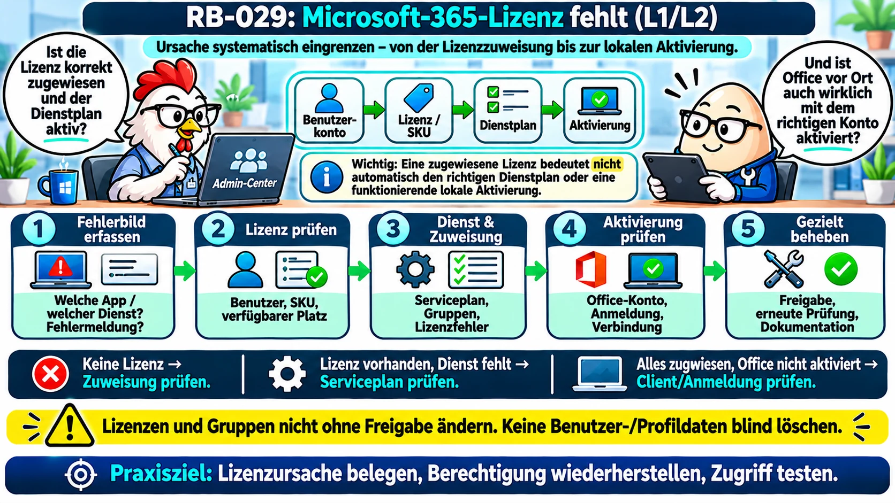

# RB-029 – Microsoft-365-Lizenz fehlt

**Projekt:** 50 Tickets – 50 typische Supportfälle  
**Bereich:** Microsoft 365, Identitäten, Lizenzen und Aktivierung  
**Support-Level:** L1/L2 · **Stand:** 22.11.2026 · **Version:** 1.0  
**Status:** Anhand offizieller Microsoft-Quellen recherchiert und als Lernfall dokumentiert; **nicht praktisch validiert**. Konkrete Beispieltickets sind ausdrücklich fiktiv.



> **Leitgedanke:** **Lizenz vorhanden** ist nicht dasselbe wie **passenden Dienst lizenziert**, **fehlerfrei zugewiesen** oder **lokale App aktiviert**. Erst die Ebene mit dem Fehler belegen, dann genau dort korrigieren.

---

## 1. Supportfall, Ziel und Abgrenzung

**Typische Meldung:** „Ich kann Word nicht mehr bearbeiten“, „Office zeigt *Nicht lizenziertes Produkt*“, „Teams/Exchange lässt sich nicht nutzen“ oder „Mein Microsoft-365-Produkt fehlt.“ Ziel ist, die Ursache reproduzierbar einer Ebene zuzuordnen, einen zulässigen Korrekturweg festzulegen und die ursprünglich betroffene Funktion zu überprüfen.

Dies ist **nicht** RB-028 („Office startet nicht“): Eine App kann starten und trotzdem im reduzierten Funktionsmodus laufen. Auch nicht jede Zugriffsverweigerung ist lizenzbedingt: Conditional Access, Anmeldung, Netzwerk und Dienststörungen bleiben Alternativhypothesen. **Geltungsbereich:** überwiegend Microsoft-365-Unternehmensumgebungen mit Microsoft Entra ID und verwaltetem Windows 11. Nicht ohne Prüfung auf private Microsoft-Konten, Volumenlizenz-Office, macOS oder Sonder-Clouds übertragen.

**L1:** Fehlermeldung sichern, Identität und Umfang klären, lesende Kontrollen im verfügbaren Rollenbereich, gegebenenfalls an Lizenzadministration übergeben. **L2 / autorisierte Lizenzadministration:** SKU/Serviceplan/Gruppenvererbung, Fehlerstatus, Aktivierung und genehmigte Lizenzänderung. Ticketpriorität nach Auswirkung: ein Benutzer versus mehrere Abteilungen, kritische Dienste oder Neuanlage eines Kontos.

## 2. Wie die Lizenzkette funktioniert

```text
Benutzer/UPN im richtigen Tenant
  ↓
Subscription vorhanden, gültig und mit ausreichenden Lizenzen
  ↓
Passende SKU (Lizenzprodukt) direkt oder über lizenzierte Gruppe
  ↓
Enthaltene Serviceplans: benötigter Dienst enthalten und aktiviert
  ↓
Zuweisung verarbeitet / ohne Fehler; Dienst bereitgestellt
  ↓
Richtige Anmeldung, Clientkontext und Erreichbarkeit der Lizenzdienste
  ↓
Der konkrete Dienst bzw. die Desktop-App funktioniert
```

Die Pfeile sind **Prüfabhängigkeiten**, keine Behauptung, dass jede Störung strikt linear auftritt. Ein Fehler auf einer Ebene kann sich erst weiter unten zeigen. Beispiel: Ein User besitzt Microsoft 365 Business Basic, aber die installierte Word-Desktop-App erwartet eine Desktop-App-Lizenz. Der User ist **lizenziert**, jedoch **nicht für die erwartete Desktopfunktion**. Microsoft unterscheidet Business Basic (Web-/Mobilversionen) und Business Standard (Desktop-Apps enthalten; konkrete Produktvarianten prüfen) [Q6].

**Begriffstrennung:**

| Begriff | Präzise Bedeutung | Diagnosefrage |
|---|---|---|
| Tenant | Organisationsverzeichnis und Microsoft-365-Mandant | Bin ich im richtigen Firmenkonto? |
| Subscription / Abonnement | Vertrag/Produktbestand mit verfügbaren Plätzen | Gibt es den Tarif und freie Einheiten? |
| SKU | Konkretes Lizenzprodukt (z. B. Business Basic) | Eignet sich das Produkt für die Funktion? |
| Serviceplan | Ein Dienst innerhalb einer SKU | Ist die benötigte Funktion im Produkt enthalten und eingeschaltet? |
| Direktzuweisung | Lizenz direkt auf dem Benutzer | Darf sie hier geändert werden? |
| Gruppenbasierte Zuweisung | Lizenz aufgrund Gruppenmitgliedschaft | Ist die Gruppe korrekt, und ist die Verarbeitung erfolgreich? |
| Provisionierung | Bereitstellung des Dienstes nach Zuweisung | Wurde der Dienst erfolgreich provisioniert? |
| Aktivierung | Client bestätigt gültiges Nutzungsrecht | Ist lokale Office-Aktivierung mit richtigem Konto erfolgreich? |

## 3. Symptome und Diagnosehypothesen

| Symptom | Mögliche Hypothesen, **keine Diagnose** | Trennender Test |
|---|---|---|
| Word meldet „Nicht lizenziertes Produkt“ | falsches Konto, ungeeignete SKU, Aktivierungs-/Netzwerkproblem | Im Admin Center Lizenz und Produktrecht bestätigen; Word > Datei > Konto |
| Browser-Office funktioniert, Desktop-Word nicht | Web-only-Tarif, lokale Aktivierung, Installation/Client | Produktberechtigung mit Browser-/Clientkontext abgleichen |
| Teams oder Exchange nicht verfügbar | Serviceplan deaktiviert, Verarbeitung fehlgeschlagen, Zugriffspolicy, Dienststörung | Planstatus und identische Funktion beim Vergleichsbenutzer |
| Nach Onboarding keine Dienste | Zuweisung ausstehend, falsche Gruppe/Standort, kein freier Platz | Gruppenmitgliedschaft, Fehler & Probleme, Zeitstempel |
| Mehrere Benutzer gleichzeitig | Gruppenänderung, ausgelaufenes Abonnement, Plattformproblem | Gemeinsame SKU/Gruppe, Status und Change prüfen |
| Office nur auf Remote Desktop nicht aktiv | Shared Computer Activation falsch konfiguriert/nicht enthalten | Lizenzmodus und Unterstützungsstatus prüfen |

Ein Fehlertext wie „Nicht lizenziertes Produkt“ beweist *nicht*, dass im Tenant kein Lizenzplatz existiert. Microsoft nennt Anmelde-, Aktivierungs- und Verbindungsursachen [Q3].

## 4. Erstaufnahme: die neun Fragen

1. Welche App oder welcher Dienst ist betroffen (Word Desktop, Word Web, Teams, Exchange, SharePoint, OneDrive etc.)?
2. Welcher **exakte Wortlaut**, Fehlercode und Screenshot liegen vor (möglichst ohne personenbezogene Daten im Anhang)?
3. Seit wann und nach welchem Ereignis (Onboarding, Konto-/Gruppenwechsel, Neuinstallation, Gerätewechsel)?
4. Einzelperson, mehrere Benutzer oder alle Nutzer einer Gruppe?
5. Welche Firmenidentität/UPN und welcher Tenant sind betroffen (keine privaten Passwörter erfassen)?
6. Funktioniert derselbe Dienst im Browser? Funktioniert ein anderer lizenzierter Dienst?
7. Ist die App auf einem Einzelplatz-PC, per RDS/VDI, auf einem gemeinsam genutzten Gerät oder per Geräte-Lizenzierung betrieben?
8. Hat die Person nur den lokalen Client gewechselt oder gibt es eine dokumentierte Tenant-Änderung?
9. Wer ist für Lizenzfreigaben zuständig und welche Berechtigung hat das Support-Team?

**Datenschutz:** Im Ticket nach Möglichkeit interne Fall-ID statt vollständiger UPN, keine Authentifizierungstokens, Gerätezertifikate, Lizenzdateien, Passwort-/MFA-Codes oder Screenshots mit privaten Inhalten dokumentieren.

## 5. Sicherheits- und Änderungs-Gate

**Vor jeder Änderung prüfen:** Berechtigung, Change-/Freigabeprozess, Bestandsaufnahme, Leistungs- und Datenfolgen und Rückfallmöglichkeit. Eine Lizenz zu entfernen oder umzuhängen kann Dienste unterbrechen; bei Gruppenwechseln empfiehlt Microsoft, die Zielgruppe zuerst zu belegen und die neue Zuweisung nachzuweisen, bevor die alte Mitgliedschaft entfällt [Q2].

**Nicht als erster Schritt:** Benutzer löschen, Gruppenmitgliedschaft auf Verdacht verändern, Lizenzen anderer Benutzer entfernen, Office neu installieren, Profil-/Tokenordner oder Registrierungseinträge löschen. Aktivierungs-Reset ist ein gezielter Eingriff der L2-/Endpoint-Ebene und erst nach nachvollziehbarem Befund sinnvoll [Q7].

**Prüffalle:** Lizenz- und Serviceplanstatus im Admin Center sind für die meisten Supportfälle aussagekräftiger als ein lokales Windows-Popup allein. Umgekehrt reicht eine korrekte Tenant-Zuweisung ohne Ende-zu-Ende-Funktionstest nicht für den Ticketabschluss.

## 6. L1: schnellster sicherer Diagnoseweg

1. Genauen Fehlertext, betroffene Funktion, Uhrzeit und Konto aufnehmen.
2. **Nur die gemeldete Funktion** reproduzieren: z. B. Word-Dokument öffnen und bearbeiten (keine produktiven Daten ändern, wenn nicht autorisiert).
3. Web- und Desktop-Verhalten getrennt feststellen; Browserzugriff nur als **Vergleich**, nicht als Beweis einer Lizenz.
4. Bei Zugriff auf Admin Center: **Benutzer > Aktive Benutzer > Benutzer auswählen > Lizenzen und Apps** (Menünamen können je nach Rollout variieren); Produkt und aktivierte Dienste ansehen [Q1].
5. Wenn die Lizenz fehlt, falscher Tarif oder ein Serviceplan deaktiviert ist: nicht selbständig irgendeine SKU zuweisen, sondern Berechtigungs-/Freigabeweg prüfen.
6. Wenn Lizenz und Dienst korrekt aussehen: L2 informiert mit exaktem Hinweis auf möglicherweise **lokalen Aktivierungsfehler**.

**Praktisches Gegenbeispiel:** Ein User kann Word im Browser bearbeiten. Daraus folgt *nicht*, dass dieselbe Person Word Desktop starten/aktivieren darf. Lizenzrechte für Web und Desktop sind planabhängig [Q6].

## 7. Admin Center: Produktsitz, Benutzer und Lizenzfehler lesen

Für die Diagnose stehen zwei administrative Ansichten zur Verfügung (Microsoft-Oberflächen ändern sich):

- **Microsoft 365 Admin Center → Benutzer → Aktive Benutzer → [Benutzer] → Lizenzen und Apps**: zugewiesenes Produkt sowie Apps/Dienste prüfen.
- **Abrechnung → Lizenzen → [Produkt]**: verfügbare/zugewiesene Einheiten und **Fehler & Probleme (Errors & Issues)** prüfen. Nach erfolgreicher Ursachenbehebung gibt es in der Oberfläche, abhängig von Rolle/Fall, eine **Reprocess**-Funktion für fehlgeschlagene Zuweisungen [Q1].

**Konkrete Kontrollfragen:** Stimmen UPN und Tenant? Ist das Produkt für den gewünschten Dienst geeignet? Sind genügend Lizenzplätze verfügbar? Ist der Dienst in der SKU aktiviert? Ist die Lizenz direkt oder via Gruppe zugewiesen? Wird der Benutzer tatsächlich als **erfolgreich lizenziert** angezeigt – oder liegt nur eine geplante/fehlgeschlagene Zuweisung vor?

Ein freier Platz in einem Produkt bedeutet nicht automatisch, dass jeder andere Tarif ausreichend ist. Produkt-/Dienstanforderung **vor** Zuweisung klären.

## 8. Gruppenzuweisung: die typische versteckte Ursache

Microsoft beschreibt, dass **gruppenbasierte Lizenzfehler** asynchron auftreten und im Admin Center in der Fehlerübersicht sichtbar werden können [Q2]. Prüfe:

1. Ist die Person **Mitglied der erwarteten lizenzierten Gruppe**?
2. Ist das Produkt für **diese Gruppe** zugewiesen?
3. Ist die zugewiesene SKU noch verfügbar und passend?
4. Ist die Verarbeitung erfolgreich? Anzeichen: „Errors & Issues“ beziehungsweise `licenseAssignmentStates`.
5. Gibt es **Serviceplan-Konflikte**, Voraussetzungen für Add-ons oder eine ungültige Nutzungsregion (`UsageLocation`)? [Q2]

**Keine falsche Abkürzung:** Bei einer durch Gruppen verwalteten Lizenz kann eine direkte Lizenzzuweisung das zugrunde liegende Gruppen-/Governanceproblem verdecken. Änderungen gehören zur definierten Zuständigkeit. Wird ein Benutzer zwischen Lizenzgruppen verschoben, zuerst Zielgruppe und neue Lizenz prüfen, danach alte Gruppe entfernen [Q2].

## 9. Serviceplans: warum „eine Lizenz“ nicht genügt

Die SKU ist ein Bündel aus Einzelrechten. Entscheidend ist, **welcher Dienst** fehlt. Zwei Beispiele:

- Ein Nutzer darf Web-Word verwenden, hat aber keinen Anspruch auf Desktop-Office. Erwarteter Desktopzugriff und gebuchter Plan stimmen nicht überein [Q6].
- Ein Produkt ist korrekt zugewiesen; der für den konkreten Dienst erforderliche Serviceplan ist jedoch deaktiviert oder fehlerhaft provisioniert. **Nicht** irgendeinen anderen Plan aktivieren, sondern berechtigtes Produkt und Soll-Konfiguration nachweisen.

Bei Serviceplanverfügbarkeit unterscheiden: *im Produkt enthalten*, *für Benutzer aktiv*, *technisch bereitgestellt*, *im Client tatsächlich nutzbar*. Zum Umfang einzelner M365-Tarife immer den aktuellen Microsoft-Produktvergleich und die Organisationsvorgaben prüfen, nicht allein die Bezeichnung „M365“.

## 10. Lokale Microsoft-365-Apps-Aktivierung

**Voraussetzung:** Im Tenant sind für diese Benutzeridentität die erforderlichen Desktop-App-Rechte bestätigt. Erst **dann** lokale Aktivierung untersuchen:

1. Office-App öffnen → **Datei > Konto**: Produkt- und Aktivierungsstatus, angemeldete Identität, ggf. Hinweise zur Lizenzaktualisierung dokumentieren.
2. **Geschäftskonto vs. privates Microsoft-Konto** abgleichen; gegebenenfalls im richtigen Benutzerkontext erneut anmelden. Bereits vorhandene Benutzerdateien bleiben erhalten.
3. Erreichbarkeit der Microsoft-365-Anmelde- und Lizenzdienste sowie Netz-/Proxy-Situation gemäß Unternehmensvorgaben klären.
4. Offiziellen Aktivierungs-Troubleshooter / „Hilfe anfordern“ nach Freigabe einsetzen, falls die Standardprüfung keine Ursache zeigt [Q3].
5. Bei Shared Computer Activation (RDS/VDI) Lizenzmodus und unterstützten Plan separat prüfen [Q5]. Bei gerätebasierter Lizenzierung gelten wieder andere Bedingungen [Q4].
6. Aktivierungsdateien oder Registry-Werte **nicht manuell löschen**; Microsofts Resetverfahren ist ein spezifischer Eskalationspfad [Q7].

**Zeitliche Einordnung:** Microsoft nennt für Microsoft 365 Apps eine regelmäßig benötigte Internetverbindung zur Lizenzverlängerung und empfiehlt bei Bereitstellung die Zuweisung rechtzeitig vor der Installation (in der Übersicht etwa 24 Stunden Vorlauf) [Q4]. Das ist **keine garantierte Fehlerdauer** für individuelle Tickets.

## 11. Nur lesende Microsoft-Graph-PowerShell-Diagnose (L2)

**Voraussetzung:** Genehmigte Rolle im richtigen Tenant, Microsoft Graph PowerShell SDK vorhanden und gültiger Zugriff; die tatsächlichen Rechte der Rolle sind zusätzlich zu den Scopes maßgeblich. Die folgenden Abfragen **ändern keine Lizenzen**. Platzhalter sind zu ersetzen; produktive Ergebnisse nur gemäß Datenschutz dokumentieren. Die Befehle orientieren sich an den Microsoft-Beispielen [Q8, Q9, Q10].

```powershell
# Einmalig, interaktiv: nur Lese-Scopes anfordern.
Connect-MgGraph -Scopes "User.Read.All", "Organization.Read.All"

# Prüfen, in welchem Tenant/Account die Sitzung läuft.
Get-MgContext | Select-Object TenantId, Account, Scopes

# Beispiel-UPN: durch autorisiertes Testkonto ersetzen.
$upn = "test.user@firma.example"

# Konto, Nutzungsregion, direkte/erhaltene Lizenzen und Zuweisungsstatus lesen.
Get-MgUser -UserId $upn -Property Id,DisplayName,UserPrincipalName,UsageLocation,AssignedLicenses,LicenseAssignmentStates |
  Select-Object DisplayName,UserPrincipalName,UsageLocation,AssignedLicenses,LicenseAssignmentStates |
  Format-List

# Zugewiesene Lizenzprodukte und enthaltene Serviceplans lesen.
Get-MgUserLicenseDetail -UserId $upn |
  Select-Object SkuPartNumber,SkuId,ServicePlans |
  Format-List

# Tenant-Produkte und Kapazität lesen; die Detailinterpretation
# muss Enabled, Consumed und ggf. Suspended/Warning berücksichtigen.
Get-MgSubscribedSku |
  Select-Object SkuPartNumber,SkuId,ConsumedUnits,PrepaidUnits |
  Format-Table -AutoSize
```

**Interpretation:** `AssignedLicenses` beschreibt zugewiesene SKUs einschließlich ggf. deaktivierter Plan-IDs. `LicenseAssignmentStates` kann direkte oder gruppenbasierte Herkunft und Fehler zeigen; `Get-MgUserLicenseDetail` zeigt Produkte und darin enthaltene Dienste. Eine leere Ausgabe kann auch fehlende Berechtigung oder falschen Tenant bedeuten – nicht automatisch „keine Lizenz“. `PrepaidUnits` ist ein komplexes Objekt; freie Einheiten nicht schlicht aus einem zufälligen Feld errechnen. Die Admin-Center-Anzeige ist für operative Kapazität oft die verlässlichere Übersicht.

**Bewusst nicht Teil des Standard-Runbooks:** `Set-MgUserLicense`, `Update-MgUser`, Gruppenzuweisungsschreibzugriffe, `Remove-Mg...`. Diese Befehle verändern produktive Berechtigungen und gehören in einen gesondert freigegebenen Change [Q9].

## 12. Sonderfälle und Grenzen der Diagnose

| Kontext | Ergänzende Diagnose | Besondere Vorsicht |
|---|---|---|
| Benutzer nach Onboarding | Gruppenmitgliedschaft, Übernahme, SKU/Plan, Fehlerstatus | Nicht blind neue Lizenz doppelt zuweisen |
| Lizenz nach Rollenwechsel weg | Änderungshistorie, alter/neuer Gruppenpfad | Vor Umstellung Dienstunterbrechung vermeiden |
| Browser ja, Desktop nein | Tarifrecht, richtige Office-Anmeldung, Aktivierungsdienst | Kein Reinstall allein aufgrund des Textes „unlizenziert“ |
| RDS/VDI / gemeinsamer PC | Lizenzberechtigung und Shared Computer Activation | Nicht per gewöhnlichem Einzelplatzprofil „reparieren“ [Q5] |
| Gerätebasierte Lizenzierung | Gerätegruppe, Aktivierungsmodus, Gerätezustand | Benutzerbasierte Annahmen nicht ungeprüft übernehmen [Q4] |
| Nur ein Dienst fehlt | einschlägiger Serviceplan, Policy, Service Health | Es muss kein Lizenzproblem sein |
| Viele Benutzer gleichzeitig | gemeinsamer Lizenzbestand, Gruppe, Service Health | Incident-/Changekoordination vor Einzelplatzfix |

Bei einer Dienststörung, blockierenden Zugriffspolitik oder einem Identitätsproblem können ähnliche Symptome auftreten. Bei unklaren Hinweisen bewusst Gegenhypothesen bilden und an die passende Fachgruppe eskalieren.

## 13. Entscheidungsmatrix für die gezielte Maßnahme

| Befund aus Vergleichstests | Begründete Maßnahme (autorisierte Stelle) | Nachweis der Lösung |
|---|---|---|
| Erwartete SKU fehlt tatsächlich | Freigegebene direkte oder gruppenbasierte Zuweisung im Sollzustand herstellen | Benutzer zeigt SKU ohne Fehler; gewünschte Funktion testen |
| Erwartete SKU vorhanden, Serviceplan fehlt/aus | Serviceplan/SKU nach Leistungsbedarf und Governance prüfen, ggf. freigeben | Planstatus erfolgreich; Dienst nutzbar |
| Gruppenzuweisung fehlerhaft | Ursache wie Plätze, Konflikt oder UsageLocation korrigieren, Verarbeitung erneut anstoßen | Fehlerstatus nicht mehr vorhanden; Benutzerberechtigung bestätigt |
| Produkt hat keine Desktopberechtigung | Geeigneten Tarif/Produkt durch Lizenzverantwortliche klären | Desktop-App nach genehmigter Lizenzierung aktiviert |
| Tenant-Zuweisung korrekt, nur Client defekt | Konto, Netzwerk und offizielle Aktivierungsdiagnose prüfen | App zeigt „Aktiviert“; Bearbeiten/Speichern funktioniert |
| Ursache unklar / kein Änderungsrecht | Belege an Lizenz-/Identity-/Endpointteam weitergeben | Übergabe enthält klare Trennung von Hypothesen und Tests |

**Keine pauschale „Lizenz entfernen und neu zuweisen“-Routine.** Das wäre in produktiven Umgebungen ein echter Berechtigungseingriff mit möglichen Auswirkungen auf Arbeitsfähigkeit und Dienste.

## 14. Zwei fiktive Praxisfälle – Diagnoselogik üben

### Fall A: „Der neue Mitarbeiter kann Word online nutzen, Desktop-Word meldet unlizenzierte Nutzung“

**Lage (fiktiv):** Nach Onboarding kann der Mitarbeitende Dateien über Word im Browser bearbeiten. Auf dem verwalteten Windows-Notebook erscheint aber im Desktop-Word der Aktivierungshinweis.

**Hypothesen:** falsches Anmeldekonto, Aktivierungsproblem, Web-only-Tarif. **Tests:** UPN im Word-Konto und Admin Center vergleichen; SKU und Desktopberechtigung im aktuellen Produktvergleich prüfen. **Befund im Übungsfall:** Business Basic korrekt zugewiesen, Desktop-Apps nicht im erwarteten Umfang enthalten. **Maßnahme:** Lizenzverantwortlichen über fehlende Desktopberechtigung informieren; keine Tokenlöschung. Bei genehmigtem passenden Tarif nach neuer Zuweisung die App mit richtigem Konto aktivieren und Testdokument bearbeiten. **Lernpunkt:** Produkt vorhanden ≠ Funktion lizenziert. Kein reales Testergebnis.

### Fall B: „Neue Teammitglieder erhalten keinen Dienst trotz Gruppenzugehörigkeit“

**Lage (fiktiv):** Drei Benutzer einer Abteilung melden kurz nach Aufnahme in eine lizenzierte Gruppe fehlenden Dienstzugriff. Bestandsbenutzer funktionieren.

**Hypothesen:** Gruppe falsch, zu wenige Produktplätze, Verarbeitung ausstehend, Plan-Konflikt. **Tests:** Gruppenmitgliedschaft, Soll-SKU, Fehlerübersicht, verfügbare Plätze vergleichen. **Befund im Übungsfall:** Keine verfügbaren Lizenzplätze, fehlgeschlagene gruppenbasierte Zuweisung. **Maßnahme:** Berechtigte Stelle organisiert korrekt dimensionierten Lizenzbestand; nach Freigabe Verarbeitung erneut prüfen, keine bestehende Lizenz blind entfernen. **Erfolg:** Benutzer erhalten passende SKU und Serviceplan ohne Fehler; exakt betroffener Dienst wird wiederholt getestet. **Lernpunkt:** Gruppenmitgliedschaft allein beweist keine erfolgreiche Lizenzzuweisung. Kein reales Testergebnis.

## 15. Active Recall, Transfer und spätere Laborvalidierung

**Ohne Nachschlagen beantworten:**

1. Was ist der Unterschied zwischen SKU und Serviceplan?
2. Warum bedeutet „Nicht lizenziertes Produkt“ nicht zwingend, dass dem Benutzer jede Microsoft-365-Lizenz fehlt?
3. Welche drei Abgleiche würdest du zuerst machen, bevor du eine Lizenz änderst?
4. Warum kann Business Basic für Word Web reichen, aber nicht für den erwarteten Desktop-Einsatz?
5. Wo prüfst du gruppenbasierte Zuweisungsfehler?
6. Welche zwei Graph-Cmdlets zeigen Tenant-SKUs und Benutzer-Lizenzdetails, ohne eine Zuweisung zu verändern?
7. Warum ist das Umziehen eines Benutzers zwischen zwei Lizenzgruppen ohne Reihenfolge riskant?
8. Welche Nachweise müssen vor dem Schließen des Tickets vorliegen?

**Drei mögliche Anki-Karten (nur Vorschläge):**

- **Wissen:** „SKU vs. Serviceplan?“ → „SKU ist das Lizenzprodukt; Serviceplan ist eine enthaltene Dienstberechtigung.“
- **Verständnis:** „Wieso kann Web-Word trotz gesperrtem Desktop-Word funktionieren?“ → „Unterschiedliche Produktrechte oder lokaler Aktivierungsfehler.“
- **Diagnose:** „Gruppe korrekt, Lizenz fehlt – nächster Test?“ → „Fehler der gruppenbasierten Zuweisung und verfügbare Plätze prüfen.“

**Praxisvalidierung später:** Nur mit genehmigtem Testtenant, Testkonto und dokumentiertem Sollzustand. Einen Nutzer mit und ohne vorgesehenem Serviceplan vergleichen; bewusst **nicht** produktive Lizenzen entfernen. Vorher Hypothese und erwartetes Ergebnis aufschreiben; danach Istzustand, Admin-Sicht und Funktionstest dokumentieren. In dieser Ausarbeitung wurde **keine** produktive oder Laboränderung ausgeführt.

---

## Herstellerquellen – offizielle Microsoft-Dokumentation (Recherche 22.11.2026)

- **[Q1] Microsoft 365 Admin Center: Benutzer- und Produktlizenzen, Fehler & Probleme:** https://learn.microsoft.com/en-us/microsoft-365/admin/manage/assign-licenses-to-users?view=o365-worldwide
- **[Q2] Gruppenbasierte Lizenzierung und Fehlertypen:** https://learn.microsoft.com/en-us/microsoft-365/admin/manage/manage-group-licenses?view=o365-worldwide
- **[Q3] „Nicht lizenziertes Produkt“ / Office-Aktivierungsfehler:** https://support.microsoft.com/de-de/microsoft-365-activation-licensing/office-install/unlicensed-product-and-activation-errors-in-office
- **[Q4] Microsoft 365 Apps: Lizenz- und Aktivierungsmodelle:** https://learn.microsoft.com/en-us/microsoft-365-apps/licensing-activation/overview-licensing-activation-microsoft-365-apps
- **[Q5] Shared Computer Activation: Fehlerbehebung:** https://learn.microsoft.com/en-us/microsoft-365-apps/licensing-activation/troubleshoot-shared-computer-activation
- **[Q6] Microsoft 365 Business-Tarife und Funktionen:** https://www.microsoft.com/de-de/microsoft-365/business/compare-all-microsoft-365-business-products
- **[Q7] Zurücksetzen des Office-Aktivierungsstatus (nur gezielt nach Freigabe):** https://learn.microsoft.com/en-us/troubleshoot/microsoft-365-apps/activation/reset-activation-state
- **[Q8] Microsoft Graph PowerShell: Lizenz- und Serviceplandetails anzeigen:** https://learn.microsoft.com/en-us/microsoft-365/enterprise/view-account-license-and-service-details-with-microsoft-365-powershell
- **[Q9] Microsoft Graph PowerShell: gruppenbasierte Lizenzen und Fehler lesen:** https://learn.microsoft.com/en-us/entra/identity/users/licensing-powershell-graph-examples
- **[Q10] `Get-MgUserLicenseDetail` – Cmdlet-Referenz:** https://learn.microsoft.com/en-us/powershell/module/microsoft.graph.users/get-mguserlicensedetail?view=graph-powershell-1.0

**Transparenz:** Herstellerquellen wurden für eine allgemeine Lern- und Diagnosevorlage ausgewertet. Die Abläufe wurden **nicht an einer tatsächlichen Unternehmensumgebung geprüft**. Bei Änderungen am Microsoft-365-Portal und an Produktplänen hat die aktuelle Herstellerdokumentation Vorrang.
