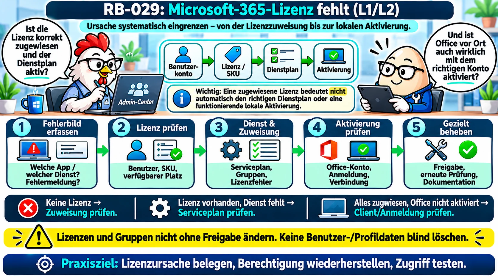

# RB-029 – Praxis-Runbook: Microsoft-365-Lizenz fehlt

**Projekt:** 50 Tickets – 50 typische Supportfälle  
**Support-Level:** L1 / L2 (Lizenzadministration nach Berechtigungsmodell)  
**Version:** 1.0 · **22.11.2026** · **Fachstatus:** recherchiert, **praktisch nicht validiert**.

> **Arbeitsregel:** Erst ermitteln, ob ein passendes Produkt zugewiesen ist, der richtige Dienst aktiviert wurde und die Zuweisung erfolgreich verarbeitet ist. Erst **danach** einen rein lokalen Office-Aktivierungsfehler behandeln. Keine vorschnellen Lizenz- oder Gruppenänderungen.



Technischer Entscheidungsbaum: [SVG](assets/rb029_diagnosebaum.svg) · [PNG-Vorschau](../assets/rb029_diagnosebaum.svg)

---

## 1. Ticketaufnahme und Priorität (L1)

**Minimaldaten:** Ticket-ID; Zeitpunkt; Anwendung/Dienst; exakter Fehlertext/-code; betroffene User/Gruppe; richtiger Tenant und anonymisierte Benutzerkennung; Business-Auswirkung; letzte Konto-/Lizenz-/Gruppenänderung; Rolle/Verantwortlichkeit der bearbeitenden Person.

**Klassifizierung:**

- **Ein User:** übliches L1/L2-Ticket, sofern nicht geschäftskritischer Prozess blockiert ist.
- **Mehrere User:** gemeinsame SKU, Gruppenzuweisung, Abonnementstatus, Service Health und Changes vergleichen; ggf. Major-Incident-Prozess.
- **Nur Desktop / nur Web / nur ein Dienst:** präzise eingrenzen, keinen pauschalen Office-/M365-Ausfall annehmen.

**Abfrage an den Nutzer:** „Welche konkrete Funktion ist nicht möglich, und was zeigt die Meldung? Ist das im Browser genauso? Seit wann und nach welcher Änderung?“

## 2. Sicherheits-Gate vor Änderungen

- Richtigen Tenant, Account und Zuständigkeit bestätigen; privilegierte Rollen nicht allein aufgrund eines Symptoms erweitern.
- Keine produktiven Lizenzen, Gruppen, Serviceplans, Benutzer oder Profile ohne Freigabe löschen, entfernen oder verändern.
- Auswirkungen auf Mailbox, Teams, Dateizugriff und Arbeitsfähigkeit bei Lizenzänderungen beachten; Lizenzentzug ist nicht trivial.
- Vor Änderungen am Office-Aktivierungsstatus: Client, Lizenzmodus, Anmeldestatus und Datenlage dokumentieren.
- Keine Passwörter, Tokens, privaten Dokumente oder vollständige Zugangsnachweise im Ticket ablegen.
- Wenn aktueller Tenant-/Produktzustand nicht zuverlässig gelesen werden kann: **STOPP → Berechtigungs-/Identitätsteam**.

## 3. L1-Schnellprüfung: Symptome trennen

| Schritt | Test / Beobachtung | Aussage |
|---|---|---|
| A | Fehlertext und betroffenen Dienst notieren | Problemtyp identifizieren |
| B | Richtige Firmenidentität/UPN im Client und im Browser vergleichen | Konto-/Tenantverwechslung ausschließen |
| C | Word/Excel/Teams Web und Desktop getrennt testen (soweit erlaubt) | Nur Client oder auch Cloud betroffen? |
| D | Bei Admin-Center-Lesezugriff Benutzer → Aktive Benutzer → Lizenzen und Apps | Tatsächlich zugewiesenes Lizenzprodukt prüfen |
| E | Soll-Funktion gegen aktuellen Produktumfang halten | Passender SKU-/Serviceplan vorhanden? |

**Wichtig:** Browserfunktion **beweist keine Desktopberechtigung**. Ein Microsoft 365 Business Basic-Tarif kann Web-Office bereitstellen, ohne die entsprechenden Desktop-Apps zu umfassen [Q6].

## 4. Pfad A – Lizenzprodukt fehlt oder passt nicht

**Voraussetzung:** Das Admin Center zeigt für den korrekten Benutzer keine passende SKU – oder die vorliegende SKU deckt den konkreten Leistungsbedarf nicht ab.

1. Erwarteten Sollzustand aus Onboarding-/Berechtigungsmatrix und freigegebener Produktliste ermitteln.
2. Prüfen, ob **direkte** oder **gruppenbasierte** Vergabe vorgesehen ist.
3. Lizenzbestand, Zielgruppe, verfügbaren Platz und Nutzungsregion kontrollieren [Q1, Q2].
4. Befund an lizenzberechtigte Stelle übergeben: „Sollprodukt fehlt“ oder „Vorhandener Plan enthält keinen gewünschten Dienst“.
5. **Nur nach Freigabe** passende Zuweisung vornehmen lassen; keine andere Nutzerlizenz auf Verdacht abziehen.
6. Nach Verarbeitung SKU und Dienst nachweisen und denselben Nutzer-Funktionstest wiederholen.

**Kein Schnellfix:** Massenhafte Direktlizenzierung als Umgehung einer fehlerhaften lizenzierten Gruppe.

## 5. Pfad B – Lizenzprodukt vorhanden, Dienst fehlt

**Voraussetzung:** SKU ist dem Nutzer zugewiesen, aber der benötigte Serviceplan ist nicht vorhanden, deaktiviert oder nicht provisioniert.

1. **Welche konkrete Funktion** ist betroffen (z. B. Exchange Online vs. Desktop-App)?
2. Prüfen, ob Produkt den Plan überhaupt enthält. Falls nein: **Tarif-/Beschaffungsfrage**.
3. Falls Plan enthalten: Ist er für den Nutzer **aktiv**? Ggf. globale Sollkonfiguration gegenprüfen.
4. Bei gruppenbasierter Vergabe: Gruppenmitgliedschaft, Zuweisungsfehler und konkurrierende Pläne kontrollieren.
5. Erst nach Freigabe Serviceplan/SKU/Gruppe korrigieren lassen; anschließend tatsächliche Dienstfunktion nachweisen.

**Achtung:** Lizenz-/Serviceplanprobleme nicht mit Conditional Access, Authentifizierungs- oder Microsoft-365-Dienststörung verwechseln.

## 6. Pfad C – Gruppenlizenzierung fehlgeschlagen

**Prüfpunkt:** Microsoft 365 Admin Center → Abrechnung → Lizenzen → Produkt → **Fehler & Probleme** (oder entsprechender Entra-Bereich; UI abhängig vom Rollout) [Q1, Q2].

**Typische Fehler:** Keine verfügbaren Plätze; kollidierende Serviceplans; nicht unterstützte Nutzungsregion; Abhängigkeiten/zusätzliche Produkte; fehlerhafte Verarbeitung.

**Maßnahmenfolge:**

1. Meldung und **betroffene SKU/Gruppe** dokumentieren.
2. Ursache bestimmen und mit zuständiger Stelle beheben; Änderungen nur gemäß Berechtigung.
3. Falls der Vorgang nach Ursachenbehebung fehlerhaft bleibt: vorgesehene **Reprocess**-Funktion durch autorisierte Administration nutzen [Q1].
4. Erneut den **Zuweisungsstatus ohne Fehler** und die nutzbare Funktion nachweisen.

**Beim Gruppenwechsel:** Zielgruppe hinzufügen → neue wirksame Lizenz bestätigen → alte Gruppe entfernen, um Unterbrechungen zu vermeiden [Q2].

## 7. Pfad D – Tenant-Lizenz korrekt, Office Desktop unlizenzierter Client

**Anwendung:** Rechte für die konkrete Desktop-App sind nachgewiesen; nur der Client meldet Aktivierungsfehler.

1. Word/Excel → **Datei > Konto**: Produktinformationen, Aktivierungsstatus, angemeldete Adresse lesen.
2. Business- und Privatkonto unterscheiden; richtige Organisation überprüfen.
3. Internet-/Proxy-/Anmelde- und Lizenzdiensterreichbarkeit anhand Endpoint-Vorgaben untersuchen.
4. Bei passendem Befund: vorgeschriebenen offiziellen Microsoft-Aktivierungs-Troubleshooter einsetzen [Q3].
5. Bei RDS/VDI/Shared Computer Activation: **Sonderlizenzmodus und unterstützten Tarif** prüfen [Q5]; gegebenenfalls an Endpoint-/VDI-Team eskalieren.
6. Erst nach technischer Bestätigung und Freigabe ein dokumentiertes, herstellerkonformes Token-/Aktivierungsresetverfahren erwägen [Q7]. **Keine manuelle Löschung auf Verdacht.**
7. Word erneut öffnen, Anzeige der Aktivierung prüfen, neues Testdokument öffnen, bearbeiten und speichern.

**Sonderfall:** Gerätelizenzierung nutzt andere Berechtigungs-/Aktivierungsregeln als Nutzerlizenzierung; bei Anzeichen dafür separat dokumentieren und zuständige Stelle einbeziehen [Q4].

## 8. Nur lesende Microsoft-Graph-Diagnose (L2)

**Voraussetzungen:** Graph PowerShell SDK, autorisierte Rolle und Einwilligung für Lese-Scopes; nur im richtigen Tenant. Keine tatsächlichen Benutzerdaten im Lernprotokoll veröffentlichen.

```powershell
# Genehmigte Lesesitzung öffnen; Benutzer-/Tenant-Kontext prüfen.
Connect-MgGraph -Scopes "User.Read.All", "Organization.Read.All"
Get-MgContext | Select-Object Account,TenantId,Scopes

# Platzhalter-UPN durch autorisierten Testbenutzer ersetzen.
$upn = "test.user@firma.example"

# Zugewiesene SKUs und die Lizenzverarbeitungszustände anzeigen.
Get-MgUser -UserId $upn -Property UserPrincipalName,UsageLocation,AssignedLicenses,LicenseAssignmentStates |
  Select-Object UserPrincipalName,UsageLocation,AssignedLicenses,LicenseAssignmentStates |
  Format-List

# Lizenzprodukt und Serviceplans für den User anzeigen.
Get-MgUserLicenseDetail -UserId $upn |
  Select-Object SkuPartNumber,ServicePlans |
  Format-List

# Tenant-Produkte und gekaufte/verwendete Einheiten anzeigen.
Get-MgSubscribedSku |
  Select-Object SkuPartNumber,ConsumedUnits,PrepaidUnits |
  Format-Table -AutoSize
```

**Auswertung:** Differenz zwischen Produkt-SKU, dem gewünschten Serviceplan und `LicenseAssignmentStates` erklären; ein leerer Graph-Befund **kann** am falschen Tenant oder an Berechtigungen liegen. `PrepaidUnits` ist kein einfacher Ganzzahlwert. **`Set-MgUserLicense` wird hier bewusst nicht verwendet.** Quellen: [Q8, Q9, Q10].

## 9. Erfolgskontrolle und Eskalationsgrenze

**Ticket nur schließen, wenn die ursprünglich betroffene Funktion reproduzierbar funktioniert und die zuständige Person dies bestätigt oder der vereinbarte Freigabeprozess erfüllt ist:**

- Richtiger Benutzer/Tenant und Soll-Lizenzprodukt eindeutig bestätigt.
- Benötigter Serviceplan aktiv und wirksam; keine offenen Zuordnungsfehler.
- Bei Desktop-Problem zeigt Office **aktiviert**; konkrete Datei bearbeiten/speichern möglich.
- Bei Cloud-Dienst Problem ist genau dieser Dienst auf dem betroffenen Konto nutzbar.
- Ergebnis mindestens zweimal nachvollzogen, z. B. nach erneuter App-Anmeldung/Start, soweit sinnvoll.
- Ursache, autorisierte Maßnahme, Zeitpunkt und Testergebnis im Ticket dokumentiert.

**L2/License/Identity eskalieren**, wenn Sollplan unklar, Lizenzbudget betroffen, Gruppenmigration notwendig, Provisionierungsfehler ungelöst, RDS/VDI-Lizenzmodus betroffen oder Administratorrolle nicht verfügbar. **Endpoint eskalieren**, wenn Tenantberechtigung korrekt und ein Client-/Token-/Geräteproblem plausibel ist. **Incident Management**, wenn mehrere Benutzer gleichzeitig ausfallen.

## 10. Ticketdokumentation und Mini-Lerncheck

### Muster-Ticketkommentar – ausdrücklich fiktiv

> **Sachverhalt:** Benutzer meldet „Nicht lizenziertes Produkt“ in Word Desktop; Word Web funktioniert. Identität und Tenant abgeglichen. **Diagnose:** Für das betroffene Konto war ein gültiger Web-only-Tarif zugewiesen; die benötigte Desktop-App-Nutzung war dadurch nicht abgedeckt. **Maßnahme:** Soll-Tarif mit Lizenzverantwortlichen geprüft, erforderliche Desktop-Berechtigung nach Freigabe zugewiesen. **Prüfung:** Lizenz-/Serviceplanstatus ohne Fehler; Word Desktop unter Firmenkonto aktiviert; Öffnen, Bearbeiten und Speichern einer Testdatei erfolgreich. **Status:** Nur Musterfall, nicht produktiv durchgeführt.

### L1-Status in drei Sätzen

> **Problem:** Word meldet fehlende Lizenz, obwohl Web-Zugriff möglich ist. **Prüfung:** Konto und Tenant sind abgeglichen; passender Desktop-Tarif beziehungsweise lokaler Aktivierungsstatus wird getrennt verifiziert. **Nächster Schritt:** Erforderliche Lizenzänderung nur nach Freigabe durch die zuständige Administration; danach erneuter Funktionstest.

### Active Recall – drei schnelle Fragen

1. Was unterscheidet **SKU**, **Serviceplan** und **lokale Aktivierung**?
2. Warum ist eine Gruppenmitgliedschaft **kein** Beweis für eine fehlerfreie Lizenzvergabe?
3. Welchen Beleg brauchst du, bevor du einen Client-Aktivierungsreset überhaupt in Betracht ziehst?

---

## Quellen – offizielle Microsoft-Dokumentation (Recherche 22.11.2026)

- [Q1] Lizenzzuweisung und Fehleransicht im Microsoft 365 Admin Center: https://learn.microsoft.com/en-us/microsoft-365/admin/manage/assign-licenses-to-users?view=o365-worldwide
- [Q2] Gruppenbasierte Lizenzierung: https://learn.microsoft.com/en-us/microsoft-365/admin/manage/manage-group-licenses?view=o365-worldwide
- [Q3] Aktivierungsfehler und „Nicht lizenziertes Produkt“: https://support.microsoft.com/de-de/microsoft-365-activation-licensing/office-install/unlicensed-product-and-activation-errors-in-office
- [Q4] Lizenz-/Aktivierungsmodelle für Microsoft 365 Apps: https://learn.microsoft.com/en-us/microsoft-365-apps/licensing-activation/overview-licensing-activation-microsoft-365-apps
- [Q5] Shared Computer Activation: https://learn.microsoft.com/en-us/microsoft-365-apps/licensing-activation/troubleshoot-shared-computer-activation
- [Q6] Microsoft 365 Business-Tarifvergleich: https://www.microsoft.com/de-de/microsoft-365/business/compare-all-microsoft-365-business-products
- [Q7] Microsoft-365-Apps-Aktivierung zurücksetzen (nur nach Diagnose/Freigabe): https://learn.microsoft.com/en-us/troubleshoot/microsoft-365-apps/activation/reset-activation-state
- [Q8] Lizenzdetails mit Graph PowerShell anzeigen: https://learn.microsoft.com/en-us/microsoft-365/enterprise/view-account-license-and-service-details-with-microsoft-365-powershell
- [Q9] Gruppenlizenzen/Fehler mit Graph PowerShell: https://learn.microsoft.com/en-us/entra/identity/users/licensing-powershell-graph-examples
- [Q10] `Get-MgUserLicenseDetail` Referenz: https://learn.microsoft.com/en-us/powershell/module/microsoft.graph.users/get-mguserlicensedetail?view=graph-powershell-1.0

**Fachstatus:** Nur Recherche und Dokumentation. Kein Kunden-Tenant wurde geprüft oder verändert; alle Fälle und Testergebnisse sind als Muster gekennzeichnet.
