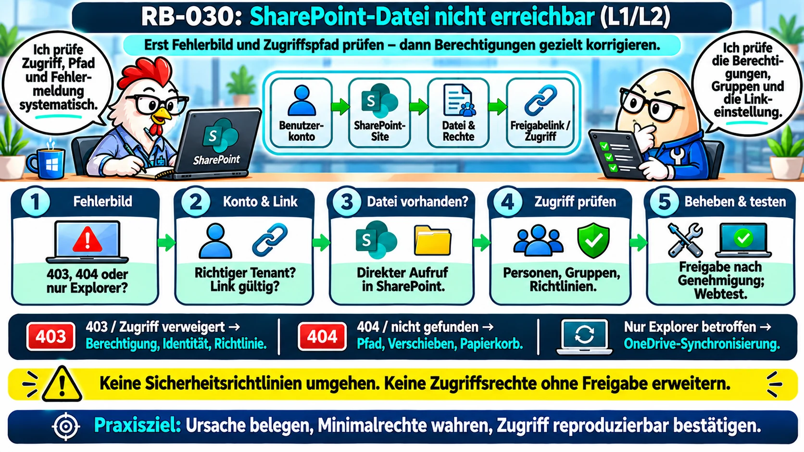

# RB-030 – SharePoint-Datei nicht erreichbar

**Projekt:** 50 Tickets – 50 typische Supportfälle  
**Bereich:** Microsoft 365 / SharePoint Online, Freigaben, Zugriffsrechte, OneDrive-Synchronisierung  
**Support-Level:** L1/L2 · **Stand:** 22.11.2026 · **Version:** 1.0  
**Status:** Anhand offizieller Microsoft-Quellen recherchiert, **noch nicht praktisch validiert**. Die beiden Fallbeispiele sind **fiktive Übungstickets**.



> **Leitgedanke:** Eine Fehlermeldung „Zugriff verweigert“ beweist noch nicht, dass eine Berechtigung fehlt. **Erst Konto, Speicherort und Zugriffsweg trennen, dann Freigabe und Richtlinien kontrollieren.** Eine erfolgreiche Anmeldung ersetzt keine Berechtigung; eine Berechtigung ersetzt keine gültige Datei oder zulässige Zugriffsrichtlinie.

---

## 1. Supportfall, Ziel und Abgrenzung

**Typische Meldungen:** „Ich kann den SharePoint-Link nicht öffnen“, „Diese Datei ist nicht mehr verfügbar“, „Sie benötigen eine Berechtigung“, „Im Browser geht es, im Explorer nicht“, „Die Datei in Teams lässt sich nicht öffnen.“

**Ziel:** Den Fehler reproduzierbar einer der Ebenen **Identität, Datei/Pfad, Berechtigung/Freigabelink, organisationsweite Richtlinie, Webdienst oder lokaler Synchronisierungsclient** zuordnen. Den Zugriff ausschließlich im zulässigen Umfang wiederherstellen und mit der betroffenen Person nachweisen.

**L1** nimmt exakten Wortlaut, betroffene Datei, Benutzer- und Geräteumgebung auf, testet freigegebene Zugriffswege und sammelt lesbare Befunde. **L2 bzw. Site-Owner/SharePoint-Administration** prüft vererbte und individuelle Berechtigungen, Gruppen, Website-Restriktionen, Gastzugriff, administrative Zustände und genehmigte Korrekturen. Zugriff auf vertrauliche Inhalte wird auch zu Diagnosezwecken nicht automatisch gewährt.

**Abgrenzung:** RB-016 behandelt primär OneDrive-Synchronisierung; RB-005 allgemein „Zugriff verweigert“; RB-029 die Microsoft-365-Lizenzierung. Hier ist der Ausgangspunkt eine **konkrete SharePoint-Datei bzw. Dokumentbibliothek** – nicht jede fehlgeschlagene M365-Anmeldung oder Synchronisierung.

## 2. Die technische Zugriffs- und Abhängigkeitskette

```text
Korrektes Geschäfts-/Schulkonto im richtigen Microsoft-365-Tenant
   ↓
SharePoint-Website und Dokumentbibliothek existieren und sind erreichbar
   ↓
Datei liegt am erwarteten Ort / Freigabelink zeigt auf gültiges Element
   ↓
Benutzer besitzt wirksame Berechtigungen (direkt, Gruppe, über Link, geerbt)
   ↓
Zusätzliche Zugriffsregeln erlauben den Vorgang (z. B. Geräte-/Gast-/Site-Policy)
   ↓
Webbrowser ODER OneDrive-Synchronisierungsclient übermittelt Zugriff erfolgreich
   ↓
Die konkret benötigte Aktion klappt: Ansehen, Bearbeiten oder Herunterladen
```

Das ist eine **Diagnose-Reihenfolge**, nicht die technische Aussage, dass SharePoint immer exakt linear arbeitet. Eine Datei kann für einige berechtigte Benutzer erreichbar und für andere nicht sein. Ein Link kann ungültig sein, obwohl das Originaldokument existiert. Ein Browser kann funktionieren, während eine lokale Sync-Kopie nicht aktuell ist [Q1, Q3, Q5].

### Begriffe sauber trennen

| Begriff | Bedeutung | Wichtige Diagnosefrage |
|---|---|---|
| Tenant | Microsoft-365-Organisation | Mit welchem Konto und welchem Verzeichnis erfolgt die Anmeldung? |
| Website / Site | SharePoint-Speicher- und Berechtigungskontext | Ist die konkrete Site erreichbar? |
| Dokumentbibliothek | Container für Dateien und Ordner | Wird die Datei in der Bibliothek gefunden? |
| Berechtigung | Ansehen/Bearbeiten etc. über direkte, Gruppen-, geerbte oder Linkrechte | Hat *dieser* Nutzer das passende Sollrecht? |
| Freigabelink | URL mit Linktyp und ggf. Zielgruppenbindung | Gilt der Link für dieses Konto; ist er noch gültig? |
| Synchronisierung | Lokale Abbildung über den OneDrive-Client | Betrifft der Fehler nur den Explorer oder auch SharePoint im Web? |
| Richtlinie | Administrative Zugriffsrestriktion | Blockiert eine höhere Schutzregel den Zugriff trotz Datei-Berechtigung? |

## 3. Fehlersymptome: 403, 404 und nur lokal

| Beobachtung | Mögliche Hypothesen – **keine automatische Diagnose** | Trennender Test |
|---|---|---|
| **403 / Zugriff verweigert / Berechtigung erforderlich** | Falsches Konto; fehlende Dateirechte; für andere Person bestimmter Link; zusätzliche Website-/Richtlinienrestriktion; vorübergehender Zustand | Kontokontext, Site/Bibliothek, Zugriffsquellen und Regeln überprüfen [Q1, Q2, Q7] |
| **404 / Datei oder Seite nicht gefunden** | Datei/Ordner/Site verschoben, umbenannt oder gelöscht; veralteter Link | Dateinamen und Originalort durch berechtigte Person suchen; Papierkorb/Verlauf durch Zuständige prüfen [Q3, Q4] |
| **Web erreichbar, Explorer nicht** | OneDrive-Sync unterbrochen, veraltete lokale Verknüpfung, Clientkonto, Dateien bei Bedarf, Pfad-/Namensgrenze | Dieselbe Datei im Web öffnen; OneDrive-Syncstatus und konkreten lokalen Pfad prüfen [Q5] |
| **Nur externe Person betroffen** | Einladung auf anderes Konto; Linktyp „bestimmte Personen“; Guest- und Tenant-Sharing-Policy | Gastidentität, Freigabemodus, Sharing-Level von Site und Tenant prüfen [Q6] |
| **Viele Benutzer / ganze Site betroffen** | Dienststörung, Site gesperrt, organisatorische Änderung, restriktive Richtlinie | Service Health, Site-Status und letzte genehmigte Changes prüfen [Q1, Q2] |
| **Ansehen geht, Bearbeiten nicht** | Nur Leserechte; geschützter Download; Datei ausgecheckt; Richtlinie | Gewünschte Aktion vom tatsächlichen Berechtigungsumfang trennen [Q8] |

**Fehlercode-Regel:** HTTP-Status, Microsoft-Fehlertext und tatsächliche Ursache sind nicht identisch. Dokumentiere, was die Anwendung *wirklich* meldet; ein 403 ist nicht automatisch ein Hinweis, breite Rechte zu vergeben. Auch 404 nicht sofort mit einer Dateiwiederherstellung beantworten.

## 4. Die neun wichtigsten Fragen bei der Erstaufnahme

1. **Exakter Wortlaut/HTTP-Code** und Zeitpunkt? Screenshot nur mit geschwärzten privaten Angaben.
2. **Welche Aktion** scheitert: Link öffnen, Anzeigen, Bearbeiten, Download oder Explorer-Öffnung?
3. **Wer ist betroffen?** Einzelperson, Gruppe, interne/externe Mitarbeitende oder alle?
4. **Wie führt der Weg zur Datei?** Outlook-Link, Teams-Registerkarte, Browserfavorit, SharePoint-Web oder Explorer?
5. **Welches Konto/Tenant** ist angemeldet? Gab es Kontowechsel oder mehrere Browserprofile?
6. **Hat die Datei früher funktioniert?** Seit welcher Änderung (Umzug, Freigabe, Gruppenwechsel, Wechsel der Teamzugehörigkeit)?
7. **Funktioniert der direkte Bibliothekszugriff** statt des geteilten Links (nur wenn der Nutzer dort regulär Zugriffsrecht hat)?
8. **Funktioniert dieselbe Datei im Web** – und scheitert ausschließlich der Windows-Explorer?
9. **Wie kritisch ist der Ausfall** und wer ist Eigentümer/Verantwortlicher der Datei beziehungsweise Website?

**Datensparsamkeit:** Nur redigierte URL/Website-ID bzw. interne Referenz, kein vollständiger privater Freigabetoken-Link im Ticket und keine Dokumentinhalte ohne Geschäftsnotwendigkeit. Keine Zugangsdaten, Sitzungscookies, MFA-Codes oder personenbezogenen Dateiinhalte erfassen.

## 5. Sicherheit: Freigaben und Daten nicht als „Schnellfix“ verändern

**Vor jeder Änderung** Berechtigungs-Sollzustand, Eigentümerfreigabe, minimale notwendige Rolle, Auswirkungen und Rückweg feststellen. Ein Supportmitarbeiter darf nicht durch unberechtigten Eigendownload einen Zugriffsfehler „nachweisen“.

- **Nicht blind:** „Jeder mit dem Link“, „Jeder außer externe Benutzer“, Site-Besitzerrechte oder Vollzugriff vergeben. Das wäre ein erhebliches Oversharing-Risiko.
- **Nicht blind:** Gruppenmitgliedschaften, SharePoint-Site-Policy, Conditional Access, Sensitivity Labels, Gastzugriff oder Tenant-Sharing-Einstellungen lockern.
- **Nicht blind:** Synchronisierung zurücksetzen, Ordner entkoppeln, lokale Offlinekopien löschen oder eine Datei aus dem Papierkorb zurückholen. Rücksicherung an Originalstelle kann bestehende Inhalte und Arbeitsabläufe betreffen.
- **Nicht umgehen:** Schutzmaßnahmen durch privates Gerät, andere Identität, persönliche Cloud oder unkontrollierte Kopie.

**Prüffrage:** Ist eine Änderung für diese Person und dieses Dokument **fachlich vorgesehen und schriftlich/verfahrenstechnisch freigegeben**? Falls nicht: **Stopp → Eigentümer/Administration**.

## 6. L1-Schnellprüfung: der sicherste Vergleich

1. Fehler mit Zeitpunkt und genauer Aktion dokumentieren; andere Benutzer nicht zum Nachstellen über fremde Konten bitten.
2. Website-/Linktyp unterscheiden: SharePoint-Webadresse, Teams-Datei-Link oder lokaler Explorerpfad.
3. Auf **richtiges Unternehmens-/Schulkonto** und korrekten Tenant achten; bei Mehrfachkonten einen freigegebenen InPrivate-Test mit regulärer Anmeldung durchführen [Q2]. InPrivate ist **nur ein Kontexttest**, keine Rechte- oder Richtlinienumgehung.
4. Ist die **Site** erreichbar? Ist die **Bibliothek** sichtbar? Ist die **Datei** in der Bibliothek erreichbar – jeweils mit der zugriffsberechtigten Identität?
5. Wenn die Bibliothek im Web geht, aber der geteilte Link nicht: Freigabelink und Zielgruppe vom Eigentümer prüfen lassen.
6. Wenn die Datei im Web geht, aber lokal nicht: OneDrive-Sync-Symbol, Kontokontext und Clientstatus prüfen, ohne den Sync neu einzurichten [Q5].
7. Bei mehreren Betroffenen: interne Statusmeldung, Service Health und jüngste Änderungen durch das zuständige Team prüfen [Q1, Q2].
8. Nur nach Beleg und Freigabe gezielt ändern lassen; **mit demselben Konto und derselben Aktion erneut testen**.

Ein funktionierender SharePoint-Startbildschirm beweist **nicht**, dass eine bestimmte Datei verfügbar ist. Ein funktionierendes Office-Dokument im Explorer beweist **nicht**, dass der lokale Stand synchron und aktuell ist.

## 7. Pfad A – Konto, Freigabelink und Berechtigungsumfang

**Zweck:** 403/„You need permission“ oder ein nicht nutzbarer Freigabelink nachweisen.

1. Benutzeridentität und die am Link angemeldete Identität vergleichen; insbesondere bei Gästen die **tatsächlich eingeladene** E-Mail beziehungsweise Tenantidentität beachten.
2. Mit Eigentümer oder Site-Owner im SharePoint-Web: Datei markieren → **Teilen / Zugriff verwalten** (UI-Bezeichnungen können variieren). Personen, Gruppen, Links und Zugriffsart **lesen** [Q8].
3. Linktyp unterscheiden: **bestimmte Personen**, **Personen in Ihrer Organisation**, **Personen mit vorhandenem Zugriff** und ggf. **jeder mit dem Link**; die verfügbare Auswahl hängt von Richtlinien ab [Q6, Q8].
4. **Zugriffsquellen** berücksichtigen: direkte, vererbte und Gruppenberechtigung sowie Linkrechte. Eine angezeigte „Kann anzeigen“-Zeile beweist nicht zwingend, dass nicht an anderer Stelle zusätzliche Berechtigungen wirksam sind [Q8].
5. Wurde ein Link entfernt/ersetzt oder die Datei verschoben, **neuen autorisierten Link** vom Eigentümer ausgeben lassen; nicht zuerst Berechtigungen ausweiten [Q8].
6. Wenn eine erforderliche Berechtigung tatsächlich fehlt: Sollberechtigung und Freigabebeschluss dokumentieren; **gezielt** Person oder passende Rolle zuweisen lassen, nicht universell freischalten.

**Sonderfall:** Berechtigung erst kürzlich vergeben, Zugriff weiterhin 403: Microsoft beschreibt Fälle unvollständig replizierter Berechtigungen. Nach dokumentierter Wartezeit (Microsoft erwähnt im speziellen 403-Szenario bis zu 30 Minuten) Status neu testen; bei weiterhin bestehendem Fehler zuständige Administration einbeziehen [Q2]. Das ist keine allgemeine garantierte SLA.

## 8. Pfad B – 404, verschobene Datei oder Papierkorb

**Nicht sofort „Datei gelöscht“ annehmen.** Microsoft nennt für 404 u. a. Umbenennung, Verschieben und Löschen [Q3].

1. **Unveränderten Fehlerzeitpunkt** und bisherigen Link sichern (nur an berechtigte Stelle, ohne Token öffentlich zu teilen).
2. Site-Owner/Dateieigentümer prüft die ursprüngliche **Dokumentbibliothek**, Dateinamen, Unterordner und bekannte Umzüge. L1 soll nicht durch globales Suchen fremde Inhalte offenlegen.
3. Wenn die Datei noch vorhanden ist: korrekten, aktuellen Pfad ermitteln; passenden gültigen Link neu ausgeben; die alte Verknüpfung im Wissens-/Teamkontext autorisiert ersetzen.
4. Wenn die Datei tatsächlich gelöscht ist: Website-Papierkorb (erste Stufe) und bei berechtigter Administration ggf. Papierkorb der Websitesammlung (zweite Stufe) prüfen [Q4].
5. Vor Wiederherstellung: Eigentümerfreigabe, Datenklassifikation, möglicher Konflikt mit neu angelegten Dateien, Aufbewahrungsregel und Zielort kontrollieren. Keine beliebige Vorversion zurückspielen.
6. Anschließend **Dateiintegrität, korrekte Berechtigung und den ursprünglichen Arbeitsablauf** mit der betroffenen Person nachweisen.

**Zeitfenster:** Microsoft dokumentiert bei SharePoint in Microsoft 365 insgesamt **93 Tage** Aufbewahrung ab Löschung für die beiden Papierkorb-Stufen, solange die Elemente nicht vorher endgültig gelöscht werden; Sonderregeln/Retention-Konfigurationen und Speicherort sind zu berücksichtigen [Q4]. Das ist **keine Wiederherstellungsgarantie**.

## 9. Pfad C – Berechtigungen vorhanden, Zugriff dennoch blockiert

Ein gültiger Dateilink **und** eine Datenberechtigung können trotzdem unzureichend sein. Mögliche zusätzliche Sicherheitskontrollen:

- **Restricted site access:** Eine Site kann auf Mitglieder definierter Microsoft-365-/Entra-Gruppen beschränkt werden. **Beides** ist erforderlich: Zugriffsberechtigung *und* Mitgliedschaft in der zugelassenen Gruppe; die Gruppenmitgliedschaft allein gewährt keine Dateiberechtigung [Q7].
- **Conditional Access / Gerätevertrauen:** Zugriff kann von Geräte-Compliance, Sicherheitszustand, Netzkontext oder Anmeldung abhängen. Nur das Sicherheits-/Identity-Team interpretiert entsprechende Policy-Auswertungen [Q9].
- **Externe Freigabe:** Site- und Tenant-Einstellungen, Einladungsadresse, Gastidentität und zugelassene Domains können den Zugriff beschränken [Q6].
- **Sensitivitäts-/Compliance-Regeln:** Schutzlabel, Download- oder Geräteeinschränkungen und andere Governance-Regeln können Aktionen begrenzen; die genaue Kontrollursache muss belegt werden.
- **LockState / Dienststörung:** SharePoint-Site kann administrativ gesperrt sein, oder ein Microsoft-365-Serviceproblem betrifft mehrere Nutzer [Q1, Q2].

**Vorgehen:** Fehler mit Konto, Ressource, Uhrzeit, Gerätetyp und Gegenprobe an die berechtigte L2-/Security-/SharePoint-Stelle eskalieren. **Nicht** einen CA-Ausfall durch Abschalten einer Schutzrichtlinie behandeln.

## 10. Pfad D – Nur in Explorer / OneDrive-Synchronisierung betroffen

**Schnellste Abgrenzung:** Dasselbe Dokument im **SharePoint-Web** öffnen, dann den synchronisierten Pfad im Windows-Explorer vergleichen.

| Web | Explorer | Einordnung |
|---|---|---|
| funktioniert | funktioniert nicht / alter Stand | Sync-/Client-/Pfadproblem vorrangig untersuchen |
| funktioniert nicht | funktioniert nicht | Zuerst Identität, Site, Berechtigung, Richtlinie oder Dienst prüfen |
| funktioniert | öffnet nur schreibgeschützt | Datei-/Clientmodus, Schreibrechte oder Download-/Schutzregel getrennt untersuchen |
| bei Kollegin funktioniert | bei betroffenem User nicht | Benutzerkontext oder Rechte/Policy wahrscheinlich; weiteren Test nötig |

**Nur lesende/risikoarme Prüfungen:** OneDrive-Kontosymbol und Syncstatus; Warnsymbole; korrekter geschäftlicher Synchronisierungsaccount; ob „Dateien bei Bedarf“ die Datei als online verfügbar kennzeichnet; Pfadlänge/Dateinamensregeln; verfügbarer lokaler Speicher. Microsoft hat eine eigenständige Anleitung zu SharePoint-Syncproblemen und Einschränkungen [Q5, Q10].

**Nicht als erstes:** OneDrive `reset`, Konto-Verknüpfung lösen, gesamtes Verzeichnis löschen oder Sync-Verbindung neu aufbauen. Insbesondere **nicht synchronisierte lokale Bearbeitungen** könnten verloren gehen. Erst Bestand/Backup und Änderungsfreigabe sichern.

## 11. Nur lesende Windows-/PowerShell-Prüfungen

Diese Befehle sind **Diagnosebeispiele**, keine Pflichtschritte in jedem Ticket. Nur mit freigegebener Arbeitsumgebung und legitimen Zugriffen ausführen. Platzhalter ersetzen, keine vollständigen Links mit Freigabetokens protokollieren.

### 11.1 Erreichbarkeit – nicht mit Autorisierung verwechseln

```powershell
# DNS-Auflösung: beweist nur Namensauflösung, keine SharePoint-Berechtigung.
Resolve-DnsName 'beispiel.sharepoint.com'

# TCP 443: zeigt nur, ob der Port grundsätzlich erreichbar ist.
# Ein erfolgreicher Test beweist weder Anmeldung noch Dateizugriff.
Test-NetConnection 'beispiel.sharepoint.com' -Port 443

# OneDrive-Client-Prozess auf dem aktuellen Gerät anzeigen.
Get-Process -Name 'OneDrive' -ErrorAction SilentlyContinue |
  Select-Object ProcessName, Id, StartTime
```

**Interpretation:** DNS und TCP 443 erfolgreich, Datei liefert trotzdem „Access denied“? Weiter bei **Konto/Berechtigung/Link/Policy**, nicht „Netzwerk in Ordnung, also SharePoint defekt“ behaupten.

### 11.2 L2: Site-Zustand auslesen (nur mit administrativer Berechtigung)

```powershell
# VORAUSSETZUNG: freigegebenes SharePoint Online Management Shell-Modul
# und die passende Administratorrolle im richtigen Tenant.
# Verbinden ist eine interaktive Anmeldung, KEINE Änderung an Site-Inhalten.
Connect-SPOService -Url 'https://beispiel-admin.sharepoint.com'

# Nur lesen: Stammdaten der betroffenen Site abrufen.
Get-SPOSite -Identity 'https://beispiel.sharepoint.com/sites/Projekt' |
  Select-Object Url, LockState, SharingCapability
```

**Grenzen:** `Get-SPOSite` prüft **nicht** die effektiven **Dateiberechtigungen** eines konkreten Benutzers und ersetzt nicht „Zugriff verwalten“; er liefert Site-Eigenschaften. Der Leseaufruf ist rollenabhängig und gehört nicht in jedes L1-Ticket [Q11]. Sicherheitsrestriktionen bei Site Access Control und Entra ID müssen ggf. separat von Zuständigen betrachtet werden [Q7].

**Nicht ausführen, nur als Warnung:** `Set-SPOSite`, unkontrolliertes `Remove-*`, Berechtigungsreset und Tenant-weite Sicherheitsänderungen sind **schreibende Eingriffe** und hier keine Schnellreparatur.

## 12. Diagnosematrix: Befund → Ursache → kleinste Maßnahme

| Belastbarer Befund | Wahrscheinliche Fehlerklasse | Gezielt geeigneter Weg | Zuständig |
|---|---|---|---|
| Direkter Aufruf funktioniert; alter freigegebener Link scheitert | Link ungültig / falsche Zielgruppe | Eigentümer prüft gültige Linkart und gibt passenden Link neu frei | L1 koordiniert / Owner |
| Richtige Datei da; Nutzer ohne Sollberechtigung | Fehlendes Dateirecht / Gruppe | Genehmigte minimale Berechtigung über vorgesehenen Pfad herstellen | Owner / L2 |
| Site-Berechtigung bestätigt, Zugang weiterhin 403; Restricted Access aktiv | zusätzliche Site-Sicherheitskontrolle | Gruppen- und Dateiberechtigung sowie Policy-Eignung getrennt prüfen | SharePoint/Security |
| 404; Datei durch Owner an neuem Ort gefunden | Umzug/Umbenennung | Neuen Link bereitstellen, ohne Rollen auszuweiten | Owner / L1 |
| 404; Datei im SharePoint-Papierkorb | Gelöschtes Objekt | Fachlich freigegebene Wiederherstellung mit Konfliktprüfung | Site-Owner / L2 |
| Im Web okay, im Explorer fehlerhaft | Sync-/Clientpfad | OneDrive-Status und Sync-Abweichung untersuchen; erst dann genehmigte Reparatur | L1 / Endpoint-L2 |
| Externer Empfänger kann „bestimmte Personen“-Link nicht öffnen | Gast-/Einladungs-/Policy-Kontext | Richtige Gastidentität und zulässige Freigabeform prüfen | Site-Owner / Identity |
| Mehrere Sites/Nutzer gleichzeitig nicht erreichbar | M365-Dienst-/Tenantproblem | Service Health, dokumentierte Änderungen, Incident-Pfad | M365-Administration |

**Grundsatz:** Die beste technische Maßnahme ist nicht zwingend die mit den meisten Eingriffen – sondern diejenige, die den nachgewiesenen Fehler bei **minimalem Änderungsrisiko** behebt.

## 13. Wiederherstellung und Abschlusskontrolle

Ein Ticket wird **nicht** durch „Rechte wurden angepasst“ geschlossen, sondern nach verifiziertem Ergebnis:

1. **Identischer Benutzer, gleiche Datei, dieselbe Aktion:** funktionierender Zugriff im zuvor betroffenen Weg.
2. **Rechtestufe passend:** Lesen, Bearbeiten oder Download nur wie fachlich vorgesehen; kein unnötiger zusätzlicher Benutzerkreis.
3. **Standort stimmt:** keine veraltete Kopie, falsche Bibliothek oder parallele Schattenkopie im Explorer.
4. **Sicherheitskontrollen intakt:** keine temporär aufgelockerten Sharing-/Conditional-Access-Regeln offen lassen.
5. **Ticket vollständig:** Ursache, trennende Tests, genehmigte Korrektur, Zeitpunkt, Bearbeiterrolle, Re-Test und Hinweise für Wiederholung dokumentiert.

Wenn der Fehler bleibt: vorhandene Hypothese widerlegen, weitere Befunde sammeln und an passende L2-/Security-/Microsoft-365-Administration übergeben – nicht in Reparatur-Schleifen geraten.

## 14. Zwei fiktive Praxisfälle – Diagnose, nicht Raten

### Fall A – „Die Excel-Datei ist verschwunden“

**Fiktive Meldung:** Eine Mitarbeiterin verwendet einen Teams-Chat-Link zu einer Tabelle. Seit heute erscheint **404**. Zwei Kolleginnen sehen die Tabelle weiterhin in der SharePoint-Dokumentbibliothek unter einem umbenannten Unterordner.

**Hypothesen:** Datei gelöscht? Link veraltet? Fehlende Berechtigung? **Entscheidender Nachweis:** Eigentümer findet dieselbe Datei am neuen Ort und kann sie regulär öffnen. Die bisherige URL wird nicht mehr aufgelöst; Rechte des ursprünglichen Nutzers waren nicht der nachgewiesene Fehler.

**Geeignete Reaktion:** Eigentümer gibt autorisierten neuen Link aus. Betroffener Nutzer testet die ursprüngliche fachliche Aktion. **Nicht:** auf Verdacht breitere Site-Rechte vergeben oder eine Doppelkopie erzeugen.

**Dreisatz-Ticketkommentar – fiktiv:** „Der bisherige Dokumentlink führte nach einer Ordnerumstrukturierung nicht mehr zum Ziel. Die Datei wurde durch den zuständigen Eigentümer am aktuellen Speicherort bestätigt und ein gültiger Link bereitgestellt. Der Zugriff auf die Datei wurde mit dem betroffenen Konto erfolgreich geprüft; Rechte wurden nicht erweitert.“

### Fall B – „Berechtigt, aber trotzdem 403“

**Fiktive Meldung:** Ein Mitarbeiter hat direkte **Leserechte** auf eine vertrauliche SharePoint-Datei und erhält dennoch 403; Kolleginnen aus der vorgesehenen Site-Sicherheitsgruppe können die Datei öffnen.

**Hypothesen:** Falsche Anmeldung, noch nicht wirksame Berechtigung, Restricted Site Access, Conditional Access. **Trennender Befund:** SharePoint-Admin bestätigt eine aktive **Site Access Restriction** auf eine definierte Entra-Gruppe. Der Nutzer ist nicht in dieser Gruppe; die Datei selbst ist korrekt freigegeben.

**Geeignete Reaktion:** Berechtigung und Site-Restriktion als **zwei getrennte Prüfungen** dokumentieren. Zuständige Stelle klärt zunächst die *fachliche Berechtigung zur Mitgliedschaft*; falls genehmigt, Gruppenaufnahme über den regulären Rollenprozess. **Nicht:** Restricted Access global abschalten.

**Dreisatz-Ticketkommentar – fiktiv:** „Die Datei war vorhanden und direkt berechtigt; der Site-Zugriff wurde zusätzlich über eine eingeschränkte Zugriffskontrollgruppe gesteuert. Der Befund wurde an die verantwortliche SharePoint-/Security-Administration mit Anfrage zur Sollberechtigung übergeben. Eine Freigabeänderung erfolgte im L1 nicht; abschließende Verifikation steht nach der genehmigten Entscheidung aus.“

## 15. Selbsttest, Transfer und Lernkarten-Anker

**Active Recall – ohne Vorlage beantworten:**

1. Welche drei getrennten Fehlerklassen deuten 403, 404 und „nur Explorer“ zunächst an – und was beweisen sie gerade **nicht**?
2. Warum kann ein Nutzer mit Datei-Leserechten dennoch bei einer Restricted-Site-Access-Policy gesperrt sein?
3. Welche Prüfung unterscheidet einen veralteten Link von einer tatsächlich gelöschten Datei?
4. Welche Informationen solltest du **nicht** in ein Supportticket kopieren?
5. Warum ist „Jeder mit dem Link“ kein zulässiger Schnellfix?
6. Wodurch bestätigst du, dass nach einer Änderung nicht nur ein Fenster verschwunden ist, sondern die konkrete Aufgabe wieder funktioniert?
7. Welcher Test grenzt einen OneDrive-Synchronisierungsfehler von einem cloudseitigen Dateizugriffsfehler ab?

**Wissenskarte:** *Welche zwei Prüfungen sind bei Restricted Site Access nötig?* → Dateiberechtigung **und** Mitgliedschaft in der erlaubten Restriktionsgruppe.

**Verständniskarte:** *Warum ist ein funktionierender SharePoint-Startbildschirm keine Dateizugriffsbestätigung?* → Site-Zugang, Datei-/Linkrechte und zusätzliche Richtlinien sind verschieden.

**Diagnosekarte:** *Web funktioniert, Explorer nicht – erster Ansatz?* → OneDrive-Syncstatus und lokalem Zugriffsweg nachgehen, nicht Site-Rechte ausweiten.

**Praxistransfer:** Baue später in einer autorisierten Laborumgebung je einen Fall „ungültiger Link“, „fehlende Dateirechte“ und „nur lokaler Syncfehler“. Für jeden Fall **erst Hypothese und trennenden Test notieren**, danach durchführen; nach etwa 7 und 21 Tagen ohne Runbook erneut einordnen.

### Validierungsstatus

Dieses Dokument bildet ein recherchiertes **Lernszenario**, **keinen durchgeführten Supportfall** ab. Es wurden keine realen Tenant-Berechtigungen, Gäste, Dateien oder SharePoint-Richtlinien verändert. Die beschriebenen Beispieltickets sind fiktiv. Ergebnisse sollen später in einer berechtigten Testumgebung überprüft werden.

---

## Quellen – offizielle Microsoft-Dokumentation (abgerufen 22.11.2026)

- **[Q1]** Microsoft Learn: [Unable to access SharePoint Online](https://learn.microsoft.com/en-us/troubleshoot/sharepoint/administration/sharepoint-online-inaccessible) – Berechtigungen, Dienstprobleme, Service Health.
- **[Q2]** Microsoft Learn: [403 Forbidden in OneDrive or SharePoint](https://learn.microsoft.com/en-us/troubleshoot/sharepoint/sharing-and-permissions/error-403-forbidden) – 403 und Administratorprüfungen.
- **[Q3]** Microsoft Learn: [404 File/Page not found in OneDrive or SharePoint](https://learn.microsoft.com/en-us/troubleshoot/sharepoint/administration/error-404-onedrive-sharepoint) – Verschieben, Umbenennen und Löschen.
- **[Q4]** Microsoft Support: [Wiederherstellen gelöschter Elemente aus dem SharePoint-Websitesammlungs-Papierkorb](https://support.microsoft.com/de-de/sharepoint/admin/restore-deleted-items-from-the-site-collection-recycle-bin) – Stufen und Aufbewahrung.
- **[Q5]** Microsoft Support: [Beheben von Synchronisierungsproblemen mit SharePoint Online](https://support.microsoft.com/de-de/sharepoint/sync/fix-sharepoint-online-sync-problems) – Web/Explorer/Sync.
- **[Q6]** Microsoft Learn: [Overview of external sharing in SharePoint and OneDrive](https://learn.microsoft.com/en-us/sharepoint/external-sharing-overview) – externe Freigaben und B2B.
- **[Q7]** Microsoft Learn: [Restrict SharePoint site access with Microsoft 365 groups and Microsoft Entra security groups](https://learn.microsoft.com/en-us/sharepoint/restricted-access-control) – zusätzliche Site-Restriktion.
- **[Q8]** Microsoft Support: [Anzeigen, für wen eine Datei in OneDrive oder SharePoint freigegeben ist](https://support.microsoft.com/de-de/sharepoint/sharepoint-sharing-and-permissions/see-who-a-file-is-shared-with-in-onedrive-or-sharepoint) – Personen, Gruppen und Linkrechte.
- **[Q9]** Microsoft Learn: [Conditional Access policy for SharePoint](https://learn.microsoft.com/en-us/sharepoint/authentication-context-example) – CA-basierte Site-Schutzmaßnahmen.
- **[Q10]** Microsoft Support: [Einschränkungen und Grenzwerte in OneDrive und SharePoint](https://support.microsoft.com/de-de/onedrive/restrictions-and-limitations-in-onedrive-and-sharepoint) – Pfad-/Synchronisationsgrenzen.
- **[Q11]** Microsoft Learn: [Get-SPOSite](https://learn.microsoft.com/en-us/powershell/module/microsoft.online.sharepoint.powershell/get-sposite) – lesende Site-Metadaten im Administrationskontext.
- **[Q12]** Microsoft Support: [Verwalten von Teilen und Berechtigungen in OneDrive und SharePoint](https://support.microsoft.com/de-de/onedrive/sharepoint/manage-sharing-and-permissions-in-onedrive-and-sharepoint) – Freigabelinks und Zugriffsverwaltung.

**Quellenhinweis:** Microsoft-Oberflächen und Funktionen werden laufend aktualisiert. Die Dokumentation ist technische Orientierung, keine Garantie für die identische Menüführung im jeweiligen Tenant oder eine bereits nachgewiesene Ursache.
