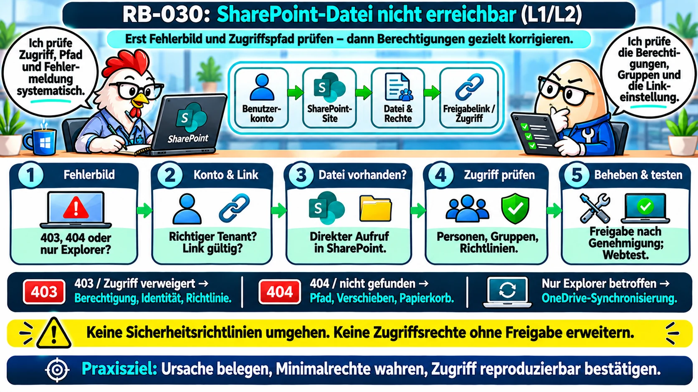

# RB-030 – Praxis-Runbook: SharePoint-Datei nicht erreichbar

**Projekt:** 50 Tickets – 50 typische Supportfälle  
**Support-Level:** L1/L2 · **Version:** 1.0 · **22.11.2026**  
**Fachstatus:** Herstellerquellen recherchiert, **noch nicht praktisch validiert**.

> **Arbeitsregel:** **403 ≠ fehlende Berechtigung bewiesen. 404 ≠ Datei endgültig gelöscht bewiesen. Web funktioniert ≠ Explorer synchronisiert.** Konto, Ort und Zugriffsweg trennen; **keine** Rechte oder Sicherheitsregeln ohne festgestellten Sollzustand ändern.



Technischer Entscheidungsbaum: [SVG](assets/rb030_diagnosebaum.svg) · [PNG-Vorschau](../assets/rb030_diagnosebaum.svg)

---

## 1. Ticketannahme, Auswirkung und Priorität (L1)

**Sichere Mindestdaten:** Fall-ID; redigierter Dateiname bzw. interne Ressourcenreferenz; Website/Bibliothek (keine öffentlichen Sharing-Tokens); exakter Fehlertext/HTTP-Code; Zeitpunkt; App bzw. Zugriffsweg (Teams/SharePoint-Web/Explorer); betroffene Aktion (Ansehen/Bearbeiten/Herunterladen); betroffene Personen und Auswirkung; jüngste Änderungen.

**Erstfrage an den Nutzer:** „Können Sie die SharePoint-Website und die Datei direkt im Browser aufrufen, oder tritt der Fehler nur beim geteilten Link beziehungsweise im Explorer auf?“

**Priorisierung:** Einzelner Nutzer / einzelne Datei üblicher Incident; mehrere Dateien/Sites/Abteilungen oder unternehmensweiter Zugriff: Incident- bzw. Major-Incident-Prozess und Service-Health-Prüfung. Eine vertrauliche Datei nicht zur Fehlersuche per E-Mail oder persönlicher Cloud verteilen.

## 2. Sicherheits-/Freigabe-Gate (vor Änderungen)

- Zugriff nur mit **eigenem zulässigen Firmenkonto**; keine fremden Anmeldungen, Links oder Dokumentinhalte sichern.
- Im Ticket URLs nur **ohne Freigabetoken** oder als intern geschützte Referenz erfassen; private Inhalte, Credentials, Cookies und MFA-Codes vermeiden.
- Wer ist fachlicher Datei-/Site-Eigentümer? Welches **Sollrecht** braucht die Person (Lesen/Bearbeiten/Download)? Gibt es eine dokumentierte Genehmigung?
- **Kein Schnellfix:** „Jeder mit Link“, globaler Gastzugriff, CA-Deaktivierung, Vollzugriff, pauschaler Gruppenbeitritt.
- Vor Papierkorb-Restore oder OneDrive-Reset: Änderungsfreigabe, Backup/Offlinebearbeitungen und Auswirkungen prüfen.
- Bei unklarem Sollrecht oder fehlender Berechtigung: **STOPP und zuständige Freigabestelle**.

## 3. L1-Schnelltriage: Konto, Pfad und Kontext (ohne Änderungen)

| Frage/Test | Entscheidung | Folge |
|---|---|---|
| Richtiges Geschäfts-/Schulkonto/Tenant? | Nein / unklar | Anmeldung/Kontokontext klären; keine Zugriffsliste auf Verdacht erweitern |
| SharePoint-Site im Web erreichbar? | Nein | Identität, Site, Richtlinie, Dienstlage prüfen |
| Bibliothek und Datei direkt im Web erreichbar? | Ja | Original ist für diesen Nutzer erreichbar → Link/Client nachfolgend vergleichen |
| Nur geteilter Link schlägt fehl? | Ja | Linktyp, Empfängerbindung, Gültigkeit durch Owner prüfen |
| Nur Explorer/OneDrive-Ordner betroffen? | Ja | Syncstatus und lokale Abbildung prüfen, nicht Rechte wechseln |
| Mehrere Nutzer / Sites betroffen? | Ja | M365 Service Health / Change / SharePoint Admin einbeziehen |

Ein InPrivate-Test kann Mehrfachkonten und Sessionkontext abgrenzen, **ersetzt aber keine Rechte-/Sicherheitsprüfung**. [Q1, Q2]

## 4. Diagnosepfad A – 403 / „Zugriff verweigert“

**Voraussetzung:** Fehler kommt am Web-/Freigabezugriff, auch mit richtigem Konto.

1. Fehlertext, Zeitpunkt und Benutzer-/Tenantkontext dokumentieren.
2. Site und Bibliothek mit *berechtigtem* Konto öffnen lassen; prüfen, ob nur Datei, Ordner oder gesamte Site betroffen ist.
3. **Zugriff verwalten/Teilen** mit Eigentümer oder Site-Owner kontrollieren: Personen, Gruppen, direkte/geerbte/linkbasierte Rechte, Linktyp [Q3].
4. Prüfen, ob Link ausdrücklich für andere Person bestimmt, abgelaufen oder erneuert wurde [Q4].
5. Wenn Rechte vorhanden: zusätzliche **Restricted Site Access**, CA, Gästeinstellungen und ggf. LockState durch L2/Security prüfen [Q5, Q6].
6. **Erst nach Genehmigung** kleinstmögliche Rolle/Gruppe korrigieren; dann **mit ursprünglicher Identität** erneuten Zugriff nachweisen.

**Nicht vergessen:** Restricted Site Access benötigt **sowohl** Dateirecht als auch erlaubte Restriktionsgruppe; eines allein reicht nicht [Q5].

## 5. Diagnosepfad B – 404 / „Datei nicht gefunden“

1. Konkrete URL-/Dateireferenz dem zuständigen Owner übergeben (keine Sharing-Tokens in offenen Tickets).
2. Owner kontrolliert in der Bibliothek: **umbenannt / verschoben / gelöscht?** [Q7]
3. Datei an neuem Ort vorhanden → aktuellen, passend adressierten Link neu bereitstellen, alten Link ggf. aktualisieren.
4. Datei tatsächlich gelöscht → zuständige Person prüft **ersten** und bei Bedarf **zweiten SharePoint-Papierkorb**; Restore nur nach Freigabe [Q8].
5. Nach Wiederherstellung Dateipfad, Metadaten, Rechte, Inhalt und Zugriff prüfen; Konflikte oder Dubletten ausschließen.

**Zeitgrenze:** Microsoft nennt bei SharePoint Online für die beiden Papierkorb-Stufen grundsätzlich 93 Tage ab Löschen; keine garantierte Verfügbarkeit und abhängig von Lösch-/Aufbewahrungsbedingungen [Q8].

## 6. Diagnosepfad C – Browser funktioniert, Explorer nicht

1. **Dieselbe Datei** mit derselben Unternehmensidentität in SharePoint **Web** öffnen.
2. OneDrive-Symbol im Infobereich: Angemeldetes Geschäftskonto, Warnung, pausierte Synchronisierung, Konflikt, Dateistatus.
3. Prüfen: Stimmt der lokale Ordner zur **richtigen Bibliothek**? Ist Datei online-only / offline verfügbar? Gibt es Pfad-/Dateinamensprobleme oder ungesyncte lokale Änderungen? [Q9, Q10]
4. Sync-Symptom und Web-Zustand dokumentieren; ggf. Endpoint-L2 und RB-016 hinzuziehen.
5. Erst bei nachgewiesener Client-Ursache **und** gesicherten Änderungen eine autorisierte Sync-Reparatur durchführen lassen.
6. Danach Web-/lokalen Änderungsstand und öffnen/bearbeiten erneut vergleichen.

**Niemals zu Beginn:** Client entkoppeln, Cache/Sync-Ordner löschen oder OneDrive ohne Klärung lokaler Offlinekopien zurücksetzen.

## 7. Diagnosepfad D – Gast, Sicherheitsrichtlinie oder Plattformproblem

- **Externe Gäste:** Eingeladene Identität, passende Linkzielgruppe, SharePoint-Site-/Tenant-Freigaberegeln und erlaubte Domains prüfen [Q11].
- **Restricted Site Access:** L2 kontrolliert die Site-Restriktionsgruppe zusätzlich zu den üblichen Dateirechten [Q5].
- **Conditional Access / Device Compliance / Label:** Security-Team bewertet Richtlinien und sign-in-Belege im zulässigen Kontext. Nicht durch private Geräte umgehen [Q6].
- **Viele Benutzer betroffen:** M365 Admin Center → Health → Service health und jüngste Changes durch Admin prüfen [Q1].
- **Site gesperrt:** Nur SharePoint-Admin bewertet `LockState` und Ursachen. Eine Site-Entsperrung ist kein L1-Schnellfix [Q2].

**Eskalationsübergabe:** Zeitpunkt, Nutzer-/Tenantkontext, redigierte Ressource, Fehlermeldung, Web/Explorer-Vergleich, betroffene Gruppe, dokumentierte Rechte/Richtlinienbefunde und bisherige nicht-schreibende Tests.

## 8. Lesende PowerShell-/Admin-Prüfungen

**Optional; keine Voraussetzung für jedes L1-Ticket.** Keine vertraulichen Linktokens in Konsolenausgaben oder Protokolldateien speichern.

```powershell
# Netzwerk-DNS: Nur Auflösung des SharePoint-Dienstnamens.
Resolve-DnsName 'beispiel.sharepoint.com'

# Verbindungsprüfung auf TCP 443. KEIN Nachweis für Datei-/Benutzerzugriff!
Test-NetConnection 'beispiel.sharepoint.com' -Port 443

# Läuft der lokale OneDrive-Sync-Client überhaupt?
Get-Process OneDrive -ErrorAction SilentlyContinue |
  Select-Object ProcessName, Id, StartTime
```

**Administrativer L2-Lesepfad** – nur mit Rolle, genehmigtem SharePoint Online PowerShell-Modul, richtigen Tenant-Adressen:

```powershell
# Interaktive Anmeldung beim richtigen Admin-Endpunkt.
Connect-SPOService -Url 'https://beispiel-admin.sharepoint.com'

# Site-Eigenschaften NUR LESEN (keine effektiven Dateirechte!).
Get-SPOSite -Identity 'https://beispiel.sharepoint.com/sites/Projekt' |
  Select-Object Url, LockState, SharingCapability
```

**Einordnung:** `Test-NetConnection` kann erfolgreich sein, während SharePoint 403 liefert. `Get-SPOSite` zeigt Site-Eigenschaften, aber **nicht** ob ein bestimmter User eine konkrete Datei lesen darf [Q12]. `Set-SPOSite` oder Rechteänderung nur als gesondert genehmigter L2-Eingriff.

## 9. Abschlussprüfung und Eskalation

**Erfolgsmessung:**

- Betroffene Person öffnet **die richtige Datei** mit ihrem ursprünglichen Konto über den ursprünglich problematischen Arbeitsweg.
- Die gewünschte Aktion (ansehen/bearbeiten/herunterladen) funktioniert tatsächlich, ohne zu breite Rechte.
- Link und Dateipfad zeigen auf den richtigen Inhalt; bei Explorer-Fällen sind Sync-Status und Dateiversion konsistent.
- Sicherheits-/Freigaberichtlinien sind weiterhin intakt; Änderung und Eigentümerfreigabe sind dokumentiert.

**Stopp/Eskalation:** fehlendes Sollrecht, ungeklärte externe Identität, Compliance-Policy, nicht nachvollziehbarer Gruppen-/Site-Zugriff, mehrere Sites/Benutzer, nicht sicherbare Offlineänderungen, Verdacht auf Datenverlust oder fortbestehende 403 trotz dokumentierter Berechtigungen.

## 10. Ticketdokumentation, Status und Mini-Kompetenzcheck

### Muster-Ticketkommentar – ausdrücklich fiktiv

> **Problem:** Der Benutzer erhielt beim Öffnen eines SharePoint-Dokuments über einen gespeicherten Link „404 – Datei nicht gefunden“. **Diagnose/Maßnahme:** Die Datei war von der zuständigen Eigentümerin in einen anderen Bibliotheksordner verschoben worden; über den aktuellen Speicherort wurde ein gültiger Link bereitgestellt, ohne Berechtigungen zu erweitern. **Ergebnis:** Datei ließ sich mit dem ursprünglichen Benutzerkonto wieder öffnen; neuer Link und Ursache sind dokumentiert.

### L1-Status in drei Sätzen

> „Der Dateizugriff schlägt aktuell über den geteilten Link fehl. Ich habe den Kontokontext und den direkten SharePoint-Zugriff voneinander abgegrenzt; die Überprüfung der Freigabe liegt nun beim zuständigen Dateieigentümer. Nach der Rückmeldung testen wir den Zugriff mit demselben Benutzerkonto erneut.“

### Active Recall: drei Fragen

1. Welcher Vergleich trennt **veralteten Link** von **fehlender Site-/Dateiberechtigung**?
2. Warum reicht bei **Restricted Site Access** eine direkte Dateifreigabe gegebenenfalls nicht aus?
3. Was ist der sicherste erste Schritt, wenn die Datei **im Web funktioniert, aber nicht im Explorer**?

### Weiterführendes Lernen

Für die praktische Validierung drei voneinander unterscheidbare Fehlerszenarien in einem autorisierten M365-Testtenant nachstellen: **falscher Link**, **fehlendes Sollrecht**, **lokal gestörter OneDrive-Sync**. Zu jedem Szenario erst Hypothesen, dann Trenn-Test, dann Maßnahme und nachgelagerte Verifikation festhalten. Später ohne Anleitung erneut lösen.

---

## Quellen – offizielle Microsoft-Dokumentation (recherchiert 22.11.2026)

- **[Q1]** [Unable to access SharePoint Online](https://learn.microsoft.com/en-us/troubleshoot/sharepoint/administration/sharepoint-online-inaccessible).
- **[Q2]** [403 Forbidden in OneDrive or SharePoint](https://learn.microsoft.com/en-us/troubleshoot/sharepoint/sharing-and-permissions/error-403-forbidden).
- **[Q3]** [Anzeigen, für wen eine Datei in OneDrive oder SharePoint freigegeben ist](https://support.microsoft.com/de-de/sharepoint/sharepoint-sharing-and-permissions/see-who-a-file-is-shared-with-in-onedrive-or-sharepoint).
- **[Q4]** [Verwalten von Teilen und Berechtigungen in OneDrive und SharePoint](https://support.microsoft.com/de-de/onedrive/sharepoint/manage-sharing-and-permissions-in-onedrive-and-sharepoint).
- **[Q5]** [Restrict SharePoint site access with groups](https://learn.microsoft.com/en-us/sharepoint/restricted-access-control).
- **[Q6]** [Conditional Access policy – SharePoint](https://learn.microsoft.com/en-us/sharepoint/authentication-context-example).
- **[Q7]** [404 File/Page not found in SharePoint](https://learn.microsoft.com/en-us/troubleshoot/sharepoint/administration/error-404-onedrive-sharepoint).
- **[Q8]** [Wiederherstellen gelöschter Elemente](https://support.microsoft.com/de-de/sharepoint/admin/restore-deleted-items-from-the-site-collection-recycle-bin).
- **[Q9]** [Beheben von SharePoint-Synchronisierungsproblemen](https://support.microsoft.com/de-de/sharepoint/sync/fix-sharepoint-online-sync-problems).
- **[Q10]** [Einschränkungen in OneDrive und SharePoint](https://support.microsoft.com/de-de/onedrive/restrictions-and-limitations-in-onedrive-and-sharepoint).
- **[Q11]** [Overview of external sharing](https://learn.microsoft.com/en-us/sharepoint/external-sharing-overview).
- **[Q12]** [Get-SPOSite](https://learn.microsoft.com/en-us/powershell/module/microsoft.online.sharepoint.powershell/get-sposite).

**Status:** Recherchiert, nicht praktisch getestet. Bei veränderter Tenant-Oberfläche oder abweichender Microsoft-Version im konkreten Fall erneut gegen die aktuelle Herstellerdokumentation prüfen.
