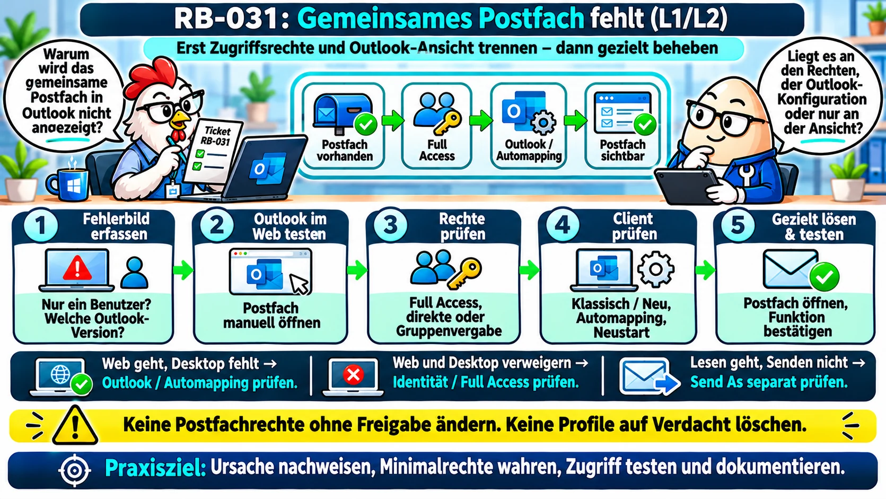

# RB-031 – Gemeinsames Postfach fehlt

**Projekt:** 50 Tickets – 50 typische Supportfälle  
**Bereich:** Microsoft 365 / Exchange Online / Outlook (klassisch, neu, Web)  
**Support-Level:** L1/L2 · **Stand:** 22.11.2026 · **Version:** 1.0  
**Fachstatus:** Herstellerquellen recherchiert; **noch nicht praktisch validiert**. Alle Praxisbeispiele und Adressen sind fiktiv.



> **Leitsatz:** Ein gemeinsam genutztes Postfach kann in Exchange Online vorhanden und für einen Mitarbeiter zugänglich sein, ohne in Outlook automatisch zu erscheinen. **Postfachexistenz, Zugriffsberechtigung, automatische Einbindung und Sendeberechtigung sind vier verschiedene Dinge.**

---

## 1. Supportfall, Ziel und fachliche Abgrenzung

**Typische Störungsmeldungen:** „Das Postfach `service@beispiel.de` ist nicht mehr in Outlook“, „Kollege sieht den Team-Posteingang, ich nicht“, „Im Browser funktioniert es, aber nicht im neuen Outlook“, „Das Postfach wurde gestern freigeschaltet, erscheint aber nicht“, „Lesen geht, Senden als Team nicht“.

**Ziel:** Nachweisbar bestimmen, ob das Postfach (1) existiert, (2) mit dem richtigen Konto erreichbar ist, (3) der Benutzer über **Full Access** verfügt, (4) Outlook es automatisch oder manuell einbindet und (5) für den vereinbarten Arbeitsauftrag zusätzlich **Send As** beziehungsweise **Send on Behalf** benötigt wird. Den Sollzustand wiederherstellen, ohne Berechtigungen ungeprüft auszuweiten [Q1–Q4].

**L1:** exakten Wortlaut, betroffene Person, Postfachadresse, Outlook-Variante, Zeitraum und Vergleiche erfassen; lesende beziehungsweise vom Benutzer autorisierte Web-/Clienttests. **L2/Exchange-Administration:** Postfach- und Berechtigungsobjekt, Zuweisungsweg, Gruppen, Automapping, hybride Randbedingungen und genehmigte Änderungen prüfen.

**Abgrenzung:** RB-006 behandelt allgemeinen Mailversand/-empfang; RB-019 das beschädigte Outlook-Profil; RB-029 Microsoft-365-Lizenzen. Hier geht es um die **Sichtbarkeit und Erreichbarkeit eines Shared Mailbox** und ihre Berechtigungs-/Client-Abhängigkeiten, nicht primär um ein kaputtes persönliches Konto.

## 2. Technische Grundlagen: Was ist ein gemeinsames Postfach?

Ein Shared Mailbox in **Exchange Online** ist ein eigenständiges Postfachobjekt mit eigener E-Mail-Adresse, das von berechtigten Personen über deren persönliche Geschäftskonten genutzt wird. Typische Beispiele sind `info@`, `support@` oder `rechnung@`. Es ist **kein** bloßer Outlook-Ordner, **keine** Verteilerliste und **keine** Microsoft-365-Gruppe, obwohl solche Objekte aus Anwendersicht ähnlich wirken können.

Der übliche Zugriff erfolgt als Stellvertretung mit dem individuellen, authentifizierten Benutzerkonto; die direkte Anmeldung am gemeinsam genutzten Postfach wird nicht als Workaround etabliert. Microsoft beschreibt für Shared Mailboxes eine gesonderte Benutzerkonto-/Anmelde- und Lizenzlogik: Berechtigte Benutzer benötigen selbst ein geeignetes Exchange-Online-Postfach; das Shared Mailbox benötigt unter bestimmten Standardbedingungen nicht unbedingt eine eigene Lizenz, während Zusatzfunktionen bzw. größere Postfächer eigene Lizenzvoraussetzungen haben [Q5]. Lizenzfragen sind deswegen ein **Sonderprüfpfad**, nicht die generelle Erstvermutung.

### Begriffe, die nicht verwechselt werden dürfen

| Begriff | Bedeutung | Was daraus **nicht** folgt |
|---|---|---|
| **Full Access** (Read and manage) | Postfach öffnen und Inhalte verwalten | Keine automatische **Send As**-Berechtigung |
| **Send As** | Nachricht erscheint als vom gemeinsamen Postfach gesendet | Kein Leserecht auf Postfachinhalte |
| **Send on Behalf** | Nachricht erscheint *im Auftrag von* dem Postfach | Kein Full Access; anderes sichtbares Absenderverhalten |
| **Automapping** | Outlook bindet ein Postfach unter unterstützten Voraussetzungen automatisch ein | Keine Garantie allein aufgrund eines Gruppeneintrags |
| **Manuelle Einbindung** | Berechtigtes Postfach gezielt in Outlook/Web hinzufügen | Keine neue Berechtigung wird dadurch vergeben |

Die Berechtigungsdefinitionen sind in der Exchange-Online-Dokumentation getrennt aufgeführt [Q2, Q3].

## 3. Die Abhängigkeitskette – Warum ein Postfach fehlen kann

```text
Postfachobjekt in Exchange Online vorhanden und korrekt adressiert?
   ↓
Benutzer mit seinem richtigen Geschäftskonto/Tenant angemeldet?
   ↓
Full Access für diesen Benutzer effektiv vorhanden?
   ↓
Zuweisungsweg geprüft: direkt oder über Sicherheitsgruppe?
   ↓
Passende Einbindung: Automapping oder manuelles Hinzufügen?
   ↓
Outlook im Web / neues Outlook / klassisches Outlook getestet?
   ↓
Postfach sichtbar, Ordner öffnend, erwartete Nachrichten erreichbar?
   ↓
Falls Versand gefordert: Send As / Send on Behalf separat nachweisen
```

**Achtung:** Das ist eine **Diagnosereihenfolge**, keine technische Behauptung, dass Exchange intern exakt linear arbeitet. Ein fehlender Autodiscover-Eintrag kann bei vorhandenen Rechten die *Darstellung* betreffen, ohne das Postfach oder das Zugriffsrecht zu entfernen [Q3, Q6].

## 4. Fehlerbilder und trennende Beobachtungen

| Beobachtung | Mögliche Erklärung | Trennender nächster Test |
|---|---|---|
| Postfach nur auf **einem** PC nicht sichtbar | Outlook-Profil/-Ansicht/Automapping | Mit demselben Benutzerkonto **Outlook im Web** testen |
| Postfach auf **allen** Clients nicht zu öffnen | Identität, Postfachexistenz, Full Access, Provisionierung, Policy | EAC-/PowerShell-Objekt und berechtigte Zugriffsprobe |
| Webzugriff funktioniert, klassisches Outlook zeigt nichts | Manuelle Einbindung fehlt; Gruppenberechtigung ohne Automapping; lokales Profil | Zuweisungsweg und Outlook-Variante prüfen |
| Postfach erst **kürzlich** angelegt/zugewiesen | Verzögerung bei Replikation, Sitzung oder Clientneustart | Änderungszeitpunkt dokumentieren, kontrolliert neu testen |
| Lesen funktioniert, **Senden nicht** | Separates Send As / Send on Behalf fehlt | Berechtigte Versandprüfung und Sendeberechtigung prüfen |
| Nur Outlook mobil/neues Outlook betroffen | Unterschiedliche Oberfläche/Einbindemethode | Versionsbezogene Microsoft-Anleitung anwenden |
| Mehrere Benutzer und Postfächer betroffen | Dienststörung, Policy- oder zentraler Change | Service Health und Veränderungslage durch Admin prüfen |

**Nicht aus dem Fehlerbild ableiten:** Die Nichtanzeige allein beweist weder ein fehlendes Full-Access-Recht noch einen Outlook-Defekt.

## 5. Die neun wichtigsten Fragen bei der Ticketaufnahme

1. Wie lautet die **genaue SMTP-Adresse** des betroffenen Shared Mailbox (intern vertraulich dokumentieren)?
2. Wird der Postfachordner **gar nicht angezeigt**, oder erscheint er und meldet beim Öffnen einen Fehler?
3. Welche Anwendung ist betroffen: **klassisches Outlook, neues Outlook, Outlook im Web** oder mobil?
4. Seit wann? Gab es **neue Mitarbeitende, Delegationen, Gruppenänderungen oder Clientupdates**?
5. Sind **andere Benutzer** mit demselben Postfach erfolgreich?
6. Kann der **gleiche Benutzer** das Postfach in Outlook im Web manuell öffnen?
7. Wurde Zugriff **direkt** oder über **Sicherheitsgruppe** zugewiesen?
8. Ist nur **Lesen/Öffnen** erforderlich oder soll auch als gemeinsames Postfach **gesendet** werden?
9. Wie dringend ist die Beeinträchtigung, welche Fachprozesse hängen daran, und gibt es einen freigegebenen Ersatzweg?

**Rhetorisch präzise Rückfrage:** „Fehlt das Postfach nur in der Ordnerliste, oder erhalten Sie beim gezielten Öffnen eine Fehlermeldung?“ Damit trennst du *Anzeige* von *Zugriff*.

## 6. Sicherheit und Rollen – vor jedem Eingriff

- **Least Privilege:** Nur die Rechte, die der Fachprozess tatsächlich benötigt; Anforderung und Freigabe durch Eigentümer/Verantwortliche dokumentieren.
- **Nie aus Bequemlichkeit:** Postfachkennwort teilen, Direktanmeldung mit Shared-Mailbox-Zugang improvisieren, allgemein Full Access oder Send As geben.
- **Keine Profilzerstörung:** Outlook-Profil nicht vorschnell löschen oder neu anlegen; Offlineentwürfe, Archive, lokale Signaturen, PSTs und weitere Konten können betroffen sein.
- **Keine Rechte auf Verdacht neu setzen:** `Remove-MailboxPermission`/`Add-MailboxPermission` können Automapping oder Zugriff verändern und benötigen dokumentierte Change-Freigabe.
- **Keine Geheimnisse protokollieren:** Passwörter, Tokens, MFA-Codes, private Nachrichten, vertrauliche Betreffzeilen oder Mailinhalte nicht in Tickets kopieren.
- **Bei hybriden Umgebungen** getrennte Zuständigkeit und besondere Automapping-Voraussetzungen berücksichtigen; nicht so tun, als wäre ein On-Prem-/Cloud-Szenario identisch mit reinem Exchange Online [Q7].

## 7. L1-Schnelltest: Outlook im Web als Vergleichsweg

**Prämisse:** Mitarbeiter ist mit **seinem eigenen berechtigten Geschäfts-/Schulkonto** bei Outlook im Web angemeldet. Die Testmethode benötigt keine Zugangsdaten des Shared Mailbox.

1. `https://outlook.office.com` mit dem richtigen Firmenkonto öffnen.
2. In Outlook im Web je nach Oberfläche: Auf **Ordner** rechtsklicken und **Freigegebenen Ordner oder Postfach hinzufügen** wählen; die Shared-Mailbox-Adresse eingeben.
3. Alternativ über das Benutzerprofil **Weiteres Postfach öffnen** auswählen und die Postfachadresse angeben.
4. Ergebnis genau unterscheiden: **öffnen und lesen möglich**, **Postfach nicht gefunden**, **Zugriff verweigert** oder **Anmeldungs-/Dienstproblem**.
5. Keine vertraulichen Inhalte zur Probe an private Konten weiterleiten; vorhandenen Ordnerzugriff nachweisen oder eine genehmigte Testnachricht verwenden.

Microsoft dokumentiert beide Webzugriffswege [Q1]. **Webzugriff erfolgreich** spricht für vorhandene effektive Zugriffsmöglichkeit, beweist aber **nicht**, dass Automapping oder ein bestimmtes lokales Outlook-Profil korrekt konfiguriert ist. **Webzugriff fehlgeschlagen** macht serverseitige Identitäts-/Berechtigungs- und Objektprüfung vorrangig; eine reine Desktop-Reparatur wäre voreilig.

## 8. Pfad A – Postfach vorhanden, Webzugriff wird verweigert

Für berechtigte Administratoren in **Exchange Admin Center** (`https://admin.exchange.microsoft.com`):

1. **Empfänger → Postfächer** / Shared-Mailbox-Bereich (Oberfläche kann sich ändern): korrekte SMTP-Adresse, Empfängertyp und Objekt bestätigen.
2. **Postfachdelegierung** / Berechtigungen prüfen: Hat der richtige Benutzer **Full Access (Read and manage)**? Bei Gruppenberechtigungen Mitgliedschaft gesondert nachweisen.
3. Falls Benutzer soeben hinzugefügt: Zeitpunkt, Replikations-/Clientzustand und tatsächlichen Webtest festhalten. Microsoft beschreibt Verzögerungen nach Erstellung bzw. Änderungen; **keine feste Wartezeit garantiert eine Lösung** [Q5].
4. Prüfen, ob dieselbe Person mit ihrem normalen Postfach korrekt angemeldet ist; möglicher Tenant- oder Kontowechsel.
5. Bei weiterem Zugriffsausfall Microsoft-365-Service-Health, Fehlerzeitpunkte und administrativ nachvollziehbare Änderungen/Policy berücksichtigen.
6. Nur bei bestätigt fehlendem **Sollrecht** und mit Freigabe die passende Rechtezuweisung durch L2 korrigieren; danach mit dem ursprünglichen Konto erneut öffnen.

**Nicht verwechseln:** Ein Shared Mailbox als **Verteilergruppe/Microsoft-365-Gruppe** vorzufinden, ist ein anderer Objekttyp – nicht einfach wie ein vollwertiges Shared-Mailbox-Postfach öffnen.

## 9. Pfad B – Webzugriff geht, klassisches Outlook zeigt Postfach nicht

1. Prüfen, ob klassische Outlook-Version betroffen ist und ob Outlook nach der Berechtigungsänderung einmal **ordnungsgemäß beendet und neu gestartet** wurde [Q4].
2. Feststellen, wie Full Access vergeben wurde:
   - **Direkt an Benutzer:** Standard-Automapping kann die Einbindung ermöglichen.
   - **Über mailaktivierte Sicherheitsgruppe:** Die Mitglieder erhalten ggf. Zugriff, aber das Postfach wird **nicht automatisch** in ihrem Outlook-Profil eingehängt [Q3, Q6].
3. Bei **gruppenbasierter Berechtigung** nach Unternehmensstandard **manuell als zusätzliches Postfach einbinden**; keine direkte Einzeldelegation nur erzwingen, damit Automapping „schön“ aussieht.
4. Bei direkt gewährtem Full Access und trotzdem fehlender Anzeige: autorisierten Webzugriff als Referenz sichern; Outlook-Konfiguration/Autodiscover und ggf. Profilzustand durch Endpoint-L2 prüfen.
5. **Keine unkontrollierte Doppelkonfiguration:** Vor manueller Einbindung prüfen, ob das Postfach bereits automatisch eingebunden ist. Doppeltes Hinzufügen oder die Einrichtung als weiteres Exchange-Hauptkonto kann Folgeprobleme verursachen [Q8].
6. Erfolg: gemeinsames Postfach erscheint, lässt sich öffnen, und die vorgesehenen Ordner laden.

**Technische Feinheit:** Automapping ist ein Clientbereitstellungsmechanismus im Zusammenspiel mit Exchange/Autodiscover. *Manuelles Öffnen bei gültigem Full Access* ist ein legitimer Unterschied zur automatischen Sichtbarkeit.

## 10. Pfad C – Neues Outlook, Weboberfläche oder mobile App

**Neues Outlook für Windows:** Microsoft beschreibt für aktuelle Builds die Verwaltung über **Einstellungen → Konten → Für mich freigegeben** (englische Oberfläche *Shared with me*) beziehungsweise eine Funktion **Hinzufügen**; je nach Version lassen sich vorhandene Freigaben als eigenes Konto anzeigen [Q9]. Menübezeichnungen und Verfügbarkeit **am konkreten Build prüfen**.

**Outlook im Web:** Der Benutzer kann das berechtigte Postfach über **Freigegebenen Ordner oder Postfach hinzufügen** oder **Weiteres Postfach öffnen** öffnen [Q1]. Ein Postfach muss hier nicht ohne Nutzeraktion in der Liste erscheinen.

**Outlook mobil:** Einbindung und unterstützte Konten-/Postfachfunktionen sind versionsabhängig. Vor Diagnose zuerst feststellen, ob das Postfach im Web funktioniert; danach nur die zur App gehörige offizielle Microsoft-Anleitung anwenden.

**Falle:** Eine Anleitung für **klassisches** Outlook passt nicht zwingend 1:1 für das **neue** Outlook. Das vorschnelle Anlegen eines zweiten Vollkontos mit dem Kennwort des Shared Mailbox ist kein zulässiger Standardweg.

## 11. Pfad D – Lesen geht, aber „Senden als“ scheitert

**Achtung:** Dieser Pfad ist eine **ergänzende Diagnose**, nicht das eigentliche Symptom „Postfach fehlt“.

- Ein User mit **Full Access** darf Inhalte verwalten, **aber nicht automatisch als Shared Mailbox senden** [Q2, Q3].
- **Send As:** Empfänger sieht das Team-Postfach als Absender.
- **Send on Behalf:** Empfänger sieht eine Form wie „Mitarbeiter im Auftrag von Team“.
- Exchange-Admin prüft separat Send-As-/Send-on-Behalf-Rechte und den gewählten **Von:**-Absender. Sonderfälle wie aus Adresslisten ausgeblendete Postfächer sind möglich [Q2].
- Nach neu vergebenen Senderechten kann es Replikationsverzögerung geben [Q5]. Ein Test muss die Berechtigung tatsächlich mit dem vereinbarten Absenderverhalten bestätigen.

**Merksatz:** **Öffnen ≠ Senden**. Weder „nochmal Full Access“ noch Passwortwechsel lösen fehlendes Send As logisch.

## 12. Lesende Exchange-Online-PowerShell-Prüfungen (L2)

**Voraussetzungen:** passende Adminrolle, im Unternehmen freigegebenes **ExchangeOnlineManagement**-Modul, richtige Tenant-/Cloud-Umgebung, interaktive Anmeldung und autorisierter Test. Die Platzhalterdomains sind fiktiv. Die folgenden **Get-**-Befehle verändern keine Berechtigungen.

```powershell
# Einmalige Verbindung nach Berechtigungsprüfung / Richtlinie:
Connect-ExchangeOnline -UserPrincipalName 'admin@beispiel.de'

# 1) Objekt prüfen: Ist es ein Shared Mailbox?
Get-EXOMailbox -Identity 'service@beispiel.de' |
  Select-Object DisplayName, PrimarySmtpAddress, RecipientTypeDetails

# 2) Berechtigungen anzeigen (nicht verändern).
# Bei Gruppenvergabe zusätzlich Gruppenmitgliedschaft getrennt nachweisen.
Get-EXOMailboxPermission -Identity 'service@beispiel.de' |
  Where-Object { -not $_.IsInherited } |
  Select-Object User, AccessRights, Deny, IsInherited

# 3) Send-As-Berechtigungen (nur falls Versand zum Ticket gehört).
Get-EXORecipientPermission -Identity 'service@beispiel.de' |
  Select-Object Trustee, AccessRights, IsInherited

# 4) Sitzung ordentlich schließen.
Disconnect-ExchangeOnline -Confirm:$false
```

**Einordnung:** 

- Eine Zeile mit **FullAccess** für eine Sicherheitsgruppe belegt nicht automatisch, dass **eine bestimmte Person** Mitglied ist: Gruppenzugehörigkeit muss separat geprüft werden.
- Ob ein Recht *effektiv* ist, sollte zusätzlich durch einen berechtigten **Webzugriff mit dem Betroffenen** nachgewiesen werden.
- `Get-EXORecipientPermission` betrifft insbesondere **Send As**, nicht Full Access [Q10, Q11].
- Die Ausgabe zeigt nicht zuverlässig, ob **Automapping im konkreten Outlook-Profil** bereits erfolgt ist; die Clientprobe bleibt nötig.
- **Absichtlich keine** unbegleiteten `Set-`, `Add-` oder `Remove-`-Cmdlets in diesem Lern-Runbook. Rechteänderungen müssen separat autorisiert und dokumentiert sein.

## 13. Diagnosematrix: Befund → Hypothese → kleinste passende Maßnahme

| Belegter Befund | Plausible Hypothese | Nächster sinnvoller Schritt | Abschlussbeweis |
|---|---|---|---|
| Postfachobjekt fehlt im Exchange-Verzeichnis | Falsche Adresse oder Objekt nicht provisioniert | Objektidentität und Provisionierung L2 klären | Objekt existiert unter korrekter Adresse |
| Webzugriff verweigert + Full Access fehlt | Fehlende Delegation | **Sollrecht/Genehmigung** einholen, L2-Zuweisung | Weböffnung mit ursprünglichem User |
| Webzugriff ok, klassisches Outlook ohne Postfach, Gruppenrecht | Automapping über Gruppe nicht verfügbar | Genehmigte manuelle Einbindung | Ordner sichtbar und lesbar |
| Webzugriff ok, klassisches Outlook, direktes Full Access | Lokale Einbindung/Profil/Autodiscover | Neustart, konfigurierte Einbindung prüfen, Endpoint-L2 | Nach wiederholtem Start sichtbar |
| Neues Outlook zeigt Shared Mailbox nicht | Andere Clientmenüs und Einbindungsmethode | „Für mich freigegeben“ prüfen | Eigene Kontositzung + Postfachzugriff |
| Zugriff lesend ok, Senden verweigert | Send As / Send on Behalf separat fehlend | Rechte und Von-Adresse prüfen; genehmigte Anpassung | Nachricht mit korrektem Absender |
| Zahlreiche User betroffen | Zentrale Änderung oder Dienststörung | Service Health / Changes / Exchange-Admin | Mehrere betroffene Nutzer bestätigen |

## 14. Zwei fiktive Supportfälle – erst selbst analysieren

### Fall A – „In Outlook weg, im Web verfügbar“

**Meldung:** Eine Mitarbeiterin sieht `team@beispiel.de` seit ihrem Gerätewechsel nicht mehr im **klassischen Outlook**. In Outlook im Web kann sie die Shared Mailbox über „Weiteres Postfach öffnen“ erreichen. Im Exchange Admin Center steht Full Access für die mailaktivierte Sicherheitsgruppe `SG-Team-Mail`; die Mitarbeiterin ist nachweislich Mitglied.

**Deine Aufgabe vor dem Lesen der Lösung:** Welche Fehlerhypothese ist durch den Webtest schwächer geworden? Warum kann das Postfach trotzdem im Desktop fehlen? Welche minimalinvasive Maßnahme würdest du im Rahmen des Unternehmensstandards vorschlagen?

**Auswertung:** Der erfolgreiche Webtest spricht gegen einen vollständigen Zugriffsverlust. **Gruppenbasiertes Full Access löst in klassischem Outlook nicht das übliche Automapping aus** [Q3, Q6]. Bei erlaubtem Standardvorgehen manuell als **zusätzliches Postfach** einbinden; anschließend das Lesen im Outlook-Client nachweisen. Nicht vorsorglich Vollrechte direkt vergeben, weil das die Berechtigungsverwaltung umgeht.

### Fall B – „Fachbereich kann lesen, aber nicht antworten“

**Meldung:** Ein Kollege öffnet `einkauf@beispiel.de` im Outlook im Web und liest die Nachrichten. Beim Versand **als `einkauf@`** kommt eine Berechtigungsfehlermeldung. L2 findet Full Access, aber kein Send As für den vorgesehenen Benutzer.

**Deine Aufgabe:** Ist die ursprüngliche Meldung „gemeinsames Postfach fehlt“ hier überhaupt zutreffend? Was ist die kleinste passende Korrektur? Welchen Test brauchst du zur Bestätigung?

**Auswertung:** Nein, **Lesen geht**, damit ist die Sichtbarkeit nicht das eigentliche Problem. Für den geforderten Versand ist nach Fachfreigabe eine separate **Send-As-Delegation** durch autorisierte Administration nötig. Danach Test mit korrekter **Von:**-Adresse und sichtbarem Absender beim Empfänger. Ein zusätzlicher Outlook-Profilreset ist sachlich unbegründet [Q2].

**Hinweis:** Beide Fälle sind **modellierte Übungen**, keine tatsächlich ausgeführten Tickets. Ihre Befunde sind zur Schulung vorgegeben, nicht im Labor nachgewiesen.

## 15. Erfolgskontrolle, Active Recall, Transfer und späterer Praxistest

### Abschlussbedingungen

- Der ursprünglich betroffene Benutzer öffnet das richtige Shared Mailbox **mit seinem eigenen Firmenkonto**.
- Der vereinbarte Zugriff funktioniert im ursprünglichen Problemclient, nicht nur im Web-Gegentest.
- Der relevante Ordnerinhalt ist sichtbar; nach Outlook-Neustart ist die Einbindung im vereinbarten Modus weiterhin vorhanden.
- Falls gefordert, wurde Senden **separat** anhand von Send As/Send on Behalf und korrekt angezeigtem Absender getestet.
- Berechtigungen entsprechen dem bestätigten Sollzustand; keine unnötigen Zusatzrechte vergeben.
- Zeitpunkt, belegte Ursache, A/B-Test, Korrektur, Freigabe und reproduzierbare Verifikation stehen im Ticket.

### Active Recall (ohne Vorlage beantworten)

1. Warum kann ein Benutzer über eine Sicherheitsgruppe **Full Access** haben, ohne dass das Postfach automatisch in klassischem Outlook erscheint?
2. Welcher A/B-Test trennt *fehlende effektive Rechte* von einem *lokalen Anzeige-/Konfigurationsproblem*?
3. Worin unterscheiden sich **Full Access**, **Send As** und **Send on Behalf** jeweils in einem Satz?
4. Warum wäre „Outlook-Profil löschen“ **kein** sinnvoller erster Schritt?
5. Was beweist `Get-EXOMailboxPermission` bei Gruppendelegation **nicht**?
6. Welchen sichtbaren Unterschied zwischen Send As und Send on Behalf müsste eine Testnachricht zeigen?

### Lernkarten – drei Kategorien

- **Wissen:** „Welches Recht erlaubt das Öffnen eines Shared Mailbox?“ → *Full Access.*
- **Verständnis:** „Warum erscheint ein über Gruppe berechtigtes Postfach nicht automatisch?“ → *Automapping bindet solche Gruppenberechtigungen nicht automatisch ein.*
- **Diagnose:** „Web ja, klassisches Outlook nein – erste Hypothese?“ → *Client/Automapping/Einbindemethode; Rechte dennoch dokumentieren.*

### Praxisübungen im genehmigten Testtenant

**Szenario 1:** Shared Mailbox mit direktem Full Access im klassischen Outlook, Sichtbarkeit/Neustart prüfen. **Szenario 2:** Full Access über mailaktivierte Sicherheitsgruppe und manuelle Einbindung vergleichen. **Szenario 3:** Vollzugriff und Send As getrennt testen, mit einer autorisierten Testnachricht. In jedem Versuch zuerst **Hypothese und Prüfplan selbst schreiben**, danach die tatsächlichen Befunde kontrollieren. Anschließend ohne Vorlagen mit neuen Benutzern/Postfächern wiederholen (z. B. nach 7 und 21 Tagen).

**Validierungsstatus:** Anleitungen und Befehle sind recherchiert, nicht in diesem Projekt auf einem produktiven Exchange-Tenant ausgeführt. Kein erfolgreicher Test oder Berechtigungswechsel wird behauptet.

---

## Quellen – offizielle Microsoft-Dokumentation (abgerufen 22.11.2026)

- **[Q1]** [Open and use a shared mailbox in Outlook](https://support.microsoft.com/en-us/outlook/sharing/open-and-use-a-shared-mailbox-in-outlook).
- **[Q2]** [Create a shared mailbox – Microsoft 365 admin](https://learn.microsoft.com/en-us/microsoft-365/admin/email/create-a-shared-mailbox?view=o365-worldwide).
- **[Q3]** [Manage permissions for recipients in Exchange Online](https://learn.microsoft.com/en-us/exchange/recipients-in-exchange-online/manage-permissions-for-recipients).
- **[Q4]** [Shared mailboxes in Exchange Online](https://learn.microsoft.com/en-us/exchange/collaboration-exo/shared-mailboxes).
- **[Q5]** [About shared mailboxes in Microsoft 365](https://learn.microsoft.com/en-us/microsoft-365/admin/email/about-shared-mailboxes?view=o365-worldwide).
- **[Q6]** [Full Access mailbox not automapped to Outlook profile](https://learn.microsoft.com/en-us/exchange/troubleshoot/administration/full-access-mailbox-not-automapped-outlook-profile).
- **[Q7]** [Permissions in Exchange hybrid deployments](https://learn.microsoft.com/en-us/exchange/permissions).
- **[Q8]** [Issues adding multiple Exchange accounts to the same Outlook profile](https://learn.microsoft.com/en-us/troubleshoot/outlook/profiles-and-accounts/issues-that-occur-when-adding-multiple-exchange-accounts).
- **[Q9]** [Manage shared mailbox settings in new Outlook](https://support.microsoft.com/en-us/outlook/sharing/manage-shared-mailbox-settings-in-new-outlook).
- **[Q10]** [Get-EXOMailboxPermission](https://learn.microsoft.com/en-us/powershell/module/exchangepowershell/get-exomailboxpermission?view=exchange-ps).
- **[Q11]** [Get-EXORecipientPermission](https://learn.microsoft.com/en-us/powershell/module/exchangepowershell/get-exorecipientpermission?view=exchange-ps).

> **Quellen- und Praxisgrenze:** Die verlinkten Microsoft-Artikel unterstützen die genannten Rechte-, Einbindungs- und Fehlerklassen. Ein konkreter Fall benötigt eigene Messwerte, einen dokumentierten Sollzustand und Tests. Änderungen an Outlook-Oberflächen und Tenant-Richtlinien bitte bei der Durchführung anhand der aktuellen Produktversion neu prüfen.
