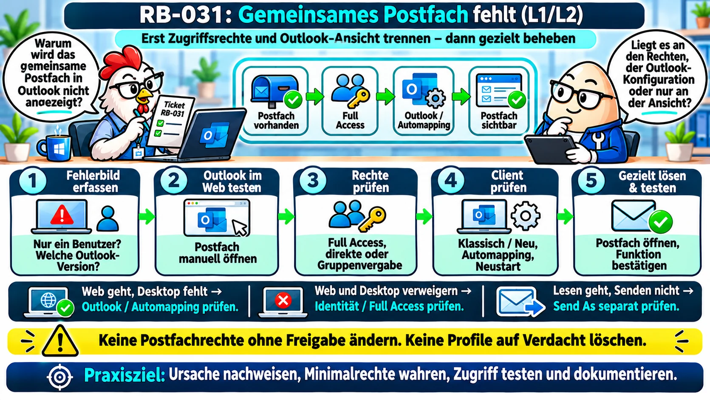

# RB-031 – Praxis-Runbook: Gemeinsames Postfach fehlt

**Projekt:** 50 Tickets – 50 typische Supportfälle  
**Support-Level:** L1/L2 · **Version:** 1.0 · **22.11.2026**  
**Fachstatus:** Offizielle Microsoft-Quellen ausgewertet, **praktisch noch nicht validiert**. Adressen, Nutzer und Beispielkommentare sind fiktiv.

> **Arbeitsregel:** **Nicht sichtbar ≠ kein Full Access. Full Access ≠ Send As.** Zuerst Postfach, Identität und Webzugriff prüfen, dann Zuweisungsweg und Outlook-Client – keine Rechte-/Profiländerung auf Verdacht.



Technischer Entscheidungsbaum: [SVG](assets/rb031_diagnosebaum.svg) · [PNG-Vorschau](../assets/rb031_diagnosebaum.svg)

---

## 1. Ticketannahme, Auswirkung und Priorität (L1)

**Erfassen:** Ticket-ID; betroffener Benutzer und sein Geschäfts-/Schulkonto; **SMTP-Adresse** des gemeinsamen Postfachs; Zeitpunkt des erstmaligen Fehlers; konkreter Wortlaut; betroffenes Gerät; Outlook-Typ (**klassisch / neu / Web / mobil**), Version und erwartete Aufgabe (nur Lesen, auch Senden); andere betroffene Benutzer; kürzliche Delegations-, Gruppen- oder Geräteänderungen.

**Erstfrage:** „Ist das Postfach aus der linken Ordnerliste verschwunden, oder erhalten Sie beim gezielten Öffnen die Meldung *Zugriff verweigert*?“

**Priorisieren:** Ein Benutzer / ein Shared Mailbox ist oft regulärer Incident. Mehrere Teams, zentrale Hotline oder organisationsweiter Ausfall erfordern Eskalation nach Unternehmensprozess und gegebenenfalls Service-Health-Kontrolle. Keine fiktiven SLA-Zeiten festlegen.

## 2. Sicherheits- und Freigabe-Gate

- Zugriff ausschließlich mit **eigener Firmenidentität**; kein Shared-Mailbox-Passwort erfragen oder teilen.
- Fachliche **Sollberechtigung** vom verantwortlichen Postfach-/Prozesseigentümer bestätigen lassen: Full Access? Send As? Send on Behalf? Wer darf sie vergeben?
- Keine Änderung von Mitgliedschaften, Gruppen- und Mailboxrechten allein auf Basis einer Fehlermeldung. Keine generelle Freigabe an Abteilungen.
- **Nicht ohne Vorbereitung:** Outlook-Profil löschen, persönliche OST/PST-Dateien entfernen, Shared Mailbox als zweites Konto mit eigenem Passwort konfigurieren, `Remove-MailboxPermission` ausführen.
- Keine Mailinhalte, Tokens, MFA-Codes oder Zugangsdaten in offenen Tickets speichern; nötige Screenshots redigieren.
- Exchange-Online-Admin- und PowerShell-Prüfungen nur mit angemessener Rolle und im richtigen Tenant. Bei Hybridbereitstellung an zuständige L2-/Exchange-Teams übergeben.

## 3. L1-Triage – drei Vergleiche ohne Systemänderung

| Test | Befund | Konsequenz |
|---|---|---|
| **A**: Postfach in Outlook auf dem PC sichtbar? | Nein | Webtest zum Trennen von Anzeige und Zugriff |
| **B**: Mit *demselben Konto* in Outlook im Web über „Weiteres Postfach öffnen“ oder „Freigegebenen Ordner oder Postfach hinzufügen“ erreichbar? | **Ja** | Effektiver Zugriff besteht über Web → Outlook-/Automapping-Pfad prüfen |
| **B**: Webzugriff verweigert oder Postfach unbekannt? | **Nein** | Identität, Postfachobjekt, Full Access durch L2 prüfen |
| **C**: Können andere dafür berechtigte Mitarbeiter das Postfach öffnen? | Ja/Nein | Einzelclient vs. zentraler Umfang eingrenzen |
| **D**: Öffnen geht, Senden scheitert? | Ja | Separates Send As / Send on Behalf prüfen, kein Sichtbarkeitsproblem |

**Webtest konkret:** `https://outlook.office.com` → richtige Firmenanmeldung → je nach Oberfläche **Ordner → Freigegebenen Ordner oder Postfach hinzufügen** oder Profilmenü → **Weiteres Postfach öffnen**. Die genaue Postfachadresse eingeben. Kein direkter Login mit einem Shared-Mailbox-Kennwort [Q1].

**Protokollieren:** Zeitpunkt, App, Postfachadresse, Nutzerkonto, Ergebnis, Fehlermeldung. Ohne Webtest bleibt die Ursache meist zu breit.

## 4. Pfad A – Webzugriff verweigert / Postfach nicht gefunden (L2)

1. **Falsche Adresse oder falscher Tenant?** SMTP-Adresse und UPN mit internem Sollbestand abgleichen.
2. **Exchange-Objekt vorhanden?** Im Exchange Admin Center (**Empfänger → Postfächer**; Oberfläche kann abweichen) `RecipientTypeDetails` bzw. Postfachtyp prüfen.
3. **Delegation vorhanden?** Unter **Postfachdelegierung** / **Read and manage (Full Access)** die richtige Person oder die zugewiesene Gruppe prüfen [Q2, Q3].
4. **Gruppenweg:** Bei Berechtigung über mailaktivierte Sicherheitsgruppe zusätzlich die tatsächliche **Mitgliedschaft** prüfen. Allein die ACL-Zeile der Gruppe beweist keine Mitgliedschaft des Betroffenen.
5. **Zeitpunkt:** Wurde das Postfach gerade angelegt oder der Zugriff gerade geändert? Replikations-/Clientsynchronisierung berücksichtigen; ohne Erfolg nicht unbegrenzt warten [Q4].
6. **Sollrecht vorhanden, aber technisch nicht wirksam:** Fehler und Zeiten sichern; Exchange-/Identitätsadministration, Policy/Hybrid und gegebenenfalls Service Health überprüfen lassen.
7. **Sollrecht fehlt nachweislich:** Erst mit dokumentierter Freigabe die **kleinstmögliche** passende Delegation durch berechtigten Admin setzen; danach mit ursprünglichem Benutzerkonto im Web prüfen.

**STOPP:** Weder Identität noch Postfachobjekt/Sollrecht bestätigt → nicht weiter Berechtigungen vergeben.

## 5. Pfad B – Outlook im Web geht, klassisches Outlook zeigt Postfach nicht

1. Kontrollieren, dass der Nutzer das **klassische Outlook** verwendet und das richtige primäre Konto aktiv ist.
2. Outlook nach kürzlicher Delegationsänderung **geordnet beenden und neu starten** [Q2].
3. **Zuweisungsweg bestimmen:** direktes Full Access oder über Sicherheitsgruppe?
4. **Über Gruppe:** Automapping erfolgt im klassischen Outlook üblicherweise **nicht** für die Gruppenmitglieder. Bei bestätigtem Full Access das Postfach nach Unternehmensstandard **manuell als zusätzliches Postfach** anbinden [Q3, Q5].
5. **Direkt:** Automapping ist im Standardfall möglich; bei weiterhin fehlender Anzeige bereits vorhandene Einbindung prüfen, dann Autodiscover-/Outlook-Profil-Diagnose durch Endpoint-L2.
6. **Doppelkonfiguration vermeiden:** Postfach nicht zusätzlich ein zweites Mal einhängen, wenn bereits automatisch vorhanden; nicht blind als unabhängiges Exchange-Hauptkonto anlegen [Q6].
7. Postfachordner öffnen, zulässige Nachrichtenliste prüfen, Outlook neu starten und Sichtbarkeit erneut testen.

**Einordnen:** Vorhandene Webrechte + fehlende Desktop-Anzeige rechtfertigen **nicht automatisch** einen Rechte-Reset.

## 6. Pfad C – Neues Outlook oder Outlook im Web

**Neues Outlook für Windows:** Aktuelle Microsoft-Anleitung: **Einstellungen → Konten → Für mich freigegeben** (*Shared with me*), bei Bedarf **Hinzufügen** bzw. eine bereits automapped/freigegebene Mailbox in geeigneter Form einbinden [Q7]. Die UI hängt von Version und Funktionsumfang ab; das konkrete Produkt prüfen.

**Outlook im Web:** Postfach als **freigegebenen Ordner/Postfach** zur Liste hinzufügen oder über **Weiteres Postfach öffnen** in separatem Fenster öffnen [Q1]. Weboberfläche muss nicht stets automatisch alle delegierten Postfächer anzeigen.

**Test:** Richtiges Benutzerkonto, korrekte SMTP-Adresse, Postfach öffnet, zu erwartender Ordner sichtbar. Bei Verweigerung auf Pfad A zurück; bei funktionierendem Web und nur einem Desktopclient auf Clientdiagnose konzentrieren.

## 7. Pfad D – Lesen funktioniert, Senden als Postfach nicht

1. **Ticketinhalt korrigieren:** Es handelt sich nicht mehr um „Postfach fehlt“, sondern um **Sendeberechtigung/Absenderwahl**.
2. Erwarteten Versandmodus klären: **Send As** („von Team“) oder **Send on Behalf** („im Auftrag von Team“).
3. Exchange-Admin prüft diese Rechte **getrennt** von Full Access [Q2, Q3].
4. Im Mailclient **Von:**-Adresse prüfen, bevor Rechte geändert werden.
5. Bei fehlendem genehmigtem Senderecht L2 zur gezielten Vergabe; bei neuer Änderung mögliche Replikationsverzögerung beachten [Q4].
6. Autorisierte Testmail und sichtbaren Absender beim Empfänger prüfen. Keine vertraulichen Geschäftsinhalte für einen Test versenden.

**Merksatz:** **Full Access erlaubt Lesen/Verwalten, aber nicht automatisch Senden.**

## 8. Optionale lesende Exchange-Online-PowerShell-Diagnose (L2)

**Voraussetzung:** ExchangeOnlineManagement-Modul, passende Rolle, korrekter Tenant, interaktive Authentifizierung und zugelassene Nutzung. Fiktive Beispieladressen durch echte Unternehmensidentitäten ersetzen. **Alle `Get-`-Cmdlets sind lesend.**

```powershell
# Verbindung mit einem zugelassenen Administratorkonto:
Connect-ExchangeOnline -UserPrincipalName 'admin@beispiel.de'

# Ist ein Exchange-Shared-Mailbox-Objekt unter dieser Adresse vorhanden?
Get-EXOMailbox -Identity 'service@beispiel.de' |
  Select-Object DisplayName, PrimarySmtpAddress, RecipientTypeDetails

# ACL einschließlich explizit gesetzter Delegation lesen:
Get-EXOMailboxPermission -Identity 'service@beispiel.de' |
  Where-Object { -not $_.IsInherited } |
  Select-Object User, AccessRights, Deny, IsInherited

# Separater Send-As-Pfad (wenn erforderlich):
Get-EXORecipientPermission -Identity 'service@beispiel.de' |
  Select-Object Trustee, AccessRights, IsInherited

Disconnect-ExchangeOnline -Confirm:$false
```

**Grenze der Aussagekraft:** Gruppenmitgliedschaft, effektiver Benutzerzugriff und **Automapping im spezifischen Outlook-Client** ergeben sich daraus nicht automatisch. Sie sind gesondert zu testen. `Get-EXORecipientPermission` ersetzt nicht die Prüfung von Send on Behalf [Q8, Q9].

**Keine ungeprüften Schreibbefehle:** Das Neusetzen von Full Access mit AutoMapping-Parameter erfordert bei bereits bestehender Delegation ggf. Entfernen und erneutes Hinzufügen. Das kann den Produktivzugriff unterbrechen und ist **keine** L1-Routine [Q3].

## 9. Erfolgskontrolle, Stopp und Eskalation

**Als gelöst markieren, wenn:**

- Der ursprüngliche Mitarbeiter öffnet mit eigenem Firmenkonto das **richtige gemeinsame Postfach**.
- Der **ursprünglich betroffene Outlook-Client** zeigt es nach der vereinbarten Einbindung und erneutem Start.
- Ordner und Nachrichten sind im erlaubten Umfang sichtbar; keine unnötigen Rechte vergeben.
- Falls Versand Teil des Auftrags ist: **separate** Sendeberechtigung und korrekte Von-Adresse nachgewiesen.
- Ticket enthält exakten Ausgangsfehler, Trenn-Tests, freigegebene Änderung und Retest.

**An L2/Exchange-/Security-Team eskalieren bei:** fehlendem genehmigtem Sollrecht; Rechte trotz ACL und Webtest nicht wirksam; unbekanntem Postfachtyp; Hybrid-/Mandantenkonflikt; verdächtiger Mehrfachauswirkung; nicht nachvollziehbarer Rechteänderung; Compliance-/Sicherheitsbedenken; Profil-/Autodiscover-Anomalien, die L1 nicht risikolos prüfen kann.

**Schutzkriterium:** Kein Herunterfahren der Sicherheitsprüfung zugunsten schneller Sichtbarkeit; keine Aktion allein nach einem kosmetischen Anzeigeproblem.

## 10. Muster-Ticketkommentar, Status und Mini-Kompetenzcheck

### Muster-Ticketkommentar – ausdrücklich fiktiv

> **Problem:** Der Benutzer konnte das gemeinsame Postfach `team@beispiel.de` im klassischen Outlook nach einem PC-Wechsel nicht mehr sehen. **Diagnose/Maßnahme:** Der Zugriff war im Outlook im Web mit dem ursprünglichen Nutzerkonto möglich. Das Postfach war per mailaktivierter Sicherheitsgruppe mit Full Access berechtigt und wurde deshalb nicht automatisch in das klassische Outlook eingebunden; nach bestätigtem Unternehmensstandard wurde es manuell als zusätzliches Postfach hinzugefügt. **Ergebnis:** Der Benutzer konnte Ordner öffnen; die Anzeige blieb nach Outlook-Neustart erhalten. Keine Berechtigungsänderung notwendig.

### Kurzer L1-Status in drei Sätzen

> „Das gemeinsame Postfach fehlt derzeit in Ihrer Outlook-Ansicht. Ich prüfe zuerst, ob der Zugriff im Browser funktioniert, und gleiche anschließend die Berechtigung und die Einbindemethode mit dem zuständigen Team ab. Danach testen wir das Postfach gemeinsam erneut in der betroffenen Outlook-Version.“

### Active Recall – drei Fragen

1. Warum ist „In Outlook nicht sichtbar“ **kein Beweis** für fehlende Exchange-Berechtigung?
2. Weshalb kann gruppenbasiertes Full Access den **Webzugriff erlauben**, aber **kein Automapping** erzeugen?
3. Welchen zusätzlichen Nachweis benötigst du, wenn Lesen geht, **Senden als Postfach** aber scheitert?

### Transfertraining für später

Drei Testfälle in einem **autorisierten** Exchange-Online-Lab vergleichen: (A) direkte Delegation und Automapping; (B) Gruppenberechtigung und manuelle Einbindung; (C) Full Access ohne Send As. **Vor dem Test** eigene Hypothese, Trenn-Test und Erfolgsdefinition schreiben; **nach dem Test** tatsächlich beobachteten Zustand dokumentieren. Später ohne diese Vorlage erneut diagnostizieren.

---

## Quellen – offizielle Microsoft-Dokumentation (recherchiert 22.11.2026)

- **[Q1]** [Open and use a shared mailbox in Outlook](https://support.microsoft.com/en-us/outlook/sharing/open-and-use-a-shared-mailbox-in-outlook)
- **[Q2]** [Create a shared mailbox – Microsoft 365 admin](https://learn.microsoft.com/en-us/microsoft-365/admin/email/create-a-shared-mailbox?view=o365-worldwide)
- **[Q3]** [Manage permissions for recipients in Exchange Online](https://learn.microsoft.com/en-us/exchange/recipients-in-exchange-online/manage-permissions-for-recipients)
- **[Q4]** [About shared mailboxes in Microsoft 365](https://learn.microsoft.com/en-us/microsoft-365/admin/email/about-shared-mailboxes?view=o365-worldwide)
- **[Q5]** [Mailboxes aren't automapped to Outlook profile](https://learn.microsoft.com/en-us/exchange/troubleshoot/administration/full-access-mailbox-not-automapped-outlook-profile)
- **[Q6]** [Issues when adding multiple Exchange accounts to an Outlook profile](https://learn.microsoft.com/en-us/troubleshoot/outlook/profiles-and-accounts/issues-that-occur-when-adding-multiple-exchange-accounts)
- **[Q7]** [Manage shared mailbox settings in new Outlook](https://support.microsoft.com/en-us/outlook/sharing/manage-shared-mailbox-settings-in-new-outlook)
- **[Q8]** [Get-EXOMailboxPermission](https://learn.microsoft.com/en-us/powershell/module/exchangepowershell/get-exomailboxpermission?view=exchange-ps)
- **[Q9]** [Get-EXORecipientPermission](https://learn.microsoft.com/en-us/powershell/module/exchangepowershell/get-exorecipientpermission?view=exchange-ps)

**Validierungsstatus:** Recherche, kein Zugriff auf einen produktiven Tenant, kein ausgeführter administrativer Eingriff und kein praktisch überprüfter Fehlerfall. Alle Prozeduren vor Umsetzung mit der konkreten Umgebung und dem aktuellen Produktstand abgleichen.
