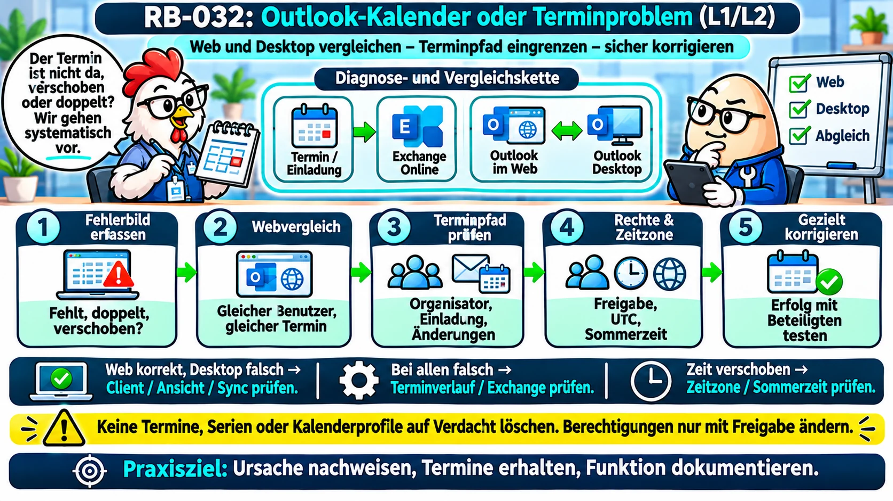

# RB-032 – Outlook-Kalender oder Terminproblem

**Projekt:** 50 Tickets – 50 typische Supportfälle  
**Bereich:** Microsoft 365 / Exchange Online / Outlook im Web, neues und klassisches Outlook  
**Support-Level:** L1/L2 · **Stand:** 22.11.2026 · **Version:** 1.0  
**Fachstatus:** Offizielle Microsoft-Quellen recherchiert; **praktische Validierung noch ausstehend**. Alle Fallbeispiele, Namen und E-Mail-Adressen sind fiktiv.



> **Leitsatz:** „Termin fehlt“ ist eine Beobachtung, keine Ursache. **Kalenderzuordnung, Einladungs-/Änderungsverlauf, Exchange-Postfach, Freigaberecht, Synchronisierung und Zeitzone** sind gesondert zu prüfen. Nicht auf Verdacht löschen, neu erstellen oder Kalenderrechte erweitern.

---

## 1. Supportfall, Lernziele und Abgrenzung

**Typische Meldungen:** „Mein Termin ist weg“, „Im Browser sehe ich ihn, auf dem PC nicht“, „Kollegen sehen den Teamkalender anders“, „Der Termin ist genau eine Stunde verschoben“, „Besprechungsupdates kommen nicht an“, „Serientermin doppelt“, „Der Raum lehnt die Buchung ab“.

**Ziel:** Das konkrete Objekt und die betroffene Aktion identifizieren, anhand eines sicheren A/B-Vergleichs den Fehlerpfad isolieren, nur nach nachgewiesenem Befund und Freigabe korrigieren und die erwartete Funktion beim ursprünglichen Benutzer kontrollieren.

**L1:** Störung aufnehmen, Kalender/Konto/Outlook-Version bestimmen, Ansicht und Zeitzone lesen, Termin in **Outlook im Web (OWA)** mit demselben Konto vergleichen und nicht-destruktive Tests durchführen. **L2/Exchange:** Berechtigungen und Stellvertretungen, Änderungsverlauf, Kalenderdiagnoseprotokolle sowie Ressourcenpostfächer auswerten. In Spezialfällen Microsoft-Support/Exchange-Expertise einbeziehen.

**Abgrenzung:** RB-006 (Mailzustellung), RB-019 (Outlook-Profil), RB-028 (Office-Programmstart), RB-031 (gemeinsames Postfach). Dieses Ticket konzentriert sich auf **Kalenderelemente, Besprechungseinladungen, gemeinsame Kalender und Uhrzeiten**. Ein Posteingangs-/Mailtransportproblem wird als möglicher Teilpfad dokumentiert, nicht vorschnell zur Kalenderursache erklärt.

## 2. Grundlagen: Welche Objekte spielen zusammen?

| Begriff | Technische Einordnung | Typischer Irrtum |
|---|---|---|
| **Termin / Appointment** | Ein Kalenderelement, grundsätzlich ohne Einladung anderer Teilnehmer | „Termin“ und „Besprechung“ werden gleichgesetzt |
| **Besprechung / Meeting** | Kalendereintrag mit Organisator, Teilnehmern und Einladungs-/Updateablauf | Ein Teilnehmer könne jeden Parameter verbindlich ändern |
| **Serientermin / Recurrence** | Regel und einzelne Vorkommen/Ausnahmen | Änderung einer Instanz wird mit Änderung der ganzen Serie verwechselt |
| **Organisator** | Verantwortliche Quelle für Einladungen und Updates | Bearbeitung beim Teilnehmer sei automatisch eine Organisator-Änderung |
| **Exchange-Online-Postfach** | Server- und Kalenderdaten der betreffenden Identität | Desktopanzeige sei stets deckungsgleich mit dem Postfach |
| **Outlook im Web (OWA)** | Browserclient für einen servernahen Vergleich | OWA sei eine hundertprozentige Wahrheit über alle Teilnehmenden |
| **Shared Calendar / Delegation** | Freigegebener Kalender mit abgestufter Berechtigung | Sichtbarkeit bedeute Bearbeitungs- oder Stellvertreterrecht |
| **Zeitzone/DST** | Anzeigen lokaler Zeiten aus einer UTC-basierten Zeitinformation | Eine um eine Stunde andere Anzeige bedeute gelöschte/verschobene Daten |

Outlook speichert Anfangs- und Endzeiten in UTC und zeigt sie entsprechend den Zeitzoneneinstellungen an [Q4]. Das bedeutet **nicht**, dass jedes beobachtete Zeitproblem automatisch ein UTC-Fehler ist. Verschiedene Kalenderansichten, Zeitzonen und Sommerzeitwechsel müssen mit dem Organisator-Eintrag abgeglichen werden.

## 3. Diagnose- und Abhängigkeitsmodell

```text
Wer meldet den Fehler? → Wer ist Organisator / Eigentümer?
          ↓
Welches Konto, welcher Tenant, welcher Kalender und welche Outlook-Variante?
          ↓
Existiert der fragliche Termin mit den erwarteten Angaben in Outlook im Web?
          ├─ Ja:     Desktop/Mobil/Ansicht/Sync und freigegebene Kalender vergleichen
          └─ Nein:   Kalenderobjekt, Einladung/Absage, Organisator, Änderungen untersuchen
          ↓
Sonderzweige: Freigaberechte/Delegation | Zeitzone/DST | Serie/Einzeltermin
          ↓
Befund + Freigabe → kleinste gezielte Maßnahme → Originalnutzer-Retest
```

Das ist eine **Diagnoseabfolge**, kein Anspruch, dass Exchange intern jede Besprechung exakt entlang dieser Linie verarbeitet. Shared Calendars verwenden je nach Freigabe- und Clientmodell unterschiedliche Synchronisierungsverfahren [Q1].

## 4. Fehlerbilder und diskriminierende Tests

| Beobachtung | Mögliche Erklärungen | Sicherster nächster Vergleich |
|---|---|---|
| Nur **ein** Termin fehlt | Anderer Kalender, Ausblendung/Ansicht, Absage, Änderung durch Organisator, lokaler Sync | Genauen Termin in OWA, beim Organisator und beim Teilnehmer suchen |
| Viele Termine nur **im klassischen Outlook** fehlen | Ansicht, Cache/Synchronisierung, lokale Clientprobleme, bekanntes Shared-Calendar-Problem | Mit identischem Konto und Datumsbereich in OWA vergleichen |
| Alle Clients zeigen Termin falsch | Ursprungsobjekt, Organisator-Update, Berechtigung, Serververlauf | Organisator- und Teilnehmerkopie samt Uhrzeit gegenüberstellen; ggf. CDL |
| Terminuhrzeit eine Stunde anders | Zeitzone, Sommerzeit, Einladung aus anderem Zeitzonen-Kontext | UTC/local-Zeit, Windows-/Outlook-Zeitzone, Datum der DST-Umstellung prüfen |
| Gemeinsamer Kalender fehlt/veraltet | Freigabe/Akzeptanz, Modellwechsel, Sync, Berechtigung | Kalender im Web mit derselben Berechtigung öffnen; Eigentümer prüfen |
| Besprechung wiederholt/doppelt | Serie und Ausnahmen, mehrere eingeblendete Kalender, Sync, Client-Bug | Termin-IDs/Organisator/Serieninstanz abgleichen, nicht sofort löschen |
| Nur Raum antwortet abweichend | Raum-/Ressourcenrichtlinie oder Konflikt | Raum-Mailbox und `Get-CalendarProcessing` durch L2 untersuchen [Q15] |
| Einladungen/Updates fehlen | E-Mail-Regeln/Transport, Weiterleitung, Delegation, Einladung nie versandt | Organisator, Gesendete Elemente, Posteingang, OWA abgleichen |

**Fachliche Grenze:** Ein abweichendes OWA-/Desktop-Ergebnis lokalisiert den Fehlerpfad, identifiziert aber nicht automatisch den konkreten defekten Cache oder eine eindeutige Root Cause.

## 5. Zehn Fragen bei der Ticketaufnahme

1. Was ist **genau** falsch: fehlt, doppelt, verschoben, nicht editierbar, keine Einladung oder kein Meeting-Link?
2. **Betroffene Person** und ggf. **Organisator**: Wer hat den Termin erstellt?
3. Welcher **Kalender** ist gemeint – eigener, geteilter, Gruppe, Raum, Internetkalender?
4. Welches **Konto/Tenant** und welche **Outlook-Variante** (klassisch, neu, Web, mobil)?
5. Welcher **Termin** (Betreff nur soweit datenschutzrechtlich nötig), Datum, Start-/Endzeit, Zeitzone?
6. Ist es ein **Einzeltermin** oder eine **Serieninstanz**? Gibt es Ausnahmen?
7. Tritt der Fehler **seit wann** auf; gab es ein Update, eine Delegation oder eine Terminänderung?
8. Sind andere Teilnehmer oder Geräte mit **demselben Termin** ebenfalls betroffen?
9. Erscheint der Termin **in OWA** mit demselben Konto im richtigen Kalender?
10. Welche **Geschäftsauswirkung** besteht (wichtige Besprechung, Buchungsproblem), und gibt es einen autorisierten Ersatzweg?

**Gute kommunikative Nachfrage:** „Fehlt der Termin nur auf diesem Rechner oder sehen Sie ihn mit demselben Konto auch im Outlook-Browserkalender nicht?“

## 6. Sicherheits-, Datenschutz- und Freigabe-Gate

- Termine können **personenbezogene und besonders vertrauliche Inhalte** enthalten; nur erforderliche Metadaten, möglichst keine vollständigen Einladungsinhalte in das Ticket aufnehmen.
- Keine Kalender, Serientermine oder Einladungen auf Verdacht löschen, verschieben oder neu versenden. Das kann zu echten Absagen, Verwirrung, Datenverlust oder neuen Benachrichtigungen führen.
- Keine Outlook-Profile, OST-Dateien, Freigaben, Delegationen oder Kalenderberechtigungen ungeprüft löschen/neu aufbauen.
- Eine Produktionsbesprechung nicht als Testobjekt verändern; **kontrollierte Testtermine** nur mit Einverständnis, klaren Testteilnehmern und eingeplantem Rückbau erstellen.
- `Editor`, `Delegate` und Frei/Gebucht-Rechte sind nicht austauschbar. Änderungen nur mit Eigentümerfreigabe, dokumentiertem Sollzustand und passenden Exchange-Rechten [Q2, Q3].
- Die **Calendar Diagnostic Logs** können Betreff, Beteiligte und Zeitstempel enthalten: Zugriffsberechtigung, Vertraulichkeit, Speicherort und Aufbewahrung im Unternehmen beachten [Q5, Q6].

**Stopp:** Verdacht auf kompromittiertes Konto, organisationweiten Ausfall, rechtlich relevante Termindaten oder vertrauliche Executive-/HR-Kalender → L2/Security/Datenschutz nach Betriebsverfahren.

## 7. L1-Schnelltest – derselbe Termin, zwei Clients

1. Den gleichen Benutzer mit dem **richtigen Geschäftskonto/Tenant** bestimmen; keine Zugangsdaten erfragen.
2. Datum, Kalenderauswahl, Anzeige-/Suchfilter, Zeitzone und ggf. mehrere übereinandergelegte Kalender notieren.
3. Im betroffenen Client das Originalfehlerbild **ohne Änderungen** reproduzieren.
4. Mit demselben Konto **Outlook im Web** öffnen und exakt denselben Kalender/Zeitraum/Termin prüfen.
5. Bei gemeinsamem Kalender prüfen, ob der Eigentümer ihn tatsächlich freigegeben hat und ob der Benutzer die Einladung korrekt angenommen hat; Freigabeansicht in OWA vergleichen [Q2].
6. Eine zweite Ansicht wählen (Tag/Woche/Liste, soweit verfügbar), um reine Darstellungsfehler abzugrenzen.
7. Ergebnis tabellarisch festhalten:

| Test | OWA | Desktop/Neu | Schlussfolgerung |
|---|---|---|---|
| Termin vorhanden? | ja/nein | ja/nein | Pfad Client/Ansicht vs. Organisator/Exchange |
| Startzeit/Zone | Uhrzeit + Zone | Uhrzeit + Zone | Bei Differenz Zeitzonenpfad |
| Kalendername und Eigentümer | notiert | notiert | Falscher Kalender ausgeschlossen? |
| Sichtbarkeit mit Berechtigung | ja/nein | ja/nein | Freigabe- vs. Clientpfad |

**Wichtig:** OWA ist bei Microsoft 365 ein sehr hilfreicher Gegencheck, aber keine Garantie, dass Teilnehmerkopien, Ressourcen oder externe ICS-Kalender identisch sind.

## 8. Pfad A – OWA korrekt, Desktop/Neues Outlook oder Mobilgerät falsch

**Wahrscheinlicher Fehlerbereich:** Clientansicht, Synchronisierung, Kalenderüberlagerung, Profilbezug, unterstütztes Shared-Calendar-Modell oder Client-Version.

1. Prüfen, ob exakt derselbe Kalender mit gleichem Konto und Zeitbereich geöffnet ist; Anzeigeoptionen und Filter dokumentieren.
2. Outlook-Verbindungsstatus sowie ggf. Offline-Modus, Internet-/Proxy-Verfügbarkeit und Dienststatus prüfen.
3. Neuen vs. klassischen Outlook-Client ausdrücklich unterscheiden; Funktionen und Menüs sind nicht immer identisch.
4. Bei freigegebenen Kalendern Alter/Art der Freigabe, Annahme der Freigabeeinladung und Client-Synchronisierungsmodell prüfen [Q1]. Microsoft dokumentiert für klassische Outlook-Versionen auch bekannte Shared-Calendar-Probleme [Q12, Q16].
5. Abmelden/Neustart des Clients nur nach Freigabe und Sicherung offener Arbeit; danach erneut vergleichen.
6. **Nicht sofort** Profil zurücksetzen, `.ost` löschen oder die Kalenderfreigabe entfernen. Solche Maßnahmen gehören in einen nachgewiesenen Clientpfad und erfordern Sicherheits- und Rückbaubewertung.
7. Bleibt der Befund lokal, mit Version/Build, Clientprotokollen und Vergleichsbelegen an Endpoint-L2 eskalieren.

## 9. Pfad B – Termin bei Organisator oder Teilnehmer in OWA fehlt

1. Prüfen: Handelt es sich um eine neue Einladung, ein Update, eine Absage oder eine Terminserie?
2. Organisator, Betreff/ID, Zeitpunkt und betroffene Teilnehmerkopie feststellen. Teilnehmeransicht und Organisatorkalender können voneinander abweichen.
3. Gibt es eine **Absage oder Aktualisierung**? Relevante Nachrichten in den autorisierten Postfächern samt Zeitpunkt feststellen; keine privaten Inhalte extrahieren.
4. Kontrollieren, ob die Besprechung im richtigen Kalender, verschoben oder als Serienausnahme existiert.
5. Fehlende Teilnehmerkopie ≠ zwingend ein Fehler im Organisatorkalender. Die Übermittlung und Verarbeitung von Einladungen ggf. getrennt untersuchen.
6. Bei unklarer Änderung/Entfernung **L2-Kalenderdiagnoseprotokolle** mit Meeting-ID beziehungsweise genauem Betreff und zulässigen Metadaten heranziehen [Q5, Q6, Q9].
7. Bei bestätigtem Fehler nur vom berechtigten Organisator und nach Abstimmung einen neuen Termin/ein Update erzeugen; vorhandene Serien nicht unbeabsichtigt überschreiben.

**Dokumentationsfrage:** Wurde die Einladung *nicht zugestellt*, *nicht verarbeitet*, *die Kalenderansicht nicht aktualisiert* oder *das Objekt bewusst geändert*? Das sind unterschiedliche Ursachen.

## 10. Pfad C – Freigegebener Kalender, Rechte oder Stellvertretung

Ein freigegebener Kalender kann nur die Frei/Gebucht-Informationen, einzelne Details, alle Details oder Bearbeitungsmöglichkeiten offenlegen; eine **Delegate**-Beziehung beinhaltet gesondertes Terminmanagement [Q2].

- Eigentümer, betroffenen Benutzer, Kalender und geforderte Aufgabe präzise identifizieren.
- **Sichtbarkeit ≠ Änderungsrecht ≠ Delegation**. Immer den benötigten Sollzustand klären.
- Kalender über OWA mit derselben Identität prüfen; bei Fehlern explizite Berechtigung und Teilmodell kontrollieren.
- Das neue Shared-Calendar-Modell synchronisiert serverseitig eine Empfängerkopie; ältere Varianten und via Gruppen/Default geöffnete Kalender können abweichend funktionieren [Q1].
- Exchange-Admin prüft die effektive Kalenderordnerberechtigung. Eine `Editor`-Rolle allein ersetzt keine vollständige Outlook-Delegationskonfiguration [Q3].
- Änderungen nicht ohne Eigentümerfreigabe durchführen; danach auch vertrauliche/private Elemente nur nach vorgesehenem Berechtigungsmodell beurteilen.

## 11. Pfad D – Uhrzeit, Sommerzeit, Terminserie oder Raumbuchung

**Zeitzone:** Outlook speichert Terminzeiten UTC-basiert und zeigt sie in der lokalen Zeitzone an [Q4]. Prüfe Windows-Zeitzone, Outlook-Kalenderzeitzone und den konkreten Veranstaltungszeitpunkt in der jeweiligen Zeitzone. Ein Sommerzeitwechsel kann scheinbar um eine Stunde abweichende Termine verursachen. Ein `WorkingHoursTimeZone`-Wert bezieht sich auf Arbeitszeiten; er beweist nicht allein die Zeitzone eines konkreten Termins [Q10].

**Serie:** Gegenüberstellen, ob die **gesamte Besprechungsserie** oder nur **ein Vorkommen** geändert wurde; Teilnehmer-/Organisatorvariante und Client-Build vergleichen. Microsoft dokumentiert bekannte Client- und Serienterminprobleme [Q12, Q14]. Keine Serie einfach neu erstellen, solange Teilnehmer bereits eingeladen sind.

**Raum:** Eine abgelehnte Ressourcenbuchung ist kein gewöhnlicher Synchronisierungsfehler. L2 kann `Get-CalendarProcessing` am autorisierten Raumpostfach lesen; Konflikte, Buchungsfenster und Policies prüfen, ohne automatisierte Regeln zu umgehen [Q15].

## 12. Lesende Exchange-Online-PowerShell-Diagnose (L2)

**Voraussetzung:** autorisierte Exchange-Online-PowerShell-Sitzung, passende Rollen, genehmigter Ticketzweck; **nur lesende Cmdlets**. Beispiele nutzen fiktive Adressen. Der Ordnername `Calendar` ist nicht in allen Postfächern identisch lokalisiert.

```powershell
# Verbindung nur mit freigegebenem Adminkonto / Rolle
Connect-ExchangeOnline

# Kalenderordner des Postfachs ermitteln (lokalisierte Ordnernamen beachten)
Get-EXOMailboxFolderStatistics -Identity 'lea@contoso.example' -FolderScope Calendar |
    Select-Object Name, FolderPath, FolderType

# Beispiel nur bei geprüftem tatsächlichem Kalenderordner-Namen "Calendar":
Get-EXOMailboxFolderPermission -Identity 'lea@contoso.example:\Calendar' |
    Select-Object User, AccessRights, SharingPermissionFlags

# Terminzeitzonen-/Arbeitszeiten-Einstellungen: kein Nachweis für einzelne Terminzeiten
Get-MailboxCalendarConfiguration -Identity 'lea@contoso.example' |
    Format-List WorkingHoursTimeZone, WorkDays, WorkingHoursStartTime, WorkingHoursEndTime

# Regionale Postfacheinstellungen ergänzend lesen
Get-MailboxRegionalConfiguration -Identity 'lea@contoso.example' |
    Format-List Language, TimeZone, DateFormat, TimeFormat

# Nur nach autorisierter Eingrenzung eines konkreten Meetings;
# enthält personenbezogene Kalendermetadaten, daher nicht unkontrolliert exportieren!
Get-CalendarDiagnosticObjects -Identity 'lea@contoso.example' -Subject 'Projektstatus' -ExactMatch $true

# Sitzung schließen
Disconnect-ExchangeOnline -Confirm:$false
```


**Datenschutz:** Kalenderdiagnoseprotokolle können personenbezogene Inhalte enthalten. Microsoft empfiehlt für komplexe Meeting-Verläufe die zusammenfassende CDL-Auswertung, nicht das ungeprüfte Verteilen der Rohdaten [Q5, Q6]. Keine exportierten Daten in ungeschützten Ticketanhängen ablegen. Parameter in Produktionsumgebungen anhand aktueller Modulhilfe bestätigen.

## 13. Diagnosematrix – Befund, Hypothese, Maßnahme

| Nachgewiesener Befund | Haupt-Hypothese / weitere Prüfung | Niedrigstes sinnvolles Vorgehen |
|---|---|---|
| OWA korrekt, Desktop falsch | Ansicht, Filter, Cache/Sync, Shared-Calendar-Bug | Ansicht/Version/Verbindung prüfen; lokalen Clientpfad an Endpoint-L2 |
| Termin fehlt in OWA und Desktop | Kalenderobjekt/Einladung/Organisatorpfad | Organisator- und Teilnehmerkopie, Änderung/Absage, ggf. CDL |
| Nur Teamkalender nicht bearbeitbar | Berechtigung oder Delegation | Aktuelle ACL lesend prüfen; Sollrecht + Freigabe vor Änderung |
| Genau eine Stunde verschoben | Zeitzone, DST, Client-/Postfachregion | UTC/Zeitpunkt/Anzeigekontext aller Beteiligten vergleichen |
| Ein Vorkommen einer Serie abweichend | Einzelinstanz statt Serienmaster, Clientproblem | Organisator/Client-Version/Meeting-ID abgleichen |
| Raum lehnt ab | Konflikte/Ressourcenpolicy | L2 prüft Raum-Postfach/`Get-CalendarProcessing` |
| Alle Kollegen betroffen | Dienststörung, zentraler Rollout, Kalenderfehler | Service Health/Change, Incident-Eskalation |

## 14. Zwei fiktive Störungsfälle – zuerst eigene Hypothesen bilden

### Fall A – „Besprechung nur auf einem Laptop verschwunden“

**Meldung:** „Der Wochenstarttermin fehlt in meinem klassischen Outlook. Kollegen sehen ihn.“ Der gleiche Benutzer sieht den Termin in Outlook im Web im richtigen Kalender; auf seinem Desktop ist in derselben Woche nichts sichtbar. Die letzte Änderung war ein Outlook-Update am Vortag.

**Deine Aufgabe ohne Lösung:** Formuliere zwei konkurrierende Hypothesen. Welcher risikoarme Test unterscheidet sie? Was wäre ein ungerechtfertigter Eingriff?

<details><summary>Auswertung erst nach eigener Diagnose öffnen</summary>

**Befundorientierte Hypothese:** Clientansicht, Synchronisierung oder spezielles Shared-Calendar-Verhalten; kein ausreichender Beleg für fehlende Exchange-Berechtigung oder gelöschten Organisatortermin. **Test:** identische Kalenderauswahl/Ansicht/Konto, Clientbuild und Synchronisierungszustand vergleichen; ggf. mit anderem autorisierten Client. **Nicht:** Kalenderfreigabe entfernen, Profil/OST ungeprüft löschen. **Abschluss:** Termin erscheint im ursprünglichen Desktopclient wieder und Änderung bleibt nach Neustart sichtbar.

</details>

### Fall B – „Termin plötzlich eine Stunde früher“

**Meldung:** Ein Termin mit externem Projektpartner erscheint beim Teilnehmer in Berlin nach einer Zeitumstellung eine Stunde früher als erwartet. Der Organisator sitzt in einer anderen Zeitzone; es handelt sich um eine wiederkehrende Besprechung mit mehreren Ausnahmen.

**Deine Aufgabe ohne Lösung:** Welche Uhrzeiten und Zeitzonen musst du erfassen? Welche Daten darfst du **nicht** allein aufgrund der Anzeige korrigieren?

<details><summary>Auswertung erst nach eigener Diagnose öffnen</summary>

**Mögliche Ursache:** Unterschied zwischen lokalem Anzeigezeitpunkt, UTC, DST-Umstellungsdatum und einzelner Serieninstanz. **Test:** konkretes Vorkommen, Organisatorzeit, Teilnehmeranzeige, Zeitzone und DST im betroffenen Zeitraum vergleichen. Eine Serienänderung nur durch den berechtigten Organisator und nach Bestätigung, nicht durch Übersteuerung beim Teilnehmer. **Abschluss:** Originalteilnehmer und Organisator sehen die vereinbarte lokale Zeit, ohne ungewollte Änderung weiterer Vorkommen.

</details>

## 15. Validierung, Active Recall, Transfer und Kompetenznachweis

### Erfolgskontrolle

- Derselbe Benutzer öffnet den **korrekten Kalender** und findet den **richtigen Termin** in OWA und im betroffenen Client oder es ist begründet dokumentiert, warum eine Ansicht abweicht.
- Terminserie, Zeitzone, Organisator, Datum und Teilnehmerstatus stimmen mit dem **vereinbarten Sollzustand** überein.
- Bei freigegebenen Kalendern ist nur die genehmigte **Lesen-/Bearbeiten-/Delegationsstufe** wirksam.
- Einladungen/Updates werden, falls relevant, bei autorisierten Testteilnehmern korrekt angezeigt; keine unbeabsichtigten Benachrichtigungen.
- Ursache, A/B-Test, Maßnahme, Freigabe, Retest und ggf. Eskalationsübergabe sind im Ticket protokolliert.

### Active Recall – ohne Unterlage erklären

1. Warum ist ein in Outlook fehlender Termin nicht zwingend gelöscht?
2. Warum ist der **OWA/Desktop-Vergleich** so aussagekräftig, aber kein endgültiger Ursachenbeweis?
3. Was unterscheidet **Organisator**, **Teilnehmer**, **Termin** und **Besprechung**?
4. Wann ist ein **freigegebener Kalender** ein Rechteproblem, wann eher ein Synchronisierungsproblem?
5. Warum muss bei Zeitverschiebungen das **Datum der Sommerzeitumstellung** berücksichtigt werden?
6. Welche Risiken entstehen, wenn man einen Serientermin oder eine Stellvertretung voreilig entfernt?
7. Wann sind `Get-EXOMailboxFolderPermission` und `Get-CalendarDiagnosticObjects` als L2-Werkzeuge sinnvoll?

### Lernkarten – drei Kategorien

- **Wissen:** „Outlook-Start-/Endzeiten von Kalenderobjekten?“ → UTC gespeichert, lokal angezeigt.
- **Verständnis:** „OWA zeigt Termin, Desktop nicht: Beweis für Rechtefehler?“ → Nein; spricht zunächst für Client/Ansicht/Sync.
- **Diagnose:** „Nur einzelnes Serienvorkommen verschoben: erster Vergleich?“ → Organisator-/Teilnehmerkopie, Zeitzone und Instanz vs. Serie.

**Praxistraining später:** Fehler zunächst aus Meldung ohne Runbook bearbeiten, Hypothesen dokumentieren, in einer autorisierten Testumgebung nachstellen und mit Herstellerdokumentation abgleichen; Retest nach ungefähr 7 und 21 Tagen. Dieses Dokument ist **Vorbereitung**, kein Nachweis eines bereits ausgeführten Tests.

---

## Quellen – offizielle Microsoft-Dokumentation (geprüft am 22.11.2026)

- **[Q1]** [Calendar sharing in Microsoft 365 – Synchronisierung und neues/älteres Modell](https://support.microsoft.com/en-us/outlook/calendar-sharing-in-microsoft-365)
- **[Q2]** [Share your calendar in Outlook on the web – Freigabestufen und Kalenderansicht](https://support.microsoft.com/en-us/outlook/share-your-calendar-in-outlook-on-the-web)
- **[Q3]** [Manage calendar permissions in Exchange Online – Kalenderberechtigungen und Delegationen](https://learn.microsoft.com/de-de/exchange/collaboration-exo/shared-calendars/manage-calendar-permissions)
- **[Q4]** [Manage time zone settings in Outlook – Zeitzonen/UTC](https://support.microsoft.com/de-de/outlook/getstarted/manage-time-zone-settings-in-outlook)
- **[Q5]** [Get calendar diagnostic logs for Exchange Online mailboxes – CDL](https://learn.microsoft.com/en-us/troubleshoot/exchange/calendars/cdl/get-calendar-diagnostic-logs)
- **[Q6]** [Analyze Calendar diagnostic logs for Exchange Online mailboxes – Zeitstrahl](https://learn.microsoft.com/en-us/troubleshoot/exchange/calendars/cdl/analyze-calendar-diagnostic-logs)
- **[Q7]** [Get-EXOMailboxFolderPermission – Exchange Online PowerShell](https://learn.microsoft.com/en-us/powershell/module/exchangepowershell/get-exomailboxfolderpermission?view=exchange-ps)
- **[Q8]** [Get-EXOMailboxFolderStatistics – Kalenderordner finden](https://learn.microsoft.com/en-us/powershell/module/exchangepowershell/get-exomailboxfolderstatistics?view=exchange-ps)
- **[Q9]** [Get-CalendarDiagnosticObjects – Kalenderereignisse](https://learn.microsoft.com/en-us/powershell/module/exchangepowershell/get-calendardiagnosticobjects?view=exchange-ps)
- **[Q10]** [Get-MailboxCalendarConfiguration – Arbeitszeiten/Zeitzone](https://learn.microsoft.com/en-us/powershell/module/exchangepowershell/get-mailboxcalendarconfiguration?view=exchange-ps)
- **[Q11]** [Get-MailboxRegionalConfiguration – Postfachregion/Zeitzone](https://learn.microsoft.com/de-de/powershell/module/exchangepowershell/get-mailboxregionalconfiguration?view=exchange-ps)
- **[Q12]** [Known issues with classic Outlook desktop shared calendar improvements](https://support.microsoft.com/en-us/support/known-issues/known-issues-with-classic-outlook-desktop-shared-calendar-improvements)
- **[Q13]** [Calendar Checking Tool for Outlook (CalCheck)](https://learn.microsoft.com/en-us/troubleshoot/outlook/calendaring/calendar-checking-tool-for-outlook)
- **[Q14]** [Change an appointment, meeting or event in Outlook](https://support.microsoft.com/en-us/outlook/calendar/change-an-appointment-meeting-or-event-in-outlook)
- **[Q15]** [Get-CalendarProcessing – Ressourcen-/Raumbuchung, Spezialpfad](https://learn.microsoft.com/en-us/powershell/module/exchangepowershell/get-calendarprocessing?view=exchange-ps)
- **[Q16]** [Bekanntes Problem: klassisches Outlook stürzt beim Akzeptieren einer freigegebenen Kalender-Einladung ab](https://support.microsoft.com/de-de/support/known-issues/classic-outlook-crash-accept-shared-calendar-invite)

**Quellenstatus und Grenzen:** Die Quellen dokumentieren Produktfunktionen, typische Fehler und Diagnosewerkzeuge; sie beweisen keine Ursache in einer konkreten Umgebung. Benutzeroberflächen, Bugs und Rolloutstände können sich ändern. Der Forschungsstand bezieht sich auf den 22.11.2026, die beschriebenen Tests wurden nicht an produktiven Systemen ausgeführt. Microsoft-Tools und Cmdlets können je nach Mandant, Exchange-Online-Modul und Rolle abweichen.
