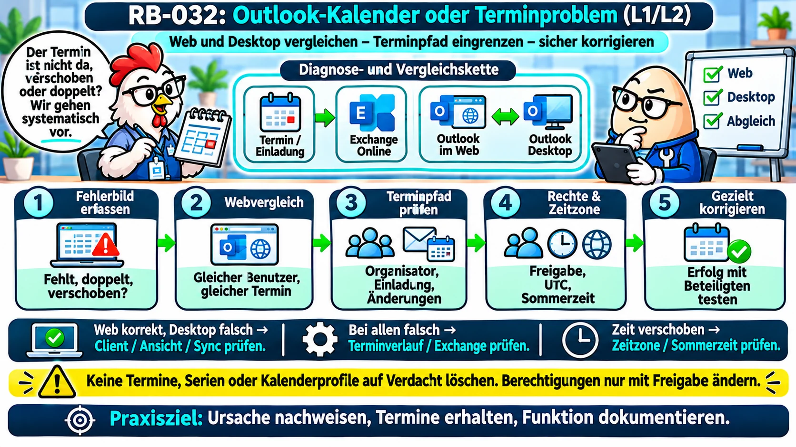

# RB-032 – Praxis-Runbook: Outlook-Kalender oder Terminproblem

**Projekt:** 50 Tickets – 50 typische Supportfälle  
**Support-Level:** L1/L2 · **Stand:** 22.11.2026 · **Version:** 1.0  
**Fachstatus:** Recherchiert, nicht produktiv validiert; Muster sind fiktiv.



> **Arbeitsprinzip:** Fehlerbild → richtiger Termin/Kalender → Outlook-Webvergleich → Organisator-/Rechte-/Zeitzonenpfad → minimaler Eingriff → Erfolgstest.

## 1. Ticketannahme, Umfang und Auswirkung (L1)

- [ ] Exakter Wortlaut: **Termin fehlt / doppelt / falsche Uhrzeit / Freigabe / Einladung / Absage / Raum**.
- [ ] Betroffene Person, Konto/Tenant, Organisator, konkreter Kalender und Outlook-Variante.
- [ ] Einzeltermin oder Serie? Betroffenes Vorkommen, Datum, Start/Ende und Zone.
- [ ] Nur ein Benutzer/Gerät oder mehrere? Seit wann und nach welcher Änderung?
- [ ] Geschäftsimpact, zeitkritische Besprechung, Ticketpriorität und Datenschutzstufe.
- [ ] Nur minimale Termindaten im Ticket speichern. Keine sensiblen Einladungsinhalte kopieren.

**Ziel der Triage:** „Was genau stimmt an *welchem Termin in welchem Kalender* aus Sicht *welcher Person* nicht?“

## 2. Sicherheits- und Freigabe-Gate

- [ ] Autorisierte Sicht auf Kalender, Einladungen und Diagnosedaten geklärt.
- [ ] Keine Termine/Serien löschen oder erneute Einladungen an unbeteiligte Produktivnutzer senden.
- [ ] Keine Kalender-ACL, Stellvertretung, Outlook-Profile oder OST-Dateien ohne Nachweis/Freigabe ändern.
- [ ] Auswertung von CDLs und Termintiteln nur in berechtigtem L2-Kontext; Datenminimierung beachten.
- [ ] Bei Security-/Compliance-/VIP-Themen oder großflächiger Störung korrekt eskalieren.

## 3. L1-Schnelltriage – OWA-/Desktop-A/B-Test

1. Im ursprünglichen Client Kalendername, Benutzer, Ansicht und sichtbares Fehlerbild notieren.
2. **Outlook im Web** mit demselben geschäftlichen Konto öffnen.
3. **Gleichen Kalender, gleiches Datum, gleiche Zeitzone, gleichen Termin** vergleichen.
4. Bei fehlendem Eintrag andere Kalender/Überlagerungen und Such-/Ansichtsoptionen prüfen.
5. Falls möglich, Organisator- und Teilnehmeransicht mit Erlaubnis vergleichen.
6. Ergebnis in zwei Spalten dokumentieren: OWA: ja/nein/abweichende Zeit – Desktop: ja/nein/abweichende Zeit.

**Weiche:** OWA korrekt, Desktop falsch → Abschnitt 4; OWA ebenfalls falsch → Abschnitt 5; Rechte-/Freigabeproblem → 6; Zeit-/Serienproblem → 7.

## 4. Pfad A – OWA richtig, Desktop/Mobilgerät falsch

- [ ] Outlook-Version: klassisch, neu, mobil; Build und letzte Updates erfassen.
- [ ] Kalenderauswahl, Ansicht, Filter, Overlay und Offline-/Synchronisierungsstatus prüfen.
- [ ] Ist es ein **gemeinsamer Kalender**? Freigabeeinladung und Synchronisierungsmodell laut [Q1] unterscheiden.
- [ ] Verbindung und ggf. bekannte Probleme des klassischen Outlook vergleichen [Q12].
- [ ] Nach kontrolliertem Client-Neustart erneut denselben Termin prüfen.
- [ ] Keine Profil- oder Cachelöschung als Erstmaßnahme; bei fortbestehendem lokalem Problem an Endpoint-L2 mit Befunden übergeben.

## 5. Pfad B – OWA und Desktop zeigen Terminproblem

- [ ] Organisator, Teilnehmer und gegebenenfalls Raum bestimmen.
- [ ] Gesendete Einladung, Terminupdate oder Absage anhand erlaubter Metadaten nachvollziehen.
- [ ] Eigenen Kalender, Zielkalender und Serienausnahmen nicht verwechseln.
- [ ] Ist nur eine Kopie betroffen oder alle Teilnehmer? Keine Meeting-ID auf Verdacht „bereinigen“.
- [ ] Bei unklarer Änderung, Duplikat oder fehlendem Update: **Exchange-L2 mit Calendar Diagnostic Logs (CDL)** einschalten [Q5/Q6].
- [ ] Nur bei nachgewiesenem Bedarf veranlasst der berechtigte Organisator ein gezieltes Update oder eine abgestimmte neue Einladung.

## 6. Pfad C – Kalenderfreigabe, Sichtbarkeit, Editieren oder Delegation

- [ ] Kalenderbesitzer, Zielbenutzer und benötigte Handlung identifizieren (sehen, Details, bearbeiten, delegieren).
- [ ] Sichtbarkeit in OWA und Client mit demselben Berechtigungsmodell vergleichen.
- [ ] Berechtigungszuweisung und Freigabeannahme prüfen; **Viewer/Reviewer, Editor und Delegate** unterscheiden [Q2/Q3].
- [ ] L2 liest Kalenderordnerberechtigung; lokalisierte Kalenderordnernamen beachten.
- [ ] Nur den freigegebenen Sollzustand ändern, keine Berechtigungen pauschal erweitern.
- [ ] Danach nur die benötigte Aktion mit Originalnutzer erfolgreich testen.

## 7. Pfad D – Falsche Uhrzeit, Serie, Sommerzeit oder Raum

- [ ] Exaktes **Datum, Startzeit, Endzeit, Zeitzone und UTC-/Ortszeitbezug** erheben.
- [ ] Windows- und Outlook-Zeitzone, Zeitumstellung und Organisator-/Teilnehmeransicht abgleichen [Q4].
- [ ] Bei Serie: gesamte Serie vs. Einzelinstanz, Ausnahmen und Client-Version unterscheiden [Q12].
- [ ] Raum-Buchung: Exchange-L2 prüft `Get-CalendarProcessing` und Konflikt-/Buchungsregeln [Q15].
- [ ] Kein globales Überschreiben von Serienzeiten oder Raum-Policies ohne Freigabe.

## 8. Optionale lesende Exchange-Online-PowerShell-Diagnose (L2)

**Nur nach Rollenprüfung/Datenschutzfreigabe, fiktives Beispiel.**

```powershell
Connect-ExchangeOnline
$owner = 'lea@contoso.example'

# Tatsächlichen lokalisierten Kalenderordner ermitteln
Get-EXOMailboxFolderStatistics -Identity $owner -FolderScope Calendar |
    Select-Object Name, FolderPath, FolderType

# Ordnernamen an das vorherige Ergebnis anpassen; Beispiel "Calendar":
Get-EXOMailboxFolderPermission -Identity "${owner}:\Calendar" |
    Select-Object User, AccessRights, SharingPermissionFlags

# Arbeitszeit-/Zeitzonen-Konfiguration prüfen (nicht blind gleich Terminzeit):
Get-MailboxCalendarConfiguration -Identity $owner |
    Format-List WorkingHoursTimeZone, WorkDays, WorkingHoursStartTime, WorkingHoursEndTime
Get-MailboxRegionalConfiguration -Identity $owner |
    Format-List TimeZone, Language

# Sensible Terminverlaufsdaten NUR bei berechtigtem L2-Auftrag:
Get-CalendarDiagnosticObjects -Identity $owner -Subject 'Projektstatus' -ExactMatch $true

Disconnect-ExchangeOnline -Confirm:$false
```

**Achtung:** `Calendar` ist nur ein Beispielpfad; je nach Sprache kann der Ordner anders heißen. Ein Resultat aus `Get-CalendarDiagnosticObjects` ist ein Diagnoseartefakt, kein automatischer Beweis für eine schuldhafte Änderung. Keine Rohprotokolle an unberechtigte Personen weitergeben [Q5–Q11].

## 9. Erfolgskontrolle, Stopp und Eskalation

**Erfolg:** Der Originalbenutzer findet bzw. bearbeitet den richtigen Termin im richtigen Kalender mit vorgesehener Rechteebene, in korrekt vereinbarter Zeitzone; Update-/Serien-/Raumverhalten ist geprüft, Wiederholung nach Neustart oder erneutem Aufruf erfolgreich.

**Stopp/Eskalation:** OWA und Desktop beide fehlerhaft ohne eindeutige Ursache, fehlende Zuständigkeit/Datenschutzfreigabe, Serien-/Meeting-ID-Unklarheit, Ressourcenrichtlinien, Konflikte mehrerer Teilnehmer oder bekanntes Clientproblem → L2/Exchange/Microsoft-Support mit minimalen Befunden.

**Übergeben:** Ticket-ID, Business-Impact, Client/Build, Besitzer/Organisator, betroffene Kalenderkopien, Datum/Zeitzonen, OWA-vs.-Client-Tabelle, bereits durchgeführte sichere Tests, Freigaben und ggf. zulässiger CDL-Zeitraum.

## 10. Muster-Ticketkommentar, Status und Mini-Kompetenzcheck

### Muster-Ticketkommentar – ausdrücklich fiktiv

> **Problem:** Ein Mitarbeiter sieht eine Wochenbesprechung in klassischem Outlook nicht; Outlook im Web zeigt sie im selben Kalender.  
> **Diagnose:** Konto, Kalender, Datumsbereich und Organisator abgeglichen; OWA korrekt, Desktopansicht nach Ansichtseinstellung abweichend. Kein Berechtigungs- oder Terminobjektwechsel nachgewiesen.  
> **Maßnahme/Validierung:** Kalenderansicht nach Freigabe korrigiert; Originaltermin im Desktopclient und OWA wiederholt sichtbar. Keine Termine gelöscht oder Rechte geändert; Ticket geschlossen.

### Drei-Satz-Status (L1)

> „Der betroffene Termin ist im Outlook-Webkalender vorhanden, wird aber auf dem Arbeitsplatz nicht korrekt angezeigt. Ich grenze deshalb zunächst die Kalenderansicht und Synchronisierung im Desktopclient ein, ohne Termin- oder Berechtigungsdaten zu verändern. Nach dem nächsten Vergleichstest dokumentiere ich den Befund und eskaliere bei Bedarf gezielt an L2.“

### Active Recall

1. Welche zwei Informationen fehlen, wenn jemand nur „Termin weg“ sagt?
2. Warum trennt ein OWA-/Desktopvergleich **Clientanzeige** und **Kalenderdaten**, ohne schon die Root Cause zu beweisen?
3. Welche Risiken birgt das voreilige Neuerstellen einer Besprechungsserie?

### Transfertraining

**Variation:** Termin erscheint in OWA bei der Assistenz, aber nicht bei der Chefin und zeigt eine andere Ortszeit. Wie ändert sich dein Diagnosepfad? Erstelle drei Hypothesen und den jeweils sichersten Trenn-Test, bevor du die Lösung nachliest.

---

## Quellen – offizielle Microsoft-Dokumentation (geprüft am 22.11.2026)

- **[Q1]** [Calendar sharing in Microsoft 365 – Synchronisierung und neues/älteres Modell](https://support.microsoft.com/en-us/outlook/calendar-sharing-in-microsoft-365)
- **[Q2]** [Share your calendar in Outlook on the web – Freigabestufen und Kalenderansicht](https://support.microsoft.com/en-us/outlook/share-your-calendar-in-outlook-on-the-web)
- **[Q3]** [Manage calendar permissions in Exchange Online – Kalenderberechtigungen und Delegationen](https://learn.microsoft.com/de-de/exchange/collaboration-exo/shared-calendars/manage-calendar-permissions)
- **[Q4]** [Manage time zone settings in Outlook – Zeitzonen/UTC](https://support.microsoft.com/de-de/outlook/getstarted/manage-time-zone-settings-in-outlook)
- **[Q5]** [Get calendar diagnostic logs for Exchange Online mailboxes – CDL](https://learn.microsoft.com/en-us/troubleshoot/exchange/calendars/cdl/get-calendar-diagnostic-logs)
- **[Q6]** [Analyze Calendar diagnostic logs for Exchange Online mailboxes – Zeitstrahl](https://learn.microsoft.com/en-us/troubleshoot/exchange/calendars/cdl/analyze-calendar-diagnostic-logs)
- **[Q7]** [Get-EXOMailboxFolderPermission – Exchange Online PowerShell](https://learn.microsoft.com/en-us/powershell/module/exchangepowershell/get-exomailboxfolderpermission?view=exchange-ps)
- **[Q8]** [Get-EXOMailboxFolderStatistics – Kalenderordner finden](https://learn.microsoft.com/en-us/powershell/module/exchangepowershell/get-exomailboxfolderstatistics?view=exchange-ps)
- **[Q9]** [Get-CalendarDiagnosticObjects – Kalenderereignisse](https://learn.microsoft.com/en-us/powershell/module/exchangepowershell/get-calendardiagnosticobjects?view=exchange-ps)
- **[Q10]** [Get-MailboxCalendarConfiguration – Arbeitszeiten/Zeitzone](https://learn.microsoft.com/en-us/powershell/module/exchangepowershell/get-mailboxcalendarconfiguration?view=exchange-ps)
- **[Q11]** [Get-MailboxRegionalConfiguration – Postfachregion/Zeitzone](https://learn.microsoft.com/de-de/powershell/module/exchangepowershell/get-mailboxregionalconfiguration?view=exchange-ps)
- **[Q12]** [Known issues with classic Outlook desktop shared calendar improvements](https://support.microsoft.com/en-us/support/known-issues/known-issues-with-classic-outlook-desktop-shared-calendar-improvements)
- **[Q13]** [Calendar Checking Tool for Outlook (CalCheck)](https://learn.microsoft.com/en-us/troubleshoot/outlook/calendaring/calendar-checking-tool-for-outlook)
- **[Q14]** [Change an appointment, meeting or event in Outlook](https://support.microsoft.com/en-us/outlook/calendar/change-an-appointment-meeting-or-event-in-outlook)
- **[Q15]** [Get-CalendarProcessing – Ressourcen-/Raumbuchung, Spezialpfad](https://learn.microsoft.com/en-us/powershell/module/exchangepowershell/get-calendarprocessing?view=exchange-ps)
- **[Q16]** [Bekanntes Problem: klassisches Outlook stürzt beim Akzeptieren einer freigegebenen Kalender-Einladung ab](https://support.microsoft.com/de-de/support/known-issues/classic-outlook-crash-accept-shared-calendar-invite)

**Quellenstatus und Grenzen:** Die Quellen dokumentieren Produktfunktionen, typische Fehler und Diagnosewerkzeuge; sie beweisen keine Ursache in einer konkreten Umgebung. Benutzeroberflächen, Bugs und Rolloutstände können sich ändern. Der Forschungsstand bezieht sich auf den 22.11.2026, die beschriebenen Tests wurden nicht an produktiven Systemen ausgeführt. Microsoft-Tools und Cmdlets können je nach Mandant, Exchange-Online-Modul und Rolle abweichen.
