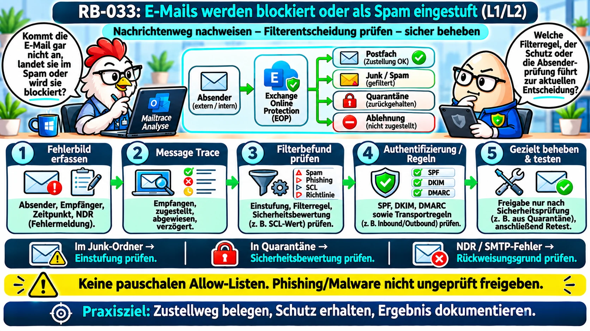

# RB-033 – E-Mails werden blockiert oder als Spam eingestuft

**Projekt:** 50 Tickets – 50 typische Supportfälle  
**Bereich:** Microsoft 365 / Exchange Online / Exchange Online Protection (EOP) / Microsoft Defender for Office 365  
**Support-Level:** L1/L2 · **Stand:** 22.11.2026 · **Version:** 1.0  
**Fachstatus:** Offizielle Microsoft-Quellen recherchiert; **praktische Validierung noch ausstehend**. Alle Beispiele und E-Mail-Adressen sind fiktiv; keine produktiven Sicherheitsrichtlinien verändert.



> **Leitsatz:** „E-Mail fehlt“ ist keine Diagnose. **Mailtransport, SMTP-Antwort, Filterentscheidung, Quarantäne und Postfachanzeige** sind verschiedene Stationen. Erst Nachricht und Entscheidung identifizieren; **keine pauschalen Allowlists und keine ungeprüfte Phishing-/Malware-Freigabe**.

---

## 1. Supportfall, Lernziele und Zuständigkeiten

**Typische Meldungen:** „Die Kundenmail kommt nicht“, „Meine E-Mail landet beim Partner im Spam“, „Ich erhalte eine Unzustellbarkeitsmeldung“, „Im Outlook erscheint sie kurz und verschwindet“, „Seit gestern fehlen alle Mails eines Dienstleisters“, „Die Quarantäne enthält eine angeblich wichtige Rechnung“.

**Lernziel:** Aus einer unpräzisen Störungsmeldung ein **eindeutig identifizierbares Nachrichtenereignis** machen, den Transport- und Sicherheitsbefund belegen und eine **minimale, autorisierte** Korrektur mit erneuter Zustellprüfung auswählen.

- **L1:** Absender-/Empfängeradresse, Zeitfenster, Richtung, Client und Fehlerbild aufnehmen; Junk-Ordner, Outlook-Regeln und erlaubte Quarantäneansicht prüfen; bei Zugriffsrechten Exchange-/Defender-L2 beauftragen.
- **L2 / Messaging:** Message Trace, NDR, Anti-Spam-Klassifizierung, Quarantäne, Mailflow-Regeln, Connectoren und Zustellrestriktionen auswerten; bei Bedarf SPF/DKIM/DMARC prüfen.
- **Security/SOC:** Verdacht auf Phishing, Malware, kompromittierte Konten, Massenzustellung, hochriskante Freigaben und Richtlinienausnahmen bewerten. Ein „bekannter Absender“ allein legitimiert keine Freigabe.

**Abgrenzung:** RB-006 behandelt allgemeine Outlook-Sende-/Empfangsfehler; RB-019 Outlook-Profile; RB-031 gemeinsame Postfächer. Hier geht es vorrangig um **Mailflow, Sicherheitsklassifizierung und Zustellentscheidungen**.

## 2. Wie eine E-Mail zugestellt oder gefiltert wird

Eine vereinfachte **Diagnosekette** für Nachrichten, die über Microsoft 365 laufen:

```text
Absender/Mailserver
       │
       ▼
SMTP-Verbindung / Routing / Empfängerprüfung
       │
       ▼
Microsoft 365 / Exchange Online Protection (EOP)
       ├── SMTP zurückgewiesen → NDR beim Absender möglich
       ├── zurückgestellt (deferred) → spätere Zustellung möglich
       ├── Quarantäne / Sicherheitsaktion
       └── ins Postfach zugestellt
                 ├── Posteingang
                 ├── Junk / anderer Ordner
                 └── nach Zustellung verschoben/entfernt (Regel/ZAP etc.)
```

**Vorsicht:** Dies ist ein Modell zur Fehlereingrenzung, **kein garantiert identischer interner Verarbeitungspfad** für jede Nachricht. Hybrid, Drittanbieter-Gateways, Connectoren und Richtlinien können den Pfad verändern [Q1–Q4]. Ein Trace-Ergebnis „Delivered“ belegt eine Zustellaktion des Dienstes, **nicht zwingend die aktuelle Sichtbarkeit im Outlook-Posteingang**.

## 3. Schlüsselbegriffe – nicht verwechseln

| Begriff | Bedeutung | Was daraus **nicht** folgt |
|---|---|---|
| **Message Trace** | Ablaufverfolgung für Verarbeitung/Zustellstatus in Exchange Online | Dass eine nicht gefundene Nachricht nie versendet wurde |
| **NDR / DSN** | Nichtzustellbarkeitsbericht mit SMTP-/Diagnosecode | Dass jede fehlende Mail einen NDR erzeugen muss |
| **SMTP 4xx** | Typischerweise temporärer Fehler; erneuter Zustellversuch möglich | Dass die Nachricht endgültig verloren ist |
| **SMTP 5xx** | Typischerweise dauerhafte Zurückweisung | Dass Spam zwingend der Grund ist |
| **Junk Email** | Zustellung ins Postfach, aber in Spam-/Junk-Ordner | Dass die Nachricht nicht zugestellt wurde |
| **Quarantäne** | Nachricht unterliegt einer Sicherheitsverwahrung | Dass die Nachricht problemlos freigegeben werden darf |
| **SCL (Spam Confidence Level)** | Wert zur Spamklassifizierung, je nach Filter-/Regelkontext | Dass ein hoher SCL allein die komplette Ursache erklärt |
| **BCL (Bulk Complaint Level)** | Indikator für Massenmail-Klassifizierung | Dass die Nachricht Malware enthält |
| **SPF** | Autorisierte Versandquellen der Envelope-Domain anhand von DNS | Dass SPF-Pass allein Identität des sichtbaren From beweist |
| **DKIM** | Kryptografische Signatur ausgewählter Header/Körperteile | Dass DKIM-Pass automatisch DMARC-Pass bedeutet |
| **DMARC** | Prüft Alignment der sichtbaren From-Domain mit SPF-/DKIM-Identität und zugehörige Policy | Dass jede DMARC-Auffälligkeit automatisch auf Phishing beruht |
| **ZAP** | Zero-hour auto purge; nachträgliche Sicherheitsaktion im Postfach | Dass eine zuvor zugestellte Mail unverändert im Posteingang bleiben muss |

Zur Spamklassifizierung und den Headerwerten siehe [Q3, Q8]; zur Authentifizierung [Q5].

## 4. Intake: Welches Ereignis ist tatsächlich betroffen?

Erfasse möglichst **eine konkrete Beispielnachricht** und formuliere überprüfbar:

1. **Richtung:** eingehend (externer Partner → eigener Tenant), ausgehend oder intern?
2. **Identität:** genauer Absender, Empfänger, Alias oder Gruppe; alle Adressen nur im erlaubten Ticketsystem.
3. **Zeit:** Sendezeit mit Zeitzone und Zeitraum (zum Beispiel 22.11.2026, 14:10 MEZ); Filterung über Fenster, nicht nur Minute.
4. **Merkmale:** Betreff nur falls datenschutzrechtlich nötig; besser Message-ID/Internet Message ID beziehungsweise Network Message ID, wenn vorhanden.
5. **Symptom:** Junk, Quarantäne, NDR, Zeitverzögerung, „verschwunden“, nur ein Empfänger oder viele.
6. **Gegenprobe:** funktioniert ein anderer Absender zum gleichen Empfänger beziehungsweise derselbe Absender zu anderem Empfänger? Nur mit autorisierten Testkonten.
7. **Impact:** Rechnungen, sicherheitskritische Vorgänge, Mailflut, VIP, tenantweiter Fehler oder eine einzelne Mail.

**Grundsatz Datenminimierung:** Nicht unaufgefordert Mailtexte, Anhänge, personenbezogene Kommunikationsinhalte oder vollständige Rohheader in frei einsehbare Tickets kopieren. Für L2 nur die notwendigen Befundmetadaten bereitstellen.

## 5. Die wichtigste Weiche: Hat Exchange Online die Nachricht gesehen?

**Bevorzugtes Werkzeug:** **Exchange Admin Center → Mail flow → Message trace** (`https://admin.exchange.microsoft.com/#/messagetrace`) [Q1]. Nach **Absender, Empfänger, Zeitfenster und möglichst Message-ID** suchen.

| Trace-Beobachtung | Nächster Diagnosepfad |
|---|---|
| **Received / Delivered** | Zielordner, Regeln, Junk, ggf. ZAP und Drittanbieter-Nachbearbeitung untersuchen |
| **Quarantined / Filteraktion** | Quarantäne, Klassifizierung, betroffene Sicherheitsrichtlinie prüfen |
| **Failed / Rejected** | Detailereignisse und konkreten SMTP-/NDR-Code auswerten |
| **Pending / Deferred** | Zeitabhängige Transportverzögerung, Retry, Connector und Fehlerstatus prüfen |
| **Kein Eintrag** | Suchparameter, Zeitfenster, Retention, Eingangsweg, Vorfilter/Gateway, sendende Seite prüfen |

**Nicht gefunden ≠ nicht versendet:** Möglicherweise lag der Fehler vor Eintritt in Microsoft 365, die Suche ist falsch eingegrenzt oder die Daten liegen außerhalb des verfügbaren Zeitfensters. Die moderne Trace-Ansicht unterstützt eine begrenzte Historie; für ältere Daten können andere Abfragen/Reports nötig sein [Q1, Q2].

**Eskalation an L2:** Bei nicht eindeutigen Detailereignissen, Drittsystemen oder möglicher organisationsweiter Störung vollständigen Zeitrahmen und Trace-ID beilegen, nicht bloß „Trace leer“.

## 6. Pfad A – Nachricht im Junk-Ordner

1. Empfängeridentität, Ordner (Junk/sonstiger Ordner) und Zeitpunkt im **Outlook im Web** mit dem Desktopclient vergleichen.
2. Outlook-Postfachregeln, blockierte Absender, lokale Junk-Einstellungen und eventuelle Verschiebungen prüfen.
3. Falls erlaubt, bei vorhandener Nachricht die **Antispam-Nachrichtenheader** (`X-Forefront-Antispam-Report`, `X-Microsoft-Antispam`, `Authentication-Results`) untersuchen [Q8].
4. SCL, SFV, BCL und ggf. Filter-/Transportregel vergleichen – nicht aus einem einzelnen Wert einen vollständigen Sicherheitsbefund ableiten.
5. Bei sicher verifizierter legitimer Nachricht als **„Kein Junk“** melden und gegebenenfalls nach Organisationsprozess zur Microsoft-Analyse einreichen [Q7].
6. Erneuten kontrollierten Versand oder eine **neue** Testnachricht prüfen; historisch klassifizierte Mails ändern nicht zwangsläufig rückwirkend ihren Speicherort.

**Lernpunkt:** Eine Mail im Junk-Ordner hat den Transport typischerweise bereits durchlaufen. Ein DNS-/MX-Umbau ist bei diesem Befund kein sinnvoller erster Schritt.

## 7. Pfad B – Nachricht in Quarantäne

Administratoren prüfen im Microsoft Defender-Portal die Quarantäne (`https://security.microsoft.com/quarantine`) und erfassen **Zeit, Absender, Empfänger, Erkennungsgrund, Richtlinie und erlaubte Aktion** [Q4].

| Erkennungsgrund | Beurteilung |
|---|---|
| Spam/Bulk | Legitimität anhand Kontext, Metadaten und Richtlinie bewerten |
| Hohe Phishing-Sicherheit | **Keine** benutzerseitige Selbstfreigabe; Security-Prozess beachten [Q3, Q4] |
| Malware / verdächtiger Anhang | **Nicht** ungeprüft freigeben oder öffnen; SOC/Security einschalten |
| Safe Attachments / Richtlinie | Lizenz-/Policy- und Scanstatus prüfen, autorisierte Fachstelle einbeziehen |

**Freigabe ist eine Sicherheitsentscheidung:** Sie erfordert Berechtigung, Plausibilitätsprüfung und gegebenenfalls Security-Freigabe. Microsoft unterstützt die Einreichung möglicher Fehlklassifizierungen zur Analyse; Freigaben und „Allow“-Ausnahmen sind **getrennte** Entscheidungen [Q4, Q7, Q12]. Bei einer Freigabe wird eine Nachricht neu zugestellt und kann einen späteren Zustellzeitstempel erhalten [Q4].

## 8. Pfad C – NDR, SMTP-Ablehnung oder ausgehende Sperre

**Der exakte Code samt Diagnosekontext zählt**, beispielsweise `550 5.7.1`: Dieser Code kann unterschiedliche sicherheits- oder berechtigungsbezogene Ursachen haben (z. B. Empfängerrestriktion, Weiterleitungs-/Routingkontext, Relay-Grenze), ist **kein universeller Spamcode** [Q6].

**Prüfablauf:**

1. NDR vom Absender aus sicherem Kanal einholen; **Diagnostic information for administrators** nach Möglichkeit strukturiert erfassen.
2. Eingehend oder ausgehend unterscheiden; Empfänger- und Senderdomänen, Mailbox, Verteiler oder Connector festhalten.
3. Bei 4xx: Verzögerung/Retry und Uhrzeitverlauf statt sofortiger Neuversendung untersuchen.
4. Bei 5xx: Ablehnenden Server, genauen Code, Text und Auslöser (Restriktion, Spam, Authentifizierung, Routing, Policy) isolieren.
5. Bei **outbound spam** / eingeschränktem Konto: Security Incident prüfen, keine Aufhebung der Sperre ohne Klärung möglicher Kompromittierung.
6. Erforderliche Regel- oder Konnektoränderungen nur nach Prüfung durch Messaging/Security und Change-Freigabe.

**Abgrenzung:** Ein externer Empfänger kann Nachrichten aufgrund seiner **eigenen** Sicherheitsrichtlinie blockieren. Lokale Microsoft-365-Admins können nicht ohne Weiteres die fremde Empfängerorganisation ändern.

## 9. Pfad D – Authentifizierung / SPF, DKIM, DMARC

Für externe Zustellprobleme die zugehörigen **Header und Domänenrollen** überprüfen [Q5, Q11].

- **SPF:** `MAIL FROM`-/Return-Path-Domain, sendende Infrastruktur und SPF-Eintrag vergleichen; DNS ist nur ein Teil der Prüfung.
- **DKIM:** ist eine überprüfbare Signatur vorhanden und für welche `d=`-Domain? Weiterleitungen oder Gateways können signierte Inhalte verändern.
- **DMARC:** besteht Alignment mit der sichtbaren From-Domain durch passenden SPF- oder DKIM-Pfad? DMARC-Policy `p=none`, `quarantine`, `reject` nur mit genauer Kontextprüfung interpretieren.
- **Weiterleitung/Relay:** kann die ursprüngliche Authentifizierung verändern. Bei berechtigter Zwischenstation gegebenenfalls ARC-Mechanismus prüfen.
- **Reputation, Bulk, Spoofing:** EOP verwendet zusätzliche Signale; SPF/DKIM/DMARC-Pass garantiert keine Zustellung in den Posteingang.

**Nicht** zur Behebung einer einzelnen Mail wahllos SPF-Einträge erweitern, DMARC abschalten oder externe Domains pauschal allowlisten.

## 10. Pfad E – Transportregeln, Connectoren, Postfachaktionen

Falls Trace/Filterevents eine andere Schicht zeigen, untersucht L2 **lesend**:

- **Exchange Mailflow-Regeln:** Kriterien, Priorität, Regelmodus und Aktionen (Ablehnen, Umleiten, Löschen, SCL beeinflussen). Eine Transportregel kann SCL vor der Antispamwertung verändern [Q9].
- **Connectoren / Drittanbieter-Gateways:** Wird Mail tatsächlich über Exchange Online geleitet oder vorgelagert gefiltert? Gibt es Hybrid oder Richtungs-/Routingspezifika?
- **Empfängerbeschränkungen:** Gruppenmoderation, externe Senderbeschränkung, gültige Zieladresse, ggf. Empfängerlimit [Q6].
- **Postfachseitige Aktionen:** Regeln, Junk, Weiterleitung, mobil-/desktopseitige Ansichten oder Zugriffe. **ZAP** kann nach erfolgter Zustellung eine Sicherheitsaktion auslösen [Q3].

**Aufpassen:** Im Header kann `SFV:SKN` eine durch Regel ausgelöste Spamumgehung anzeigen; `SFV:SKS` eine vorherige Spammarkierung. Entscheidend ist die Verbindung aus Trace, Header, Richtlinie und Regel [Q8, Q9].

## 11. Lesende PowerShell-Diagnose (berechtigter L2-Kontext)

Voraussetzungen: Exchange-Online-PowerShell, angemessene Rollen, Zustimmung zur Verarbeitung betroffener Nachrichtendaten, aktuelle Module. Microsoft dokumentiert für `Get-MessageTraceV2` ein hinreichend aktuelles Exchange-Online-PowerShell-Modul [Q1, Q10]. **Diese Befehle lesen; sie geben keine Quarantäne frei und verändern keine Richtlinien.**

```powershell
# Fiktive Adressen! Nur in autorisierter Umgebung ausführen.
Import-Module ExchangeOnlineManagement
Connect-ExchangeOnline

$sender    = 'dienstleister@partner.example'
$recipient = 'lea@contoso.example'
$start     = (Get-Date).AddDays(-2)
$end       = Get-Date

# Verlauf derselben Richtung und derselben Adressen eingrenzen
$trace = Get-MessageTraceV2 -SenderAddress $sender `
    -RecipientAddress $recipient -StartDate $start -EndDate $end
$trace | Select-Object Received, SenderAddress, RecipientAddress, Subject, Status, MessageTraceId

# Detailereignisse nur für EINEN eindeutig zugeordneten Treffer
$one = $trace | Select-Object -First 1
if ($null -ne $one) {
    Get-MessageTraceDetailV2 -MessageTraceId $one.MessageTraceId `
        -RecipientAddress $one.RecipientAddress |
        Select-Object Date, Event, Action, Detail
}

# Quarantäne-Metadaten (rollen- und richtlinienabhängig)
Get-QuarantineMessage -RecipientAddress $recipient |
    Select-Object ReceivedTime, SenderAddress, RecipientAddress, Subject, Type, ReleaseStatus

# Richtlinien / Mailflow-Regeln lesen, keine Änderungen
Get-HostedContentFilterPolicy | Select-Object Name, SpamAction, HighConfidenceSpamAction, BulkThreshold
Get-TransportRule | Select-Object Name, State, Mode, Priority

Disconnect-ExchangeOnline -Confirm:$false
```

**Hinweise:** `Get-MessageTraceV2` und `Get-MessageTraceDetailV2` statt des älteren Trace-Cmdlets bevorzugen [Q10]. Ergebnisse können bei großen Datenmengen paginiert bzw. begrenzt sein; ein einzelner Treffer ist nur nach ID-Abgleich repräsentativ. Die Property-Namen und Cmdlet-Verfügbarkeit können je nach Microsoft-Version/Role variieren. `Subject` enthält sensible Informationen – im Ticket nur nach begründetem Bedarf verarbeiten. Verbindliche Syntax und Berechtigungen anhand [Q10, Q13] abgleichen.

## 12. Entscheidungsmatrix: Befund → nächste sinnvolle Aktion

| Gesicherter Befund | Minimaler sinnvoller nächster Schritt | Zuständigkeit |
|---|---|---|
| E-Mail in Junk, legitimer Inhalt bestätigt | Als „Kein Junk“ melden, Klassifizierung prüfen, neuen Test | L1 + L2 bei Muster |
| E-Mail quarantänisiert, verdächtig | Securityprüfung; **keine** voreilige Freigabe | SOC / Defender-L2 |
| E-Mail quarantänisiert, geprüfter Fehlalarm | Autorisierter Security-Workflow: Submission; ggf. gezielte Freigabe | Defender-L2 |
| Trace `Delivered`, Outlook zeigt nichts | OWA, Zielordner, Postfachregeln, ZAP prüfen | L1 → L2 |
| Trace `Deferred` | temporären Zustellstatus, Retry und Connector prüfen | Exchange-L2 |
| Trace `Failed` mit 5xx | Exakten SMTP-Code und ablehnendes System prüfen | Exchange-L2 / Partner |
| Trace ohne Treffer, externe Mail | Suchfenster, Gateway/Vorfilter, Senderlogs und MX prüfen | Exchange-L2 / Partner |
| Wiederholte False Positives von einer legitimen SaaS-Quelle | Headerauthentifizierung, Dienstkonfiguration und Microsoft-Submission | Messaging/Security |
| Verdacht auf kompromittierten Absender | Incident-Response-Prozess, Kontoschutz, keine automatische Ausnahme | SOC |

## 13. Fiktiver Fall A – Rechnung in Quarantäne statt Posteingang

**Muster-Ticket (frei erfunden):** „Ein Dienstleister sagt, die Rechnung sei gestern verschickt worden, aber bei mir ist sie nicht angekommen.“

**Beobachtung:** L1 prüft Absender, Empfänger, UTC-/MEZ-Zeitbezug und Junk/OWA. Exchange-L2 findet im Trace eine Filteraktion; Defender zeigt für die Nachricht Quarantäne mit einer Phishing-Einstufung. Die Betroffene behauptet, der Absender sei „immer vertrauenswürdig“.

**Hypothesen:** echter Angriff durch Spoofing oder kompromittiertes Partnerpostfach; fehlklassifizierte legitime Rechnung; unerwartete Weiterleitung oder fehlerhafte Authentifizierung.

**Sicherer Weg:** Keine Mail öffnen, weiterleiten oder blind freigeben. Security prüft Header/Absenderkanal, Richtlinie, Detektionsgrund und ggf. direkt über bekannten Kommunikationsweg den Partner. Bei bestätigtem False Positive erfolgt der freigegebene Microsoft-Submission-/Freigabeprozess; sonst bleibt die Schutzmaßnahme bestehen.

**Lernergebnis:** „Geschäftskritisch“ ändert die Dringlichkeit, **nicht** automatisch die Vertrauenswürdigkeit.

## 14. Fiktiver Fall B – Kundenmail wird extern mit 550 5.7.1 abgewiesen

**Muster-Ticket (frei erfunden):** „Die E-Mail an das externe Projektpostfach kommt mit Unzustellbarkeit zurück.“

**Beobachtung:** Absender zeigt NDR `550 5.7.1` mit einer spezifischen Empfängerrestriktion. Exchange-Trace bestätigt das Senden in Richtung Empfängersystem; die externe Gegenstelle lehnt mit genauer Diagnosezeile ab. Andere Empfänger funktionieren.

**Hypothesen:** Empfängergruppe akzeptiert keine externen Absender; Moderation/ACL; Anti-Spam-Policy auf der Fremdseite; Adress- oder Routingproblem.

**Sicherer Weg:** Fehlerdiagnose aus NDR statt pauschaler Spamannahme; Empfänger-/Partneradmin kontaktiert und Ursache mit dessen Berechtigung geklärt; keine eigene tenantweite Ausnahme. Anschließend kontrollierter Test an genau das Ziel und Vergleich von NDR/Trace/Empfängerbestätigung.

**Lernergebnis:** `5.7.1` ist eine **Fehlerklasse mit mehreren Ursachen**, kein Beweis für Spam [Q6].

## 15. Active Recall, Self-Explanation und Transfer

**Wissen (kurz beantworten):**

1. Wofür nutzt du Message Trace? → Nachrichtentransport, Zustellstatus und Aktionen rekonstruieren.
2. Was ist der Unterschied zwischen Junk und Quarantäne? → Zugestellte Mail im Postfachordner vs. sicherheitsseitig zurückgehaltene Nachricht.
3. Was bedeutet NDR? → Rückmeldung über Nichtzustellung, mit Diagnoseinformationen.
4. Wozu dienen SPF, DKIM und DMARC? → Authentifizierung und Domänen-Alignment im Mailverkehr.

**Verständnis (in eigenen Worten):**

5. Warum kann eine als „Delivered“ markierte Mail für den Nutzer trotzdem fehlen?
6. Warum sollte man SCL, SFV und Richtlinien gemeinsam statt isoliert betrachten?
7. Warum darf ein bekannter Absender nicht ohne weitere Prüfung freigegeben werden?
8. Warum erklärt ein SPF-Pass nicht immer einen DMARC-Pass?

**Diagnosekarten (ohne Runbook antworten):**

9. Mail ist im Junk von OWA sichtbar, aber nicht im Desktop-Posteingang: Welche zwei Prüfungen zuerst?
10. Im Trace keine Spur einer Kundenmail: Welche drei Alternativerklärungen außer „nie gesendet“?
11. Zwei externe Empfänger reagieren unterschiedlich; einer sendet NDR 5.7.1: Welcher Befund wird zuerst gesichert?
12. Quarantäne signalisiert „High confidence phishing“, Nutzer fordert sofortige Freigabe: Wie priorisierst du?

**Transfertraining:** Simuliere drei neue Tickets mit gleichem Nutzerwortlaut „Mail kommt nicht an“, aber mit verschiedenen technischen Gründen: (a) Junk, (b) externer SMTP-Reject, (c) Postfachregel nach Zustellung. Formuliere jeweils ein **minimal diskriminierendes Testergebnis** und einen fachlich präzisen Drei-Satz-Ticketkommentar: **Befund → Handlung → Nachweis**.

**Spaced Repetition:** Nach etwa 7 und 21 Tagen mit veränderten Symptomen selbstständig erneut diagnostizieren. **Fertig dokumentiert ist nicht gleich praktisch beherrscht**.

---

## Quellen – offizielle Microsoft-Dokumentation (Recherche 22.11.2026)

- **[Q1]** [Message trace im neuen Exchange Admin Center](https://learn.microsoft.com/en-us/exchange/monitoring/trace-an-email-message/message-trace-modern-eac) – Status, Filter, Rollen, Details.
- **[Q2]** [Message Trace – FAQ](https://learn.microsoft.com/en-us/exchange/monitoring/trace-an-email-message/message-trace-faq) – Historie und Suchgrenzen.
- **[Q3]** [Anti-spam protection in cloud organizations](https://learn.microsoft.com/en-us/defender-office-365/anti-spam-protection-about) – Spam- und Phishingklassifizierungen, Richtlinien, ZAP.
- **[Q4]** [Quarantäne: Nachrichten administrativ verwalten](https://learn.microsoft.com/en-us/defender-office-365/quarantine-admin-manage-messages-files) – Zuständigkeit, Freigabe und Neubewertung.
- **[Q5]** [How email authentication works in Microsoft 365](https://learn.microsoft.com/en-us/defender-office-365/email-authentication-about) – SPF, DKIM, DMARC/Alignment.
- **[Q6]** [NDR 550 5.7.1: Fehlerbehebung](https://learn.microsoft.com/en-us/troubleshoot/exchange/email-delivery/ndr/fix-error-code-550-5-7-1-in-exchange-online) – Ursachen differenzieren.
- **[Q7]** [False Positives bei Defender for Office 365 untersuchen](https://learn.microsoft.com/en-us/defender-office-365/step-by-step-guides/how-to-handle-false-positives-in-microsoft-defender-for-office-365) – sichere Behandlung legitimer Nachrichten.
- **[Q8]** [Anti-spam message headers](https://learn.microsoft.com/en-us/defender-office-365/message-headers-eop-mdo) – SCL/SFV/BCL und Header.
- **[Q9]** [Troubleshoot anti-spam policies](https://learn.microsoft.com/en-us/defender-office-365/anti-spam-policies-troubleshooting) – Filter- und Regelinteraktion.
- **[Q10]** [Get-MessageTraceV2](https://learn.microsoft.com/en-us/powershell/module/exchangepowershell/get-messagetracev2) und [Get-MessageTraceDetailV2](https://learn.microsoft.com/en-us/powershell/module/exchangepowershell/get-messagetracedetailv2) – Syntax und Grenzen.
- **[Q11]** [Troubleshoot email authentication](https://learn.microsoft.com/en-us/defender-office-365/email-authentication-troubleshoot) – Authentifizierungsprobleme eingrenzen.
- **[Q12]** [Submit messages for analysis](https://learn.microsoft.com/en-us/defender-office-365/submissions-admin) – Microsoft-Submission.
- **[Q13]** [Get-QuarantineMessage](https://learn.microsoft.com/en-us/powershell/module/exchangepowershell/get-quarantinemessage) – lesende Quarantäneabfrage.

> **Transparenz / Laborstatus:** Das ist eine recherchierte, didaktisch erstellte Diagnosevorlage; weder ein Nachweis produktiver Fehlerbehebung noch eine praktische Validierung. Änderungen in produktiven Tenants nur in vorgesehenen Rollen und nach Freigabe. Bildnachweis: „Eigene Konzeption, KI-gestützte Visualisierung mit ChatGPT“.
