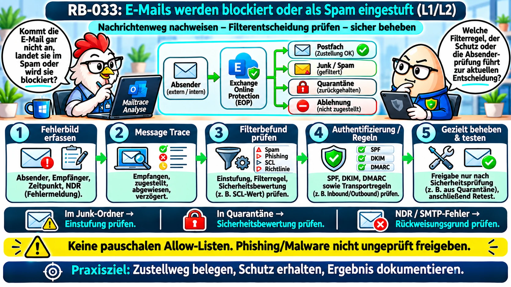

# RB-033 – Praxis-Runbook: E-Mails werden blockiert oder als Spam eingestuft

**Projekt:** 50 Tickets – 50 typische Supportfälle · **Level:** L1/L2 · **Stand:** 22.11.2026  
**Status:** Recherchierte Arbeitsanweisung – **nicht praktisch validiert**. Für Exchange Online/EOP/Defender for Office 365; Anpassung an die Umgebung erforderlich.



> **Schnellprinzip:** **Eine konkrete Nachricht → Transportereignis → Filter-/Postfachaktion → geprüfte Ursache → autorisierte Maßnahme → Zustellnachweis.** Keinen Spam- oder Phishingschutz auf Verdacht ausschalten.

## 1. Ticket-Triage und reproduzierbares Fehlerbild

- [ ] Exakte Störungsmeldung: **Junk, Quarantäne, NDR, verzögert, „verschwunden“, Ablehnung durch Empfänger?**
- [ ] Richtung **eingehend, ausgehend oder intern**; betroffene Benutzer, Konten, Gruppen und externe Partner.
- [ ] **Konkrete einzelne Nachricht**: Sender, Empfänger, Zeitpunkt **mit Zeitzone**, ggf. Message-ID und NDR-Code.
- [ ] Welche vergleichbare Nachricht funktioniert? Eine oder mehrere Personen betroffen? Seit welcher Änderung?
- [ ] Auswirkung: Frist, geschäftskritischer Vorgang, erhöhte Phishinggefahr oder mögliche Tenant-Störung.
- [ ] Nur nötige Metadaten speichern; keine sensiblen Inhalte/Anhänge in ungesicherte Tickets aufnehmen.

**L1-Ziel:** „Die Nachricht von [Sender] an [Empfänger] vom [Zeitpunkt] ist [konkreter Zustand] – geprüft werden [definierte Gegenprobe/Transportpfad].“

## 2. Sicherheits- und Berechtigungsgate – **vor jeder Änderung**

- [ ] Rollen für Message Trace, Quarantäne, Defender und Mailflow sind vorhanden; Zugriff nachvollziehbar.
- [ ] Kein Öffnen verdächtiger Anhänge/URLs zur „Schnellprüfung“; Header/Metadaten bevorzugen.
- [ ] **Hohe Phishing-Einstufung / Malware / möglicher Accountmissbrauch** → Security-/SOC-Prüfung, keine ungeprüfte Freigabe.
- [ ] Keine pauschale Domain-Allowlist, kein Setzen von SCL `-1`, keine Abschaltung von ZAP, DMARC oder Anti-Phishing-Policies auf Verdacht.
- [ ] Keine Header-, Nachrichten- und Personendaten außerhalb der freigegebenen Diagnoseumgebung verbreiten.
- [ ] Änderungen an Quarantäne, Transportregeln, Connectoren, Senderlisten und DNS nur durch autorisierte Zuständige mit Change-Freigabe.

**Stoppregel:** Wenn die Legitimationsprüfung fehlt, dokumentieren und an Security/Messaging eskalieren – nicht „damit es endlich funktioniert“ freigeben.

## 3. L1-Schnellprüfung – Benutzer- und Clientseite

1. Im **Outlook im Web** und im ursprünglichen Client nach derselben Nachricht suchen (Posteingang, Junk, andere Ordner, Suche/Filter).
2. Hinweise zu Postfachregeln, Weiterleitung, blockierten Absendern und gegebenenfalls Löschaktionen erfassen.
3. Hat der Absender einen **NDR**? Exakten SMTP-Code und den **ablehnenden Server** erfragen.
4. Liegt eine Quarantänebenachrichtigung vor? **Keine** automatische Freigabe; Befund an autorisierte Stelle geben.
5. Benutzeridentität, Mailadresse, Alias und ggf. Verteiler-/Gemeinschaftspostfach unterscheiden.
6. Ergebnisse als Vergleich erfassen: **OWA / Client / NDR / Quarantäne / Trace**.

**Weiche:** „Junk“ → Abschnitt 5A; „Quarantäne“ → 5B; „NDR“ → 5C; „keine Spur“ → 4/5D; „Delivered, aber nicht sichtbar“ → 5E.

## 4. L2 – Message Trace und Zustellbefund sichern

**Exchange Admin Center → Mail flow → Message trace:** `https://admin.exchange.microsoft.com/#/messagetrace` [Q1].

- [ ] Sender, Empfänger, Zeitfenster (inkl. Zeitzone) und gegebenenfalls Nachrichten-ID verwenden.
- [ ] Relevanten **einzelnen Treffer** und zugehörige **Detailereignisse** betrachten; nicht nur letzte Statusspalte.
- [ ] Status **zugestellt / fehlgeschlagen / zurückgestellt / quarantänisiert / anders behandelt** sachlich beschreiben.
- [ ] **Kein Treffer?** Such-/Historiengrenzen, vorgeschaltete Mailgateway-Filter, fremden sendenden Server, MX-/Routingpfad prüfen.
- [ ] Ein Trace-Status `Delivered` bestätigt nicht zwingend die aktuelle Sichtbarkeit im Posteingang – Junk, Regeln oder nachträgliche Aktionen getrennt prüfen.

**Dokumentationsmuster:** „Trace-ID [gekürzt], Zeitpunkt [UTC/MEZ], Aktion [X], Detail [Y], Folgetest [Z]“. Vertrauliche Metadaten nicht vollständig in offene Ticketkommentare übernehmen.

## 5. Vier primäre Diagnosepfade (A–D) plus Postfachpfad (E)

### A – Im Junk-Ordner

- [ ] Nachricht im OWA-Ordner sichtbar? Filter-/Inbox-Regeln und blockierte Absender vergleichen.
- [ ] Header (falls verfügbar) auf **SCL/SFV/BCL** und Authentifizierung prüfen [Q3/Q8].
- [ ] Ist Nachricht nach unabhängiger Prüfung legitim? „Kein Junk“ melden und ggf. Microsoft-Submission für Fehlklassifizierung auslösen [Q7].
- [ ] Neuen kontrollierten Test statt Rückschluss aus altem Klassifizierungszustand.

### B – In Quarantäne

- [ ] Defender Quarantäne: `https://security.microsoft.com/quarantine` [Q4].
- [ ] Quarantänegrund, Richtlinie, betroffene Empfänger, Zeit und Freigabeberechtigung identifizieren.
- [ ] **High confidence phishing / Malware**: Security prüft; keine ungeprüfte Freigabe.
- [ ] Bestätigter False Positive? Über vorgesehenen Admin-Submission-/Freigabeprozess entscheiden; gezielte statt generelle Ausnahmen [Q7/Q12].
- [ ] Nach Freigabe Zustellung **erneut** per Trace und beim Originalempfänger bestätigen.

### C – NDR / SMTP-Ablehnung / ausgehender Block

- [ ] Vollständigen **Fehlercode und Kontext** betrachten, z. B. 550 5.7.1 [Q6].
- [ ] Zieladresse, Zielsystem, Empfängerrichtlinie, Connector, Verteiler-/Moderationsregeln eingrenzen.
- [ ] **4xx = typischerweise temporär**, **5xx = typischerweise dauerhaft**; Ausnahmen und Text beachten.
- [ ] Bei externem Reject zuständige **Empfängerorganisation** mit NDR-Befund kontaktieren.
- [ ] Bei Spam-Ausgangssperre/Accountverdacht Security Incident untersuchen; kein Shortcut über Freigabe.

### D – Kein Trace-Treffer

- [ ] Sender/Empfänger, Alias, Zeitfenster, Message-ID und Suchgrenze korrigieren.
- [ ] Eingangs- und Ausgangsrichtung, Hybrid, Drittanbieter-Gateway und vorgeschalteten Filter prüfen.
- [ ] Senderseite um autorisierte SMTP-/Versanddiagnose bitten; nicht behaupten, die Nachricht sei „nie gesendet“ worden.

### E – Trace zugestellt, Benutzer sieht nichts

- [ ] OWA- und Desktopansicht / Suchfilter / Junk / andere Ordner vergleichen.
- [ ] Postfachregel, Weiterleitung, mobil synchronisierte Aktionen, ggf. **ZAP nach Zustellung** mit L2 bewerten [Q3].
- [ ] Keine Mailbox-/Profilneuanlage oder Regeländerung ohne gesicherten Befund.

## 6. Richtlinien, SPF/DKIM/DMARC und Header nur nach Befund auswerten

- [ ] Nachricht einer betroffenen **Anti-Spam-, Anti-Phishing- oder Mailflow-Regel** zuordnen.
- [ ] Bei Headerdaten SCL, SFV, BCL, `Authentication-Results` und passende Zustellaktion **im Zusammenhang** interpretieren [Q8/Q9].
- [ ] SPF, DKIM und DMARC sowie **Alignment zur From-Domain** unterscheiden [Q5].
- [ ] Bei Drittanbieterrelay / Forwarding prüfen, ob Versandweg, DNS, ARC und Absenderreputation plausibel sind.
- [ ] Nur fachlich nachgewiesene Fehlkonfiguration mit Genehmigung korrigieren; **kein globales Allow von Domains/IPs**.

## 7. Optionale **lesende** Exchange-Online-PowerShell-Abfragen (L2)

**Voraussetzungen:** ExchangeOnlineManagement, ausreichende Rollen, abgegrenztes Untersuchungsfenster. Beispieladressen sind fiktiv. Cmdlets nur in genehmigter Umgebung verwenden [Q10/Q13].

```powershell
Import-Module ExchangeOnlineManagement
Connect-ExchangeOnline

$sender    = 'rechnung@partner.example'
$recipient = 'lea@contoso.example'
$start     = (Get-Date).AddDays(-2)
$end       = Get-Date

$trace = Get-MessageTraceV2 -SenderAddress $sender `
    -RecipientAddress $recipient -StartDate $start -EndDate $end
$trace | Select-Object Received, SenderAddress, RecipientAddress, Status, MessageTraceId

# Erst eindeutigen Treffer identifizieren, DANN dessen Details lesen:
$one = $trace | Select-Object -First 1
if ($null -ne $one) {
    Get-MessageTraceDetailV2 -MessageTraceId $one.MessageTraceId `
        -RecipientAddress $one.RecipientAddress |
        Select-Object Date, Event, Action, Detail
}

Get-QuarantineMessage -RecipientAddress $recipient |
    Select-Object ReceivedTime, SenderAddress, RecipientAddress, Type, ReleaseStatus
Get-HostedContentFilterPolicy | Select-Object Name, SpamAction, HighConfidenceSpamAction
Get-TransportRule | Select-Object Name, State, Mode, Priority

Disconnect-ExchangeOnline -Confirm:$false
```

**Keine Änderungsbefehle in diesem Runbook.** Output kann sensible Informationen enthalten. Bei mehreren Treffern keinesfalls per `-First 1` automatisch als „den Fall“ werten: Vor dem Detailschritt Zeit, Nachricht und ID kontrollieren.

## 8. Freigegebene Lösung und kontrollierter Retest

- [ ] Ursache als **nachgewiesen / plausibel / noch unklar** einstufen.
- [ ] Kleinste mögliche Maßnahme mit Zuständigkeit und Freigabe dokumentieren: z. B. Junk-Klassifizierung melden, bestätigten Quarantäne-Fehlalarm einreichen, einzelne fehlerhafte Transportregel korrigieren, Senderauthentifizierung vom Partner reparieren lassen.
- [ ] Nie Phishing-/Malware-Schutz ausschalten, nur um einen Test „grün“ zu bekommen.
- [ ] **Neue** berechtigte Testnachricht gleicher Richtung und gleicher Empfängergruppe, soweit gefahrlos möglich, auslösen.
- [ ] **Trace + Empfängerbestätigung + korrekter Zielordner + unveränderte Sicherheitskontrolle** prüfen.
- [ ] Bei Quarantäne: mögliche spätere Freigabezeit nicht mit ursprünglicher Versandzeit verwechseln [Q4].

## 9. Stopp, Eskalation und Übergabe an L2/SOC

**Sofortige Security-Eskalation:** Malware/Phishing, verdächtige Anhänge, Kontoübernahmeverdacht, ungewöhnliche ausgehende Massenmails, mögliche Datenexfiltration oder unautorisierte Ausnahmen.

**Exchange-/Messaging-Eskalation:** Kein konsistenter Message-Trace, Hybrid-/Gateway-Route, 4xx-Retry-Kaskade, NDR mit fremder Serverentscheidung, Connector-/Mailflow-Konfiguration, SPF/DKIM/DMARC-Konflikt oder großflächige Zustellstörung.

**Übergabedaten:** Ticket-ID, betroffene Richtung und Anzahl, minimierte Sender-/Empfänger-Metadaten, Zeitfenster/Zeitzone, Message-ID/Trace-ID, Status und konkrete Ereignisse, Richtlinie/Erkennungsgrund, sichere Vergleichstests, bereits genehmigte Änderungen und noch offene Hypothesen.

## 10. Muster-Ticketkommentar und Abschlusskriterien

**Fiktives Beispiel – bestätigter Fehlalarm, ohne produktive Änderung:**

> **Befund:** Die Nachricht des externen Partners vom 22.11.2026, 14:10 MEZ, wurde in EOP verarbeitet und aufgrund einer Spam-Klassifizierung in Quarantäne gehalten; der reguläre Posteingang blieb daher leer. **Vorgehen:** Die Security-Administration bewertet die Metadaten und die Absenderauthentifizierung; eine Freigabe oder Ausnahme wurde bislang nicht vorgenommen. **Nächster Schritt:** Nach Security-Entscheid den zulässigen Submission-/Freigabeprozess durchführen und Zustellung beim Originalempfänger sowie im Message Trace bestätigen.

**Abschluss nur, wenn:**

- [ ] Der nachgewiesene Nachrichtenpfad im Ticket steht und der konkrete Fehlergrund korrekt differenziert wurde.
- [ ] Abhilfe ist genehmigt, sicherheitskonform und minimal wirksam.
- [ ] Originalbenutzer und Microsoft-365-Nachrichtenablaufverfolgung bestätigen das vereinbarte Ergebnis.
- [ ] Keine ungewollte Schutzabschwächung entstanden; bei Restunsicherheit Ticket offen/eskaliert.
- [ ] Ursache, Handlung, Wirksamkeit und Datenschutzgrenzen knapp dokumentiert.

---

**Herstellerquellen (Stand 22.11.2026):** [Q1 Message Trace](https://learn.microsoft.com/en-us/exchange/monitoring/trace-an-email-message/message-trace-modern-eac) · [Q3 Anti-Spam](https://learn.microsoft.com/en-us/defender-office-365/anti-spam-protection-about) · [Q4 Quarantäne](https://learn.microsoft.com/en-us/defender-office-365/quarantine-admin-manage-messages-files) · [Q5 Authentifizierung](https://learn.microsoft.com/en-us/defender-office-365/email-authentication-about) · [Q6 NDR 5.7.1](https://learn.microsoft.com/en-us/troubleshoot/exchange/email-delivery/ndr/fix-error-code-550-5-7-1-in-exchange-online) · [Q7 False Positives](https://learn.microsoft.com/en-us/defender-office-365/step-by-step-guides/how-to-handle-false-positives-in-microsoft-defender-for-office-365) · [Q10 Get-MessageTraceV2](https://learn.microsoft.com/en-us/powershell/module/exchangepowershell/get-messagetracev2).

**Transparenz:** Fachlich recherchiert, nicht praktisch getestet. Das Runbook ist eine Diagnosevorlage, kein Freibrief für Änderungen produktiver Sicherheitsregeln. Bildnachweis: „Eigene Konzeption, KI-gestützte Visualisierung mit ChatGPT“.
