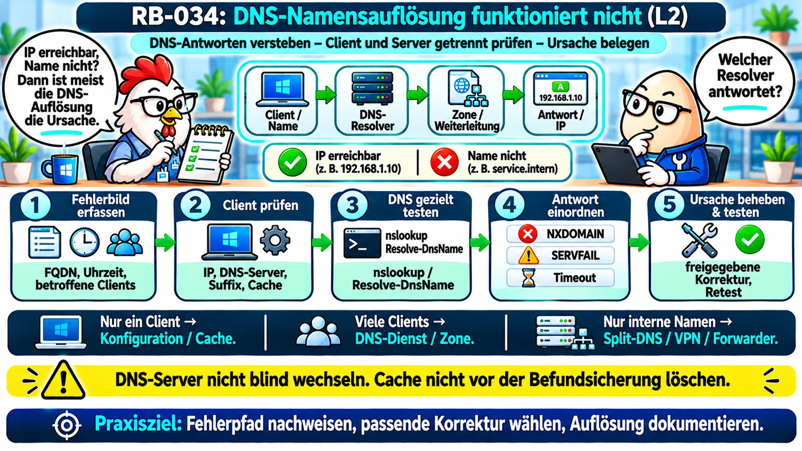

# RB-034 – DNS-Namensauflösung funktioniert nicht

**Projekt:** 50 Tickets – 50 typische Supportfälle  
**Bereich:** Netzwerk / Windows 11 / DNS-Client / Windows Server DNS / VPN  
**Support-Level:** L2 · **Stand:** 22.11.2026 · **Version:** 1.0  
**Fachstatus:** Vorgehensweisen aus Microsoft-Dokumentation recherchiert; **praktische Validierung noch ausstehend**. IPs, DNS-Zonen, Tickets und Befunde sind fiktiv. Es wurden keine produktiven DNS-Einstellungen verändert.



> **Leitsatz:** „Name nicht erreichbar“ ist eine Beobachtung. Bevor du DNS-Server wechselst oder Caches löschst, beweise **welcher Name / Recordtyp**, **welcher Resolver**, **welche Antwort** und **welcher Netzpfad** betroffen sind.

---

## 1. Störungsmeldung, Zuständigkeiten und Lernziele

**Typische Tickets:** „Die Freigabe `\\srv01.corp.example\Projekte` geht nicht mehr, über die Server-IP schon“, „Nur interne Webanwendungen funktionieren aus dem Homeoffice nicht“, „Einige Webseiten gehen, andere nicht“, „Nur mein PC findet den Servernamen nicht“, „DNS-Server antwortet nicht“.

**Ziel:** Mit kontrollierten Abfragen unterscheiden zwischen **Clientkonfiguration**, **lokalem Cache/Hosts/Suffix**, **Transport zum DNS-Server**, **Server-/Zonenantwort**, **Forwarding/Delegation** und **anwendungs- bzw. VPN-spezifischer Auflösung**.

- **L1:** präzisen Hostnamen und Wortlaut der Fehlermeldung aufnehmen; betroffene Geräte und Zeitpunkt vergleichen; `ipconfig /all`, `nslookup` und erlaubte Gegenprobe erfassen. Keine DNS-Server- oder Registryänderungen.
- **L2:** Hypothesen durch Vergleich desselben Namens und Recordtyps auf verschiedenen Resolversystemen testen; Cache, VPN/NRPT, DNS-Zonen, Forwarder und Port-/Firewallpfad analysieren.
- **Infrastruktur/Security:** Freigabe für Änderungen an AD-integrierten Zonen, Resolvern, Firewalls, VPN- und DNS-Richtlinien erteilen; Änderungen nachvollziehbar durchführen.

**Abgrenzung:** RB-010 behandelt allgemeine Netzwerkprobleme, RB-011 VPN-Aufbau, RB-035/036 DHCP und APIPA, RB-038/039 Server-/Dienst-/Porterreichbarkeit. Hier wird **Namensauflösung als eigenständige Fehlerdomäne** untersucht.

## 2. DNS-Abhängigkeitskette verstehen

Vereinfachtes Modell (keine zwingend identische Reihenfolge für jede App oder Richtlinie):

```text
Anwendung fordert z. B. srv01.corp.example an
            │
            ▼
Windows / Browser / VPN-Namensauflösung
lokaler Cache, Hosts, Suffix, ggf. NRPT / DoH
            │
            ▼
zuständiger DNS-Resolver (IPv4 / IPv6)
            │
            ├─ lokale Zone / Cache → Antwort
            ├─ bedingte Weiterleitung für interne Namespace
            └─ rekursive Auflösung über Forwarder / Root Hints
            │
            ▼
A / AAAA / CNAME / SRV / negative Antwort / Timeout
            │
            ▼
Anwendung versucht erst danach die Dienstverbindung
```

**Drei getrennte Ebenen:** (1) **Name → IP** (DNS), (2) **IP → Ziel erreichbar** (Routing/Firewall), (3) **Zieldienst → funktioniert** (Port, TLS, Anmeldung). Der Zugriff über eine IP ist ein **Indiz**, aber kein universeller DNS-Beweis: Hostheader, Zertifikate und virtuelle Hosts können IP-Zugriffe anders behandeln. [Q1–Q3]

**Beispiel:** `Resolve-DnsName srv01.corp.example -Type A` liefert `10.20.30.50`; daraus folgt **nicht**, dass SMB 445 offen oder eine Freigabe berechtigt ist. DNS beantwortet zunächst nur die Namensfrage.

## 3. DNS-Recordtypen und Antworten sicher einordnen

| Begriff | Bedeutung / Testbezug | Kein automatischer Beweis für … |
|---|---|---|
| **A / AAAA** | IPv4- bzw. IPv6-Zieladresse | Erreichbarkeit oder korrekte Anwendung |
| **CNAME** | Alias auf einen anderen DNS-Namen | Dass dessen A/AAAA-Auflösung klappt |
| **SRV** | Diensteintrag (z. B. AD-Domänencontroller-Ermittlung) | Dass der Dienst am Zielport funktioniert |
| **PTR** | Reverse Lookup IP → Name | Dass Vorwärtsauflösung fehlerfrei ist |
| **NOERROR + Daten** | Positive DNS-Antwort | Dass IP/Dienst korrekt oder aktuell ist |
| **NOERROR ohne passenden Record / NODATA** | Name kann existieren, gesuchter Typ fehlt | Dass der gesamte Name nicht existiert |
| **NXDOMAIN** | Angefragter Name existiert aus Sicht der befragten DNS-Antwort nicht | Dass die Anwendung oder das gesamte Netzwerk ausgefallen ist |
| **SERVFAIL** | DNS-Server konnte Anfrage nicht erfolgreich bearbeiten | Dass der Name objektiv nicht existiert |
| **Timeout** | Keine rechtzeitige Antwort im Testkontext | Dass der Server physisch ausgeschaltet ist |
| **REFUSED** | Server lehnt Anfrage ab (z. B. Policy/Recursion) | Dass DNS-Port grundsätzlich blockiert ist |

**Wichtig:** `NXDOMAIN` und `NODATA` sind grundsätzlich terminale DNS-Antworten, die nicht automatisch ein Fallback auf andere Resolver auslösen. Timeouts und Retry-Konfigurationen verhalten sich anders und hängen von DNS-Server-Policies ab. [Q5]

## 4. Vorwissen aktivieren: Welche Fehlerhypothesen sind unterscheidbar?

Untersuche zunächst ohne Reparaturversuch:

1. **Nur ein Client** oder mehrere Clients betroffen?
2. **Ein FQDN**, mehrere interne Namen oder alle Namen betroffen? `www.example.com` als neutraler externer Testname.
3. **Kurzname** (`srv01`) vs. **FQDN** (`srv01.corp.example`) – Hinweis auf DNS-Suffixe. [Q2]
4. Betrifft es **VPN** oder lokale Netzwerke gleichermaßen? Welchen Resolver nutzt der VPN-Client für welche Domäne?
5. Liefert der **vorgesehene interne DNS-Server** die korrekte Antwort, während der Standardpfad fehlschlägt?
6. Ist die Antwort **falsch**, **negativ** oder **gar nicht vorhanden**?
7. Betrifft es **A** oder **AAAA**, eventuell nur eine Anwendung mit abweichender DNS-/Proxy-/DoH-Nutzung?

**Diagnoselogik:** Eine Hypothese ist nur nützlich, wenn der nächste Test ein Ergebnis liefert, das mindestens zwei mögliche Ursachen **unterscheidet**.

## 5. Ticketaufnahme: reproduzierbares Fehlerbild statt Bauchgefühl

Erfasse im Ticket:

- **FQDN vollständig**, ggf. exakt eingegebener Kurzname, Recordtyp, betroffener Dienst (SMB/HTTPS/RDP).
- **Fehlertext** oder DNS-RCODE; Zeitpunkt mit Zeitzone; Dauer oder intermittierendes Auftreten.
- **Clientkontext:** Windows-Version, Host, Ethernet/WLAN, aktiver VPN-Adapter, Standort, gleiche Symptome bei Vergleichsclient?
- **Netzkontext:** erwartete IP/Subnetz, DHCP oder statisch, erwarteter DNS-Resolver; IPv6 vorhanden?
- **Vorherige Änderungen:** neues VPN, DNS-Eintrag, Migration, GPO, Netzsegment, Firewall, Wechsel der Dockingstation.
- **Auswirkungen:** eine Person, Abteilung oder Standort? AD-Login, Teams, Fileshare, Business-Anwendung?

**Datenschutz:** Keine realen internen Namensräume, Nutzerkennungen, IP-Topologien oder vollständigen Protokolle auf einer öffentlichen Website veröffentlichen. Laborbeispiele mit `corp.example` verwenden.

## 6. Clientgrundlagen prüfen – ohne Einstellungen zu verändern

Beginne mit einer **read-only Bestandsaufnahme**:

```powershell
ipconfig /all
Get-NetIPConfiguration
Get-DnsClientServerAddress | Format-Table -AutoSize
Get-DnsClient | Select-Object InterfaceAlias,ConnectionSpecificSuffix
Get-DnsClientGlobalSetting
```

**Interpretation:** DNS-Server je aktiver Schnittstelle, Interface-Metrik/VPN, DHCP/IPv6, Verbindungssuffix und erwartete Firmen-DNS-IP vergleichen. `ipconfig /all` enthält zusätzliche Informationen zu DNS-Suffixsuchliste und DNS-Servern.

**Wichtig:** Ein Client, der einen öffentlichen Resolver statt eines zuständigen internen AD-DNS-Servers nutzt, kann externe Namen problemlos, interne Namen aber nicht auflösen. **Nicht** auf Verdacht `8.8.8.8` oder `1.1.1.1` eintragen – dies kann interne Zonen, Sicherheitsauflagen und Domänendienste verschlechtern.

## 7. Kontrollierte DNS-Abfragen: immer denselben Namen vergleichen

**Basisvergleich:** identischer FQDN und Recordtyp, gleiche Zeit, abweichender Auflösungspfad.

```powershell
# Beispieladressen und -domäne; durch autorisierte Umgebungsdaten ersetzen.
nslookup srv01.corp.example 10.20.0.53
Resolve-DnsName -Name srv01.corp.example -Type A -DnsOnly
Resolve-DnsName -Name srv01.corp.example -Type A -Server 10.20.0.53 -DnsOnly -NoHostsFile
Resolve-DnsName -Name srv01.corp.example -Type AAAA -Server 10.20.0.53 -DnsOnly -NoHostsFile
```

- **Expliziter Server erfolgreich, Standardpfad scheitert:** DNS-Zuweisung, Cache, Hosts, NRPT und aktive Netzwerk-/VPN-Konfiguration eingrenzen.
- **Expliziter Server falsch/negativ für denselben Namen:** Zone, Recordtyp, Delegation und Antwortquelle serverseitig prüfen.
- **Ein Resolver liefert korrekt, ein anderer nicht:** Unterschied der DNS-Daten (z. B. Replikation, Zonenstand, Forwarder/Policy) untersuchen; kein pauschales Failoverversprechen.
- **A erfolgreich, AAAA nicht vorhanden:** Nicht automatisch eine Störung, wenn IPv6 im Zielsystem nicht vorgesehen ist.
- **Immer Name und Typ dokumentieren**, nicht nur „nslookup erfolgreich“.

`nslookup` fragt DNS-Server unabhängig vom lokalen Windows-DNS-Clientcache ab. `Resolve-DnsName` kann bei Standardnutzung Cache und Hosts berücksichtigen; für direkte Queries `-DnsOnly -NoHostsFile` mit `-Server` ausdrücklich dokumentieren. [Q1–Q3]

## 8. Clientcache, Hosts-Datei und DNS-Suffix prüfen

```powershell
# Nur LESEN:
ipconfig /displaydns
Get-DnsClientCache | Where-Object { $_.Entry -like '*corp.example*' }
Get-Content "$env:SystemRoot\System32\drivers\etc\hosts"
Get-DnsClient | Select-Object InterfaceAlias,ConnectionSpecificSuffix
Get-DnsClientGlobalSetting
```

Microsoft beschreibt, dass ein lokal aufgelöster Name aus **Cache oder Hosts-Datei** kommen kann, ohne dass eine DNS-Anfrage ins Netz gesendet wird [Q1]. `nslookup` dient deshalb als Gegenprobe. Eine negative Antwort kann ebenfalls zwischengespeichert sein [Q2].

**Kurzname vs. FQDN:** Wenn `srv01.corp.example` auflösbar ist, `srv01` aber nicht, zuerst die **DNS-Suffix-/Suchliste** prüfen. Bei Verwendung des FQDN mit abschließendem Punkt lässt sich Suffixanhängen kontrollieren, z. B. `nslookup srv01.corp.example.` (abhängig vom Testwerkzeug). [Q2]

**Cache leeren ist keine Ursachenanalyse:** `ipconfig /flushdns` verändert den diagnostisch wichtigen Cachezustand. Erst **nach Befundsicherung, Freigabe und Hypothese „veralteter Cache“** gezielt durchführen und erneut vergleichen. Hosts-Datei niemals ungeprüft bearbeiten.

## 9. Sonderfall VPN, Split-DNS und Browser-DoH

Ein VPN kann erfolgreich verbunden sein, ohne dass die **interne DNS-Namensauflösung** korrekt funktioniert:

- Erhält die VPN-Schnittstelle die vorgesehenen Resolver und den Suchsuffix?
- Enthält die **Name Resolution Policy Table (NRPT)** passende Namespace-Regeln (sofern verwendet)?
- Wird `srv01.corp.example` über den internen Resolver oder einen externen Resolver gefragt?
- Betrifft der Fehler nur Browser mit **Secure DNS/DoH**, einen Proxy, eine besondere App oder alle Windows-Anwendungen?
- Ist interne DNS-Auflösung durch VPN-Routing, ACLs oder Firewallfilter blockiert?

```powershell
# Lesende Auskunft, sofern NRPT auf diesem Client genutzt wird:
Get-DnsClientNrptPolicy
Get-DnsClientServerAddress
```

**Einschränkung:** Leere NRPT-Ausgabe beweist keine fehlerhafte VPN-Konfiguration – nicht jedes VPN nutzt NRPT. Explizite `-Server`-Queries testen den angegebenen Resolver und ersetzen nicht automatisch die Analyse des **tatsächlich von der Anwendung gewählten** Resolverpfads. DoH- und VPN-Einstellungen nur nach Unternehmensvorgabe ändern. [Q6–Q7]

## 10. Serverseitige Diagnose: DNS-Zone, Records, Forwarder

Wenn mehrere Clients bei **demselben DNS-Server** dieselbe falsche Antwort erhalten, benötigt L2 DNS-Serverbefunde. Auf autorisiertem Windows-DNS-Server oder einer Verwaltungsstation mit DNS-Server-Modul:

```powershell
# Nur lesende administrative Abfragen in genehmigter Umgebung:
Get-DnsServerZone -ComputerName dns01.corp.example
Get-DnsServerResourceRecord -ComputerName dns01.corp.example `
    -ZoneName 'corp.example' -Name 'srv01' -RRType A
Get-DnsServerForwarder -ComputerName dns01.corp.example
Get-DnsServerZone -ComputerName dns01.corp.example | Where-Object ZoneType -eq 'Forwarder'
```

**Prüfpfade:**

- **Autoritative Zone:** Existiert richtiger FQDN/Recordtyp? IP aktualisiert? TTL? Zone auf zuständigem DNS-Server geladen? Weitere replizierte DNS-Server konsistent?
- **Nur extern fehlerhaft:** Rekursion, Forwarder, Timeouts, Firewall, DNS-Server-Routing, Root Hints und Richtlinien untersuchen. [Q4–Q5]
- **Nur bestimmte interne Zone:** Conditional Forwarder, Stub-/delegierte Zone, Zonenkonflikt, unterschiedliche Server-Antworten prüfen.
- **AD-Störungen:** Bei Domänenanmeldung/Services zusätzlich SRV-Records und Domänencontroller-DNS prüfen; dies ist **nicht** mit einer einzelnen A-Abfrage abgedeckt.

**Warnung:** `Get-*`-Cmdlets benötigen geeignete Berechtigungen und vorhandenes DNS-Server-Modul. Zonenneuanlage, Recordänderungen, Forwarderwechsel und Cachelöschung des DNS-Servers sind **Änderungen** mit Scope-/Freigaberisiko.

## 11. DNS-Transportfehler richtig testen: UDP, TCP und ICMP

DNS verwendet typischerweise **UDP 53** und bei Bedarf auch **TCP 53**. Diagnosefehler entstehen häufig durch folgende Fehlschlüsse:

- `ping 10.20.0.53` erfolgreich → beweist **nicht** DNS-Dienstfunktion (ICMP ≠ DNS).
- `Test-NetConnection 10.20.0.53 -Port 53` erfolgreich → prüft in diesem Aufruf **TCP 53**, nicht UDP 53.
- `nslookup` Timeout → kann DNS-Dienst, ACL, Routing, UDP/Antwortweg, Paketfilter, Serverüberlast oder eine andere Pfadursache haben.
- Antwort `SERVFAIL` → der Server hat **geantwortet**; nicht als Timeout klassifizieren.

```powershell
# Erst Diagnosetest, keine Änderung:
Test-NetConnection -ComputerName 10.20.0.53 -Port 53
Resolve-DnsName -Name www.example.com -Server 10.20.0.53 -DnsOnly -NoHostsFile
Resolve-DnsName -Name www.example.com -Server 10.20.0.53 -DnsOnly -NoHostsFile -TcpOnly
```

**Interpretation:** Explizite TCP-Abfrage kann helfen, UDP-spezifische Pfadprobleme einzugrenzen; daraus allein folgt noch keine vollständige Firewall-Diagnose. Für UDP/53-Befund ggf. genehmigte Paketmitschnitte/Serverlogs mit Zeitstempel, Namen und Client-/Server-IP erheben; personenbezogene/organisatorische Daten minimieren. [Q3–Q4]

## 12. Kompakte PowerShell-Diagnose – nur lesende Befehle

Die folgenden Befehle sind **Beispiele**, keine automatisierte Reparatur; nur auf autorisierten Systemen ausführen. `corp.example` und `10.20.0.53` sind Platzhalter.

```powershell
# 1) Zugewiesene Resolver und DNS-Suffixe
Get-DnsClientServerAddress
Get-DnsClientGlobalSetting
Get-DnsClient | Select-Object InterfaceAlias,ConnectionSpecificSuffix

# 2) Cache lesen, nicht leeren
Get-DnsClientCache | Where-Object Entry -like '*corp.example*'

# 3) Abfrage über standardmäßige Windows-Auflösung
Resolve-DnsName -Name srv01.corp.example -Type A

# 4) Gezielt auf den vorgesehenen internen Resolver fragen
Resolve-DnsName -Name srv01.corp.example -Server 10.20.0.53 -Type A -DnsOnly -NoHostsFile

# 5) Kurznamenvergleich / Suffixhypothese
nslookup srv01
nslookup srv01.corp.example. 10.20.0.53

# 6) Nur bei konkreter VPN-/Namespace-Frage
Get-DnsClientNrptPolicy

# 7) TCP-Porttest als Zusatzhinweis, NICHT als UDP-Beweis
Test-NetConnection -ComputerName 10.20.0.53 -Port 53
```

**Nur als freigegebene Korrektur, nicht Teil des Diagnoseblocks:** `ipconfig /flushdns`, `Clear-DnsClientCache`, `Set-DnsClientServerAddress`, Änderungen an Hosts, Zonen, Forwardern, Firewall, NRPT oder Browser-DoH. Vor Änderung Zustand sichern; nach Änderung identischen Query plus Anwendungstest wiederholen. [Q1–Q10]

## 13. Entscheidungsmatrix: Befund → sicherer nächster Schritt

| Beobachtung | Wahrscheinlicher Prüfbereich | Sinnvolle nächste Gegenprobe | Keine voreilige Maßnahme |
|---|---|---|---|
| Ein Client falsch, Vergleichsclient korrekt | DNS-Zuweisung, Cache, Hosts, VPN/NRPT | Direktquery mit identischem Server/Name/Typ; Cache/Hosts lesen | Nicht alle DNS-Zonen ändern |
| Alle Clients einer Zone: NXDOMAIN | Zone/Record, Autorität, Conditional Forwarder | Autoritativen DNS-Server, Zone, Record vergleichen | Nicht blind Forwarder ändern |
| Nur Kurzname scheitert, FQDN korrekt | DNS-Suffixsuchliste | `ipconfig /all`, `Get-DnsClientGlobalSetting` | Kein A-Record-Duplikat anlegen |
| A korrekt, Anwendung nicht erreichbar | Port/Routing/Firewall/TLS/App | Ziel-IP und Dienstport getrennt prüfen | Nicht als DNS-Ticket abschließen |
| Interner Name über VPN scheitert | VPN-DNS, Split DNS, NRPT, Routing | Name gegen Firmendns explizit, dann echten Clientpfad | Keinen öffentlichen DNS eintragen |
| Nur externe Namen scheitern bei allen | Forwarder/Rekursion/Firewall | DNS-Server selbst fragt extern; Forwarder prüfen | Nicht Rekursion pauschal einschalten |
| `SERVFAIL` auf bestimmtem DNS-Server | Rekursion/Delegation/DNSSEC/Policy | anderen zuständigen Resolver und Serverlogs | Nicht mit `NXDOMAIN` verwechseln |
| Query timeout, TCP/53 verfügbar | UDP/Antwortweg/DNS-Dienst | protokollierte UDP-/TCP-DNS-Abfragen | Nicht aus TCP-Porttest auf UDP schließen |
| Cache liefert alte IP, direkter DNS-Test neue IP | lokaler Cache/TTL | Cache-Eintrag + TTL dokumentieren | Nicht Cache vor Beweissicherung leeren |

**Priorisierung:** Mit dem **kleinsten, sichersten Test** beginnen, der die meisten konkurrierenden Ursachen voneinander trennt. Problembehebung erst nach präziser Hypothese und angemessener Freigabe.

## 14. Zwei fiktive Störungsfälle – mit Hypothesen und Prüfpfaden

### Fall A: Eine Mitarbeiterin findet `files01.corp.example` nicht

**Meldung:** „Die Freigabe geht nicht mehr; mein Kollege kommt hinein.“ Die direkte IP-Verbindung auf einen Testdienst klappt; die Kollegin hat eine alte Ziel-IP im DNS-Clientcache.

**Denkweg:** Ist DNS-Clientzuweisung richtig? Betrifft es denselben FQDN auf beiden Geräten? Antwortet ein autoritativer Server identisch? Wie lautet der Cacheeintrag? Eine neue IP wurde kürzlich zugewiesen.

**Fiktive Messungen:** `Get-DnsClientCache` auf betroffenem Client zeigt `10.20.30.40` für den Namen, `Resolve-DnsName ... -Server 10.20.0.53 -DnsOnly -NoHostsFile` dagegen `10.20.30.50`; Vergleichsclient liefert ebenfalls `10.20.30.50`.

**Schlussfolgerung:** **Lokaler alter Cacheeintrag** ist plausibel und durch Vergleich gestützt. Cacheeintrag/TTL dokumentieren, dann **nach Freigabe** gezielt Clientcache leeren bzw. TTL-Ablauf abwarten; Namensauflösung und SMB-Funktion testen. **Nicht** Servereintrag korrigieren, solange authoritative Antwort korrekt ist.

**Transferfrage:** Welche Messung widerlegt die Hypothese „DNS-Zone falsch“?

### Fall B: Außenauflösung scheitert für mehrere Clients

**Meldung:** „Interne AD- und Fileservernamen funktionieren, aber externe DNS-Abfragen laufen seit dem Firewallwechsel in Timeouts.“ Betroffen sind mehrere Clients am selben Standort.

**Denkweg:** Die Clients nutzen einen internen DNS-Server, der interne Zonen beantwortet. `Resolve-DnsName www.example.com -Server 10.20.0.53 -DnsOnly` liefert fiktiv einen Timeout. Direkt auf dem DNS-Server schlägt die externe Auflösung gleichfalls fehl. Ein Forwarder ist konfiguriert, der vom DNS-Server aus nicht zuverlässig erreichbar ist.

**Schlussfolgerung:** Ein Problem **im serverseitigen Rekursions-/Forwardingpfad** ist wahrscheinlich. Das Netzwerk-/DNS-Team prüft Forwarder-IP, Port 53 (UDP/TCP), DNS-Logs, Rekursionspolicy und Firewalländerung; nur autorisierte Konfigurationskorrektur, anschließend interner und externer Retest.

**Transferfrage:** Warum wäre `ipconfig /flushdns` auf sämtlichen Clients hier keine belastbare Reparatur?

**Transparenz:** Beide Fälle sind didaktische Beispiele. Es liegen keine echten Messungen aus einem Labor oder Kundennetz vor.

## 15. Active Recall, Self-Explanation und Transfertraining

**Ohne Lösungsabschnitt beantworten:**

1. Welche **drei Ebenen** trennst du, wenn eine Website über Namen nicht funktioniert?
2. Wie unterscheidest du einen **falschen DNS-Cache** von einer **falschen autoritativen DNS-Antwort**?
3. Was unterscheidet `NXDOMAIN`, `SERVFAIL`, `Timeout` und `NOERROR` ohne passenden Record?
4. Warum beweist `ping` keine funktionierende Namensauflösung?
5. Welche Bedeutung hat der Vergleich **Kurzname vs. FQDN**?
6. Warum kann ein VPN verbunden sein, obwohl interne Namensauflösung nicht funktioniert?
7. Welche Konsequenz hat ein erfolgreicher **TCP-53-Test** für **UDP 53**? (Nicht die gleiche Aussage.)
8. Was prüfen Sie bei **mehreren betroffenen Clients** auf demselben Resolver zuerst?
9. Weshalb sollte man `ipconfig /flushdns` **erst nach Beweissicherung** einsetzen?
10. Formuliere einen **Drei-Satz-Ticketkommentar**: Symptom/Befund → begründete Hypothese/Nächster Test → Ergebnis/Eskalation.

**Transferfall:** Ein Firmen-Notebook findet `intranet.corp.example` im Office, aber nicht im Homeoffice. Zwei andere öffentliche Webseiten funktionieren im Homeoffice. Schreibe **drei unterschiedliche** Hypothesen und je einen Test, der sie klar trennt; die Lösung steht nicht im Fragetext.

**Spaced Repetition:** Nach etwa **7 und 21 Tagen** dieselben Grundprinzipien an anderen Symptomen abfragen. Karten erst nach eigener Diagnoseprüfung erstellen, z. B. **Wissen** (RCODE), **Verständnis** (Server vs. Cache), **Diagnose** (FQDN ok/Kurzname nicht).

---

## Quellen – offizielle Microsoft-Dokumentation (Recherche 22.11.2026)

- **[Q1]** [Windows-Client: DNS-Namensauflösung diagnostizieren](https://learn.microsoft.com/de-de/troubleshoot/windows-client/networking/troubleshoot-dns-client-resolution-issues)
- **[Q2]** [Windows Server: DNS-Clientproblembehandlung](https://learn.microsoft.com/de-de/windows-server/networking/dns/troubleshoot/troubleshoot-dns-client)
- **[Q3]** [Resolve-DnsName – Syntax, `-DnsOnly`, `-Server`, `-TcpOnly`, `-NoHostsFile`](https://learn.microsoft.com/en-us/powershell/module/dnsclient/resolve-dnsname?view=windowsserver2025-ps)
- **[Q4]** [DNS-Server: Problembehandlung](https://learn.microsoft.com/de-de/windows-server/networking/dns/troubleshoot/troubleshoot-dns-server)
- **[Q5]** [Windows Server: DNS Forwarding und Fallback](https://learn.microsoft.com/en-us/windows-server/networking/dns/forwarding)
- **[Q6]** [Get-DnsClientNrptPolicy](https://learn.microsoft.com/en-us/powershell/module/dnsclient/get-dnsclientnrptpolicy?view=windowsserver2025-ps)
- **[Q7]** [Microsoft Edge: Richtlinie DNS-over-HTTPS-Modus](https://learn.microsoft.com/en-us/deployedge/microsoft-edge-browser-policies/dnsoverhttpsmode)
- **[Q8]** [Get-DnsClientServerAddress](https://learn.microsoft.com/en-us/powershell/module/dnsclient/get-dnsclientserveraddress)
- **[Q9]** [Get-DnsClientCache](https://learn.microsoft.com/en-us/powershell/module/dnsclient/get-dnsclientcache)
- **[Q10]** [DNS-Forwarder-Fehlerdiagnose – Windows Server](https://learn.microsoft.com/de-de/troubleshoot/windows-server/networking/troubleshoot-dns-forwarders-related-failures)
- **[Q11]** [Get-DnsServerResourceRecord](https://learn.microsoft.com/en-us/powershell/module/dnsserver/get-dnsserverresourcerecord?view=windowsserver2025-ps)
- **[Q12]** [Get-DnsServerForwarder](https://learn.microsoft.com/en-us/powershell/module/dnsserver/get-dnsserverforwarder?view=windowsserver2025-ps)
- **[Q13]** [DNS-Weiterleitung einrichten und auslesen (`Get-DnsServerZone | Where-Object ZoneType -eq "Forwarder"`)](https://learn.microsoft.com/de-de/windows-server/networking/dns/configure-dns-forwarding)

**Hinweis zur Veröffentlichung:** Konfigurationen sind zur Schulung konstruiert; Befehle sind nicht für ungeprüfte Ausführung in produktiven Netzen gedacht. Änderungen erfordern nachvollziehbare Freigabe, Change-Prozess, Rollback und erneuten Test. Die Website wurde durch dieses Paket nicht verändert.
