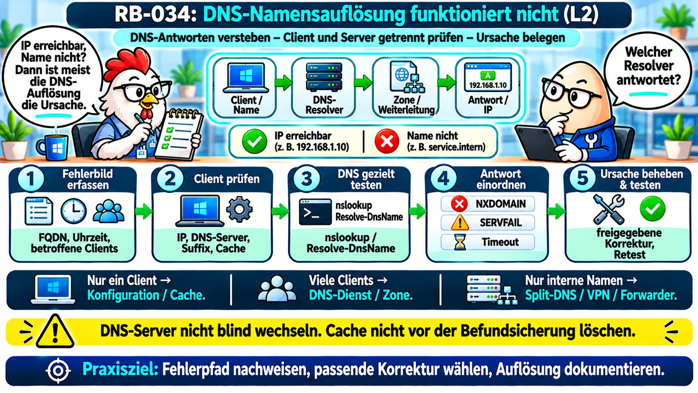

# RB-034 – Praxis-Runbook: DNS-Namensauflösung funktioniert nicht

**Projekt:** 50 Tickets – 50 typische Supportfälle · **Level:** L2 · **Stand:** 22.11.2026 · **Version:** 1.0  
**Fachstatus:** Recherchiertes Runbook – **praktische Validierung steht aus**. Nur berechtigte und freigegebene Diagnosen; Beispiele sind fiktiv.



> **Schnellprinzip:** **Name + Recordtyp → verwendeter Resolver → DNS-Antwort → Client/Server-Vergleich → belegte Ursache → autorisierte Korrektur → identischer Retest.** Ein DNS-Cache-Flush ist kein Ersatz für Ursachenanalyse.

## 1. Ticketaufnahme und Impact

- [ ] Vollständiger betroffener Name/FQDN, ggf. Kurzname; Dienst/Anwendung (SMB, HTTPS, RDP, AD).
- [ ] Fehlerwortlaut (NXDOMAIN, SERVFAIL, Timeout, falsche IP, „Server nicht gefunden“), Zeitpunkt und Dauer.
- [ ] Nur ein Client / VLAN / Standort / VPN-Benutzer oder mehrere? Vergleichsgerät benennen.
- [ ] Funktioniert der gleiche Dienst über IP? Das ist ein Indiz, aber noch kein DNS-Beweis.
- [ ] Erwartete IP und Recordtyp (A/AAAA/SRV/CNAME), zuvor funktionierender Zustand, jüngste Changes.

**Ticket-Satz:** „`[FQDN]` wird auf `[Client/VPN/Standort]` um `[Zeit]` beim `[Resolver]` mit `[Antwort]` beantwortet; `[Gegenprobe]` zeigt `[Unterschied]`."

## 2. Sicherheits-, Rollen- und Freigabecheck

- [ ] Nur notwendige DNS-/Netzwerkmetadaten im Ticket speichern; personenbezogene und interne Infrastrukturinformationen minimieren.
- [ ] Read-only-Diagnosen zunächst ohne administrative Änderung; DNS-/AD-/VPN-/Security-Owner bei Bedarf hinzuziehen.
- [ ] Keine DNS-Server-IP, Hosts-Datei, DNS-Zone, Forwarder, GPO, VPN-Richtlinie oder Firewall ohne Freigabe verändern.
- [ ] Bevor Cache gelöscht wird: Cacheeintrag/TTL und direkte Query protokollieren.
- [ ] Für produktive Changes: betroffene Systeme, Backup, Rollback-Plan, Change-ID und Wartungsfenster klären.

## 3. Client-Basiswerte (lesend)

```powershell
ipconfig /all
Get-NetIPConfiguration
Get-DnsClientServerAddress
Get-DnsClientGlobalSetting
Get-DnsClient | Select-Object InterfaceAlias,ConnectionSpecificSuffix
```

- [ ] Aktive Adapter, IP/Subnetz, DNS-Resolver pro Schnittstelle und Suchsuffix mit Soll vergleichen.
- [ ] Mehrere NICs, VPN, IPv4/IPv6, Schnittstellenpriorität und abweichende DNS-Zuweisung berücksichtigen.
- [ ] Interne AD-Namespace nicht über zufälligen öffentlichen DNS testen und damit „beheben“ wollen.

## 4. Vorprüfung: IP-Pfad und Name auseinanderhalten

- [ ] Soweit zulässig, Ziel-IP separat testen; `ping` prüft ICMP, nicht DNS oder Dienst.
- [ ] Bei Dienstproblem auch Zielport gezielt testen (z. B. `Test-NetConnection ... -Port 445`).
- [ ] DNS-Diagnose nur fortsetzen, wenn tatsächlich Namensauflösung als Fehlerkomponente erkennbar ist.

```powershell
# Beispiel-IP und -Name sind fiktiv:
Test-NetConnection -ComputerName 10.20.30.50 -Port 445
```

## 5. Gleicher FQDN und Typ, zwei DNS-Wege

```powershell
# Standardauflösung
Resolve-DnsName -Name srv01.corp.example -Type A

# Vorgesehenen internen DNS-Resolver direkt abfragen
Resolve-DnsName -Name srv01.corp.example -Server 10.20.0.53 -Type A -DnsOnly -NoHostsFile
nslookup srv01.corp.example 10.20.0.53
```

- [ ] **Antwort/RCODE, IP, Resolver, Zeit und TTL** sichern.
- [ ] Vergleich mit einem zweiten autorisierten Client bzw. zuständigen DNS-Server durchführen.
- [ ] Bei Bedarf A und AAAA getrennt sowie Kurzname und FQDN vergleichen.
- [ ] **nslookup ignoriert Client-DNS-Cache**. Unterschied zu Standardpfad ist ein Hinweis auf Cache, Hosts, Suffix, Richtlinie oder Resolverwahl – **kein Beweis für genau eine Ursache**.

## 6. Diagnosezweig nach Ergebnis

| Befund | Nächste Prüfung |
|---|---|
| **Nur Client betroffen** | DNS-Konfiguration, Hosts, Cache, Suffix, VPN/NRPT, lokaler Sicherheitsclient |
| **FQDN korrekt, Kurzname falsch** | DNS-Suffixsuchliste und Namenskonvention |
| **Direkter DNS-Server korrekt, Standardpfad falsch** | Resolverwahl, VPN, Cache/Hosts/NRPT, IPv4/IPv6 |
| **NXDOMAIN bei mehreren Clients** | Richtiger DNS-Server? Zone/Record/Delegation, Conditional Forwarder |
| **SERVFAIL** | Serverlogs, Rekursion, Forwarder, DNSSEC/Policy und betroffene Zielzone |
| **Timeout** | DNS-Transportpfad, UDP/TCP 53, Netzwerk ACL, Erreichbarkeit und Serverantwort |
| **A richtig, Anwendung falsch** | Routing, Firewall, Dienst/TLS und Berechtigungen (RB-038/039) |
| **Nur interne Namen über VPN** | Unternehmensresolver, Split-DNS, VPN-Routing, NRPT/Policies |

## 7. L2-Vertiefung – Clientcache, Server und DNS-Transport

```powershell
# Client lesen – NICHT flushen:
ipconfig /displaydns
Get-DnsClientCache | Where-Object { $_.Entry -like '*corp.example*' }
Get-Content "$env:SystemRoot\System32\drivers\etc\hosts"
Get-DnsClientNrptPolicy

# TCP-Verbindung auf Port 53, beweist KEINE UDP-Funktion:
Test-NetConnection -ComputerName 10.20.0.53 -Port 53

# DNS-Abfrage über TCP als Vergleich zu regulärem Test:
Resolve-DnsName -Name srv01.corp.example -Server 10.20.0.53 -DnsOnly -NoHostsFile -TcpOnly
```

Bei mehreren betroffenen Clients DNS-Owner hinzuziehen und **auf berechtigtem DNS-Server** lesen:

```powershell
Get-DnsServerZone -ComputerName dns01.corp.example
Get-DnsServerResourceRecord -ComputerName dns01.corp.example -ZoneName 'corp.example' -Name 'srv01' -RRType A
Get-DnsServerForwarder -ComputerName dns01.corp.example
Get-DnsServerZone -ComputerName dns01.corp.example | Where-Object ZoneType -eq 'Forwarder'
```

**Achtung:** Ein erfolgreicher `Test-NetConnection -Port 53` testet TCP 53; DNS-UDP-Requests können weiterhin scheitern. Serverseitiges `NXDOMAIN` ist keine gleichbedeutende Aussage mit Timeout. [Q3–Q5]

## 8. Gezielte Korrektur – nur nach bestätigter Ursache

- [ ] Falsche DNS-Zuweisung → mit Netzwerkteam korrekte Konfiguration/DHCP/VPN-Profil herstellen.
- [ ] Alter Cacheeintrag → **nach Dokumentation**, Prüfung und Freigabe gezielt `ipconfig /flushdns` oder TTL-Ablauf; Fehlerursache trotzdem dokumentieren.
- [ ] DNS-Zone/A-Record defekt → autorisierte DNS-Administration korrigiert Record; Zonenkonsistenz/TTL und gegebenenfalls Replikation berücksichtigen.
- [ ] Forwarder/Transportfehler → zuständiges DNS-/Netzwerkteam prüft ACL, Weiterleitungsziel und Serverlogs.
- [ ] Suffix/NRPT/VPN falsch → zentrale Richtlinie durch zuständigen Owner korrigieren; keine clientseitigen Wildwest-Fixes.
- [ ] Anwendung scheitert trotz korrekt aufgelöstem Namen → an RB-038/039 bzw. Dienstowner übergeben.

**Nicht durchführen:** öffentliche DNS-Server in AD-Domänenprofilen „zum Test“ dauerhaft setzen, DNS-Sicherheit abschalten, Firewall öffnen, Hosts-Einträge auf Verdacht überschreiben oder produktive Zoneneinträge ohne Change-ID bearbeiten.

## 9. Funktionstest und Validierung

- [ ] **Derselbe** FQDN/Recordtyp liefert über den **vorgesehenen** Resolver erwartete Antwort.
- [ ] DNS-Daten nach TTL/Cache-Änderung konsistent, keine veralteten Gegenantworten.
- [ ] Ursprüngliche Anwendung (SMB/HTTPS/RDP/AD-Dienst) unter Benutzerkontext funktioniert – nicht nur `nslookup`.
- [ ] Vergleichsclient / weiterer betroffener Standort oder VPN-Sitzung getestet, falls relevant.
- [ ] Änderungen, Freigaben, Rollback-Informationen und verbleibende Risiken dokumentiert.

**Bei ausbleibendem Erfolg:** Reproduzierbare Befunde an DNS-/Netzwerk-/AD-Team: Name+Typ, Queryantwort, Resolver-IP, Client/VPN, Uhrzeit, Paket-/Server-Logs (nur autorisierte Auszüge), Änderungshistorie, Auswirkung und zuletzt getestete Maßnahmen.

## 10. Muster-Ticketkommentar und Abschlusskriterien

**Drei-Satz-Kommunikation – fiktives Beispiel:**

> **Sachverhalt:** „Auf PC-17 konnte `files01.corp.example` nicht korrekt aufgelöst werden; der Clientcache enthielt die alte Adresse `10.20.30.40`, während der interne Resolver `10.20.30.50` meldete.“  
> **Diagnose und Maßnahme:** „Die DNS-Zone und der Vergleichsclient waren korrekt; nach Sicherung des Befunds und Freigabe wurde ausschließlich der lokale Cache bereinigt.“  
> **Nachweis:** „Die erneute DNS-Abfrage lieferte `10.20.30.50`; der Dateizugriff über den Hostnamen funktionierte wieder, der Anwender bestätigte den Erfolg.“

**Schließen nur wenn:** Fehlerbild reproduzierbar geklärt; technische Ursache ausreichend belegt; Berechtigungs-/Changeprozess eingehalten; ursprüngliche Funktion getestet; Ticketbefunde verständlich und datensparsam dokumentiert. Andernfalls **statusgerecht eskalieren** statt „gelöst“ behaupten.

---

**Quellen:** [Q1–Q12] im `RB-034_Lernartikel.md`. **Alle Beispiele hypothetisch; praktische Laborvalidierung noch nicht erfolgt.**
