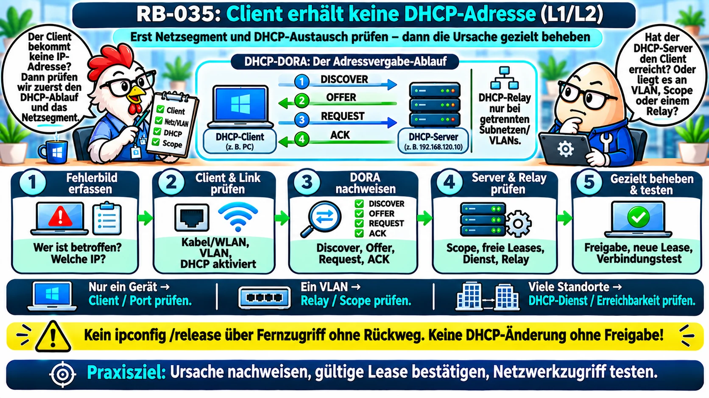

# RB-035 – Client erhält keine DHCP-Adresse

**Projekt:** 50 Tickets – 50 typische Supportfälle  
**Bereich:** Windows 11 / Ethernet & WLAN / DHCPv4 / VLAN / DHCP-Relay / Windows Server DHCP  
**Support-Level:** L1/L2 · **Stand:** 22.11.2026 · **Version:** 1.0  
**Fachstatus:** Recherchierte, aus Microsoft-Dokumentation abgeleitete Diagnoseverfahren. **Praktische Validierung steht aus.** Alle Ticketdaten, Netze und Befunde sind fiktiv. Es wurden keine produktiven Netzwerke verändert.



> **Leitsatz:** „Der Client bekommt keine IP“ beschreibt nur ein Symptom. Beweise zuerst **welcher Adapter**, **welches Segment**, **welche DHCP-Nachrichten** und **welcher Server** tatsächlich betroffen sind – erst dann ist eine Korrektur begründet.

---

## 1. Störungsmeldung, Rollen und Lernziele

**Typische Anfragen:** „Mein Windows-Notebook hat im Büro kein Netzwerk“, „Nach dem Umzug an einen anderen Switch bekommt nur ein PC keine Adresse“, „Alle Geräte im neuen VLAN bekommen keine IP“, „WLAN ist verbunden, aber keine Firmenadresse zugewiesen“, „Beim `ipconfig /renew` tritt ein Zeitüberschreitungsfehler auf“.

**Lernziel:** Einen fehlenden oder ungültigen DHCPv4-Lease ohne vorschnelle Eingriffe eingrenzen. Zwischen **Client/Netzadapter**, **Link und VLAN**, **DHCP-Relay/IP-Helper**, **DHCP-Dienst und Scope** sowie **Adresskonflikt oder Richtlinienfilterung** unterscheiden.

- **L1:** Fehlerbild, Reichweite und Uhrzeit sichern; lesende Adapter-/Adressprüfung; Vergleich an erlaubtem Arbeitsplatz oder Port; bei riskanten Änderungen stoppen.
- **L2:** DORA-Nachrichten, Netzwerkpfad, VLAN-/Relay-Umsetzung, DHCP-Scopes, Serverbindungen, AD-Autorisierung, Logs, Sicherheitsfilter und Failover prüfen.
- **Netzwerk-/Server-Owner:** Änderungen an Switchport, DHCP-Snooping, IP-Helper, Firewall, Scope, Reservierung, Filter, Failover und Dienst nach Change-Verfahren freigeben.

**Abgrenzung:** RB-034 behandelt DNS-Auflösung, RB-036 gezielt APIPA (`169.254.x.x`). Hier geht es um die **Ursache einer gescheiterten DHCPv4-Zuweisung**, nicht um generelle Anwendungs- oder Namensprobleme.

## 2. Technische Grundlage – was DHCP tatsächlich tut

Ein DHCPv4-Client fordert eine zeitlich begrenzte Konfiguration an. Ein typischer **Neubezug** folgt dem **DORA-Schema** [Q1, Q2]:

```text
DHCP-Client                                DHCP-Server
   |---- DHCPDISCOVER (UDP 68 → 67) ---------->|
   |<--- DHCPOFFER (angebotene Adresse) ------|
   |---- DHCPREQUEST (ausgewähltes Angebot) -->|
   |<--- DHCPACK (Lease bestätigt) -----------|
   |          → IP / Maske / Optionen
```

Ein **DHCP-Relay/IP-Helper** vermittelt zwischen Client und Server, **wenn beide in unterschiedlichen L3-Subnetzen liegen**. In demselben Broadcastsegment ist für diesen Standardfall kein Relay erforderlich. Ein Relay transportiert die Anfrage über die Segmentgrenze und liefert dem Server üblicherweise Subnetzinformationen (beispielsweise `giaddr`) zur Scope-Auswahl. [Q1, Q2]

**Wichtig:** Nicht jeder `ipconfig /renew`-Vorgang zeigt eine vollständige DORA-Sequenz. Bei noch gültigen Leases kann der Client direkt per **Unicast** eine Verlängerung anfragen. Erst bei einer Neuvergabe oder wenn eine direkte Verlängerung nicht gelingt, ergeben sich andere Austauschmuster. Paketmitschnitte stets im Zusammenhang mit dem Leasezustand interpretieren. [Q2]

DHCPv4 verwendet **UDP 67 (Server)** und **UDP 68 (Client)**. Ein erfolgreicher TCP-Porttest oder Ping ist **kein DHCP-Funktionstest**. [Q1, Q2]

## 3. Symptome richtig klassifizieren

| Beobachtung | Erste Hypothese | Was damit *nicht* bewiesen ist |
|---|---|---|
| Kein IPv4-Lease, Adapter „Medien getrennt“ | Layer 1/2, Kabel, Adapter, Funkassoziation | Dass der DHCP-Server defekt ist |
| `169.254.x.x` auf Windows | Automatische Link-Local-Adresse (APIPA) | Dass der Fehler ausschließlich beim DHCP-Server liegt |
| Statische, aber unerwartete IPv4-Adresse | DHCP möglicherweise gar nicht aktiviert / Sonderkonfiguration | Dass ein DHCP-Server falsch geantwortet hat |
| Ein Client betroffen, andere am selben Port/VLAN funktionieren | Client, MAC-Zulassung, Treiber, lokale Richtlinie | Dass die gesamte DHCP-Infrastruktur gesund ist |
| Alle Clients eines VLANs betroffen | Relay, VLAN, Scope, Netzfilter | Dass alle DHCP-Scopes ausgefallen sind |
| Alle Standorte betroffen | Dienst/HA, zentrale Filter/Erreichbarkeit | Dass jeder Client gleich konfiguriert ist |
| Lease vorhanden, DNS/Internet trotzdem nicht funktionsfähig | DHCP-Optionen, Routing, DNS, Proxy, Authentisierung | Dass DHCP-Adressvergabe fehlgeschlagen ist |

**IPv4 vs. IPv6:** IPv6 kann unabhängig von DHCPv4 funktionieren (SLAAC oder DHCPv6). Eine IPv6-Adresse beweist daher nicht, dass DHCPv4 in Ordnung ist.

## 4. Vorwissen aktivieren – Hypothesen vor Befehlen

Formuliere vor dem ersten Eingriff drei konkurrierende Hypothesen:

1. **Ein Client, ein Port:** falscher Interfacezustand oder lokale DHCP-Einstellung.
2. **Mehrere Clients im gleichen VLAN:** falsches VLAN, fehlender DHCP-Relay/IP-Helper oder Scope-Probleme.
3. **Mehrere Segmente:** zentrale DHCP-Funktion, AD-Autorisierung, Routing/Filter oder HA.

**Trennender Test:** Dasselbe Gerät an einem freigegebenen Vergleichsport; ein bekannt intaktes Gerät am ursprünglichen Port; betroffene und nicht betroffene Clients desselben Segments. **Nicht** unkontrolliert Geräte zwischen Sicherheitszonen umstecken.

Merksatz: **Ein Test ist diagnostisch wertvoll, wenn sein Ergebnis mehrere Hypothesen auseinanderhält.**

## 5. Ticketaufnahme – reproduzierbar und datensparsam

Erfasse **exakte Uhrzeit**, Host, betroffenen Netzadapter, Ethernet/WLAN, Standort, Switchport/WLAN-SSID (falls verfügbar), VLAN/Scope nach Netzwerkdokumentation, Zeitpunkt der letzten erfolgreichen Verbindung, `ipconfig /all`-Auszug sowie Anzahl betroffener Anwender.

Kläre zusätzlich:

- Ist der Netzwerkadapter **aktiv**, der Link **UP**, bei WLAN die Anmeldung/Assoziation abgeschlossen?
- **DHCP aktiviert?** Welche IPv4-Adresse, Maske, Gateway, DNS-Server, Lease-Zeiten und DHCP-Server werden angezeigt?
- Gab es Gerätewechsel, Patchkabeltausch, Port-/VLAN-/SSID-Änderungen, Netzumzug oder neue NAC-Richtlinien?
- Gab es letzte Leases auf demselben Adapter, und wurden **Fehler im DHCP-Client-Ereignisprotokoll** registriert?
- Besteht Fernzugriff über genau diese Verbindung? Dann **keine trennenden Befehle** ohne alternative Zugangsmöglichkeit.

**Datenschutz:** MAC-Adressen, Rechnernamen, interne IP-Bereiche, Benutzerbezug und Switch-Topologien nur in internen autorisierten Tickets speichern. Publikationen verwenden vollständig fiktive Beispiele.

## 6. Lesende Clientdiagnose unter Windows 11

Die folgenden Befehle ermitteln Zustände und **verändern weder Lease noch Adapterkonfiguration** [Q3, Q4]:

```powershell
# Zuverlässiger Überblick über aktuelle IPv4-/DHCP-Konfiguration
ipconfig /all
Get-NetAdapter | Format-Table Name,Status,LinkSpeed,MacAddress -AutoSize
Get-NetIPInterface -AddressFamily IPv4 |
  Select-Object InterfaceAlias,InterfaceIndex,ConnectionState,Dhcp
Get-NetIPAddress -AddressFamily IPv4 |
  Select-Object InterfaceAlias,IPAddress,PrefixLength,PrefixOrigin
Get-NetIPConfiguration
Get-Service -Name Dhcp

# Ereigniskanäle auf diesem System finden (Namen können variieren)
Get-WinEvent -ListLog '*Dhcp*' -ErrorAction SilentlyContinue |
  Select-Object LogName,RecordCount,IsEnabled
```

**Interpretation:**

- `DHCP aktiviert: Nein` beziehungsweise `Dhcp=Disabled` → keine dynamische IPv4-Vergabe über diese Schnittstelle zu erwarten, solange keine Änderung freigegeben wurde.
- Link `Disconnected` → zunächst Layer 1/2; DHCP kann ohne nutzbare Verbindung nicht erfolgreich durchlaufen.
- `PrefixOrigin=Dhcp` zeigt eine per DHCP bezogene Adresse an, **nicht**, dass alle Optionen korrekt sind.
- `169.254/16` kann unter Windows auf APIPA hinweisen; nähere Analyse folgt in RB-036. [Q5]
- DHCP-Clientdienst darf nicht blind neu gestartet oder deaktiviert werden; Prozessabhängigkeiten und Richtlinien beachten.

**Ereignisanzeige:** *Anwendungs- und Dienstprotokolle → Microsoft → Windows → DHCP-Client* (insbesondere Admin/Operational; die konkrete Anzeigename-/Kanalstruktur prüfen). Ereignisse mit **Zeitpunkt und Adapter-ID** korrelieren. Microsoft empfiehlt hierfür bei Bedarf `Get-NetAdapter -IncludeHidden`. [Q3]

## 7. Layer 1/2 und Netzwerksegment testen

**Prüfungsreihenfolge:** Link-/WLAN-Status → Kabel oder Funkassoziation → Dock/USB-Ethernet → zugewiesenes VLAN/SSID → zulässiger Vergleichsport → NAC/802.1X und DHCP-Snooping (durch berechtigten Owner).

- **Kabelgebunden:** Link-LED allein garantiert nicht, dass das vorgesehene VLAN, 802.1X und DHCP-Pakete durchgelassen werden.
- **WLAN:** Ein angezeigter WLAN-Link ist kein Beweis für Zugang zum richtigen Unternehmenssegment. SSID, Authentisierung und Clientrolle vergleichen.
- **Nur ein Switchport:** Portprofil, VLAN-ID, Port-Security/DHCP-Snooping und Fehlerzähler vergleichen, ohne die Konfiguration eigenmächtig zu ändern.
- **Nur ein VLAN:** ist das DHCP-Relay für dieses Subnetz konfiguriert? Erreichen Discover-Pakete den Relay und verlässt die Weiterleitung den Router? Die Diagnose gehört zur Netzadministration.

**A/B-Vergleichsmatrix:**

| Test | Befund | Konsequenz |
|---|---|---|
| Gleiches Gerät am freigegebenen Vergleichport | Lease ja/nein | Port-/VLAN-Abhängigkeit prüfen |
| Vergleichsgerät am betroffenen Port | Lease ja/nein | Client- gegen Netzpfad-Hypothese abgrenzen |
| Nachbarclient im selben VLAN | Lease ja/nein | Einzelclient vs. Segmentfehler |
| Client im selben Subnetz wie Server | Lease ja, anderes VLAN nein | Relay/Firewall/Routing bevorzugt prüfen |

**Achtung:** Ein Wechsel kann NAC- oder Sicherheitskontrollen auslösen. Nur autorisierte Testgeräte und Ports verwenden.

## 8. DORA über Netzwerkaufzeichnung belegen

Bei komplexeren Fällen empfiehlt Microsoft zeitgleiches Erfassen von **Client- und Serverseite** beziehungsweise auf dem Relay. Wireshark-Anzeigefilter `dhcp` (je nach Wireshark-Version ist auch `bootp` verbreitet), alternativ `udp.port == 67 || udp.port == 68`. [Q1, Q3]

**Paketdiagnose (nach Freigabe und Datensicherheitsklärung):**

| Paketlage | Befund | Nächster Untersuchungsort |
|---|---|---|
| **Kein Discover/Request am Client** trotz gezielt angestoßener Neuvergabe | Keine Sendung erkennbar | Adapter, DHCP-Client, Erfassungsinterface und tatsächlichen Leasezustand prüfen |
| **Discover am Client, nicht am Server** | Transport unterbrochen | VLAN, Relay, Switch-/Firewallpfad, DHCP-Snooping prüfen |
| **Discover am Server, kein Offer** | Server reagiert nicht im Capture | Scope, Dienst, Autorisierung, Filter/Policies und Logs |
| **Offer am Server, nicht am Client** | Rückweg fehlt | Relay, Netzfilter, Switch/DHCP-Snooping |
| **Offer + Request, aber NAK oder kein ACK** | Zuweisung nicht abgeschlossen | Leasekonflikt, fremdes Subnetz, Policy, Serverlogs, Paketpfad |
| **ACK am Client, aber keine gültige Konfiguration** | Client übernimmt angebotene Parameter nicht | Adresskonflikt/DAD, Clientlogs, Adapter/Policy |

**Wichtig:** Fehlt ein Paket in einem einzelnen Mitschnitt, ist das kein endgültiger Beweis. Falscher Mitschnittpunkt, Capture-Filter, Packet-Offloading, Zeitversatz und Wechsel des Interfaces können die Beobachtung verfälschen. Immer zwei Perspektiven abgleichen.

Eine Neuvergabe lässt sich auf einem **lokal betreuten Testgerät** nach Sicherung des Ausgangszustands gegebenenfalls mit `ipconfig /release "Ethernet"` und `ipconfig /renew "Ethernet"` anstoßen. **Das sind verändernde Befehle, keine reinen Diagnoseabfragen**: Sie können Netzwerk- und Fernzugriff trennen, veränderte Leases auslösen und laufende Anwendungen unterbrechen. Nicht ungefragt in produktiven Sitzungen ausführen. [Q4]

## 9. DHCP-Server prüfen – nur mit Zuständigkeit und Berechtigung

Auf einem autorisierten Windows-Server- oder RSAT-System, mit passender Rolle und Leserechten [Q1, Q6–Q10]:

```powershell
# Fiktive Labornamen/Netze
Get-DhcpServerInDC
Get-DhcpServerv4Binding -ComputerName dhcp01.corp.example
Get-DhcpServerv4Scope -ComputerName dhcp01.corp.example
Get-DhcpServerv4ScopeStatistics -ComputerName dhcp01.corp.example -ScopeId 192.168.120.0
Get-DhcpServerv4Lease -ComputerName dhcp01.corp.example -ScopeId 192.168.120.0
Get-DhcpServerv4OptionValue -ComputerName dhcp01.corp.example -ScopeId 192.168.120.0
Get-Service -Name DHCPServer
```

`Get-Service -Name DHCPServer` ist **nur auf dem DHCP-Server selbst** bzw. innerhalb einer dafür autorisierten Remotesitzung sinnvoll; ein Helpdesk-Client ohne Serverrolle hat diesen Dienst normalerweise nicht.

**Servercheckliste:**

1. Serverdienst läuft? Windows-DHCP-Server in AD **autorisiert** (falls relevant)? [Q7]
2. Scope für das Clientsubnetz vorhanden und **aktiv**? Freie Adressen, Ausschlüsse und Reservierungen plausibel?
3. Aktuelle Statistiken, Leases und `BAD_ADDRESS`-Einträge prüfen; Konflikte nicht allein aufgrund eines Zählers behaupten. [Q1, Q11]
4. Option 003 (Gateway), 006 (DNS) und weitere Optionen prüfen – diese erklären Konfigurationsfehler **nach** der Zuweisung, aber nicht automatisch das Fehlen jedes Leases.
5. Richtlinien, MAC-/Vendor-Filter, Scope-Reihenfolge, Serverbindung und bei HA die Failover-Statistik berücksichtigen.
6. Ereignisprotokolle unter **Microsoft → Windows → DHCP-Server** und Auditdateien standardmäßig unter `%windir%\System32\Dhcp` prüfen. [Q1]

**Besondere Gefahren:** DHCP-Scope nicht „kurz vergrößern“ ohne Adressplan; keine produktiven Reservierungen, Exclusions oder Autorisierung in AD auf Verdacht ändern.

## 10. Relay, VLAN und Netzwerk-Security – typischer L2-Pfad

Wenn Client und DHCP-Server **verschiedene Subnetze** benutzen, ist bei DHCPv4 meist ein DHCP-Relay/IP-Helper auf dem L3-Gateway erforderlich. [Q1, Q2]

Der Netzwerk-Owner prüft:

- Welches **VLAN/Subnetz** hat der betroffene Switchport bzw. das WLAN-Profil tatsächlich?
- Welcher **Relay-/Helper-Zielserver** ist auf der VLAN-Schnittstelle eingetragen?
- Welche Subnetzinformation (`giaddr`, ggf. Option 82) trifft beim DHCP-Server ein? Passen sie zum Scope und den Sicherheitsregeln?
- Ist der **Hin- und Rückweg** für DHCP zwischen Gateway/Relay und Server erlaubt? Richtige UDP-Ports und Gerätefunktionen berücksichtigen.
- Verwirft **DHCP-Snooping**, Port-Security, NAC oder eine ACL Pakete? Vertrauensstellung nur nach Sicherheitskonzept ändern.
- Gibt es versehentlich **weitere DHCP-Server**, welche widersprüchliche Angebote liefern? Nie die Filterung ausschalten, nur um schnell einen Lease zu bekommen.

**Beispiel:** Clients in VLAN 120 (`192.168.120.0/24`) bekommen keine Lease, im Server-VLAN funktioniert alles: Das ist ein starkes **Indiz** für Scope/Relay/VLAN/ACL, kein Beweis ohne Mitschnitt und Servercheck.

## 11. Entscheidungs- und Fehlermatrix

| Beobachtung | Erste Untersuchung | Sichere Folgemaßnahme |
|---|---|---|
| Nur ein Client; DHCP auf Adapter deaktiviert | Interfacekonfiguration/Policy | Zuständigen Owner um Prüfung der Sollkonfiguration bitten |
| Adapterstatus „Disconnected“ | Kabel, Funk, Dock, Port | Vergleichskomponenten nach Freigabe testen |
| Mehrere Clients eines VLANs ohne Lease | VLAN, Relay/IP-Helper, Scope, Snooping | Netzwerkteam mit Netz-/Zeit-/Capturebefunden einschalten |
| Server sieht Discover, kein Offer | Autorisierung, Scope, Leasevorrat, Filter | Serverteam gezielt eskalieren |
| Offer am Server, nicht am Client | Rückweg, Relay, Filter | Beidseitige Captures korrelieren |
| ACK, aber Client nimmt IPv4 nicht an | Clientlog, Adresskonflikt, Policy | Client- und Server-Events abgleichen |
| Lease korrekt, nur Anwendungen gestört | DNS/Route/Gateway/Dienst | Zu RB-034 / RB-038 / RB-039 wechseln |
| DHCP erneuert, Problem tritt wieder auf | Ablaufzeit, Failover, Intervall, sporadische L2-Probleme | Langzeitbefunde sammeln; nicht als dauerhaft gelöst schließen |

**Ein guter Ticketbefund** nennt das konkrete Paket/Protokollereignis und den Vergleichspunkt – nicht lediglich „DHCP kaputt“.

## 12. Korrektur, Freigabe und Sicherheitsgrenzen

**Grundsatz:** Änderungen erst nach Befundsicherung, schriftlich oder prozessual erlaubter Freigabe, Wirkungsschätzung und Rollbackplan.

- **Client:** falsch zugewiesenes statisches IPv4 oder deaktiviertes DHCP nur nach Prüfung der Sollkonfiguration korrigieren.
- **Link:** defektes Kabel oder falsche Dock-/Switchverbindung gezielt ersetzen, mit Genehmigung.
- **VLAN/Relay:** Port-VLAN und IP-Helper auf dokumentierten Sollzustand zurückführen – nur Netzwerk-Owner.
- **Server:** abgelaufene/erschöpfte Scopes, Reservierungen, Ausnahmelisten, AD-Autorisierung und Failover prüfen; nur Server-Owner ändert.
- **Adresskonflikte:** Konfliktquelle nachweisen, statt blind `BAD_ADDRESS`-Leases zu löschen oder Adressbereiche frei zu geben.

**Nicht als Schnelllösung:** unkontrolliertes `ipconfig /release`, DHCP-Server-Neustart, Deaktivieren von DHCP-Snooping/NAC, blindes Ändern von Scopes, Ausschlüssen oder DHCP-Filterlisten, dauerhafte statische Notfalladresse ohne Change.

## 13. Zwei fiktive Musterfälle – Diagnose vor Lösung

### Fall A: Nur ein Notebook in Besprechungsraum betroffen

**Meldung:** „Notebook NB-17 bekommt nach Anschluss an die Dockingstation keine Firmenadresse.“

**Befunde (fiktiv):** WLAN ist deaktiviert, USB-Ethernet-Adapter meldet Link `Up`, `ipconfig /all` zeigt DHCP aktiviert und APIPA; Nachbarclient am freigegebenen Port bekommt gültigen Lease. Vergleichsgerät am ursprünglichen Port erhält ebenfalls keine Adresse. Netzteam stellt fest: Der Port ist versehentlich dem Gast-VLAN zugeordnet, das in diesem Szenario keinen DHCP-Dienst anbietet.

**Hypothesenprüfung:** Clientkonfiguration plausibel; zwei Geräte scheitern am selben Port; am Soll-VLAN funktioniert DHCP. Ergebnis **spricht für ein Port-/VLAN-Problem**, nicht für einen global defekten DHCP-Server.

**Korrektur:** Autorisierter Netzwerk-Owner stellt dokumentiertes VLAN wieder her; DHCP-Neubezug bei lokal anwesendem Anwender und kontrollierter Zugangsmöglichkeit; Soll-IP, Gateway, DNS und Anwendungstest bestätigen.

### Fall B: Ganzes neues VLAN ohne DHCP-Lease

**Meldung:** „Nach Standorterweiterung bekommen 14 Geräte im neuen Netz keine IP.“

**Befunde (fiktiv):** Clients senden DHCPDISCOVER; der DHCP-Server erhält im zeitgleichen Capture **keine** entsprechenden Pakete. Im bisherigen VLAN gibt es weiterhin DORA und gültige Leases. Der L3-Owner prüft das neue SVI und findet einen fehlenden DHCP-Relay-Eintrag; Scope ist vorhanden und aktiv.

**Hypothesenprüfung:** Vergleich altes/neues VLAN, Client-/Servercapture und Sollkonfiguration weisen auf den fehlenden Relay-Pfad. **Kein Serverdienst-Neustart erforderlich.**

**Korrektur:** Netzwerk-Owner setzt IP-Helper nach Change, prüft Paketfluss und gültige Leases sowie erreichbare Business-Dienste; Rollback und Zeitpunkt ins Ticket.

**Beide Fälle sind ausschließlich Lernsimulationen und wurden nicht praktisch durchgeführt.**

## 14. Active Recall, Diagnosekarten und Transfer

Beantworte zunächst **ohne Runbook** und prüfe erst danach die Lösungen:

1. **Wissen:** Welche vier Schritte bilden DORA? → Discover, Offer, Request, ACK.
2. **Verständnis:** Warum reicht `ping` zum DHCP-Server nicht? → DHCPv4 arbeitet über UDP 67/68 und Broadcast/Relay; ICMP ist eine andere Prüfung.
3. **Diagnose:** Ein Client sendet Discover, kein Server sieht es. Was vergleichst du? → Relay/VLAN/ACL/Snooping und zweiten Mitschnittpunkt.
4. **Diagnose:** Der Server versendet Offer, der Client sieht es nicht. Welche Hypothese? → Rückweg/Relay/Netzfilter oder Capturefehler.
5. **Verständnis:** Warum beweist 169.254.x.x keinen Serverdefekt? → Auch Link, Adapter, VLAN, Relay, Richtlinien und Adresskonflikte können vorher scheitern.
6. **Diagnose:** Nur ein VLAN betroffen, andere laufen. Erstmaßnahme? → Segment/Relay/Scope vergleichen, nicht den zentralen Dienst pauschal neu starten.
7. **Wissen:** Welche Komponente verteilt Leases in Windows Server? → DHCP-Serverdienst mit aktivem Scope und gültiger Autorisierung (wenn AD-Kontext).
8. **Diagnose:** Lease vorhanden, Anwendung trotzdem offline. Weiter? → Gateway, DNS, Routing, Firewall, Dienst separat prüfen.
9. **Sicherheit:** Warum `ipconfig /release` nicht einfach remote? → Der Vorgang kann den einzigen Verwaltungszugang trennen.
10. **Transfer:** Neuer WLAN-Client sieht SSID, bekommt aber keine Lease. Welche Ebene noch offen? → Richtige Authentisierung/Rolle, VLAN, NAC und DHCP-Pfad.

**Anki bei späterem Tagesabschluss (Vorschlag):** 3 Wissens-, 3 Verständnis- und 4 Diagnosekarten; kurze präzise Antworten, möglichst keine reinen Definitionsfragen. Zeitversetzte neue Szenarien nach ca. 7 und 21 Tagen.

## 15. Abschluss, Erfolgskriterien und Quellen

Ein Ticket gilt **nicht** aufgrund einer einzelnen `ipconfig /renew`-Erfolgsmeldung als abschließend validiert. Prüfe unter Originalbedingungen:

1. Gewünschter Adapter bekommt **nachweislich** gültige IPv4-Adresse aus richtigem Scope sowie passende Maske, Gateway, DNS und Leasezeiten.
2. Mehrere betroffene Clients, derselbe Port, WLAN-Bereich oder dasselbe VLAN funktionieren wieder – soweit betroffen.
3. Verwendeter DHCP-Server/Relay und Ursache sind durch Log, Capture oder kontrollierte Gegenprobe ausreichend belegt.
4. Anmeldung, fachlich benötigte Anwendung und Zugriff auf interne Dienste funktionieren mit vorgesehenen Rechten.
5. Änderung, Genehmigung, Risiken, Rollback und Anwenderbestätigung im Ticket dokumentiert; bei ungeklärtem Befund korrekt eskalieren.

**Drei-Satz-Ticketkommentar (fiktiv):**

> **Problem:** „Vierzehn Clients in VLAN 120 erhielten keine DHCPv4-Adresse; die Clients sendeten Discover, die entsprechende Anfrage erreichte den Server nicht.“  
> **Diagnose/Maßnahme:** „Der Netzwerkvergleich lokalisierte einen fehlenden IP-Helper-Eintrag am VLAN-Gateway; der zuständige Netzwerkadministrator stellte den dokumentierten Zustand nach Freigabe wieder her.“  
> **Nachweis:** „Danach wurde DORA erfolgreich beobachtet; die Clients erhielten gültige Leases und der Zugriff auf die vorgesehenen Dienste wurde bestätigt.“

### Offizielle Quellen – Microsoft Learn, abgerufen am 22.11.2026

- **[Q1]** [Anleitung zur Problembehandlung bei DHCP (DHCP-Server/Client/Relay/Paketmitschnitt)](https://learn.microsoft.com/de-de/troubleshoot/windows-server/networking/troubleshoot-dhcp-guidance)
- **[Q2]** [DHCP Troubleshooting Guide – DORA, Renew, Rebind, Relay und UDP-Ports](https://learn.microsoft.com/en-us/windows-server/troubleshoot/troubleshoot-dhcp-issue)
- **[Q3]** [Troubleshoot problems on the DHCP client – Ereignisprotokolle und Vergleichsmitschnitte](https://learn.microsoft.com/de-de/troubleshoot/windows-server/networking/troubleshoot-problems-dhcp-client)
- **[Q4]** [`ipconfig` – Syntax und Auswirkungen von Release/Renew](https://learn.microsoft.com/de-de/windows-server/administration/windows-commands/ipconfig)
- **[Q5]** [APIPA – automatische TCP/IP-Adressierung ohne DHCP](https://learn.microsoft.com/de-de/windows-server/troubleshoot/how-to-use-automatic-tcpip-addressing-without-a-dh)
- **[Q6]** [`Get-DhcpServerv4ScopeStatistics` – Scope-Auslastung](https://learn.microsoft.com/en-us/powershell/module/dhcpserver/get-dhcpserverv4scopestatistics?view=windowsserver2025-ps)
- **[Q7]** [DHCP Server Authorization Failures – AD-Autorisierung](https://learn.microsoft.com/en-us/troubleshoot/windows-server/networking/troubleshooting-guide-dhcp-authorization-failures)
- **[Q8]** [`Get-DhcpServerv4Binding` – Netzwerkbindungen](https://learn.microsoft.com/en-us/powershell/module/dhcpserver/get-dhcpserverv4binding?view=windowsserver2025-ps)
- **[Q9]** [`Get-DhcpServerv4Scope` – Scopes lesen](https://learn.microsoft.com/en-us/powershell/module/dhcpserver/get-dhcpserverv4scope?view=windowsserver2025-ps)
- **[Q10]** [`Get-DhcpServerv4Lease` – Leases lesen](https://learn.microsoft.com/en-us/powershell/module/dhcpserver/get-dhcpserverv4lease?view=windowsserver2025-ps)
- **[Q11]** [Event ID 4199 und DHCP-Adresskonflikte](https://learn.microsoft.com/en-us/troubleshoot/windows-server/networking/event-4199-windows-client-cannot-get-ip-address-dhcp-server)

**Transparenz:** Diese Recherche und die erzeugten Dateien ersetzen keine reale Paketaufzeichnung, Konfigurationstests oder praktische Freigabe. Der Inhalt ist als Lern- und Vorbereitungsgrundlage für die eigenständige Validierung konzipiert.
