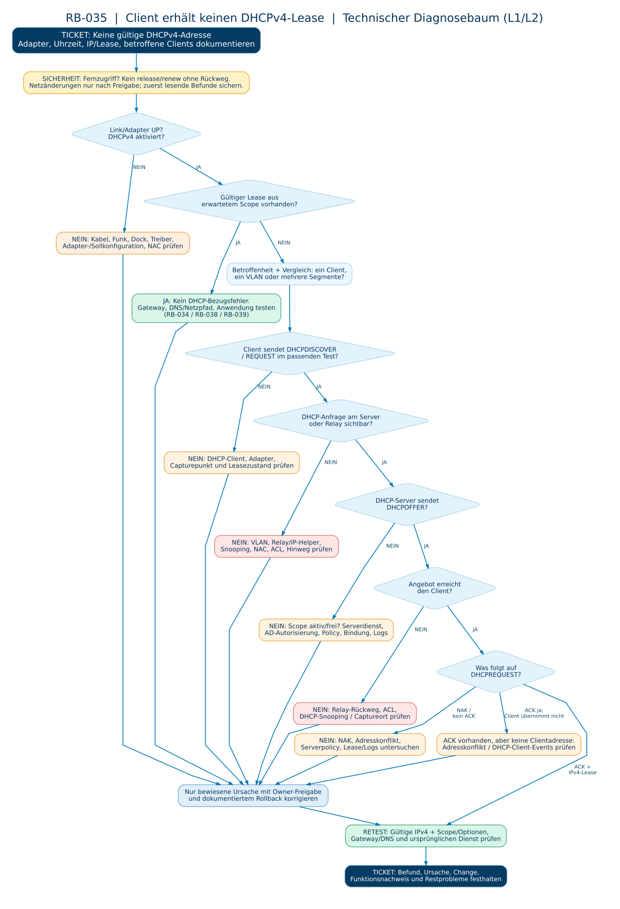

# RB-035 – Praxis-Runbook: Client erhält keine DHCP-Adresse

**Support-Level:** L1/L2 · **Stand:** 22.11.2026 · **Version:** 1.0  
**Ziel:** Fehlerdomäne nachweisen, zuständigen Owner einschalten, gültigen DHCP-Lease bestätigen.  
**Status:** Recherchiertes Runbook, **noch nicht praktisch validiert**. Alle Werte und Fälle sind fiktiv.



## 1. Eingang und Eingrenzung

- [ ] Betroffenen Host, Benutzer, Adapter, Uhrzeit, Standort, SSID/Port und genaue Meldung aufnehmen.
- [ ] Nur ein Client, mehrere Clients eines VLANs oder mehrere Standorte betroffen?
- [ ] Ethernet/WLAN, VPN, Dock, NAC/802.1X und kürzliche Änderungen notieren.
- [ ] Ist die Sitzung **remote**? Bei fehlendem alternativen Zugang keine störenden Befehle ausführen.
- [ ] IP/Mask/Gateway/DNS/Lease aus `ipconfig /all` festhalten; keine sensitiven vollständigen Protokolle öffentlich teilen.

## 2. Erster Befund – lesend

```powershell
ipconfig /all
Get-NetAdapter | Format-Table Name,Status,LinkSpeed -AutoSize
Get-NetIPInterface -AddressFamily IPv4 |
  Select-Object InterfaceAlias,InterfaceIndex,ConnectionState,Dhcp
Get-NetIPAddress -AddressFamily IPv4 |
  Select-Object InterfaceAlias,IPAddress,PrefixOrigin
Get-Service Dhcp
```

**Abzweige:**

- **Link down:** Kabel/WLAN/Adapter/Dock und Port prüfen.
- **DHCP deaktiviert:** Sollkonfiguration/Policy klären, nicht blind ändern.
- **APIPA 169.254/16:** Fehlende gültige DHCPv4-Zuweisung möglich; Ursachen über DHCP/Link prüfen, Detail RB-036.
- **Lease sichtbar:** `DHCP-Server`, Gültigkeit, Gateway und DNS kontrollieren; womöglich anderes Problem als die DHCP-Vergabe.

## 3. Kontrollierter Vergleich

- [ ] Vergleichsclient **am selben autorisierten VLAN/Port** testen.
- [ ] Gleiches Gerät nach Freigabe an einem geeigneten Vergleichsport testen.
- [ ] WLAN-Bereich oder Switchportprofil mit dokumentiertem Soll vergleichen.
- [ ] Client im Server-VLAN/anderen Segment prüfen, wenn verfügbar.
- [ ] Ergebnis als kleine Matrix „Gerät x Port/VLAN x IP-Lease“ dokumentieren.

**Interpretation:** „Nur ein Gerät“ spricht für Client/Anschluss, „nur ein VLAN“ für Relay/Scope/Netzfilter, „viele Standorte“ für zentrale Infrastruktur – keine dieser Aussagen beweist allein die Ursache.

## 4. Sicherheitsgate vor jedem aktiven Test

- [ ] Produktivsystem, Fernzugriff, Wartungsfenster, Nutzerkommunikation und Rollback geprüft?
- [ ] Kein `ipconfig /release` ohne bestätigten lokalen oder alternativen Rückweg.
- [ ] Keine DHCP-Scope-/Relay-/Switch-/NAC-/Firewall-Änderung ohne Owner-Freigabe.
- [ ] Für Paketmitschnitt: Genehmigung, Datensparsamkeit und geeignete Erfassungsorte klären.

## 5. DORA-Messung (L2, autorisierte Umgebung)

DHCPv4-Standard-Neuvergabe: **Discover → Offer → Request → ACK** (UDP 67/68). Bei aktiven Leases kann ein `renew` zunächst nur eine Unicast-Verlängerung auslösen.

- [ ] Wenn nötig: Mitschnitt Client plus Server/Relay zeitlich synchronisieren.
- [ ] Filter z. B. `dhcp` oder `udp.port == 67 || udp.port == 68`.
- [ ] Client sendet **keine** DHCP-Anfrage? Interface, Clientdienst und Capturesetup prüfen.
- [ ] Client sendet Discover, **Server sieht nichts**? VLAN/Relay/DHCP-Snooping/ACL.
- [ ] Server sieht Discover, **kein Offer**? Scope, Dienst, Autorisierung, Policy, Leasevorrat.
- [ ] Server sendet Offer, **Client sieht es nicht**? Rückweg/Relay/Netzfilter.
- [ ] Request → NAK/kein ACK? Konfigurationskonflikt, Serverpolicy, Logs und Rückweg prüfen.
- [ ] ACK beim Client, Adresse nicht übernommen? Clientlogs/Adresskonflikt prüfen.

## 6. Windows-Server-DHCP prüfen (nur berechtigtes L2/RSAT)

```powershell
# Beispiel: Hostnamen und IPs sind fiktiv.
Get-DhcpServerInDC
Get-DhcpServerv4Binding -ComputerName dhcp01.corp.example
Get-DhcpServerv4Scope -ComputerName dhcp01.corp.example
Get-DhcpServerv4ScopeStatistics -ComputerName dhcp01.corp.example -ScopeId 192.168.120.0
Get-DhcpServerv4Lease -ComputerName dhcp01.corp.example -ScopeId 192.168.120.0
Get-DhcpServerv4OptionValue -ComputerName dhcp01.corp.example -ScopeId 192.168.120.0
```

Prüfe **Scope aktiv/frei**, Serverdienst, AD-Autorisierung falls nötig, Filters/Reservierungen, `BAD_ADDRESS`, Failover und Serverlogs. Serverweite Dienstprüfung nur direkt am Server/autorisiert remote.

## 7. Diagnosematrix – direkt nutzbar

| Befund | Gezielte Prüfung | Verantwortlich |
|---|---|---|
| Nur einzelner Client | Adapter-DHCP, Link, Treiber, MAC/Port | L1/L2 |
| Nur bestimmter Port/SSID | VLAN/NAC/Portprofil | Netzwerkteam |
| Alle Geräte in einem VLAN | Relay/IP-Helper, Scope, Firewall | Netzwerk-/Serverteam |
| Scope erschöpft | Statistik, Exclusion/Leasekonflikte | DHCP-Owner |
| DHCP-Server nicht autorisiert | AD-Autorisierungsstatus, Ereignis 1046 | AD-/Serverteam |
| ACK vorhanden, aber kein Lease | Clientlog, IP-Konflikt, Richtlinie | L2 |
| Lease korrekt, kein Namens-/Dienstzugriff | DNS/Gateway/Port, RB-034/038/039 | Zuständiges Fachteam |

## 8. Gezielte Korrektur – erst nach bestätigter Ursache

- [ ] Dokumentierten Sollzustand und passenden Change genehmigt?
- [ ] Client-Konfiguration bzw. Adapterfehler **nur** entsprechend Diagnose korrigiert?
- [ ] Ggf. VLAN/Relay/Scope/DHCP-Autorisierung durch passenden Owner korrigiert?
- [ ] Keine ungeprüfte statische Ersatzadresse, keine globale Deaktivierung von DHCP-Snooping, keine unbegründete Scope-Aufweitung.
- [ ] Vorher-/Nachher-Befunde und Rückweg festgehalten.

## 9. Erfolgskontrolle und Eskalationspaket

**Abschluss nur nach Test unter Originalbedingungen:**

- [ ] Client besitzt gültige IPv4 aus dem erwarteten Netz, passende Maske, Gateway, DNS und Leasezeit.
- [ ] `ipconfig /all` nennt den erwarteten DHCP-Server; falls relevant DORA/ACK im Mitschnitt.
- [ ] Ursprüngliche Business-Anwendung, Name und Dienst tatsächlich erreichbar.
- [ ] Mehrere betroffene Clients/Ports/VLANs nach gleicher Methode gegengeprüft.
- [ ] Ursache, Change-ID, Freigabe, Retest und Anwenderbestätigung im Ticket.

**Bei Eskalation:** Client/MAC (intern geschützt), Interface-/VLAN-Zuordnung, Befehlsauszüge, AD-/DHCP-Logs, Capture-Befunde, Uhrzeiten, Auswirkung, betroffene Scopes und erfolgte Tests übergeben.

## 10. Drei-Satz-Ticketkommentar – fiktiver Musterfall

> **Sachverhalt:** „In VLAN 120 erhielten mehrere Windows-Clients keine DHCPv4-Adresse; die Anfragen wurden am Client gesendet, aber nicht am DHCP-Server beobachtet.“  
> **Prüfung/Maßnahme:** „Der Netzwerkvergleich ergab einen fehlenden DHCP-Relay-Eintrag; das Netzwerkteam stellte die dokumentierte Konfiguration nach Freigabe wieder her.“  
> **Erfolg:** „Die Clients erhielten anschließend Leases aus dem richtigen Scope; Gateway, DNS und der ursprüngliche Anwendungszugriff wurden geprüft und bestätigt.“

**Offizielle Quellen:** siehe [Q1–Q11] im `RB-035_Lernartikel.md`. **Fiktive Musterfälle, reale Validierung noch offen.**
