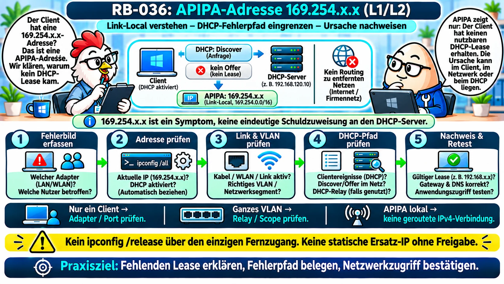

# RB-036 – APIPA-Adresse 169.254.x.x

**Projekt:** 50 Tickets – 50 typische Supportfälle  
**Bereich:** Windows 11 / IPv4 Link-Local / DHCP-Client / Ethernet & WLAN / VLAN & Relay  
**Support-Level:** L1/L2 · **Stand:** 22.11.2026 · **Version:** 1.0  
**Fachstatus:** Recherchierte und fachlich abgeleitete Diagnoseverfahren auf Basis von Microsoft Learn und RFC 3927. **Keine praktische Validierung durchgeführt.** Alle Fälle, Personen und Adressen sind fiktiv.



> **Leitsatz:** Eine `169.254.x.x`-Adresse zeigt einen **IPv4-Link-Local-Zustand** an. Sie zeigt **nicht**, an welcher Stelle eine erwartete DHCP-Vergabe fehlgeschlagen ist. Erst den Adapter und Sollzustand identifizieren; dann die Beweiskette aufbauen.

---

## 1. Störungsmeldung, Ziele und Zuständigkeit

**Typische Meldung:** „Mein PC zeigt `169.254.83.42`, aber ich komme nicht auf den Fileserver“, „Nach dem Andocken habe ich keine Firmen-IP“, „Nur Geräte in einem Besprechungsraum bekommen 169.254“, „WLAN verbunden – aber keine Verbindung zu internen IPv4-Diensten“.

**Lernziel:** Die Bedeutung einer APIPA-Adresse erklären und anhand **unabhängiger Tests** zwischen physikalischem Anschluss/SSID, DHCP-Clientkonfiguration, VLAN/NAC, DHCP-Pfad, Relay und DHCP-Server unterscheiden. Nicht nur den Normalzustand herstellen, sondern **nachweisen**, weshalb er zuvor fehlte.

- **L1:** Betroffenheit, Adapter, Sollnetz, `ipconfig /all`, Link- und WLAN-Status, Vergleichsgerät erfassen; keine unkontrollierten Adaptereingriffe.
- **L2:** Ereignisprotokolle und DHCP-Verkehr auswerten; Paketpfad, VLAN, Relay, Scope, Richtlinien und mögliche IP-Konflikte prüfen.
- **Netzwerk-/DHCP-Owner:** Konfigurationsänderungen an Switch, WLAN/NAC, Relay, DHCP-Server und Scopes nur nach dokumentierter Freigabe.

**Abgrenzung:** RB-035 erklärt die DHCP-Vergabe über den ganzen DORA-Ablauf. **RB-036 beginnt beim beobachteten Zustand `169.254/16` und dessen korrekter Interpretation.** RB-034 behandelt DNS-Probleme bei grundsätzlich vorhandener IP-Konnektivität.

## 2. Was ist APIPA – und was nicht?

**APIPA** bedeutet *Automatic Private IP Addressing*. Wenn ein Windows-Netzwerkadapter für automatische IPv4-Vergabe konfiguriert ist und keine brauchbare DHCP-Konfiguration erhält, kann Windows ihm automatisch eine **IPv4-Link-Local-Adresse** aus `169.254.0.0/16` zuweisen. Typische Maske: **255.255.0.0**. `ipconfig /all` zeigt beispielsweise **„Autokonfigurations-IPv4-Adresse“** an. [Q1, Q2]

```text
Gewünschter Unternehmensbetrieb        Möglicher Fallback
    DHCP → 192.168.120.35/24           kein nutzbarer DHCP-Lease
    Gateway/DNS/Sollnetz               ↓
                                       APIPA 169.254.83.42/16
                                       nur Link-Local IPv4
```

**Wichtig:** APIPA ist eine regulär definierte Link-Local-Technik, nicht per se ein Softwaredefekt. Für ein bewusst isoliertes kleines Netz ohne DHCP kann Link-Local-Kommunikation sinnvoll sein. In einem Firmennetz, in dem ein routbares IPv4-Netz vorgesehen ist, deutet APIPA hingegen auf einen **Soll-Ist-Unterschied** hin. [Q1, Q3]

**Kein Schuldbeweis:** Eine APIPA-Adresse beweist **nicht**, dass der DHCP-Server ausgefallen ist, dass überhaupt ein `DHCPDISCOVER` beim Server ankam oder dass der letzte Fehler zwingend „kein Offer“ war. Die Ursache kann auf Client, Link, VLAN/802.1X/NAC, Relay, Server, Filter oder im Übernahmeprozess einer Konfiguration liegen. [Q2, Q4]

## 3. Reichweite und Grenzen von 169.254/16

Nach **RFC 3927** dürfen IPv4-Link-Local-Pakete nicht von Routern weitergeleitet werden. APIPA ermöglicht lokale IPv4-Kommunikation **auf demselben Link**, sofern Gegenstelle, Netz und lokale Firewall dies zulassen. Die häufige Aussage „Mit APIPA geht überhaupt kein Netzwerk“ ist daher technisch falsch. [Q3]

| Merkmal | APIPA / IPv4 Link-Local |
|---|---|
| IPv4-Bereich | `169.254.0.0/16` (Link-Local) |
| Windows-Maske im Normalfall | `255.255.0.0` (Präfix `/16`) |
| Auswahl | Automatische Auswahl, ARP-Prüfung gegen Adresskonflikte |
| Verkehr im selben Link | Möglich, aber nicht garantiert |
| Routing zu anderen IPv4-Subnetzen | Nicht zulässig für Link-Local-Pakete |
| Internet-/Firmennetz über diesen IPv4-Pfad | Nicht möglich, solange nur diese Adresse als Quelladresse verfügbar ist |
| Adresse bewusst als statisches Firmennetz verteilen | Nicht als regulären Ersatz konfigurieren [Q3] |

RFC 3927 spezifiziert für die dynamische Auswahl den Bereich **169.254.1.0 bis 169.254.254.255**; Anfangs- und Endbereich sind für diese automatische Auswahl reserviert. Der Host prüft über **ARP Probes**, ob eine Adresse bereits beansprucht wird. Eine Kollision wird erkannt und die Adresswahl angepasst. [Q3]

**Mehrere Adapter beachten:** Ein Laptop kann auf einem Adapter APIPA haben und über einen **anderen** Adapter, VPN oder IPv6 weiterhin Zugriff besitzen. Eine angezeigte IPv6-Link-Local-Adresse `fe80::/10` ist **nicht** dasselbe wie APIPA für IPv4. Deshalb stets den **konkret betroffenen Adapter** untersuchen und nicht aus einer einzelnen Adresse auf die gesamte Konnektivität schließen.

## 4. Erste Denkaufgabe: Drei Hypothesen formulieren

**Ohne direkt zu reparieren:** Ein Windows-Notebook hat per Ethernet `169.254.83.42/16`. WLAN kann weiterhin funktionieren.

1. **Hypothese A (Client):** Ethernet ist statisch falsch konfiguriert, der DHCP-Client oder die Schnittstelle arbeitet nicht erwartungsgemäß.
2. **Hypothese B (Zugangsnetz):** Link/Port, Dock oder 802.1X/NAC ordnen den Client dem falschen oder keinem produktiven VLAN zu.
3. **Hypothese C (DHCP-Pfad):** Discover erreicht DHCP/Relay nicht, die Antwort erreicht den Client nicht oder der Server kann keine gültige Lease bereitstellen.

**Trennender Test:** Funktioniert ein bekannt intaktes Gerät am **selben freigegebenen Port**? Bekommt das betroffene Gerät an einem **freigegebenen Vergleichsport** eine korrekte Adresse? Sind andere Geräte **im selben VLAN/SSID** betroffen? Ein einziger Test kann mehrere Hypothesen entkräften, ersetzt aber keine Beweisführung.

## 5. Ticketaufnahme: Exakten Soll- und Istzustand ermitteln

Vor Maßnahmen möglichst erfassen:

- **Zeitpunkt**, Benutzerwirkung, Host, Ethernet- oder WLAN-Interface, Adaptername/InterfaceIndex, physischer Standort, verwendetes Dock, SSID oder dokumentierter Switchport.
- Angezeigte IPv4-Adresse, Subnetzmaske, Status **„DHCP aktiviert“**, Gateway, DNS, DHCP-Server, etwaige Lease-Zeitstempel und andere aktive Adapter.
- Sollnetz aus autorisierter Netzwerkdokumentation und **Anzahl betroffener Geräte**.
- Auftreten nach Gerätewechsel, Umzug, Patchfeldarbeit, Dock-Wechsel, WLAN-Rekonfiguration, Sicherheitsrichtlinienänderung oder Netzstörung.
- Fernzugriff: Erfolgt die aktuelle Administrationssitzung **über das betroffene Interface**? Ohne gesicherten Rückweg keinerlei trennende Tests.

**Fiktiver Ausgangsbefund:** Ethernet → `169.254.83.42 / 255.255.0.0`; DHCP aktiviert „Ja“; kein sinnvoller IPv4-Standardgateway auf dem betroffenen Adapter; Sollnetz: `192.168.120.0/24` (Lernbeispiel). **Zuerst prüfen, ob Ethernet tatsächlich die Schnittstelle ist, die den Ausfall verursacht.**

## 6. Sichere, ausschließlich lesende Windows-Diagnose

Alle folgenden Befehle **lesen**, sie lösen keinen Lease-Neubezug aus und ändern keine Netzwerkkonfiguration. Einige Details können vom Betriebssystemstand und den Berechtigungen abhängen. [Q4, Q5]

```powershell
# Windows-11-Client, vorerst nur beobachten
ipconfig /all
Get-NetAdapter |
  Format-Table Name,InterfaceIndex,Status,LinkSpeed -AutoSize
Get-NetIPInterface -AddressFamily IPv4 |
  Select-Object InterfaceAlias,InterfaceIndex,ConnectionState,Dhcp
Get-NetIPAddress -AddressFamily IPv4 |
  Select-Object InterfaceAlias,IPAddress,PrefixLength,PrefixOrigin,AddressState
Get-NetIPConfiguration
Get-NetRoute -AddressFamily IPv4 |
  Select-Object InterfaceAlias,DestinationPrefix,NextHop,RouteMetric
Get-Service -Name Dhcp
```

**Interpretation – nicht verwechseln:**

- `169.254.x.x` mit Maske `/16` und Anzeige „Autokonfigurations-IPv4-Adresse“ → APIPA-Befund dokumentieren.
- `Dhcp=Disabled` auf **diesem** Interface → zunächst Sollkonfiguration/Alternative Configuration prüfen; nicht behaupten, hier müsse ein normaler DHCP-Ablauf stattfinden.
- `Status=Disconnected` → Link/Assoziation vor DHCP-Diagnose überprüfen.
- Kein Default Gateway **auf diesem Interface** bedeutet nicht, dass auf dem Rechner insgesamt keine Route vorhanden ist; Tabelle pro Interface prüfen.
- Eine IPv6-Konnektivität oder andere funktionierende Netzkarte beweist **nicht**, dass DHCPv4 auf Ethernet funktioniert.
- Eine `169.254`-Adresse allein belegt noch **keine** konkrete DORA-Paketfolge.

**Bewusst keine „Ein-Klick-Lösung“:** `ipconfig /flushdns` ändert DNS-Cache, aber **beseitigt nicht** die Ursache einer APIPA-Vergabe. `netsh int ip reset` oder Treiberdeinstallation sind keine Erstdiagnose.

## 7. Windows-Ereignisprotokolle und Befundsicherung

Microsoft empfiehlt, DHCP-Clientereignisse unter **Anwendungs- und Dienstprotokolle → Microsoft → Windows → DHCP-Client** in den Kanälen **Admin/Operational** zu untersuchen. Kanalverfügbarkeit und Bezeichnung am Zielsystem prüfen. [Q4]

```powershell
# Vorhandene DHCP-Clientkanäle feststellen (lesend)
Get-WinEvent -ListLog '*DHCP*' -ErrorAction SilentlyContinue |
  Select-Object LogName,IsEnabled,RecordCount

# Beispiel nach vorheriger Prüfung des Kanalnamens
Get-WinEvent -LogName 'Microsoft-Windows-Dhcp-Client/Admin' -MaxEvents 30 |
  Select-Object TimeCreated,Id,LevelDisplayName,Message
```

**Hinweise:** Fehlt der Kanal, nichts erfinden; im Event Viewer die verfügbaren Kanäle prüfen. Fehlermeldung **zeitlich** mit `ipconfig`-Befund und Netzadapter-ID abgleichen; historische Ereignisse ohne Zeitbezug belegen keine aktuelle Ursache. Für Zuordnung von Adapter-GUID/MAC kann ein berechtigtes L2 zusätzlich `Get-NetAdapter -IncludeHidden` einsetzen. [Q4]

**Datensparsamkeit:** Hostnamen, interne Adressen, Nutzerkennung, MAC, VLAN und Netzwerktopologie nur in geschützten Tickets erfassen. Öffentlich nur fiktive Daten verwenden.

## 8. Fehlerpfad durch Vergleichstests eingrenzen

| Messung | Befund | Nächster sinnvoller Prüfpunkt |
|---|---|---|
| Nur ein Gerät betroffen | Vergleichsclient im selben Netz hat Lease | Adapter, Treiber, lokale DHCP-Einstellung, MAC/NAC, Port |
| Nur ein Port oder Dock betroffen | Direkter Anschluss/anderer Port funktioniert | Patchung, Portprofil, Dock, USB-Ethernet |
| Alle Geräte einer SSID betroffen | Andere SSID funktioniert | WLAN-VLAN, NAC-Rolle, DHCP-Relay, Scope |
| Alle Geräte eines VLANs betroffen | Nachbar-VLAN funktioniert | Relay/IP-Helper, Scope, ACL, DHCP-Snooping |
| Viele Segmente betroffen | Zentrale DHCP-Fehler | Dienst, Erreichbarkeit, Policy, HA |
| APIPA nur auf ungenutztem Adapter | Produktivinterface hat reguläre IPv4 | Eventuell kein Anwenderproblem; Sollkonfiguration prüfen |
| Direkt am lokalen Link ist ein anderes `169.254`-Gerät erreichbar | Link-Local-Verkehr möglich | Kein Nachweis für DHCP- oder routbares Netzwerk |

**A/B-Tests nur im autorisierten Segment:** Ein Gerätewechsel kann 802.1X-, NAC- oder Port-Security-Effekte auslösen. Kein Umstecken zwischen Sicherheitszonen und keine Portanpassung ohne Erlaubnis.

## 9. DHCP-Verkehr und APIPA korrekt zusammen interpretieren

Bei **typischer DHCPv4-Neuzuweisung** ist der Austausch:

```text
Client                   VLAN / ggf. DHCP-Relay                DHCP-Server
  |---- DISCOVER ------------------------------->|
  |<--- OFFER -----------------------------------|
  |---- REQUEST -------------------------------->|
  |<--- ACK -------------------------------------|
  |      → routbare IPv4-Konfiguration

Fehlschlag: keine nutzbare DHCP-Konfiguration → ggf. APIPA
```

**Wichtig:** Das Diagramm ist eine vereinfachte Neubezugsskizze; eine Lease-Verlängerung kann anders ablaufen. Ein APIPA-Befund beweist **nicht**, bei welcher Nachricht die Kommunikation abgebrochen ist. [Q4, Q6]

| Paketbefund (zugelassener Mitschnitt) | Interpretation / Nachfolgeprüfung |
|---|---|
| Kein Discover vom betroffenen Client | Capturesetup, richtiger Adapter, Schnittstellenstatus, DHCP-Konfiguration/Clientdienst |
| Discover am Client, nicht am Server/Relay | L2-VLAN, NAC, DHCP-Snooping, Relay, ACL, Erfassungsposition |
| Discover am Server, kein Offer | Scope, Dienst, Policy, Bindings, Leases, Serverlogs |
| Offer am Server, nicht am Client | Rückweg, Relay, Filterung, Switch/WLAN |
| Request und DHCPNAK | Serverlog, Subnetz/Leasekonflikt, DHCP-Policy |
| ACK am Client, trotzdem APIPA | Adapter/IP-Konfiguration, DHCP-Clientereignisse, Konfliktmeldungen |

**Wireshark-Filter:** `dhcp` oder `udp.port == 67 || udp.port == 68` (nur mit Genehmigung). Vertrauliche Daten im Mitschnitt gemäß betrieblicher Richtlinie behandeln. Microsoft empfiehlt bei komplexen DHCP-Störungen zeitgleiche Client-/Server-Traces. [Q4, Q6]

## 10. APIPA, ARP und Adresskonflikte

Link-Local-Adressen werden **nicht** durch einen regulären DHCP-Scope vergeben. Nach RFC 3927 wählt der Host eine Adresse und **prüft mit ARP-Probes**, ob diese bereits verwendet wird. Er muss Konflikte auch während der Verwendung erkennen und angemessen darauf reagieren. [Q3]

- APIPA auf mehreren Geräten heißt nicht, dass sie alle **dieselbe** Adresse verwenden sollen.
- Ein **Ping** zu einer Link-Local-Gegenstelle kann eine begrenzte lokale Verbindung testen, ist aber weder DHCP-Server-Test noch Beweis für korrektes VLAN/DNS/Gateway.
- Ein APIPA-Client kann mit passenden anderen Link-Local-Geräten desselben Links sprechen. **169.254/16 darf nicht geroutet werden.**
- Adresskonfliktmeldungen im Clientlog oder ARP-Probes können relevant sein. Blindes Setzen einer statischen `169.254`-Adresse ist **keine Standardreparatur**.

## 11. Sicherheitsgate und abgestufte Maßnahmen

**Stufe A – keine Konfigurationsänderung:** Sollnetz/Berechtigungen prüfen, `ipconfig /all`, Adapter- und Logzustand auswerten, freigegebene Vergleichstests durchführen, DHCP-Paketpfad belegen.

**Stufe B – begrenzte Clientkorrektur nach Freigabe:** Ausgewähltes Gerät/Interface, dokumentierte DHCP-Einstellung, genehmigte Kabel-/Port-/Dock-Korrektur. `ipconfig /renew "Ethernet"` ist **aktiv**, nicht lesend; es kann die Netzverbindung verändern. `ipconfig /release` kann einen bestehenden Lease aufheben und **den einzigen Fernzugang unterbrechen**. [Q5]

**Stufe C – Infrastrukturmaßnahmen durch Owner:** VLAN-/SSID-/NAC-Rolle, Relay, DHCP-Scope/-Bindung, Reservierung, Serverrichtlinien und Filter nach Change-Verfahren korrigieren. Keine pauschale Abschaltung von Sicherheitsmechanismen, keine ungeprüften statischen Ersatzadressen.

**Stoppkriterien:** einziger Fernzugang, fehlende Freigabe, produktionskritische Systeme, nicht dokumentierte VLAN-Änderung, sensible Netzsegmente oder Risiko eines größeren Ausfalls. An zuständigen Owner eskalieren.

## 12. Erfolgskontrolle – technische Ursache statt bloß „Netz geht wieder“

Nach genehmigter Korrektur am **ursprünglichen** Anschluss und mit dem **ursprünglichen** Benutzer-/Geräteprofil:

- [ ] Betroffener Adapter hat nun die **erwartete IPv4-Adresse** aus dem dokumentierten DHCP-Scope, nicht nur irgendeine andere Adresse.
- [ ] Präfix/Netzmaske, Gateway, DNS-Server, DHCP-Server und Lease-Zeit sind plausibel.
- [ ] DHCP-Clientereignisse beziehungsweise Mitschnitt passen zur belegten Ursache; keine neue Fehlerserie.
- [ ] Gateway/Netzpfad, interne DNS-Auflösung (RB-034) und die **ursprünglich betroffene Anwendung** funktionieren.
- [ ] Der Effekt ist reproduzierbar, bei Bedarf auch nach erlaubtem Neustart oder erneuter Verbindung.
- [ ] Im Ticket stehen **Vorher/Nachher**, Testergebnis, verantwortlicher Owner, Freigabe und Benutzerbestätigung.

**Achtung:** Wenn ein Laptop über WLAN erreichbar ist, obwohl Ethernet auf APIPA steht, ist ein allgemeiner Internet-Ping **kein** Beleg, dass Ethernet repariert wurde. Die Tests gezielt am richtigen Interface und mit dem richtigen Pfad ausführen.

## 13. Zwei fiktive Praxisfälle zum Transfer

### Musterfall A – Nur ein Arbeitsplatz betroffen

**Meldung:** Ein PC am freigegebenen Arbeitsplatzport hat `169.254.83.42`; zwei andere Geräte im selben VLAN erhalten reguläre DHCP-Leases.

**Hypothesen:** (1) Kabel/Dock/USB-Ethernet, (2) Clientkonfiguration, (3) Port-/NAC-Profil. **Test:** Ein bekannt intaktes Clientgerät wird nach Freigabe am gleichen Port geprüft, der betroffene PC am genehmigten Vergleichsport. **Fiktiver Befund:** Vergleichsgerät funktioniert am Originalport; betroffener PC bleibt auf APIPA, auch am Vergleichsport. Die lesende Kontrolle zeigt einen fehlerhaften lokalen Netzwerkadapterzustand. **Korrektur:** IT-Administration führt nach Freigabe gerätespezifische Maßnahme aus. **Retest:** Erwartete DHCP-Lease sowie Anwendungszugriff werden nachgewiesen.

**Lernfrage:** Weshalb beweist die Beobachtung „Andere Clients im VLAN funktionieren“ nicht automatisch, dass am betroffenen Port alles korrekt ist?

### Musterfall B – Alle Geräte in einem VLAN betroffen

**Meldung:** Nach einem dokumentierten Netzumbau erhalten alle Windows-Clients in VLAN 120 APIPA; VLAN 110 funktioniert.

**Hypothesen:** (1) DHCP-Relay fehlt, (2) Scope unbrauchbar, (3) DHCP-Snooping/ACL blockiert. **Test:** Zeitgleicher Client-/Relay-/Servermitschnitt nach Genehmigung. **Fiktiver Befund:** Discover erreicht das VLAN-Gateway, wird aber mangels dokumentiertem IP-Helper nicht an den DHCP-Server weitergeleitet. **Korrektur:** Netzwerk-Owner korrigiert Relay mit Change. **Retest:** Client erhält Lease aus `192.168.120.0/24`, interne Verbindung und DNS werden bestätigt.

**Lernfrage:** Was wäre anders zu prüfen, wenn der Server *sehr wohl* ein Offer sendet, der Client es jedoch nicht empfängt?

**Alle Musterbefunde sind ausdrücklich erfunden und keine durchgeführten Labortests.**

## 14. Active Recall, Self-Explanation und Diagnosekarten

**Wissenskarten (kurze Antworten):**

1. **Was bedeutet APIPA?** — Automatische IPv4-Link-Local-Adressierung ohne brauchbare reguläre IPv4-Konfiguration.
2. **Welcher Adressbereich?** — `169.254.0.0/16`.
3. **Welche Maske?** — Typischerweise `255.255.0.0`.
4. **Dürfen Router Link-Local-Pakete weiterleiten?** — Nein.
5. **Welcher Windows-Befehl zeigt die Autokonfigurationsadresse?** — `ipconfig /all`.

**Verständniskarten:**

6. **Warum ist APIPA nicht automatisch „DHCP-Server defekt“?** — Client, VLAN/Relay, Filter und Rückweg können ebenfalls ursächlich sein.
7. **Warum kann WLAN funktionieren, Ethernet aber APIPA zeigen?** — Getrennte Interfaces/Adressvergaben.
8. **Wozu dienen ARP-Probes?** — Konfliktprüfung einer ausgewählten Link-Local-Adresse.
9. **Wieso reicht ein Internet-Ping nicht als Ethernet-Retest?** — Der Ping kann über eine andere Schnittstelle laufen.

**Diagnosekarten:**

10. **Nur ein Client APIPA, andere im VLAN okay: erster trennender Test?** — Adapter/Port-Vergleich im genehmigten Segment.
11. **Alle Clients eines VLANs APIPA: nächster Prüfpunkt?** — Relay/IP-Helper, Scope und Netzwerkfilter.
12. **Discover am Server sichtbar, Offer bleibt aus: wo suchen?** — DHCP-Serverdienst, Scope, Policy, Bindung und Logs.
13. **Offer am Server, nicht am Client: was prüfen?** — Rückweg, Relay/VLAN, ACL/DHCP-Snooping.
14. **Welcher Schritt ist vor `ipconfig /release` über Fernzugriff nötig?** — Alternativen Rückweg/Freigabe sichern.

**Self-Explanation (90 Sekunden):** Erkläre ohne Spickzettel: „Was bedeutet `169.254/16`, was bedeutet es **nicht** und welche zwei Tests trennen Client- von Infrastrukturfehlern?“ Danach erst mit den Quellen vergleichen. Nach 7 und 21 Tagen ein neues, gemischtes DHCP-/DNS-/APIPA-Fehlerbild ohne Lösungsblatt bearbeiten.

## 15. Quellen, Fachstand und Validierungsplan

**Offizielle technische Grundlagen (abgerufen am 22.11.2026):**

- **[Q1] Microsoft Learn – APIPA/automatische TCP/IP-Adressierung:** https://learn.microsoft.com/de-de/windows-server/troubleshoot/how-to-use-automatic-tcpip-addressing-without-a-dh
- **[Q2] Microsoft Learn – DHCP-Problembehandlungsleitfaden:** https://learn.microsoft.com/en-us/windows-server/troubleshoot/troubleshoot-dhcp-issue
- **[Q3] IETF RFC 3927 – Dynamic Configuration of IPv4 Link-Local Addresses:** https://www.rfc-editor.org/rfc/rfc3927.html
- **[Q4] Microsoft Learn – DHCP-Clientprobleme:** https://learn.microsoft.com/de-de/troubleshoot/windows-server/networking/troubleshoot-problems-dhcp-client
- **[Q5] Microsoft Learn – `ipconfig`:** https://learn.microsoft.com/en-us/windows-server/administration/windows-commands/ipconfig
- **[Q6] Microsoft Learn – Guidance for troubleshooting DHCP:** https://learn.microsoft.com/de-de/troubleshoot/windows-server/networking/troubleshoot-dhcp-guidance
- **[Q7] Microsoft Learn – DHCP-Serverprobleme:** https://learn.microsoft.com/de-de/windows-server/troubleshoot/troubleshoot-problems-on-dhcp-server
- **[Q8] Microsoft Learn – Windows Networking Data Collection:** https://learn.microsoft.com/en-us/troubleshoot/windows-client/windows-tss/collect-data-analyze-troubleshoot-windows-networking-scenarios

**Was die Recherche liefert:** begründete APIPA-Einordnung, Soll-/Ist-Vergleiche, lesende Windows-Diagnose und sichere Eskalationslogik. **Was sie nicht liefert:** praktische Bestätigung für eine bestimmte Windows-11-Version, Hardware, VLAN-Konfiguration oder produktive Umgebung.

**Labortest – erst später:** in isolierter Umgebung (z. B. Windows-Client + freigegebenes Testnetz/DHCP) gezielt eine fehlende DHCP-Antwort simulieren; APIPA und Ereignisse dokumentieren; Ursache korrigieren; gültige Lease, DNS und Geschäftsfunktion nachweisen. Keine Produktivänderungen ohne Freigabe.

**Bildnachweisvorschlag:** „Eigene Konzeption, KI-gestützte Visualisierung mit ChatGPT“.
