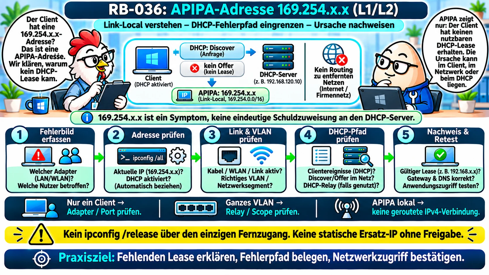

# RB-036 – Praxis-Runbook: APIPA-Adresse 169.254.x.x (L1/L2)

**Version:** 1.0 · **22.11.2026** · **Fachstatus:** recherchiert, **praktische Validierung offen**  
**Ziel:** Die Ursache eines APIPA-Zustands auf dem **betroffenen Adapter** identifizieren; erwartete IPv4-Konfiguration und ursprünglichen Zugriff verifizieren. Nicht allein „Internet geht“ als Lösung akzeptieren.



## 1. Ticket aufnehmen – Umfang eingrenzen

- [ ] Zeitpunkt, betroffener Benutzer/Host, betroffene Anwendung und Standort.
- [ ] **Betroffener Adapter:** Ethernet/WLAN/Dock; falls vorhanden InterfaceAlias und InterfaceIndex.
- [ ] Welche IP meldet `ipconfig /all`? **Autokonfigurations-IPv4-Adresse 169.254.x.x / 255.255.0.0?**
- [ ] Welche Soll-IP/Subnetz/VLAN/SSID laut Netzwerkdokumentation erwartet?
- [ ] Nur ein PC, ein Port, ein VLAN oder mehrere Standorte?
- [ ] Ist Fernzugriff über genau diesen Adapter die einzige Verbindung? Falls ja: **keine trennenden Eingriffe**.

## 2. Vorwissen und Ersthypothesen

- [ ] APIPA ist eine Link-Local-Adresse, **keine** gültige Ersatzadresse für das geplante routbare Firmennetz.
- [ ] Hypothese A: Client/Adapter/konfiguriertes DHCP.
- [ ] Hypothese B: Link, Kabel, WLAN-Zuordnung, Dock, VLAN oder NAC.
- [ ] Hypothese C: Relay/ACL/Scope/DHCP-Server oder Rückweg.
- [ ] Für jede Hypothese einen **trennenden Test** notieren.

## 3. Lesende Basisdiagnose (Windows 11)

```powershell
ipconfig /all
Get-NetAdapter | Select-Object Name,InterfaceIndex,Status,LinkSpeed
Get-NetIPInterface -AddressFamily IPv4 |
  Select-Object InterfaceAlias,InterfaceIndex,ConnectionState,Dhcp
Get-NetIPAddress -AddressFamily IPv4 |
  Select-Object InterfaceAlias,IPAddress,PrefixLength,PrefixOrigin,AddressState
Get-NetIPConfiguration
Get-NetRoute -AddressFamily IPv4 |
  Select-Object InterfaceAlias,DestinationPrefix,NextHop
Get-Service Dhcp
```

- [ ] DHCP für den **betroffenen Adapter** aktiviert?
- [ ] Adapter `Up`/WLAN assoziiert und im erwarteten Segment?
- [ ] Gibt es andere Interfaces mit routbarer IPv4, die eine Fehlinterpretation verursachen?
- [ ] 169.254/16 dokumentiert, **ohne** daraus vorschnell einen DHCP-Serverausfall zu folgern.

## 4. A/B-Vergleich und Reichweite

- [ ] Bekannter Vergleichsclient im **selben genehmigten Port/Netzsegment**.
- [ ] Betroffener Client an **freigegebenem** Vergleichsport (wenn sinnvoll).
- [ ] Betrifft es eine SSID, ein VLAN, mehrere VLANs oder nur den aktuellen Adapter?
- [ ] Dock/USB-Ethernet als eigenen Fehlerpfad prüfen.
- [ ] Kein ungenehmigtes Umstecken zwischen Sicherheitszonen.

| Befund | Arbeitshypothese |
|---|---|
| Ein Client APIPA, Vergleichsgeräte okay | Client/Adapter/MAC-/Port-/NAC-Zuordnung |
| Nur ein Port/Dock APIPA | Link/Portprofil/Dock |
| Ganzes VLAN APIPA | Relay/Scope/Netzfilter |
| Viele VLANs APIPA | zentrale DHCP-/Netzstörung |
| APIPA nur auf ungenutzter NIC | möglicher Befund ohne unmittelbare Nutzerwirkung |

## 5. DHCP-Ereignisprotokoll lesen

```powershell
Get-WinEvent -ListLog '*DHCP*' -ErrorAction SilentlyContinue |
  Select-Object LogName,IsEnabled,RecordCount
# Nur bei vorhandenem Kanal:
Get-WinEvent -LogName 'Microsoft-Windows-Dhcp-Client/Admin' -MaxEvents 30 |
  Select-Object TimeCreated,Id,Message
```

- [ ] Ereignisse mit **Zeitpunkt**, Adapter-ID und Fall verbinden; alte Meldungen nicht als neue Ursache ausgeben.
- [ ] Fehlt Kanal oder Zugriff: im Event Viewer prüfen; keinen Befund erfinden.

## 6. DHCP-Transaktion (L2, nur nach Freigabe)

**Typische DHCPv4-Neuvergabe:** Discover → Offer → Request → ACK. **APIPA beweist allein nicht, welches Paket fehlt.** Wireshark-Filter `dhcp` oder `udp.port == 67 || udp.port == 68`.

- [ ] Client sendet kein Discover → Captureort, Adapter-/DHCP-Clientzustand prüfen.
- [ ] Discover am Client, nicht am Relay/Server → VLAN/NAC/Snooping/ACL/Relay.
- [ ] Discover beim Server, kein Offer → Dienst/Scope/Policy/Bindung/Logs.
- [ ] Offer am Server, nicht am Client → Rückweg/Relay/Filter.
- [ ] ACK kommt am Client an, APIPA bleibt → Client-/Adressübernahme, Ereignisse, Konflikt.

**Sicherheitsgate:** Mitschnitt nur genehmigt, interne IP/MAC und Nutzerdaten vertraulich. Kein Paketmitschnitt ohne ordnungsgemäße Freigabe.

## 7. Korrekturpfad und Stoppschwellen

- [ ] L1: Nur genehmigte gerätespezifische Korrektur nach Befund.
- [ ] L2/Owner: DHCP-Konfiguration, VLAN, Relay, NAC, DHCP-Scope/Serverlog nach Zuständigkeit prüfen.
- [ ] **`ipconfig /release` oder `ipconfig /renew` ist ein aktiver Eingriff:** über einzigen Fernzugang nur mit Rückweg und Freigabe.
- [ ] Keine statische Ersatz-IP, kein ungeprüftes `netsh ... reset`, kein blindes DNS-Flush als „APIPA-Fix“.
- [ ] Keine Änderung an DHCP-/VLAN-/Security-Richtlinien ohne Change/Freigabe.

## 8. Funktionstest unter Originalbedingungen

- [ ] Erwartete dynamische IPv4-Adresse auf dem **richtigen Adapter**.
- [ ] Erwartetes Präfix, Gateway, DNS, DHCP-Server und Leasezeiten.
- [ ] Gateway und interne Ressource über **den korrigierten Netzpfad** erreichbar.
- [ ] Ursprüngliche Anwenderfunktion läuft; der Test lief nicht versehentlich über WLAN/VPN.
- [ ] Bei Bedarf weitere betroffene Clients desselben Segments vergleichen.

## 9. Eskalation und Ticketabschluss

**Übergabe an L2/Netzteam:** Problembeginn, Schaden/Umfang, Adapter, Soll-VLAN, `ipconfig /all`, IP-/Routingtabelle, DHCP-Events, A/B-Matrix, Packet Trace (wenn genehmigt), Fallhypothesen und Freigabe-/Change-Status. Intern speichern, öffentlich anonymisieren.

**Abschluss:** Beleg der Ursache oder begründete Einschränkung, konkrete Maßnahme/Owner, Vorher-/Nachher-Werte, tatsächlicher Anwendungstest und Anwenderbestätigung. Wenn Ursache nicht nachgewiesen: als **Workaround/ungeklärt** kennzeichnen, nicht als gesichert repariert.

## 10. Drei-Satz-Ticketkommentar (rein fiktiv)

> **Sachverhalt:** „Mehrere Clients in VLAN 120 erhielten statt einer IPv4-Adresse aus dem Sollnetz eine Autokonfigurationsadresse aus `169.254.0.0/16`.“  
> **Prüfung/Maßnahme:** „Der Vergleich zwischen Client- und Netzwerkaufzeichnung zeigte, dass DHCP-Anfragen das VLAN-Gateway erreichten, aber wegen eines fehlenden Relay-Eintrags nicht zum DHCP-Server gelangten; der Netzwerk-Owner stellte die freigegebene Konfiguration wieder her.“  
> **Erfolg:** „Die Clients erhielten Leases aus dem korrekten Scope; Standardgateway, DNS und die betroffene Anwendung wurden im ursprünglichen VLAN erfolgreich getestet.“

**Quellen:** [Q1–Q8] in `RB-036_Lernartikel.md`. **Keine reale Störung bearbeitet; Laborvalidierung steht aus.**
