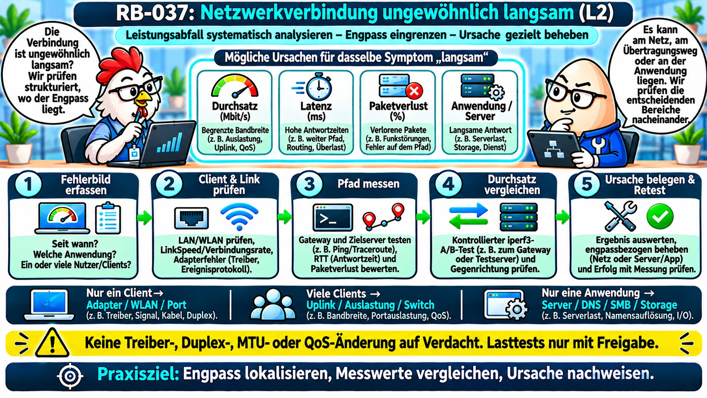

# RB-037 – Netzwerkverbindung ungewöhnlich langsam (L2)

**Projekt:** 50 Tickets – 50 typische Supportfälle  
**Bereich:** Windows 11 / TCP/IP / Ethernet & WLAN / Switching / WAN & VPN / SMB  
**Support-Level:** L2 · **Stand:** 22.11.2026 · **Version:** 1.0  
**Fachstatus:** Auf Grundlage offizieller Microsoft- und ESnet-Dokumentation recherchiert, fachlich ausgearbeitet, **nicht praktisch validiert**. Alle Fälle, Hostnamen, IP-Adressen und Zahlenwerte in Beispielen sind fiktiv.



> **Leitsatz:** „Langsam“ ist ein subjektives Symptom, keine festgestellte Netzwerkursache. Erst den betroffenen Dienst und die Messgröße definieren, dann Client, Pfad, Zielsystem und Anwendung kontrolliert vergleichen.

---

## 1. Störungsmeldung, Ziel und Zuständigkeit

**Typische Meldungen:** „Die Freigabe lädt heute ewig“, „Teams stockt nur über WLAN“, „Der Upload ins Firmen-VPN ist sehr langsam“, „Seit dem Arbeitsplatzwechsel dauern Datenbankabfragen zehn Sekunden“.

**Ziel:** Einen reproduzierbaren Leistungsabfall anhand von **Durchsatz, Antwortzeit, Paketverlust, Jitter** und **Anwendungszeit** eingrenzen. Die Korrektur erfolgt erst nach nachvollziehbarem Befund; die Anwendung muss anschließend unter vergleichbaren Bedingungen erneut getestet werden.

- **L1:** Störungsumfang, Zeitpunkt, betroffene Dienste, Vergleichsgeräte und erste lesende Messwerte aufnehmen.
- **L2:** Netzadapter-/Linkbefunde, RTT- und Verlustmessungen, kontrollierte Durchsatztests, Switch-/AP-/VPN-/WAN-Befunde und anwendungsspezifische Abhängigkeiten korrelieren.
- **Netzwerk-/Server-Owner:** Konfigurationsänderungen, QoS, WLAN-Kanalplanung, Firewall, Switchport, Treiber/Firmware oder Servermaßnahmen nur nach Zuständigkeit und Freigabe.

**Abgrenzung zu anderen Tickets:** RB-034 behandelt DNS-Auflösung, RB-035/036 DHCP/APIPA, RB-038 Servererreichbarkeit und RB-039 Dienst-/Porterreichbarkeit. **RB-037 setzt grundsätzlich vorhandene Konnektivität voraus und untersucht die Qualität der Verbindung beziehungsweise die wahrgenommene Leistung.**

## 2. Vier Größen, die man nicht verwechseln darf

| Begriff | Einheit | Aussage | Was er **nicht** beweist |
|---|---|---|---|
| **Durchsatz** | Mbit/s oder MB/s | Tatsächlich übertragene Daten pro Sekunde | Dass die Anwendung sofort reagiert |
| **RTT / Latenz** | ms | Zeit für Hin- und Rückweg eines Testpakets | Dass ein bestimmter Serverprozess langsam ist |
| **Paketverlust** | % | Anteil fehlender Antworten/Datagramme im gewählten Test | Unmittelbar den Ort oder Grund des Verlusts |
| **Jitter** | ms | Streuung der Verzögerung über die Zeit | Allein die Sprach-/Videoqualität |
| **Anwendungsreaktionszeit** | ms/s | Dauer eines vollständigen Nutzer- oder API-Vorgangs | Dass ausschließlich das Netzwerk verantwortlich ist |

**Umrechnung:** 1 Gbit/s = 1.000 Mbit/s (Netzwerkrate); 1 Byte = 8 Bit. Eine angezeigte **1-Gbit/s-Linkgeschwindigkeit** ist die *ausgehandelte Anschlussrate*, nicht der automatisch erreichbare Dateidurchsatz. Protokolloverhead, Laufzeiten, Server-CPU, Datenträger und Anwendung können die Nutzdatenrate verringern. [Q1, Q2]

**Beispiel (reine Rechenillustration):** 100 Mbit/s entsprechen theoretisch 12,5 MB/s vor Overhead; reale Transferraten können niedriger ausfallen. Eine Speedtest-Webseite misst zudem einen anderen Pfad als eine interne SMB-Freigabe.

## 3. Hypothesen statt Schnellreparatur

Vor jedem Eingriff mindestens drei konkurrierende Erklärungen notieren:

1. **Client/Access:** Der Laptop hat über Dock/Ethernet nur 100 Mbit/s ausgehandelt, WLAN-Signal ist schwach oder am Adapter steigen Discard-Zähler.
2. **Netzpfad:** Ein Uplink oder eine WAN-/VPN-Strecke ist ausgelastet; dort treten höhere RTT, Jitter oder Verlust auf.
3. **Server/Anwendung:** Der Pfad liefert ausreichenden Durchsatz, aber SMB, Antivirus/EDR, Datenbank oder Datenträger limitiert den Vorgang.

**Trennende Prüfung:** Gleicher Dienst von einem zweiten PC im gleichen Segment? Gleicher PC per LAN statt WLAN? Gleicher Client zu einem zweiten Ziel? Vergleich mit einem autorisierten internen iperf3-Server? Nur **eine Variable pro Test** ändern und Messergebnisse mit Uhrzeit festhalten.

## 4. Fehlerbild messbar machen und Scope festlegen

**Ticketaufnahme:**

- Seit wann, dauerhaft oder sporadisch, nur zu Stoßzeiten? Tritt es nach Update, Umzug, Dockwechsel, VPN-Verbindung oder WLAN-Wechsel auf?
- Welcher **konkrete Dienst** ist langsam (SMB-Kopie, Browseraufruf, RDP, Videokonferenz, SAP, interne API)?
- Upload, Download, interaktiver Login oder Wartezeit pro Aktion? Datenvolumen, Zahl kleiner Dateien, Nutzergruppe?
- Ein Gerät, ein Büro, eine SSID, ein VLAN, ein Standort oder alle Nutzer?
- Getrennte Baselines für **LAN/WLAN**, **mit/ohne VPN**, **Ziel A/Ziel B**; Betriebszeit und Testumgebung notieren.
- Verbindungsart und exakter Pfad: Client → Dock/Port/WLAN-AP → Switch → Router/Firewall → VPN/WAN → Zielserver/Cloud.
- Freigaben für zusätzliche Messlast, Zugang zu Vergleichssystemen und Wartungsfenster klären.

**Gute Messnotiz:** „22.11.2026 10:40, Testdatei *fiktiv* 1 GiB, Client A über Ethernet / VPN aus, 14 MB/s; Client B am selben Netz 93 MB/s; Datei, Zielserver und zeitlicher Testzeitraum vergleichbar.“ Nicht aus isolierten Werten vorschnell auf Fehler schließen.

## 5. Messplan: Baseline, Vergleich, Reproduzierbarkeit

Eine aussagekräftige Netzwerkdiagnose benötigt Vergleichswerte mit gleicher Methode und möglichst gleichen Bedingungen. Microsoft empfiehlt explizit **Baselines** für Durchsatz und Netzwerkpfade. [Q1]

| Vergleich | Hält konstant | Geändert | Wofür hilfreich? |
|---|---|---|---|
| Betroffener PC ↔ Vergleichs-PC | Zielserver / Netz / Zeit | Client | Client-/NIC-Problem eingrenzen |
| LAN ↔ WLAN | gleicher PC und Ziel | Zugangspfad | WLAN-/AP-/Funkfaktoren erkennen |
| VPN aus ↔ VPN an | gleicher PC und Dienst (sofern erreichbar) | Tunnel/Pfad | VPN-/WAN-Overhead und Routing unterscheiden |
| Service A ↔ Service B | gleicher Client / möglichst gleicher Pfad | Ziel/Anwendung | Einzeldienst-/Serverproblem erkennen |
| TCP-Durchsatz ↔ Dateiübertragung | gleiche Endpunkte | Protokoll/Datenträger | Netzkapazität von SMB/Storage abgrenzen |

**Achtung:** Eine öffentliche Internet-Speedtestseite, ein Testserver im LAN und ein SMB-Ziel hinter einer Firewall sind drei **unterschiedliche Pfade**. Ergebnisse dürfen nicht ohne Normalisierung gleichgesetzt werden.

## 6. Lesende Windows-11-Basisdiagnose

Folgende Abfragen sind **lesend**; sie setzen keine IP-Adresse zurück und verändern keine Adaptereinstellungen. Administrative Leserechte können je nach Unternehmen nötig sein. [Q3, Q4]

```powershell
# Adapterstatus, ausgehandelte Rate und Fehlerzähler
Get-NetAdapter |
  Select-Object Name, InterfaceDescription, Status, LinkSpeed, MacAddress
Get-NetAdapterStatistics -Name 'Ethernet' | Format-List *

# IP/Interface/Routen und laufende Verbindungen
Get-NetIPConfiguration
Get-NetRoute -AddressFamily IPv4 |
  Select-Object InterfaceAlias, DestinationPrefix, NextHop, RouteMetric
Get-NetTCPConnection -State Established |
  Select-Object -First 20 LocalAddress,LocalPort,RemoteAddress,RemotePort,State

# WLAN-spezifischer Linkzustand (nur wenn verbunden)
netsh wlan show interfaces
```

**Interpretation:**

- `LinkSpeed` = **ausgehandelte** Geschwindigkeit (z. B. 100 Mbit/s vs. erwartet 1 Gbit/s); niemals unmittelbar mit Nutzdatendurchsatz verwechseln.
- Bei `Get-NetAdapterStatistics` **Delta** zwischen zwei zeitnahen Messungen bilden; hohe absolute historische Zählerwerte ohne Zeitbezug sind kein aktueller Beweis. Microsoft nennt verworfene NIC-Pakete als einen Diagnosehinweis. [Q3]
- Bei WLAN sind **Sende-/Empfangsrate** Funkverbindungsraten, nicht erzielbarer TCP-Durchsatz; Signal, Airtime, Kanalbelegung, Störungen, Roaming und AP-Auslastung prüfen.
- Zunächst den **aktiven** Adapter und das **effektiv genutzte** Routing bestimmen, besonders bei VPN/virtuellen Adaptern.
- Keine Link-Speed-, Offload-, Duplex-, MTU- oder Energiespareinstellung „auf Verdacht“ ändern.

## 7. Latenz und Verlust: Tests richtig lesen

```powershell
# Beispieladressen müssen durch ausdrücklich freigegebene Ziele ersetzt werden
ping -n 30 192.0.2.1              # Beispiel: freigegebener Default-Gateway-Test
ping -n 30 198.51.100.20         # Beispiel: freigegebener Zielhost
tracert 198.51.100.20            # Routenhinweis, keine sichere Engpasslokalisierung
pathping 198.51.100.20           # längerer, ICMP-basierter Verlustvergleich
Test-NetConnection -ComputerName 198.51.100.20 -Port 445 -InformationLevel Detailed
```

`192.0.2.0/24` und `198.51.100.0/24` sind **Dokumentationsnetze**; die Beispieladressen sind nicht als reale Messziele verwendbar. [Q4]

**Vorsicht bei der Auswertung:**

- `ping` misst ICMP-Antworten. **Kein** ICMP-Echo beweist nicht, dass TCP/SMB oder der Server ausgefallen ist; ICMP kann bewusst gefiltert/ratenbegrenzt werden.
- Ein Hop mit hoher `tracert`-/`pathping`-Verzögerung oder „Verlust“ **nur an diesem Hop** kann durch reduzierte ICMP-Antwortpriorität entstehen. Erst ein **fortbestehender Effekt bis zum eigentlichen Ziel**, unter vergleichbaren Bedingungen, ist relevanter – auch dann nicht automatisch ein Ortsbeweis.
- Ein erfolgreiches `Test-NetConnection ... -Port 445` belegt die TCP-Erreichbarkeit **zu diesem Zeitpunkt**, nicht hohe SMB-Performance. [Q4]
- Wiederholte Stichproben, Auslastungszeitpunkt und Protokollklasse dokumentieren. Ein Test ohne Anwendungsreproduktion ist bestenfalls ein Teilbefund.

## 8. Kontrollierte Durchsatzmessung mit iperf3 (nur freigegeben)

**Warum iperf3?** Ein isolierter TCP-Durchsatztest gegen einen kontrollierten Vergleichsserver lässt sich besser von Festplatten- und SMB-Protokollfaktoren trennen. Die Projektbeschreibung und Optionen stammen von ESnet. iperf3 ist **zusätzliche Testsoftware**, nicht standardmäßig Teil von Windows; Deployment und Firewalleintrag erfordern Berechtigung. [Q5]

```text
# Auf genehmigtem internen Testserver (Befehl nur nach Freigabe ausführen)
iperf3 -s -p 5201

# Auf autorisiertem Client (TESTSERVER = freigegebene Hostadresse)
iperf3 -c TESTSERVER -p 5201 -t 10     # Client sendet an Server
iperf3 -c TESTSERVER -p 5201 -t 10 -R  # umgekehrte Richtung
```

**Einsatzbedingungen:** Tests erzeugen messbare Netzlast. Nicht ungefragt Produktions-WANs, Internetserver oder geschäftskritische Links sättigen. Bei Bedarf **vorab** Testfenster, Verkehrsgrenze, Ziel, Richtung und Dauer mit dem Owner abstimmen; Überwachungsdaten einbeziehen. Standard-TCP-Tests versuchen gewöhnlich verfügbaren Durchsatz auszunutzen; wer eine **begrenzte Last** braucht, muss dies bewusst konfigurieren und freigeben.

**Auswertung:** Vergleich Send/Receive, gleicher Testzeitpunkt, Endgeräte-CPU, Testserverkapazität, VPN-Zustand, NIC-Rate. `-R` prüft die Gegenrichtung; `-P` erzeugt zusätzliche parallele Streams und darf ein Ergebnis nicht künstlich als „repariert“ erscheinen lassen. iperf3 misst keinen vollständigen Office-/SMB-Nutzerprozess. [Q5]

**Keine falsche Aussage:** Ein normaler iperf3-Wert beweist nicht, dass ein bestimmter Server oder eine Anwendung korrekt arbeitet. Und ein schlechter iperf3-Wert beweist allein nicht, an welchem Hop die Ursache liegt.

## 9. Paketverlust, TCP-Retransmits und Ursachenketten

Microsoft unterscheidet lokalen Paketverlust (z. B. Ressourcenmangel, Filter, NIC) von Remoteverlusten und empfiehlt für Verdachtsfälle eine **korrelierte Untersuchung** von NIC-Countern und bei Bedarf Ablaufverfolgungen. [Q3]

**Beispielhafte Fehlerkette:** fehlerhafter Port/Kabel → Layer-2-Übertragungsfehler oder Drops → TCP-Wiederholungen und reduziertes Sendefenster → niedriger Durchsatz → langsamer SMB-Kopiervorgang. **Das ist eine Hypothese**, keine allgemeingültige Kausalkette.

Bei Bedarf in L2/L3 zusätzlich prüfen: Switchport-Fehler- und Drop-Counter; Duplex-/Speed-Mismatch; QoS-Queue-Drops, WAN-Uplink, VPN-Encapsulation/MTU, Firewall-CPU, AP-Roaming, Funkkanalbelegung, NIC-Treiber und Ressourcenlast. Immer Vergleich **vor/nach** einer gezielten Maßnahme.

**Paketanalyse ist nicht immer neutral:** Zeitgleiche Paketaufzeichnung kann Durchsatzmessungen beeinflussen. Für maximale Netto-Durchsatzmessung empfiehlt Microsoft, auf aufwendiges Paket-Capture während des Tests zu verzichten; Capture und Lasttest deshalb nach Möglichkeit zeitlich trennen. [Q1]

## 10. SMB-/Server-/Anwendungsengpässe abgrenzen

Microsoft weist darauf hin, dass langsame SMB-Kopien neben Netzproblemen durch **viele kleine Dateien, Datenträger-IO, Antivirus/EDR, CPU-Last, Cacheeffekte, SMB-Signierung/-Verschlüsselung** oder serverseitige Limits entstehen können. Sicherheitsfeatures wie SMB-Signierung **nicht** zur Beschleunigung deaktivieren. [Q2]

```powershell
# Lesende SMB-Clientbefunde, falls eine Freigabe tatsächlich verwendet wird
Get-SmbConnection |
  Select-Object ServerName,ShareName,Dialect,NumOpens,Signed,Encrypted
Get-SmbMultichannelConnection -ErrorAction SilentlyContinue |
  Select-Object ServerName,ClientInterfaceIndex,ServerInterfaceIndex,Selected

# Zeitgleiche Ressourcenbeobachtung (lesend)
Get-Process | Sort-Object CPU -Descending |
  Select-Object -First 12 ProcessName,Id,CPU
```

**Fallvergleich:** Netztest schnell + SMB-Kopie langsam → SMB/Server/Storage als **Arbeits-Hypothese**, erst durch Server- und Anwendungsdaten erhärten. Ein großer zusammenhängender Dateitransfer ist nicht gleichzusetzen mit Tausenden kleinen Dateien; auch die Messmethode beeinflusst den Wert.

**Datenschutz und Produktivsicherheit:** Keine Kundendateien als Testdaten kopieren, keine Antivirus-/EDR-Filter abschalten, keine SMB-Signierung umgehen, keine größeren Produktionslasten ohne Freigabe.

## 11. Entscheidungsmatrix – Befund, Hypothese, nächster Test

| Befund | Wahrscheinlichere Fehlerdomäne | Nächster trennender Test |
|---|---|---|
| Nur ein Client langsam; Vergleichsgerät am selben Netz normal | Client/NIC/Dock/WLAN | Originalgerät an freigegebenem Vergleichsport, Counter-Delta |
| Nur WLAN betroffen; LAN zum selben Ziel gut | Funk-/AP-Pfad | Signal/AP/Kanal/Airtime, zweite SSID/Position |
| Viele Clients eines Segments langsam | Switch/Uplink/Firewall/QoS | Port-/Uplink-Counter und Auslastung zur Störzeit |
| Nur über VPN langsam | Tunnel/WAN/MTU/Firewall/Internetpfad | gleiches Ziel ohne/mit VPN, Route und Lastvergleich |
| RTT/Verlust schlecht bis zum Ziel | Netzwerkpfad oder Zielreaktion | alternative Route/Ziel, Endpunktbefunde und Zähler korrelieren |
| iperf3 normal, SMB langsam | Server/Storage/SMB/EDR | Server-CPU, Storage-I/O, SMB-Counter und Dateityp |
| Nur eine App langsam, übrige Dienste normal | App, Backend, DNS, API, DB | End-to-End-Transaktionszeit, Serverlogs, DNS-Zeit |
| Durchsatz nur in eine Richtung schwach | asymmetrischer Pfad/Host/Policy | iperf3-Hin- und Rückrichtung, NIC-/Interface-/Uplink-Zähler |

„Wahrscheinlichere Fehlerdomäne“ heißt **noch nicht Ursache bewiesen**. Vergleichsbedingungen, Zeitbezug und Gegenhypothesen im Ticket festhalten.

## 12. Sicherheitsgate, abgestufte Lösung und Retest

**Vor Konfigurationsänderungen:**

1. Störung reproduziert? Vergleich/Quelle/Ziel/Uhrzeit dokumentiert? Fehlermetrik definiert?
2. Effektive Administrationsroute bekannt? Bei einzigem Fernzugang keine trennende Adaptermaßnahme ohne Rettungsweg.
3. Verantwortlichen Owner, Freigabe, Wartungsfenster, Rückfallplan, Monitoring und Datenschutz geklärt?
4. Zuerst **kleinstmögliche** ursachenbezogene Maßnahme (defektes zertifiziertes Kabel/Port, freigegebener AP-Kanalplan, Kapazitätsanpassung, Server-I/O-Behebung).
5. Erneut mit **gleicher Testmethode** messen: Problemvorgang, Richtung, Lastzeitfenster, Vergleichsgerät und Baseline.

**Nicht als Erstmaßnahme:** NIC-/Netzwerktreiber neu installieren, MTU/Jumbo Frames ändern, Duplex hart festlegen, RSS/Offloads abschalten, QoS deaktivieren, VPN/EDR/Firewall ausschalten oder Internet-Speedtests massenhaft wiederholen.

**Abnahme:** Ursache durch Vorher-/Nachher-Befund plausibel belegt; Sollwert oder dokumentierte Baseline unter vergleichbaren Bedingungen erreicht; betroffene Anwendung funktioniert zuverlässig; Sicherheits- und Betriebsanforderungen weiterhin erfüllt.

## 13. Zwei fiktive Praxisfälle (keine realen Messergebnisse)

### Fall A – „Dateiserver langsam“ bei nur einem Client

- **Störungsmeldung:** Nur Notebook A kopiert eine fiktive 1-GiB-Datei aus einem Share ungewöhnlich langsam.
- **Messhypothese 1:** Netzwerkpfad oder Server ist überlastet.
- **Gegenbefund:** Notebook B im selben VLAN kopiert dieselbe Art Testdatei am gleichen Server deutlich schneller; auf Notebook A wird eine unerwartete 100-Mbit/s-Linkrate angezeigt.
- **Folgerung:** Client-/Port-/Dock-/Kabelpfad priorisieren, nicht sofort den Server beschuldigen. Mit freigegebenem Vergleichskabel und Port testen, NIC- und Switchcounter korrelieren.
- **Fiktiver Abschluss:** Nach nachgewiesen fehlerhaftem Patchkabel und autorisiertem Austausch verhandelt der Anschluss die erwartete Rate; identischer Dateitest zeigt wieder Baselinebereich.
- **Transferfrage:** Warum ist die 100-Mbit/s-Anzeige ein Hinweis auf einen Engpass, aber noch kein Nachweis für den Kabeldefekt?

### Fall B – „Netzwerk langsam“ trotz normalem Durchsatztest

- **Störungsmeldung:** 12 Mitarbeitende beklagen, dass das Öffnen vieler kleiner Projektdateien vom SMB-Server zu lange dauert.
- **Gegenbefund:** Kontrollierter iperf3-Test zwischen genehmigten Endpunkten erreicht die dokumentierte Baseline; RTT und Verlust unauffällig. CPU-/Storage-Monitoring am Dateiserver zeigt in der Störzeit hohe E/A-Wartezeiten.
- **Folgerung:** Nicht mit einer NIC-Treibermodifikation reagieren. Server-/Storage-/SMB-Pfad prüfen, Dateistruktur und Antivirus/EDR-Betrieb mit zuständigen Teams betrachten.
- **Fiktiver Abschluss:** Nach autorisierter Behebung des Storage-Engpasses sinkt die Anwendungszeit; ein wiederholter realitätsnaher Dateitest bestätigt die Wirkung.
- **Transferfrage:** Welchen Teil der Diagnose kann iperf3 hier gut abgrenzen, welchen gerade nicht?

## 14. Active Recall, Self-Explanation und Diagnosetransfer

**Wissensfragen (ohne Nachschlagen beantworten):**

1. Worin unterscheiden sich Bandbreite/LinkSpeed und gemessener Durchsatz?
2. Warum belegt ein erfolgreicher TCP-Porttest keine gute Performance?
3. Was misst RTT und warum ist eine einzelne Messung schwach?
4. Was ist die Aufgabe von `Get-NetAdapterStatistics`?
5. Warum sind 100 MB/s ≠ 100 Mbit/s?

**Verständnis-/Diagnosefragen:**

6. Welchen A/B-Test würdest du wählen, wenn nur WLAN im Besprechungsraum langsam ist?
7. Warum ist ICMP-Verlust an einem einzigen Traceroute-Hop nicht automatisch echter Forwarding-Verlust?
8. Welche Beweisführung trennt einen SMB-/Storage-Engpass von einem langsamen Netzwerkpfad?
9. Wie stellst du sicher, dass Messungen vor und nach einer Maßnahme vergleichbar bleiben?
10. Ein VPN-User meldet hohe Latenz, nur zu Stoßzeiten. Nenne drei konkurrierende Hypothesen und je einen trennenden Test.

**Self-Explanation:** „Warum ist der Satz *‚Unser Netz ist langsam, also muss die Firewall schuld sein‘* keine belastbare Diagnose?“ Als kurze fachlich präzise Ticketnotiz formulieren.

**Wiederholung:** optional Anki-Karten nach eigenem Lernabschluss; nach etwa 7 und 21 Tagen neue, nicht identische Diagnosefälle bearbeiten. Keine praktische Lösung vor dem eigenen ersten Diagnoseversuch offenlegen, wenn dies das Lernziel ist.

## 15. Quellen, Grenzen und Validierungsplan

**Offizielle Quellen, am 22.11.2026 recherchiert:**

- **[Q1] Microsoft Learn – Handbuch zur Problembehandlung bei TCP/IP-Leistungsproblemen.** Baselines, End-to-End-Durchsatz, TCP-Engpässe und Kosten der Paketaufzeichnung: https://learn.microsoft.com/de-de/troubleshoot/windows-server/networking/overview-of-tcpip-performance
- **[Q2] Microsoft Learn – Langsame Dateiübertragungsgeschwindigkeit bei SMB.** SMB, Storage, kleine Dateien, Sicherheitsfunktionen: https://learn.microsoft.com/de-de/troubleshoot/windows-server/networking/slow-smb-file-transfer
- **[Q3] Microsoft Learn – Diagnostizieren von Paketverlusten.** NIC-Drops, lokale/Remote-Verluste: https://learn.microsoft.com/de-de/troubleshoot/windows-client/networking/diagnose-packet-loss
- **[Q4] Microsoft Learn – Test-NetConnection / Get-NetAdapterStatistics.** Windows-Diagnose-Cmdlets: https://learn.microsoft.com/en-us/powershell/module/nettcpip/test-netconnection?view=windowsserver2025-ps und https://learn.microsoft.com/en-us/powershell/module/netadapter/get-netadapterstatistics?view=windowsserver2025-ps
- **[Q5] ESnet – iperf3, Aufruf und Optionen.** TCP-Durchsatz, Richtung, kontrollierte Tests: https://software.es.net/iperf/invoking.html
- **[Q6] Microsoft Learn – Netzwerkadapter-Tuning.** NIC-Leistungsoptionen und Tradeoffs: https://learn.microsoft.com/de-de/windows-server/networking/technologies/network-subsystem/net-sub-performance-tuning-nics

**Beweisstatus:** Alle Diagnosehinweise sind recherchiert oder als Hypothesen gekennzeichnet. **Keine** der dargestellten Reparaturen wurde am realen Problemgerät ausgeführt, keine Messwerte stammen aus einem tatsächlichen Versuch.

**Vorgeschlagener Praxisversuch für später:** Zwei autorisierte Testsysteme und ein kontrollierter Switch-/WLAN-Pfad; einmal Baseline messen, anschließend in einer **isolierten** Umgebung bewusst einen reproduzierbaren Flaschenhals konfigurieren, Befundaufnahme, Diagnose, ursachenbezogene Behebung und erneuten Test dokumentieren. Änderungen in einem produktiven Unternehmensnetz nicht nachstellen.

**Bildnachweis:** Eigene Konzeption, KI-gestützte Visualisierung mit ChatGPT.
