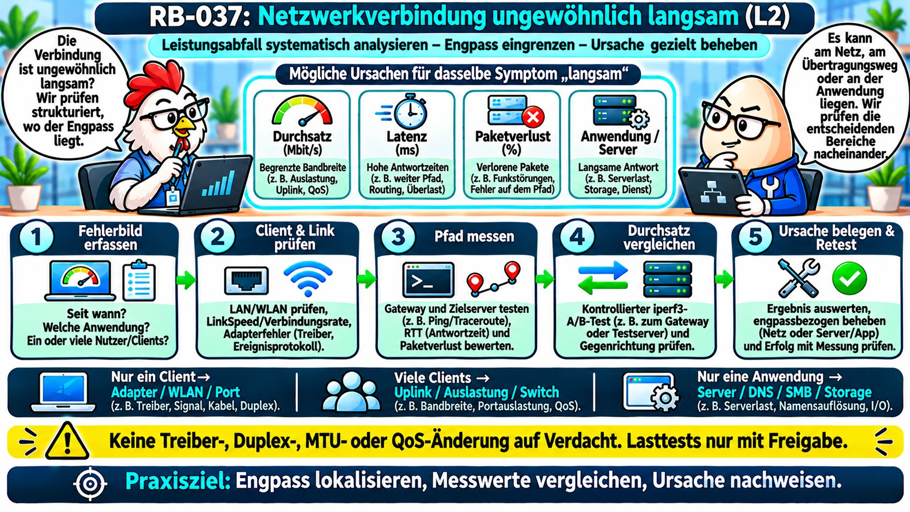

# RB-037 – Praxis-Runbook: Netzwerkverbindung ungewöhnlich langsam (L2)

**Version:** 1.0 · **Stand:** 22.11.2026 · **Fachstatus:** recherchiert, **nicht praktisch validiert**  
**Ziel:** Langsame Netzwerk- oder Anwendungsleistung messbar machen, Client/Access/Transport/Server voneinander trennen, ursachenbezogen korrigieren und die Wiederherstellung reproduzierbar bestätigen.



## 1. Ticket aufnehmen: Symptom, Reichweite und Sollzustand

- [ ] **Was ist langsam?** SMB-Kopie, Webanwendung, VPN, RDP, Video, nur Upload oder nur Download?
- [ ] **Seit wann?** Dauerhaft, intermittierend oder nur unter Auslastung? Letzte Änderung?
- [ ] **Wer ist betroffen?** Einzelgerät, Port, SSID, VLAN, Standort oder ganze Organisation?
- [ ] **Pfad:** Client → Ethernet/Dock/WLAN → Switch/AP → Router/Firewall/VPN → Dienst.
- [ ] Erwartung/Baseline sowie ein reproduzierbarer **Anwendungsvorgang** mit Uhrzeit dokumentieren.
- [ ] Fernzugang/Produktivsystem? Vor trennenden Änderungen Rückweg und Owner klären.

## 2. Messgrößen und erste Hypothesen

- [ ] Gemessener Nutzdatendurchsatz (Mbit/s, Richtung, Zeitraum).
- [ ] RTT in ms (Quelle/Ziel), ggf. Jitter und tatsächlicher Endpunktverlust.
- [ ] Anwendungszeit, CPU/RAM/Storage des Zielsystems falls verfügbar.
- [ ] Hypothese A Client/Link; B Transport/Netzpfad; C Server/Anwendung.
- [ ] Für jede Hypothese einen **trennenden A/B-Test** festlegen.

## 3. Windows-Basisdiagnose – nur lesen

```powershell
Get-NetAdapter |
  Select-Object Name,InterfaceDescription,Status,LinkSpeed
Get-NetAdapterStatistics -Name 'Ethernet' | Format-List *
Get-NetIPConfiguration
Get-NetRoute -AddressFamily IPv4 |
  Select-Object InterfaceAlias,DestinationPrefix,NextHop,RouteMetric
netsh wlan show interfaces
```

**Interpretation:** `LinkSpeed` ≠ tatsächlicher Nutzdatendurchsatz; NIC-Counter als **Delta** zur Testzeit betrachten, nicht nur absolute Gesamtwerte. Die Befehle setzen keine Netzwerkeinstellung zurück. Ggf. Adaptername anpassen; WLAN-Befehl ist auf Ethernet-only-Systemen nicht aussagekräftig. [Q3,Q4]

## 4. Vergleichsprüfung: Eine Variable ändern

| A/B-Test | Ergebnis | Priorisierte Fehlerdomäne |
|---|---|---|
| Zweiter Client, gleiches VLAN/Ziel | Nur erster langsam | Client/NIC/Dock/Port |
| Gleicher Client LAN ↔ WLAN | Nur WLAN langsam | Funk/SSID/AP |
| Gleiches Ziel mit/ohne VPN | Nur VPN langsam | VPN/WAN/Tunnelpfad |
| Gleicher Client anderer Server | Nur ein Server langsam | Ziel-/Anwendungspfad |
| Mehrere Clients im gleichen Segment langsam | Gemeinsame Störung | Access/Uplink/Firewall/Service |

**Nicht** unterschiedliche Pfade/Zeiträume wie identische Messbedingungen behandeln.

## 5. RTT, Paketverlust und TCP-Portfunktion prüfen

```powershell
# Fiktive TEST-NET-Adressen durch tatsächlich genehmigte Ziele ersetzen!
ping -n 30 192.0.2.1
ping -n 30 198.51.100.20
tracert 198.51.100.20
pathping 198.51.100.20
Test-NetConnection -ComputerName 198.51.100.20 -Port 445 -InformationLevel Detailed
```

- [ ] Auf den **Endpunkt** und auf **vergleichbare Testzeitpunkte** achten.
- [ ] ICMP-Firewall/Rate-Limit kann „Verlust“ vortäuschen; Hop-Antwort allein kein Ortsnachweis.
- [ ] Ein offener Port belegt **Erreichbarkeit**, nicht guten Durchsatz.
- [ ] Werte im Ticket mit Quell-/Zieladresse und Uhrzeit festhalten.

## 6. Kontrollierter Durchsatztest (L2, nur freigegeben)

```text
# Freigegebener interner Testserver:
iperf3 -s -p 5201
# Freigegebener Client:
iperf3 -c TESTSERVER -p 5201 -t 10
iperf3 -c TESTSERVER -p 5201 -t 10 -R
```

- [ ] iperf3 ist Zusatzsoftware, kein Windows-Standardbefehl. Installation/Firewallfreigabe durch Owner.
- [ ] Vorher Lastgrenze/Zeitraum/VPN-Pfad und Testserverkapazität klären.
- [ ] Hin- und Gegenrichtung getrennt bewerten; CPU- und NIC-Auslastung beobachten.
- [ ] Kein ungebremster Massentest über kritischen WAN-/VPN-Uplink.
- [ ] iperf3 nicht mit einem SMB-Datei- oder Web-Anwendungstest gleichsetzen.

## 7. Befunde verzweigen und sichere Maßnahme wählen

| Befund | Nächster Prüfpunkt | Maßnahme nur nach Beleg/Freigabe |
|---|---|---|
| Einzelgerät + unerwartete Linkrate | Kabel, Dock, Port, Switchcounter | Defektes Teil gezielt tauschen |
| WLAN-only langsam | Signal, Airtime, Interferenzen, AP-Last | WLAN-Planung/Standort/Fehlerbehebung |
| Viele Clients langsam | Uplink-Last, Queue-Drops, QoS, Firewall | Engpass-/Kapazitätsmaßnahme |
| VPN-only langsam | Pfad, Tunnel, MTU, Bandbreite | VPN-/WAN-Ursache bearbeiten |
| iperf3 normal, SMB langsam | Server-Storage, SMB, AV/EDR | Server-/Applikationsowner einbinden |
| Eine Anwendung langsam | Backend, DNS/DB, API | App-/Serverlog und Transaktionszeit |

**Verbotene Schnellschlüsse:** Kein pauschales MTU-, Duplex-, Treiber-, Offload-, QoS-, Firewall-, EDR- oder SMB-Signierungs-Tuning.

## 8. Erfolgskontrolle unter Originalbedingungen

- [ ] Ursache aus Vorher-Befund und kontrolliertem Vergleich plausibel hergeleitet?
- [ ] Gleiches Endgerät, Ziel, Methode, Richtung, Zeitfenster und vergleichbare Last?
- [ ] Anwendungsproblem **wirklich** behoben (nicht nur Ping besser)?
- [ ] Sicherheits-/Betriebsrichtlinien unverändert; keine unbeabsichtigte Nebenwirkung?
- [ ] Messwerte/Beweismittel, Ursache und Freigabe im Ticket; Anwenderbestätigung.

## 9. Eskalation / Übergabedaten

Bei fehlendem Zugriff auf Switch, Firewall, AP, VPN, Server oder Testsysteme zuständigen Owner hinzuziehen. **Liefern:** Ticket-ID; Betroffenheit; Quelle/Ziel; Dienst/Port; Lastzeit; A/B-Tabelle; RTT/Verlust; NIC-/Switch-Counter-Deltas; iperf3-Resultate (wenn freigegeben); Server-/Storage-Indizien; Sicherheitsgate und bisherige Maßnahmen.

**Keine** unautorisierten Netzwerktraces von Nutzdaten oder nicht benötigten personenbezogenen Informationen; Diagnosedaten geschützt ablegen.

## 10. Muster-Ticketkommentar (fiktiv) / Lernerfolg

> **Befund:** Nur der Beispielclient A zeigte beim Kopieren vom Fileserver reduzierte Leistung; das Vergleichssystem im selben VLAN war unauffällig. **Eingrenzung:** Die betroffene Ethernet-Verbindung handelte unerwartet 100 Mbit/s aus; nach freigegebenem Kabelvergleich war der Fehler reproduzierbar auf den Anschlussweg begrenzt. **Ergebnis:** Nach autorisiertem Austausch wurde die erwartete Rate ausgehandelt und die Anwendung unter gleichen Testbedingungen erneut erfolgreich geprüft.

**Lernkontrolle:** Was unterscheidet `LinkSpeed`, `iperf3`-TCP-Durchsatz, RTT und die Zeit für eine SMB-Kopie? Formuliere je einen Test, der zwei konkurrierende Ursachen voneinander trennt.

**Quellen:** [Q1] https://learn.microsoft.com/de-de/troubleshoot/windows-server/networking/overview-of-tcpip-performance · [Q2] https://learn.microsoft.com/de-de/troubleshoot/windows-server/networking/slow-smb-file-transfer · [Q3] https://learn.microsoft.com/de-de/troubleshoot/windows-client/networking/diagnose-packet-loss · [Q4] https://learn.microsoft.com/en-us/powershell/module/netadapter/get-netadapterstatistics?view=windowsserver2025-ps · [Q5] https://software.es.net/iperf/invoking.html
