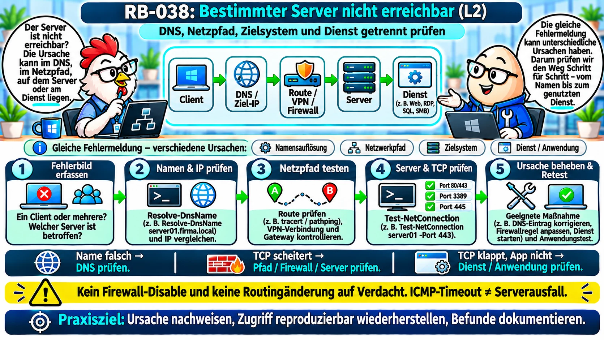

# RB-038 – Bestimmter Server nicht erreichbar (L2)

**Projekt:** 50 Tickets – 50 typische Supportfälle  
**Bereich:** Netzwerkdiagnose / Windows 11 / Windows Server / DNS / Routing / Firewall / VPN  
**Level:** L2 · **Stand:** 22.11.2026 · **Version:** 1.0  
**Fachstatus:** Offizielle Microsoft-Quellen recherchiert; **nicht praktisch validiert**. Beispiele, IP-Adressen, Uhrzeiten, Ergebnisse und Tickettexte sind ausdrücklich fiktiv.



> **Leitsatz:** „Server nicht erreichbar“ ist eine Anwenderbeschreibung. Ein fehlerhafter DNS-Eintrag, ein anderer Netzwerkpfad, eine Filterregel, ein ausgeschalteter Server oder eine gestörte Anwendung können denselben Eindruck erzeugen. Erst die Schicht und den Ausfallbereich isolieren, dann eingreifen.

---

## 1. Ticket-Szenario, Ziel und Abgrenzung

**Typische Meldung:** „Seit dem Standortwechsel komme ich nicht mehr auf `fileserver01.firma.example`; meine Kollegin schon.“ Ein anderer Nutzer meldet hingegen: „Seit 09:20 erreicht niemand mehr den internen App-Server.“

**Lernziel:** Eigenständig und nachvollziehbar feststellen, ob der Fehler bei **Namensauflösung, Client/IP-Konfiguration, Layer-3-Pfad, VPN/Firewall, Zielsystem oder Dienst** liegt. Ein erfolgreicher Test soll den *tatsächlich benötigten Zugriff* nachweisen, nicht nur eine Ping-Antwort.

- **L1:** Benutzer/Standort/Zeit, betroffenen Namen, Fehlermeldung, Zugriffsart und Auswirkungen erfassen; Standardtests ohne Änderung durchführen.
- **L2:** DNS, IPv4/IPv6, Routing und TCP von mehreren Quellen vergleichen; Befunde mit Netzwerk-, Server- und Firewall-Teams korrelieren.
- **Owner:** DNS-/Firewall-/Routing- oder Serverkonfiguration nur auf Basis eines bestätigten Befunds und mit autorisierter Freigabe ändern.

**Abgrenzung:** RB-034 = DNS-Problem als Hauptfall; RB-035/036 = DHCP/APIPA; RB-037 = zu geringe Performance; **RB-038 = End-to-End-Erreichbarkeit eines bestimmten Servers**; RB-039 vertieft anschließend einzelne TCP-Ports und Dienste.

## 2. Das Schichtenmodell als Diagnosekarte

| Abschnitt | Typische Voraussetzung | Prüffrage | Beispielbefund |
|---|---|---|---|
| Anwendung | gültiger URL-/UNC-/RDP-Pfad, Berechtigung, funktionsfähiger Dienst | Funktioniert der echte Arbeitsvorgang? | Browser zeigt HTTP 503 trotz offenem TCP-Port |
| Transport | TCP-Zielport erreichbar, Rückweg vorhanden | Kann ein TCP-Handshake hergestellt werden? | `TcpTestSucceeded: False` für 443 |
| Netzwerk | passende IP-Adresse, Source-Route, Gateway, VPN, Firewall | Gibt es einen zulässigen Hin- und Rückweg? | Nur Subnetz A betroffen |
| DNS | korrekte A-/AAAA-Auflösung im richtigen Netz | Zeigt der Name auf die beabsichtigte Adresse? | veralteter A-Record |
| Endsystem | Server/VM online, NIC aktiv, Service bereit | Ist Zielsystem aus dem richtigen Segment erreichbar? | VM aus oder Dienst gestoppt |

**Wichtig:** Diese Abschnitte sind diagnostisch miteinander verknüpft, aber nicht identisch. Ein erreichbares Gateway beweist **nicht** die Servererreichbarkeit. Eine korrekte DNS-Antwort beweist **nicht** die IP-/TCP-Erreichbarkeit. Ein erfolgreicher TCP-Test beweist **nicht** die korrekte Anwendung oder Zugriffsberechtigung. [Q1–Q3]

## 3. Fehlerbild richtig beschreiben

Vor technischen Schritten klären:

1. **Was ist „nicht erreichbar“?** Servername, IP-Adresse, UNC-Freigabe `\\server\share`, URL, RDP oder API? Exakte Fehlermeldung oder Fehlercode dokumentieren.
2. **Wer ist betroffen?** Ein Benutzer, ein PC, ein VLAN, Homeoffice/VPN, ein Standort oder das gesamte Unternehmen?
3. **Seit wann?** Nach Firewallregel, DNS-Änderung, Migration, Wartung, Clientupdate, VPN-Wechsel oder Serverneustart?
4. **Welche Dienste sind betroffen?** Beispielsweise HTTPS (typisch TCP 443), SMB (typisch TCP 445), RDP (typisch TCP 3389). Immer den **tatsächlich konfigurierten Port** erfragen – Standardports sind nur Beispiele.
5. **Wie kritisch?** Produktionsdienst, Datenschutz, laufende Arbeit, Priorität/SLA und mögliche Alternativen.

**Sicherheitsvorbedingung:** Keine Firewall deaktivieren, keine produktive Route löschen, keine DNS-Zone ändern, keinen Server neu starten und keinen Dienst starten, bevor Zuständigkeit, Freigabe, möglicher Rückweg und Auswirkungen geklärt sind. Besonders keine Änderungen an der VPN-/Netzwerkverbindung über den einzigen Fernwartungszugang.

## 4. Den Verbindungsweg aufzeichnen

Beispiel für einen **fiktiven** Netzpfad:

```text
Windows-Client (VLAN 20) → Access-Switch → Core/Router
 → interne Firewall → Servernetz VLAN 120 → Server-VM
                                      ↘ Dienst (SMB/HTTPS)
            ↘ bei Homeoffice: VPN-Tunnel / VPN-Gateway ↗
```

Notiere die **Quelle**, Zielname und erwartete Ziel-IP, Quell- und Zielnetz, VPN-Status, ausgewählten Adapter, Default-Gateway, DNS-Server, Routingentscheidung und Sicherheitsübergänge. Prüfe, ob IPv4 oder IPv6 verwendet wird und ob der Name auf mehrere IPs zeigt (Round Robin/Load Balancer). [Q2, Q5]

**Beweisstrategie:** Vergleiche betroffenen mit funktionierendem Client *zum selben Ziel und Port*, möglichst zur selben Uhrzeit. Wenn nur ein Weg versagt, wird die Differenz – Interface, Subnetz, VPN, Route oder Policy – zum nächsten Prüfpunkt.

## 5. Kontrollierte A/B-Tests und ihre Aussagekraft

| Test | Aussage bei Erfolg | Was Erfolg nicht beweist |
|---|---|---|
| Name in IP auflösbar | DNS-Antwort vorhanden | IP ist richtig oder aktuell |
| IP-Ziel antwortet auf Ping | ICMP-Echo möglich | Dienst/Port oder Nutzerrecht funktionieren |
| `Test-NetConnection -Port 443` gelingt | TCP-Verbindung auf Port 443 möglich | HTTPS-Anwendung/Authentifizierung funktioniert |
| Zweiter Client im selben VLAN kommt durch | Ziel und gemeinsamer Pfad grundsätzlich erreichbar | betroffener Client ist sicher schuld |
| Anderes VLAN kommt durch, ursprüngliches nicht | Problem möglicherweise segment-/richtlinienbezogen | Welche Firewall-/ACL-Regel genau ursächlich ist |
| Server lokal erreichbar, remote nicht | Zielsystem reagiert lokal | Rückweg, Routing und Filterung vom Quellnetz funktionieren |

Eine ICMP-Zeitüberschreitung ist **kein Ausfallnachweis**: ICMP kann auf Netzwerkgeräten und Hosts gefiltert oder ratenbegrenzt sein. Auch Zwischenhops bei `tracert` müssen nicht antworten. Das betrifft die **Interpretation**, nicht die sinnvolle Nutzung der Werkzeuge. [Q1, Q3, Q4]

## 6. DNS und Zieladresse prüfen (nur lesend)

**Beispielziele:** `server01.firma.example` und `192.0.2.40` sind ausschließlich Dokumentationsbeispiele – **niemals blind in einer Produktionsumgebung ausführen oder als echte Ergebnisse interpretieren**. [Q5]

```powershell
# Aktuell konfigurierte DNS-Server und relevante Schnittstellen
Get-DnsClientServerAddress
Get-NetIPConfiguration

# Ergebnis der Namensauflösung (A-/AAAA-Einträge getrennt betrachten)
Resolve-DnsName -Name 'server01.firma.example' -Type A
Resolve-DnsName -Name 'server01.firma.example' -Type AAAA

# Optional kontrollierter Vergleich mit einem freigegebenen internen Resolver:
# Resolve-DnsName -Name 'server01.firma.example' -Server '192.0.2.53' -Type A
```

**Interpretation:** `NXDOMAIN`/„nicht gefunden“ → Namen, Suchsuffix, Zone, VPN-DNS und Resolver prüfen. Eine **abweichende IP** → geplante Adress-/DNS-Änderung und DNS-Cache-/TTL-Situation vergleichen. Ein korrekter Record mit fehlender Verbindung → Netzwerk- und Diensttests fortsetzen. Nicht unkontrolliert öffentliche Resolver eintragen, vor allem nicht in AD-/Split-DNS-Netzen. [Q5]

**IPv4/IPv6-Falle:** Wenn ein FQDN A und AAAA liefert, kann ein Client einen anderen Zielpfad nehmen als ein Vergleichsgerät. Prüfe deshalb die tatsächlich verwendete Adresse im Testresultat; deaktiviere IPv6 nicht als „Schnellreparatur“.

## 7. Clientadresse, Adapter und Routenauswahl prüfen

```powershell
Get-NetIPConfiguration
Get-NetAdapter | Select-Object Name, Status, LinkSpeed, InterfaceDescription
Get-NetRoute -AddressFamily IPv4 |
  Sort-Object RouteMetric,InterfaceMetric |
  Select-Object DestinationPrefix,NextHop,InterfaceAlias,RouteMetric,InterfaceMetric

# Gewählte Route/Quelladresse zu einem Ziel (Diagnose, keine Änderung):
Test-NetConnection -ComputerName '192.0.2.40' -DiagnoseRouting -InformationLevel Detailed

# Lesende Basisabfragen in klassischer CMD-Syntax:
ipconfig /all
route print -4
```

**Interpretation:** IP/Gateway/DNS plausibel? Liegt der Client im richtigen VLAN? Aktiviert ein VPN eine spezifische Route statt des Default-Gateways? Gibt es überlappende Netze (z. B. Heimnetz und Firmennetz) oder ungewöhnliche Metriken? `Get-NetRoute` zeigt Routen, aber ein Routenlisteneintrag allein beweist keine Paketzustellung. Die Zielnetz-Auswahl beruht insbesondere auf Präfixlänge und weiteren Auswahlregeln. [Q2]

**Sonderfall:** Kein Default-Gateway auf einem isolierten LAN muss nicht fehlerhaft sein, wenn das Ziel im selben Subnetz liegt. Eine APIPA-Adresse betrifft hingegen den DHCP-/Link-Local-Pfad (RB-036).

## 8. ICMP- und Pfadtests ohne Fehlschluss

```powershell
# Voraussetzung: tatsächlich freigegebene Testadresse einsetzen
ping -n 4 192.0.2.40
tracert -d 192.0.2.40
Test-NetConnection -ComputerName '192.0.2.40' -TraceRoute
```

`tracert -d` unterdrückt die **Namensauflösung der Zwischenrouter** und liefert Adressen in der Ausgabe, sofern Hops ICMP antworten. Hops können Sternchen anzeigen, ohne den Datenverkehr tatsächlich zu blockieren. `ping` testet ICMP; ein erfolgreiches Echo ist nur ein Teilbefund. [Q3, Q4]

**Fehlertexte differenzieren:**

- `Request timed out`: keine ICMP-Echoantwort innerhalb des Testfensters; kann auch an ICMP-Filterung liegen.
- `Destination host unreachable`: ein Knoten meldet mangelnde Erreichbarkeit; Absender der Meldung und lokale/nächste Netzhops betrachten, nicht reflexartig „Server aus“ folgern.
- `General failure`: möglicher lokaler Interface-/Stack-/Policyfehler; Treiber-/Adapterstatus prüfen.
- Route endet vor Ziel: mögliche Routing-/ACL-Störung – nur in Verbindung mit Diensttest und Netztelemetrie belastbar.

**Kein pauschales „ping = Server lebt“**. Einen deaktivierten Server, eine verweigerte ICMP-Antwort und einen aktiven Server mit geschlossenem Dienstport kann der Pingtest nicht sicher voneinander trennen.

## 9. Erreichbarkeit auf dem tatsächlich benötigten TCP-Port

```powershell
# TCP-Verbindungstest mit dokumentiertem Ziel und Port
Test-NetConnection -ComputerName 'server01.firma.example' -Port 443 -InformationLevel Detailed
Test-NetConnection -ComputerName '192.0.2.40' -Port 443 -InformationLevel Detailed

# Alternativer Dienstport nur wenn für das Ticket relevant:
# Test-NetConnection -ComputerName 'server01.firma.example' -Port 445
# Test-NetConnection -ComputerName 'server01.firma.example' -Port 3389
```

**Ergebnislogik:**

- **Name-Test negativ, IP-Test positiv:** DNS, falsche Ziel-IP, IPv6-Auswahl, Namensbindung oder Name-basierte Anwendungslogik prüfen – nur dann als DNS-Problem bestätigen, wenn der falsche Adresspfad nachgewiesen ist.
- **Name und IP negativ:** Zielport kann geschlossen sein, Firewall/Routing blockieren, Server offline sein oder Rückweg fehlen – noch keine einzelne Ursache bewiesen.
- **TCP erfolgreich, Anwendung scheitert:** Server **am getesteten Port** erreichbar; HTTP/TLS, SMB, Authentifizierung, Applikationszustand oder Zielkonfiguration prüfen.
- **Port 443 erfolgreich, 445 fehlschlägt:** Port- oder anwendungsspezifischer Pfad wahrscheinlich; keine Aussage, dass die gesamte Serververbindung gestört ist.

`TcpTestSucceeded : True` zeigt einen erfolgreichen TCP-Verbindungsaufbau – **keine vollständige Prüfung der Anwendungsebene**. `False` sagt nicht, welches Gerät oder welche Regel konkret blockiert. [Q2]

## 10. Gegenprobe: Client, VLAN, Standort und VPN

Nutze eine Messmatrix, die **Quelle, Ziel, Port, Zeit und Kontext** aufzeichnet:

| Vergleich | Ergebnis (Beispiel, fiktiv) | Nächste Hypothese |
|---|---|---|
| Client A / VLAN 20 → Server TCP 443 | `False` | Client/VLAN/Pfad oder Firewall |
| Client B / VLAN 20 → gleicher Server TCP 443 | `True` | clientnahe Unterschiede überprüfen |
| Client C / VLAN 30 → gleicher Server TCP 443 | `True` | Policy zwischen VLAN 20 und Ziel prüfen |
| Client A / VPN verbunden → gleicher Server TCP 443 | `True` | Split-Tunnel-/Quellnetzunterschiede prüfen |

Bei **nur einem Client**: Adapter, IP, DNS, VPN-Profil, Hosts-Datei, lokale Firewall-/EDR-Befunde und effektive Route ansehen. Bei **einem VLAN**: Segmentierung, Gateway, Inter-VLAN-Routing, Firewallregel, NAC oder ACL untersuchen. Bei **allen Clients**: Serverstatus, Zielnetz, Uplink, globale Firewall-Policy, Load Balancer sowie zentralen DNS prüfen. [Q1]

**Nicht verwechseln:** Eine passende Firewall-Regel in der Verwaltungskonsole ist noch kein Beweis, dass genau der betroffene Flow sie trifft. Für belastbare Zuordnung werden Quelle, Ziel, Port, Protokoll, Zeitsynchronisation und Hit-/Drop-Logs benötigt.

## 11. Zielsystem prüfen – nur mit Berechtigung und sicherem Zugang

Wenn ein zuständiger Administrator den Server über Konsole oder Managementzugang erreichen kann:

```powershell
# Auf dem Zielserver – nur lesende Abfragen, kein Remote-Eingriff
Get-NetAdapter | Select-Object Name,Status,LinkSpeed
Get-NetIPConfiguration
Get-NetRoute -AddressFamily IPv4 | Select-Object DestinationPrefix,NextHop,InterfaceAlias

# Existiert ein Listener am erwarteten lokalen TCP-Port?
Get-NetTCPConnection -LocalPort 443 -State Listen -ErrorAction SilentlyContinue

# Dienste nur lesend abfragen, wenn der konkrete Dienstname bekannt ist:
# Get-Service -Name 'W3SVC'
```

Prüfe, ob das Zielsystem/VM online, NIC und vSwitch verbunden, IP und Gateway korrekt, das Zielnetz nicht überlastet und der Listener am erwarteten Port vorhanden ist. Ein lokaler Listener beweist noch nicht die Erreichbarkeit **aus dem betroffenen Quellnetz**. Ein Dienst kann auch ohne erfolgreiche Anmeldung oder HTTP-Response TCP-Verbindungen akzeptieren. [Q1]

**Hardware-/Hypervisor-Spezialfall:** Ist die VM aus, muss zuerst Monitoring/Hypvervisor-Befund, geplante Wartung, Kapazität oder Hostausfall geklärt werden – kein spontaner Neustart und keine VM-Netzwerkänderung über den einzigen Managementpfad.

## 12. Wenn Standardtests nicht reichen: Logs und Paketpfad

Erweiterte Diagnose nur mit Auftrag, Netzwerkplan und abgestimmtem Messfenster:

1. **Firewall-/ACL-/NAC-Logs:** Quell-IP, Ziel-IP, Zielport, Regel, Action, Zeitstempel, NAT und mögliche asymmetrische Rückwege.
2. **Server-Ereignisse:** Listenerzustand, Windows Filtering Platform/Firewall, System-/Dienstereignisse; keine pauschale Deaktivierung von Filtern.
3. **Zweiseitiger Mitschnitt:** TCP-SYN verlässt Quelle? Kommt am Ziel an? SYN-ACK kommt zurück? RST vom Server? Wo gehen Pakete verloren? [Q1]
4. **Datenschutz und Sicherheit:** Traces können Verbindungsmetadaten und sensible Daten enthalten; Speicherort, Zugriff und Löschung nach interner Richtlinie.

**TCP-Muster (vereinfachte Deutung):**

| Beobachtung | Verdacht | Grenzen |
|---|---|---|
| SYN Quelle, kein SYN am Ziel | vorgelagerte Filterung/Routing | nur mit synchronen beidseitigen Captures belastbar |
| SYN am Ziel, keine Antwort | Zielhost-Firewall/Stack/Listener | kann hostseitig oder durch Capture-Filter verdeckt sein |
| SYN → RST | aktive Zurückweisung / kein passender Listener / Policy | Absender der RST-Antwort beachten |
| SYN, SYN-ACK am Ziel, Antwort nicht am Client | Rückweg/Filterung/asymmetrischer Pfad | Captures auf beiden Seiten vergleichen |
| TCP etabliert, Anwendung fehlerhaft | TLS/Auth/App/Backend | Anwendungsspezifische Logs nötig |

Microsoft empfiehlt bei komplexen TCP-Störungen **korrelierte Netzwerk-Traces** statt blindem Ändern des TCP-Stacks. [Q1]

## 13. Fiktiver Praxisfall A: Veralteter DNS-Record

**Meldung:** „Vom PC im Büro öffnet sich die Weboberfläche des Dateiservers nicht; beim Kollegen funktioniert sie.“

**Befund (vollständig erfunden):** Client A löst `server01.firma.example` auf `192.0.2.41` auf, während die freigegebene aktuelle Zieladresse `192.0.2.40` ist. `Test-NetConnection` zu `.41:443` liefert `False`; zur **autorisiert bestätigten** `.40:443` ist `True`. Ein Client B mit korrekt aufgelöstem Namen verbindet sich erfolgreich.

**Begründung:** Der spezifische Namens-/Adresspfad ist die führende Hypothese. Erst A-/AAAA-Einträge, DNS-Quelle, TTL und Änderungshistorie vergleichen; anschließend autorisierte DNS-Korrektur durch den zuständigen Owner, Client-Caches nur gezielt und nach Sicherung der Befunde betrachten. **Nicht** pauschal öffentliche DNS-Server eintragen.

**Retest:** Gleicher FQDN, gewünschter Dienstport und vollständiger Anwendungsaufruf am ursprünglichen Client. Im Ticket: Vorher-/Nachherauflösung, Quelle und Freigabe dokumentieren.

## 14. Fiktiver Praxisfall B: Nur ein VLAN kommt nicht zum Server

**Meldung:** „Nach Umzug in eine andere Etage kann die gesamte Abteilung den internen Server nicht mehr öffnen.“

**Befund (vollständig erfunden):** Beide VLANs lösen den FQDN identisch auf. Betroffene Clients in VLAN 20 erreichen andere interne Ziele, nicht aber `192.0.2.40:445`. Ein autorisierter Vergleichsclient aus VLAN 30 erreicht denselben Port. Die zuständige Netzwerkadministration bestätigt nach Logvergleich eine nicht passende Quellnetz-ACL bei einer geplanten Migration.

**Begründung:** Die Störung ist **nicht** durch fehlende Namensauflösung oder einen generellen Serverausfall erklärt. Die Ursachenhypothese wird erst durch die korrelierte ACL-/Firewalltelemetrie bestätigt. Nach Change-Freigabe minimal notwendige Policy korrigieren, Log dokumentieren und Retest durchführen.

**Retest:** Ursprünglicher Benutzer aus VLAN 20, konkrete SMB-Freigabe und die berechtigte Aktion (z. B. Lesen) prüfen; keine Freigabe für ganze Netze oder unspezifizierte Ports einrichten.

## 15. Wissensabruf, Selbst-Erklärung und Transfer

**Wissenskarten (kurze Antworten):**

1. Was zeigt `TcpTestSucceeded: True`? → Erfolgreicher TCP-Verbindungsaufbau auf dem getesteten Port.
2. Beweist fehlender Ping einen Serverausfall? → Nein; ICMP kann gefiltert sein.
3. Welche vier Ebenen unterscheiden wir zuerst? → Name, Pfad, Zielsystem, Dienst.
4. Was zeigt `tracert -d`? → Antwortende Zwischenhops ohne Reverse-DNS-Abfrage.

**Verständnisfragen:**

5. Warum ist ein TCP-443-Erfolg kein Beweis für eine funktionierende HTTPS-App? Begründe mit TLS, HTTP und Authentifizierung.
6. Warum müssen IPv4 und IPv6 getrennt betrachtet werden, wenn der FQDN mehrere Records hat?
7. Warum kann ein A/B-Test zwischen zwei VLANs den Suchraum verkleinern, aber nicht die genaue Firewallregel beweisen?

**Diagnose-/Transferfragen (erst selbst beantworten):**

8. `Resolve-DnsName` ist korrekt, aber TCP 445 ist aus nur einem VLAN nicht erreichbar: Welche drei nicht-invasiven Tests folgen?
9. Ping scheitert, TCP 443 klappt: Was ist nachgewiesen und was nicht?
10. Server antwortet lokal auf Port 3389, aber kein VPN-Client kommt durch: Welche Hin- und Rückwegshypothesen prüfst du?

**Lernkontrolle:** Erstelle eine Drei-Satz-Ticketnotiz: (1) reproduzierbarer Sachverhalt, (2) Hypothesen und unterscheidende Befunde, (3) freigegebene nächste Maßnahme inklusive Erfolgskriterium. Nach 7 und 21 Tagen neue Szenarien ohne Lösungsblatt bearbeiten.

---

## Quellen und Transparenz

Diese Links sind **Herstellerreferenzen** für die *recherchierten* Verfahren; sie belegen keine erfolgreiche Ausführung in einer Laborumgebung. Die Kennziffern beziehen sich auf die Textstellen oben.

- **[Q1]** Microsoft, „Guidance for troubleshooting TCP/IP communication“ (Server, Netzpfad, Vergleichs- und zweiseitige Traces): https://learn.microsoft.com/en-us/troubleshoot/windows-server/networking/troubleshoot-tcp-ip-communication-guidance
- **[Q2]** Microsoft, `Test-NetConnection` (TCP-Test, Routing- und Traceroute-Diagnose): https://learn.microsoft.com/en-us/powershell/module/nettcpip/test-netconnection?view=windowsserver2025-ps
- **[Q3]** Microsoft, „TCP/IP connectivity issues troubleshooting“ (TCP-Resets, Firewall und Paketpfad): https://learn.microsoft.com/en-us/troubleshoot/windows-client/networking/tcp-ip-connectivity-issues-troubleshooting
- **[Q4]** Microsoft, `tracert`-Diagnose: https://learn.microsoft.com/de-de/troubleshoot/windows-server/networking/trace-route-troubleshoot-tcp-ip-problems
- **[Q5]** Microsoft, DNS-Clientdiagnose: https://learn.microsoft.com/en-us/troubleshoot/windows-client/networking/troubleshoot-dns-client-resolution-issues

**Prüfstatus:** Recherchiert und als Lern-/Runbook formuliert; **keine realen Tests, keine produktiven Änderungen, keine bestätigte Problemlösung**. Bilder: „Eigene Konzeption, KI-gestützte Visualisierung mit ChatGPT“.
