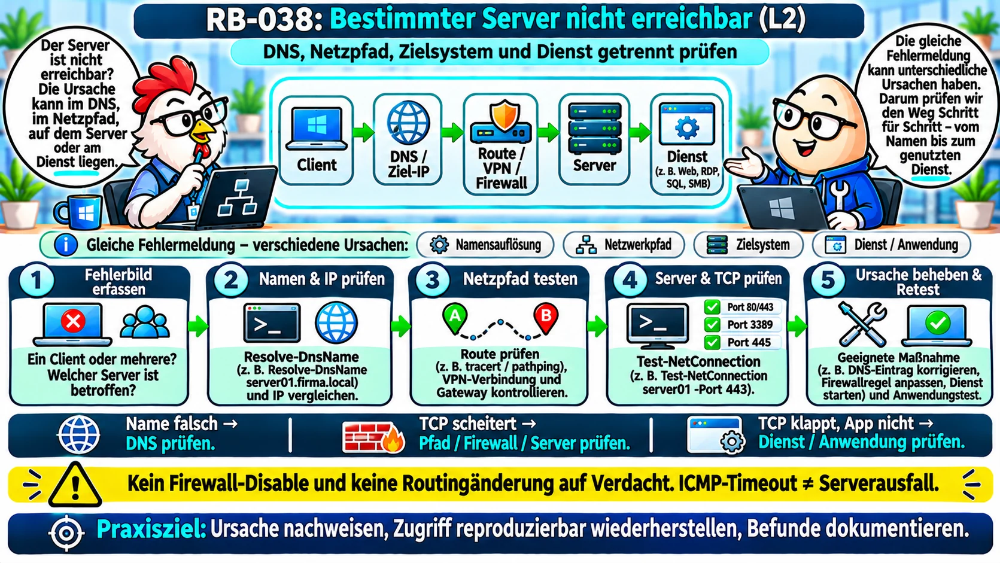

# RB-038 – Praxis-Runbook: Bestimmter Server nicht erreichbar (L2)

**Status:** Recherchiert, **nicht praktisch validiert** · **Stand:** 22.11.2026 · **Version:** 1.0  
**Bereich:** Windows 11 / DNS / TCP-IP / Routing / Firewall / Windows Server  
**Regel:** Keine Produktivänderung ohne Auftrag, Ownership, Freigabe, Rückweg und dokumentiertes Retest-Kriterium.



## 1. Incident aufnehmen und eingrenzen

- [ ] Exakte Fehlermeldung / Screenshot / Uhrzeit, Clientname, Benutzergruppe, Standort notieren.
- [ ] Ziel: FQDN, IP, UNC/URL und tatsächlich benötigter **Port/Dienst** erfassen.
- [ ] Ein Client, mehrere im selben VLAN, VPN, ein Standort oder alle betroffen?
- [ ] Startzeitpunkt, Änderungshistorie, Server-/Applikations-Owner und Kritikalität klären.

**Zielnotiz:** „Von Client A, VLAN 20, 22:10 Uhr, `server01.firma.example:443` fehlerhaft; derselbe Dienst von Client B im VLAN 30 erreichbar.“ – Beispiel fiktiv.

## 2. Sicherheit und Rückweg absichern

- [ ] Nur **lesende** Diagnosen zunächst; sensible Logs geschützt speichern.
- [ ] VPN-/Netzwerk-Konfigurationsänderungen vermeiden, falls nur ein Fernzugang existiert.
- [ ] Keine Firewall-Deaktivierung, Route-/DNS-Manipulation, ungeplanten Neustart oder Portfreigabe auf Verdacht.
- [ ] Gegenprobe mit freigegebenem Vergleichsclient und notwendigem Testport abstimmen.

## 3. DNS-/IP-Abgleich

```powershell
Get-DnsClientServerAddress
Resolve-DnsName -Name 'server01.firma.example' -Type A
Resolve-DnsName -Name 'server01.firma.example' -Type AAAA
```

**Befundfragen:** Antwortet Resolver? Erwartete A-/AAAA-Adressen? Unterschied zu Vergleichsclient? Split-DNS/VPN? Kein öffentlicher DNS-Ersatz auf Verdacht. Für echte Tests den Beispielnamen ersetzen.

## 4. IP- und Routengrundlagen

```powershell
Get-NetIPConfiguration
Get-NetAdapter | Select-Object Name,Status,LinkSpeed
Get-NetRoute -AddressFamily IPv4 | Select-Object DestinationPrefix,NextHop,InterfaceAlias,RouteMetric
Test-NetConnection -ComputerName '192.0.2.40' -DiagnoseRouting -InformationLevel Detailed
```

**Befundfragen:** Welcher Adapter, welche Quell-IP/Route, VPN-Tunnel, Gateway und Serverzielnetz? Falls IPv6-Ziel: separaten IPv6-Routenpfad untersuchen. Keine `ipconfig /release`-/`route delete`-Befehle über Remotesitzung.

## 5. ICMP und Pfad testen

```powershell
ping -n 4 192.0.2.40
tracert -d 192.0.2.40
```

**Wichtig:** `Ping fehlgeschlagen` ist **kein** Serverausfall-Beweis. ICMP kann gefiltert sein. Hop-Timeouts in `tracert` sind ohne weitere Befunde kein Nachweis des Fehlerorts.

## 6. TCP mit Name und IP vergleichen

```powershell
Test-NetConnection -ComputerName 'server01.firma.example' -Port 443 -InformationLevel Detailed
Test-NetConnection -ComputerName '192.0.2.40' -Port 443 -InformationLevel Detailed
```

**Bewertung:**

| Messbild | Nächste Prüfung |
|---|---|
| Name → falsches Ziel; geprüfte richtige IP → TCP funktioniert | DNS-/Adresspfad, Split-DNS, IPv4/IPv6 |
| Beide TCP-Tests scheitern | Route, Firewall, Zielhost/Listener, Rückweg |
| TCP ist erfolgreich, App meldet Fehler | TLS/HTTP/SMB/Authentifizierung/Backend (RB-039) |
| Nur ein Quell-VLAN betroffen | Gateway, Segmentierung, ACL/Firewall-Logs, VPN-Route |

`TcpTestSucceeded` bestätigt **nur TCP auf dem gewählten Port**, nicht die korrekte Anwendung.

## 7. A/B-Test mit kontrollierter Vergleichsquelle

- [ ] Gleicher FQDN, gleiche Ziel-IP und gleicher TCP-Port, ähnliche Zeit.
- [ ] Zweiter Client im selben Subnetz; wenn möglich zweiter Standort/VLAN.
- [ ] Ergebnis mit Uhrzeit, Source-IP, Destination-IP, Port, DNS-Antwort und VPN-Status festhalten.
- [ ] Nicht allein aufgrund eines Clients die Ursache einem Server oder einer Firewall zuschreiben.

## 8. Zielserver- und Ownerprüfung

Nur mit Serverzugang und entsprechender Berechtigung:

```powershell
Get-NetIPConfiguration
Get-NetAdapter | Select-Object Name,Status,LinkSpeed
Get-NetTCPConnection -LocalPort 443 -State Listen -ErrorAction SilentlyContinue
```

**Fragen:** Server/VM online? Erwartete IP und NIC? Dienst lauscht? Hypervisor-/Firewall-/Routing- und Monitoring-Befunde korrelieren. Lokaler Listener beweist keine externe Erreichbarkeit.

## 9. Freigabe, minimale Korrektur oder L2/L3-Eskalation

- [ ] Verantwortlichen benennen (DNS-Owner, Netzwerk-/Firewall-Team, Server-/Applikations-Team).
- [ ] Befundbasierte Hypothese mit zwei oder mehr unabhängigen Beobachtungen dokumentieren.
- [ ] Änderung nur nach Genehmigung, mit Rollback-Plan und Testfenster.
- [ ] Falls unklar: **keinen** blind durchgeführten Firewall-/Netzwerkreset, sondern Paket-/Firewall-Logs mit Source und Destination anfordern.

**Eskalationspaket:** Ticket-Impact; Quelle/VLAN/VPN; Ziel/FQDN/IP/Port; Uhrzeit; DNS-Ergebnis; TCP/Traceroute; Vergleichsclient; Änderungshistorie; gewünschte minimale Freigabe.

## 10. Retest, Nutzerfreigabe und Ticketkommentar

**Nur dann „behoben“:** Der *ursprünglich betroffene* Nutzer/Client kann **denselben Dienst** am beabsichtigten Ziel und Port wieder nutzen; der erfolgreiche TCP-Test allein genügt nicht.

**Muster-Ticketkommentar – FIKTIV:**

> **Befund:** HTTPS-Zugriff auf `server01.firma.example` von VLAN 20 fehlgeschlagen, von VLAN 30 erfolgreich; identische DNS-Antwort auf `192.0.2.40`.  
> **Analyse:** TCP 443 nur aus VLAN 20 nicht erreichbar; Netzwerk-Owner hat anhand Firewall-Logs eine unpassende ACL für die betreffende Quellgruppe bestätigt.  
> **Maßnahme und Ergebnis:** Nach dokumentierter Freigabe hat der Owner die Regel minimal angepasst; ursprünglicher Client kann die Anwendung wieder öffnen. Retest und Nutzerbestätigung dokumentiert.

**Abschluss:** Zeit, tatsächlich ausgeführte Prüfungen, bestätigte Ursache (oder „weiterhin offen“), Freigabe-/Change-ID, konkrete Maßnahme, Vorher/Nachher und Nutzerbestätigung. Keine Laborvalidierung behaupten, solange sie nicht stattgefunden hat.
