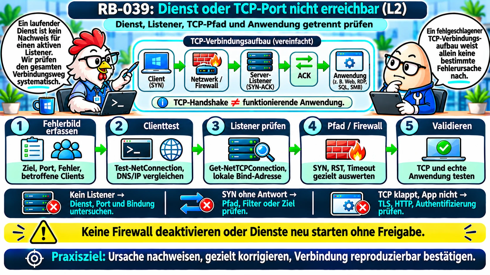

# RB-039 – Dienst oder TCP-Port nicht erreichbar (L2)

**Projekt:** 50 Tickets – 50 typische Supportfälle  
**Bereich:** Windows 11 / Windows Server / TCP/IP / Windows Defender Firewall / Dienstdiagnose  
**Level:** L2 · **Stand:** 22.11.2026 · **Version:** 1.0  
**Fachstatus:** Anhand offizieller Microsoft-Dokumentation recherchiert; **nicht praktisch validiert**. Alle Musterfälle, Messergebnisse, Adressen und Tickettexte sind fiktiv.



> **Leitsatz:** Ein gestarteter Dienst ist nicht dasselbe wie ein vorhandener TCP-Listener. Ein Listener auf dem Server ist kein Beweis für den Zugriff aus einem anderen Netz. Und ein erfolgreicher TCP-Handshake bestätigt noch nicht, dass die Anwendung funktioniert.

---

## 1. Störungsszenario, Lernziel und Abgrenzung

**Meldung A:** „Das interne Webportal unter `https://app01.firma.example:8443` lädt nicht, andere Anwendungen funktionieren.“  
**Meldung B:** „Die Datenbank läuft laut Diensteanzeige, aber der Client verbindet sich nicht.“

**Lernziel:** Ohne ungezielte Neustarts oder Firewallfreigaben unterscheiden können, ob **Dienst, Prozess, Listener/Bind-Adresse, DNS/Ziel-IP, Firewall/Netzpfad, TCP-Verbindungsaufbau oder die darüberliegende Anwendung** betroffen sind.

- **L1:** Quelle, Ziel, Port, Protokoll, Fehlertext, Zeit und Umfang erfassen, freigegebene Verbindungstests durchführen.
- **L2:** TCP-Ergebnisse, Listening-Sockets, lokale/remote Vergleichstests, Firewallbedingungen und Logs korrelieren.
- **System-/Security-/Netzwerk-Owner:** Jede Veränderung von Dienst, Portbindung, Regelwerk, Routing oder Zertifikats-/Proxy-Konfiguration nach Freigabe und mit Rollback.

**Abgrenzung:** RB-038 untersucht die *End-to-End-Erreichbarkeit eines bestimmten Servers*; **RB-039** betrachtet gezielt **einen bestimmten TCP-Dienst/Port** und den Unterschied zwischen Socket, Transport und Anwendung. DNS im Detail: RB-034; Performance: RB-037.

## 2. Erst unterscheiden: Dienst, Listener, TCP und Anwendung

| Ebene | Nachweis | Was damit **nicht** bewiesen ist |
|---|---|---|
| Dienst/Prozess | `Get-Service` meldet `Running` | Der Prozess hat tatsächlich einen Socket geöffnet |
| Listener | `Get-NetTCPConnection -State Listen` zeigt Port und lokale Bind-Adresse | Externe Clients dürfen ihn erreichen |
| TCP-Verbindung | `Test-NetConnection -Port` liefert `TcpTestSucceeded: True` | TLS, HTTP, SMB, Datenbankanmeldung oder Berechtigung funktionieren |
| Anwendung | Authentifizierter Test der tatsächlichen Funktion klappt | Dauerhafte Stabilität, Lastfestigkeit oder andere Benutzerpfade |

Ein Windows-Dienst kann gestartet sein, während sein Webmodul noch nicht gebunden ist; eine Anwendung kann ohne Windows-Serviceverwaltung als normaler Prozess oder in einem Container laufen. Umgekehrt kann der TCP-Listener korrekt sein, aber ein Reverse Proxy oder eine Backend-Verbindung HTTP 502/503 liefern. **Jede Ebene braucht ihren eigenen Beleg.** [Q1–Q4]

## 3. TCP-Verbindungsaufbau: SYN → SYN-ACK → ACK

```text
Client                        Server / erreichbarer TCP-Endpunkt
  | --- SYN  (Zielport 8443) --------------------> |
  | <---------------------- SYN-ACK -------------- |
  | --- ACK -------------------------------------> |
  |        TCP-Verbindung aufgebaut                |
  |     erst danach: z. B. TLS, HTTP, Login        |
```

- **SYN:** Client möchte den TCP-Handshake starten.
- **SYN-ACK:** Ein erreichbarer Endpunkt akzeptiert die TCP-Aushandlung auf dieser Verbindung.
- **ACK:** Client bestätigt; der Handshake ist abgeschlossen.
- **RST:** Aktive Zurückweisung oder Zurücksetzung möglich; Herkunft kann Zielhost, Firewall, Load Balancer oder eine Zwischenkomponente sein. Die RST-Ursache ist **nicht** allein aus dem Vorhandensein des Flags ableitbar.
- **SYN-Wiederholungen ohne Antwort:** Paketverlust, Filterung, falsche Route, nicht erreichbarer Host oder fehlender Rückweg sind denkbar. Nur ein Mitschnitt auf mehreren Punkten kann den Drop-Punkt genauer belegen.

Ein TCP-Handshake kann an **einem Proxy/Load Balancer** enden, nicht zwingend am Backend. Außerdem kann eine Verbindung nach erfolgreichem Handshake durch TLS-Fehler oder Anwendungsantworten scheitern. [Q1, Q2, Q5]

## 4. Fehlerbild und Ausfallbereich erfassen

Vor technischen Änderungen folgende Daten sammeln:

1. **Ziel:** FQDN, tatsächlich erwartete IPv4/IPv6-Adresse, TCP-Port, Dienstname, URL oder Applikationsname.
2. **Quelle:** Clientname, Quell-IP, VLAN, VPN, Standort, Betriebsart und verwendete Anwendung.
3. **Fehler:** Exakter Text/Code (z. B. „Connection refused“, Timeout, TLS-Fehler, HTTP 503), Zeitpunkt und Reproduzierbarkeit.
4. **Betroffene:** Ein PC, eine Benutzergruppe, nur VPN, nur ein VLAN, alle Standorte? Funktioniert ein Vergleichsdienst?
5. **Veränderungen:** Neuer Release, Firewall-Change, Serverneustart, Zertifikat, neue Bind-Adresse, Container-/Reverse-Proxy-Änderung?

**Wichtig:** Standardports (HTTPS meist 443; SMB 445; RDP 3389) dienen nur der Orientierung. Ein kundenspezifischer Dienst kann auf *einem anderen* Port lauschen. **Port und Transportprotokoll aus der Sollkonfiguration verifizieren.** UDP braucht andere Prüfschritte; `Test-NetConnection -Port` ist ein **TCP-Test**, kein UDP-Nachweis.

## 5. Sicherheit, Ownership und Rückweg vor Diagnose

- Zu Beginn **lesende** Abfragen, wenige vereinbarte Einzeltests und erlaubte A/B-Vergleiche.
- Keine produktive Firewall deaktivieren, keine globale Portfreigabe, keine ACL-/Routenänderung oder Dienste-/Serverneustarts auf Verdacht.
- Über einen einzigen Fernzugang keine Änderung vornehmen, die den Rückweg abschneiden kann; alternative Konsole/Rollback abstimmen.
- Paketmitschnitte enthalten ggf. interne Adressen, Token, personenbezogene Daten und Anwendungsinhalte: nur mit Freigabe, minimierter Aufzeichnung und geregelter Aufbewahrung.
- TLS-Zertifikatsfehler nicht durch dauerhaftes Abschalten der Zertifikatsprüfung „lösen“.

Eine freigegebene Reparatur benötigt: **Befund → Owner → Zieländerung → Zeitfenster → Rollback → verifizierbarer Retest**.

## 6. Client: FQDN, Ziel-IP und TCP-Port testen

**Auf dem betroffenen Windows-Client; Testport 8443 ist fiktiv und muss angepasst werden.**

```powershell
# 1. Tatsächliche DNS-Zieladressen ermitteln:
Resolve-DnsName -Name 'app01.firma.example' -Type A
Resolve-DnsName -Name 'app01.firma.example' -Type AAAA

# 2. TCP-Verbindungsaufbau zum genannten Dienstport prüfen:
Test-NetConnection -ComputerName 'app01.firma.example' -Port 8443 -InformationLevel Detailed

# 3. Nur bei freigegebenem Vergleich mit erwarteter IPv4-Adresse:
Test-NetConnection -ComputerName '192.0.2.40' -Port 8443 -InformationLevel Detailed
```

**Interpretation:** `TcpTestSucceeded: True` bedeutet, dass der TCP-Verbindungsversuch auf den angegebenen Endpunkt erfolgreich war. `False` sagt nur, dass dieser Versuch *nicht erfolgreich* war; Ursache und konkreter Fehler (RST vs. Timeout) sind aus diesem Boolean allein nicht eindeutig bestimmbar. Die Ausgabe `RemoteAddress`, `SourceAddress` und `InterfaceAlias` hilft, die tatsächliche Verbindung zu prüfen. [Q3]

**A/B-Matrix:** Dieselbe *Ziel-IP und derselbe Port* am betroffenen Client, an einem funktionierenden Client im selben VLAN und (wenn freigegeben) aus einem anderen VLAN/VPN testen. Nur so können unterschiedliche Quellbedingungen sinnvoll verglichen werden.

## 7. Server: Läuft der Dienst wirklich und öffnet er einen Listener?

**Die folgenden Befehle sind lokal auf dem berechtigt zugänglichen Zielserver auszuführen.**

```powershell
# Windows-Dienststatus, wenn der tatsächliche Dienstname bekannt ist:
Get-Service -Name 'W3SVC'  # Beispiel für IIS, nicht zwingend für Port 8443 zuständig

# TCP-Listener auf dem erwarteten Port:
Get-NetTCPConnection -State Listen -LocalPort 8443 |
  Select-Object LocalAddress, LocalPort, State, OwningProcess

# Listener-Prozess identifizieren, nachdem PID aus obiger Ausgabe bekannt ist:
Get-Process -Id 1234  # Beispiel-PID, niemals ungeprüft übernehmen

# Nur lesend: Windows-Service zum Prozess zuordnen, falls Service-basiert:
Get-CimInstance Win32_Service | Where-Object ProcessId -eq 1234 |
  Select-Object Name, DisplayName, State, ProcessId
```

**Befundlogik:** `Get-Service` mit `Running` **reicht nicht**. Der Socket muss auf dem erwarteten **Port, Adressfamilie und Bind-Ziel** vorhanden sein. Ein Listener auf `127.0.0.1:8443` kann von einem entfernten Client normalerweise nicht direkt erreicht werden; ein Listener auf `0.0.0.0:8443` gilt für IPv4-Adressen dieses Hosts, vorbehaltlich Host-/Netzwerkfiltern. Bei IPv6 (`::`, `::1`) gelten die jeweiligen Socket- und Dual-Stack-Eigenschaften; deren Verhalten nicht stillschweigend als identisch zu IPv4 annehmen. [Q4]

**Kein Listener:** Dienst-/App-Logs, Konfigurationsdatei, Zertifikatsbindung, Portkonflikt, Prozessabsturz oder Container-/Reverse-Proxy-Portmapping abklären. **Nicht reflexartig neu starten.**

## 8. Lokaler Gegenvergleich: Loopback ist nicht gleich Netz-IP

```powershell
# Auf dem Server: Nur sinnvoll, wenn ein Listener auf Loopback oder allen IPv4-Adressen lauscht:
Test-NetConnection -ComputerName '127.0.0.1' -Port 8443

# Auf dem Server: Bind-Adresse aus der Listenerliste als Ziel verwenden:
Test-NetConnection -ComputerName '192.0.2.40' -Port 8443
```

**Entscheidung:** „Loopback funktioniert, externe Adresse nicht“ ist ein Hinweis auf eine Bindungs-, lokale Filter- oder Hostpfadfrage, **aber kein endgültiger Beweis** für eine Firewall. Wenn nur auf einer konkreten Nicht-Loopback-IP gebunden wurde, ist ein fehlgeschlagener Loopback-Test nicht automatisch ein Fehler.

| Vergleich | Möglicher Fokus | Vorbehalt |
|---|---|---|
| Kein Listener auf dem erwarteten Port | Dienst/App-Konfiguration, Portbindung, Startfehler | Listener kann auf anderem Host/Proxy/Container liegen |
| Listener nur `127.0.0.1` | Loopback-Bindung / Proxy-Topologie | Proxy könnte bewusst lokal weiterleiten |
| Listener auf Soll-IP; lokal erfolgreich; remote scheitert | Hostfilter, Netzwerk-ACL, Route, Rückweg | Zwei-seitige Traces zum Beweis nötig |
| Remote TCP erfolgreich; Anwendung scheitert | TLS, Hostname/SNI, Auth, HTTP-Status, Backend | TCP-Test endet evtl. an Load Balancer |

## 9. Firewall und Sicherheitsfilter: Bedingungen lesen, nicht abschalten

```powershell
# Lokal auf dem Zielserver – geltende Profile und Standardaktionen:
Get-NetFirewallProfile |
  Select-Object Name, Enabled, DefaultInboundAction, DefaultOutboundAction

# Regeln zu einem exakt konfigurierten TCP-Port suchen (nur ein Einstieg):
Get-NetFirewallPortFilter |
  Where-Object { $_.Protocol -eq 'TCP' -and $_.LocalPort -eq '8443' } |
  Get-NetFirewallRule |
  Select-Object DisplayName, Direction, Enabled, Action, Profile
```

**Achtung:** Dieser Portfilter ist **kein vollständiger Wirksamkeitsnachweis**: Regeln mit `Any`, Portbereichen, Programm-/Dienstbindung, Quell-IP-Bedingungen, Sicherheits-/IPsec-Vorgaben, zentralen GPO-/MDM-Richtlinien oder Drittanbieter-WFP-Filtern können ebenso relevant sein. Die aktiven Richtlinien und zugehörigen Address-/Application-/Service-Filter müssen bei Bedarf durch die zuständige Administration geprüft werden. Nicht alle Netzwerk-Firewalls befinden sich auf dem Zielserver. [Q6, Q7]

Für eine notwendige Korrektur **nie pauschal die Firewall deaktivieren**: Stattdessen zielgenaue Regeln nach Source, Destination, Protokoll und Port gemäß Change-/Security-Prozess planen.

## 10. Ergebnisarten interpretieren: Timeout, RST, erfolgreicher Handshake

| Ergebnis | Was sicherer gesagt werden kann | Nächster differenzierender Test |
|---|---|---|
| `TcpTestSucceeded: False` | Versuch konnte keine TCP-Verbindung herstellen | Listener lokal prüfen; vergleichende Paket-/Logbefunde suchen |
| Capture: SYN wiederholt, keine Antwort | Kein SYN-ACK/RST am Capture-Punkt beobachtet | SYN auf Server und Firewall-Grenzen verfolgen; Rückweg prüfen |
| Capture: RST statt SYN-ACK | Verbindung wird aktiv zurückgewiesen/zurückgesetzt | RST-Ursprung mit Server-/Firewall-Logs oder zweiseitiger Capture bestimmen |
| `TcpTestSucceeded: True` | Handshake zum getesteten TCP-Endpunkt gelang | Echte Anwendung: TLS, Auth, HTTP-/Protokollstatus, Backend prüfen |
| Lokal funktioniert, ein VLAN scheitert | Quellnetz-spezifischer Pfad-/Filterunterschied plausibel | Vergleich Quelle/VLAN, ACL, Rückroute, Firewalllogs |

**Vorsicht:** Ein Paketmitschnitt ist **ortsabhängig**. Ein fehlendes SYN im Servercapture kann ein Filter auf dem Pfad sein; ein SYN am Server ohne Antwort könnte durch Hostfilter, Listener, Routing oder Capture-Bedingungen entstehen. Nicht aus einer einzigen Messung eine definitive Schuldzuweisung ableiten. [Q1, Q2, Q8]

## 11. Anwendungsschicht nach offenem Port gezielt prüfen

Ist der TCP-Test erfolgreich, folgt ein **protokollgerechter** End-to-End-Test, keine Portliste auf Verdacht:

- **HTTPS:** Richtiger Hostname/SNI, Zertifikat und HTTP-Status, Reverse Proxy, IIS-/App-Logs; z. B. in freigegebener Testumgebung `curl.exe -I https://app01.firma.example:8443/` (`HEAD` muss vom Dienst unterstützt werden). Nicht `-k` als dauerhafte Umgehung verwenden.
- **SMB:** Tatsächliche Freigabe und Benutzerberechtigung unter Windows testen; Port 445 allein beweist keine erfolgreiche SMB-Sitzung.
- **RDP:** Anmeldung, Gruppenrichtlinien und RDP-Dienst, nicht nur Port 3389 testen.
- **SQL/Datenbanken:** Instanz/Port, TLS, Authentifizierung und Datenbankzustand mit autorisiertem Client; „Port offen“ ist kein erfolgreicher Datenbank-Login.

Auch HTTP 401/403/404/502/503 kann nach **erfolgreichem TCP-Handshake** auftreten. Das ist für die Diagnose ein wertvoller *Schichtwechsel* und kein Widerspruch. **Nie echte Credentials in Tickets oder Screenshots übernehmen.**

## 12. Wenn Standardtests nicht reichen: kontrollierte Traces und Eskalation

**Nur bei Bedarf, nach Freigabe und möglichst zeitgleich an Quelle und Ziel:** Paketaufzeichnungen bzw. Windows Filtering Platform (WFP)-Ereignisse auswerten. Microsoft beschreibt zweiseitige Traces und die Identifikation von SYN-Drops sowie WFP-Filtern. [Q1, Q2, Q8]

- Client-Timestamp, Quell-IP/Quellport, Ziel-IP/Zielport, TCP-Flags festhalten.
- Sichtbarkeit des **SYN** am Server prüfen; Rückantwort **SYN-ACK oder RST** prüfen; falls Antwort verlässt den Server, Rückweg überprüfen.
- Ergebnisse mit Host-Firewall, Netzwerkfirewall, Load Balancer und IDS/IPS korrelieren.
- Logs und Traces nur im erforderlichen Umfang und entsprechend Sicherheits-/Datenschutzregel verwahren.

**Eskalationspaket:** betroffene Quelle(n)/Ziel/Port, DNS-Ziel, Zeitfenster, lokale Bind-Adresse, Listener-PID, Service-Status, A/B-Tests, Regel-Owner, relevante Log-/Trace-Befunde, beobachtete Handshakephase und konkrete nächste Hypothese.

## 13. Fiktiver Praxisfall A: Dienst läuft, aber Listener ist falsch gebunden

**Meldung:** „Nur das Webportal `app01.firma.example:8443` ist von den Arbeitsplätzen nicht erreichbar.“

**Beobachtungen (erfunden):**

1. `Get-Service` meldet `Running` für den zugehörigen Dienst.
2. `Get-NetTCPConnection -State Listen -LocalPort 8443` meldet **`127.0.0.1:8443`**, aber keinen Listener auf der vorgesehenen Netz-IP.
3. `Test-NetConnection 127.0.0.1 -Port 8443` ist auf dem Server erfolgreich, ein direkter Test zur Server-IP von einem anderen Client scheitert.
4. Architekturabgleich: Es gibt **keinen vorgesehenen Reverse Proxy**; die Bindung an Loopback ist laut Sollkonfiguration falsch.

**Hypothese:** Falsche Listener-Bindadresse; der Dienst beantwortet nur lokale Verbindungen.  
**Freigegebene L2-Maßnahme (nicht ausgeführt):** Verantwortlicher Applikations-Owner korrigiert die konfigurierte Bind-Adresse im Changefenster, prüft Abhängigkeiten und sichert Rollback.  
**Erfolgskriterium:** Listener auf Soll-IP und Soll-Port sichtbar, Remote-TCP-Test erfolgreich, authentifizierte Webfunktion bestätigt.

**Transfer:** Wäre ein lokaler Reverse Proxy vorgesehen, könnte dieselbe Loopback-Bindung korrekt sein – dann müsste stattdessen der Proxy-Eingangsport untersucht werden.

## 14. Fiktiver Praxisfall B: Nur aus VPN scheitert der TCP-Verbindungsaufbau

**Meldung:** „Port 8443 geht im Büro, im Homeoffice hängt die Verbindung.“

**Beobachtungen (erfunden):**

1. Server lauscht auf `192.0.2.40:8443` und beantwortet den lokalen Test.
2. Büro-Client: `TcpTestSucceeded: True`, App funktioniert.
3. VPN-Client: DNS löst auf dieselbe Ziel-IP auf, `TcpTestSucceeded: False`.
4. Genehmigte Netzwerk-/Hostfirewall-Logs zeigen eine **explizite Deny-Regel** für das VPN-Quellsubnetz auf genau diesen Zielport; Change-Historie und Sollregel passen zusammen.

**Belegte Ursache im fiktiven Fall:** Eine unpassende ACL für das VPN-Quellnetz; kein Dienstdefekt.  
**Freigegebene Maßnahme (nicht ausgeführt):** Security-/Netzwerk-Owner korrigiert ausschließlich die erforderliche Source-/Destination-/Port-Regel mit dokumentiertem Rollback.  
**Retest:** TCP, TLS/Anmeldung und tatsächliche Anwendung vom **ursprünglichen VPN-Client**, plus Negativtest mit nicht autorisiertem Quellnetz.  
**Transfer:** Ohne ein belegendes Deny-Log wären Rückroute, VPN-Split-Tunnel, Endpoint-Security und Filter auf dem Pfad weiterhin Hypothesen, keine Tatsachen.

## 15. Active Recall, Diagnosekarten und selbstständiger Transfer

**Wissensfragen (ohne Nachschlagen beantworten):**

1. Wie lauten die drei Nachrichten des TCP-Verbindungsaufbaus?
2. Was zeigt `TcpTestSucceeded: True` – und was nicht?
3. Was bedeutet `Listen` in `Get-NetTCPConnection`?
4. Unterschied zwischen Bindung an `127.0.0.1` und `0.0.0.0`?

**Verständnisfragen:**

5. Warum kann `Get-Service = Running` bei fehlendem Listener auftreten?
6. Weshalb ist ein lokaler Loopback-Test kein Beweis für den Fernzugriff?
7. Warum beweist ein RST allein keine defekte Anwendung?

**Diagnose-/Transferfragen:**

8. Server lauscht auf `192.0.2.40:8443`, lokaler TCP-Test geht, nur VLAN 40 scheitert. Welche A/B- und Logtests trennen Hostfilter, ACL und Rückweg?
9. TCP 443 klappt, Browser meldet TLS-Zertifikatsfehler. Welches Fachteam und welche Ebene sind jetzt relevant?
10. Der Windows-Dienst steht auf `Running`, aber die Software läuft in einem Container hinter Proxy. Wo **muss** der erwartete externe Listener sein?

**Selbst-Erklärung:** In drei Sätzen dokumentieren: (1) reproduzierbares Problem, (2) unterscheidende Messung mit konkretem Ergebnis, (3) minimaler, freigegebener Folgeschritt mit Retest.  
**Spaced Repetition:** Nach etwa 7 und 21 Tagen zwei neue Diagnoseszenarien ohne Musterlösung lösen; Anki-Karten erst aus tatsächlich verstandenem Material erstellen.

---

## Offizielle Quellen, Prüfumfang und Transparenz

Die folgenden Microsoft-Referenzen dokumentieren die *recherchierten Konzepte und Kommandos*, nicht deren erfolgreiche Durchführung in diesem Projekt:

- **[Q1]** Windows Server – TCP/IP-Kommunikation: https://learn.microsoft.com/en-us/troubleshoot/windows-server/networking/troubleshoot-tcp-ip-communication-guidance
- **[Q2]** Windows-Client – TCP/IP-Konnektivitätsdiagnose: https://learn.microsoft.com/en-us/troubleshoot/windows-client/networking/tcp-ip-connectivity-issues-troubleshooting
- **[Q3]** PowerShell `Test-NetConnection`: https://learn.microsoft.com/en-us/powershell/module/nettcpip/test-netconnection?view=windowsserver2025-ps
- **[Q4]** PowerShell `Get-NetTCPConnection`: https://learn.microsoft.com/en-us/powershell/module/nettcpip/get-nettcpconnection?view=windowsserver2025-ps
- **[Q5]** Microsoft – TCP-Three-Way-Handshake: https://learn.microsoft.com/en-us/troubleshoot/windows-server/networking/three-way-handshake-via-tcpip
- **[Q6]** Windows Firewall über PowerShell: https://learn.microsoft.com/en-us/windows/security/operating-system-security/network-security/windows-firewall/configure-with-command-line
- **[Q7]** PowerShell `Get-NetFirewallPortFilter`: https://learn.microsoft.com/en-us/powershell/module/netsecurity/get-netfirewallportfilter?view=windowsserver2025-ps
- **[Q8]** SMB-Beispiel – TCP-Handshake und WFP: https://learn.microsoft.com/en-us/troubleshoot/windows-server/storage/file-server/troubleshoot/tcp-three-way-handshake-fails
- **[Q9]** PowerShell `Get-Service`: https://learn.microsoft.com/en-us/powershell/module/microsoft.powershell.management/get-service?view=powershell-7.6

**Status:** Keine realen Netzwerktests durchgeführt und keine produktiven Änderungen vorgenommen. Eigene Konzeption, KI-gestützte Visualisierung mit ChatGPT. Alle Beispiel-IP-Adressen unter `192.0.2.0/24` und `.example` sind ausschließlich Platzhalter; bei einer echten Diagnose an die genehmigte Umgebung anpassen.
