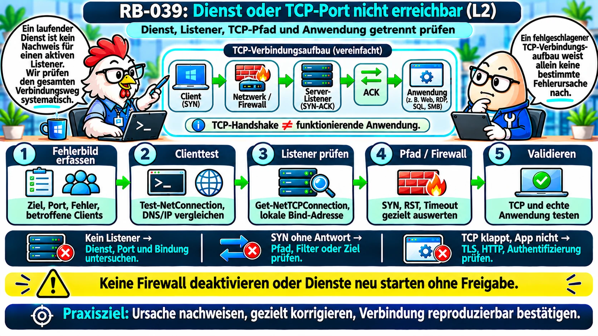

# RB-039 – Praxis-Runbook: Dienst oder TCP-Port nicht erreichbar (L2)

**Version:** 1.0 · **Stand:** 22.11.2026 · **Status:** Recherchiert, **nicht praktisch validiert**  
**Bereich:** Windows 11 / Windows Server / TCP, Listener, Dienst und Firewall  
**Regel:** Nur lesende Diagnosen und wenige gezielte Verbindungstests; produktive Änderungen erst nach Freigabe, Owner-Abstimmung und Rollback.



## 1. Ticket erfassen

- [ ] Exakter Client, Quell-IP/VLAN/VPN, Standort, betroffener Nutzerkreis und Startzeitpunkt.
- [ ] FQDN, **erwartete Ziel-IP**, TCP-Port, Anwendung/Protokoll, Fehlertext, Screenshot.
- [ ] Störung bei nur einem Client, einem Netzsegment oder allen Clients? Vergleichsclient verfügbar?
- [ ] Ist ein Reverse Proxy / Load Balancer / Container / Portforwarding im Sollweg?

## 2. Sicherheits- und Zuständigkeitsgate

- [ ] Berechtigtes Testziel bestätigt; keine unsanktionierten Portscans.
- [ ] Alternativer Zugang/Console und Rückweg bei Remote-Änderung gesichert.
- [ ] Keine Dienstneustarts, Firewall-Deaktivierung, unbestätigte Portfreigaben oder Routingänderungen.
- [ ] Für Captures: Datenschutz, Security-Freigabe, schmaler Testzeitraum.

## 3. Client: Zieladresse und TCP-Funktion prüfen

```powershell
Resolve-DnsName -Name 'app01.firma.example' -Type A
Resolve-DnsName -Name 'app01.firma.example' -Type AAAA
Test-NetConnection -ComputerName 'app01.firma.example' -Port 8443 -InformationLevel Detailed
# Bei vereinbartem Soll-IP-Vergleich:
Test-NetConnection -ComputerName '192.0.2.40' -Port 8443 -InformationLevel Detailed
```

- [ ] `RemoteAddress`, `SourceAddress`, `InterfaceAlias`, `TcpTestSucceeded` und Zeitpunkt protokollieren.
- [ ] `False` = **kein erfolgreicher TCP-Test**, noch keine konkrete Ursachenangabe.

## 4. Server: Listener nachweisen

**Nur an berechtigt zugänglichem Server – lokal oder autorisierte Remotesitzung:**

```powershell
Get-NetTCPConnection -State Listen -LocalPort 8443 |
  Select-Object LocalAddress, LocalPort, State, OwningProcess
# PID aus der eigenen Ausgabe, Beispiel 1234 ersetzen:
Get-Process -Id 1234
Get-CimInstance Win32_Service | Where-Object ProcessId -eq 1234 |
  Select-Object Name, State, ProcessId
```

- [ ] Port, **Bind-Adresse**, IPv4/IPv6 und PID mit Sollwert vergleichen.
- [ ] Läuft ein Dienst laut `Get-Service`, aber der Listener fehlt? Logs/Bindung/Portkonflikt/Startabhängigkeit prüfen.
- [ ] Container-/Proxy-Architektur beachten: Listener kann auf anderem Hop liegen.

## 5. Lokal gegen remote vergleichen

```powershell
# Auf Server nur wenn zur erwarteten Bindung passend:
Test-NetConnection -ComputerName '127.0.0.1' -Port 8443
Test-NetConnection -ComputerName '192.0.2.40' -Port 8443
```

- [ ] Loopback-Test **nur interpretieren, wenn** der Dienst auch auf Loopback lauschen sollte.
- [ ] Gleicher Zielport und gleiche Ziel-IP von funktionierendem und betroffenem Client testen.
- [ ] Unterschiedliche VLANs/VPN/Quell-Adressen dokumentieren.

## 6. Dienstzustand, Fehlerprotokolle und Bindung

```powershell
# Nur wenn Dienstname tatsächlich bekannt (hier IIS-Beispiel):
Get-Service -Name 'W3SVC'
# Optional: relevante lokale Ereignisse in einem abgestimmten Zeitfenster prüfen:
Get-WinEvent -FilterHashtable @{LogName='System'; StartTime=(Get-Date).AddHours(-2)} -MaxEvents 50 |
  Select-Object TimeCreated, Id, ProviderName, LevelDisplayName
```

- [ ] Passende App-/Dienstlogs statt wahlloser Änderungen prüfen; fehlerhafte Listen-IP, Port oder Abhängigkeit feststellen.
- [ ] Keine Logs mit Geheimnissen in ungeschützte Tickets kopieren.

## 7. Firewall- und Pfadbefunde einordnen

```powershell
Get-NetFirewallProfile |
  Select-Object Name, Enabled, DefaultInboundAction, DefaultOutboundAction
Get-NetFirewallPortFilter |
  Where-Object { $_.Protocol -eq 'TCP' -and $_.LocalPort -eq '8443' } |
  Get-NetFirewallRule |
  Select-Object DisplayName, Direction, Enabled, Action, Profile
```

- [ ] Portfilter ist nur Teilauswahl, kein vollständiger Regelbeweis (IP/Profile/Programm/Service/Any/GPO/EDR berücksichtigen).
- [ ] Bei „nur bestimmtes Netz betroffen“ Netzwerkkontrollen und Rückweg durch Owner prüfen lassen.
- [ ] Kein Aus- und Einschalten der Firewall als Schnelltest.

## 8. Diagnoseentscheidung

| Befund | Primärer nächster Prüfpfad |
|---|---|
| Server hat keinen erwarteten Listener | Dienst-/App-Owner, Start- und Bindkonfiguration |
| Listener nur `127.0.0.1`, Soll ist Netz-IP | Architektur/Proxy/Bindadresse vergleichen |
| Server lokal OK, eine Quelle scheitert | Hostfilter, ACL, Netzpfad und Rückweg |
| SYN erreicht Ziel nicht | Zwischenpfad/Firewall-Logs, Quell-/Zielcapture |
| SYN erreicht Ziel, keine Antwort | Listener/WFP/Hostpfad und Rückweg prüfen |
| RST sichtbar | Herkunft des Reset anhand Traces/Logs bestimmen |
| TCP OK, App fehlgeschlagen | TLS, Authentifizierung, HTTP/Backend/Anwendung |

**Nur nach Freigabe:** Bei weiterhin unklarer Ursache gezielte zweiseitige Captures/Firewall-Logs durch zuständige Teams; keinen Massenscan.

## 9. Minimaländerung und Retest

- [ ] Vor einer Änderung: konkreter Befund, verantwortlicher Owner, genehmigte Maßnahme, Rollback und Wartungsfenster.
- [ ] Nur passende Bind-Adresse, Prozess-/Dienstkonfiguration, spezifische ACL/Firewall-Regel oder App-Konfiguration korrigieren.
- [ ] Ursprünglicher Client: identische Ziel-IP und Port mit `Test-NetConnection` erneut testen.
- [ ] **Echte Anwendungsfunktion** (z. B. TLS-/HTTP-Status, Login, RDP, SMB-Freigabe) im vorgesehenen Berechtigungskontext prüfen.
- [ ] Nach Änderung prüfen, dass nicht autorisierte Quellnetze weiterhin gesperrt sind; Vorher-/Nachher-Befunde dokumentieren.

## 10. Eskalation, Ticketnotiz und Trainingsabschluss

**Eskalation:** Quell-/Ziel-IP, FQDN, TCP-Port, betroffene VLANs, exakte Uhrzeit, TCP-Resultate, Listener-Bindung/PID, Server-/App-Logs, Host-/Netzwerkfirewall-Befunde, Änderungshistorie, Sicherheitsgate, bislang ausgeführte Schritte.

**Muster-Ticketkommentar (fiktiv):**  
„Seit 14:10 ist `app01.firma.example:8443` nur aus VPN-VLAN 60 nicht erreichbar. Der Zielserver zeigt einen Listener auf `192.0.2.40:8443`; ein Büroclient verbindet sich erfolgreich, der VPN-Client nicht. Freigegebene Netzwerkanalyse zeigt einen Deny-Eintrag für die VPN-Quell-IP auf TCP 8443. Netzwerk/Security prüft spezifische ACL; keine Änderungen durchgeführt. Retest: TCP und authentifizierte Webfunktion vom ursprünglichen VPN-Client sowie Negativtest nicht autorisierter Quellen.“

**Active Recall:** Worin unterscheiden sich `Running`, `Listen`, `TcpTestSucceeded` und „Anwendung funktioniert“? Erkläre es ohne Runbook in vier Sätzen. Später neue Fälle nach 7 und 21 Tagen.

---

**Referenzen:** Siehe Lernartikel und README (offizielle Microsoft-Quellen). Alle Zielwerte sind nur Dokumentationsbeispiele. Status: **recherchiert, nicht in einer Laborumgebung validiert**.
