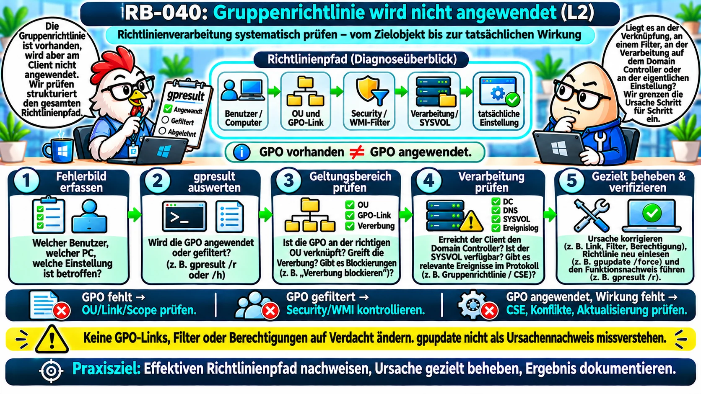

# RB-040 – Gruppenrichtlinie wird nicht angewendet (L2)

**Projekt:** 50 Tickets – 50 typische IT-Supportfälle  
**Bereich:** Active Directory Domain Services (AD DS), Windows 11, Windows Server, Gruppenrichtlinien (GPO)  
**Support-Level:** L2 · **Stand:** 22.11.2026 · **Version:** 1.0  
**Fachstatus:** Anhand offizieller Microsoft-Quellen recherchiert; **noch nicht praktisch validiert**. Alle Beispiele, Namen, Ereignisse und Ticketdaten sind **fiktiv**.



> **Leitsatz:** Eine GPO kann in Active Directory existieren, ohne für einen Benutzer oder Computer relevant zu sein. Sie kann relevant, aber gefiltert sein. Sie kann als angewendet erscheinen, ohne dass die erwartete Einzeleinstellung wirkt. Erst **Geltungsbereich → Filter → Verarbeitung → wirksame Einstellung** unterscheiden.

---

## 1. Störungsbild, Lernziel und Zuständigkeit

**Beispielmeldungen:**

- „Die Laufwerkszuordnung erscheint bei einem Mitarbeiter nicht.“
- „Die neue Bildschirmsperrrichtlinie gilt nur auf einigen PCs.“
- „`gpupdate /force` ist durchgelaufen, aber die Einstellung bleibt unverändert.“

**Lernziel:** Die Fehlerquelle präzise einer von vier Klassen zuordnen: **(A) nicht verknüpft/nicht im Scope, (B) durch Filter ausgeschlossen, (C) Verarbeitung/Erreichbarkeit gestört, (D) GPO angewendet, einzelne Einstellung wirkungslos**.

**L1:** Objektname, Benutzer, PC, Zeitpunkt, Fehlermeldung, Umfang, Sollwert, Vergleichsgerät erfassen und lesende Basisinformationen sammeln. **L2:** RSoP/gpresult, GPMC, AD-Objektpfade, GPO-Link/Security/WMI, GroupPolicy-Protokoll und SYSVOL-Befund korrelieren. **AD-/Security-Owner:** Änderungen an Links, Berechtigungen, Filter, OU, Replikation und Sicherheitsvorgaben nach Freigabe. [Q1–Q5]

**Abgrenzung:** RB-040 ist nicht identisch mit RB-041 „AD-Gruppenmitgliedschaft greift nicht“. Gruppenmitgliedschaften können aber eine Ursache der GPO-Sicherheitsfilterung darstellen. DNS-/Servererreichbarkeit werden in RB-034/RB-038 vertieft.

## 2. Grundlagen: GPO, GPC, GPT und RSoP

Eine Gruppenrichtlinie besteht aus einem **Group Policy Container (GPC)** in **Active Directory** und dem **Group Policy Template (GPT)** im **SYSVOL** eines Domänencontrollers. Vereinfacht gesagt liegen GPO-Metadaten und Verknüpfungsbeziehungen in AD, Dateien/Policy-Inhalte werden unter SYSVOL verwaltet. AD-Replikation und DFSR-Replikation von SYSVOL sind zwei getrennte Mechanismen; unterschiedliche Stände können die Verarbeitung erschweren. [Q1, Q2, Q6]

- **GPO:** Regelwerk mit Benutzer- und/oder Computereinstellungen.
- **GPO-Link:** Verknüpfung mit **Site, Domäne oder OU**. Eine GPO im Ordner „Gruppenrichtlinienobjekte“ ohne wirksame Verknüpfung kann leer ausgehen.
- **RSoP (Resultant Set of Policy):** Tatsächlich resultierende Richtlinien für einen bestimmten Computer/Benutzer unter seinen Bedingungen.
- **GPMC:** Gruppenrichtlinienverwaltung; zeigt Objekte, Links, Vererbung, Filter, GPO-Ergebnisse und Modellierung.
- **CSE (Client Side Extension):** Windows-Komponente, die die Einstellungen einer bestimmten Richtlinienkategorie verarbeitet.

**Entscheidender Unterschied:** **Group Policy Modeling** berechnet eine *Simulation*; **Group Policy Results** beziehungsweise `gpresult` erfasst *tatsächliche* Richtlinienergebnisse auf einem Client. Modellierung ist deshalb kein Ersatz für den Befund auf dem betroffenen System. [Q1, Q4]

## 3. Verarbeitungsweg: vom Zielobjekt zur konkreten Einstellung

```text
Benutzer- oder Computerobjekt
    ↓  OU / Domäne / Site und GPO-Link
Geltungsbereich + Vererbung + Linkreihenfolge
    ↓  Security Filtering / WMI-Filter
GPO grundsätzlich anwendbar?
    ↓  DC erreichbar, AD-Informationen & SYSVOL lesbar?
Client-Side-Extensions verarbeiten die Einstellungen
    ↓  CSE-spezifisch: Konflikte, GPP-Targeting, Zeitpunkt
Erwarteter Wert / Verhalten tatsächlich wirksam?
```

**Computer-Konfiguration** gilt auf das Computerobjekt und wird primär beim Start sowie in Hintergrundaktualisierungen verarbeitet. **Benutzer-Konfiguration** gilt auf das Benutzerobjekt und wird primär bei der Anmeldung sowie in Hintergrundaktualisierungen verarbeitet. Im Sonderfall **Loopback** ändern Computer-GPOs die Zusammenstellung der Benutzerrichtlinien (Merge/Replace), häufig an Terminalservern/Kiosken. [Q1, Q2]

## 4. Fehlermeldung strukturieren, bevor du prüfst

Erfasse in einem Ticket:

1. **Welcher Sollwert?** Pfad und exakte Einstellung innerhalb welcher GPO, z. B. Netzlaufwerkszuordnung oder Sperrbildschirm-Timeout.
2. **Wer/Wo?** Benutzerkonto, Computername, Domäne, OU des **Benutzers** und OU des **Computers**, Standort/VPN.
3. **Was fehlt?** GPO erscheint nicht in `gpresult`? Wird sie explizit gefiltert? Wird sie angewendet, aber der Sollwert fehlt?
4. **Seit wann?** Letzte funktionierende Anmeldung, letzte Änderung, Uhrzeit, Client-Neustart, Replikationszeitfenster.
5. **Vergleich:** Wirkt dieselbe GPO bei einem anderen Benutzer/Computer? Im gleichen OU-Zweig? An anderem Standort/DC?

Dokumentiere die **exakte GPO-ID** und den Pfad der Einstellung statt nur eines ähnlich klingenden Anzeigenamens. Sammle so wenig personenbezogene Informationen wie nötig.

## 5. Sicherheitsgate: Beweise vor Änderungen

**Zunächst nur lesende Diagnose:** GPMC anschauen, RSoP-Bericht erstellen, DNS/DC-Zugang und Logs lesen. **Nicht** ohne Belege GPO-Links, `Authenticated Users`, „Apply Group Policy“, WMI-Filter, OU-Zuordnung, SYSVOL-Inhalte oder Replikation ändern. In produktiven Umgebungen können fehlerhafte GPO-Änderungen viele Endgeräte betreffen.

`gpupdate /force` ist eine **zustandsändernde Aktualisierung**, kein reiner Lesetest und kein Ursachenbeweis. Manche Einstellungen benötigen Neuanmeldung/Neustart; bei einem Remote-Arbeitsplatz nur nach Absprache und mit gesichertem Rückweg ausführen. Kein pauschales „alles zurücksetzen“.

**Datenschutz:** `gpresult` und Ereignislogs können Benutzer-, Computer- und Domäneninformationen enthalten. Nur zweckgebunden speichern; keine Anmeldekennwörter, Tickets oder Geheimnisse in Dokumentationen kopieren.

## 6. Client: effektive Richtlinien lesend nachweisen (`gpresult`)

**Auf dem betroffenen Windows-Client, möglichst in der betroffenen Benutzersitzung; bei Computerdaten ggf. erhöhten Zugriff verwenden:**

```powershell
# Ausgabe aktueller RSoP-Zusammenfassung (CMD-Tool aus PowerShell):
gpresult /r

# Nur Computerbereich ausgeben (erfordert passende Berechtigung):
gpresult /scope computer /r

# Nur Benutzerbereich ausgeben (im betroffenen Benutzerkontext):
gpresult /scope user /r

# HTML-Bericht im TEMP-Verzeichnis, nur lesender Berichtsexport:
gpresult /h "$env:TEMP\RB040-gpresult.html" /f
```

**Interpretation:**

- GPO unter **„Angewendete Gruppenrichtlinienobjekte“**: Verarbeitung als GPO grundsätzlich berichtet, aber nicht automatisch Erfolg jeder einzelnen Einstellung.
- GPO unter **„Abgelehnte/ausgefilterte GPOs“**: Filtergrund beachten, z. B. Sicherheitsfilter oder WMI-Filter.
- GPO im Bericht **nicht vorhanden**: Link/Scope, Objekt-OU, GPO-/Linkstatus und ggf. fehlende Domänenkommunikation prüfen.
- Bericht enthält falschen **Benutzerkontext**: Keine Aussage zur betroffenen Anmeldung ableiten. Auch RSoP-Daten können unvollständig sein; den Befund mit tatsächlicher Einstellung und Ereignissen abgleichen. [Q3, Q4]

**Wichtig:** `gpresult` wird nicht auf einem beliebigen Admin-PC ausgeführt, um automatisch die Richtlinien eines anderen betroffenen PCs zu beweisen; bei Remote-Verwendung explizite Zielparameter und Berechtigungen beachten.

## 7. Geltungsbereich: OU, Link, Vererbung und Priorität

In der **GPMC** kontrollieren:

- Liegt das **richtige Benutzer- beziehungsweise Computerobjekt** tatsächlich in der erwarteten OU? Benutzer-GPOs wirken normalerweise nicht auf beliebige Computer-OUs, Computer-GPOs nicht auf beliebige Benutzer-OUs.
- Ist die GPO **wirksam mit Site/Domäne/OU verknüpft**? Link aktiviert? GPO selbst aktiviert? Entsprechender Benutzer-/Computerteil aktiviert?
- Blockiert eine OU die Vererbung? Ist ein übergeordneter GPO-Link **Erzwungen (Enforced)**? Welche **Link-Reihenfolge/Priorität** gilt?
- Gibt es eine andere GPO mit derselben Einstellung und höherer effektiver Priorität?

**Korrekte Fachsprache:** **LSDOU** bezeichnet vereinfacht die Verarbeitung Lokal → Site → Domäne → OU. **Erzwungene** Verknüpfungen und Vererbungsblockierung verändern diese einfache Betrachtung. Ein niedrigere numerische Linkreihenfolge innerhalb desselben Containers bedeutet normalerweise höhere Priorität; ohne die tatsächliche Effektivreihenfolge ist ein bloßer Name in GPMC kein Beweis. [Q1, Q2]

## 8. Security Filtering und WMI-Filter kontrollieren

Sicherheitsfilterung setzt eine passende **Read-** und **Apply Group Policy**-Berechtigung für die betreffenden Sicherheitsprinzipale voraus. GPO-Anwendbarkeit basiert auf **wirksamen** Berechtigungen, Gruppenmitgliedschaften und ggf. Deny-ACEs. **Deny**-Regeln und spezielle Computerleserechte bei Benutzer-GPOs können Sonderfälle erzeugen.

- In GPMC die Register **Bereich (Scope)** und **Delegierung → Erweitert** ansehen.
- Prüfen, ob Benutzer oder **Computer** bzw. ihre relevanten Gruppen von der Filterung abgedeckt sind.
- `whoami /groups` in der Sitzung des betroffenen Benutzers dokumentiert den **aktuellen Token**, nicht einen beliebigen früheren/nächsten Gruppenstand.
- Falls WMI-Filter hinterlegt: Prüfen, ob seine Bedingung am **Zielcomputer** erfüllt ist; nicht ohne Analyse löschen.

```powershell
# In der betroffenen Benutzersitzung: aktuell wirksame Token-Gruppen:
whoami /groups

# Betriebssysteminformationen, z. B. zum Abgleich mit WMI-Filtern:
Get-CimInstance -ClassName Win32_OperatingSystem |
  Select-Object Caption, Version, BuildNumber
```

**Wichtig:** Eine neu hinzugefügte AD-Gruppenmitgliedschaft ist nicht zwingend unmittelbar im vorhandenen Benutzer-Token sichtbar. Neuanmeldung und ggf. Computeranmeldung im Freigabe-/Sicherheitsrahmen prüfen; keine willkürliche Gruppenänderung ausführen. [Q2, Q5]

## 9. DC, DNS und SYSVOL: Verarbeitung kann vor dem Inhalt scheitern

Wenn mehrere GPOs betroffen sind, `gpresult` unvollständig ist oder GroupPolicy-Events auf Domänenkommunikation hinweisen, auf dem Client **lesend** prüfen:

```powershell
# IP-Konfiguration mit DNS-Servern (Ausgabe enthält interne Daten):
Get-DnsClientServerAddress -AddressFamily IPv4 |
  Select-Object InterfaceAlias, ServerAddresses

# Erreichbaren Domänencontroller ermitteln; Domainname anpassen:
nltest /dsgetdc:corp.example

# Freigegebenen SYSVOL-Pfad auf Namensauflösung/Zugriff testen:
Test-Path '\\corp.example\SYSVOL'

# DNS-Name eines bereits bekannten DC (Beispiel) prüfen:
Resolve-DnsName -Name 'dc01.corp.example' -Type A
```

**Befundgrenze:** `Test-Path` meldet einen Erfolg oder Fehler des Zugriffs *aus diesem Kontext*. Ein `False` ist nicht automatisch eine Diagnose von DFSR-Replikation; DNS, Authentifizierung, SMB-Filter und Berechtigungen können ebenfalls beteiligt sein. `nltest` zeigt eine DC-Auswahl, beweist aber nicht, dass alle benötigten Dienste und SYSVOL-Dateien funktionsfähig sind.

**L2/AD-Eskalation:** Bei standortabhängigen Unterschieden die DC-Version der GPO (AD/GPC und SYSVOL/GPT), SYSVOL-Verfügbarkeit, DFSR-/AD-Replikationsstatus und relevante DC-Events durch den Domain-Owner prüfen lassen. **Keine SYSVOL-Dateien manuell ersetzen oder DFSR neu initialisieren.** [Q1, Q6]

## 10. GroupPolicy-Ereignisse: Zeitpunkt und Fehlercode korrelieren

Windows-Protokoll: **Anwendungs- und Dienstprotokolle → Microsoft → Windows → GroupPolicy → Operational**. Anwendungs-/Systemereignisse können ergänzend relevant sein.

```powershell
# Lesende Sicht auf Ereignisse der letzten acht Stunden:
$since = (Get-Date).AddHours(-8)
Get-WinEvent -FilterHashtable @{
    LogName   = 'Microsoft-Windows-GroupPolicy/Operational'
    StartTime = $since
} -ErrorAction SilentlyContinue |
  Select-Object -First 35 TimeCreated, Id, LevelDisplayName, Message
```

- **Zeitstempel und Aktivitätskorrelation**: Welcher Anmelde-/Refresh-Durchlauf gehört zum gemeldeten Problem?
- **Fehlercodes/Event-ID**: Text und Kontext lesen; Event-ID **1129** kann auf Netzwerkprobleme zum DC hindeuten, **1058** auf ein Problem beim Lesen einer Policy-Datei. Eine ID ohne Text und Umgebungsbefund reicht nicht für eine eindeutige Ursache. [Q1]
- **CSE-Status**: Ist die relevante Erweiterung gelaufen, fehlgeschlagen oder war die Verarbeitung nur zeitlich verschoben?

**Erweitertes GPSvc-Debuglogging** verändert Registrierung und Logvolumen; nur durch berechtigte Administration nach Freigabe und mit Rückbauplan aktivieren. Die Microsoft-Anleitung beschreibt dieses Verfahren, es gehört **nicht** zum standardmäßigen Ersttest.

## 11. GPO ist angewendet, aber eine Einstellung wirkt nicht

Dieser Fall wird häufig falsch diagnostiziert. Für eine GPO in der angewendeten Liste prüfen:

1. **Winning GPO/effektiver Wert:** Eine andere Richtlinie kann dieselbe Einstellung überschreiben.
2. **Passende CSE:** Administrative Vorlagen, Skripte, Netzlaufwerke, Softwareinstallation oder Ordnerumleitung haben unterschiedliche Verarbeitungseigenschaften.
3. **Hintergrund vs. Vordergrund:** Manche Einstellungen werden erst beim Start oder bei der Anmeldung wirksam, nicht sofort nach einem Hintergrundrefresh.
4. **Group Policy Preferences (GPP):** Item-Level-Targeting, Aktion Create/Update/Replace/Delete, „Apply once“, Run-in-user-context und Fehler einer einzelnen Preference-Position.
5. **Aufrufkontext:** Ein Netzlaufwerk als Benutzer-Preference ist etwas anderes als eine Einstellung im Computerkontext.

Einzelne Preference-Elemente können trotz angewandter GPO nicht wirken, wenn **Item-Level-Targeting** false liefert; das ist kein GPO-Linkfehler. Bei „Remove this item when it is no longer applied“ können Auswirkungen auf bestehende Einstellungen entstehen – niemals ohne Prüfung aktivieren. [Q2, Q5]

## 12. Freigegebene Reparaturmaßnahmen und Retest

**Erst wenn Befund + Owner + Changefreigabe + Rollback feststehen:**

| Belegter Befund | Eigentümer / begrenzte Maßnahme | Was anschließend zu testen ist |
|---|---|---|
| GPO-Link fehlt/ist deaktiviert | AD-Owner setzt korrigierten Link nach Abgleich | RSoP auf ursprünglich betroffenem Client und konkrete Einstellung |
| Security-/WMI-Filter schließt das Ziel aus | AD-/Security-Owner korrigiert ausschließlich den erforderlichen Scope | Erfasster Filterstatus, Wirkung und Negativtest bei nicht berechtigten Zielen |
| SYSVOL/DFSR oder DC-Kontakt fehlerhaft | AD-/Netzwerk-Team behebt Ursache nach Replikations-/Netzbefund | Richtlinien- und SYSVOL-Stände, GroupPolicy-Events, Clientfunktion |
| CSE/Timing/Item-Level-Targeting | Verantwortlicher GPO-Owner korrigiert konkrete Einstellung oder verarbeitet sie zum erforderlichen Zeitpunkt | Sichtbarer Nutzereffekt statt bloß `gpupdate`-Erfolg |

`gpupdate /force` nur als **gezielten, genehmigten** Folgetest verwenden (ggf. `/target:user` oder `/target:computer`) und berücksichtigen, dass An-/Abmeldung oder Neustart erforderlich sein kann. Der Befehl beweist **nicht**, weshalb die Richtlinie zuvor fehlte. [Q1, Q2]

## 13. Fiktiver Praxisfall A – GPO durch WMI-Filter ausgeschlossen

**Meldung:** „Die Computer-GPO für eine Desktop-Einstellung greift bei Notebook N-023 nicht.“

**Fiktive Befunde:**

1. Betroffen ist nur N-023; Vergleichsgerät N-018 in derselben OU erhält die Richtlinie.
2. `gpresult /h` nennt die GPO als **gefiltert (WMI)**. DC-Kommunikation und SYSVOL sind nach Vergleichstests erreichbar.
3. Der WMI-Filter wurde für eine bestimmte Windows-Version erstellt. N-023 erfüllt die Filterbedingung nicht, obwohl er laut Sollkonzept dazugehören soll.
4. GPMC und dokumentierte Sollvorgabe bestätigen, dass die WMI-Bedingung zu eng ist.

**Hypothese im Fall bestätigt:** GPO wird wegen nicht passendem WMI-Filter ausgeschlossen; ein `gpupdate` ändert daran nichts. **Geplante, nicht durchgeführte Maßnahme:** Berechtigter GPO-Owner korrigiert nach Freigabe ausschließlich den WMI-Filter, testet zuerst am Pilotgerät, prüft `gpresult` und tatsächlichen Wert und kontrolliert unbeabsichtigte Ziele.

**Transferfrage:** Wäre dieselbe GPO nicht einmal im Geltungsbereich, wäre der WMI-Filter nicht der erste Diagnosezweig.

## 14. Fiktiver Praxisfall B – GPO angewendet, GPP-Laufwerkszuordnung fehlt

**Meldung:** „Der Netzlaufwerksbuchstabe X: fehlt nur bei einem Benutzer, obwohl die GPO angewendet wird.“

**Fiktive Befunde:**

1. `gpresult` führt die zugehörige Benutzer-GPO unter **Angewendet** auf.
2. Die betroffene Benutzeranmeldung wurde mit einem funktionierenden Vergleichsbenutzer auf demselben PC getestet (autorisierter Vergleich).
3. In GPMC ist eine **Drive Map Group Policy Preference** mit **Item-Level-Targeting auf eine spezielle Sicherheitsgruppe** konfiguriert.
4. Der betroffene Benutzer gehört laut aktuellem Token nicht zur Zielgruppe; der Vergleichsbenutzer schon. Der Fachbereich bestätigt, dass nur diese Gruppe das Laufwerk erhalten soll.

**Belegte Ursache im fiktiven Fall:** **Korrektes Ausschließen** der einzelnen GPP-Position durch Item-Level-Targeting – *kein Fehler des GPO-Links*. **Ergebnis:** Keine Freigabe zur Berechtigungsänderung erforderlich; dem Nutzer wird der beabsichtigte Rechteumfang erklärt und ein fachlicher Antrag vorgeschlagen. Kein Löschen oder Neuaufbau von Windows-Profilen.

**Transferfrage:** Was wäre anders, wenn `gpresult` die ganze GPO bereits als „Sicherheitsfilterung: ausgeschlossen“ ausweist?

## 15. Active Recall, Diagnosekarten und Transfer

**Wissenskarten (kurze Antworten):**

1. **Frage:** Was unterscheidet GPO von GPO-Link? **Antwort:** GPO = Regelwerk; Link = Zuweisung zu Site/Domäne/OU.
2. **Frage:** Welcher Befehl zeigt RSoP am Client? **Antwort:** `gpresult /r` oder `gpresult /h`.
3. **Frage:** Was bedeutet CSE? **Antwort:** Client Side Extension – verarbeitet spezifische Richtlinieneinstellungen.
4. **Frage:** Wo liegen GPO-Dateien? **Antwort:** In SYSVOL (GPT); Metadaten in AD (GPC).

**Verständniskarten:**

5. **Frage:** Warum beweist „GPO angewendet“ keine wirksame Laufwerkszuordnung? **Antwort:** Ein einzelnes GPP-Element kann gefiltert sein oder scheitern.
6. **Frage:** Warum ist `gpupdate /force` kein Ursachenbeweis? **Antwort:** Es startet die Verarbeitung neu, isoliert aber weder Filter noch GPO-/CSE-Fehler.
7. **Frage:** Warum liefert Group Policy Modeling nicht immer das reale Ergebnis? **Antwort:** Es simuliert und kennt nicht alle lokalen und Laufzeiteffekte.

**Diagnosekarten:**

8. **Frage:** GPO erscheint „abgelehnt – WMI“, was prüfen? **Antwort:** Filterbedingung auf dem Ziel-PC und Soll-Scope.
9. **Frage:** Viele Clients melden 1058 beim Lesen einer GPO-Datei, was nun? **Antwort:** Eventtext, DC/DNS, SYSVOL, AD-/DFSR-Status korrelieren.
10. **Frage:** GPO ist angewendet, aber GPP-Laufwerk fehlt nur bei einer Person. **Antwort:** Item-Level-Targeting, Gruppen-Token, CSE-Events und Sollberechtigung.

**Eigenständige Übung:** Beschreibe ohne Runbook erst dein Testdesign für die Meldung „Die Bildschirmsperre greift nicht“: Welchen GPO-Bereich, welche OU, welche Filter und welches Ergebnis würdest du jeweils nachweisen? Danach mit Kapitel 4–12 vergleichen. Für eine längerfristige Überprüfung nach etwa 7 und 21 Tagen dieselben Prinzipien an einem **anderen** Fehlerbild abrufen.

---

## Herstellerquellen / Recherchebelege

Die Quellen beschreiben reale Microsoft-Technik; die Fälle und Tabellen dieser Dokumentation sind eigens entworfene Lernbeispiele, **keine dokumentierten Labortests**.

- **[Q1] Microsoft Learn:** [Applying Group Policy troubleshooting guidance](https://learn.microsoft.com/en-us/troubleshoot/windows-server/group-policy/applying-group-policy-troubleshooting-guidance) – Diagnose auf Client, Ereignisse, GPResult, DC-/SYSVOL-Probleme.
- **[Q2] Microsoft Learn:** [Group Policy processing for Windows](https://learn.microsoft.com/en-us/windows-server/identity/ad-ds/manage/group-policy/group-policy-processing) – Scope, Vererbung, Loopback, Refresh, getrennte Replikation AD/SYSVOL.
- **[Q3] Microsoft Learn:** [gpresult](https://learn.microsoft.com/en-us/windows-server/administration/windows-commands/gpresult) – Parameter und RSoP-Auswertung.
- **[Q4] Microsoft Learn:** [Group Policy Modeling and Results](https://learn.microsoft.com/en-us/windows-server/identity/ad-ds/manage/group-policy/group-policy-modeling-results) – Simulation versus Ist-Zustand.
- **[Q5] Microsoft Learn:** [Group Policy preferences in Windows](https://learn.microsoft.com/en-us/windows-server/identity/ad-ds/manage/group-policy/group-policy-preferences) – Item-Level-Targeting und CSE-Eigenschaften.
- **[Q6] Microsoft Learn:** [Troubleshoot missing SYSVOL and Netlogon shares for DFS Replication](https://learn.microsoft.com/en-us/troubleshoot/windows-server/networking/troubleshoot-missing-sysvol-and-netlogon-shares) – SYSVOL-/DFSR-Probleme und Eskalation.

**Transparenz:** Eigene Konzeption, KI-gestützte Visualisierung mit ChatGPT. Ohne Freigabe keine produktiven GPO-Änderungen. Alle Tests sind vor Veröffentlichung unter den konkreten Berechtigungen, Versionen und Rahmenbedingungen der Laborumgebung nachzuprüfen.
