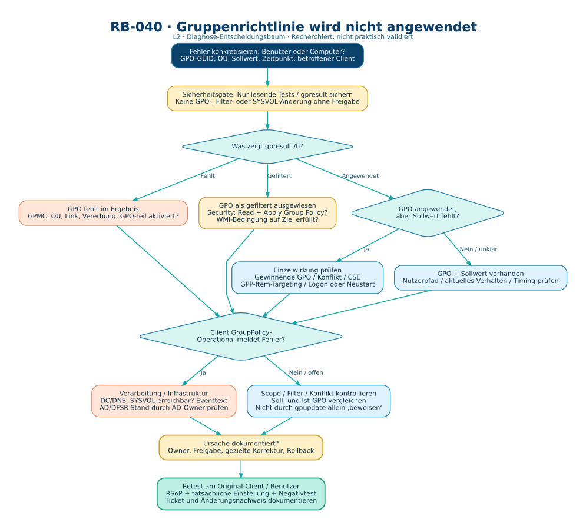

# RB-040 – Praxis-Runbook (L2): Gruppenrichtlinie wird nicht angewendet

**Fachstatus:** Recherchiertes, **noch nicht praktisch validiertes** Runbook · 22.11.2026 · Version 1.0  
**Sicherheit:** Zunächst lesende Prüfungen. Keine GPO-/OU-/Filter-/SYSVOL-Änderung ohne Owner, Freigabe, Rollback und Wirkungsprüfung.



## 1. Eingangsticket und Reproduktionsumfang

- Betroffener **Benutzer, PC, Domäne, Standort/VPN, Uhrzeit** und die **konkrete Soll-Einstellung**?
- Benutzer- oder **Computer**-GPO? Welcher GPO-Name, GUID, welche OU?
- Ein Benutzer/Client oder viele? Seit welcher Änderung? Welcher Vergleichsclient funktioniert?
- Nicht pauschal „Gruppenrichtlinie kaputt“ notieren: **GPO fehlt**, **ausgefiltert**, **Verarbeitungsfehler** oder **Einzelwirkung fehlt** unterscheiden.

## 2. Sicherheitscheck / Change-Gate

- Nur notwendige Benutzer-/Computerdaten im Ticket; RSoP enthält personenbezogene Infrastrukturdetails.
- Vor GPO-Änderung: Fach-Owner, Security-/AD-Freigabe, Zielgruppe, Pilotgerät, Zeitfenster und Rollback.
- `gpupdate /force` verändert Zustand; **nicht** als beliebigen ersten Test oder Ursachenbeweis verwenden.
- Keine GPOs, OU-Zuordnung, Security-Filtering, Registry oder SYSVOL-Inhalte „auf Verdacht“ ändern.

## 3. Client und Sitzung: effektive Richtlinien lesen

```powershell
# Auf dem betroffenen Client; im betroffenen Kontext:
gpresult /r
# Benutzerebene; Computerebene abhängig von Berechtigung:
gpresult /scope user /r
gpresult /scope computer /r
# HTML-Bericht (schreibt nur lokale Diagnosedatei):
gpresult /h "$env:TEMP\RB040-gpresult.html" /f
```

**Befund sicherstellen:** GPO angewendet, gefiltert (mit Grund) oder nicht erkennbar? Welcher DC, letzte Verarbeitungszeit? Richtiger Benutzerkontext? Die Auswertung eines anderen Admin-PCs ist kein gleichwertiger Nachweis.

## 4. GPO nicht sichtbar: Geltungsbereich prüfen

GPMC (nur lesen): Ist das richtige **Benutzer-/Computerobjekt** in der erwarteten OU? Ist die GPO mit Site, Domäne oder OU verknüpft? **Link** und GPO selbst aktiv? Richtige Hälfte aktiviert (User/Computer)? Vererbung/Enforced/Linkreihenfolge? Vergleich mit funktionierendem Ziel.

**Diagnose:** GPO nicht im Scope ≠ „Access denied“; zuerst den logischen Zielpfad klären.

## 5. GPO gefiltert: Security/WMI aufklären

- Wenn `gpresult` „**Security Filtering**“ nennt: `Read` + `Apply Group Policy`, Deny, Zielgruppen/Computerrechte prüfen.
- Wenn **WMI** genannt: tatsächlichen Filterausdruck gegen Betriebssystem-/Hardwarezustand bewerten.
- Bei Gruppenänderungen den **Token der betroffenen Sitzung** mit `whoami /groups` erfassen; neue Gruppenzuweisung ist nicht zwangsläufig im vorhandenen Token.

```powershell
whoami /groups
Get-CimInstance Win32_OperatingSystem | Select-Object Caption, Version, BuildNumber
```

**Keine** Security-Filterung erweitern, nur damit der Bericht „grün“ wird.

## 6. Verarbeitung scheitert: DC/DNS/SYSVOL prüfen

```powershell
# Domäne und DC-Namen anpassen:
nltest /dsgetdc:corp.example
Get-DnsClientServerAddress -AddressFamily IPv4
Test-Path '\\corp.example\SYSVOL'
```

Ein fehlgeschlagener SYSVOL-Test belegt nur fehlenden Zugriff aus diesem Kontext – Ursache offen. Auf dem Client GroupPolicy-Operational nach Zeitpunkt und Fehlercode lesen. Bei mehreren DCs oder Standorten: AD-/SYSVOL-Replikation **an AD-Owner eskalieren** statt selbst DFSR/SYSVOL zu reparieren.

## 7. Ereignisse und CSE-Status auswerten

```powershell
Get-WinEvent -FilterHashtable @{
  LogName='Microsoft-Windows-GroupPolicy/Operational';
  StartTime=(Get-Date).AddHours(-8)
} -ErrorAction SilentlyContinue |
  Select-Object -First 35 TimeCreated, Id, LevelDisplayName, Message
```

Zugehörigen Lauf/ActivityID und Eventbeschreibung prüfen. 1129 kann DC-Konnektivität betreffen, 1058 die Policy-Datei. **ID nicht ohne Kontext als Root Cause ausgeben.** Erweiterte GPSvc-Protokollierung nur nach Freigabe.

## 8. GPO angewendet, Einstellung fehlt: Einzelwirkung prüfen

- „Winning GPO“ und konkurrierende effektive Richtlinien auf die **konkrete Einstellung** beziehen.
- Falls Group Policy Preference: **Item-Level-Targeting**, Aktionsart, „Apply once“, Benutzerkontext und **CSE-Fehler** untersuchen.
- Ist **Anmeldung/Neustart** für diese Einstellung erforderlich? Hat der Client Hintergrundverarbeitung bereits abgeschlossen?
- Bei Zielverhalten (z. B. Laufwerk, Screensaver) am **Originalbenutzer** testen; Statusbericht allein reicht nicht.

## 9. Korrektur, Retest, Eskalation

**Nur bei belegter Ursache und Freigabe:** zuständigen Owner Link/Filter/CSE/Netzpfad korrigieren lassen; Wirkung mit Pilotgerät und Vergleich testen. Ggf. `gpupdate /force` nach Absprache, wenn Rückweg/Abmeldung/Neustart abgesichert. **Retest:** RSoP-Status, tatsächlicher Sollwert, ursprünglicher Benutzer/Client und nicht autorisierte Vergleichszielgruppe. Bei unklarem GPO-Stand: GPMC-Daten, Event-ID/Message, DC, SYSVOL, GPO-GUID und Zeitfenster an AD-/Security-/Netzwerkteam.

## 10. Abschluss und Muster-Ticketkommentar

**Abschluss-Check:** Ausgangssymptom reproduziert? Hypothese mit mindestens zwei korrelierenden Befunden gestützt? Änderung freigegeben und dokumentiert? Ursprünglicher Fehler behoben? Keine unbeabsichtigte breitere Rechtewirkung? Nutzer informiert?

> **Fiktives Muster – keine ausgeführte Reparatur:** „GPO `GPO-Workstation-Standard` wurde auf PC `CLIENT-040` nicht angewendet. RSoP zeigte Ausschluss durch WMI-Filter; GPMC-Link und SYSVOL-Zugriff waren vorhanden. Filterbedingung auf dem Zielsystem erfüllt nicht die dokumentierte Sollgruppe. Befund mit GPO-Owner abgestimmt, gezielte Korrektur im Testbereich vorgeschlagen. Produktive Änderung/Retest noch ausstehend; keine pauschale Filter- oder GPO-Änderung durchgeführt.“

**Quellen:** Microsoft Learn [GPO troubleshooting](https://learn.microsoft.com/en-us/troubleshoot/windows-server/group-policy/applying-group-policy-troubleshooting-guidance), [Group Policy processing](https://learn.microsoft.com/en-us/windows-server/identity/ad-ds/manage/group-policy/group-policy-processing), [gpresult](https://learn.microsoft.com/en-us/windows-server/administration/windows-commands/gpresult), [Group Policy Preferences](https://learn.microsoft.com/en-us/windows-server/identity/ad-ds/manage/group-policy/group-policy-preferences).

**Eigene Konzeption, KI-gestützte Visualisierung mit ChatGPT.**
