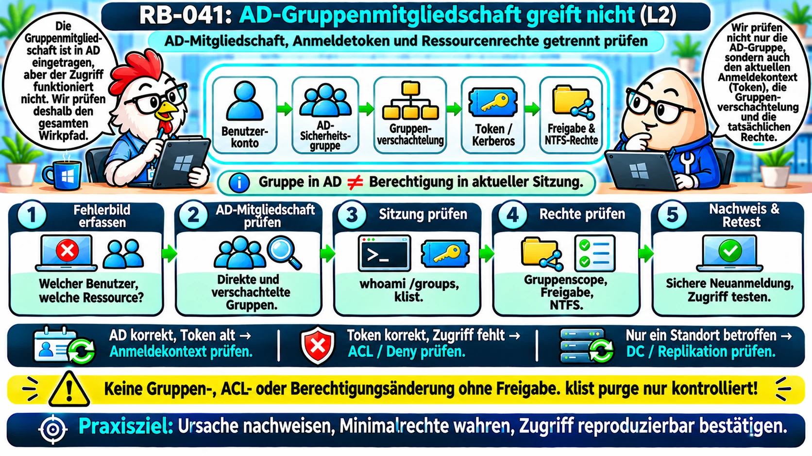

# RB-041 – AD-Gruppenmitgliedschaft greift nicht (L2)

**Projekt:** 50 Tickets – 50 typische IT-Supportfälle  
**Bereich:** Active Directory Domain Services, Windows 11, Windows Server, AD-Sicherheitsgruppen, Kerberos, SMB/NTFS  
**Support-Level:** L2 · **Stand:** 22.11.2026 · **Version:** 1.0  
**Fachstatus:** Anhand offizieller Microsoft-Quellen recherchiert, **noch nicht praktisch validiert**. Namen, Konten, Messwerte und Fallgeschichten sind **fiktiv**. Keine produktiven Berechtigungen wurden verändert.



> **Leitsatz:** Die **Verzeichnis-Mitgliedschaft**, der **Sicherheitskontext einer laufenden Sitzung** und die **effektive Berechtigung am Zielserver** sind drei verschiedene Dinge. Erst prüfen, wo die Kette unterbrochen ist – dann korrigieren.

---

## 1. Störungsbild, Abgrenzung und Lernziele

**Typische Meldungen:**

- „Ich wurde gestern der Projektgruppe hinzugefügt, erhalte aber weiterhin ,Zugriff verweigert‘.“
- „Beim Kollegen funktioniert das Laufwerk, obwohl beide in derselben AD-Gruppe sind.“
- „Die neue Gruppenmitgliedschaft ist in AD sichtbar, aber `whoami /groups` zeigt sie noch nicht.“
- „Über den Standort A klappt der Zugriff; von Standort B nicht.“

**Lernziel:** Sicher entscheiden, ob das Problem an **(A) Identität/AD-Mitgliedschaft, (B) Verschachtelung/Gruppentyp/-scope, (C) Anmeldung/Token/Tickets, (D) Ressource/ACL oder (E) Replikation/Standort** liegt.

**L1:** Störungsumfang, Kontoname, Fehlermeldung, Zielressource, Zeitpunkt und Vergleichsnutzer erfassen; keine Rechte ändern. **L2:** AD, aktuelle Anmeldung, Kerberos und Ressourcen-ACLs mit lesenden Befunden korrelieren. **AD-/File-Server-/Security-Owner:** Genehmigte Mitgliedschafts-, ACL- und Replikationskorrekturen durchführen. [Q1–Q7]

**Abgrenzung:** RB-040 behandelt *GPO-Verarbeitung*. Hier geht es um AD-Sicherheitsgruppen als Basis für Zugriffsrechte; eine GPO kann Gruppen nutzen, ist aber nicht dieselbe Ursache. RB-005 behandelt allgemeine „Zugriff verweigert“-Fälle; RB-017 Netzwerkfreigaben. RB-041 vertieft den Zusammenhang mit aktuellen Sicherheitstoken.

## 2. Der gesamte Wirkpfad: Vom AD-Konto bis zur Datei

```text
Betroffenes Benutzerkonto (richtige Domäne/Identität?)
        ↓
AD-Sicherheitsgruppe (direkt oder über Gruppenverschachtelung?)
        ↓
Gruppenscope / Gruppentyp / ggf. standortabhängiger DC-Stand
        ↓
Anmeldung: lokaler Zugriffstoken und/oder Kerberos-Tickets
        ↓
Ressourcenkontext auf dem Zielserver
        ↓
SMB-Freigaberecht + NTFS-DACL + eventuelle Deny-Regel
        ↓
Konkrete Operation: Lesen, Ändern, Erstellen oder Löschen erlaubt?
```

- **AD-Mitgliedschaft:** Was im Verzeichnis aktuell als Gruppenbeziehung vorhanden ist.
- **Zugriffstoken:** Sicherheitsidentität und Gruppeninformationen einer bestimmten **Logon-Sitzung** auf dem Client. Eine bereits laufende Sitzung übernimmt Änderungen nicht automatisch.
- **Kerberos:** TGT und Service-Tickets ermöglichen Authentifizierung und transportieren unter anderem Autorisierungsdaten; ihr Inhalt kann während der Ticketlebensdauer veraltet sein.
- **Autorisierung:** Erst auf der Zielressource entscheidet eine Zugriffsprüfung anhand des dort gültigen Kontextes und der Zugriffskontrolllisten (ACLs).

**Merksatz:** „In AD Mitglied“ ≠ „in der aktuellen Sitzung wirksam“ ≠ „am Ziel berechtigt“. [Q1–Q5]

## 3. AD-Gruppen richtig verstehen: Sicherheitsgruppe, Scope, Verschachtelung

**Sicherheitsgruppen** können in ACLs verwendet werden. **Verteilergruppen (Distribution)** sind nicht allgemein für Windows-ACL-Autorisierung gedacht. Prüfe den Gruppentyp statt nur eines Namens. [Q1]

| Gruppenscope | Typische Verwendung | Diagnosefalle |
|---|---|---|
| **Global** | Benutzer/Rollen innerhalb einer Domäne bündeln | Mitgliedschaftsregeln und Quell-Domäne beachten |
| **Domain Local** | Rechte an Ressourcen einer Zieldomäne zuweisen | Gruppen des Ressourcenservers können im lokalen Clienttoken fehlen und dennoch am Server wirken |
| **Universal** | Domänenübergreifende Rollen innerhalb der Gesamtstruktur | Replikation und Global Catalog berücksichtigen |

**AGDLP**, als Berechtigungsdesign im klassischen AD: **Accounts → Global Groups → Domain Local Groups → Permissions**. Nicht jede reale Umgebung folgt exakt dieser Konvention, aber sie liefert einen guten Suchpfad. Bei mehreren Domänen wird teils **AGUDLP** genutzt. Gruppenscopes, Verschachtelungsregeln und tatsächliche Domänengrenzen müssen anhand der Umgebung geprüft werden. [Q1]

**Achtung:** Die direkte `memberOf`-Eigenschaft eines Benutzerkontos deckt nicht jede indirekte/verschachtelte oder implizite Mitgliedschaft ab. Auch `Get-ADGroupMember -Recursive` liefert aufgelöste Mitglieder, nicht automatisch die vollständige Verschachtelungskette mit allen Zwischengruppen. [Q6]

## 4. Ticketannahme: Welcher Zugriff wird wirklich verweigert?

Dokumentiere **exakt**:

1. **Benutzer:** Domäne, `sAMAccountName`/UPN, Anmeldung lokal/RDP/VDI/VPN, betroffener Account (nicht bloß Anzeigename).
2. **Ziel:** UNC-Pfad `\\filesrv01.corp.example\Projekte\TeamA`, Dateipfad oder Anwendung, Ressourcenserver und erforderliche Aktion (Lesen/Schreiben/Ändern).
3. **Zeitpunkt:** Wann wurde die Gruppe geändert? Seit wann besteht die Sitzung? Seit wann tritt der Fehler auf?
4. **Fehlermeldung:** Wortlaut, Fehlercode, Ereigniszeit, Screenshot ohne sensitive Inhalte.
5. **Vergleich:** Betrifft es einen Benutzer, alle neuen Mitglieder oder einen ganzen Standort? Andere Ressource? Anderer Client?
6. **Betroffene Art:** GPO-Einstellung, SMB/NTFS, RDP oder Anwendung? Die Autorisierung kann jeweils anders erfolgen.

Nicht nur „Gruppenrecht fehlt“ ins Ticket schreiben. Ein *nicht erreichbarer Server* ist ein anderes Fehlerbild als *Access denied*; Netzwerk/DNS/Portprobleme zunächst getrennt nach RB-034/RB-038/RB-039 behandeln.

## 5. Sicherheits- und Datenschutzgate

**Zunächst lesend arbeiten.** Keine Gruppenmitgliedschaft, ACL, Freigabe, GPO, DC-Replikation oder Kerberos-Konfiguration auf Verdacht ändern. Insbesondere **keinen** Benutzer prophylaktisch in „Administratoren“, „Domänen-Admins“ oder eine breitere Sammelgruppe aufnehmen.

Vor einem Eingriff: **Fach-Owner/Anforderung**, Security- und Change-Freigabe, betroffene Ressourcen, geringstes nötiges Recht (*Least Privilege*), Testperson, Rücknahmeplan und Nachweis definieren.

- `whoami /groups`, `klist`, `Get-ADGroupMember`, `Get-SmbShareAccess` sind lesende Diagnosen.
- `klist purge` **löscht Tickets**, ist keine reine Lesediagnose und kann Anmeldungen/Zugriffe unterbrechen; nicht als routinemäßiger erster Schritt.
- Neuanmeldung beendet laufende Arbeiten/Verbindungen. Bei Remote- oder VPN-Nutzung Rückweg, Dateien, MFA und Anmeldemöglichkeiten **vorher** prüfen.
- Gruppenausgaben und ACLs enthalten personenbezogene beziehungsweise sicherheitsrelevante Informationen. Minimal dokumentieren; **keine Kennwörter oder Kerberos-Ticketgeheimnisse** in Tickets kopieren. [Q2, Q3]

## 6. Identität und direkte Mitgliedschaft im AD nachweisen

Auf einem **berechtigten Admin-System mit RSAT/ActiveDirectory-Modul** oder DC, ausschließlich lesend:

```powershell
Import-Module ActiveDirectory

# Beispielkonto und Zielgruppe – an Labor-/Unternehmensumgebung anpassen:
$User  = 'max.mustermann'
$Group = 'DL_Projekte_TeamA_Modify'

Get-ADUser -Identity $User -Properties Enabled, UserPrincipalName, DistinguishedName |
  Select-Object SamAccountName, Enabled, UserPrincipalName, DistinguishedName

Get-ADGroup -Identity $Group -Properties GroupCategory, GroupScope, DistinguishedName |
  Select-Object Name, GroupCategory, GroupScope, DistinguishedName

# Direkte Mitglieder des Gruppenobjekts, ohne rekursive Auflösung:
Get-ADGroupMember -Identity $Group |
  Select-Object Name, SamAccountName, ObjectClass
```

**Interpretation:** Richtiger Benutzer und richtige Gruppe? `GroupCategory = Security`? Richtige Domäne? Ist ein Mitglied **eine andere Gruppe** statt eines Nutzers? Ist die Änderung auf dem befragten DC sichtbar?

**Vorsicht:** `-Identity` kann in einer komplexen Gesamtstruktur eine falsche Annahme über den Ziel-Namenskontext erzeugen. Bei Bedarf explizit den korrekten `-Server dc01.corp.example` und eindeutige DN/SID verwenden. [Q1, Q6]

## 7. Verschachtelung und autorisierungsrelevante Gruppen

```powershell
# Rekursiv aufgelöste Blattmitglieder: hilfreicher Hinweis, kein Pfadbeweis.
Get-ADGroupMember -Identity 'DL_Projekte_TeamA_Modify' -Recursive |
  Where-Object { $_.ObjectClass -eq 'user' } |
  Select-Object SamAccountName, DistinguishedName

# AD-basierte Berechnung autorisierungsrelevanter Gruppen für das Konto.
# Benötigt AD-Modul, berechtigte Verbindung und erreichbaren Global Catalog.
Get-ADAccountAuthorizationGroup -Identity 'max.mustermann' |
  Select-Object Name, GroupScope, GroupCategory, SID
```

**Wichtig:** `Get-ADAccountAuthorizationGroup` ermittelt einen **AD-basierten** Gruppensatz. Der ist **nicht gleichbedeutend** mit dem aktuellen Token einer bereits laufenden Windows-Sitzung und kann den Ressourcenkontext einer anderen Domäne nicht vollständig abbilden. Prüfe lokale und domänenlokale Ressourcen-Gruppen am Zielserver bei Bedarf gesondert. [Q4, Q6]

Bei Verschachtelung eine **Kette** ausdrücklich aufschreiben, z. B. `max.mustermann → GG_Projekt_TeamA → DL_Projekte_TeamA_Modify → Freigabe/NTFS`. Ein direktes und ein verschachteltes Mitglied müssen anhand der richtigen Gruppentypen/Scopes interpretiert werden. **Nie** nur anhand ähnlich klingender Gruppennamen entscheiden.

## 8. Aktuellen Sicherheitskontext auf dem betroffenen PC lesen

Auf dem **betroffenen Windows-Client in der tatsächlichen Sitzung des Benutzers**:

```powershell
whoami
whoami /user
whoami /groups
whoami /all
```

`whoami /groups` zeigt Gruppen-SIDs und Attribute des **aktuellen lokalen Anmeldetokens**, nicht den neuesten AD-Stand aller Domänen. Gruppen können z. B. als deaktiviert oder „Deny-only“ markiert sein. Ein positives Ergebnis auf einem separaten Admin-PC sagt nichts über die Sitzung des Anwenders. [Q3]

**Auswertungsbeispiel:** In AD ist eine neue globale Gruppe vorhanden, `whoami /groups` zeigt sie nicht und der Benutzer hat sich seit dem Gruppenwechsel nicht neu angemeldet. **Hypothese:** veralteter Logon-Token. **Noch nicht bewiesen:** Welche Tickets/Sessions die Zielressource benutzt und ob die Gruppe überhaupt an der ACL beteiligt ist. Bei VPN-/Offlineanmeldung kann die lokale Sitzung besonders lange alt bleiben. [Q2]

**Hinweis zur Abweichung:** `whoami /groups` muss nicht jede **domänenlokale Gruppe der Ressourcendomäne** auf dem Client ausweisen. Fehlende Anzeige allein beweist dann nicht fehlende Serverberechtigung. [Q5]

## 9. Kerberos-Tickets und Sitzung richtig einordnen

```powershell
# Im aktuell betroffenen Benutzerkontext:
klist
klist tgt

# Optional: Lokale Sitzung und Kerberos-Zielbezug dokumentieren:
whoami /user
```

**TGT** = Ticket Granting Ticket; **Service-Ticket** = Ticket für einen bestimmten Dienst, etwa `cifs/filesrv01.corp.example`. `klist` zeigt Tickets der aktiven Sitzung (Name, Zeitraum, SPN, Tickettyp). **Es druckt nicht die vollständigen Gruppenlisten des Tickets aus.** Ein altes TGT kann nach Änderungen weiterhin veraltete Gruppeninformationen liefern; bestehende SMB-Sitzungen können zusätzlich weiterbestehen. [Q2, Q7]

**Keine Schnelllösung:** `klist purge` ist nicht gleichbedeutend mit einer kompletten Neuanmeldung und aktualisiert nicht automatisch den bestehenden lokalen Windows-Zugriffstoken. Ticketpurge nur nach vorheriger Klärung von Seiteneffekten und Berechtigung; der kontrollierte Ab-/Anmeldeversuch ist oft aussagekräftiger, wenn die Domäne zuverlässig erreichbar ist.

## 10. Ressourcenberechtigung auf dem Zielserver prüfen

Für SMB-Freigaben zwei Ebenen **getrennt** prüfen: **Freigabe-ACL** und **NTFS-DACL**. Am tatsächlichen **Dateiserver** mit ausreichenden Leserechten:

```powershell
# Beispiel: Share-ACL am Server; benötigt passende SMB-Adminrechte.
Get-SmbShareAccess -Name 'Projekte' |
  Select-Object Name, AccountName, AccessControlType, AccessRight

# Beispiel: NTFS-ACL des tatsächlichen Zielordners am Server.
Get-Acl -Path 'D:\Shares\Projekte\TeamA' |
  Select-Object -ExpandProperty Access |
  Select-Object IdentityReference, FileSystemRights, AccessControlType, IsInherited
```

**Befundfragen:** Welche Gruppe ist konkret berechtigt? Gibt es explizite/übergeordnete **Deny**-Einträge? Welche Rechte gelten für die benötigte Operation? Ist „Lesen“ erlaubt, aber das Erstellen/Ändern einer Datei verboten? Passt die Zielgruppe zu den verschachtelten Gruppen?

**Effektive Rechte** hängen zusätzlich vom tatsächlichen Token, Ressourcendomäne, lokalen Gruppen, Vererbung und Kontext ab. Ein aus der Ferne berechneter „Effektiver Zugriff“ kann bei anderen Domänen unvollständig sein; Microsoft empfiehlt die Auswertung **relativ zum Ressourcenserver**. Ein echter Zugriffsversuch mit dem genehmigten Testkonto liefert einen zusätzlichen Nachweis. [Q5, Q8]

## 11. Standortunterschiede, Domänencontroller und Replikation

Wenn sich derselbe Benutzer je nach DC/Standort unterschiedlich verhält oder neu angelegte Gruppen an verschiedenen Stellen verschieden angezeigt werden:

```powershell
# Zwei explizite DCs getrennt befragen, keine Konfigurationsänderung:
Get-ADGroupMember -Identity 'DL_Projekte_TeamA_Modify' -Server 'dc01.corp.example'
Get-ADGroupMember -Identity 'DL_Projekte_TeamA_Modify' -Server 'dc02.corp.example'

# L2/AD-Owner: Replikationsstatus abfragen (nur lesend):
repadmin /showrepl dc01.corp.example
repadmin /showrepl dc02.corp.example
```

Auch **Zeit, DNS, VPN/Netzpfad**, Erreichbarkeit eines DC/KDC, Gruppenmitgliedschaft über Trusts und Global Catalog können relevant sein. Unstimmige DC-Befunde sind ein Hinweis auf Replikation/Kontext – kein Freibrief für manuelles Erzwingen oder Wiederherstellen einer AD-Replikation. [Q2, Q9]

**Sonderfall:** Prüfe, ob die Ressource per Kerberos oder NTLM angesprochen wird und ob eine alte Netzwerk-Sitzung weiterläuft. Die Aktualisierung der lokal gemeldeten Gruppe und der Zugriff auf eine entfernte Ressource können zeitlich auseinanderfallen.

## 12. Gezielte Maßnahmen, sichere Neuanmeldung und Retest

| Belegter Befund | Vertretbare Maßnahme nach Freigabe | Nachweis |
|---|---|---|
| Zielkonto in falscher/fehlender Gruppe | Beantragte Mitgliedschaft in **genau** der vorgesehenen Sicherheitsgruppe durch Owner korrigieren | AD-Gruppe/rekursive Kette auf passendem DC nachweisen |
| AD korrekt, lokaler Token alt | Daten sichern, Domänenverbindung prüfen, **kontrolliert ab- und anmelden** | `whoami /groups` im neuen Kontext; echter Ressourcentest |
| TGT oder Ressourcensitzung alt | Sitzungs-/Ticketkontext ermitteln; ggf. genehmigte Neuverbindung/Neuanmeldung | Neuer Ticketzeitpunkt und Ressourcenberechtigung prüfen |
| AD-Gruppe + Sitzung korrekt, ACL falsch | Freigabe-/NTFS-DACL durch Ressourcen-Owner **minimal** korrigieren | Lesen/Schreiben wie beauftragt; unerlaubter Zugriff bleibt gesperrt |
| Site-/DC-abhängig | Replikations-/KDC-Fehler durch AD-Team behandeln | DC-Befunde konsistent, Retest an ursprünglichem Standort |

**Warnung:** Nicht mit neuen Domänen-Administratorrechten, Registry-Hacks, `gpupdate /force`, SMB-Sitzungstrennung oder pauschalen ACL-Freigaben „abkürzen“. Alle Änderungen brauchen vorherige Sicherung des Ausgangszustands und eine mögliche Rücknahme.

**Retest:** Originalnutzer, Originalclient, Original-UNC-Pfad, erforderliche Operation. Danach mindestens ein **Negativtest**: Ein nicht berechtigter Testbenutzer darf die Ressource weiterhin nicht öffnen. Nachweis mit Zeitpunkt, erwartetem und tatsächlichem Ergebnis protokollieren.

## 13. Fiktiver Praxisfall A – Neuer Gruppenstatus, alter Logon-Token

**Ausgangslage (fiktiv):** Mitarbeiter `max.mustermann` bekommt um 10:15 Uhr Zugriff auf `\\filesrv01\Projekte`. In AD ist seine Mitgliedschaft über `GG_TeamA` und `DL_Projekte_TeamA_Modify` nachweisbar. Windows ist aber seit 07:45 Uhr angemeldet, der Fehler lautet `Zugriff verweigert`.

**Diagnosebeobachtungen:**

1. `Get-ADAccountAuthorizationGroup` zeigt erwartete Rolle in AD-basierter Berechnung.
2. `whoami /groups` in der noch laufenden Sitzung zeigt die neue **globale** Rolle nicht; `klist tgt` stammt aus der Zeit vor der Änderung.
3. Share-/NTFS-ACL am Zielserver sind für `DL_Projekte_TeamA_Modify` passend gesetzt.

**Hypothese:** Die Sitzung beziehungsweise ihr Kerberos-Kontext ist veraltet. Nach Prüfung offener Arbeiten und zuverlässiger Domänenverbindung erfolgt **mit Zustimmung** eine vollständige Abmeldung und neue Anmeldung. Anschließend sind die erwarteten Tokeninformationen da, der Originalzugriff funktioniert, ein unberechtigtes Vergleichskonto bleibt ausgeschlossen.

**Lernpunkt:** AD war nicht falsch; ein ACL-Umbau oder breit angelegte Gruppenänderung hätte zusätzliche Risiken geschaffen. Die konkreten Messergebnisse sind **nur Übungsdaten**, kein Praxisnachweis.

## 14. Fiktiver Praxisfall B – Token korrekt, NTFS-Recht fehlt

**Ausgangslage (fiktiv):** Die Nutzerin `lena.beispiel` ist seit Tagen korrekt in `GG_ProjektB`, hat sich neu angemeldet und kann das SMB-Share öffnen, aber in `\\filesrv02\ProjektB\Vertraege` keine neue Datei speichern.

**Diagnosebeobachtungen:**

1. AD-Verschachtelung und Benutzerkontext passen; Servicezugriff ist möglich.
2. Share-ACL erlaubt Zugriff, die NTFS-DACL des Unterordners gewährt der betreffenden Ressourcenrolle nur **Lesen**, nicht **Ändern**.
3. Ein vergleichbarer Ordner mit korrektem Änderungsrecht funktioniert. Der Dateiserver-Owner bestätigt die gewünschte Berechtigung.

**Maßnahme:** Der zuständige Owner korrigiert nach Freigabe **nur** die Berechtigung des autorisierten Zielordners. Test: Lesefunktion unverändert, Erstellen/Speichern mit dem berechtigten Konto erfolgreich, unberechtigte Testperson weiterhin abgewiesen.

**Lernpunkt:** „Mitglied und angemeldet“ beweist kein Recht auf **jede** Dateisystemoperation. Auch dies ist ein **fiktives Szenario**.

## 15. Active Recall, Diagnosekarten und Transfer

**Wissenskarten (ohne Nachschlagen beantworten):**

1. Was unterscheidet AD-Mitgliedschaft, lokalen Zugriffstoken und Ressourcen-ACL? — **Verzeichnisstatus, laufende Sitzung, effektive Autorisierung**.
2. Wie lautet der Kern von AGDLP? — **Accounts → Global → Domain Local → Permissions**.
3. Welcher Befehl zeigt Gruppen im aktuellen Windows-Token? — **`whoami /groups`**.
4. Welcher Befehl zeigt Kerberos-Tickets? — **`klist`**.
5. Welche zwei ACL-Ebenen sind bei SMB+NTFS getrennt zu prüfen? — **Freigabe und NTFS**.

**Verständniskarten:**

6. Warum ersetzt `gpupdate /force` keine Neuanmeldung für einen alten Token? — **GPO-Aktualisierung ist nicht gleich Aufbau einer neuen Logon-Sitzung**.
7. Warum beweist fehlende Domain-Local-Gruppe in `whoami` keinen fehlenden Zugriff? — **Der Ressourcenserver kann eigene domänenlokale Gruppen einbeziehen**.
8. Warum reicht ein erfolgreiches `Get-ADAccountAuthorizationGroup` allein nicht? — **Berechneter AD-Gruppensatz ≠ aktueller Clienttoken ≠ Ressourcenserver-Kontext**.

**Diagnose-/Transferkarten:**

9. AD richtig, `whoami /groups` alt, Anmeldung vor Änderung: Was zunächst? — **Anmelde-/Ticketkontext, Domänenverbindung, sichere Neuanmeldung planen**.
10. AD und Token richtig, nur Schreibzugriff fehlt: Wohin? — **Freigabe- und NTFS-Rechte für Operation prüfen**.
11. Nur ein Standort betroffen, DC-Ergebnisse abweichend: Was prüfen? — **DC-Kontext, Replikation, KDC/Netzweg**.
12. Ein Anwender fordert „Gib mir kurz Adminrechte“: Was tun? — **Nicht pauschal erhöhen; Rechtebedarf und Owner-Freigabe klären**.

**Praxisvalidierung:** Im autorisierten AD-Testlabor eine globale Rolle und eine domänenlokale Ressourcenrolle anlegen, Zugriff auf ein Testshare nachvollziehen, Gruppenmitgliedschaft **während einer bestehenden Sitzung** ändern, AD-Befund und `whoami` gegenüberstellen und nur kontrolliert neu anmelden. **Keine AD-Laborumgebung vorhanden?** Alternativ fiktive Befundausgaben diagnostizieren und Handlungsplan ohne echten Eingriff erstellen.

**Zeitversetzte Prüfung:** Nach etwa **7 und 21 Tagen** ohne Unterlagen zwei neue Fehlerszenarien lösen; gemessen werden Diagnosehypothese, Zahl unnötiger Änderungen, Nachweisqualität und korrekte Rechtebegrenzung.

---

## Herstellerquellen / Recherchebelege (Microsoft Learn)

- **[Q1]** Active Directory-Sicherheitsgruppen und Gruppenscopes: https://learn.microsoft.com/de-de/windows-server/identity/ad-ds/manage/understand-security-groups
- **[Q2]** Gruppenänderungen bei Offline-/VPN-Anmeldung, lokale Token und Kerberos: https://learn.microsoft.com/de-de/troubleshoot/windows-client/group-policy/group-membership-changes-not-updating-over-some-vpn-connections
- **[Q3]** `whoami` und `/groups`: https://learn.microsoft.com/de-de/windows-server/administration/windows-commands/whoami
- **[Q4]** `Get-ADAccountAuthorizationGroup`: https://learn.microsoft.com/en-us/powershell/module/activedirectory/get-adaccountauthorizationgroup?view=windowsserver2025-ps
- **[Q5]** Effektiven Zugriff auf entfernte Ressourcen bewerten: https://learn.microsoft.com/en-us/troubleshoot/windows-server/windows-security/access-checks-windows-apis-return-incorrect-results
- **[Q6]** `Get-ADGroupMember -Recursive` und AD-Gruppenprüfung: https://learn.microsoft.com/de-de/powershell/module/activedirectory/get-adgroupmember?view=windowsserver2025-ps
- **[Q7]** `klist` – Kerberos-Tickets anzeigen und Purge-Risiko: https://learn.microsoft.com/de-de/windows-server/administration/windows-commands/klist
- **[Q8]** `Get-SmbShareAccess`: https://learn.microsoft.com/de-de/powershell/module/smbshare/get-smbshareaccess
- **[Q9]** AD-Replikationsfehler diagnostizieren: https://learn.microsoft.com/de-de/troubleshoot/windows-server/active-directory/diagnose-replication-failures

**Quellenstatus:** Die Links dokumentieren Produkteigenschaften und Diagnosewerkzeuge; die konkrete Reihenfolge und fiktiven Beispiele wurden als L2-Lernablauf zusammengestellt. Ein praktischer Funktionstest oder vollständiger Abgleich mit einer konkreten Unternehmensumgebung ist **nicht erfolgt**.
