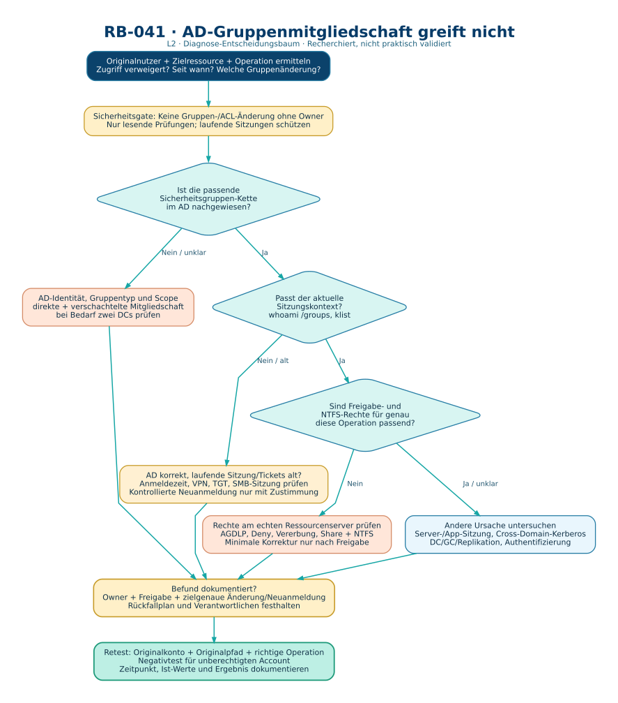

# RB-041 – Praxis-Runbook (L2): AD-Gruppenmitgliedschaft greift nicht

**Fachstatus:** Recherchiert, **noch nicht praktisch validiert** · 22.11.2026 · Version 1.0  
**Sicherheitsregel:** Zuerst lesende Beweise sammeln. Gruppen, ACLs, Tickets und Anmeldungen **nicht** ohne Owner, Freigabe und Rückweg ändern.



## 1. Ticketannahme und Scope

- Betroffener **Benutzer/UPN**, Computer, Domäne, Standort/VPN, Zielressource (UNC/Applikation), genaue Operation, Fehlermeldung, Uhrzeit?
- **Ein Nutzer oder mehrere?** Neue Mitglieder oder bestehende? Verhält es sich auf einem Vergleichsclient anders?
- Zeitpunkt der **Gruppenänderung**, letzter **vollständiger Logon**, Zustand offener Netzwerkverbindungen?
- **AD-/Token-/ACL-Problem** oder eigentlich DNS, SMB-Port, GPO oder Anwendung? Eine nachvollziehbare Hypothese notieren.

## 2. Sicherheitsgate und Beweissicherung

- Anfrage/Freigabe für genaues Zielrecht prüfen; kein pauschales Hinzufügen zu breiteren Gruppen.
- Befunde nur lesend, minimal personenbezogen sammeln. Kein Passwort, keine Tickets/Geheimnisse veröffentlichen.
- Für Neuanmeldung, Sitzungstrennung, `klist purge`, ACL- oder AD-Änderungen **Zustimmung, Backup/Dateischutz, Rückfall und Maintenance-Fenster** prüfen.
- **Remote/VPN:** Verbindung und Domänenzugriff dürfen durch Maßnahmen nicht unkontrolliert abbrechen.

## 3. Richtiges AD-Konto und Zielgruppe lesen

```powershell
# Auf einem autorisierten RSAT-/Admin-PC mit ActiveDirectory-Modul:
Import-Module ActiveDirectory
Get-ADUser -Identity 'max.mustermann' -Properties UserPrincipalName,Enabled,DistinguishedName |
  Select-Object SamAccountName, UserPrincipalName,Enabled,DistinguishedName
Get-ADGroup -Identity 'DL_Projekte_TeamA_Modify' |
  Select-Object Name,GroupCategory,GroupScope,DistinguishedName
Get-ADGroupMember -Identity 'DL_Projekte_TeamA_Modify' |
  Select-Object Name,SamAccountName,ObjectClass
```

**Befund:** Richtiger Identitätskontext? Sicherheitsgruppe statt Distribution? Benutzer direkt enthalten oder zwischengeschaltete Gruppe? Korrekte Domäne, SID, Ressource?

## 4. Verschachtelung und AD-basierten Gruppensatz prüfen

```powershell
# Rekursiv aufgelöste Mitglieder (nicht die vollständige Zwischengruppen-Kette):
Get-ADGroupMember -Identity 'DL_Projekte_TeamA_Modify' -Recursive |
  Select-Object Name,SamAccountName,ObjectClass

# Berechnete Autorisierungsgruppen im AD (kein Beweis für aktuellen Logon-Token):
Get-ADAccountAuthorizationGroup -Identity 'max.mustermann' |
  Select-Object Name,GroupScope,SID
```

**Befund:** Kette beispielsweise `User → GG_Rolle → DL_Ressource → ACL` nachvollziehen; fehlende oder ungeeignete Verschachtelung, falsche Mitgliedschaft oder Replikationsdifferenz? `Get-ADAccountAuthorizationGroup` benötigt einen Global Catalog.

## 5. Aktuelle Anmeldung beim betroffenen Benutzer prüfen

```powershell
# Im tatsächlich betroffenen Benutzerkontext auf dessen PC ausführen:
whoami /user
whoami /groups
whoami /all
```

**Befund:** Ist die neue **globale** Sicherheitsgruppe im Token enthalten? Welcher Benutzer ist angemeldet? Unterschiede zu AD sind bei einer *alten laufenden Sitzung* plausibel. Fehlende domänenlokale Gruppen des **Ressourcenservers** im Clienttoken sind allein kein Negativbeweis.

## 6. Kerberos-Tickets und Netzwerkkontext lesen

```powershell
# Keine Änderungen – aktuelle Kerberos-Tickets und TGT-Zeiten:
klist
klist tgt
```

**Befund:** TGT/Service-Ticket vor oder nach dem Gruppenwechsel ausgestellt? Zielservice (z. B. `cifs/…`) vorhanden? Noch bestehende Netzwerksitzung? **`klist` zeigt keine vollständige Gruppenliste im Ticket.** `klist purge` *nicht* zur Erstdiagnose einsetzen.

## 7. Ressource: Share- und NTFS-Rechte getrennt prüfen

```powershell
# Nur auf dem tatsächlichen Windows-Dateiserver mit passenden Leserechten:
Get-SmbShareAccess -Name 'Projekte' |
  Select-Object Name,AccountName,AccessControlType,AccessRight
Get-Acl -Path 'D:\Shares\Projekte\TeamA' |
  Select-Object -ExpandProperty Access |
  Select-Object IdentityReference,FileSystemRights,AccessControlType,IsInherited
```

**Befund:** Welche Rolle ist **tatsächlich** in den ACLs? Gewünschte Aktion: Lesen oder Ändern? Deny oder Vererbung? Der Effektivzugriff muss im Ressourcenkontext geprüft werden; entfernte ACL-Berechnungen können gruppenscopebedingt unvollständig sein.

## 8. Standort, DC und Replikation eingrenzen

Bei widersprüchlichen AD-Befunden **zwei DCs ausdrücklich vergleichen**:

```powershell
Get-ADGroupMember -Identity 'DL_Projekte_TeamA_Modify' -Server 'dc01.corp.example'
Get-ADGroupMember -Identity 'DL_Projekte_TeamA_Modify' -Server 'dc02.corp.example'
# Nur AD-L2/Domain-Owner, lesend:
repadmin /showrepl dc01.corp.example
```

**Befund:** DC-Stände konsistent? Standort/VPN, DNS/KDC/GC erreichbar? Bei Abweichungen an AD-Owner eskalieren; **keine** Replikation vorschnell erzwingen.

## 9. Entscheidung, freigegebene Korrektur und Retest

| Befund | Nächster verantwortbarer Schritt |
|---|---|
| AD-Mitgliedschaft falsch | AD-/Ressourcen-Owner um beantragte minimale Gruppenkorrektur bitten |
| AD richtig, aktuelle Sitzung alt | Nach Rückweg- und Datensicherung **kontrollierte Neuanmeldung** abstimmen |
| AD+Token korrekt, Ressource verweigert | Share/NTFS, Deny, Ressourcendomäne, erforderliche Aktion prüfen |
| DC-Ergebnisse widersprechen sich | Replikation/DNS/Standort durch AD-Team prüfen |
| Zugriff nur im alten Prozess nicht | Anwendungs-/Ressourcensitzung gezielt prüfen; keine flächendeckende Cache-Bereinigung |

**Retest:** Gleicher Benutzer und Client, Originalpfad, konkrete beauftragte Aktion; danach Negativtest eines nicht berechtigten Kontos. Ergebnis protokollieren. **Kein** vorzeitiger Abschluss allein wegen `Get-ADGroupMember` oder `whoami`.

## 10. Abschluss, Eskalation und Muster-Ticketkommentar

**Dokumentationsfelder:** Datum/Uhrzeit, Benutzer/Host/Ressource anonymisiert, angeforderte Aktion, ursprüngliche Meldung, AD-Quelle/DC, Gruppen-/Tokenbefund, Ticketzeit, ACL-Befund, verantwortlicher Owner, Maßnahme/Freigabe, Retest und Negativtest.

> **Muster (fiktiv):** „Zugriff auf `\\filesrv01\Projekte\TeamA` wurde mit dem betroffenen Konto im ursprünglichen Arbeitskontext überprüft. Mitgliedschaft über `GG_Projekt_TeamA → DL_Projekte_TeamA_Modify` im AD bestätigt. Der seit 07:45 Uhr bestehende Benutzerkontext enthielt die neu zugewiesene globale Gruppe nicht. Nach Abstimmung einer vollständigen Neuanmeldung wurden Gruppeninformationen und Zugriff erneut geprüft. Die erforderliche Änderungsoperation war erfolgreich; ein nicht berechtigtes Testkonto wurde weiterhin abgewiesen. Keine ACL- oder Gruppenberechtigungen verändert.“

**Eskalation an L3/Owner:** Cross-Forest-Scope/Trust, KDC/NTLM, abweichende DC-Stände, Authz-/ACL-Komplexität oder widersprüchliche Token-/Ressourcenereignisse – immer inklusive **exakter Befunde und Zeitpunkt**, nicht bloß „User hat Rechte, geht nicht“.

**Quellen:** Vollständige Microsoft-Links und Literaturhinweise im **Lernartikel, Abschnitt „Herstellerquellen“**. Alle hier gezeigten Nutzer-/Servernamen sind Platzhalter. Keine praktische Validierung ist erfolgt.
