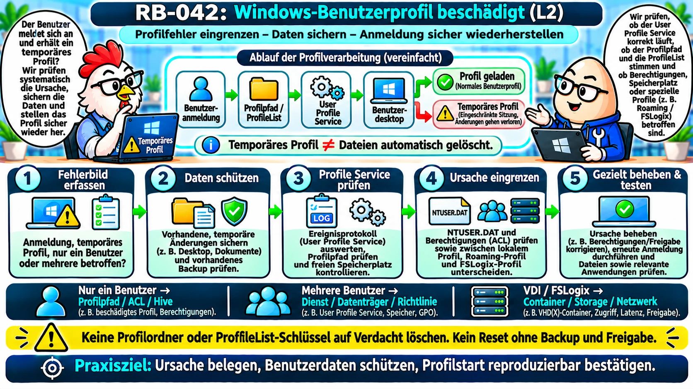

# RB-042 – Windows-Benutzerprofil beschädigt (L2)

**Projekt:** 50 Tickets – 50 typische IT-Supportfälle  
**Umgebung:** Windows 11, Windows-Benutzerprofildienst, lokale und domänengebundene Konten; optional Roaming/FSLogix  
**Support-Level:** L2 · **Stand:** 22.11.2026 · **Version:** 1.0  
**Fachstatus:** Anhand offizieller Microsoft-Quellen recherchiert, **noch nicht im Labor praktisch validiert**. Alle Personen, Orte, Geräte, Fehlermeldungskombinationen und Beispielmesswerte sind **fiktiv**.



> **Leitsatz:** Ein **temporäres Profil** ist ein Warnsignal, **kein Beweis**, dass die ursprünglichen Dateien verloren sind oder der Profilordner gelöscht werden muss. **Zuerst Daten sichern und den Ladefehler belegen, erst dann eingreifen.** [Q1–Q3]

---

## 1. Störungsbild, Lernziel und Abgrenzung

**Typische Anwenderberichte:**

- „Die Anmeldung klappt, aber mein Desktop und meine Einstellungen sind plötzlich weg.“
- „Windows meldet: *Wir können Sie nicht bei Ihrem Konto anmelden* oder *Sie wurden mit einem temporären Profil angemeldet*.“
- „Die Anmeldung wird mit *Fehler bei der Anmeldung des Diensts Benutzerprofildienst* abgebrochen.“
- „Mit einem anderen Benutzerkonto funktioniert derselbe Computer.“
- „Nach der Anmeldung in der VDI erscheint das falsche oder ein leeres Profil.“

**Lernziele:** Das Anmeldeproblem einer konkreten Phase zuordnen, das **ursprüngliche Benutzerprofil erhalten**, Hinweise aus der Ereignisanzeige auswerten, lokale Ursachen von Profilcontainer-/Netzwerkursachen unterscheiden und nur genehmigte Reparaturen mit Retest durchführen.

**Abgrenzung:** RB-001 behandelt allgemeine Windows-Anmeldung, RB-026 Windows-Startfehler, RB-041 AD-Gruppenmitgliedschaften. RB-042 beginnt dort, wo **Identität/Anmeldung möglich ist, aber die Profilinitialisierung scheitert oder falsche Profildaten erscheinen**. Ein Passwort- oder MFA-Fehler ist kein bewiesener Profilschaden.

**Rollen:** L1 dokumentiert Meldung und schützt aktuelle Anwenderarbeit. L2 untersucht lokale Profildaten, Dienstereignisse und Profilpfade. AD-/VDI-/Storage-/Security-Owner genehmigen Veränderungen an servergespeicherten Profilen, ACLs, Containern oder Registry.

## 2. Die Profil-Ladekette – technische Grundlagen

```text
Authentifizierung des Benutzerkontos (Konto/SID)
                 ↓
Profillokalisierung (ProfileList/ProfileImagePath, ggf. Profilrichtlinie)
                 ↓
Profilquelle: lokaler Ordner ODER Roaming-/Containerlösung
                 ↓
User Profile Service (ProfSvc) lädt Profil-Hive/Profilkomponenten
                 ↓
Benutzersitzung + Desktop + anwendungsspezifische Einstellungen
                 ├── korrekt geladen
                 └── Ladefehler → Anmeldung abgebrochen ODER temporäres Profil
```

- **SID:** Sicherheitskennung des Kontos; präziser als ein Anzeigename. Die SID gehört zur Identität, der Ordnername allein nicht.
- **`C:\Users\<Benutzer>`:** häufiges lokales Profilverzeichnis; tatsächlichen Pfad ermitteln statt voraussetzen.
- **`HKLM\SOFTWARE\Microsoft\Windows NT\CurrentVersion\ProfileList`:** Registry-Verzeichnis für Profilzuordnungen, darunter `ProfileImagePath`; **vorerst nur lesen**.
- **`NTUSER.DAT`:** Teil der benutzerspezifischen Registry-Hive; eine defekte oder nicht zugreifbare Hive kann Profilprobleme verursachen, ist aber nicht bei jedem temporären Profil die Ursache.
- **User Profile Service / ProfSvc:** Windows-Dienst, der das Laden und Entladen von Profilen koordiniert. [Q4, Q5, Q8]

**Merksatz:** „Konto erfolgreich authentifiziert“ ≠ „ursprüngliches Profil geladen“ ≠ „Daten gelöscht“.

## 3. Fehlerbilder nicht verwechseln

| Fehlerbild | Erste Hypothese | Kein ausreichender Beweis für |
|---|---|---|
| Meldung „Temporäres Profil“ | Ursprüngliches Profil wurde nicht normal geladen | Defekte Festplatte oder zerstörte Nutzerdaten |
| Anmeldefehler vor Desktop | Profildienst/Profilladung, aber auch Konto-/Systemursachen | Nur `NTUSER.DAT` beschädigt |
| Nur Desktop leer | Anderes/temporäres Profil, Umleitung, OneDrive, Ansicht | Profil vollständig verloren |
| Nur eine App startet nicht | App-spezifische Konfiguration | Komplettes Windows-Profil defekt |
| Viele Benutzer gleichzeitig betroffen | Gemeinsamer Dienst, Storage, Policy, Update, VDI | Fehler in jedem einzelnen Benutzerprofil |
| VDI mit FSLogix betroffen | Container-Anbindung, Berechtigung, Kapazität, Sperre | Lokaler Windows-Ordner als einzige Ursache |

Ein **temporäres Profil** kann bei einer erneuten Anmeldung verworfen werden. **Daten, die der Anwender während dieser temporären Sitzung erzeugt**, sind besonders gefährdet und müssen **vor Abmeldung oder Neustart** an einen bestätigten, sicheren Speicherort kopiert werden. [Q2]

## 4. Ticketannahme und reproduzierbaren Befund erfassen

1. **Benutzer/Identität:** korrektes lokales, AD- oder Entra-Konto, SID (nur falls erforderlich), Computername, Standort, Zeitpunkt der Anmeldung.
2. **Fehlertext:** exakte Meldung, Screenshot ohne vertrauliche Inhalte, Uhrzeit, Auftritt bei jedem oder nur einem Login.
3. **Sitzungsstatus:** Anmeldung überhaupt möglich? Tatsächlicher `$env:USERPROFILE`? Wird „Temporäres Profil“ angezeigt?
4. **Betroffenheit:** ein Benutzer an einem PC, mehrere Benutzer an einem PC oder viele PCs/VDI-Hosts?
5. **Änderungskontext:** Windows-Update, Speicherplatzwarnung, neue Richtlinie, AV-/EDR-Ereignis, Profilcontainer-Änderung?
6. **Datenlage:** Welche Dateien wurden **seit der fehlerhaften Anmeldung** bearbeitet? Gibt es geprüftes Backup, Cloud-Synchronisierung oder Dateiumleitung?

**Wichtig:** Die Person soll nicht wiederholt ab- und angemeldet werden, während ungesicherte Daten aus einem temporären Profil vorliegen.

## 5. Sicherheitsgate: Daten und Rückweg zuerst

Vor jedem **schreibenden** Eingriff:

- Daten in **temporärer Sitzung** sofort an einem von der Organisation freigegebenen Ort sichern und **Lesbarkeit kontrollieren**. Keine unkontrollierte Kopie in fremde Cloud-Dienste oder private USB-Medien.
- **Originalprofil** einschließlich relevanter Benutzerdateien und app-spezifischer Daten gegen Datenverlust absichern. Gesondert prüfen: `Desktop`, `Dokumente`, `Downloads`, benutzerdefinierte Verzeichnisse, OneDrive-Dateien mit lokalem Status, PST-Dateien und benötigte App-Einstellungen.
- Backup-Restore-Pfad, **BitLocker-Recovery-Schlüssel** bei geplantem Offlinezugriff, zuständigen Data Owner, Wartungsfenster und Change-Freigabe klären.
- **Keine** Löschung/Renamings von `C:\Users\...`, `NTUSER.DAT`, `.bak`-Schlüsseln oder `ProfileList`-Einträgen „auf Verdacht“; **kein** Reset und keine Neuinstallation als erste Maßnahme.
- **Keine** pauschale Deaktivierung von Defender/EDR oder Anpassung von Sicherheits-/Profilrichtlinien. Sicherheitsänderungen sind separate genehmigungspflichtige Untersuchungen, kein Standardrezept.
- **Protokolle/Profildaten** können vertrauliche Pfade, Benutzernamen und Dokumentnamen enthalten; nur die benötigten Ausschnitte im Ticket speichern.

**Prüftor:** Gibt es eine geprüfte Kopie der notwendigen Daten und eine getestete Rückfalloption? Wenn nein: **keine destruktive Reparatur**. [Q1, Q2, Q9]

## 6. Diagnose A – Identität, Profilsitzung und Speicherplatz nur lesen

Die folgenden Abfragen **lesen** lokalen Zustand. Auf dem betroffenen Computer, im relevanten Benutzer- oder autorisierten Administratorkontext:

```powershell
# Identität des aktuellen Prozesses – nicht automatisch die betroffene Person!
whoami /user
whoami /upn

# Tatsächliches Profilverzeichnis des aktuellen Kontexts anzeigen:
$env:USERPROFILE

# Alle dem System bekannten Profile, Pfade und Ladezustände:
Get-CimInstance -ClassName Win32_UserProfile |
  Select-Object SID, LocalPath, Loaded, Special, Status, LastUseTime

# Freien lokalen Speicherplatz lesen (Beispiel Systemlaufwerk C:):
Get-Volume -DriveLetter C |
  Select-Object DriveLetter, FileSystem, Size, SizeRemaining, HealthStatus
```

**Interpretation:** Stimmen Konto/SID und `LocalPath` überein? Ist die betreffende Profilinstanz noch geladen? Gibt es auffällig geringen freien Platz? `Win32_UserProfile` ist eine **Bestandsabfrage**, kein alleiniger Nachweis für eine erfolgreiche Benutzeranmeldung. Der Wert `Status` muss anhand seiner Dokumentation und zusammen mit Ereignissen interpretiert werden. [Q5]

**Einschränkung:** `whoami /upn` kann bei rein lokalen Konten scheitern. `C:` ist nicht auf jedem System das Windows-Volume; gegebenenfalls den tatsächlichen Laufwerksbuchstaben prüfen. **Keinen** automatischen `Remove-CimInstance`-Aufruf verwenden.

## 7. Diagnose B – User Profile Service und Ereigniszeit auswerten

Erste Anlaufstelle laut Microsoft: **Ereignisanzeige → Windows-Protokolle → Anwendung**, dann auf den Benutzerprofildienst filtern. Anschließend **Anwendungs- und Dienstprotokolle → Microsoft → Windows → User Profile Service → Operational** (Bezeichnung abhängig von Sprache/Version). [Q3]

```powershell
# Lesender Abruf: Ereignisse der letzten 48 Stunden vom Profilanbieter.
# Kann administrative Leserechte benötigen; Providername im System prüfen.
Get-WinEvent -FilterHashtable @{
    LogName      = 'Application'
    ProviderName = 'Microsoft-Windows-User Profiles Service'
    StartTime    = (Get-Date).AddHours(-48)
} -ErrorAction Stop |
  Select-Object TimeCreated, Id, LevelDisplayName, Message |
  Format-List

# Welche betrieblichen User-Profile-Protokolle heißen auf DEM System wie?
Get-WinEvent -ListLog '*User Profile*' |
  Select-Object LogName, IsEnabled, RecordCount
```

**Hinweise auf profilbezogene Ereignisse:** 1500 (Profil kann nicht geladen werden), 1508 (Lade-/Registry-Hive-Problem), 1509 (Kopier-/Dateizugriffsfehler), 1511 (temporäres Profil) oder 1515 (Profilbackup) können vorkommen. **Die genaue Meldung, Quelle, Zeit und der Betriebssystemkontext entscheiden – nicht die ID allein.** [Q3, Q7]

**Sonderfall:** Ereignis **1530** bedeutet häufig, dass eine Anwendung noch Registry-Handles offen hielt. Microsoft stuft dieses Ereignis für sich genommen im Profil-Ladeproblem nicht als zwingenden Reparaturbefund ein; ein bestimmter Prozess kann dennoch relevant sein, wenn wiederholt konkrete Folgen nachgewiesen werden. [Q3, Q10]

## 8. Diagnose C – `ProfileList`, Ordnerpfad und Zugriffsrechte vorsichtig lesen

```powershell
# Alle Profil-SID-Zuordnungen und gespeicherten ProfileImagePath-Werte LESEN.
Get-ChildItem 'HKLM:\SOFTWARE\Microsoft\Windows NT\CurrentVersion\ProfileList' |
  ForEach-Object {
    $p = Get-ItemProperty -LiteralPath $_.PSPath
    [pscustomobject]@{
      Key              = $_.PSChildName
      ProfileImagePath = $p.ProfileImagePath
      State            = $p.State
      RefCount         = $p.RefCount
    }
  } | Format-Table -AutoSize

# Nur Diagnose des ausgewählten Pfads; nicht auf allen Profilen pauschal ausführen.
$ProfilePath = 'C:\Users\testuser'    # fiktiver Pfad – gezielt ersetzen
Test-Path -LiteralPath $ProfilePath
Get-Item -LiteralPath $ProfilePath -Force |
  Select-Object FullName, Attributes, CreationTime, LastWriteTime
Get-Acl -LiteralPath $ProfilePath |
  Select-Object Owner, AccessToString
```

**Entscheidend:** Exakte SID mit richtigem Konto abgleichen. Ein `ProfileImagePath`, der auf einen anderen Benutzer oder einen nicht existierenden Pfad zeigt, ist ein **Hinweis**, aber die Reparatur erfordert Beweissicherung. Gleichnamige Ordner und `.bak`-Schlüssel nie automatisch überschreiben, umbenennen oder löschen.

**ACL-Fehler?** Nur mit berechtigtem Admin und unter Einbeziehung der vererbten Rechte beurteilen. **Keine** rekursive `icacls /grant Everyone:F`- oder Eigentümerübernahme auf Verdacht. Nicht blind `NTUSER.DAT` aus einem Profil kopieren; das kann Einstellungen, SID-Bindung, DPAPI oder anwendungsspezifische Zustände unbrauchbar machen. [Q1, Q4, Q8]

## 9. Diagnose D – lokal, Roaming, Ordnerumleitung oder FSLogix?

Nicht jeder Benutzer hat ein vollständig lokales Profil. Die **konkrete Bereitstellungsart** bestimmen:

| Profiltyp | Zusätzliche Prüfungen |
|---|---|
| Lokal | Datenträger, Profildienst, SID/Registry, Ordner-/Hive-Zugriff, ACL |
| Domänenprofil/Roaming | Erreichbarkeit der Profilfreigabe, ACL, DNS/SMB, Synchronisierung, Gruppenrichtlinien |
| Ordnerumleitung/OneDrive | Tatsächlicher Speicherort von Desktop/Dokumenten, Syncstatus, Offline-/Cloudinhalte |
| FSLogix-Profilcontainer (VDI/AVD/RDS) | VHD(X)-Attach, Container-Sperre, Storage-Kapazität, FSLogix-Protokoll, SMB-Zugriff, Konfiguration |

Bei eingesetztem FSLogix zuerst **lesend** prüfen:

```powershell
# Nur, wenn FSLogix in der Umgebung tatsächlich eingesetzt wird:
Get-ChildItem 'C:\ProgramData\FSLogix\Logs\Profile' -Filter 'Profile_*.log' |
  Sort-Object LastWriteTime -Descending |
  Select-Object -First 5 Name, LastWriteTime, Length

# Beispiel für Zugriff auf einen freigegebenen Profil-Storagepfad:
Test-NetConnection -ComputerName 'fslogix-store.corp.example' -Port 445
```

Das Log enthält möglicherweise persönliche Pfade, Host- und Sitzungsdaten: nur notwendige Fehlermeldungen nach Datenschutzvorgaben auswerten. **Nicht** Container-VHD(X) zwangsweise aushängen, zurücksetzen, verkleinern oder löschen, während eine Sitzung aktiv ist. Microsoft nennt u. a. Share-/NTFS-Berechtigungen, Containerlimit, Speicherplatzauslastung, DNS/Netzwerk sowie gesperrte Container als mögliche Ursachen. [Q6, Q7]

## 10. Entscheidungsmatrix: Was belegt welcher Befund?

| Beobachtung | Prüf-Hypothese | Nächster lesender Schritt |
|---|---|---|
| Ein Nutzer, anderer Account am selben PC funktioniert | Nutzerspezifischer Profilpfad/Hive/ACL | SID, Ereigniszeit, ProfileList, Pfad und ACL vergleichen |
| Mehrere Nutzer auf einem PC betroffen | Gemeinsamer Profildienst/Systemvolumen/Policy | Disk, Dienst-/Systemereignisse, letzte Änderung prüfen |
| Viele RDS-/VDI-Nutzer betroffen | Storage, FSLogix, Netzwerk, Profilrichtlinie | Container-Logs, Storage-Freigabe, Host-Vergleich |
| 1511 mit temporärer Anmeldung | Ursprüngliches Profil nicht normal geladen | Originalpfad, Ereignisse und aktuelle TEMP-Daten sichern |
| Meldung Zugriff verweigert beim Hive-Laden | Datei-/Registryberechtigung oder Sperre | Detailereignis, ACL und betroffenen Prozess prüfen |
| Profil normal, nur Dokumente fehlen | Umleitung/OneDrive/anderen Ordner prüfen | Tatsächlichen Pfad und Cloud-/Offlinezustand vergleichen |
| Nur eine App verliert Einstellungen | Anwendung oder per-user Konfiguration | App-/Profil-Trennung, kein pauschaler Profilreset |

**Wichtig:** „Ein anderer Benutzer kann sich anmelden“ grenzt den Fehler ein, beweist aber nicht zwingend, dass die Festplatte vollständig gesund ist. Auch „kein TEMP-Pfad“ schließt Profilprobleme nicht aus.

## 11. Korrekturstrategie nach Freigabe – von wenig zu stark eingreifend

1. **Vorbedingungen:** Anwenderarbeiten aus temporärer Sitzung gesichert, Originaldaten kontrolliert, betroffene Person/Owner informiert, Backup und Rollback dokumentiert.
2. **Ursache sicher korrigieren:** Beispiel: nachgewiesenen Storage-Engpass beheben; falschen, eindeutig dokumentierten Profilpfad oder falsche ACL **gezielt durch berechtigte Administration** mit Rückfallplan korrigieren.
3. **Kontrollierte erneute Anmeldung:** Nur nach Sicherung temporärer Daten und nach Abstimmung, da ein Neustart/Abmelden die temporäre Sitzung verwirft; in Remote-/VDI-Szenarien den Rückweg sichern.
4. **Wenn Profil nachweislich nicht reparabel:** Microsoft empfiehlt, ein neues Konto/Profil einzurichten und **persönliche Dateien aus dem alten Profil** zu kopieren. In Unternehmen muss die Zielidentität dem Gerätemanagement entsprechen; **kein ungeplanter dauerhafter Wechsel auf ein lokales Admin-Konto**. Anwendungsspezifische Daten, EFS/DPAPI, Kontenzuordnung, Outlook-/Browserdaten und Cloud-Synchronisierung separat planen. [Q1]
5. **Spezialfälle:** Profileinträge/Registry, FSLogix-Container, Roaming-Profile oder Sicherheitssoftware nur durch zuständiges Team nach Beweissicherung und Change freigeben; Änderungen vor Ausführung in isolierter Testumgebung prüfen.

**Ausdrücklich nicht als Standardlösung:** `.bak`-Registry-Schlüssel „bereinigen“, `C:\Users\Benutzer` umbenennen/löschen, blindes SFC/DISM/Reset oder Defender/EDR deaktivieren. Solche Eingriffe können die Beweislage und Nutzerdaten verschlechtern. Windows-Komponentenkorruption ist gegebenenfalls ein **separater** Diagnosezweig mit eigener Evidenz, siehe RB-026.

## 12. Retest: Nur ein sichtbarer Desktop reicht nicht

**Sichere Erfolgskriterien:**

- Anmeldung im **beabsichtigten Konto** am **ursprünglichen Gerät/VDI-Host** erfolgreich, ohne Temp-Profilwarnung.
- `whoami /user`, `$env:USERPROFILE` und Profilpfad korrelieren; relevante User-Profile-Service-Ereignisse nach dem Test geprüft.
- Desktop, Dokumente, umgeleitete Ordner, relevante Anwendungen, Drucker/Netzlaufwerke und Cloudsync stimmen mit erwarteter Benutzerumgebung überein.
- Neu erstellte **Testdatei** im vorgesehenen Profil wird nach kontrollierter Ab-/Anmeldung **nachweislich wiedergefunden**; nur zu genehmigten Testdaten und nach Sicherung.
- Bei Profilemigration: Vollständigkeit anhand einer vereinbarten Dateiliste und fachlicher Freigabe prüfen. Altes Profil **nicht sofort löschen**; Aufbewahrung gemäß Richtlinie.
- Erneute Anmeldung auf derselben Zielumgebung stabil; dokumentierter Fallabschluss erst nach Anwenderbestätigung/Owner-Freigabe.

Eine funktionsfähige temporäre Sitzung oder bloß ein neu angelegtes Profil ohne verifizierte Dateien gilt **nicht** als vollständig gelöst.

## 13. Fiktiver Praxisfall A – Lokales TEMP-Profil bei vollem Systemlaufwerk

**Meldung:** Nach einem Neustart sieht der Benutzer einen leeren Desktop und eine Warnung zu einem temporären Profil. Die Sitzung läuft noch. **Alle Daten/Ergebnisse in diesem Abschnitt sind erfunden.**

**Hypothesen (vor Diagnose):** Profilordner nicht vorhanden, Hive-Zugriff fehlerhaft, Datenträgerplatz erschöpft, Zugriffsrechte fehlerhaft.

**Beobachtungen (fiktiv):** `whoami` zeigt das korrekte Konto, `$env:USERPROFILE` zeigt ein TEMP-Verzeichnis, Ereignislog meldet ein Profilladeproblem und `Get-Volume` nur 80 MB frei. Der Originalordner `C:\Users\a.mustermann` ist lesbar. **Das beweist noch nicht**, dass Platzmangel die einzige Ursache ist.

**Kontrollierte Vorgehensweise:** Aktuelle TEMP-Arbeitsdateien sicher exportieren, ursprüngliche Daten gegenprüfen, belegte Systempartition und zeitlich passende Ereignisse korrelieren; genehmigte Speicherplatzbereinigung durch zuständigen Owner und anschließend kontrollierte Neuanmeldung mit Anwenderzustimmung. Keine Profil- oder Registry-Löschung.

**Erfolgsnachweis (fiktiv):** Anmeldung mit Originalpfad, lokale Dateien vorhanden, Testdatei über eine erneute Anmeldung erhalten; Ticket mit Ursache und kontrollierten Tests geschlossen.

## 14. Fiktiver Praxisfall B – FSLogix-Container an VDI-Host nicht eingebunden

**Meldung:** Mehrere Anwender erhalten auf einem VDI-Host temporäre Profile; andere VDI-Hosts sind unauffällig. Alle Angaben sind **fiktiv**.

**Hypothesen:** Serverübergreifende Berechtigungsabweichung, gesperrte VHD(X), Netz-/DNS-/SMB-Störung oder Speicherplatzproblem der Profilfreigabe.

**Beobachtungen (fiktiv):** Anmeldezeit 09:15; im FSLogix-Profillog steht ein Attach-Fehler und `Test-NetConnection` meldet vom betroffenen Host keine Verbindung zum Storage-Ziel über TCP 445. Ein Vergleichshost erreicht die Freigabe. **Nicht ausgeschlossen:** zusätzlicher Authentifizierungs- oder Storagefehler.

**Vorgehen:** VDI-/Storage-Team mit Befunden einbeziehen, DNS/Port/Firewallpfad und betroffene Freigabe eingrenzen; **keine** VHD(X)-Dateien entfernen und keine Container-Detach-Operation im laufenden Betrieb ausführen. Nach genehmigter Netzkorrektur Anmelde-/Profilattach auf Testhost und anschließend in der betroffenen Nutzerumgebung nachprüfen.

**Erfolgsnachweis (fiktiv):** Originalcontainer wird geladen, Anwendungszustand und Dateien vorhanden, keine erneuten Attach-Fehler, Freigabe und Regressionstest dokumentiert.

## 15. Active Recall, Diagnosekarten und Transfertraining

**Fragen zunächst ohne Lösung beantworten:**

1. Warum beweist eine erfolgreiche Kennwortprüfung nicht, dass das Benutzerprofil korrekt geladen wurde?
2. Welche Daten sind während einer temporären Sitzung besonders gefährdet – und wann?
3. Worin unterscheiden sich `whoami /user`, `Win32_UserProfile` und `ProfileList`?
4. Warum muss die Ereigniszeit zur konkreten Anmeldung passen?
5. Welche Aussage **kann** ein einzelnes Ereignis 1530 nicht beweisen?
6. Wann hilft der Vergleich „ein Nutzer / viele Nutzer“ bei der Eingrenzung?
7. Welche zusätzlichen Abhängigkeiten bringt ein FSLogix-Profilcontainer mit?
8. Welche Voraussetzungen gelten vor einer erneuten Anmeldung oder Profilmigration?
9. Warum ist das Entfernen eines `.bak`-Schlüssels ohne Diagnose riskant?
10. Wie beweist du, dass nach einer Reparatur die **richtigen** Benutzerdaten geladen wurden?

**Kompakte Anki-Vorschläge (Antwortseite jeweils selbst erstellen):**

| Typ | Vorderseite | Erwartete Antwort (Kurzanker) |
|---|---|---|
| Wissen | Welcher Dienst lädt Windows-Benutzerprofile? | User Profile Service (ProfSvc). |
| Wissen | Welche Datei trägt einen wesentlichen Teil der Benutzer-Registry-Hive? | `NTUSER.DAT`. |
| Verständnis | „TEMP-Profil“ bedeutet automatisch Datenverlust des alten Profils? | Nein; alte Daten separat prüfen, TEMP-Änderungen sofort sichern. |
| Verständnis | Warum sind „Konto“ und „Profil“ getrennte Fehlerdomänen? | Authentifizierung ≠ Profilladung. |
| Diagnose | Ein Nutzer, Login erfolgreich, TEMP, Profilordner vorhanden: zuerst? | TEMP-Daten sichern; Ereignisse, Pfad, Disk und ACL korrelieren. |
| Diagnose | Viele VDI-Logins mit TEMP: welcher Zweig? | FSLogix/Storage/Netz/Policy im Hostvergleich. |
| Diagnose | Event 1530 allein: Profil defekt? | Kein hinreichender Nachweis. |

**Transferaufgabe:** In einer isolierten Windows-11-VM ein Testkonto und Testdaten vorbereiten; nur **genehmigte, reversible** Störungsvarianten einsetzen. Zuerst Diagnoseprotokoll ausfüllen; Lösung erst danach mit dem Runbook vergleichen. **Keine** echte Benutzerprofilbeschädigung ohne Snapshot, Backup und Recovery-Test erzwingen. Wiederholung mit neuen Symptomen nach ca. 7 und 21 Tagen.

---

## Herstellerquellen / Recherchebelege

- **[Q1] Microsoft Support – Reparieren eines beschädigten Benutzerprofils:** https://support.microsoft.com/de-de/windows/security/identity-signin/fix-a-corrupted-user-profile
- **[Q2] Microsoft Support – We can't sign in to your account / temporary profile:** https://support.microsoft.com/en-us/windows/security/identity-signin/we-can-t-sign-in-to-your-account-error-message
- **[Q3] Microsoft Learn – Problembehandlung von Benutzerprofilen mit Ereignissen:** https://learn.microsoft.com/de-de/troubleshoot/windows-server/user-profiles-and-logon/troubleshoot-user-profiles-events
- **[Q4] Microsoft Learn – About User Profiles:** https://learn.microsoft.com/en-us/windows/win32/shell/about-user-profiles
- **[Q5] Microsoft Learn – Win32_UserProfile-Klasse:** https://learn.microsoft.com/en-us/previous-versions/windows/desktop/usm/win32-userprofile
- **[Q6] Microsoft Learn – FSLogix: Container Attach/Detach:** https://learn.microsoft.com/en-us/fslogix/troubleshooting-container-attach-detach
- **[Q7] Microsoft Learn – FSLogix: Protokolle und Diagnose:** https://learn.microsoft.com/de-de/fslogix/troubleshooting-events-logs-diagnostics
- **[Q8] Microsoft Learn – Recognized Environment Variables / ProfileList:** https://learn.microsoft.com/windows/deployment/usmt/usmt-recognized-environment-variables
- **[Q9] Microsoft Support – Sicherung und Wiederherstellung unter Windows:** https://support.microsoft.com/en-us/windows/experience/backup-recovery/backup-restore-and-recovery-in-windows
- **[Q10] Microsoft Learn – Ereignis 1530 im Anwendungsprotokoll:** https://learn.microsoft.com/de-de/troubleshoot/windows-server/user-profiles-and-logon/event-1530-application-log

**Anwendbarkeit:** Die Quellen umfassen Windows-11-Supportartikel und teilweise Windows-Server-/FSLogix-Szenarien; konkrete Diagnosemaßnahmen sind **versions- und umgebungsabhängig**. Herangezogene allgemeine Grundsätze sind deshalb von speziellen Server- oder VDI-Verfahren getrennt. Alle Befehle und Testannahmen sind als Lernvorlage zu prüfen, **nicht** auf dem echten Betriebssystem ausgeführt. Links: Stand der Recherche 22.11.2026.
