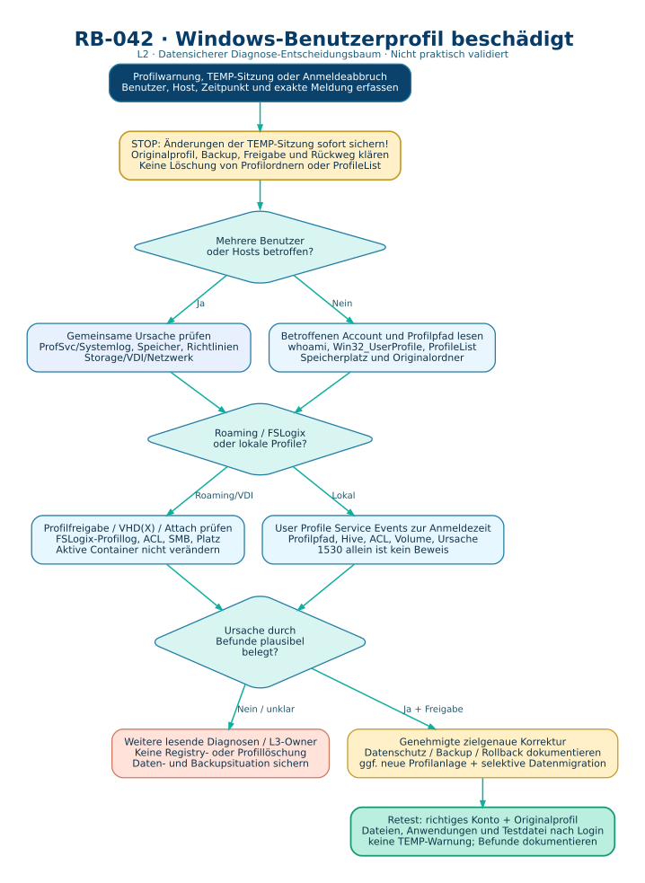

# RB-042 – Praxis-Runbook (L2): Windows-Benutzerprofil beschädigt

**Fachstatus:** Recherchiert, **noch nicht praktisch validiert** · 22.11.2026 · Version 1.0  
**Sicherheitspriorität:** **Temporäre Arbeit sichern; Originalprofil erhalten; keine Löschung oder Registry-Reparatur auf Verdacht.**



## 1. Störungsmeldung und Anmeldephase erfassen

- Meldung im Original, Screenshot ohne persönliche Inhalte, **genaue Uhrzeit**, betroffener Benutzer/SID, Hostname und Standort erfassen.
- Anmeldung abgewiesen oder Anmeldung mit **temporärem/leerem Profil** erfolgreich? Ist ein anderer Benutzer am gleichen Rechner betroffen? Tritt es auf einem VDI-/RDS-Host auf?
- Welche Arbeiten wurden **nach** Eintritt der Fehlermeldung angelegt/geändert? Wurden bereits Neustarts oder „Profilreparaturen“ durchgeführt?
- Nur Desktop-/OneDrive-Inhalte fehlen? Dann Speicherort/Umleitung prüfen, nicht sofort Profilkorruption annehmen.

## 2. Sofortmaßnahme: Daten und Zugang sichern

- Bei temporärem Profil **vor Abmelden/Neustart** die dort bearbeiteten Anwenderdateien auf genehmigten Speicher sichern; Rücklesetest durchführen.
- Originaldateien, Cloud-/Roaming-Daten, PST/EFS-/app-spezifische Informationen, vorhandenes Backup und ggf. BitLocker-Wiederherstellung klären.
- Vor Schreiboperation: Owner-/Datenschutz- und Change-Freigabe, Wartungsfenster, Rollback, funktionierender zweiter Admin-Zugang.
- **Nicht**: Profilordner, `NTUSER.DAT`, `ProfileList`-/`.bak`-Schlüssel, FSLogix-VHD(X) oder Securitykomponenten löschen/ändern.

## 3. Konto, Profilzustand und Speicherplatz lesen

```powershell
# Am betroffenen Rechner; aktuelle Sitzung ist nicht zwingend der Zielbenutzer.
whoami /user
$env:USERPROFILE
Get-CimInstance Win32_UserProfile |
  Select-Object SID, LocalPath, Loaded, Special, Status, LastUseTime
Get-Volume -DriveLetter C |
  Select-Object DriveLetter, SizeRemaining, HealthStatus
```

**Auswerten:** SID/Originalkonto korrekt? Tatsächliches TEMP-Profil? Genug Platz auf dem **richtigen** Profilvolume? Andere betroffene Nutzer auf demselben System?

## 4. Profildienst-Ereignisse zeitgenau auswerten

GUI: Ereignisanzeige → Windows-Protokolle → **Anwendung** → Quelle **User Profiles Service**; anschließend dessen **Operational**-Protokoll unter Microsoft/Windows auswerten.

```powershell
Get-WinEvent -FilterHashtable @{
  LogName='Application'
  ProviderName='Microsoft-Windows-User Profiles Service'
  StartTime=(Get-Date).AddDays(-2)
} | Select-Object TimeCreated, Id, LevelDisplayName, Message

# Falls der Name des Betriebskanals unbekannt ist:
Get-WinEvent -ListLog '*User Profile*' |
  Select-Object LogName, IsEnabled
```

**Befund:** Passende Zeit? 1500/1508/1509/1511/1515? Konkreter Pfad, Fehlercode, Zugriffs- oder Speicherproblem? Ereignis **1530 isoliert** nicht als eindeutigen Profildefekt deuten.

## 5. ProfileList, Zielpfad und ACL **nur lesend** prüfen

```powershell
Get-ChildItem 'HKLM:\SOFTWARE\Microsoft\Windows NT\CurrentVersion\ProfileList' |
  ForEach-Object {
    $p = Get-ItemProperty -LiteralPath $_.PSPath
    [pscustomobject]@{ SIDKey=$_.PSChildName; Path=$p.ProfileImagePath; State=$p.State }
  } | Format-Table -AutoSize

# Nur im konkreten, bestätigten Fehlerpfad (Beispiel):
$OldProfile='C:\Users\testuser'
Test-Path -LiteralPath $OldProfile
Get-Acl -LiteralPath $OldProfile | Select-Object Owner, AccessToString
```

**Befund:** Registry-SID passt zum Zielkonto? Korrektes Profilverzeichnis? ACL/Vererbung? Eventuell `.bak`-Eintrag dokumentieren, **nicht** automatisch manipulieren.

## 6. Profiltyp bestimmen und Sonderpfade isolieren

- **Lokal:** Profildienst, Hive, SSD/Volume, ACL, Originalpfad prüfen.
- **Roaming:** Profilserver/-share, Benutzerrechte, DNS/SMB und Gruppeneinstellungen zusätzlich prüfen.
- **Ordnerumleitung/OneDrive:** Originalspeicherort und Online-/Offline-Dateien nachweisen.
- **FSLogix/VDI:** Attach-/Detach-Ereignisse, Speicherlimit, Containerlock und Netzwerkpfad prüfen; Hostvergleich aufbauen.

```powershell
# NUR wenn FSLogix wirklich aktiv ist; lesend:
Get-ChildItem 'C:\ProgramData\FSLogix\Logs\Profile' -Filter 'Profile_*.log' |
  Sort-Object LastWriteTime -Descending |
  Select-Object -First 5 Name, LastWriteTime, Length
```

**Kein** Container löschen, gewaltsam aushängen oder Storage-Richtlinien ohne VDI-/Storage-Owner ändern.

## 7. Diagnoseentscheidung und Hypothese absichern

| Befund | Verdacht | Weiteres Vorgehen |
|---|---|---|
| Nur ein Konto betroffen | Profilpfad, Hive, ACL, Temp | Ereignisse, Originalordner und Konten vergleichen |
| Mehrere Konten auf PC | Disk/System/ProfSvc | System-/Storage-Befunde vergleichen |
| Mehrere VDI-Hosts/Nutzer | FSLogix, Storage, Freigabe | VDI-/Storage-Team, Log-/Netzvergleich |
| TEMP, Originaldaten existieren | Profilladung gescheitert | TEMP-Arbeit sichern; Ursache aus Events prüfen |
| Nur Datei „verschwunden“ | Umleitung/Sync | Tatsächliche Dokumentenpfade bestätigen |

**Keine Schlussfolgerung allein aus Event-ID, TEMP-Ordner oder bloßem „anderer Benutzer geht“ ziehen.**

## 8. Genehmigte Korrektur – kleinste geeignete Maßnahme

1. Ursache mit **mindestens zwei korrelierenden Befunden** stützen (z. B. eindeutiges Zugriffsereignis + ACL-Vergleich).
2. Owner/Backup/Freigabe/Rollback dokumentieren.
3. Ursache gezielt korrigieren lassen (z. B. nachgewiesenes Speichervolumen, konkrete Pfad-/ACL-Störung oder FSLogix-Freigabe).
4. Kontrollierte erneute Anmeldung **nur nach TEMP-Datensicherung** und unter Benutzerabstimmung.
5. Falls Profil irreparabel: **neues Profil mit sauberer Identitätszuordnung**, sorgfältige Daten-/Appmigration nach Microsoft-Verfahren; altes Profil nach Retest zunächst erhalten.

**Nicht durchführen:** pauschale Registry-„.bak“-Fixes, ungezieltes `icacls /grant`, AV/EDR deaktivieren, `NTUSER.DAT` aus Fremdprofil kopieren, Windows-Reset.

## 9. Erfolgskontrolle am Originalarbeitsplatz

- Originalbenutzer, korrekter SID-/Profilpfad, **keine TEMP-Meldung**.
- Desktop, Dokumente, Cloud-/Roaming-Ordner und kritische Anwendungen verfügbar; Datenschutzrechte unverändert.
- **Kontrollierte Testdatei** bleibt nach erlaubter Ab-/Anmeldung erhalten; bestehende Nutzerdaten durch Anwender bestätigt.
- User Profile Service protokolliert keinen neuen identischen Ladefehler zum Retest-Zeitpunkt.
- Backup und Rücknahmeplan bis Abschluss/Abnahme verfügbar halten, Altprofil nicht vorschnell löschen.

## 10. Eskalation, Abschluss und Muster-Ticketkommentar

**Eskalation:** Domain-/Security-/Storage-/VDI-Owner bei mehreren Nutzerfehlern, gesperrten FSLogix-Containern, beschädigtem Storage, Konflikten zwischen AD/Entra und Profilpfad, EFS/DPAPI, fehlendem Backup oder nicht reproduzierbaren Profilfehlern.

**Ticketfelder:** Datum, Uhrzeit, Gerät, Benutzerkennung (datensparsam), Art der Profilstörung, Backupstatus, genaue Ereignisse, Profilpfad/SID, geprüfte Hypothesen, freigegebene Maßnahme, Altprofilaufbewahrung, Retest und Benutzerbestätigung.

> **Fiktiver Ticketkommentar:** „Bei Anmeldung des Kontos `CORP\a.mustermann` um 09:12 Uhr wurde ein temporäres Windows-Profil geladen. Arbeit aus der temporären Sitzung wurde vor der Abmeldung an einem freigegebenen Speicherort gesichert und zurückgelesen. Der ursprüngliche Profilordner war vorhanden; Profildienstereignisse und knapper freier Speicherplatz wurden dokumentiert. Nach abgestimmter Speicherbereinigung durch die zuständige Administration und kontrollierter Neuanmeldung wurde der ursprüngliche Benutzerprofilpfad wieder geladen. Dokumente und Anwendungen erfolgreich geprüft, Testdatei blieb über eine erneute Anmeldung bestehen. Kein Profilordner/Registry-Schlüssel gelöscht. Alle Angaben sind fiktiv; keine praktische Durchführung erfolgt.“

**Quellen:** Alle offiziellen Microsoft-Links und Anwendbarkeitsgrenzen stehen im **Lernartikel, Abschnitt „Herstellerquellen“**.
